# 3 以太网配置指导

## 3.1 接口配置

### 3.1.1 概述

#### 简介

端口支持手工打开和关闭，支持配置速率和双工模式。

当端口状态为“打开”状态时，正确的连接线缆即可正常工作。当端口状态为“关闭”

状态时，无论是否连接线缆，端口都是不工作的。

部分设备版型支持Combo 端口(光电复用)，用户可根据实际组网情况选择其中的一个使用，但两者不能同时工作，当激活其中的一个端口时，另一个端口就自动处于禁用状态。

当combo 端口工作在光口模式下时，配置速度或双工是无效的。

端口插入SFP-1000BaseT 电口模块后，该端口的速率和双工需至少一项设置为自适应

（auto）属性，且速率不可设置为100M 属性。

设备物理端口的命名与编号方式：接口名为eth-[slot]-[port]; [slot]即槽位号，盒式交换机单板槽位号为0，stacking 状态下根据配置决定。[port]即端口号，编号从1开始，从上至下，从左至右排序。参见下图示意：

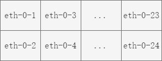

**图3-1 Interface Name**

设备支持的端口类型及数量，请参考产品spec。

### 3.1.2 配置举例

#### 配置端口状态

##### 步骤1 进入配置模式

```
Switch# configure terminal
```

##### 步骤2 打开一个端口

```
Switch(config)# interface eth-0-1
Switch(config-if)# no shutdown
```

##### 步骤3 关闭一个端口

```
Switch(config-if)# interface eth-0-2
Switch(config-if)# shutdown
```

##### 步骤4 退出配置模式

```
Switch(config-if)# end
```

##### 步骤5 检查配置

使用下列命令显示端口的状态:

```
Switch# show interface status
Port
Status
Duplex
Speed
Mode
Type
------------------------------------------------------------
eth-0-1
up
a-full
a-1000
access
1000BASE_T
eth-0-2
admin down auto
auto
access
1000BASE_T
```

#### 配置端口速率

##### 步骤1 进入配置模式

```
Switch# configure terminal
```

##### 步骤2 进入端口模式并配置速率

配置端口1 速率为100M

```
Switch(config)# interface eth-0-1
Switch(config-if)# speed 100
Switch(config-if)# no shutdown
```

配置端口2 速率为1000M

```
Switch(config-if)# interface eth-0-2
Switch(config-if)# no shutdown
Switch(config-if)# speed 1000
```

配置端口3 速率为自适应模式

```
Switch(config-if)# interface eth-0-3
Switch(config-if)# no shutdown
Switch(config-if)# speed auto
```

##### 步骤3 退出配置模式

```
Switch(config-if)# end
```

##### 步骤4 命令验证

使用下列命令，显示端口状态：

```
Switch# show interface status
Port
Status
Duplex
Speed
Mode
Type
------------------------------------------------------------
```

```
eth-0-1
up
a-full
100
access
1000BASE_T
eth-0-2
up
a-full
1000
access
1000BASE_T
eth-0-3
up
a-full
a-1000
access
1000BASE_T
```

#### 配置接口duplex

设置端口的双工模式时存在三种情况：

当需要端口在发送数据包的同时可以接收数据包时，可以将端口设置为全双工

（full）属性。

当需要端口同一时刻只能发送数据包或接收数据包时，可以将端口设置为半双工

（half）属性。

当需要端口的双工属性由本端接口和对端接口自动协商决定时，可以将端口设置为自协商（auto）属性。

用户可以根据实际组网情况选择端口的双工模式。

##### 步骤1 进入配置模式

```
Switch# configure terminal
```

##### 步骤2 进入端口模式并配置duplex

配置端口1 为全双工

```
Switch(config)# interface eth-0-1
Switch(config-if)# no shutdown
Switch(config-if)# duplex full
```

配置端口2 为半双工

```
Switch(config-if)# interface eth-0-2
Switch(config-if)# no shutdown
Switch(config-if)# duplex half
```

配置端口3 为自适应

```
Switch(config)# interface eth-0-3
Switch(config-if)# no shutdown
Switch(config-if)# duplex auto
```

##### 步骤3 退出配置模式

```
Switch(config-if)# end
```

##### 步骤4 命令验证

使用下列命令，显示端口状态：

```
Switch# show interface status
Port
Status
Duplex
Speed
Mode
Type
------------------------------------------------------------
eth-0-1
up
full
a-1000
access
1000BASE_T
eth-0-2
up
half
a-100
access
1000BASE_T
eth-0-3
up
a-full
a-1000
access
1000BASE_T
```

## 3.2 接口组速率配置

### 3.2.1 概述

#### 简介

对于接口组中的接口，任一接口配置完速率模式后，同一接口组内的所有接口都会被配置相同的速率。

### 3.2.2 配置举例

#### 查看端口的组ID 信息

设置接口组端口速率时需要知道哪些端口属于接口组，哪些端口是在一个接口组内；不属于接口组内的端口需要使用speed 命令设置端口的速率模式，属于接口组内的端口需要使用group-speed 命令设置端口的速率模式。

如果端口group-id 等于0，表示端口不属于接口组，不等于0 表示端口属于接口组，group-id 相等的端口则属于同一接口组。

##### 步骤1 显示端口接口组信息

使用下列命令，显示端口接口组信息：

```
Switch# show group-id info
Group Id
Member Ports
-----------+--------------------
0
eth-0-1
eth-0-2
eth-0-3
eth-0-4
eth-0-5
eth-0-6
eth-0-7
eth-0-8
eth-0-9
eth-0-10
eth-0-11
eth-0-12
eth-0-13
eth-0-14
eth-0-15
eth-0-16
eth-0-17
eth-0-18
eth-0-19
eth-0-20
eth-0-21
eth-0-22
eth-0-23
eth-0-24
eth-0-25
eth-0-26
eth-0-27
eth-0-28
eth-0-29
eth-0-30
eth-0-31
eth-0-32
eth-0-33
eth-0-34
eth-0-35
eth-0-36
eth-0-37
eth-0-38
eth-0-39
eth-0-40
eth-0-41
eth-0-42
eth-0-43
eth-0-44
eth-0-45
eth-0-46
eth-0-47
eth-0-48
----------------------------------
1
eth-0-49
eth-0-50
```

```
eth-0-51
eth-0-52
Switch#
```

##### 步骤2 配置接口组速率

```
Switch# configure terminal
Switch(config)# interface eth-0-49
Switch(config-if)# group-speed 1000
% Warning: Speed of Port eth-0-49, eth-0-50, eth-0-51, eth-0-52 will all be switched to 1000M after entering
this CLI
```

## 3.3 三层接口配置

### 3.3.1 概述

#### 简介

系统支持3 种类型的三层接口：

VLAN 接口：具有三层特性的逻辑接口，通过配置VLANIF 接口的IP 地址，实现Vlan间互访。VLAN 接口可以被创建和删除。

路由端口：使用no switchport 将物理端口切换为路由端口。

三层link aggregation 端口：链路聚合接口，由路由端口组成。

三层子接口：在一个物理接口或者链路聚合接口上配置出来的虚拟接口，用于在一个接口上实现VLAN 间的设备通信。

每一个三层接口都至少会拥有一个IP 地址，所有三层接口都需要一个IP 地址进行路由，此文档描述如何配置三层接口，以及如何分配一个IP 地址到接口。

### 3.3.2 配置举例

#### 配置路由端口

##### 步骤1 进入配置模式

```
Switch# configure terminal
```

##### 步骤2 进入端口配置模式并设置三层接口、配置IP 地址

```
Switch(config)# interface eth-0-1
Switch(config-if)# no switchport
Switch(config-if)# no shutdown
Switch(config-if)# ip address 1.1.1.1/24
```

##### 步骤3 退出配置模式

```
Switch(config-if)# end
```

##### 步骤4 检查配置

使用下列命令，显示端口摘要信息：

```
Switch# show ip interface brief
Interface
IP-Address
Status
Protocol
eth-0-1
1.1.1.1
up
up
Switch# show ip interface
Interface eth-0-1
Interface current state: UP
Internet address(es):
1.1.1.1/24 broadcast 1.1.1.255
Joined group address(es):
224.0.0.1
The maximum transmit unit is 1500 bytes
ICMP error messages limited to one every 1000 milliseconds
ICMP redirects are always sent
ICMP unreachables are always sent
ICMP mask replies are always sent
ARP timeout 01:00:00,
ARP retry interval 1s
VRRP master of:
VRRP is not configured on this interface
```

#### 配置VLAN 端口

在一个以太网接口上可以配置多个虚拟VLAN 接口，一旦创建，任何VLAN 接口和物理接口功能相同，它们可以像任何物理接口一样进行配置和显示。动态路由协议，如：RIP、OSPF 和BGP，都可以在整个网络使用VLAN 接口。

##### 步骤1 进入配置模式

```
Switch# configure terminal
```

##### 步骤2 进入vlan 模式创建一个vlan

```
Switch(config)# vlan database
Switch(config-vlan)# vlan 10
Switch(config-vlan)# exit
```

##### 步骤3 进入端口配置模式并设置二层端口属性

```
Switch(config)# interface eth-0-2
Switch(config-if)# switchport mode trunk
Switch(config-if)# switchport trunk allowed vlan all
Switch(config-if)# no shutdown
Switch(config-if)# exit
```

##### 步骤4 进入vlan 接口模式，配置IP 地址

```
Switch(config)# interface vlan10
Switch(config-if)# ip address 2.2.2.2/24
```

##### 步骤5 退出配置模式

```
Switch(config-if)# end
```

##### 步骤6 检查配置

使用下列命令，显示端口摘要信息：

```
Switch# show ip interface brief
Interface
IP-Address
Status
Protocol
vlan10
2.2.2.2
up
up
```

```
Switch# show ip interface
Interface vlan10
Interface current state: UP
Internet address(es):
2.2.2.2/24 broadcast 2.2.2.255
Joined group address(es):
224.0.0.1
The maximum transmit unit is 1500 bytes
ICMP error messages limited to one every 1000 milliseconds
ICMP redirects are always sent
ICMP redirects are always sent
ICMP unreachables are always sent
ICMP mask replies are always sent
ARP timeout 01:00:00,
ARP retry interval 1s
VRRP master of :
VRRP is not configured on this interface
```

#### 配置三层子接口

##### 步骤1 进入配置模式

```
Switch# configure terminal
```

##### 步骤2 进入端口配置模式并设置三层接口

```
Switch(config)# interface eth-0-1
Switch(config-if)# no switchport
Switch(config-if)# no shutdown
Switch(config-if)# exit
```

##### 步骤3 创建三层子接口、配置终结vlan，设置ip 地址，使能统计

```
Switch(config)# interface eth-0-1.1
Switch(config-if)# dot1q termination vid 5
Switch(config-if)# ip address 2.2.2.2/24
Switch(config-if)# statistic enable both
Switch(config-if)# exit
```

##### 步骤4 退出配置模式

```
Switch(config)# end
```

##### 步骤5 检查配置

使用下列命令，显示三层子接口信息：

```
Switch# show ip interface brief
Interface
IP-Address
Status
Protocol
eth-0-1.1
2.2.2.2
up
up
Switch# show interface eth-0-1.1
Interface eth-0-1.1
Interface current state: UP
Hardware is Subif, address is 98a4.a56e.ef00 (bia 98a4.a56e.ef00)
Index 12288 , Metric 1 , Encapsulation ARPA
The maximum transmit unit (MTU) is 1500 bytes
VRF binding: not bound
VRRP master of :
VRRP is not configured on this interface
ARP timeout 01:00:00,
ARP retry interval 1s
```

```
ARP Proxy is disabled, Local ARP Proxy is disabled
5 minute input rate 0 bits/sec, 0 packets/sec
5 minute output rate 0 bits/sec, 0 packets/sec
0 packets input, 0 bytes
0 packets output, 0 bytes
```

## 3.4 接口 Errdisable配置

### 3.4.1 概述

#### 简介

Errdisable 是一种自动保护机制，它通过关闭异常的接口来保护整个系统。当接口出现异常事件时，为了防止产生更严重的后果，Errdisable 可以自动将该异常接口置为关闭状态。

同时，Errdisable 支持自动恢复，可以通过配置恢复等待时间，让进入Errdisable 状态的接口在指定时间后恢复；也可以通过命令行强制恢复。

#### 原理描述

##### 术语和定义

Errdisable 状态：接口因为异常事件而被Errdisable 功能置为关闭状态，在本指导手册中简称为Errdisable 状态。

Errdisable 原因：触发Errdisable 状态的异常事件，称为Errdisable 原因。常见原因见下表描述:

**表3-1 Errdisable Reason 说明**

| Reason | 说明 |
|---|---|
| bpduguard | stp edge port 收到bpdu |
| bpduloop | 收到本端口发出的bpdu |
| link-monitor-failure | 检测到efm 越限事件 |
| oam-remote-failure | 检测到efm 故障事件 |
| port-security | 指定action 为errdisable，收到非安全mac 报文<br>后触发 |
| link-flap | 接口状态up/down 来回切换，反复震荡 |
| monitor-link | 上联口down 后，关联的下联口置为errdisable |
| udld | 检测到接口单通故障后触发 |
| fdb-loop | MAC 地址漂移 |
| loopback-detection | 指定action 为errdisable，检测到环路后触发 |
| reload-delay | mlag 等环境，为了防止设备刚重启出现环路，将<br>所有非互联口errdisable |
| dual-active-conflict | 堆叠环境双活检测 |

### 3.4.2 配置举例

#### 配置Errdisable 检测

##### 步骤1 进入配置模式

```
Switch# configure terminal
```

##### 步骤2 使能检测链路震荡errdisable

```
Switch(config)# errdisable detect reason link-flap
```

##### 步骤3 退出配置模式

```
Switch(config)# end
```

##### 步骤4 检查配置

使用下列命令，显示error disable 检查的配置：

```
Switch# show errdisable detect
ErrDisable Reason
Detection status
-----------------
----------------
bpduguard
Enabled
bpduloop
Enabled
link-monitor-failure
Enabled
oam-remote-failure
Enabled
port-security
Enabled
link-flap
Enabled
monitor-link
Enabled
udld
Disabled
fdb-loop
Disabled
loopback-detection
Enabled
reload-delay
Enabled
```

说明：如上显示，Detection status 为Enable 的项表示满足触发条件后，会因为这个Reason 将接口置为Errdisable 状态；Detection status 为Disable 的项表示即使满足触发条件，接口也不会置为Errdisable 状态。

以上所有Reason 的状态都是可配置的。

#### 配置Errdisable 恢复

##### 步骤1 进入配置模式

```
Switch# configure terminal
```

##### 步骤2 选择一个reason 使能自动恢复，并设置恢复时长

```
Switch(config)# errdisable recovery reason link-flap
Switch(config)# errdisable recovery interval 30
```

##### 步骤3 退出配置模式

```
Switch(config)# end
```

##### 步骤4 检查配置

使用下列命令，显示Errdisable 自动恢复配置：

```
Switch# show errdisable recovery
ErrDisable Reason
Timer Status
-----------------
--------------
bpduguard
Disabled
bpduloop
Disabled
link-monitor-failure
Disabled
oam-remote-failure
Disabled
port-security
Disabled
link-flap
Enabled
udld
Disabled
fdb-loop
Disabled
loopback-detection
Disabled
Timer interval: 30 seconds
```

说明：接口进入Errdisable 状态后，有两种方式恢复：

使用errdisable recovery reason 命令使能定时恢复，这样接口可以在设定的时间之后，从errdisable 状态自动恢复到正常状态。通过errdisable recovery interval 命令，可以配置自动恢复的等待时间（建议恢复时间不小于60s）。通过show errdisable recovery 命令可以显示接口被置为Erridsable 的原因，同时显示哪些原因使能了自动恢复。需要注意：如果接口已经被置为errdisable 状态，之后再使能errdisable recovery，配置不会生效，接口将无法自动恢复，会一直处在errdisable 状态。

在接口视图下使用”no shutdown”命令强制恢复。需要注意，Errdisable 触发都是由于网络存在异常，如果异常没有解决，即使使用命令强制将接口恢复，之后仍然会再次触发Errdisable；所以需要去定位触发Errdisable 的根本原因。

#### 配置Errdisable 链路震荡抑制功能

##### 步骤1 进入配置模式

```
Switch# configure terminal
```

##### 步骤2 设置链路抖动的条件

为避免端口频繁的关闭/打开，可以设置链路震荡触发errdisable 的条件，例如60 秒内震荡20 次，才能触发errdisable。

```
Switch(config)# errdisable flap reason link-flap 20 60
```

##### 步骤3 退出配置模式

```
Switch(config)# end
```

##### 步骤4 检查配置

使用下列命令，显示Errdisable 链路震荡抑制的配置：

```
Switch# show errdisable flap
ErrDisable Reason
Flaps
Time (sec)
-----------------
------
----------
link-flap
20
60
```

#### 检查Errdisable 状态

管理员可以通过两种命令来检查接口errdisable 状态。

##### 1. show errdisable recovery

如果errdisable 使能了自动恢复，将显示恢复所剩时间。

如下显示，eth-0-3，Errdisable 原因为link-flap，还有25 秒恢复：

```
Switch# show errdisable recovery
ErrDisable Reason
Timer Status
-----------------
--------------
bpduguard
Disabled
bpduloop
Disabled
link-monitor-failure
Disabled
oam-remote-failure
Disabled
port-security
Disabled
link-flap
Enabled
udld
Disabled
fdb-loop
Disabled
loopback-detection
Disabled
Timer interval: 300 seconds
Interfaces that will be enabled at the next timeout:
Interface Errdisable Reason Time Left(sec)
--------- ----------------- --------------
eth-0-3
link-flap
25
```

如果errdisable 没有使能了自动恢复，显示如下：

```
Switch# show errdisable recovery
ErrDisable Reason
Timer Status
-----------------
--------------
bpduguard
Disabled
bpduloop
Disabled
link-monitor-failure
Disabled
oam-remote-failure
Disabled
port-security
Disabled
link-flap
Disabled
udld
Disabled
fdb-loop
Disabled
loopback-detection
Disabled
Timer interval: 300 seconds
```

##### 2. 使用”show interface status”命令查看接口的errdisable 状态

```
Switch# show interface status
Port
Status
Duplex
Speed
Mode
Type
Description
-----------------------------------------------------------------------------
eth-0-1
up
a-full
a-1000
TRUNK
1000BASE_SX
eth-0-2
down
auto
auto
TRUNK
Unknown
eth-0-3
errdisable a-full
a-1000
TRUNK
1000BASE_SX
eth-0-4
down
auto
auto
ACCESS
Unknown
```

### 3.4.3 常见问题

下面以fdb-loop 和link-flap 两种异常事件，详细解析一下Errdisable 产生的原因，以及排查方法。

#### MAC 地址漂移(fdb-loop)

fdb-loop 表示MAC 地址漂移：交换机学习MAC 地址的时候，将该报文的源MAC 地址、所属VLAN、收到报文的接口，这些信息一起记录到MAC 地址表中。如果同一VLAN、同一源MAC 地址的流量，持续从不同的接口收到，则MAC 地址表中对应的接口会持续变化学习，这种现象称作fdb-loop（MAC 地址漂移）。fdb-loop 会造成流量错误转发，网络风暴等问题，属于一种网络异常。

fdb-loop 多由于流量环回造成，最常见的便是网络中出现环路时，BUM 流量被环路循环转发，出现持续fdb-loop 现象。交换机会在一段时间内检测fdb-loop 的次数，超过预设值则认为fdb-loop 触发Errdisable 的条件达成，如果此时show errdisable detect中fdb-loop 的状态是Enable，则会随机将fdb-loop 的其中一个接口置为Errdisable状态；如果状态是Disable，则只会打印告警日志，不会采取其他行为，接口不会被置为Errdisable。

fdb-loop 可能原因分析：

网络中存在网线误接或组网错误形成环网网络中大量虚拟机迁移网络中有非法流量，如非法用户进行MAC 地址攻击等网络中有不同的物理设备，如测试仪、物理机等，发出携带相同源MAC、VLAN 的流量默认配置下，errdisable 保护fdb-loop 是不使能的，是为了防止Errdisable 上联口造成更大的业务故障，如要修改为Enable，可以考虑在接口下配置errdisable fdb-loop trust，该接口永远不会因为fdb-loop 被置为Errdisable 状态。一般用该命令来保护不期望被Errdisable 的关键业务接口，如业务上行口等。

#### 链路震荡(link-flap)

link-flap 表示接口状态up/down 来回切换，反复震荡。link-flap 会造成业务的中断，一个常见的场景是，主链路down 了业务应该切到备链路上，如果主链路link-flap，就会导致主备反复切换，业务受影响。为了防止这种不稳定的状态，交换机会检测link-flap 的频率，一定时间内震荡次数超过预设值，则认为link-flap 触发Errdisable的条件达成，如果此时show errdisable detect 中link-flap 的状态是Enable，则会将该接口置为Errdisable 状态；如果状态是Disable，则只会打印告警日志，不会采取其他行为，接口不会被置为Errdisable。

link-flap 多由于物理因素造成，比如网线、DAC、光纤、光模块等物理介质问题，中间波分设备倒换等等。默认情况下Errdisable 保护link-flap 是使能的，不建议用户更改。

## 3.5 MAC 表配置

### 3.5.1 概述

#### 简介

MAC 地址表中包含交换机端口之间转发流量的地址信息。地址表包括地址类型如下：

动态地址：根据交换机的源地址学习，如果该地址在老化时间后未学习到，进入老化状态。我们只支持IVL 的学习模式。

静态地址：由管理员手动添加源地址。

以下是用来形容MAC 地址表中的术语和概念的简要描述：

IVL：独立VLAN 学习：对于一个给定的VLAN，如果某个特定的MAC 地址是在一个VLAN 学习的，它不能被作为任何其他VLAN 地址转发决策。

SVL：共享VLAN 学习：对于一个给定的VLAN，如果某个特定的MAC 地址是在一个VLAN 中学习的，它可以作为任何其他VLAN 地址转发决策。

参考：IEEE 802.1D，IEEE 802.1Q

### 3.5.2 配置举例

#### 地址老化时间配置

##### 1. 组网拓扑


**图3-2 Mac address aging**

老化时间不是精确的时间。如果老化时间设置为N，动态地址将在N - 2N 间隔后老化。

默认的老化时间为300 秒。

##### 2. 配置步骤

##### 步骤1 进入配置模式

```
Switch# configure terminal
```

##### 步骤2 设置动态地址老化时间

```
Switch(config)# mac-address-table aging-time 10
```

##### 步骤3 退出配置模式

```
Switch(config)# end
```

##### 步骤4 检查配置

使用下列命令，显示动态地址老化时间：

```
Switch# show mac address-table aging-time
MAC address table aging time is 10 seconds
```

#### 静态单播地址配置

##### 1. 组网拓扑

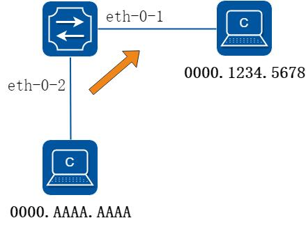

**图3-3 Static mac address table**

单播地址表只能绑定在一个端口上.如图所示，mac-da 0000.1234.5678 转发出口为eth-0-1。

##### 2. 配置步骤

##### 步骤1 进入配置模式

```
Switch# configure terminal
```

##### 步骤2 配置静态mac 地址表

```
Switch(config)# mac-address-table 0000.1234.5678 forward eth-0-1 vlan 1
```

##### 步骤3 退出配置模式

```
Switch(config)# end
```

##### 步骤4 检查配置

使用下列命令查看mac 地址表：

```
Switch# show mac address-table
Mac Address Table
-------------------------------------------
(*) - Security Entry
Vlan
Mac Address
Type
Ports
----
--------------
-------
--------
1
0000.1234.5678
static
eth-0-1
```

#### 静态组播地址配置

##### 1. 组网拓扑

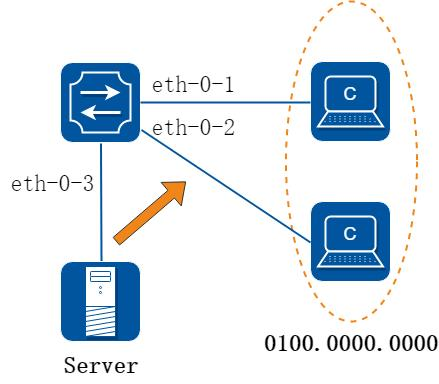

**图3-4 Static multicast mac address table**

组播地址可以绑定在多个端口上。如图所示，eth-0-1 和eth-0-2 都加入了mac 地址为

0100.0000.0000 的组播。

##### 2. 配置步骤

##### 步骤1 进入配置模式

```
Switch# configure terminal
```

##### 步骤2 配置静态组播mac 地址表

```
Switch(config)# mac-address-table 0100.0000.0000 forward eth-0-1 vlan 1
Switch(config)# mac-address-table 0100.0000.0000 forward eth-0-2 vlan 1
```

##### 步骤3 退出配置模式

```
Switch(config)# end
```

##### 步骤4 检查配置

使用下列命令查看mac 地址表：

```
Switch# show mac address-table
Mac Address Table
-------------------------------------------
(*) - Security Entry
Vlan
Mac Address
Type
Ports
----
--------------
-------
-------
1
0100.0000.0000
static
eth-0-1
eth-0-2
```

#### MAC 地址过滤配置

##### 1. 组网拓扑

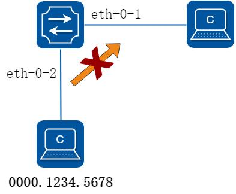

**图3-5 mac address filter**

MAC 过滤会丢弃那些源或目的地址设置为丢弃数据帧。MAC 过滤的优先级高于MAC 地址。

##### 2. 配置步骤

##### 步骤1 进入配置模式

```
Switch# configure terminal
```

##### 步骤2 配置需要丢弃的mac 地址表

```
Switch(config)# mac-address-table 0000.1234.5678 discard
```

##### 步骤3 退出配置模式

```
Switch(config)# end
```

##### 步骤4 检查配置

使用下列命令查看mac 地址过滤表：

```
Switch# show mac-filter address-table
MAC Filter Address Table
----------------------------------
Current count
: 1
Max count
: 128
Left count
: 127
Filter address list :
----------------------------------
0000.1234.5678
```

#### 指定VLAN 的MAC 地址过滤配置

##### 1. 组网拓扑

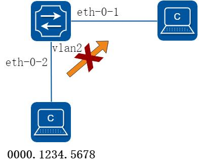

**图3-6 mac address filter with VLAN**

MAC 过滤会丢弃那些源或目的地址匹配设置的MAC，并且VLAN 也匹配的数据帧。MAC 过滤的优先级高于MAC 地址。

##### 2. 配置步骤

##### 步骤1 进入配置模式

```
Switch# configure terminal
```

##### 步骤2 创建VLAN

```
Switch(config)# vlan 2
```

##### 步骤3 退出VLAN 视图

```
Switch(config-vlan)# exit
```

##### 步骤4 配置需要丢弃的mac 地址表

```
Switch(config)# mac-address-table 0000.1234.5678 discard vlan 2
```

##### 步骤5 退出配置模式

```
Switch(config)# end
```

##### 步骤6 检查配置

使用下列命令查看指定VLAN 的mac 地址过滤表：

```
Switch# show mac address-table blackhole
Mac Address Table
-------------------------------------------
(*)
- Security Entry
(M)
- MLAG Entry
(MO) - MLAG Output Entry
(MI) - MLAG Input Entry
(E)
- EVPN Entry
(EO) - EVPN Output Entry
(EI) - EVPN Input Entry
Vlan
Mac Address
Type
Ports
----
-----------
--------
-----
2
0000.1234.5678
blackhole
drop
```

## 3.6 VLAN配置

### 3.6.1 概述

#### 简介

VLAN（虚拟局域网）是一个逻辑上分割成不同广播域的网络，使数据包只能在被指定为同一个VLAN 的端口之间进行交换。每个VLAN 都被视为一个逻辑网络，目的地不属于同一个VLAN 的数据包必须通过路由转发。

参考IEEE 802.1Q

#### 原理描述

根据以下术语来描述VLAN：

VID：VLAN 标识符LAN：本地局域网VLAN：虚拟局域网PVID：Port Vlan ID，也就是端口的虚拟局域网ID 号，关系到端口收发数据帧时的VLAN TAG 标记Tagged Frame：带有4 字节的VLAN 标签，如下图所示：

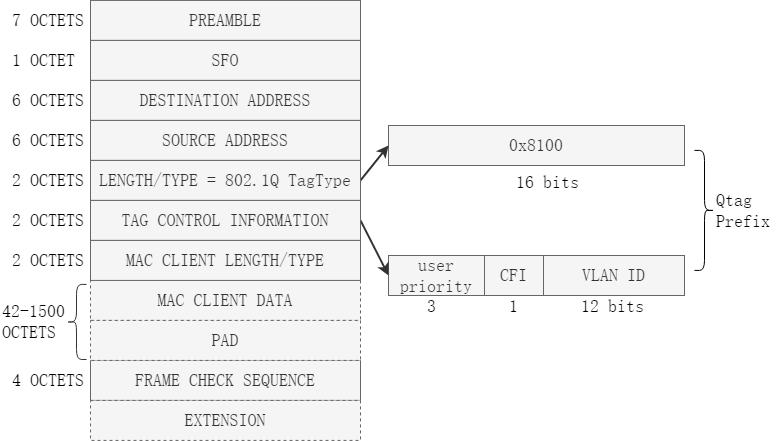

**图3-7 带有VLAN 标签的报文**

Trunk 链路：带TAG 帧和不带TAG 帧都可以在此链路上传输，Trunk 允许多个VLAN 在链路上转发，具体如下图所示：

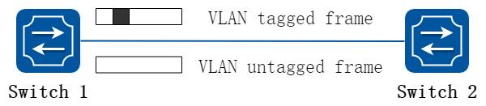

**图3-8 Trunk 链路**

Access 链路：只有不带TAG 的帧能通过ACCESS 链路，Access 链路只能连接网络的边缘,也就是所谓的工作站，具体如下图所示：

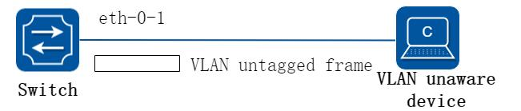

**图3-9 Access 链路**

### 3.6.2 配置举例

#### 配置Access 端口

##### 1. 组网拓扑


**图3-10 Access 链路**

Access 端口只接收未标记的帧，传输不带TAG 的帧。

##### 2. 配置步骤

##### 步骤1 进入配置模式

```
Switch# configure terminal
```

##### 步骤2 进入vlan 配置模式并创建vlan

```
Switch(config)# vlan database
Switch(config-vlan)# vlan 2
Switch(config-vlan)# exit
```

##### 步骤3 进入端口模式设置端口模式并指定相应的vlan

```
Switch(config)# interface eth-0-1
Switch(config-if)# switchport mode access
Switch(config-if)# switchport access vlan 2
```

##### 步骤4 退出配置模式

```
Switch(config-if)# end
```

##### 步骤5 检查配置

使用下列命令显示交换机接口的信息：

```
Switch# show interface switchport interface eth-0-1
Interface name
: eth-0-1
Switchport mode
: access
Ingress filter
: enable
Acceptable frame types
: vlan-untagged only
Default Vlan
: 2
Configured Vlans
:
2
```

使用下列命令显示vlan 的简要配置信息：

```
Switch# show vlan brief
VLAN ID
Name
State
STP ID
Member ports
(u)-Untagged, (t)-Tagged
======= ================ ======= =======
========================
1
default
ACTIVE
0
eth-0-2(u) eth-0-3(u)
eth-0-4(u) eth-0-5(u)
eth-0-6(u) eth-0-7(u)
eth-0-8(u) eth-0-9(u)
eth-0-10(u) eth-0-11(u)
eth-0-12(u) eth-0-13(u)
eth-0-14(u) eth-0-15(u)
eth-0-16(u) eth-0-17(u)
eth-0-18(u) eth-0-19(u)
eth-0-20(u) eth-0-21(u)
eth-0-22(u) eth-0-23(u)
2
VLAN0002
ACTIVE
0
eth-0-1(u)
```

#### Trunk 端口配置

Trunk 端口能接收标记、无标记的、优先级标记的帧，并发送未标记和标记的帧。如果端口收到一个未标记的帧，此帧将分配端口的PVID 为VLAN ID；如果一个帧的VID 与端口的PVID 相等，此帧发送时会剥掉VLAN 标签。

##### 1. 组网拓扑

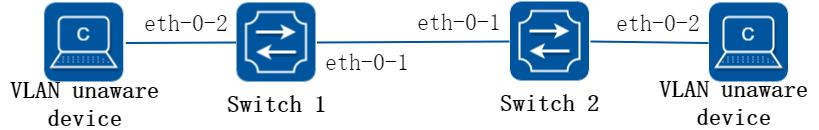

**图3-11 Trunk 链路**

组网如上拓扑所示。

以下配置步骤，Switch1 和Switch2 相同。

##### 2. 配置步骤

##### 步骤1 进入配置模式

```
Switch# configure terminal
```

##### 步骤2 进入vlan 配置模式并创建vlan

```
Switch(config)# vlan database
Switch(config-vlan)# vlan 10,20,30
Switch(config-vlan)# exit
```

##### 步骤3 进入端口模式设置端口模式并指定相应的vlan

eth-0-1 本地vlan 为10，允许所有vlan 通过

```
Switch(config)# interface eth-0-1
Switch(config-if)# switchport mode trunk
Switch(config-if)# switchport trunk allowed vlan all
Switch(config-if)# switchport trunk native vlan 10
Switch(config-if)# exit
```

eth-0-2 为access 模式，加入vlan 10

```
Switch(config)# interface eth-0-2
Switch(config-if)# switchport mode access
Switch(config-if)# switchport access vlan 10
Switch(config-if)# exit
```

##### 步骤4 在端口上剥除特定VLAN (可选)

当接口用于连接主机时，由于主机不能处理带VLAN Tag 的帧，所以必须配置接口发送Untagged 帧给主机。使用switchport trunk untagged vlan 命令，让接口在发送帧时将帧中的VLAN Tag 去掉。

下面的例子在interface eth-0-1 上剥掉VLAN 30.

```
Switch(config)# interface eth-0-1
Switch(config-if)# switchport trunk untagged
vlan 30
Switch(config-if)# exit
```

##### 步骤5 退出配置模式

```
Switch(config-if)# end
```

##### 步骤6 检查配置

使用下列命令显示交换机接口的信息：

```
Switch# show interface switchport
Interface name
: eth-0-1
Switchport mode
: trunk
Ingress filter
: enable
Acceptable frame types
: all
Default Vlan
: 10
Configured Vlans
: 1
10
20
30
Interface name
: eth-0-2
Switchport mode
: access
Ingress filter
: enable
Acceptable frame types
: vlan-untagged only
Default Vlan
: 10
Configured Vlans
: 10
```

使用下列命令显示vlan 的简要配置信息：

```
Switch# show vlan brief
VLAN ID
Name
State
STP ID
Member ports
(u)-Untagged, (t)-Tagged
```

```
======= ================ ======= =======
========================
1
default
ACTIVE
0
eth-0-1(t) eth-0-3(u)
eth-0-4(u) eth-0-5(u)
eth-0-6(u) eth-0-7(u)
eth-0-8(u) eth-0-9(u)
eth-0-10(u) eth-0-11(u)
eth-0-12(u) eth-0-13(u)
eth-0-14(u) eth-0-15(u)
eth-0-16(u) eth-0-17(u)
eth-0-18(u) eth-0-19(u)
eth-0-20(u) eth-0-21(u)
eth-0-22(u) eth-0-23(u)
10
VLAN0010
ACTIVE
0
eth-0-1(t) eth-0-2(u)
20
VLAN0020
ACTIVE
0
eth-0-1(t)
30
VLAN0030
ACTIVE
0
eth-0-1(t)
```

## 3.7 Voice VLAN配置

### 3.7.1 概述

#### 简介

随着语音技术的日益发展，IP 电话、IAD（Integrated Access Device，综合接入设备）

应用越来越广泛，尤其在宽带小区，网络中经常同时存在语音数据和业务数据两种流量。

语音数据在传输时需要具有比业务数据更高的优先级，以减少传输过程中可能产生的时延和丢包现象。

提高语音数据传输优先级的传统处理方法是使用ACL 对语音数据进行区分，并使用QoS保证传输质量。为简化用户配置、更方便的管理语音流的传输策略，设备机提供了Voice VLAN 功能。Voice VLAN 的主要特点就是可以通过报文的源MAC 地址自动识别出语音流量，保证语音流量传输。

### 3.7.2 配置举例

##### 步骤1 进入配置模式

```
Switch# configure terminal
```

##### 步骤2 进入vlan 配置模式并创建vlan

```
Switch(config)# vlan database
Switch(config-vlan)# vlan 2
Switch(config-vlan)# exit
```

##### 步骤3 设置voice vlan 的cos 值（可选）

默认值是5。

```
Switch(config)# voice vlan set cos to 7
```

##### 步骤4 指定voice vlan，添加voice vlan 的mac 条目

```
Switch(config)# voice vlan 2
Switch(config)# voice vlan mac-address 0055.0000.0000 ffff.ff00.0000 description test
```

##### 步骤5 进入端口配置模式，配置端口属性并启用voice vlan

```
Switch(config)# interface eth-0-1
Switch(config-if)# switchport mode trunk
Switch(config-if)# switchport trunk allowed vlan all
Switch(config-if)# voice vlan enable
Switch(config-if)# interface eth-0-2
Switch(config-if)# switchport mode trunk
Switch(config-if)# switchport trunk allowed vlan all
```

##### 步骤6 检查配置

向eth-0-1 发送报文，报文格式为（Vlan tag 字段当中的priority 为0）：

```
0x0000:
0000 0a02 0001 0055 0000 0011 8100 0002
........k.......
0x0010:
0800 aadd aadd aadd aadd aadd aadd aadd
................
0x0020:
aadd aadd aadd aadd aadd aadd aadd aadd
................
0x0030:
aadd aadd aadd aadd aadd aadd
............
```

在eth-0-2 接收报文，收到报文的格式为（vlan tag 字段当中的priority 被修改为了

5）：

```
0x0000:
0000 0a02 0001 0055 0000 0011 8100 a002
........k.......
0x0010:
0800 aadd aadd aadd aadd aadd aadd aadd
................
0x0020:
aadd aadd aadd aadd aadd aadd aadd aadd
................
0x0030:
aadd aadd aadd aadd aadd aadd
............
```

## 3.8 VLAN 划分配置

### 3.8.1 概述

#### 简介

VLAN 分类是基于协议或子网标准的具体规则将数据包发送到选定的VLAN。每一个接口可以应用一种规则集。

VLAN 分类规则有3 种类型：基于MAC、基于IP 和基于协议的分类。基于MAC 的VLAN 分类规则是根据传入数据包的源MAC 地址将数据包进行分类；基于IP 的VLAN 分类规则将根据传入数据包的源IP 地址进行分类；基于协议的VLAN 分类规则将根据数据包的三层协议类型进行分类，以下三层类型可以支持ARP、IP（V4）、MPLS、MCAST MPLS、PPPoE协议和RARP。

不同类型的VLAN 分类规则，可以添加到同一VLAN 的分类组。只有一个VLAN 分类规则可以在一个交换机端口生效。

### 3.8.2 配置举例

##### 1. 组网拓扑

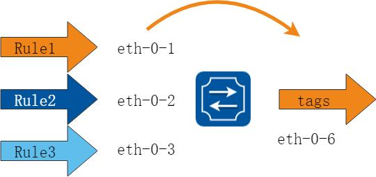

**图3-12 vlan classification**

在下面配置的例子中，创建三个VLAN 分类规则：

第1 条是基于MAC 的规则，它将源MAC 2222.2222.2222 分类到VLAN 5；

第2 条是基于IP 的规则，它将源IP 1.1.1.1 分类到VLAN 5；

第3 条是基于协议的规则，它将ARP 的协议数据包分类到VLAN 5。

把规则1，2，3 加入到组31，并且在三个接口上应用组31。在eth-0-1、eth-0-2 和eth-0-3三个接口上应用不同的分类策略。eth-0-1 基于IP 分类，意味着匹配IP 的数据包在这个接口上将转发到规则对应的VLAN。

eth-0-2 基于MAC 分类，意味着匹配MAC 地址的数据包将转发到规则对应的VLAN。

eth-0-3 基于协议的分类，意味着匹配协议的数据包将转发到规则对应的VLAN。

##### 2. 配置步骤

##### 步骤1 进入配置模式

```
Switch# configure terminal
```

##### 步骤2 进入vlan 配置模式并创建vlan

```
Switch(config)# vlan database
Switch(config-vlan)# vlan 5
Switch(config-vlan)# vlan 6
Switch(config-vlan)# exit
```

##### 步骤3 创建分类规则，并把规则加到组里

```
Switch(config)# vlan classifier rule 1 mac 2222.2222.2222 vlan 5
Switch(config)# vlan classifier rule 2 ip 1.1.1.1 vlan 5
Switch(config)# vlan classifier rule 3 protocol arp vlan 5
Switch(config)# vlan classifier group 31 add rule 1
Switch(config)# vlan classifier group 31 add rule 2
Switch(config)# vlan classifier group 31 add rule 3
```

##### 步骤4 在端口应用

端口eth-0-1：

```
Switch(config)# interface eth-0-1
Switch(config-if)# switchport access vlan 6
Switch(config-if)# switchport access allowed vlan add 5
Switch(config-if)# vlan classifier activate 31 based ip
Switch(config-if)# exit
```

端口eth-0-2：

```
Switch(config)# interface eth-0-2
Switch(config-if)# switchport access vlan 6
Switch(config-if)# switchport access allowed vlan add 5
Switch(config-if)# vlan classifier activate 31 based mac
Switch(config-if)# exit
```

端口eth-0-3：

```
Switch(config)# interface eth-0-3
Switch(config-if)# switchport access vlan 6
Switch(config-if)# switchport access allowed vlan add 5
Switch(config-if)# vlan classifier activate 31 based protocol
Switch(config-if)# exit
```

端口eth-0-6：

```
Switch(config)# interface eth-0-6
Switch(config)#switchport mode trunk
Switch(config-if)# switchport trunk allowed vlan add 5
Switch(config-if)# exit
```

##### 步骤5 退出配置模式

```
Switch(config)# end
```

##### 步骤6 检查配置

验证VLAN 分类规则：

```
Switch# show vlan classifier rule
vlan classifier rule 1 mac 2222.2222.2222 vlan 5
vlan classifier rule 2 ip 1.1.1.1 vlan 5
vlan classifier rule 3 protocol arp vlan 5
```

验证VLAN 分类规则组：

```
Switch# show vlan classifier group
vlan classifier group 31 add rule 1
vlan classifier group 31 add rule 2
vlan classifier group 31 add rule 3
```

验证VLAN 分类规则接口应用：

```
Switch# show vlan classifier interface grou
vlan classifier group 31 on interface eth-0-2, based mac
vlan classifier group 31 on interface eth-0-1, based ip
vlan classifier group 31 on interface eth-0-3, based protocol
```

## 3.9 VLAN 映射配置

### 3.9.1 概述

#### 简介

服务供应商的业务客户往往有特定的VLAN ID 的要求，同一个网络服务提供商的不同客户的要求的VLAN 可能会重叠，并且通过服务商设备的用户流量也可能会混合。通过给每一个客户分配不同的VLAN ID 来映射自己的VLAN ID，能够将不同应用的客户的通讯相分开。

使用VLAN 转换功能，服务提供商可以使用一系列的VLAN 来服务拥有自己VLAN ID 的客户。客户VLAN ID 被转换，来自不同应用的客户的流量在服务提供商的设备上被分开，甚至当他们出现在同一VLAN。

QinQ 技术通过在以太帧中堆叠两个802.1Q 包头，有效地扩展了VLAN 数目，使VLAN 的数目最多可达4096 × 4096 个。同时，多个VLAN 能够被复用到一个核心VLAN 中。ISP通常为每个客户建立一个VLAN 模型，用通用属性注册协议/通用VLAN 注册协议

（GARP/GVRP）自动监控整个主干网络的VLAN，并通过扩展生成树协议（STP）来加快网络收敛速度，从而为网络提供弹性。QinQ 技术作为初始的解决方案是不错的，但随着用户数量的增加，SVLAN 模型也会带来可扩展性的问题。因为有些用户可能希望在分支机构间进行数据传输时可以携带自己的VLAN ID，这就使采用QinQ 技术的MSP 面临以下两个问题：第一，第一名客户的VLAN 标识可能与其他客户冲突；第二，服务提供商将受到客户可使用标识数量的严重限制。如果允许用户按他们自己的方式使用各自的VLAN ID 空间，那么核心网络仍存在4096 个VLAN 的限制。

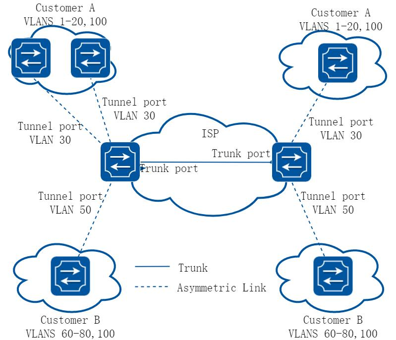

**图3-13 QinQ Tunnel**

QinQ 是指将用户私网VLAN tag 封装在公网VLAN tag 中，使报文带着两层VLAN tag 穿越骨干网络（公网）。在公网中报文只根据外层VLAN tag（即公网VLAN tag）传播，用户的私网VLAN tag 被屏蔽。这样，不仅对数据流进行了区分，而且由于私网VLAN 标签被透明传送，不同的用户VLAN 标签可以重复使用，只需要外层VLAN 标签的在公网上唯一即可，实际上也扩大了可利用的VLAN 标签数量。封装外层VLAN 标签有两种方法，一种是标准QINQ 封装，即基于端口打外层标签的，该端口下所有的用户数据统一封装一个共同的VLAN 标签，在实际应用中局限性太大，另外一种是灵活QINQ 封装方法，既可以根据一些特性对用户数据进行流分类，然后不同的类别封装不同的外层VLAN 标签。

### 3.9.2 配置举例

#### 配置VLAN 转换

##### 1. 组网拓扑

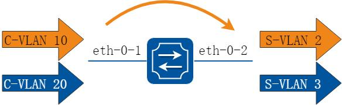

**图3-14 vlan mapping**

##### 2. 配置步骤

##### 步骤1 进入配置模式

```
Switch# configure terminal
```

##### 步骤2 进入vlan 配置模式并创建vlan

```
Switch(config)# vlan database
Switch(config-vlan)# vlan 2,3
Switch(config-vlan)# exit
```

##### 步骤3 创建EVC 并关联vlan

```
Switch(config)# ethernet evc evc_c1
Switch(config-evc)# dot1q mapped-vlan 2
Switch(config-evc)# exit
Switch(config)# ethernet evc evc_c2
Switch(config-evc)# dot1q mapped-vlan 3
Switch(config-evc)# exit
```

##### 步骤4 创建vlan mapping 表，并将vlan 映射到evc

```
Switch(config)# vlan mapping table vm
Switch(config-vlan-mapping)# raw-vlan 10 evc evc_c1
Switch(config-vlan-mapping)# raw-vlan 20 evc evc_c2
Switch(config-vlan-mapping)# exit
```

##### 步骤5 在接口使能vlan translation 并应用vlan mapping 表

```
Switch(config)# interface eth-0-1
Switch(config-if)# switchport mode trunk
```

```
Switch(config-if)# switchport trunk vlan-translation
Switch(config-if)# switchport trunk vlan-translation mapping table vm
Switch(config-if)# switchport trunk allowed vlan add 2,3
Switch(config-if)# interface eth-0-2
Switch(config-if)# switchport mode trunk
Switch(config-if)# switchport trunk allowed vlan add 2,3
Switch(config-if)# exit
```

##### 步骤6 退出配置模式

```
Switch(config)# end
```

##### 步骤7 检查配置

使用下列命令显示端口配置：

```
Switch# show interface switchport interface eth-0-1
Interface name
: eth-0-1
Switchport mode
: trunk
VLAN traslation
: enable
VLAN mapping table
: vm
Ingress filter
: enable
Acceptable frame types
: all
Default Vlan
: 1
Configured Vlans
: 1
2
3
```

使用下列命令显示vlan mapping 表：

```
Switch# show vlan mapping table
Table Name
EVC Name
Mapped VLAN Raw VLAN
================ ================
=========== =======================
vm
evc_c1
2
10
evc_c2
3
20
```

#### 配置802.1Q Tunneling （基本QinQ）

##### 1. 组网拓扑

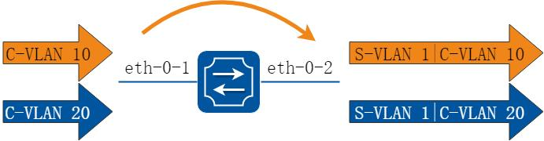

**图3-15 QinQ Tunnel**

##### 2. 配置步骤

##### 步骤1 进入配置模式

```
Switch# configure terminal
```

##### 步骤2 进入端口配置模型，配置接口为dot11 tunnel 模式

```
Switch(config)# interface eth-0-1
Switch(config-if)# no shutdown
Switch(config-if)# switchport mode dot1q-tunnel
```

##### 步骤3 退出配置模式

```
Switch(config-if)# end
```

##### 步骤4 检查配置

这个例子显示了如何配置一个基本的802.1q 隧道口的交换机端口。可用显示命令显示接口上的配置：

```
Switch# show interface switchport interface eth-0-1
Interface name
: eth-0-1
Switchport mode
: dot1q-tunnel(basic)
Ingress filter
: enable
Acceptable frame types
: all
Default Vlan
: 1
Configured Vlans
: 1
```

#### 配置802.1Q Tunneling （灵活QinQ,U-tag 报文加一层TAG）

##### 1. 组网拓扑

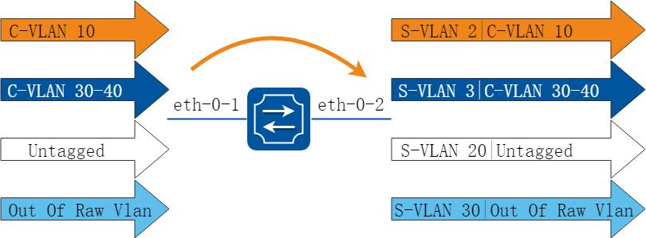

**图3-16 QinQ Tunnel**

##### 2. 配置步骤

##### 步骤1 进入配置模式

```
Switch# configure terminal
```

##### 步骤2 进入vlan 配置模式并创建vlan

```
Switch(config)# vlan database
Switch(config-vlan)# vlan 2,3,20,30
Switch(config-vlan)# exit
```

##### 步骤3 创建EVC 并关联vlan

```
Switch(config)# ethernet evc evc_c1
Switch(config-evc)# dot1q mapped-vlan 2
Switch(config)# ethernet evc evc_c2
Switch(config-evc)# dot1q mapped-vlan 3
```

```
Switch(config)# ethernet evc evc_c3
Switch(config-evc)# dot1q mapped-vlan 20
Switch(config)# ethernet evc evc_c4
Switch(config-evc)# dot1q mapped-vlan 30
Switch(config-evc)# exit
```

##### 步骤4 创建vlan mapping 表，并关联EVC

```
Switch(config)# vlan mapping table vm
Switch(config-vlan-mapping)# raw-vlan 10 evc evc_c1
Switch(config-vlan-mapping)# raw-vlan 30-40 evc evc_c2
Switch(config-vlan-mapping)# raw-vlan untagged evc evc_c3
Switch(config-vlan-mapping)# raw-vlan out-of-range evc evc_c4
Switch(config-vlan-mapping)# exit
```

##### 步骤5 配置端口属性，设置为灵活QinQ 并使用Vlan Mapping 表

eth-0-1:

```
Switch(config)# interface eth-0-1
Switch(config-if)# switchport mode dot1q-tunnel
Switch(config-if)# switchport dot1q-tunnel type selective
Switch(config-if)# switchport dot1q-tunnel vlan mapping table vm
Switch(config-if)# switchport dot1q-tunnel allowed vlan add 2,3,20,30
```

eth-0-2:

```
Switch(config)# interface eth-0-2
Switch(config-if)# switchport mode trunk
Switch(config-if)# switchport trunk allowed vlan add 2,3,20,30
```

##### 步骤6 退出配置模式

```
Switch(config-if)# end
```

##### 步骤7 检查配置

这个例子显示了如何配置一个灵活QINQ。可用显示命令显示接口上的配置。注意：如果eth-0-1 的tpid 和eth-0-2 的tpid 不同，用户需要全局启用qos 并且将eth-0-2 设置为replace cos 来替换从eth-0-2 出去的stag 的tpid:

```
Switch# show interface switchport interface eth-0-1
Interface name
: eth-0-1
Switchport mode
: dot1q-tunnel(selective)
VLAN mapping table
: vm
Ingress filter
: enable
Acceptable frame types
: all
Default Vlan
: 1
Configured Vlans
: 1
2
3
20
30
```

使用下列命令行显示vlan mapping 表：

```
Switch# show vlan mapping table
Table Name
EVC Name
Mapped VLAN Raw VLAN
================ ================ =========== ===========================
vm
evc_c1
2
10
evc_c2
3
30-40
evc_c3
20
untagged
evc_c4
30
out-of-range
```

#### 配置802.1Q Tunneling （灵活QinQ,U-tag 报文加两层TAG 的配置）

##### 1. 组网拓扑

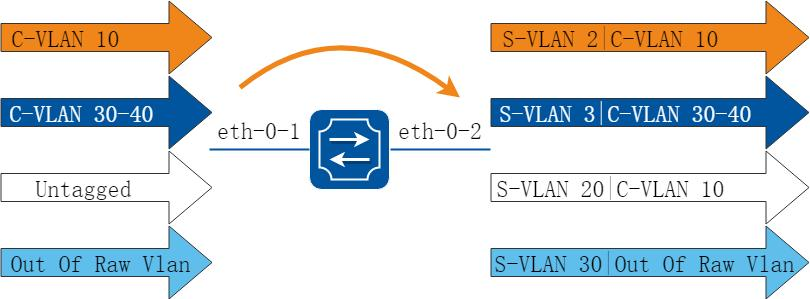

**图3-17 QinQ Tunnel**

##### 2. 配置步骤

##### 步骤1 进入配置模式

```
Switch# configure terminal
```

##### 步骤2 进入vlan 配置模式并创建vlan

```
Switch(config)# vlan database
Switch(config-vlan)# vlan 2,3,10,20,30
Switch(config-vlan)# exit
```

##### 步骤3 创建EVC 并关联vlan

```
Switch(config)# ethernet evc evc_c1
Switch(config-evc)# dot1q mapped-vlan 2
Switch(config-evc)# exit
Switch(config)# ethernet evc evc_c2
Switch(config-evc)# dot1q mapped-vlan 3
Switch(config-evc)# exit
Switch(config)# ethernet evc evc_c3
Switch(config-evc)# dot1q mapped-double-vlan 10 20
Switch(config-evc)# exit
Switch(config)# ethernet evc evc_c4
Switch(config-evc)# dot1q mapped-vlan 30
Switch(config-evc)# exit
```

##### 步骤4 创建vlan mapping 表，并关联EVC

```
Switch(config)# vlan mapping table vm
Switch(config-vlan-mapping)# raw-vlan 10 evc evc_c1
Switch(config-vlan-mapping)# raw-vlan 30-40 evc evc_c2
Switch(config-vlan-mapping)# raw-vlan untagged evc evc_c3
Switch(config-vlan-mapping)# raw-vlan out-of-range evc evc_c4
Switch(config-vlan-mapping)# raw-vlan 10 20 egress-vlan untag
Switch(config-vlan-mapping)# exit
```

##### 步骤5 配置端口属性，设置为灵活QinQ 并使用Vlan Mapping 表

eth-0-1:

```
Switch(config)# interface eth-0-1
Switch(config-if)# switchport mode dot1q-tunnel
Switch(config-if)# switchport dot1q-tunnel type selective
Switch(config-if)# switchport dot1q-tunnel vlan mapping table vm
Switch(config-if)# switchport dot1q-tunnel native inner-vlan 10
Switch(config-if)# switchport dot1q-tunnel allowed vlan add 2,3,20,30
Switch(config-if)# exit
```

eth-0-2:

```
Switch(config)# interface eth-0-2
Switch(config-if)# switchport mode trunk
Switch(config-if)# switchport trunk allowed vlan add 2,3,20,30
Switch(config-if)# exit
```

##### 步骤6 退出配置模式

```
Switch(config)# end
```

##### 步骤7 检查配置

这个例子显示了如何配置一个灵活QINQ。可用显示命令显示接口上的配置:

```
Switch# show interface switchport interface eth-0-1
Interface name
: eth-0-1
Switchport mode
: dot1q-tunnel(selective)
VLAN mapping table
: vm
Ingress filter
: enable
Acceptable frame types
: all
Default Vlan
: 10
Configured Vlans
: 1
2
3
20
30
```

使用下列命令行显示vlan mapping 表：

```
Table Name
EVC Name
Mapped VLAN Raw VLAN
================ ================ =========== =================================
vm
evc_c1
2
10
evc_c2
3
30-40
evc_c3
20(10)
untagged
evc_c4
30
out-of-range
```

## 3.10 链路聚合配置

### 3.10.1 概述

#### 简介

##### 1. 缩略语说明

| 缩略语 | 英文全称 | 翻译与解释 |
|---|---|---|
| LACP | Link Aggregation Control | 链路聚合控制协议 |
|  | Protocol |  |
| AGG Group | Aggregation Group | 聚合组 |
| AGG IF | Aggregation Interface | 聚合接口 |
| Member IF | Member Interface | 成员接口 |

##### 2. 功能说明

链路聚合是将多条以太网链路捆绑在一起成为一条逻辑链路。通过配置链路聚合，可以实现增加带宽、提高可靠性、负载分担的目的。这些捆绑在一起的链路通过相互间的动态备份，可以有效地提高链路的可靠性。

链路捆绑是通过接口捆绑实现的，多个以太网接口捆绑在一起后形成一个聚合组，而这些被捆绑在一起的以太网接口就称为该聚合组的成员端口。每个聚合组唯一对应着一个逻辑接口，称为聚合接口。聚合组与聚合接口的编号是相同的，例如聚合组1 对应于聚合接口1。

聚合组/聚合接口可以分为以下类型：

二层聚合组/二层聚合接口：二层聚合组的成员端口全部为二层以太网接口，其对应的聚合接口称为二层聚合接口。

三层聚合组/三层聚合接口：三层聚合组的成员端口全部为三层以太网接口，其对应的聚合接口称为三层聚合接口。

链路聚合的模式链路聚合分为静态聚合和动态聚合两种模式，它们各自的优点如下所示：

静态聚合模式：一旦配置好后，只要加入聚合组的物理成员口的状态为up，agg 口的状态就会为up 状态。

动态聚合模式：通过LACP 协议实现，能够根据对端和本端的信息调整端口的选中/非选中状态，比较灵活。

处于静态聚合模式下的聚合组称为静态聚合组，处于动态聚合模式下的聚合组称为动态聚合组。

聚合组内的成员端口具有以下四种状态：

w(waiting): 动态聚合模式下，不参与数据流量的转发。

s(suspend): 动态聚合模式下，不参与数据流量的转发。

B(bundle): 接口聚合成功，可以参与数据流量的转发。

D(down/admin down): 接口处于down 状态。

只要有一个成员口处于bundle 状态，聚合口agg 就处于up 状态。

#### 背景

当前网络存在的问题随着网络规模不断扩大，用户对骨干链路的带宽和可靠性提出越来越高的要求。在传统技术中，常用更换高速率的接口板或更换支持高速率接口板的设备的方式来增加带宽，但这种方案需要付出高额的费用，而且不够灵活。

链路聚合的优势采用链路聚合技术可以在不进行硬件升级的条件下，通过将多个物理接口捆绑为一个逻辑接口，达到增加链路带宽的目的。在实现增大带宽目的的同时，链路聚合采用备份链路的机制，可以有效的提高设备之间链路的可靠性。

链路聚合技术主要有以下三个优势：

增加带宽：链路聚合接口的最大带宽可以达到各成员接口带宽之和。

提高可靠性：当某条活动链路出现故障时，流量可以切换到其他可用的成员链路上，从而提高链路聚合接口的可靠性。

负载分担：在一个链路聚合组内，可以实现在各成员活动链路上的负载分担。

#### 原理描述

##### 1. LACP 协议介绍

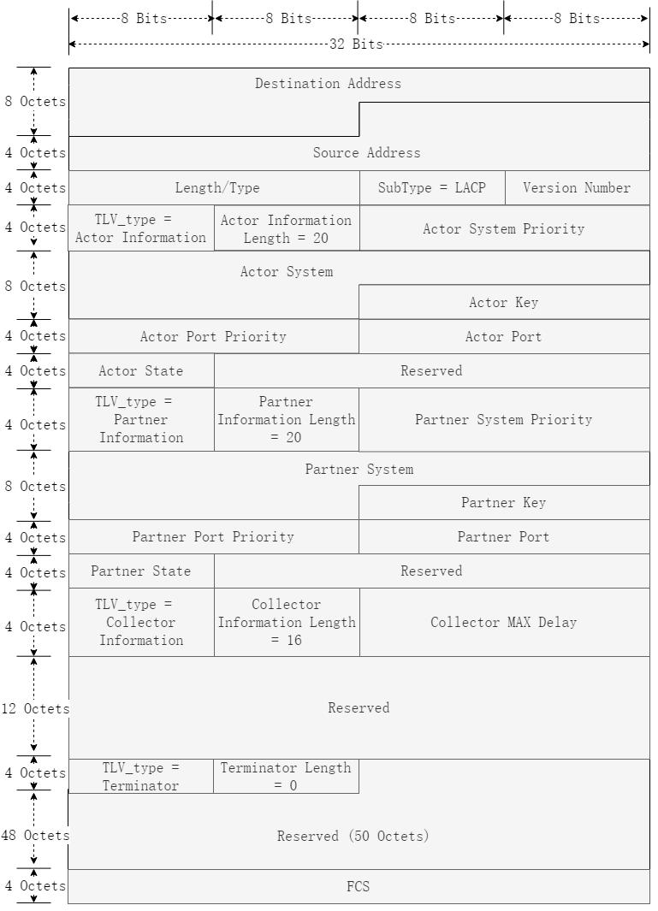

**图3-18 LACPDU 报文格式示意**

**表3-2 字段说明**

| 字段 | 长度 | 说明 |
|---|---|---|
| Destination Address | 6 字节 | 目的MAC 地址，是一个组播地址<br>（01-80-C2-00-00-02） |
| Source Address | 6 字节 | 源MAC 地址，发送端口的MAC 地<br>址 |
| Length/Type | 2 字节 | 协议类型：0x8809 |
| Subtype | 1 字节 | 报文子类型：0x01，说明是LACP<br>报文 |
| Version Number | 1 字节 | 协议版本号：0x01 |
| TLV type<br>_ | 1 字节 | 0x00 代表Terminator 字段0x01<br>代表Actor 字段0x02 代表<br>Partner 字段0x03 代表<br>Collector 字段 |
| Actor Information Length<br>_ _ | 1 字节 | actor 信息字段长度，为20 字节 |
| Actor System Priority<br>_ _ | 2 字节 | 本端系统优先级，可以设置，默<br>认情况下为32768(即0x8000) |
| Actor System<br>_ | 6 字节 | 系统ID，本端系统的MAC 地址 |
| Actor key<br>_ | 2 字节 | 端口KEY 值，系统根据端口的配<br>置生成，是端口能否成为聚合组<br>中的一员的关键因素，影响Key<br>值的因素有AGG 所选择的序号，<br>以及AGG 是否加入MLAG 端口 |
| Actor Port Priority<br>_ _ | 2 字节 | 接口优先级，可以配置，默认为<br>2048（即0x800） |
| Actor Port<br>_ | 2 字节 | 端口号，根据交换机选择的端口<br>生成 |
| Actor State<br>_ | 1 字节 | 本端状态信息，比特0-7 的含义<br>分别为：0:LACP Activity: 端口<br>_<br>在链路控制中的主从状态，0 表<br>示Passive, 1 表示Active。<br>1:LACP Timeout: 超时时间，0<br>_<br>表示长超时，1 表示短超时<br>2:Aggregation: 表示端口的聚<br>合能力。 TRUE(1)表示链路是可<br>聚合的，FALSE(0)表示链路是独<br>立链路，不可聚合<br>3:Synchronization: 表示端口<br>当前聚合是否完成。TRUE(1)表示<br>发送的链路处于IN SYNC 状态，<br>_<br>即端口已被分配到正确的聚合组<br>中， FALSE(0)表示链路为<br>OUT OF SYNC 状态，即端口还没<br>_ _<br>有选择正确的聚合组<br>4:Collecting: TRUE(1)表示当<br>前链路收包enable, 否则为<br>FALSE(0)5:Distributing:<br>TRUE(1)表示当前链路发包 |
|  |  | enable, 否则为<br>FALSE(0)6:Defaulted：TRUE(1)<br>表示Actor 使用的Partner 信息<br>来自管理员配置的默认值。<br>FALSE(0)表示Actor 使用的<br>Partner 信息来自接收的<br>LACPDU7:Expired: TRUE(1)表示<br>Actor RX 状态机处于超时状态，<br>否则不在超时状态。 |
| Reserved | 3 字节 | 保留字段，可用于功能调试以及<br>扩展 |
| Partner Information Length<br>_ _ | 1 字节 | Partner 信息字段长度。Partner<br>字段代表了链路接口接收到对端<br>的系统信息、接口信息和状态信<br>息，与actor 字段含义一致。在<br>协商最开始未收到对端信息时，<br>partner 字段填充0，接收到对端<br>信息后会把收到的对端信息补充<br>到partner 字段当中。 |
| Partner System Priority<br>_ _ | 2 字节 | 对端系统优先级 |
| Partner System<br>_ | 6 字节 | 对端系统ID，对端系统的MAC 地<br>址 |
| Partner key<br>_ | 2 字节 | 对端端口KEY 值 |
| Partner Port Priority<br>_ _ | 2 字节 | 对端接口优先级 |
| Partner Port<br>_ | 2 字节 | 对端端口号 |
| Partner State<br>_ | 1 字节 | Partner State<br>_ |
| Reserved | 2 字节 | 保留字段 |
| Collector Information Length<br>_ _ | 1 字节 | Collector 信息字段长度：0x10 |
| CollectorMaxDelay | 2 字节 | 最大延时：默认情况下为0xffff |
| Reserved | 12 字节 | 保留字段 |
| Terminator Length<br>_ | 1 字节 | Terminator 信息字段长度：0x00 |
| Reserved | 50 字节 | 保留字段，全置0 |
| FCS | 4 字节 | 用于帧内后续字节差错的循环冗<br>余检验（也称为FCS 或帧检验序<br>列）。 |

动态聚合模式通过LACP 协议实现，LACP 协议的内容及动态聚合模式的工作机制如下所述。

基于IEEE802.3ad 标准的LACP 协议是一种实现链路动态聚合的协议，运行该协议的设备之间通过互发LACPDU 来交互链路聚合的相关信息。动态聚合组内的成员端口可以收发LACPDU（Link Aggregation Control Protocol Data Unit，链路聚合控制协议数据单元），本端通过向对端发送LACPDU 通告本端的信息。当对端收到该LACPDU 后，将其中的信息与所在端其他成员端口收到的信息进行比较，以选择能够处于选中状态的成员端口，使双方可以对各自接口的选中/非选中状态达成一致。

LACP 工作模式分为ACTIVE 和PASSIVE 两种。

需要确保两端至少一端的配置为ACTIVE，ACTIVE 表示会主动发送LACPDU，PASSIVE 表示只有在收到LACPDU 的时候才会发送LACPDU，如果动态聚合组内成员端口的LACP 工作模式为PASSIVE，且对端的LACP 工作模式也为PASSIVE，两端将不能发送LACPDU。

LACP 协议定义了优先级。根据作用的不同，可以将LACP 优先级分为系统优先级和端口优先级两类，优先级的数值越小，优先级越高：

系统优先级: 用于区分两端设备优先级的高低。当两端设备中的一端具有较高优先级时，另一端将根据优先级较高的一端来选择本端的选中端口，这样便使两端设备的选中端口达成了一致。

端口优先级: 用于区分各成员端口成为选中端口的优先程度。

##### 2. 链路聚合介绍

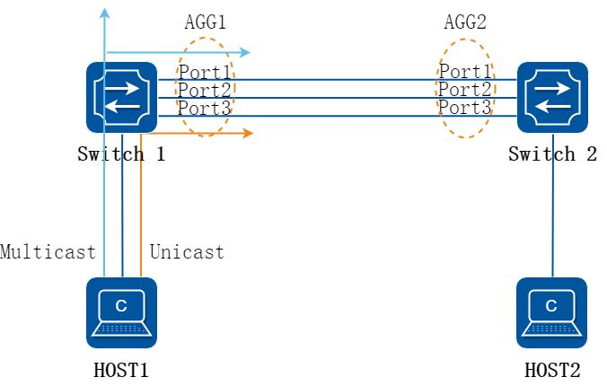

**图3-19 链路聚合**

如图所示，以下说明聚合链路的转发过程：

Switch1 的聚合口agg1 和Switch2 的聚合口agg2 对接，两交换机之间形成聚合链路；

聚合口逻辑上被视为的一个接口，广播报文转发时，在聚合口agg1 只会广播一份，再由负载均衡策略决定具体从哪个物理口转发出去；

报文到达聚合口agg2 后，Switch 2 学习MAC，对应的接口为agg2，而非实际收到报文的物理口；

图中聚合链路由三条物理链路组成，在负载流量极端理想情况下，实际Switch 1到Switch 2 的链路带宽为三条物理链路的带宽之和。

##### 3. 链路冗余介绍

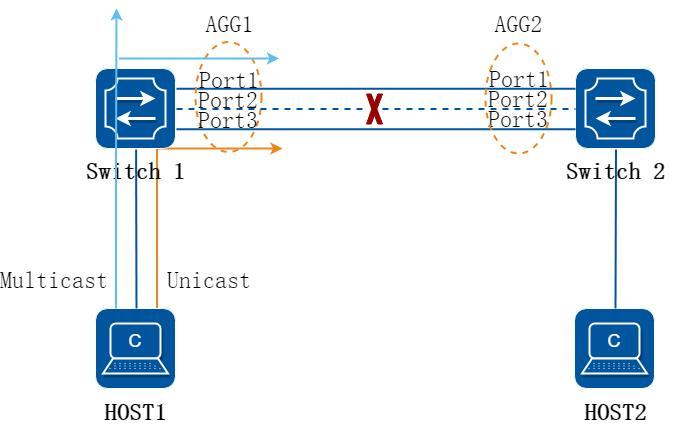

**图3-20 链路冗余**

如图所示，Switch 1 和Switch 2 之间有一条链路故障后，只要还有其他链路正常，则聚合链路依旧可以正常转发网络流量，只是聚合链路的带宽减小了。

##### 4. 负载均衡介绍

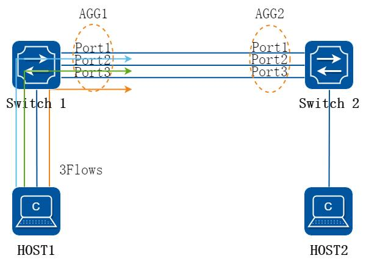

**图3-21 负载均衡**

如图所示，转发到AGG1 口的流量从不同的物理端口出去，实现流量的负载均衡。

负载均衡模式有Static（默认），Dynamic，Round-robin，Resilent 四种。

Static：是根据报文的Hash Key（默认Hash Key 为报文的Dst-IP、Src-IP、Dst-Port、Src-Port、IP-Protocol），计算出一个Hash 值，不同的Hash 值分配到不同的成员链路上，从而实现负载均衡的效果。如果业务流量的Hash Key 字段都相同，那么计算出来的Hash 值也是相同的，这种情况无法实现负载均衡效果。

Dynamic：基于流来进行负载分担，当port 1 的负载比port 2 和port 3 的要小的时候，新进来的流量将会分配从port 1 出去，如果同一时间进来很多条流，可能这些流都会负载到当前负载最小的链路上，就有可能会出现负载不均衡，甚至超过带宽的现象。

Round-robin：逐包进行负载分担，假设第一个报文是从port 1 转发出去的，那么第二个报文就会从port 2 转发出去第三个报文就会从port 3 转发出去，由于链路的传输存在不同的延时，可能会导致到达目的地时出现乱序的问题。

Resilient：基于hash 进行负载均衡，与Static 不同的是，Static 会在链路故障的时候将所有的流量重新再计算并重新负载到正常工作的端口，Resilient 在有链路出现故障的时候，只会将本来负载到故障链路的流量进行hash 计算并重新负载到正常工作的链路上。

##### 5. 亮点功能介绍

加权的链路聚合


**图3-22 加权的链路聚合**

Switch1 和Switch2 通过2 条物理链路直连，组成一个聚合链路。

某些情况下，这两条链路拥有不同的端口带宽，因而在转发时需要不同的权重，来保证带宽的合理利用。

与传统链路聚合相比，加权的链路聚合放开了对成员端口类型的限制，支持不同SPEED的端口聚合在一起，同时通过权重的设置，保证流量在不同成员之间合理分配。

端口权重的设置对静态AGG 和LACP 均有效。

主备链路聚合

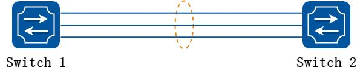

**图3-23 主备链路聚合**

Switch1 和Switch2 通过聚合链路直连。为了防止单条链路故障引起网络中断或拥塞，需要有冗余的链路作为备份。

如图所示，Switch1 和Switch2 之间有三条物理链路，其中两条为正常工作链路，第三条为冗余备份链路。当前两条链路发送故障时，第三条链路能立刻顶替故障的链路进行流量的转发。

与传统链路聚合相比，主备链路的聚合的优势很明显：传统链路聚合虽然各个聚合成员之间互为备份，但是当产生链路故障时候，故障成员的流量需要由其他成员分担。在网络利用率比较高（例如全线速转发）的情况下，不可避免会产生丢包。而主备的链路聚合则没有这个问题。

网络管理者可以根据实际需要，合理选择M:N 备份中M 和N 的比例。

主备链路聚合只对动态LACP 有效。

### 3.10.2 限制与注意事项

#### 端口属性要求

由于聚合接口是一个统一的逻辑口，部分属性需要每个成员都一致，因而在成员口加入聚合组时，会有如下要求：

**表3-3 聚合条件说明**

| 属性 | 说明 |
|---|---|
| 端口属性 | 聚合的所有成员端口应该同为二层接口，或同为<br>三层接口。不支持二三层接口混合二层口的VLAN<br>应相同 |
| DHCP 相关 | 使能DHCP relay、DHCP snooping、DHCP server<br>或DHCPv6 relay、DHCPv6 snooping 的端口，不<br>能作为成员口加入聚合组 |
| 端口隔离相关 | 成员口和聚合口是否使能端口隔离的状态应相同<br>如已使能，隔离组号应相同 |
| 私有VLAN 相关 | 私有VLAN 类型、所属的公有VLAN 和私有VLAN 都<br>应相同 |
| Error disable 相关 | 成员口和聚合口Error disable 配置应相同 |
| MTU 相关 | 成员口和聚合口MTU 应相同 |
| EFD 相关 | 成员口和聚合口EFD 配置应同时使能，或同时关<br>闭 |
| MAC Learning 相关 | 成员口和聚合口MAC Learning 配置应同时使能，<br>或同时关闭 |
| Port Block 相关 | 成员口和聚合口Port Block 配置应相同 |

#### 功能互斥

部分功能不支持在聚合口或成员口配置，具体见下表：

**表3-4 互斥特性列表**

| 属性 | 说明 |
|---|---|
| IP Source guard | 聚合口和成员口都不支持 |
| IVI | 聚合口和成员口都不支持 |
| Loop back detection | 聚合口和成员口都不支持 |
| Monitor link | 加入了Monitor link 的端口，不能作为成员口加<br>入聚合组。 |
| G.8031/G.8032/ERPS | 使能了G.8031/G.8032/ERPS 的端口，不能作为成<br>员口加入聚合组，可以在agg 口使能。 |
| PBR | 使能了PBR 的三层物理接口端口，不能作为成员<br>口加入聚合组，PBR 可以在agg 口使能。 |
| QOS policy map | 配置了QOS policy map 的端口，不能作为成员口<br>加入聚合组，QOS 可以在agg 口下使能。 |
| Port security | 使能了Port security 的端口，不能作为成员口 |
|  | 加入聚合组，Port security 可以在agg 口下使能。 |
| Voice VLAN | 使能了Voice VLAN 的端口，不能作为成员口加入<br>聚合组，Voice VLAN 可以在agg 口下使能。 |

#### 规格限制

全局支持的聚合组/聚合端口数量是有限的，每个聚合组包含的成员端口数量也是有限的。

链路聚合规格有五种模式，切换模式之后，需要重启才能生效。

五种模式说明如下：

**表3-5 规格模式**

| 模式 | 说明 |
|---|---|
| group-mode flexible | 默认模式。最多可以创建64 个聚合组（动态聚合<br>组0 保留），最大成员口数量可以通过命令进行<br>调节，默认值最大成员口数量为16。 |
| group-mode 56 | 最多可以创建56 个聚合组（动态聚合组0 保留）<br>每个聚合组最多含有16 个成员口。 |
| group-mode 32 | 最多可以创建32 个聚合组（动态聚合组0 保留）<br>每个聚合组最多含有32 个成员口。 |
| group-mode 16 | 最多可以创建16 个聚合组（动态聚合组0 保留）<br>每个聚合组最多含有64 个成员口。 |
| group-mode 8 | 最多可以创建8 个聚合组（动态聚合组0 保留），<br>每个聚合组最多含有128 个成员口。 |

具体规格受限于不同型号的硬件条件，详情参考产品规格书（Product Spec）。

### 3.10.3 配置举例

#### 配置静态AGG

##### 1. 组网拓扑

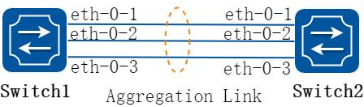

**图3-24 Static Agg**

##### 2. 配置步骤

Switch1 和Switch2 配置如下：

##### 步骤1 进入配置模式

```
Switch# configure terminal
```

##### 步骤2 进入端口配置模式，将端口添加到静态Channel Group 中

```
Switch(config)# interface eth-0-1
Switch(config-if)# no shutdown
Switch(config-if)# static-channel-group 1
Switch(config-if)# exit
Switch(config)# interface eth-0-2
Switch(config-if)# static-channel-group 1
Switch(config-if)# no shutdown
Switch(config-if)# exit
Switch(config)# interface eth-0-3
Switch(config-if)# static-channel-group 1
Switch(config-if)# no shutdown
Switch(config-if)# exit
```

##### 步骤3 退出配置模式

```
Switch(config)# end
```

##### 步骤4 检查配置

显示channel group 摘要信息：

```
Switch1# show channel-group summary
port-channel load-balance hash-arithmetic: xor
port-channel load-balance hash-field-select:
macsa
Flags:
s - suspend
T - standby
D - down/admin down
B - in Bundle
R - Layer3
S - Layer2
w - wait
U - in use
Mode:
SLB
- static load balance
DLB
- dynamic load balance
SHLB - self-healing load balance
RR
- round robin load balance
Aggregator Name
Mode
Protocol
Ports
----------------+---------+------------+-----------------------------------------------
agg1(SU)
SLB
Static
eth-0-1(B) eth-0-2(B) eth-0-3(B)
```

显示AGG 端口信息：

```
Switch1# show interface agg 1
Interface agg1
Interface current state: UP
Hardware is AGGREGATE, address is cce3.33fc.330b (bia a876.6b2c.9c01)
Bandwidth 3000000 kbits
Index 1025 , Metric 1 , Encapsulation ARPA
Speed - 1000Mb/s , Duplex - Full
, Media type is Aggregation
Link speed type is autonegotiation, Link duplex type is autonegotiation
Input flow-control is off, output flow-control is off
The Maximum Frame Size is 1534 bytes
VRF binding: not bound
Label switching is disabled
No virtual circuit configured
ARP timeout 01:00:00,
ARP retry interval 1s
5 minute input rate 0 bits/sec, 0 packets/sec
```

```
5 minute output rate 140 bits/sec, 0 packets/sec
0 packets input, 0 bytes
Received 0 unicast, 0 broadcast, 0 multicast
0 runts, 0 giants, 0 input errors, 0 CRC
0 frame, 0 overrun, 0 pause input
0 input packets with dribble condition detected
1080 packets output, 60614 bytes
Transmitted 0 unicast, 0 broadcast, 0 multicast
0 underruns, 0 output errors, 0 pause output
```

#### 配置加权的链路聚合

##### 1. 组网拓扑

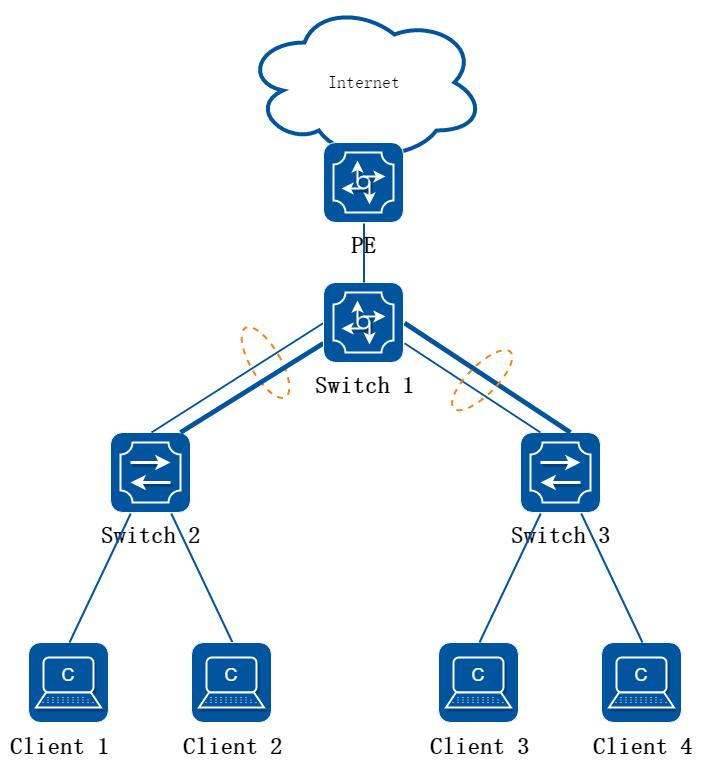

**图3-25 加权的链路聚合**

##### 2. 配置思路

如图所示，Switch2 和Switch3 作接入设备，上联汇聚设备Switch1。接入设备和汇聚设备之间，有两条拥有不同带宽的物理链路，组成一个加权的聚合链路。端口权重的设置对静态AGG 和LACP 均有效，下面以LACP 为例介绍配置。

在这个配置中，我们假设interface eth-0-1 物理带宽为1 Gbps，interface eth-0-2 物理带宽为10Gbps，所以设置interface eth-0-2 的端口权重为interface eth-0-1 的十倍。具体端口形态取决于不同的硬件型号，请参考产品规格书。

这里权重和带宽的比例关系不是强制的，可以根据网络的实际需求来设置。

##### 3. 配置步骤

本节展示了如何配置Switch1 和Switch2 之间配置。

Switch1 和Switch3 之间的配置方法相同。

Switch1 和Switch2 配置如下：

##### 步骤1 进入配置模式

```
Switch# configure terminal
```

##### 步骤2 配置端口属性

```
Switch(config)# interface eth-0-1
Switch(config-if)# no shutdown
Switch(config-if)# channel-group 1 mode active
Switch(config-if)# exit
Switch(config)# interface eth-0-2
Switch(config-if)# channel-group 1 mode active
Switch(config-if)# distribute-weight 10
Switch(config-if)# no shutdown
Switch(config-if)# exit
```

默认情况下，每个成员口权重都为1。

目前仅支持在静态负载均衡且非self-healing 模式下的成员口配置权重，成员口总权重不能超过最大成员口数。

##### 步骤3 退出配置模式

```
Switch(config)# end
```

##### 4. 验证配置

显示channel group 摘要信息：

```
Switch# show channel-group summary
port-channel load-balance hash-arithmetic: xor
port-channel load-balance hash-field-select:
macsa
Flags:
s - suspend
T - standby
D - down/admin down
B - in Bundle
R - Layer3
S - Layer2
w - wait
U - in use
Mode:
SLB
- static load balance
DLB
- dynamic load balance
SHLB - self-healing load balance
RR
- round robin load balance
Aggregator Name
Mode
Protocol
Ports
----------------+---------+--------------+---------------------------------------------
agg1(SU)
SLB
LACP(Dynamic)
eth-0-1(B) eth-0-2(B)
```

显示AGG 端口信息：

```
Switch# show interface agg1
Interface agg1
Interface current state: UP
Hardware is AGGREGATE, address is cce3.33fc.330b (bia cce3.33fc.330b)
Bandwidth 11000000 kbits
Index 1025 , Metric 1 , Encapsulation ARPA
Speed - 1000Mb/s , Duplex - Full
, Media type is Aggregation
Link speed type is autonegotiation, Link duplex type is autonegotiation
Input flow-control is off, output flow-control is off
The Maximum Frame Size is 1534 bytes
VRF binding: not bound
Label switching is disabled
No virtual circuit configured
ARP timeout 01:00:00,
ARP retry interval 1s
5 minute input rate 0 bits/sec, 0 packets/sec
5 minute output rate 2 bits/sec, 0 packets/sec
13 packets input, 1184 bytes
Received 0 unicast, 0 broadcast, 0 multicast
0 runts, 0 giants, 0 input errors, 0 CRC
0 frame, 0 overrun, 0 pause input
0 input packets with dribble condition detected
20 packets output, 2526 bytes
Transmitted 0 unicast, 0 broadcast, 0 multicast
0 underruns, 0 output errors, 0 pause output
```

#### 配置主备链路聚合

##### 1. 组网拓扑

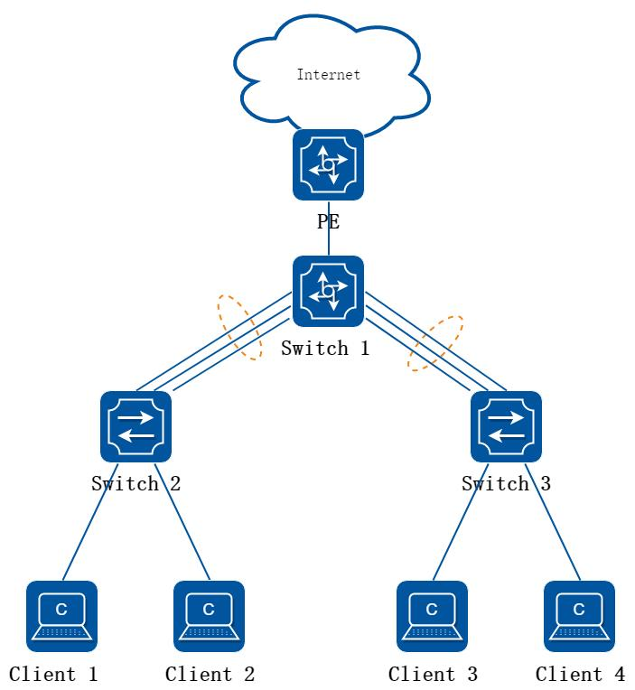

**图3-26 主备链路聚合**

##### 2. 配置思路

Switch2 和Switch3 作接入设备，上联汇聚设备Switch1。对于接入设备的上行链路，一方面要求有较高的带宽，满足多个用户接入的带宽需要，另一方面，为防止单条链路故障引起所有下联用户断网，需要有链路冗余。

这个例子中采用2:1 备份，即有两条工作链路，一条备份链路。

##### 3. 配置步骤

本节展示了如何配置Switch1 和Switch2 之间配置。

Switch1 和Switch3 之间的配置方法相同。

Switch1 和Switch2 配置如下：

##### 步骤1 进入配置模式

```
Switch# configure terminal
```

##### 步骤2 配置端口属性

```
Switch(config)# interface eth-0-1
Switch(config-if)# no shutdown
Switch(config-if)# channel-group 1 mode active
Switch(config-if)# exit
Switch(config)# interface eth-0-2
Switch(config-if)# channel-group 1 mode active
Switch(config-if)# no shutdown
Switch(config-if)# exit
Switch(config)# interface eth-0-3
Switch(config-if)# channel-group 1 mode active
Switch(config-if)# no shutdown
Switch(config-if)# exit
```

##### 步骤3 配置AGG 主备链路

```
Switch(config)# interface agg 1
Switch(config-if)# lacp max-active-linknumber 2
Switch(config-if)# lacp preempt enable
Switch(config-if)# lacp preempt delay 20
Switch(config-if)# end
```

“lacp max-active-linknumber 2” 这条命令，指定了这个聚合组中最多有2 个链路处于工作状态，因为我们配置了3 个成员，所有一个成员处于备份状态。当链路出现故障时，备份的链路才会成为工作链路。

“lacp preempt enable” 和“lacp preempt delay 20” 规定了抢占使能，且链路稳定状态下，延迟20 秒才开始抢占。也就是说，假设其他参数都是不变的，当链路故障恢复以后20 秒后，原先的工作链路会抢占备份链路而继续工作，原先的备份链路继续备份。延迟抢占可以减少链路震荡引起的频繁切换。如果不做设置，默认的延迟抢占时间是30 秒。如果链路之间是完全相等的，也可以不使能抢占功能。系统默认情况下抢占没有使能。

##### 4. 验证配置

显示channel group 摘要信息：

```
Switch# show channel-group summary
port-channel group-mode: flexible
Flags:
s - Suspend
T - Standby
D - Down/Admin down
B - In bundle
R - Layer3
S - Layer2
w - Wait
U - In use
Mode:
SLB
- Static load balance
DLB
- Dynamic load balance
RR
- Round robin load balance
RLB
- Resilient load balance
Aggregator Name
Mode
Protocol
Ports
----------------+---------+--------------+--------------------------------------
-------
agg1(SU)
SLB
LACP
eth-0-9(B)
eth-0-10(B)
eth-0-
11(T)
```

显示AGG 端口信息：

```
Switch# show interface agg 1
Interface agg1
Interface current state: UP
Hardware is AGGREGATE, address is 845b.cf07.8009 (bia 845b.cf07.8009)
Bandwidth 80000000 kbits
Index 2049 , Metric 1 , Encapsulation ARPA
Speed - 80.00Gb/s , Duplex - Full
, Media type is Aggregation
Link type is autonegotiation
FEC config: DEFAULT
FEC ability: NONE
FEC status: OFF
The Maximum Frame Size is 9600 bytes
VRF binding: not bound
ARP timeout 01:00:00,
ARP retry interval 1s
ARP Proxy is disabled, Local ARP Proxy is disabled
5 minute input rate 71 bits/sec, 0 packets/sec
5 minute output rate 68 bits/sec, 0 packets/sec
73 packets input, 10804 bytes
Received 0 unicast, 0 broadcast, 73 multicast
0 runts, 0 giants, 0 input errors, 0 CRC
0 frame, 0 overrun, 0 pause input
72 packets output, 10656 bytes
Transmitted 0 unicast, 0 broadcast, 72 multicast
0 underruns, 0 output errors, 0 pause output
0 output discard
```

#### 服务器双网卡绑定与交换机对接

| 服务器双网卡绑定模式 | 交换机侧对应配置 |
|---|---|
| Bond0 | 使用静态聚合 |
| Bond1 | 交换机侧无需做配置 |
| Bond2 | 使用静态聚合 |
| Bond3 | 不同的交换机端口需要划分到不同的VLAN |
| Bond4 | 使用动态聚合 |
| Bond5 | 交换机侧无需做配置 |
| Bond6 | 交换机侧无需做配置 |

实际使用中，Bond4 比较主流，我们也比较推荐您使用Bond4。

#### 配置静态LACP

##### 1. 组网拓扑


**图3-27 Static LACP**

##### 2. 配置步骤

Switch1 和Switch2 配置如下：

##### 步骤1 进入配置模式

```
Switch# configure terminal
```

##### 步骤2 LACP 全局属性

设置系统优先级，用于决定系统解决在选择聚合组中的冲突。数值越低，优先级越高。

设置负载均衡的模式，这个例子中使用源mac 地址实现。

Switch1 配置：

```
Switch(config)# lacp system-priority 2000
Switch(config)# hash-field port-channel
Switch(config-hash-field)# l2 macsa
```

Switch2 配置：

```
Switch(config)# lacp system-priority 1000
Switch(config)# hash-field port-channel
Switch(config-hash-field)# l2 macsa
```

##### 步骤3 进入端口配置模式，将端口添加到Channel Group 中

```
Switch(config)# interface eth-0-1
Switch(config-if)# no shutdown
Switch(config-if)# channel-group 1 mode active
Switch(config-if)# exit
Switch(config)# interface eth-0-2
Switch(config-if)# channel-group 1 mode active
Switch(config-if)# no shutdown
Switch(config-if)# exit
Switch(config)# interface eth-0-3
Switch(config-if)# channel-group 1 mode active
Switch(config-if)# no shutdown
Switch(config-if)# exit
```

##### 步骤4 退出配置模式

```
Switch(config)# end
```

##### 步骤5 检查配置

显示channel group 摘要信息：

```
Switch# show channel-group summary
port-channel load-balance hash-arithmetic: xor
port-channel load-balance hash-field-select:
macsa
Flags:
s - suspend
T - standby
D - down/admin down
B - in Bundle
R - Layer3
S - Layer2
w - wait
U - in use
Mode:
SLB
- static load balance
DLB
- dynamic load balance
SHLB - self-healing load balance
RR
- round robin load balance
Aggregator Name
Mode
Protocol
Ports
----------------+---------+------------+-----------------------------------------------
agg1(SU)
SLB
LACP
eth-0-1(B) eth-0-2(B) eth-0-3(B)
```

显示AGG 端口信息：

```
Switch1# show interface agg1
Interface agg1
Interface current state: UP
Hardware is AGGREGATE, address is cce3.33fc.330b (bia cce3.33fc.330b)
Bandwidth 3000000 kbits
Index 1025 , Metric 1 , Encapsulation ARPA
Speed - 1000Mb/s , Duplex - Full
, Media type is Aggregation
Link speed type is autonegotiation, Link duplex type is autonegotiation
Input flow-control is off, output flow-control is off
The Maximum Frame Size is 1534 bytes
VRF binding: not bound
Label switching is disabled
No virtual circuit configured
ARP timeout 01:00:00,
ARP retry interval 1s
5 minute input rate 0 bits/sec, 0 packets/sec
5 minute output rate 2 bits/sec, 0 packets/sec
13 packets input, 1184 bytes
Received 0 unicast, 0 broadcast, 0 multicast
```

```
0 runts, 0 giants, 0 input errors, 0 CRC
0 frame, 0 overrun, 0 pause input
0 input packets with dribble condition detected
20 packets output, 2526 bytes
Transmitted 0 unicast, 0 broadcast, 0 multicast
0 underruns, 0 output errors, 0 pause output
```

#### 配置动态LACP

##### 1. 组网拓扑


**图3-28 Dynamic LACP**

##### 2. 配置步骤

Switch1 和Switch2 配置如下：

##### 步骤1 进入配置模式

```
Switch# configure terminal
```

##### 步骤2 LACP 全局属性

开启动态lacp 模式。

Switch1 配置：

```
Switch(config)# port-channel 1 lacp-mode dynamic
```

Switch2 配置：

```
Switch(config)# port-channel 1 lacp-mode dynamic
```

##### 步骤3 进入端口配置模式，将端口添加到Channel Group 中

```
Switch(config)# interface eth-0-1
Switch(config-if)# no shutdown
Switch(config-if)# channel-group 1 mode active
Switch(config-if)# exit
Switch(config)# interface eth-0-2
Switch(config-if)# channel-group 1 mode active
Switch(config-if)# no shutdown
Switch(config-if)# exit
Switch(config)# interface eth-0-3
Switch(config-if)# channel-group 1 mode active
Switch(config-if)# no shutdown
Switch(config-if)# exit
```

##### 步骤4 退出配置模式

```
Switch(config)# end
```

##### 步骤5 检查配置

显示channel group 摘要信息：

```
Switch# show channel-group summary
port-channel load-balance hash-arithmetic: xor
port-channel load-balance hash-field-select:
macsa
Flags:
s - suspend
T - standby
D - down/admin down
B - in Bundle
R - Layer3
S - Layer2
w - wait
U - in use
Mode:
SLB
- static load balance
DLB
- dynamic load balance
SHLB - self-healing load balance
RR
- round robin load balance
Aggregator Name
Mode
Protocol
Ports
----------------+---------+--------------+---------------------------------------------
agg1(SU)
SLB
LACP(Dynamic)
eth-0-1(B) eth-0-2(B) eth-0-3(B)
```

显示AGG 端口信息：

```
Switch1# show interface agg1
Interface agg1
Interface current state: UP
Hardware is AGGREGATE, address is cce3.33fc.330b (bia cce3.33fc.330b)
Bandwidth 3000000 kbits
Index 1025 , Metric 1 , Encapsulation ARPA
Speed - 1000Mb/s , Duplex - Full
, Media type is Aggregation
Link speed type is autonegotiation, Link duplex type is autonegotiation
Input flow-control is off, output flow-control is off
The Maximum Frame Size is 1534 bytes
VRF binding: not bound
Label switching is disabled
No virtual circuit configured
ARP timeout 01:00:00,
ARP retry interval 1s
5 minute input rate 0 bits/sec, 0 packets/sec
5 minute output rate 2 bits/sec, 0 packets/sec
13 packets input, 1184 bytes
Received 0 unicast, 0 broadcast, 0 multicast
0 runts, 0 giants, 0 input errors, 0 CRC
0 frame, 0 overrun, 0 pause input
0 input packets with dribble condition detected
20 packets output, 2526 bytes
Transmitted 0 unicast, 0 broadcast, 0 multicast
0 underruns, 0 output errors, 0 pause output
```

### 3.10.4 部署建议

##### 1. 组网拓扑

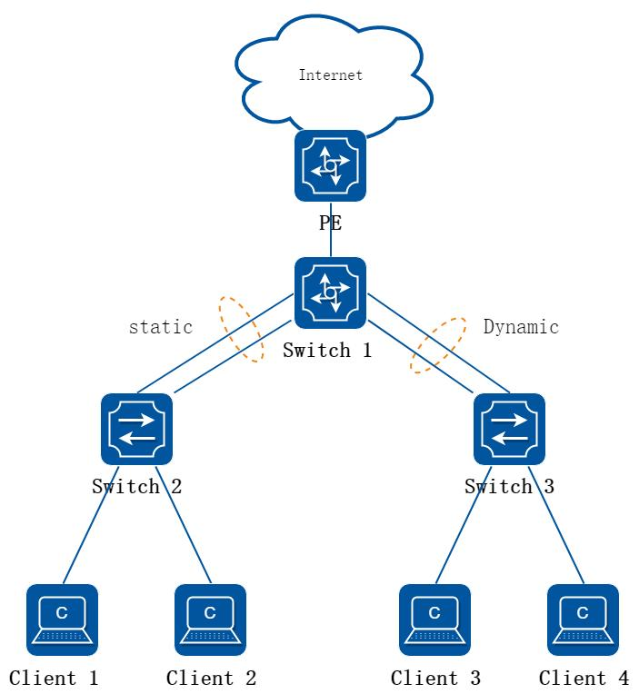

**图3-29 AGG 应用场景示意图**

##### 2. 配置思路

如图所示，Switch2 和Switch3 作接入设备，上联汇聚设备Switch1。对于接入设备的上行链路，一方面要求有较高的带宽，满足多个用户接入的带宽需要，另一方面，为防止单条链路故障引起所有下联用户断网，需要有链路冗余。

考虑大带宽和冗余性，接入设备和汇聚设备可使用链路聚合的方式互连来满足需要。

如果两端设备均支持LACP 协议，推荐使用静态LACP 模式链路聚合。

如果对端设备不支持LACP 协议，必须使用静态聚合模式链路聚合。

在这个例子中展示配置Switch1 和Switch2 之间的静态AGG, 以及配置Switch1 和Switch3 之间的LACP 协议。

##### 3. Switch1 和Switch2 静态聚合组配置步骤

##### 步骤1 进入配置模式

```
Switch# configure terminal
```

##### 步骤2 进入端口配置模式，将成员接口添加到静态聚合接口中

```
Switch(config)# interface eth-0-1
Switch(config-if)# no shutdown
Switch(config-if)# static-channel-group 1
Switch(config-if)# exit
Switch(config)# interface eth-0-2
Switch(config-if)# static-channel-group 1
Switch(config-if)# no shutdown
Switch(config-if)# exit
```

第一个端口加入静态聚合接口之前，需要先确定并修改好成员端口的二三层类型。聚合接口的二三层类型直接继承第一个成员口的属性。

二三层类型不一致的成员端口，无法加入聚合接口。

##### 步骤3 进入聚合接口模式配置属性

```
Switch(config)# interface agg 1
Switch(config-if)# ip address 10.10.10.1/24
```

不支持修改AGG 端口的二三层属性、Duplex、Speed 等。

可以修改二层AGG 所属的VLAN。

##### 4. Switch1 和Switch3 LACP 配置步骤

##### 步骤1 进入配置模式

```
Switch# configure terminal
```

##### 步骤2 全局开启lacp 模式

方法一：动态的LACP 模式在此种模式下，如果LACP 协商失败，各个成员口可以继承VLAN 的属性，独立进行二层数据的转发，动态LACP 通常使用在PXE(Preboot Execution Environmemt)场景，不推荐使用于交换机之间的对接，当聚合失败的时候，有可能会导致环路。

```
Switch(config)# port-channel 2 lacp-mode dynamic
```

方法二：传统LACP（静态模式）

交换机默认使用的为静态LACP 模式，可以通过命令将动态LACP 模式切换为静态，示例如下：

```
Switch(config)# no port-channel 2 lacp-mode
```

##### 步骤3 进入端口配置模式，将成员接口添加到聚合接口中

```
Switch(config)# interface eth-0-3
Switch(config-if)# no shutdown
Switch(config-if)# channel-group 1 mode active
Switch(config-if)# exit
Switch(config)# interface eth-0-4
Switch(config-if)# channel-group 1 mode active
Switch(config-if)# no shutdown
Switch(config-if)# exit
```

##### 步骤4 退出配置模式

```
Switch(config)# end
```

##### 5. 验证配置

Switch1 和Switch2 信息查看：

显示channel group 摘要信息：

```
Switch1# show channel-group summary
port-channel load-balance hash-arithmetic: xor
port-channel load-balance hash-field-select:
macsa
Flags:
s - suspend
T - standby
D - down/admin down
B - in Bundle
R - Layer3
S - Layer2
w - wait
U - in use
Mode:
SLB
- static load balance
DLB
- dynamic load balance
SHLB - self-healing load balance
RR
- round robin load balance
Aggregator Name
Mode
Protocol
Ports
----------------+---------+------------+-----------------------------------------------
agg1(SU)
SLB
Static
eth-0-1(B) eth-0-2(B)
```

显示AGG 端口信息：

```
Switch1# show interface agg 1
Interface agg1
Interface current state: UP
Hardware is AGGREGATE, address is cce3.33fc.330b (bia a876.6b2c.9c01)
Bandwidth 2000000 kbits
Index 1025 , Metric 1 , Encapsulation ARPA
Speed - 1000Mb/s , Duplex - Full
, Media type is Aggregation
Link speed type is autonegotiation, Link duplex type is autonegotiation
Input flow-control is off, output flow-control is off
The Maximum Frame Size is 1534 bytes
VRF binding: not bound
Label switching is disabled
No virtual circuit configured
ARP timeout 01:00:00,
ARP retry interval 1s
5 minute input rate 0 bits/sec, 0 packets/sec
5 minute output rate 140 bits/sec, 0 packets/sec
0 packets input, 0 bytes
Received 0 unicast, 0 broadcast, 0 multicast
0 runts, 0 giants, 0 input errors, 0 CRC
0 frame, 0 overrun, 0 pause input
0 input packets with dribble condition detected
1080 packets output, 60614 bytes
Transmitted 0 unicast, 0 broadcast, 0 multicast
0 underruns, 0 output errors, 0 pause output
```

Switch1 和Switch3 信息查看：

显示channel group 摘要信息：

```
Switch# show channel-group summary
port-channel load-balance hash-arithmetic: xor
port-channel load-balance hash-field-select:
macsa
Flags:
s - suspend
T - standby
D - down/admin down
B - in Bundle
R - Layer3
S - Layer2
w - wait
U - in use
Mode:
SLB
- static load balance
DLB
- dynamic load balance
SHLB - self-healing load balance
RR
- round robin load balance
Aggregator Name
Mode
Protocol
Ports
----------------+---------+--------------+---------------------------------------------
agg2(SU)
SLB
LACP(Dynamic)
eth-0-3(B) eth-0-4(B)
```

显示AGG 端口信息：

```
Switch# show interface agg2
Interface agg1
Interface current state: UP
Hardware is AGGREGATE, address is cce3.33fc.330b (bia cce3.33fc.330b)
Bandwidth 2000000 kbits
Index 1025 , Metric 1 , Encapsulation ARPA
Speed - 1000Mb/s , Duplex - Full
, Media type is Aggregation
Link speed type is autonegotiation, Link duplex type is autonegotiation
Input flow-control is off, output flow-control is off
The Maximum Frame Size is 1534 bytes
VRF binding: not bound
Label switching is disabled
No virtual circuit configured
ARP timeout 01:00:00,
ARP retry interval 1s
5 minute input rate 0 bits/sec, 0 packets/sec
5 minute output rate 2 bits/sec, 0 packets/sec
13 packets input, 1184 bytes
Received 0 unicast, 0 broadcast, 0 multicast
0 runts, 0 giants, 0 input errors, 0 CRC
0 frame, 0 overrun, 0 pause input
0 input packets with dribble condition detected
20 packets output, 2526 bytes
Transmitted 0 unicast, 0 broadcast, 0 multicast
0 underruns, 0 output errors, 0 pause output
```

### 3.10.5 参考文献

LACP: 基于IEEE 802.3ad 标准协议。

## 3.11 流量控制配置

### 3.11.1 概述

#### 简介

流量控制在直连的以太端口上启用，在拥塞期间允许另一端拥塞的节点暂停链路运作来控制流量速率。当本地设备在本地检测到了任何拥塞，他能够发送一个暂停帧通知链路伙伴或者远程设备已发生拥塞。紧随收到暂停帧之后，远程设备停止发送任何数据包，这样防止在拥塞期间丢弃任何一个数据包。在自协商链路上，本地的流控制能力能通过链路断开/连接来通知对方。

流量控制只在全双工链路上有效

### 3.11.2 配置举例

##### 1. 组网拓扑

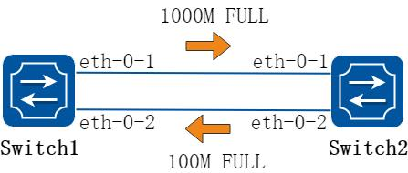

**图3-30 Flow control**

#### 配置发送流量控制报文

##### 1. 配置步骤

##### 步骤1 进入配置模式

```
Switch# configure terminal
```

##### 步骤2 进入接口配置模式，并使能发送流量控制

```
Switch(config)# interface eth-0-1
Switch(config-if)# flowcontrol send on
```

##### 步骤3 退出配置模式

```
Switch(config-if)# end
```

##### 步骤4 检查配置

使用下列命令查看流量控制状态：

```
Switch# show flowcontrol
Port
Receive FlowControl
Send FlowControl
RxPause
TxPause
admin
oper
admin
oper
```

```
---------
-------- --------
-------- --------
-----------
-----------
eth-0-1
off
off
on
on
0
0
eth-0-2
off
off
off
off
0
0
eth-0-3
off
off
off
off
0
0
```

使用下列命令查看指定端口的流量控制状态：

```
Switch# show flowcontrol eth-0-1
Port
Receive FlowControl
Send FlowControl
RxPause
TxPause
admin
oper
admin
oper
---------
-------- --------
-------- --------
-----------
-----------
eth-0-1
off
off
on
on
0
0
```

#### 配置接收流量控制报文

##### 步骤1 进入配置模式

```
Switch# configure terminal
```

##### 步骤2 进入接口配置模式，并使能发送流量控制

```
Switch(config)# interface eth-0-1
Switch1(config-if)# flowcontrol receive on
```

##### 步骤3 退出配置模式

```
Switch(config-if)# end
```

##### 步骤4 检查配置

使用下列命令查看流量控制状态：

```
Switch1# show flowcontrol
Port
Receive FlowControl
Send FlowControl
RxPause
TxPause
admin
oper
admin
oper
---------
-------- --------
-------- --------
-----------
-----------
eth-0-1
on
on
off
off
0
0
eth-0-2
off
off
off
off
0
0
eth-0-3
off
off
off
off
0
0
```

使用下列命令查看指定端口的流量控制状态：

```
Switch1# show flowcontrol eth-0-1
Port
Receive FlowControl
Send FlowControl
RxPause
TxPause
admin
oper
admin
oper
---------
-------- --------
-------- --------
-----------
-----------
eth-0-1
on
on
off
off
0
0
```

## 3.12 风暴控制配置

### 3.12.1 概述

#### 简介

##### 1. 缩略语说明

| 缩略语 | 英文全称 | 翻译与解释 |
|---|---|---|
| bps | bit per second | 每秒允许通过的比特数 |
| pps | packet per second | 每秒允许通过的数据包数 |

风暴控制是指在指定接口上，通过对接收的最大广播、最大未知组播以及最大未知单播流量进行限制，防止泛洪消耗过多的交换机资源，确保业务正常运行。

可以使用以下两种方式之一进行风暴控制：

百分比模式(Level)包速率模式(PPS)

#### 背景

当广播数据充斥网络无法处理，并占用大量网络带宽，导致正常业务不能运行，甚至彻底瘫痪，这就发生了“广播风暴”。一个数据帧或包被传输到本地网段（由广播域定义）

上的每个节点就是广播；由于网络拓扑的设计和连接问题，或其他原因导致广播在网段内大量复制，传播数据帧，导致网络性能下降，甚至网络瘫痪，这就是广播风暴。

当设备某个二层以太接口收到广播、组播或未知单播报文时，如果根据报文的目的MAC地址设备不能明确报文的出接口，设备会向同一VLAN 内的其他二层以太接口转发这些报文，这样可能导致广播风暴，降低设备转发性能。

因此，为了限制出入接口的广播、组播、未知单播报文的速率，防止广播风暴，就出现了Storm Control。

Storm Control 可以在指定接口上或在指定VLAN 内，通过对接收的最大广播、最大未知组播以及最大未知单播流量进行限制，防止泛洪消耗过多的交换机资源，确保业务正常运行。Storm Control 可以从交换机层面对产生风暴的场景进行控制，从而维持网络的稳定。

#### 原理描述

##### 1. 相关术语

单播报文（Unicast）：网络中的交换机和路由器对报文只进行转发不进行复制，服务端对客户机的相应是一对一的。

未知单播（Unknown-unicast）：设备MAC 表中没有该单播帧的目的MAC 条目。

组播报文（Multicast）：对网络中有需要的客户端进行转发，服务端与客户端是一对多的。

广播报文（Broadcast）：对网络中的所有消息进行转发，不论客户端是不是需要，服务端对客户端是一对多的。

##### 2. Storm Control 工作机制

Storm Control 可以在接收报文的方向上，对广播，组播以及未知单播报文在端口上或同一VLAN 内进行流量抑制。

在接口视图下，设备支持分别对三类报文按百分比、包速率进行流量抑制。设备监控接口下的三类报文速率并和配置的阈值相比较，当入口流量超过配置的阈值时，设备会丢弃超额的流量。

在VLAN 视图下，设备支持分别对三类报文按比特速率和包速率进行流量抑制。设备监控同一VLAN 内三类报文的速率并和配置的阈值相比较，当VLAN 内流量超过配置的阈值时，设备会丢弃超额的流量。

Storm Control 的具体工作流程如下图所示。

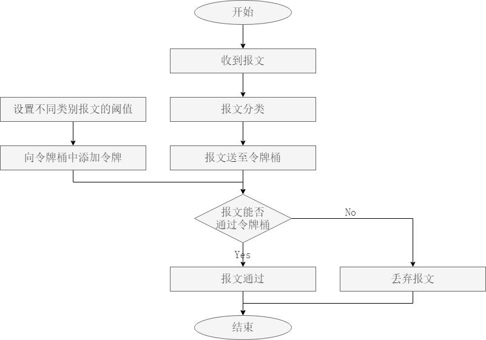

**图3-31 Storm Control 工作流程图**

Storm Control 是采用令牌桶进行流量控制。如果在设备的某个接口上配置了Storm Control，所有经由该接口收到的报文首先要经过Storm Control 的令牌桶进行处理。

首先根据用户设定的阈值以一定的速率向令牌桶中添加令牌，如果令牌桶中有足够的令牌，则报文可以通过令牌桶进行后续处理；否则，报文将会被丢弃。

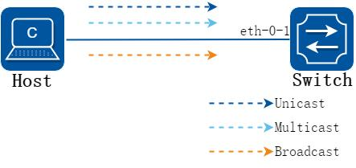

**图3-32 Storm Control 工作机制组网图**

如上图所示，主机可以向交换机发送三类报文，Switch1 收到报文以后，首先会对报文进行鉴别，判断其属于哪一类报文，再将报文送至对应的令牌桶中，令牌桶的原理如下图所示，根据配置的阈值令牌桶中会存放相应的令牌（根据阈值的单位，令牌分为bps和pps 的），每个报文要通过令牌桶都要带走对应数量的令牌，当令牌桶中没有令牌时，收到的报文就会被丢弃。

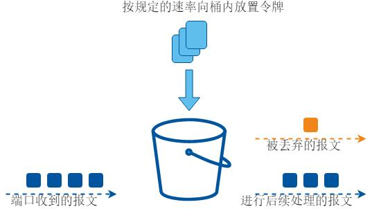

**图3-33 Storm Control 工作机制原理图**

### 3.12.2 配置举例

#### 使用百分比(LEVEL)模式配置风暴控制

##### 1. 组网拓扑

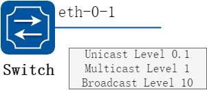

**图3-34 Percentage Storm Control**

##### 2. 配置步骤

##### 步骤1 进入配置模式

```
Switch# configure terminal
```

##### 步骤2 进入端口模式，设置风暴控制的百分比

未知单播、组播、广播报文可以分别设置：

```
Switch(config)# interface eth-0-1
Switch(config-if)# storm-control unicast level 0.1
Switch(config-if)# storm-control multicast level 1
Switch(config-if)# storm-control broadcast level 10
```

##### 步骤3 退出配置模式

```
Switch(config-if)# end
```

##### 步骤4 检查配置

```
Switch# show storm-control interface eth-0-1
Port
ucastMode ucastlevel
bcastMode bcastLevel
mcastMode mcastLevel
-------------------------------------------------------------------------------
eth-0-1
Level
0.10
Level
10.00
Level
1.00
```

#### 使用包速率(PPS)模式配置风暴控制

##### 1. 组网拓扑

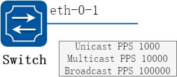

**图3-35 PPS Storm Control**

##### 2. 配置步骤

##### 步骤1 进入配置模式

```
Switch# configure terminal
```

##### 步骤2 进入端口模式，设置风暴控制的包速率

未知单播、组播、广播报文可以分别设置：

```
Switch(config)# interface eth-0-1
Switch(config-if)# storm-control unicast pps 1000
Switch(config-if)# storm-control multicast pps 10000
Switch(config-if)# storm-control broadcast pps 100000
```

##### 步骤3 退出配置模式

```
Switch(config-if)# end
```

##### 步骤4 检查配置

```
Switch# show storm-control interface eth-0-1
Port
ucastMode ucastlevel
bcastMode bcastLevel
mcastMode mcastLevel
-------------------------------------------------------------------------------
eth-0-1
PPS
1000
PPS
100000
PPS
10000
```

#### 基于VLAN 的风暴控制

##### 1. 组网拓扑

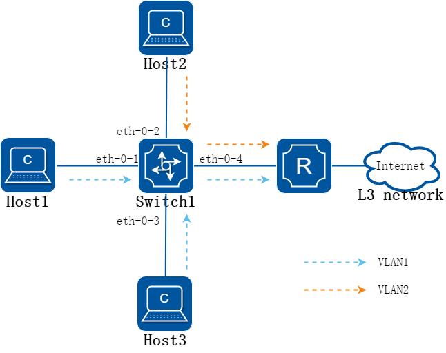

**图3-36 Storm Control 基于VLAN 典型应用组网图**

上图为Storm Control 基于VLAN 的应用场景，Host1 和Host3 向Switch1 发送了大量的VLAN1 的广播报文，Host2 向Switch1 发送VLAN2 的数据报文。为了避免让大量的VLAN1的广播报文占用资源从而影响VLAN2 的报文转发，可以在Switch1 上对VLAN１的广播报文进行流量抑制，使超过配置阈值的VLAN１的报文被丢弃，从而让VLAN２的报文可以正常转发。

##### 2. 配置步骤

##### 步骤1 进入配置模式

```
Switch# configure terminal
```

##### 步骤2 进入vlan 配置模式，并创建vlan

```
Switch(config)# vlan database
Switch(config-vlan)# vlan 20
Switch(config-vlan)# exit
```

##### 步骤3 对VLAN1 的广播报文限制带宽

```
Switch(config)# vlan 1
Switch(config-vlan)# storm-control broadcast bandwidth 20000
Switch(config-vlan)# exit
```

bandwidth 目前取值范围1-100000000, 单位是kilobits。

##### 步骤4 退出配置模式

```
Switch(config)# end
```

## 3.13 环路检测配置

### 3.13.1 概述

#### 简介

网络中的环路会导致设备对广播、组播以及未知单播等报文进行重复发送，造成网络资源的浪费甚至导致网络瘫痪。为了能够及时发现二层网络中的环路，以避免对整个网络造成严重影响，需要提供一种检测功能，使网络中出现环路时能及时通知用户检查网络连接和配置情况，并能够将出问题的接口受控。

Loopback Detection（环回检测）功能可以检测设备的接口是否发生环回，它通过从接口定时发送检测报文，并检测该报文是否会从发出去的接口收到，如果收到从该接口发出的检测报文，则认为当设备的此接口存在环路，可以及时通过发送告警信息到网管系统，使管理人员及时发现并解决网络环路问题，避免长时间的网络异常。此外，设备还可以进行接口受控，根据需求选择配置Trap、关闭接口等处理方式，能迅速将环回对网络的影响降低至最小。

### 3.13.2 配置举例

#### 配置使能Loopback Detect

##### 步骤1 进入配置模式

```
Switch# configure terminal
```

##### 步骤2 进入端口配置模式，使能Loopback Detect

```
Switch(config)# interface eth-0-1
Switch(config-if)# loopback-detect enable
```

##### 步骤3 退出配置模式

```
Switch(config-if)# end
```

##### 步骤4 检查配置

默认情况下，loopback detection 功能未使能，使能接口Loopback Detection 功能后，接口才会发送环回检测报文来进行接口环回检测。默认检测报文发送间隔为5 秒。

使用下列命令查看loopback detection 状态：

```
Switch# show loopback-detect
Loopback detection packet interval(second): 5
Loopback detection recovery time(second):
15
Interface
Action
Status
eth-0-2
shutdown
NORMAL
```

#### 配置Loopback Detect 报文发送周期

由于网络时刻处于变化中，因此环回检测是一个持续的过程，接口以一定的时间间隔发送环回检测报文，这个时间间隔即Loopback Detection 报文发送周期。

系统支持配置Loopback Detection 报文的发送间隔（1-300 秒）。Loopback 状态默认恢复的时间为发送间隔的3 倍。Loop 消失后，接口状态会自动恢复到之前的状态。

##### 步骤1 进入配置模式

```
Switch# configure terminal
```

##### 步骤2 设置Loopback Detect 报文发送间隔

```
Switch(config)# loopback-detect packet-interval 10
```

##### 步骤3 退出配置模式

```
Switch(config)# end
```

##### 步骤4 检查配置

使用下列命令查看loopback detection 的报文周期：

```
Switch# show loopback-detect packet-interval
Loopback detection packet interval(second): 10
```

#### 配置Loopback Detect 处理动作

如果发现接口有环回，设备会将该接口设置为处于环回检测工作状态，可配置发送告警、关闭接口、阻塞端口等处理动作。

开启Loopback Detection 功能后，接口会周期性地检测是否收到环回报文。用户可以配置检测到有环回报文时的处理方式，尽量减轻环路对本设备和整个网络的影响

##### 步骤1 进入配置模式

```
Switch# configure terminal
```

##### 步骤2 进入端口配置模式，配置loopback detect 处理动作

```
Switch(config)# interface eth-0-1
Switch(config-if)# loopback-detect enable
Switch(config-if)# loopback-detect action shutdown
```

##### 步骤3 退出配置模式

```
Switch(config)# end
```

##### 步骤4 检查配置

使用下列命令查看端口上的loopback detection 配置：

```
Switch# show loopback-detect interface eth-0-1
Interface
Action
Status
eth-0-1
shutdown
NORMAL
```

#### 配置对指定VLAN 的Loopback Detection 功能

接口开启Loopback Detection 功能后，系统默认发送的为Untag 检测报文，即不对任何指定VLAN 进行环回检测。当接口是以Tagged 方式加入VLAN，接口发出去Untag 检测报文在链路上会被丢弃，接口将收不到环回回来的报文，因此需要配置对指定的VLAN进行环回检测。配置对指定VLAN 的Loopback Detection 功能，接口会定时发送1 份Untagged 检测报文和多份带指定VLAN Tag 的检测报文，一个接口最多可发送8 份带指定VLAN Tag 的检测报文。

##### 步骤1 进入配置模式

```
Switch# configure terminal
```

##### 步骤2 进入端口配置模式，配置vlan 在此接口的loopback detect 功能

```
Switch(config)# interface eth-0-1
Switch(config-if)# loopback-detect enable
Switch(config-if)# loopback-detect packet vlan 20
```

##### 步骤3 退出配置模式

```
Switch(config-if)# end
```

##### 步骤4 检查配置

使用下列命令显示loopback detect 配置：

```
Switch# show running-config interface eth-0-1
Building configuration...
!
interface eth-0-1
loopback-detect enable
loopback-detect packet vlan 20
!
```

## 3.14 二层协议隧道配置

### 3.14.1 概述

#### 简介

在不同站点上通过服务提供商网络连接的客户需要能正常运行二层协议。这一需求希望服务提供商网络能透明传输STP/RSTP/MSTP 报文，因此客户可以跨越服务提供商网络构建自己的STP 树，切断冗余链路。

当二层协议报文透传功能被启用后，在服务提供商网络边缘的交换机会使用一个新的二层头封装二层协议报文，然后向服务提供商网络传输。在服务提供商网络里，该封装后的报文作为普通报文传输。当报文到达服务提供商网络边缘时，该报文新加的二层头被剥去，然后二层协议报文被转发给用户交换机处理。

二层协议报文透传功能可以独立使用也可以和QinQ 功能一起使用。

### 3.14.2 配置举例

#### 配置透传指定的二层协议报文

##### 1. 组网拓扑

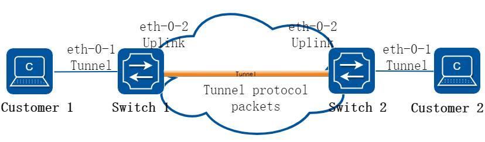

**图3-37 L2 protocol tunnel**

指定的二层协议报文包括STP BPDU 报文，Slow proto 报文，802.1X EAPOL 报文, CFM报文。

在下面的例子中，Switch1 eth-0-1 和Switch2 eth-0-1 配置成tunnel 端口。Switch1 eth-0-2 和Switch2 的eth-0-2 配置成上联口。如果在Switch1 的eth-0-1 口上收到上面三种协议报文，协议报文会加上新的二层头然后从上联口发出。在新的二层头中：目的MAC 是tunnel dmac；源MAC 是交换机的route-mac；VLAN id 是tunnel evc 所对应的VLAN id；VLAN priority 是配置的Layer 2 protocol cos；Ethertype 是0xFFEE。

如果在Switch2 的eth-0-2 上收到带上新二层头的协议报文，协议报文上所带的新二层头会被剥去，然后从Switch2 的eth-0-1 发出。

##### 2. 配置步骤

##### 步骤1 进入配置模式

```
Switch# configure terminal
```

##### 步骤2 进入vlan 配置模式并创建vlan

```
Switch(config)# vlan database
Switch(config-vlan)# vlan 2-4
Switch(config-vlan)# exit
```

##### 步骤3 创建EVC 并关联vlan

```
Switch(config)# ethernet evc evc_c1
Switch(config-evc)# dot1q mapped-vlan 2
Switch(config-evc)# exit
Switch(config)# ethernet evc evc_c2
Switch(config-evc)# dot1q mapped-vlan 3
Switch(config-evc)# exit
Switch(config)# ethernet evc evc_c3
Switch(config-evc)# dot1q mapped-vlan 4
Switch(config-evc)# exit
```

步骤4 全局使能l2 protocol，配置tunnel destination mac 和允许透传的二层协议mac 地址

```
Switch(config)# l2protocol enable
Switch(config)# l2protocol tunnel-dmac 0100.0CCD.CDD2
Switch(config)# l2protocol mac 3 0180.C200.0008
Switch(config)# l2protocol mac 4 0180.C200.0009
Switch(config)# l2protocol full-mac 0100.0CCC.CCCC
```

##### 步骤5 进入端口模式，配置端口属性。将二层协议报文透传到指定evc

```
Switch(config)# interface eth-0-1
Switch(config-if)# no shutdown
Switch(config-if)# switchport mode trunk
Switch(config-if)# switchport trunk allowed vlan add 2-4
Switch(config-if)# spanning-tree port disable
Switch(config-if)# l2protocol mac 3 tunnel evc evc_c1
Switch(config-if)# l2protocol mac 4 tunnel evc evc_c2
Switch(config-if)# l2protocol full-mac tunnel evc evc_c3
Switch(config)# interface eth-0-2
Switch(config-if)# no shutdown
Switch(config-if)# switchport mode trunk
Switch(config-if)# switchport trunk allowed vlan add 2-4
Switch(config-if)# l2protocol uplink enable
```

##### 步骤6 退出配置模式

```
Switch(config-if)# end
```

##### 步骤7 检查配置

使用下列命令，查看tunnel 口的属性：

```
switch1# show l2protocol interface eth-0-1
Interface
PDU Address
MASK
Status
EVC
(u)-Untagged
(t)-Tagged
=========
=================
==============
========
================
eth-0-1
0180.c200.0008(u)
ffff.ffff.ffff
Tunnel
evc_c1
eth-0-1
0180.c200.0008(t)
ffff.ffff.ffff
Tunnel
evc_c1
eth-0-1
0180.c200.0009(u)
ffff.ffff.ffff
Tunnel
evc_c2
eth-0-1
0180.c200.0009(t)
ffff.ffff.ffff
Tunnel
evc_c2
eth-0-1
0100.0ccc.cccc(u)
ffff.ffff.ffff
Tunnel
evc_c3
eth-0-1
0100.0ccc.cccc(t)
ffff.ffff.ffff
Tunnel
evc_c3
eth-0-1
stp(u)
ffff.ffff.ffff
Peer
N/A
eth-0-1
stp(t)
ffff.ffff.ffff
Peer
N/A
eth-0-1
slow-proto(u)
ffff.ffff.ffff
Peer
N/A
eth-0-1
slow-proto(t)
ffff.ffff.ffff
Peer
N/A
eth-0-1
dot1x(u)
ffff.ffff.ffff
Peer
N/A
eth-0-1
dot1x(t)
ffff.ffff.ffff
Peer
N/A
eth-0-1
cfm(u)
ffff.ffff.ffff
Peer
N/A
eth-0-1
cfm(t)
ffff.ffff.ffff
Peer
N/A
eth-0-1
lldp(u)
ffff.ffff.ffff
Peer
N/A
eth-0-1
lldp(t)
ffff.ffff.ffff
Peer
N/A
eth-0-1
cdp(u)
ffff.ffff.ffff
Peer
N/A
eth-0-1
cdp(t)
ffff.ffff.ffff
Peer
N/A
eth-0-1
vtp(u)
ffff.ffff.ffff
Peer
N/A
eth-0-1
vtp(t)
ffff.ffff.ffff
Peer
N/A
```

使用下列命令，查看上联口的属性：

```
switch1# show l2protocol interface eth-0-2
Interface
PDU Address
MASK
Status
EVC
(u)-Untagged
(t)-Tagged
=========
=================
==============
========
================
eth-0-2
0180.c200.0008(u)
ffff.ffff.ffff
Peer
N/A
eth-0-2
0180.c200.0008(t)
ffff.ffff.ffff
Peer
N/A
eth-0-2
0180.c200.0009(u)
ffff.ffff.ffff
Peer
N/A
eth-0-2
0180.c200.0009(t)
ffff.ffff.ffff
Peer
N/A
eth-0-2
0100.0ccc.cccc(u)
ffff.ffff.ffff
Peer
N/A
eth-0-2
0100.0ccc.cccc(t)
ffff.ffff.ffff
Peer
N/A
eth-0-2
stp(u)
ffff.ffff.ffff
Peer
N/A
eth-0-2
stp(t)
ffff.ffff.ffff
Peer
N/A
eth-0-2
slow-proto(u)
ffff.ffff.ffff
Peer
N/A
eth-0-2
slow-proto(t)
ffff.ffff.ffff
Peer
N/A
eth-0-2
dot1x(u)
ffff.ffff.ffff
Peer
N/A
eth-0-2
dot1x(t)
ffff.ffff.ffff
Peer
N/A
eth-0-2
cfm(u)
ffff.ffff.ffff
Peer
N/A
eth-0-2
cfm(t)
ffff.ffff.ffff
Peer
N/A
eth-0-2
lldp(u)
ffff.ffff.ffff
Peer
N/A
eth-0-2
lldp(t)
ffff.ffff.ffff
Peer
N/A
eth-0-2
cdp(u)
ffff.ffff.ffff
Peer
N/A
eth-0-2
cdp(t)
ffff.ffff.ffff
Peer
N/A
eth-0-2
vtp(u)
ffff.ffff.ffff
Peer
N/A
eth-0-2
vtp(t)
ffff.ffff.ffff
Peer
N/A
eth-0-2
N/A
N/A
Uplink
N/A
```

使用下列命令，查看tunnel 的目的mac 地址

```
Switch1# show l2protocol tunnel-dmac
Layer2 protocols tunnel destination MAC address is 0100.0ccd.cdd2
```

## 3.15 MSTP配置

### 3.15.1 概述

#### 简介

MST（Multiple Spanning Tree）多生成树（MST）是把IEEE802.1w 的快速生成树（RST）

算法扩展而得到的。MST 能够通过trunk 链路建立多个生成树，关联VLANs 到相关的生成树实例，并且每个生成树实例可以具备区别于其他实例的拓扑结构。MST 提供了多个数据转发路径和负载均衡，提高了网络容错能力。因为一个实例（转发路径）的故障不会影响其他实例（转发路径）。一个生成树实例只能存在于一致的VLAN 实例分配的桥中，必须用同样的MST 配置信息来配置一组桥，这使得这些桥能属于同一组生成树实例，具备同样的MST 配置信息的互连的桥构成多生成树区（MST Region）。MSTP 将环路网络修剪成为一个无环的树型网络，避免报文在环路网络中的增生和无限循环，同时还提供了数据转发的多个冗余路径，在数据转发过程中实现VLAN 数据的负载均衡。MSTP 兼容STP和RSTP，并且可以弥补STP 和RSTP 的缺陷。它既可以快速收敛，也能使不同VLAN 的流量沿各自的路径分发，从而为冗余链路提供了更好的负载分担机制。

### 3.15.2 配置举例

##### 1. 组网拓扑

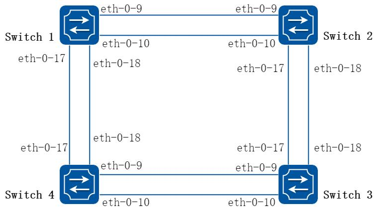

**图3-38 MSTP**

Switch1-Switch4 配置如下步骤所示。如无特别说明，则4 台设备配置相同。

##### 2. 配置步骤

##### 步骤1 进入配置模式

```
Switch# configure terminal
```

##### 步骤2 配置STP 模式

```
Switch(config)# spanning-tree mode mstp
```

##### 步骤3 进入vlan 配置模式并创建vlan

```
Switch(config)# vlan database
Switch(config-vlan)# vlan 10
Switch(config-vlan)# vlan 20
Switch(config-vlan)# exit
```

##### 步骤4 进入MSTP 配置模式，创建域和实例，将vlan 关联到实例

```
Switch(config)# spanning-tree mst configuration
Switch(config-mst)# region RegionName
Switch(config-mst)# instance 1 vlan 10
Switch(config-mst)# instance 2 vlan 20
Switch(config-mst)# exit
```

##### 步骤5 进入端口配置模式，配置端口属性和允许通过的vlan

```
Switch(config)# interface eth-0-9
Switch(config-if)# switchport mode trunk
Switch(config-if)# switchport trunk allowed vlan all
Switch(config-if)# no shutdown
Switch(config-if)# exit
```

```
Switch(config)# interface eth-0-10
Switch(config-if)# switchport mode trunk
Switch(config-if)# switchport trunk allowed vlan all
Switch(config-if)# no shutdown
Switch(config-if)# exit
Switch(config)# interface eth-0-17
Switch(config-if)# switchport mode trunk
Switch(config-if)# switchport trunk allowed vlan all
Switch(config-if)# no shutdown
Switch(config-if)# exit
Switch(config)# interface eth-0-18
Switch(config-if)# switchport mode trunk
Switch(config-if)# switchport trunk allowed vlan all
Switch(config-if)# no shutdown
Switch(config-if)# exit
```

##### 步骤6 在不同设备分别配置STP 优先级并使能STP

Switch1 配置：

```
Switch1(config)# spanning-tree priority 0
Switch1(config)# spanning-tree enable
```

Switch2 配置：

```
Switch2(config)# spanning-tree instance 1 priority 0
Switch2(config)# spanning-tree enable
```

Switch3 配置：

```
Switch3(config)# spanning-tree instance 2 priority 0
Switch3(config)# spanning-tree enable
```

Switch4 配置：

```
Switch4(config)# spanning-tree enable
```

##### 步骤7 退出配置模式

```
Switch(config)# end
```

##### 步骤8 检查配置

使用下列命令显示Switch1 的mstp 端口状态：

```
Switch1# show spanning-tree mst brief
##### MST0:
Vlans: 1
Multiple spanning tree protocol Enabled
Root ID
Priority
0 (0x0000)
Address
2225.fa28.c900
Hello Time
2 sec
Max Age
20 sec Forward Delay 15 sec
Bridge ID
Priority
0 (0x0000)
Address
2225.fa28.c900
Hello Time
2 sec
Max Age
20 sec Forward Delay 15 sec
Aging Time
300 sec
Interface
Role
State
Cost
Priority.Number
Type
--------------------------------------------------------------------------------
```

```
eth-0-9
Designated
Forwarding
20000
128.9
P2p
eth-0-10
Designated
Forwarding
20000
128.10
P2p
eth-0-17
Designated
Forwarding
20000
128.17
P2p
eth-0-18
Designated
Forwarding
20000
128.18
P2p
##### MST1:
Vlans: 10
Root ID
Priority
1 (0x0001)
Address
9c9a.7d91.9f00
Bridge ID
Priority
32769 (0x8001)
Address
2225.fa28.c900
Interface
Role
State
Cost
Priority.Number
Type
--------------------------------------------------------------------------------
eth-0-9
Rootport
Forwarding
20000
128.9
P2p
eth-0-10
Alternate
Discarding
20000
128.10
P2p
eth-0-17
Designated
Forwarding
20000
128.17
P2p
eth-0-18
Designated
Forwarding
20000
128.18
P2p
##### MST2:
Vlans: 20
Root ID
Priority
2 (0x0002)
Address
304c.275b.b200
Bridge ID
Priority
32770 (0x8002)
Address
2225.fa28.c900
Interface
Role
State
Cost
Priority.Number
Type
--------------------------------------------------------------------------------
eth-0-9
Alternate
Discarding
20000
128.9
P2p
eth-0-10
Alternate
Discarding
20000
128.10
P2p
eth-0-17
Rootport
Forwarding
20000
128.17
P2p
eth-0-18
Alternate
Discarding
20000
128.18
P2p
```

使用下列命令显示Switch2 的mstp 端口状态：

```
Switch2# show spanning-tree mst brief
##### MST0:
Vlans: 1
Multiple spanning tree protocol Enabled
Root ID
Priority
0 (0x0000)
Address
2225.fa28.c900
Hello Time
2 sec
Max Age
20 sec Forward Delay 15 sec
Bridge ID
Priority
32768 (0x8000)
Address
9c9a.7d91.9f00
Hello Time
2 sec
Max Age
20 sec Forward Delay 15 sec
Aging Time
300 sec
Interface
Role
State
Cost
Priority.Number
Type
--------------------------------------------------------------------------------
eth-0-9
Rootport
Forwarding
20000
128.9
P2p
eth-0-10
Alternate
Discarding
20000
128.10
P2p
eth-0-17
Designated
Forwarding
20000
128.17
P2p
eth-0-18
Designated
Forwarding
20000
128.18
P2p
##### MST1:
Vlans: 10
Root ID
Priority
1 (0x0001)
Address
9c9a.7d91.9f00
Bridge ID
Priority
1 (0x0001)
Address
9c9a.7d91.9f00
Interface
Role
State
Cost
Priority.Number
Type
--------------------------------------------------------------------------------
eth-0-9
Designated
Forwarding
20000
128.9
P2p
eth-0-10
Designated
Forwarding
20000
128.10
P2p
eth-0-17
Designated
Forwarding
20000
128.17
P2p
eth-0-18
Designated
Forwarding
20000
128.18
P2p
```

```
##### MST2:
Vlans: 20
Root ID
Priority
2 (0x0002)
Address
304c.275b.b200
Bridge ID
Priority
32770 (0x8002)
Address
9c9a.7d91.9f00
Interface
Role
State
Cost
Priority.Number
Type
--------------------------------------------------------------------------------
eth-0-9
Designated
Forwarding
20000
128.9
P2p
eth-0-10
Designated
Forwarding
20000
128.10
P2p
eth-0-17
Rootport
Forwarding
20000
128.17
P2p
eth-0-18
Alternate
Discarding
20000
128.18
P2p
```

使用下列命令显示Switch3 的mstp 端口状态：

```
Switch3# show spanning-tree mst brief
### MST0:
Vlans: 1
Multiple spanning tree protocol Enabled
Root ID
Priority
0 (0x0000)
Address
2225.fa28.c900
Hello Time
2 sec
Max Age
20 sec Forward Delay 15 sec
Bridge ID
Priority
32768 (0x8000)
Address
304c.275b.b200
Hello Time
2 sec
Max Age
20 sec Forward Delay 15 sec
Aging Time
300 sec
Interface
Role
State
Cost
Priority.Number
Type
--------------------------------------------------------------------------------
eth-0-9
Rootport
Forwarding
20000
128.9
P2p
eth-0-10
Alternate
Discarding
20000
128.10
P2p
eth-0-17
Alternate
Discarding
20000
128.17
P2p
eth-0-18
Alternate
Discarding
20000
128.18
P2p
##### MST1:
Vlans: 10
Root ID
Priority
1 (0x0001)
Address
9c9a.7d91.9f00
Bridge ID
Priority
32769 (0x8001)
Address
304c.275b.b200
Interface
Role
State
Cost
Priority.Number
Type
--------------------------------------------------------------------------------
eth-0-9
Designated
Forwarding
20000
128.9
P2p
eth-0-10
Designated
Forwarding
20000
128.10
P2p
eth-0-17
Rootport
Forwarding
20000
128.17
P2p
eth-0-18
Alternate
Discarding
20000
128.18
P2p
##### MST2:
Vlans: 20
Root ID
Priority
2 (0x0002)
Address
304c.275b.b200
Bridge ID
Priority
2 (0x0002)
Address
304c.275b.b200
Interface
Role
State
Cost
Priority.Number
Type
--------------------------------------------------------------------------------
eth-0-9
Designated
Forwarding
20000
128.9
P2p
eth-0-10
Designated
Forwarding
20000
128.10
P2p
eth-0-17
Designated
Forwarding
20000
128.17
P2p
eth-0-18
Designated
Forwarding
20000
128.18
P2p
```

使用下列命令显示Switch4 的mstp 端口状态：

```
Switch4# show spanning-tree mst brief
##### MST0:
Vlans: 1
```

```
Multiple spanning tree protocol Enabled
Root ID
Priority
0 (0x0000)
Address
2225.fa28.c900
Hello Time
2 sec
Max Age
20 sec Forward Delay 15 sec
Bridge ID
Priority
32768 (0x8000)
Address
80a4.be55.6400
Hello Time
2 sec
Max Age
20 sec Forward Delay 15 sec
Aging Time
300 sec
Interface
Role
State
Cost
Priority.Number
Type
--------------------------------------------------------------------------------
eth-0-9
Designated
Forwarding
20000
128.9
P2p
eth-0-10
Designated
Forwarding
20000
128.10
P2p
eth-0-17
Rootport
Forwarding
20000
128.17
P2p
eth-0-18
Alternate
Discarding
20000
128.18
P2p
##### MST1:
Vlans: 10
Root ID
Priority
1 (0x0001)
Address
9c9a.7d91.9f00
Bridge ID
Priority
32769 (0x8001)
Address
80a4.be55.6400
Interface
Role
State
Cost
Priority.Number
Type
--------------------------------------------------------------------------------
eth-0-9
Alternate
Discarding
20000
128.9
P2p
eth-0-10
Alternate
Discarding
20000
128.10
P2p
eth-0-17
Rootport
Forwarding
20000
128.17
P2p
eth-0-18
Alternate
Discarding
20000
128.18
P2p
##### MST2:
Vlans: 20
Root ID
Priority
2 (0x0002)
Address
304c.275b.b200
Bridge ID
Priority
32770 (0x8002)
Address
80a4.be55.6400
Interface
Role
State
Cost
Priority.Number
Type
--------------------------------------------------------------------------------
eth-0-9
Rootport
Forwarding
20000
128.9
P2p
eth-0-10
Alternate
Discarding
20000
128.10
P2p
eth-0-17
Designated
Forwarding
20000
128.17
P2p
eth-0-18
Designated
Forwarding
20000
128.18
P2p
```

## 3.16 MLAG配置

### 3.16.1 概述

#### 简介

在高可靠性的网络拓扑中，典型的应用会通过两台聚合交换机来连接TOR 交换机或服务器以提供冗余保护与负载分担。在这样的拓扑结构中，生成树协议（STP）通过block聚合交换机的一半的接口来防止网络环路，但这样做会导致网络带宽利用率减半，即使使用MSTP 可以一定程度上提高带宽利用率，但增加了组网复杂度，不利于运维和问题定位。

通过部署MLAG（Multi-Chassis Link Aggregation）即跨设备链路聚合组可以解决这个问题。MLAG 是一种实现跨设备链路聚合的机制，将两台聚合交换机上的接口进行跨设备链路聚合，从而把可靠性从链路级提高到了设备级，组成双活系统（Active-Active System）. 在两台聚合交换机的中间通过一条Peer-link 链路进行连接，使其在逻辑上如同一台设备。两台设备上的接口共同形成聚合接口，使得所有接口可以同时参与数据流量的转发。

#### 背景

与堆叠相比，组成MLAG 的设备在管理上仍然需要分别管理，但是MLAG 配置相对简单，大大降低脑裂的风险，且配置完成后不需重启，同时转发决策都在本地，正常情况下流量不需走设备间互连路径，避免了互连路径带宽成为瓶颈的同时也降低了延时。

相比传统网络，MLAG 具备以下优势：

在网络流量增加的时候提供了更高的带宽，更高的可靠性；

MLAG 提供了一个没有环路的二层拓扑同时实现冗余备份，不再需要繁琐地配置生成树协议，极大的简化了组网及配置；

使用静态LAG 或者LACP 来连接其他交换机或者服务器，而不需要借助其他协议；

提供了active-active 的二层冗余保护；

两台设备可以分别进行独立升级，保证有一台设备正常工作即可，对正在运行的业务几乎没有影响

#### 原理描述

##### 1. 基本原理

##### 基本概念

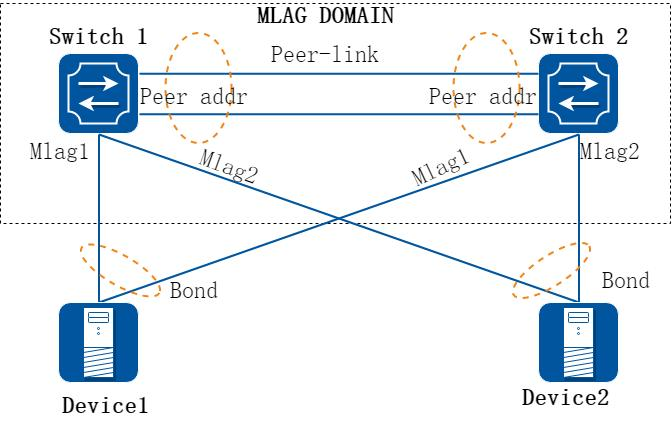

**图3-39 MLAG 组网示意图**

上图为MLAG 组网示意图,其中MLAG 域由两台交换机组成，与其连接的设备可以是服务器，也可以是交换机，或者是另一个MLAG 域。Switch 1 与Switch 2 上各有两个口加入不同的MLAG 组中，其中相关术语解释如下：

MLAG：Multi-Chassis Link Aggregation 跨设备链路聚合，组成MLAG 的两台设备互称MLAG Peer MLAG 组：加入同一MLAG 组的接口，对外表现为同一个聚合接口。

Orphan Port : MLAG 设备上未加入MLAG 组的接口称为Orphan Port Peer-link：用于组成MLAG 的两个设备之间互联，当一侧的MLAG 组内的接口故障时，流量通过Peer-link 引至MLAG Peer 设备进行转发。

Peer-address：对端MLAG Peer 设备上MLAG 协议的通信地址。

Reload-delay：设备重启后，非Peer-link 接口将Errdisable 一段时间，用于防止在MLAG 状态建立起来之前网络成环，该定时器超时后，接口将自动up（此时间可配置）。

System ID : 默认为设备的Route-MAC 地址,用于MLAG 中Master 设备和Slave 设备的角色选举。（非LACP System-id）

##### 转发原理（正常转发）

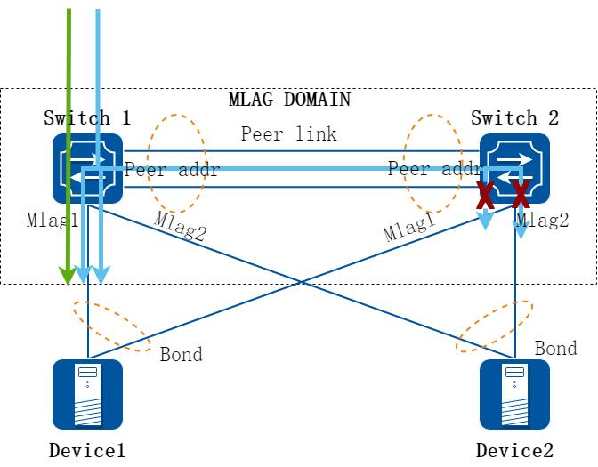

**图3-40 MLAG 报文转发示意图**

如上图所示，以下是MLAG 建立过程及转发原理Switch1 和Switch2 通过Peer-address 建立TCP 连接，交互MLAG 协议报文，建立MLAG 邻居关系；

通过MLAG 协议报文中携带的System ID大小进行Master/Slave 的选举，选择System ID 较大的为Master，默认情况下，MLAG 系统采用Master 设备的System ID 作为整个系统的LACP System MAC；

邻居建立之后，设备间发送keepalive 报文，并启动超时机制，如果hold time 时间内没有收到keepalive 报文时，认为MLAG 邻居已断开，设备恢复成单台运行状态；

两台设备绑定到同一个MLAG 组中的聚合接口，逻辑上视为同一个聚合口。

MLAG 口所绑定的聚合口上收到报文进行MAC 学习时，会把学到的MAC 同步到Peer设备，以保持两边MAC 的同步；

对于的已知单播流量，由于两边各自都有MAC 表项，会各自直接查本地的MAC 表项来进行转发，图中用绿色线表示从SWITCH 1 进入的流量，在SWITCH 1 本地查表转发，从SWITCH 2 进来的流量图中未标示，转发原理与从SWITCH 1 进来的流量相同。

对于未知单播/广播等需要泛洪的流量，如图中蓝色线所示，会通过PEER-LINK 泛洪MLAG PEER 设备，通过MLAG 协议SWITCH 2 上看到SWTICH1 上MLAG 1 和2 都处于UP 状态，因此SWITCH 2 会将这部分流量丢弃，防止流量环回及双倍流量问题。

失效保护（MLAG 接口失效）

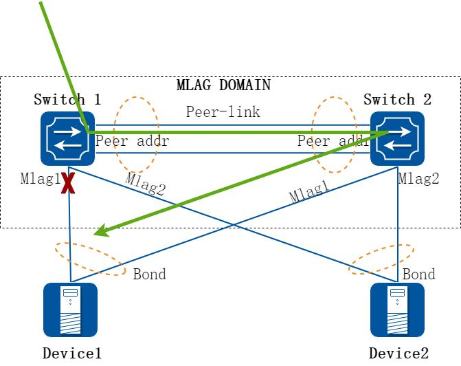

**图3-41 MLAG 对单播报文保护切换**

如上图所示，Switch 1 上的MLAG 1 接口失效的时候，为保护单播流量的正常转发，系统做如下处理：

当Switch 1 上系统检测出有MLAG 组内所有接口都失效的时候，进行MAC 表的更新操作，将数据流量引向peer link；

数据报文从peer link 到达Switch 2 上继续查MAC 表，从Switch 2 上对应的MLAG组中转发出来；

当Switch 1 上失效的MLAG 接口重新恢复时，系统进行回切操作；

切换只影响原出口失效掉的部分流量，不会影响到其他流量，即只影响图中Switch

1 上到MLAG 1 的流量，到MLAG 2 的流量还是按正常转发

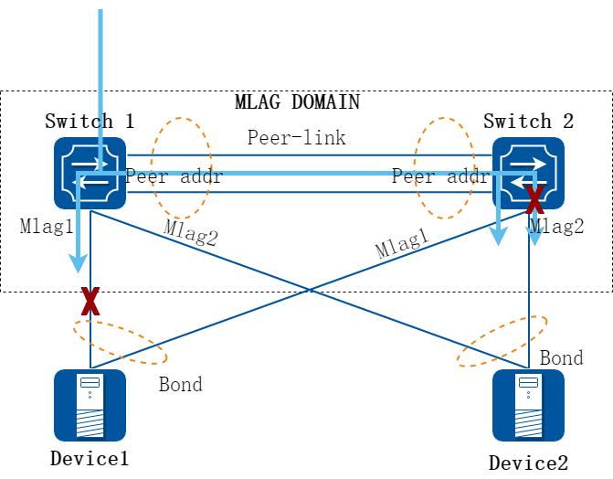

**图3-42 MLAG 对泛洪流量的保护**

如上图所示，Switch 1 上的MLAG 1 接口失效的时候，为保证泛洪流量转发，系统做如下处理：

当Switch 1 发现本地的MLAG 1 接口失效时，通过MLAG 协议通知Switch 2，Switch

2 收到消息后不再丢弃到MLAG 1 上的报文；

当MLAG 接口从失效状态重新恢复时，Switch 1 也会通过MLAG 协议通知Switch 2，Switch 2 恢复正常状态处理；

失效保护（Peer-link 失效）

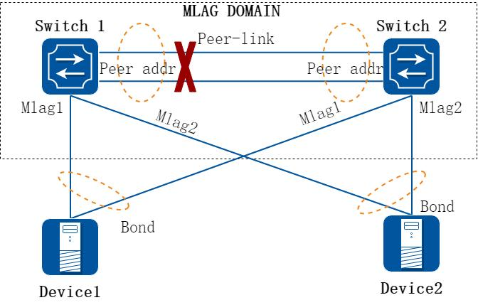

**图3-43 Peer-link 失效保护**

如上图所示，当Mlag 配置中的Peer Link 断开时，为避免出现环路，系统作如下处理：

当Peer link 断开，hold time 超时后，MLAG 设备会分裂成为两台独立的交换机。

如果Device 1 和Device 2 与MLAG 设备之间使用LACP 聚合组连接，当Peer link失效后MLAG 分裂，SWITCH 1 与SWITCH 2 各自使用不同LACP systemID，因此Device的上联链路将只有一条处于active 状态，无环路风险如果Device 1 和Device 2 与MLAG 设备间使用静态链路聚合组连接，此时Device上两条链路还是都处于active 状态，但是由于同一聚合组的成员口之间不会互相转发流量，此时也不会造成环路

##### 2. 周边特性

LACP 与MLAG实现LACP for MLAG 需要与MLAG 对接的设备能将来自组成MLAG 的两台设备的lacp 报文识别成来自同一个channel group：

两台MLAG 设备在MLAG interface 发送的LACP 报文拥有相同的Actor System Priority 和Actor System ID；

两台MLAG 设备在同一MLAG interface 发送的LACP 报文拥有相同的Actor Key；

因此MLAG 设备的LACP System id 使用了master 设备的LACP Sytem ID（LACP System ID由LACP System Priority 和LACP System MAC 组成），Master 设备会将自己的LACP System ID 同步给Slave 设备。

由于Slave 设备在MLAG 状态建立的情况下，使用Master 设备的LACP System MAC，那么当MLAG 设备宕机或重启的时候，Slave 设备的MLAG 状态会变为断开，此时Slave 设备将切换为自身的LACP System MAC，这会导致LACP 协议重新协商，LACP 链路由up 到down，然后再up，为了增强这类场景下的可靠性，交换机提供命令行，手工配置两台MLAG 设备使用的LACP System MAC。在手工配置后，所有MLAG 接口均使用配置的LACP System MAC。

LACP System ID 为LACP 协议概念，用于在LACP 协议中标示一台设备。聚合模式优先选择LACP 模式，避免线路单通问题，只有对端不支持lacp 时，才使用静态聚合。

ISSU 与MLAG MLAG 设备采用Errdisable 机制来实现ISSU，当设备升级完成需要重启后，配置了MLAG的设备会将本地的业务接口Errdisable 一段时间，这段时间用来进行MLAG 状态重新协商和表项同步，待该定时器超时之后，业务接口恢复正常。该时间可以通过reload-delay命令行配置，默认为300 秒。

处于Errdisable 的接口与处于down 状态的接口类似，不参与转发，可通过命令no shutdown 恢复，通过命令show errdisable recovery 查看。

VARP 与MLAG系统提供全局配置virtual mac 和接口配置virtual ip，以便给与MLAG 设备相连的对端设备以统一的网关地址，包括ip 地址和mac 地址。不论是哪台设备收到这样的virtual ip 和virtual mac 的报文，都能在本地进行正确的处理。Virtual ip 可以与接口主ip在同一网段，也可在不同网段，每个接口最多配置15 个Virtual ip,交换机全局只能支持一个Virtual MAC。

virtual mac 需要配置为一个本地不存在的mac 地址，不能和设备的route-mac 或者接口的mac 地址相同。

服务器与MLAG 设备对接对于双网卡服务器，一般都会将服务器bond 值设置为4，此种环境下交换机端需要配置动态聚合模式与其对接，聚合口加入mlag 组，使用4.5 章节的channel-group 命令配置动态聚合组。

服务器的bond 值设置为bond0 或者bond2 时，交换机端需要配置静态接口聚合，聚合口加入mlag 组；其他情况不需要配置mlag 组。

### 3.16.2 限制与注意事项

Peer-address 只支持直连网段的地址。

处于Errdisable 的接口与处于shutdown 状态的接口一样，不参与转发。

Reload-delay 原因造成的Errdisable 定时器超时后会自动恢复，双主检测造成不会恢复。通过命令show errdisable recovery 查看状态；也可通过命令shutdown/no shutdown 手动恢复。

目前MLAG 不支持组播表项同步，在组播环境中组播数据流量将泛洪转发，不建议在组播场景使用MLAG。建议在MLAG 设备上关闭igmp snooping 功能（默认打开）。

使能MLAG 的设备如果需要使用STP，应该开启e-stp 功能。

### 3.16.3 配置举例

#### MLAG 基本配置

##### 1. 组网拓扑

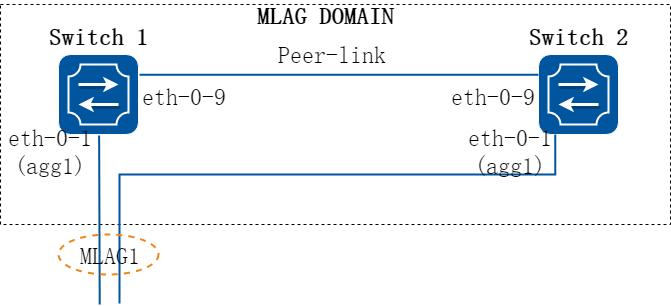

**图3-44 MLAG**

Switch 1/Switch 2 配置如下步骤所示。如无特别说明，则2 台设备配置相同。

##### 2. 配置步骤

##### 步骤1 进入配置模式

```
Switch# configure terminal
```

##### 步骤2 进入vlan 配置模式并创建vlan

```
Switch(config)# vlan database
Switch(config-vlan)# vlan 10,4094
Switch(config-vlan)# exit
```

##### 步骤3 创建静态AGG 属性

```
Switch(config)# interface eth-0-1
Switch(config-if)# static-channel-group 1
Switch(config-if)# no shutdown
Switch(config-if)# exit
```

##### 步骤4 提前准备配置peer link interface 的属性

eth-0-9 将用作peer link，提前配置如下属性：

```
Switch(config)# interface eth-0-9
Switch(config-if)# switchport mode trunk
Switch(config-if)# switchport trunk allowed vlan all
Switch(config-if)# spanning-tree port disable
Switch(config-if)# no shutdown
Switch(config-if)# exit
```

##### 步骤5 将AGG 口加入mlag

```
Switch(config)# interface agg1
Switch(config-if)# switchport mode trunk
```

```
Switch(config-if)# switchport trunk allowed vlan add 10
Switch(config-if)# mlag 1
Switch(config-if)# exit
```

##### 步骤6 配置vlan interface 的属性

配置SWITCH 1

```
Switch(config)# interface vlan4094
Switch(config-if)# ip address 12.1.1.1/24
Switch(config-if)# exit
```

配置SWITCH 2

```
Switch(config)# interface vlan4094
Switch(config-if)# ip address 12.1.1.2/24
Switch(config-if)# exit
```

##### 步骤7 进入MLAG 模式，配置相关属性

配置SWITCH 1

```
Switch(config)# mlag configuration
Switch(config-mlag)# peer-link eth-0-9
Switch(config-mlag)# peer-address 12.1.1.2
Switch(config-mlag)# exit
```

配置SWITCH 2

```
Switch(config)# mlag configuration
Switch(config-mlag)# peer-link eth-0-9
Switch(config-mlag)# peer-address 12.1.1.1
Switch(config-mlag)# end
```

##### 步骤8 配置MLAG 优先级属性(可选）

优先级取值范围1-254，数字越大优先级越高。默认没有优先级，没有配置优先级时对比MAC 地址。更高优先级的设备可以被选举为mlag 的主设备。

注意：该属性在V0.0.1 及之后版本上可配，如果对端设备低于此版本，建议不要配置，避免造成协商过程异常。

配置SWITCH 1

```
Switch(config)# mlag configuration
Switch(config-mlag)# priority 10
Switch(config-mlag)# exit
```

配置SWITCH 2

```
Switch(config)# mlag configuration
Switch(config-mlag)# priority 20
Switch(config-mlag)# exit
```

##### 步骤9 检查配置

使用下列命令查看Switch 1 的mlag 状态：

```
Switch# show mlag
MLAG configuration:
-----------------
```

```
role
: Master
local_sysid : ea90.aecc.cc00
mlag_sysid
: ea90.aecc.cc00
peer-link
: eth-0-9
peer conf
: Yes
Switch# show mlag interface
mlagid
local-if
local-state
remote-state
1
agg1
up
up
Switch# show mlag peer
MLAG neighbor is 12.1.1.2, MLAG version 1
MLAG state = Established, up for 00:13:07
Last read 00:00:48, hold time is 240, keepalive interval is 60 seconds
Received 17 messages,Sent 19 messages
Open
: received 1, sent 2
KAlive
: received 15, sent 16
Fdb sync : received 0, sent 0
Failover : received 0, sent 0
Conf
: received 1, sent 1
Connections established 1; dropped 0
Local host: 12.1.1.1, Local port: 61000
Foreign host: 12.1.1.2, Foreign port: 46157
remote_sysid: baa7.8606.8b00
```

使用下列命令查看Switch 1 的mac 表：

```
Switch# show mac address-table
Mac Address Table
-------------------------------------------
(*) - Security Entry
Vlan
Mac Address
Type
Ports
----
-----------
--------
-----
```

使用下列命令查看Switch 2 的mlag 状态：

```
Switch# show mlag
MLAG configuration:
-----------------
role
: Slave
local_sysid : baa7.8606.8b00
mlag_sysid
: ea90.aecc.cc00
peer-link
: eth-0-9
peer conf
: Yes
Switch# show mlag interface
mlagid
local-if
local-state
remote-state
1
agg1
up
up
Switch# show mlag peer
MLAG neighbor is 12.1.1.1, MLAG version 1
MLAG state = Established, up for 00:14:29
Last read 00:00:48, hold time is 240, keepalive interval is 60 seconds
Received 19 messages,Sent 19 messages
Open
: received 1, sent 1
KAlive
: received 17, sent 17
```

```
Fdb sync : received 0, sent 0
Failover : received 0, sent 0
Conf
: received 1, sent 1
Connections established 1; dropped 0
Local host: 12.1.1.2, Local port: 46157
Foreign host: 12.1.1.1, Foreign port: 61000
remote_sysid: ea90.aecc.cc00
```

使用下列命令查看Switch 2 的mac 表：

```
Switch# show mac address-table
Mac Address Table
-------------------------------------------
(*) - Security Entry
Vlan
Mac Address
Type
Ports
----
-----------
--------
-----
```

#### 配置MLAG 双主检测(可选)

##### 1. 组网拓扑

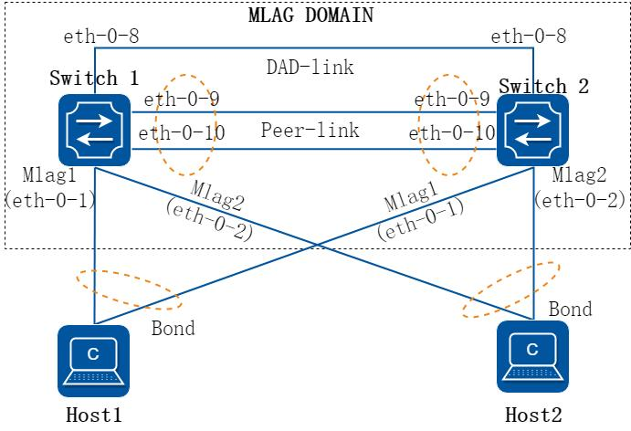

**图3-45 MLAG**

##### 2. 组网需求

两台设备组成MLAG。使用独立的链路（eth-0-8 直连）作为双主检测的专用链路。当Peer link 断开，但是专用链路仍能收到对端的报文时，作为MLAG slave 的设备会将MLAG 端口设为err-disable 状态来避免网络异常。

##### 3. 配置步骤

##### 步骤1 进入配置模式

```
Switch# configure terminal
```

##### 步骤2 配置三层接口及其接口地址

配置SWITCH 1

```
Switch(config)# interface eth-0-8
Switch(config-if)# no switchport
Switch(config-if)# no shutdown
Switch(config-if)# ip address 12.1.2.1/24
Switch(config-if)# exit
```

配置SWITCH 2

```
Switch(config)# interface eth-0-8
Switch(config-if)# no switchport
Switch(config-if)# no shutdown
Switch(config-if)# ip address 12.1.2.2/24
```

##### 步骤3 配置MLAG 双主检测相关参数

在两台设备分别配置双主检测会话的本地地址和远端地址。并建议将双主检测链路的端口设置为reserved interface，这个端口不会在故障时被双主检测机制被设为err-disable。

配置SWITCH 1

```
Switch(config)# mlag configuration
Switch(config-mlag)# dual-active-detection source 12.1.2.1 peer 12.1.2.2
Switch(config-mlag)# dual-active-detection reserved interface eth-0-8
Switch(config-mlag)# exit
```

配置SWITCH 2

```
Switch(config-if)# exit
Switch(config)# mlag configuration
Switch(config-mlag)# dual-active-detection source 12.1.2.2 peer 12.1.2.1
Switch(config-mlag)# dual-active-detection reserved interface eth-0-8
Switch(config-mlag)# exit
```

##### 步骤4 检查配置

使用下列命令查看Switch 1 的MLAG 双主检测相关信息

```
Switch# show mlag dad
MLAG DAD:
-----------------
status
: UP
src ip
: 12.1.2.1
peer ip
: 12.1.2.2
vrf
: -
udp port
: 1025
interval
: 1
timeout
: 3
updelay
: 240
switch-delay : -
receive
: ON
send
: ON
HB src ip
: 12.1.2.2
HB peer ip
: 12.1.2.1
HB mac
: baa7.8606.8b00
```

```
HB priority
: 0
HB role
: Master
DAD occur
: No
```

使用下列命令查看Switch 2 的MLAG 双主检测相关信息

```
Switch# show mlag dad
MLAG DAD:
-----------------
status
: UP
src ip
: 12.1.2.2
peer ip
: 12.1.2.1
vrf
: -
udp port
: 1025
interval
: 1
timeout
: 3
updelay
: 240
switch-delay : -
receive
: ON
send
: ON
HB src ip
: 12.1.2.1
HB peer ip
: 12.1.2.2
HB mac
: ea90.aecc.cc00
HB priority
: 0
HB role
: Slave
DAD occur
: No
```

#### 配置E-STP (可选)

注意事项：

peer-link 接口和绑定了mlag 的agg 接口，不能配置stp 链路开销、stp 接口优先级、stp 链路类型。

如果已经配置了stp 链路开销、stp 接口优先级、stp 链路类型的接口，设置为peer-link 或mlag 时，上述配置会恢复到默认值。系统记录log开启e-stp 后设备仅支持工作在stp 或者rstp 模式，不支持工作在mstp 模式。

开启e-stp 后，组成mlag 两台设备的stp 全局相关参数、绑定mlag 的agg 接口stp 参数建议一致，否则会影响stp 收敛。

##### 步骤1 进入配置模式

```
Switch# configure terminal
```

##### 步骤2 配置spanning-tree 模式(可选)

支持stp 和rstp 模式, 默认为rstp。

```
Switch(config)# spanning-tree mode stp
```

##### 步骤3 在不同设备分别使能STP 和E-STP

```
Switch(config)# spanning-tree enable
Switch(config)# spanning-tree e-stp enable
```

##### 步骤4 peer-link 上使能STP

默认情况下端口STP 是使能的，如果之前禁用了，需要使用下列命令开启。

```
Switch(config)# interface eth-0-9
Switch(config-if)# spanning-tree port enable
Switch(config-if)# exit
```

##### 步骤5 检查配置

使用下列命令查看Switch 1 的e-stp 状态

```
Switch# show spanning-tree e-stp
E-STP enabled
Config Bridge Id 8000ea90aecccc00
Active Bridge Id 8000ea90aecccc00
Peer-link eth-0-9
Bridge up - Spanning Tree Enabled
Mode - Rapid spanning tree protocol
Path Cost Standard - dot1t
Root Path Cost 0 - Root Port 0 -
Bridge Priority 32768
Forward Delay 15 - Hello Time 2 - Max Age 20
Tx Hold Count 6
Root Id 8000ea90aecccc00
Bridge Id 8000ea90aecccc00
Last topology change Tue Oct 10 06:50:44 2023
Edgeport bpdu-filter disabled
Edgeport bpdu-guard disabled
Edgeport errdisable timeout disabled
Edgeport errdisable timeout interval 300 sec
mlag 1: Port 2051 - Id 8801 - Role Designated - State Forwarding
```

#### 二层转发保护

##### 1. 组网拓扑

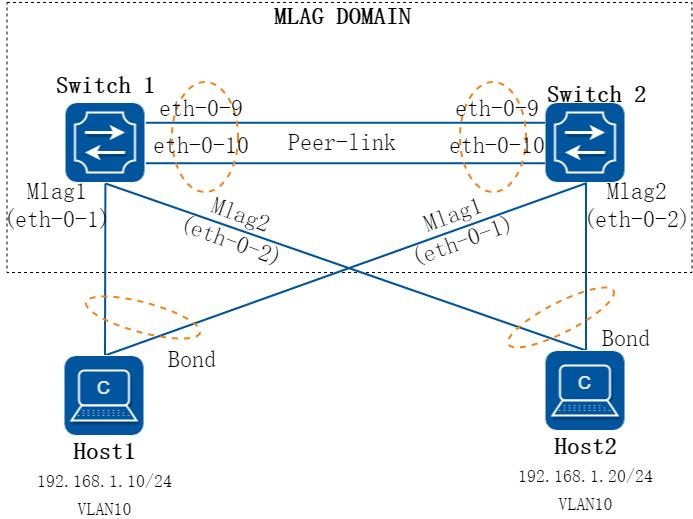

**图3-46 MLAG**

##### 2. 组网需求

Host 1 和Host 2 处于同一网段，其双网卡使用active-active 的方式双归接入到MLAG设备，需求组网无环路，Host 1 与Host 2 之间实现二层互通。其中MLAG 1 使用动态链路聚合，MLAG 2 使用静态链路聚合。

##### 3. 配置步骤

注：示例配置中两台交换机互联使用的channel-group 55，根据各版型规格不同，可自行修改，使用任意channel-group 组序号均不影响本例配置。

##### 步骤1 配置MLAG PEER 互联接口

两台做MLAG 的设备，至少选择两根10G 链路做互联（业务口10G 的情况）

配置SWITCH 1

```
Switch_1# configure terminal
Enter configuration commands, one per line.
End with CNTL/Z.
Switch_1 (config)# interface range eth-0-9 to eth-0-10
Switch_1 (config-if-range)# no shutdown
Switch_1 (config-if-range)# lacp timeout short
Switch_1 (config-if-range)# channel-group 55 mode active
Switch_1 (config-if-range)# exit
Switch_1 (config)# interface agg 55
Switch_1 (config-if)# spanning-tree port disable
Switch_1 (config-if)# switchport mode trunk
Switch_1 (config-if)# switchport trunk allowed vlan all
Switch_1 (config-if)#end
```

配置SWITCH 2

```
Switch_2# configure terminal
Enter configuration commands, one per line.
End with CNTL/Z.
Switch_2(config)# interface range eth-0-9 to eth-0-10
Switch_2 (config-if-range)# no shutdown
Switch_2 (config-if-range)# lacp timeout short
Switch_2(config-if-range)# channel-group 55 mode active
Switch_2(config-if-range)# exit
Switch_2(config)# interface agg 55
Switch_2(config-if)# spanning-tree port disable
Switch_2(config-if)# switchport mode trunk
Switch_2(config-if)# switchport trunk allowed vlan all
Switch_2(config-if)#end
```

##### 步骤2 配置MLAG PEER 通信地址

示例中vlan4094 用于配置mlag 通信地址，建议任何业务口不加入vlan4094，vlan4094仅供peer-link 使用。

配置SWITCH 1

```
Switch_1# configure terminal
Enter configuration commands, one per line.
End with CNTL/Z.
Switch_1(config)# vlan database
Switch_1(config-vlan)# vlan 4094
Switch_1(config-vlan)# exit
Switch_1(config)# interface vlan 4094
Switch_1(config-if)# ip address 10.10.0.1/30
Switch_1(config-if)# end
```

配置SWITCH 2

```
Switch_2# configure terminal
Enter configuration commands, one per line.
End with CNTL/Z.
Switch_2(config)# vlan database
Switch_2(config-vlan)# vlan 4094
Switch_2(config-vlan)# exit
Switch_2(config)# interface vlan 4094
Switch_2(config-if)# ip address 10.10.0.2/30
Switch_2(config-if)# end
```

##### 步骤3 配置MLAG PEER

v7.4.1 及以后的版本已将timers mlag 1 5 设置为默认参数，老版本需要手工配置。

配置SWITCH 1

```
Switch_1# configure terminal
Enter configuration commands, one per line.
End with CNTL/Z.
Switch_1(config)# mlag configuration
Switch_1(config-mlag)# timers mlag 1 5
Switch_1(config-mlag)# peer-link agg55
Switch_1(config-mlag)# peer-address 10.10.0.2
Switch_1(config-mlag)# end
```

配置SWITCH 2

```
Switch_2# configure terminal
Enter configuration commands, one per line.
End with CNTL/Z.
Switch_2(config)# mlag configuration
Switch_2(config-mlag)# timers mlag 1 5
Switch_2(config-mlag)# peer-link agg 55
Switch_2(config-mlag)# peer-address 10.10.0.1
Switch_2(config-mlag)# end
```

##### 步骤4 配置MLAG 接口

注：lacp mlag system-id HHHH.HHHH.HHHH 为自定义的lacp system mac，两台交换机需配置一致，比如0000.0000.aaaa；两组MLAG 级联的时候，两组MLAG 需要配置为不同的值。

配置SWITCH 1

```
Switch_1# configure terminal
Enter configuration commands, one per line.
End with CNTL/Z.
Switch_1(config)# no ip igmp snooping
Switch_1(config)# vlan database
Switch_1(config-vlan)# vlan 10
Switch_1(config-vlan)# exit
```

```
Switch_1(config)# lacp mlag system-id 0000.0000.aaaa
Switch_1(config)# interface eth-0-1
Switch_1(config-if)# no shutdown
Switch_1(config-if)# switchport access vlan 10
Switch_1(config-if)# channel-group 1 mode active
Switch_1(config-if)# exit
Switch_1(config)# interface eth-0-2
Switch_1(config-if)# no shutdown
Switch_1(config-if)# switchport access vlan 10
Switch_1(config-if)# static-channel-group 2
Switch_1(config-if)# exit
Switch_1(config)# interface agg 1
Switch_1(config-if)# mlag 1
Switch_1(config-if)# exit
Switch_1(config)# interface agg 2
Switch_1(config-if)# mlag 2
Switch_1(config-if)# end
```

配置SWITCH 2

```
Switch_2# configure terminal
Enter configuration commands, one per line.
End with CNTL/Z.
Switch_2(config)# no ip igmp snooping
Switch_2(config)# vlan database
Switch_2(config-vlan)# vlan 10
Switch_2(config-vlan)# exit
Switch_2(config)# lacp mlag system-id 0000.0000.aaaa
Switch_2(config)# interface eth-0-1
Switch_2(config-if)# no shutdown
Switch_2(config-if)# switchport access vlan 10
Switch_2(config-if)# channel-group 1 mode active
Switch_2(config-if)# exit
Switch_2(config)# interface eth-0-2
Switch_2(config-if)# no shutdown
Switch_2(config-if)# switchport access vlan 10
Switch_2(config-if)# static-channel-group 2
Switch_2(config-if)# exit
Switch_2(config)# interface agg 1
Switch_2(config-if)# mlag 1
Switch_2(config-if)# exit
Switch_2(config)# interface agg 2
Switch_2(config-if)# mlag 2
Switch_2(config-if)# end
```

##### 步骤5 验证配置结果

检查MLAG 邻居状态，配置完成后MLAG 处于Established 状态。

```
Switch_1# show mlag peer
MLAG neighbor is 10.10.0.2, MLAG version 1
MLAG state = Established, up for 00:00:01
Last read 00:00:01, hold time is 240, keepalive interval is 60 seconds
Received 4 messages,Sent 4 messages
Open
: received 1, sent 1
KAlive
: received 1, sent 1
Fdb sync
: received 0, sent 0
Failover
: received 0, sent 0
```

```
Conf
: received 0, sent 0
Syspri
: received 1, sent 1
Peer fdb : received 1, sent 1
Connections established 1; dropped 0
Local host: 10.10.0.1, Local port: 50040
Foreign host: 10.10.0.2, Foreign port: 61000
remote_sysid: 1a53.71e9.c000
```

检查MLAG 设备状态，两台设备角色分别为Master 和Slave。

```
Switch_1# show mlag
MLAG configuration:
-----------------
role
: Master
local_sysid
: 8e79.b120.2e00
remote_sysid : 1a53.71e9.c000
mlag_sysid
: 8e79.b120.2e00
local_syspri : 32768
remote_syspri: 32768
mlag_syspri
: 32768
peer-link
: agg55
peer conf
: Yes
reload-delay : 300
Switch_2# show mlag
MLAG configuration:
-----------------
role
: Slave
local_sysid
: 1a53.71e9.c000
remote_sysid : 8e79.b120.2e00
mlag_sysid
: 8e79.b120.2e00
local_syspri : 32768
remote_syspri: 32768
mlag_syspri
: 32768
peer-link
: agg55
peer conf
: Yes
reload-delay : 300
```

检查MLAG 组状态，所有接口应都处于UP 状态。

```
Switch_1# show mlag interface
mlagid
local-if
local-state
remote-state
1
agg1
up
up
2
agg2
up
up
```

如果后续业务有拓展，需要新增vlan，则在完成两台设备的新增vlan 配置后，请在两台设备执行clear mac address-table dynamic vlan x，重置该新增vlan的mac 表项，保障两台设备mac 地址表的同步性。在软件版本v7.4.2 及以后，则不再需要做clear mac address-table 操作了，系统会自动同步。

#### MLAG 设备作为三层网关（同一VLAN 上仅有一个地址）

##### 1. 组网拓扑

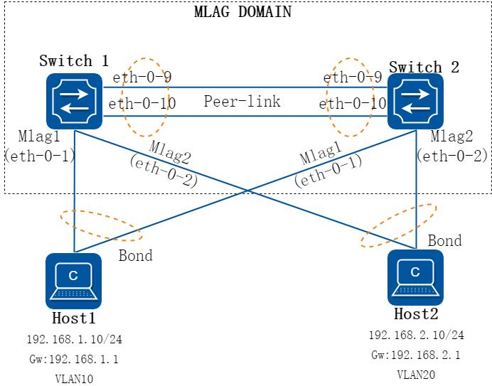

**图3-47 MLAG 三层网关组网图- 单一地址**

##### 2. 组网需求

Host 1，Host 2 使用双网卡active-active 的方式双归接入到MLAG 设备，跨网段通信，其网关部署在MLAG 设备上，需求网关双活，不使用VRRP。

##### 3. 配置步骤

注：示例配置中两台交换机互联使用的channel-group 55，根据各版型规格不同，可自行修改，使用任意channel-group 组序号均不影响本例配置。

##### 步骤1 配置MLAG PEER 互联接口

配置SWITCH 1

```
Switch_1# configure terminal
Enter configuration commands, one per line.
End with CNTL/Z.
Switch_1 (config)# interface range eth-0-9 to eth-0-10
Switch_1 (config-if-range)# no shutdown
Switch_1 (config-if-range)# lacp timeout short
Switch_1 (config-if-range)# channel-group 55 mode active
Switch_1 (config-if-range)# exit
Switch_1 (config)# interface agg 55
Switch_1 (config-if)# spanning-tree port disable
Switch_1 (config-if)# switchport mode trunk
Switch_1 (config-if)# switchport trunk allowed vlan all
Switch_1 (config-if)#end
```

配置SWITCH 2

```
Switch_2# configure terminal
Enter configuration commands, one per line.
End with CNTL/Z.
Switch_2(config)# interface range eth-0-9 to eth-0-10
Switch_2 (config-if-range)# no shutdown
Switch_2 (config-if-range)# lacp timeout short
Switch_2(config-if-range)# channel-group 55 mode active
Switch_2(config-if-range)# exit
Switch_2(config)# interface agg 55
Switch_2(config-if)# spanning-tree port disable
Switch_2(config-if)# switchport mode trunk
Switch_2(config-if)# switchport trunk allowed vlan all
Switch_2(config-if)#end
```

##### 步骤2 配置MLAG PEER 通信地址

配置SWITCH 1

```
Switch_1# configure terminal
Enter configuration commands, one per line.
End with CNTL/Z.
Switch_1(config)# vlan database
Switch_1(config-vlan)# vlan 4094
Switch_1(config-vlan)# exit
Switch_1(config)# interface vlan 4094
Switch_1(config-if)# ip address 10.10.0.1/30
Switch_1(config-if)# end
```

配置SWITCH 2

```
Switch_2# configure terminal
Enter configuration commands, one per line.
End with CNTL/Z.
Switch_2(config)# vlan database
Switch_2(config-vlan)# vlan 4094
Switch_2(config-vlan)# exit
Switch_2(config)# interface vlan 4094
Switch_2(config-if)# ip address 10.10.0.2/30
Switch_2(config-if)# end
```

##### 步骤3 配置MLAG PEER

配置SWITCH 1

```
Switch_1# configure terminal
Enter configuration commands, one per line.
End with CNTL/Z.
Switch_1(config)# mlag configuration
Switch_1(config-mlag)# timers mlag 1 5
Switch_1(config-mlag)# peer-link agg55
Switch_1(config-mlag)# peer-address 10.10.0.2
Switch_1(config-mlag)# end
```

配置SWITCH 2

```
Switch_2# configure terminal
Enter configuration commands, one per line.
End with CNTL/Z.
Switch_2(config)# mlag configuration
Switch_2(config-mlag)# timers mlag 1 5
Switch_2(config-mlag)# peer-link agg 55
Switch_2(config-mlag)# peer-address 10.10.0.1
Switch_2(config-mlag)# end
```

##### 步骤4 配置MLAG 接口

三层场景下，建议将交换机业务口和对端接口，均设置为lacp 短超时模式。使用命令lacp timeout short。

配置SWITCH 1

```
Switch_1# configure terminal
Enter configuration commands, one per line.
End with CNTL/Z.
Switch_1(config)# no ip igmp snooping
Switch_1(config)# vlan database
Switch_1(config-vlan)# vlan 10,20
Switch_1(config-vlan)# exit
Switch_1(config)# interface eth-0-1
Switch_1(config-if)# no shutdown
Switch_1(config-if)# lacp timeout short
Switch_1(config-if)# switchport access vlan 10
Switch_1(config-if)# channel-group 1 mode active
Switch_1(config-if)# exit
Switch_1(config)# interface eth-0-2
Switch_1(config-if)# no shutdown
Switch_1(config-if)# lacp timeout short
Switch_1(config-if)# switchport access vlan 20
Switch_1(config-if)# channel-group 2 mode active
Switch_1(config-if)# exit
Switch_1(config)# interface agg 1
Switch_1(config-if)# mlag 1
Switch_1(config-if)# exit
Switch_1(config)# interface agg 2
Switch_1(config-if)# mlag 2
Switch_1(config-if)# end
```

配置SWITCH 2

```
Switch_2# configure terminal
Enter configuration commands, one per line.
End with CNTL/Z.
Switch_2(config)# no ip igmp snooping
Switch_2(config)# vlan database
Switch_2(config-vlan)# vlan 10,20
Switch_2(config-vlan)# exit
Switch_2(config)# interface eth-0-1
Switch_2(config-if)# no shutdown
Switch_2(config-if)# lacp timeout short
Switch_2(config-if)# switchport access vlan 10
Switch_2(config-if)# channel-group 1 mode active
Switch_2(config-if)# exit
Switch_2(config)# interface eth-0-2
Switch_2(config-if)# no shutdown
Switch_2(config-if)# lacp timeout short
Switch_2(config-if)# switchport access vlan 20
Switch_2(config-if)# channel-group 2 mode active
Switch_2(config-if)# exit
Switch_2(config)# interface agg 1
Switch_2(config-if)# mlag 1
Switch_2(config-if)# exit
Switch_2(config)# interface agg 2
```

```
Switch_2(config-if)# mlag 2
Switch_2(config-if)# end
```

##### 步骤5 配置VARP 作为host 的网关

注：lacp mlag system-id HHHH.HHHH.HHHH 为自定义的lacp system mac，两台交换机需配置一致，比如0000.0000.aaaa；两组MLAG 级联的时候，两组MLAG 需要配置为不同的值。

配置SWITCH 1

```
Switch_1# configure terminal
Enter configuration commands, one per line.
End with CNTL/Z.
Switch_1(config)# interface vlan 10
Switch_1(config-if)# ip address 192.168.1.253/24
Switch_1(config-if)# ip virtual-router address 192.168.1.1
Switch_1(config-if)# exit
Switch_1(config)# interface vlan 20
Switch_1(config-if)# ip address 192.168.2.253/24
Switch_1(config-if)# ip virtual-router address 192.168.2.1
Switch_1(config-if)# exit
Switch_1(config)# ip virtual-router mac 0000.0000.aaaa
Switch_1(config)# end
```

配置SWITCH 2

```
Switch_2# configure terminal
Enter configuration commands, one per line.
End with CNTL/Z.
Switch_2(config)# interface vlan 10
Switch_2(config-if)# ip address 192.168.1.254/24
Switch_2(config-if)# ip virtual-router address 192.168.1.1
Switch_2(config-if)# exit
Switch_2(config)# interface vlan 20
Switch_2(config-if)# ip address 192.168.2.254/24
Switch_2(config-if)# ip virtual-router address 192.168.2.1
Switch_2(config-if)# exit
Switch_2(config)# ip virtual-router mac 0000.0000.aaaa
Switch_2(config)# end
```

##### 步骤6 验证配置结果

检查MLAG 邻居状态，配置完成后MLAG 处于Established 状态。

```
Switch_1# show mlag peer
MLAG neighbor is 10.10.0.2, MLAG version 1
MLAG state = Established, up for 00:00:01
Last read 00:00:01, hold time is 240, keepalive interval is 60 seconds
Received 4 messages,Sent 4 messages
Open
: received 1, sent 1
KAlive
: received 1, sent 1
Fdb sync
: received 0, sent 0
Failover
: received 0, sent 0
Conf
: received 0, sent 0
Syspri
: received 1, sent 1
Peer fdb : received 1, sent 1
Connections established 1; dropped 0
Local host: 10.10.0.1, Local port: 50040
```

```
Foreign host: 10.10.0.2, Foreign port: 61000
remote_sysid: 1a53.71e9.c000
```

检查MLAG 设备状态，两台设备处于Master/Slave 状态。

```
Switch_1# show mlag
MLAG configuration:
-----------------
role
: Master
local_sysid
: 8e79.b120.2e00
remote_sysid : 1a53.71e9.c000
mlag_sysid
: 8e79.b120.2e00
local_syspri : 32768
remote_syspri: 32768
mlag_syspri
: 32768
peer-link
: agg55
peer conf
: Yes
reload-delay : 300
Switch_2# show mlag
MLAG configuration:
-----------------
role
: Slave
local_sysid
: 1a53.71e9.c000
remote_sysid : 8e79.b120.2e00
mlag_sysid
: 8e79.b120.2e00
local_syspri : 32768
remote_syspri: 32768
mlag_syspri
: 32768
peer-link
: agg55
peer conf
: Yes
reload-delay : 300
```

检查MLAG 组状态，所有接口应都处于UP 状态。

```
Switch_1# show mlag interface
mlagid
local-if
local-state
remote-state
1
agg1
up
up
2
agg2
up
up
```

检查VARP 状态

```
Switch_1# show ip arp
Protocol
Address
Age (min)
Hardware Addr
Interface
Internet
10.10.0.1
-
8e79.b120.2e00
vlan4094
Internet
10.10.0.2
0
1a53.71e9.c000
vlan4094
Internet
192.168.1.1
-
0000.0000.0001
vlan10
Internet
192.168.1.253
-
8e79.b120.2e00
vlan10
Internet
192.168.2.1
-
0000.0000.0001
vlan20
Internet
192.168.2.253
-
8e79.b120.2e00
vlan20
```

#### MLAG 设备作为三层网关（同一VLAN 上有多个地址）

##### 1. 组网拓扑

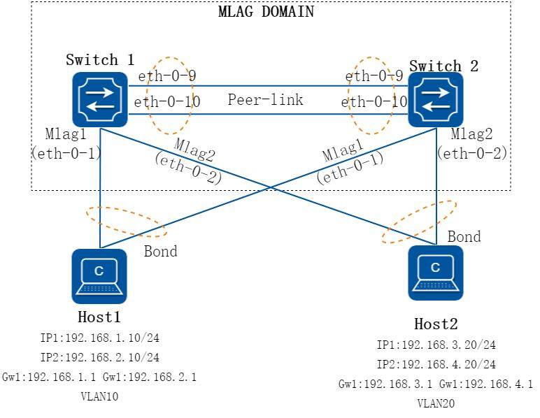

**图3-48 MLAG 三层网关组网图-多地址)**

##### 2. 组网需求

Host 1，Host 2 使用双网卡active-active 的方式双归接入到MLAG 设备，跨网段通信，其网关部署在MLAG 设备上，其在相同的vlan 上存在多个ip 地址，交换机同时作为这些地址的网关。

##### 3. 配置步骤

注：示例配置中两台交换机互联使用的channel-group 55，根据各版型规格不同，可自行修改，使用任意channel-group 组序号均不影响本例配置。

##### 步骤1 配置MLAG PEER 互联接口

配置SWITCH 1

```
Switch_1# configure terminal
Enter configuration commands, one per line.
End with CNTL/Z.
Switch_1 (config)# interface range eth-0-9 to eth-0-10
Switch_1 (config-if-range)# no shutdown
Switch_1 (config-if-range)# lacp timeout short
Switch_1 (config-if-range)# channel-group 55 mode active
Switch_1 (config-if-range)# exit
Switch_1 (config)# interface agg 55
Switch_1 (config-if)# spanning-tree port disable
Switch_1 (config-if)# switchport mode trunk
```

```
Switch_1 (config-if)# switchport trunk allowed vlan all
Switch_1 (config-if)#end
```

配置SWITCH 2

```
Switch_2# configure terminal
Enter configuration commands, one per line.
End with CNTL/Z.
Switch_2(config)# interface range eth-0-9 to eth-0-10
Switch_2 (config-if-range)# no shutdown
Switch_2 (config-if-range)# lacp timeout short
Switch_2(config-if-range)# channel-group 55 mode active
Switch_2(config-if-range)# exit
Switch_2(config)# interface agg 55
Switch_2(config-if)# spanning-tree port disable
Switch_2(config-if)# switchport mode trunk
Switch_2(config-if)# switchport trunk allowed vlan all
Switch_2(config-if)#end
```

##### 步骤2 配置MLAG PEER 通信地址

配置SWITCH 1

```
Switch_1# configure terminal
Enter configuration commands, one per line.
End with CNTL/Z.
Switch_1(config)# vlan database
Switch_1(config-vlan)# vlan 4094
Switch_1(config-vlan)# exit
Switch_1(config)# interface vlan 4094
Switch_1(config-if)# ip address 10.10.0.1/30
Switch_1(config-if)# end
```

配置SWITCH 2

```
Switch_2# configure terminal
Enter configuration commands, one per line.
End with CNTL/Z.
Switch_2(config)# vlan database
Switch_2(config-vlan)# vlan 4094
Switch_2(config-vlan)# exit
Switch_2(config)# interface vlan 4094
Switch_2(config-if)# ip address 10.10.0.2/30
Switch_2(config-if)# end
```

##### 步骤3 配置MLAG PEER

配置SWITCH 1

```
Switch_1# configure terminal
Enter configuration commands, one per line.
End with CNTL/Z.
Switch_1(config)# mlag configuration
Switch_1(config-mlag)# timers mlag 1 5
Switch_1(config-mlag)# peer-link agg55
Switch_1(config-mlag)# peer-address 10.10.0.2
Switch_1(config-mlag)# end
```

配置SWITCH 2

```
Switch_2# configure terminal
Enter configuration commands, one per line.
End with CNTL/Z.
Switch_2(config)# mlag configuration
```

```
Switch_2(config-mlag)# timers mlag 1 5
Switch_2(config-mlag)# peer-link agg 55
Switch_2(config-mlag)# peer-address 10.10.0.1
Switch_2(config-mlag)# end
```

##### 步骤4 配置MLAG 接口

配置SWITCH 1

```
Switch_1# configure terminal
Enter configuration commands, one per line.
End with CNTL/Z.
Switch_1(config)# no ip igmp snooping
Switch_1(config)# vlan database
Switch_1(config-vlan)# vlan 10,20
Switch_1(config-vlan)# exit
Switch_1(config)# interface eth-0-1
Switch_1(config-if)# no shutdown
Switch_1(config-if)# lacp timeout short
Switch_1(config-if)# switchport access vlan 10
Switch_1(config-if)# channel-group 1 mode active
Switch_1(config-if)# exit
Switch_1(config)# interface eth-0-2
Switch_1(config-if)# no shutdown
Switch_1(config-if)# lacp timeout short
Switch_1(config-if)# switchport access vlan 20
Switch_1(config-if)# channel-group 2 mode active
Switch_1(config-if)# exit
Switch_1(config)# interface agg 1
Switch_1(config-if)# mlag 1
Switch_1(config-if)# exit
Switch_1(config)# interface agg 2
Switch_1(config-if)# mlag 2
Switch_1(config-if)# end
```

配置SWITCH 2

```
Switch_2# configure terminal
Enter configuration commands, one per line.
End with CNTL/Z.
Switch_2(config)# no ip igmp snooping
Switch_2(config)# vlan database
Switch_2(config-vlan)# vlan 10,20
Switch_2(config-vlan)# exit
Switch_2(config)# interface eth-0-1
Switch_2(config-if)# no shutdown
Switch_2(config-if)# lacp timeout short
Switch_2(config-if)# switchport access vlan 10
Switch_2(config-if)# channel-group 1 mode active
Switch_2(config-if)# exit
Switch_2(config)# interface eth-0-2
Switch_2(config-if)# no shutdown
Switch_2(config-if)# lacp timeout short
Switch_2(config-if)# switchport access vlan 20
Switch_2(config-if)# channel-group 2 mode active
Switch_2(config-if)# exit
Switch_2(config)# interface agg 1
Switch_2(config-if)# mlag 1
Switch_2(config-if)# exit
```

```
Switch_2(config)# interface agg 2
Switch_2(config-if)# mlag 2
Switch_2(config-if)# end
```

##### 步骤5 配置VARP 作为host 的网关

配置SWITCH 1 Interface vlan 中配置的地址段，可指定为任意与ip virtual-router address 不同的地址段。

```
Switch_1# configure terminal
Enter configuration commands, one per line.
End with CNTL/Z.
Switch_1(config)# interface vlan 10
Switch_1(config-if)# ip address 192.168.10.253/24
Switch_1(config-if)# ip virtual-router address 192.168.1.1/24
Switch_1(config-if)# ip virtual-router address 192.168.2.1/24
Switch_1(config-if)# exit
Switch_1(config)# interface vlan 20
Switch_1(config-if)# ip address 192.168.20.253/24
Switch_1(config-if)# ip virtual-router address 192.168.3.1/24
Switch_1(config-if)# ip virtual-router address 192.168.4.1/24
Switch_1(config-if)# exit
Switch_1(config)# ip virtual-router mac 0.0.1
Switch_1(config)# end
```

配置SWITCH 2

```
Switch_2# configure terminal
Enter configuration commands, one per line.
End with CNTL/Z.
Switch_2(config)# interface vlan 10
Switch_2(config-if)# ip address 192.168.10.254/24
Switch_2(config-if)# ip virtual-router address 192.168.1.1/24
Switch_2(config-if)# ip virtual-router address 192.168.2.1/24
Switch_2(config-if)# exit
Switch_2(config)# interface vlan 20
Switch_2(config-if)# ip address 192.168.20.254/24
Switch_2(config-if)# ip virtual-router address 192.168.3.1/24
Switch_2(config-if)# ip virtual-router address 192.168.4.1/24
Switch_2(config-if)# exit
Switch_2(config)# ip virtual-router mac 0.0.1
Switch_2(config)# end
```

##### 步骤6 验证配置结果

检查MLAG 邻居状态，配置完成后MLAG 处于Established 状态。

```
Switch_1# show mlag peer
MLAG neighbor is 10.10.0.2, MLAG version 1
MLAG state = Established, up for 00:00:01
Last read 00:00:01, hold time is 240, keepalive interval is 60 seconds
Received 4 messages,Sent 4 messages
Open
: received 1, sent 1
KAlive
: received 1, sent 1
Fdb sync
: received 0, sent 0
Failover
: received 0, sent 0
Conf
: received 0, sent 0
Syspri
: received 1, sent 1
```

```
Peer fdb : received 1, sent 1
Connections established 1; dropped 0
Local host: 10.10.0.1, Local port: 50040
Foreign host: 10.10.0.2, Foreign port: 61000
remote_sysid: 1a53.71e9.c000
```

检查MLAG 设备状态，两台设备处于Master/Slave 状态。

```
Switch_1# show mlag
MLAG configuration:
-----------------
role
: Master
local_sysid
: 8e79.b120.2e00
remote_sysid : 1a53.71e9.c000
mlag_sysid
: 8e79.b120.2e00
local_syspri : 32768
remote_syspri: 32768
mlag_syspri
: 32768
peer-link
: agg55
peer conf
: Yes
reload-delay : 300
Switch_2# show mlag
MLAG configuration:
-----------------
role
: Slave
local_sysid
: 1a53.71e9.c000
remote_sysid : 8e79.b120.2e00
mlag_sysid
: 8e79.b120.2e00
local_syspri : 32768
remote_syspri: 32768
mlag_syspri
: 32768
peer-link
: agg55
peer conf
: Yes
reload-delay : 300
```

检查MLAG 组状态，所有接口应都处于UP 状态。

```
Switch_1# show mlag interface
mlagid
local-if
local-state
remote-state
1
agg1
up
up
2
agg2
up
up
```

检查VARP 状态

```
Switch_1# show ip arp
Protocol
Address
Age (min)
Hardware Addr
Interface
Internet
10.10.0.1
-
8e79.b120.2e00
vlan4094
Internet
10.10.0.2
0
1a53.71e9.c000
vlan4094
Internet
192.168.1.1
-
0000.0000.0001
vlan10
Internet
192.168.2.1
-
0000.0000.0001
vlan10
Internet
192.168.10.253
-
8e79.b120.2e00
vlan10
Internet
192.168.3.1
-
0000.0000.0001
vlan20
Internet
192.168.4.1
-
0000.0000.0001
vlan20
Internet
192.168.20.253
-
8e79.b120.2e00
vlan20
```

#### 单臂MLAG

##### 1. 组网拓扑

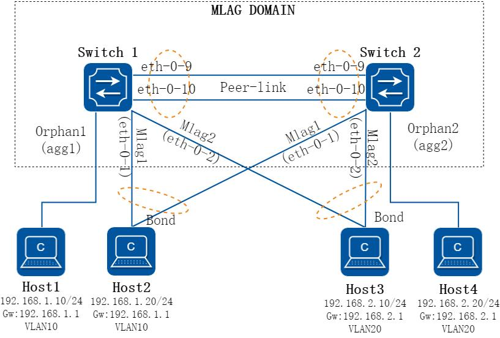

**图3-49 MLAG 单臂组网图**

##### 2. 组网需求

Host 1，Host 4 使用单网卡接入到MLAG 设备，Host 2，Host 3 使用双网卡active-active的方式双归接入到MLAG 设备，跨网段通信，其网关部署在MLAG 设备上，需求网关双活，不使用VRRP。

##### 3. 配置步骤

注：示例配置中两台交换机互联使用的channel-group 55，根据各版型规格不同，可自行修改，使用任意channel-group 组序号均不影响本例配置。

##### 步骤1 配置MLAG PEER 互联接口

配置SWITCH 1

```
Switch_1# configure terminal
Enter configuration commands, one per line.
End with CNTL/Z.
Switch_1 (config)# interface range eth-0-9 to eth-0-10
Switch_1 (config-if-range)# no shutdown
Switch_1 (config-if-range)# lacp timeout short
Switch_1 (config-if-range)# channel-group 55 mode active
Switch_1 (config-if-range)# exit
Switch_1 (config)# interface agg 55
Switch_1 (config-if)# spanning-tree port disable
Switch_1 (config-if)# switchport mode trunk
Switch_1 (config-if)# switchport trunk allowed vlan all
Switch_1 (config-if)#end
```

配置SWITCH 2

```
Switch_2# configure terminal
Enter configuration commands, one per line.
End with CNTL/Z.
Switch_2(config)# interface range eth-0-9 to eth-0-10
Switch_2 (config-if-range)# no shutdown
Switch_2 (config-if-range)# lacp timeout short
Switch_2(config-if-range)# channel-group 55 mode active
Switch_2(config-if-range)# exit
Switch_2(config)# interface agg 55
Switch_2(config-if)# spanning-tree port disable
Switch_2(config-if)# switchport mode trunk
Switch_2(config-if)# switchport trunk allowed vlan all
Switch_2(config-if)#end
```

##### 步骤2 配置MLAG PEER 通信地址

配置SWITCH 1

```
Switch_1# configure terminal
Enter configuration commands, one per line.
End with CNTL/Z.
Switch_1(config)# vlan database
Switch_1(config-vlan)# vlan 4094
Switch_1(config-vlan)# exit
Switch_1(config)# interface vlan 4094
Switch_1(config-if)# ip address 10.10.0.1/30
Switch_1(config-if)# end
```

配置SWITCH 2

```
Switch_2# configure terminal
Enter configuration commands, one per line.
End with CNTL/Z.
Switch_2(config)# vlan database
Switch_2(config-vlan)# vlan 4094
Switch_2(config-vlan)# exit
Switch_2(config)# interface vlan 4094
Switch_2(config-if)# ip address 10.10.0.2/30
Switch_2(config-if)# end
```

##### 步骤3 配置MLAG PEER

配置SWITCH 1

```
Switch_1# configure terminal
Enter configuration commands, one per line.
End with CNTL/Z.
Switch_1(config)# mlag configuration
Switch_1(config-mlag)# timers mlag 1 5
Switch_1(config-mlag)# peer-link agg55
Switch_1(config-mlag)# peer-address 10.10.0.2
Switch_1(config-mlag)# end
```

配置SWITCH 2

```
Switch_2# configure terminal
Enter configuration commands, one per line.
End with CNTL/Z.
Switch_2(config)# mlag configuration
Switch_2(config-mlag)# timers mlag 1 5
Switch_2(config-mlag)# peer-link agg 55
```

```
Switch_2(config-mlag)# peer-address 10.10.0.1
Switch_2(config-mlag)# end
```

##### 步骤4 配置MLAG 接口和单臂接口

配置SWITCH 1

```
Switch_1# configure terminal
Enter configuration commands, one per line.
End with CNTL/Z.
Switch_1(config)# no ip igmp snooping
Switch_1(config)# vlan database
Switch_1(config-vlan)# vlan 10,20
Switch_1(config-vlan)# exit
Switch_1(config)# interface eth-0-20
Switch_1(config-if)# no shutdown
Switch_1(config-if)# switchport access vlan 10
Switch_2(config-if)# exit
Switch_1(config)# interface eth-0-21
Switch_1(config-if)# no shutdown
Switch_1(config-if)# lacp timeout short
Switch_1(config-if)# switchport access vlan 10
Switch_1(config-if)# channel-group 1 mode active
Switch_1(config-if)# exit
Switch_1(config)# interface eth-0-22
Switch_1(config-if)# no shutdown
Switch_1(config-if)# lacp timeout short
Switch_1(config-if)# switchport access vlan 20
Switch_1(config-if)# channel-group 2 mode active
Switch_1(config-if)# exit
Switch_1(config)# interface agg 1
Switch_1(config-if)# mlag 1
Switch_1(config-if)# exit
Switch_1(config)# interface agg 2
Switch_1(config-if)# mlag 2
Switch_1(config-if)# end
```

配置SWITCH 2

```
Switch_2# configure terminal
Enter configuration commands, one per line.
End with CNTL/Z.
Switch_2(config)# no ip igmp snooping
Switch_2(config)# vlan database
Switch_2(config-vlan)# vlan 10,20
Switch_2(config-vlan)# exit
Switch_2(config)# interface eth-0-21
Switch_2(config-if)# no shutdown
Switch_2(config-if)# lacp timeout short
Switch_2(config-if)# switchport access vlan 10
Switch_2(config-if)# channel-group 1 mode active
Switch_2(config-if)# exit
Switch_2(config)# interface eth-0-22
Switch_2(config-if)# no shutdown
Switch_2(config-if)# lacp timeout short
Switch_2(config-if)# switchport access vlan 20
Switch_2(config-if)# channel-group 2 mode active
Switch_2(config-if)# exit
Switch_2(config)# interface agg 1
```

```
Switch_2(config-if)# mlag 1
Switch_2(config-if)# exit
Switch_2(config)# interface agg 2
Switch_2(config-if)# mlag 2
Switch_2(config)# interface eth-0-23
Switch_2(config-if)# no shutdown
Switch_2(config-if)# switchport access vlan 20
Switch_2(config-if)# exit
Switch_2(config-if)# end
```

##### 步骤5 配置VARP 作为host 的网关

配置SWITCH 1

```
Switch_1# configure terminal
Enter configuration commands, one per line.
End with CNTL/Z.
Switch_1(config)# interface vlan 10
Switch_1(config-if)# ip address 192.168.1.253/24
Switch_1(config-if)# ip virtual-router address 192.168.1.1
Switch_1(config-if)# exit
Switch_1(config)# interface vlan 20
Switch_1(config-if)# ip address 192.168.2.253/24
Switch_1(config-if)# ip virtual-router address 192.168.2.1
Switch_1(config-if)# exit
Switch_1(config)# ip virtual-router mac 0.0.1
Switch_1(config)# end
```

配置SWITCH 2

```
Switch_2# configure terminal
Enter configuration commands, one per line.
End with CNTL/Z.
Switch_2(config)# interface vlan 10
Switch_2(config-if)# ip address 192.168.1.254/24
Switch_2(config-if)# ip virtual-router address 192.168.1.1
Switch_2(config-if)# exit
Switch_2(config)# interface vlan 20
Switch_2(config-if)# ip address 192.168.2.254/24
Switch_2(config-if)# ip virtual-router address 192.168.2.1
Switch_2(config-if)# exit
Switch_2(config)# ip virtual-router mac 0.0.1
Switch_2(config)# end
```

#### 多MLAG 域级联

##### 1. 组网拓扑

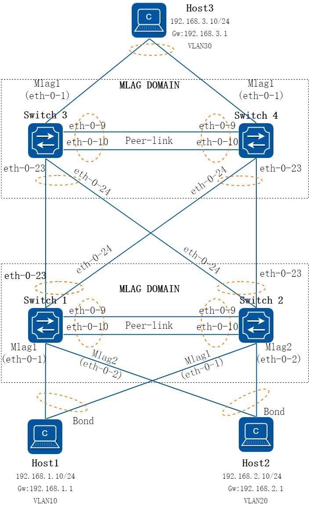

**图3-50 多MLAG 域级联组网图**

##### 2. 组网需求

随着网络规模的扩大，有时需要多个MLAG 级联，需求HOST 1/2/3 之间都可以互通，网关部署在SWITCH 3/4 上，HOST1/2 发出的报文经过2 层转发至SWITCH 3/4。

##### 3. 配置步骤

注：示例配置中两台交换机互联使用的channel-group 55，根据各版型规格不同，可自行修改，使用任意channel-group 组序号均不影响本例配置。

##### 步骤1 配置MLAG PEER 互联接口

配置SWITCH 1

```
Switch_1# configure terminal
Enter configuration commands, one per line.
End with CNTL/Z.
Switch_1 (config)# interface range eth-0-9 to eth-0-10
Switch_1 (config-if-range)# no shutdown
Switch_1 (config-if-range)# lacp timeout short
Switch_1 (config-if-range)# channel-group 55 mode active
Switch_1 (config-if-range)# exit
Switch_1 (config)# interface agg 55
Switch_1 (config-if)# spanning-tree port disable
Switch_1 (config-if)# switchport mode trunk
Switch_1 (config-if)# switchport trunk allowed vlan all
Switch_1 (config-if)#end
```

配置SWITCH 2

```
Switch_2# configure terminal
Enter configuration commands, one per line.
End with CNTL/Z.
Switch_2(config)# interface range eth-0-9 to eth-0-10
Switch_2 (config-if-range)# no shutdown
Switch_2 (config-if-range)# lacp timeout short
Switch_2(config-if-range)# channel-group 55 mode active
Switch_2(config-if-range)# exit
Switch_2(config)# interface agg 55
Switch_2(config-if)# spanning-tree port disable
Switch_2(config-if)# switchport mode trunk
Switch_2(config-if)# switchport trunk allowed vlan all
Switch_2(config-if)#end
```

配置SWITCH 3

```
Switch_3# configure terminal
Enter configuration commands, one per line.
End with CNTL/Z.
Switch_3 (config)# interface range eth-0-9 to eth-0-10
Switch_3 (config-if-range)# no shutdown
Switch_3 (config-if-range)# lacp timeout short
Switch_3(config-if-range)# channel-group 55 mode active
Switch_3 (config-if-range)# exit
Switch_3 (config)# interface agg 55
Switch_3 (config-if)# spanning-tree port disable
Switch_3 (config-if-range)# switchport mode trunk
Switch_3 (config-if-range)# switchport trunk allowed vlan all
Switch_3 (config-if)#exit
```

配置SWITCH 4

```
Switch_4# configure terminal
Enter configuration commands, one per line.
End with CNTL/Z.
Switch_4(config)# interface range eth-0-9 to eth-0-10
```

```
Switch_4 (config-if-range)# no shutdown
Switch_4 (config-if-range)# lacp timeout short
Switch_4(config-if-range)# static-channel-group 55
Switch_4(config-if-range)# exit
Switch_4(config)# interface agg 55
Switch_4(config-if)# spanning-tree port disable
Switch_4(config-if-range)# switchport mode trunk
Switch_4(config-if-range)# switchport trunk allowed vlan all
Switch_4(config-if)#exit
```

##### 步骤2 配置MLAG PEER 通信地址

配置SWITCH 1

```
Switch_1# configure terminal
Enter configuration commands, one per line.
End with CNTL/Z.
Switch_1(config)# vlan database
Switch_1(config-vlan)# vlan 4094
Switch_1(config-vlan)# exit
Switch_1(config)# interface vlan 4094
Switch_1(config-if)# ip address 10.10.0.1/30
Switch_1(config-if)# end
```

配置SWITCH 2

```
Switch_2# configure terminal
Enter configuration commands, one per line.
End with CNTL/Z.
Switch_2(config)# vlan database
Switch_2(config-vlan)# vlan 4094
Switch_2(config-vlan)# exit
Switch_2(config)# interface vlan 4094
Switch_2(config-if)# ip address 10.10.0.2/30
Switch_2(config-if)# end
```

配置SWITCH 3

```
Switch_3# configure terminal
Enter configuration commands, one per line.
End with CNTL/Z.
Switch_3(config)# vlan database
Switch_3(config-vlan)# vlan 4094
Switch_3(config-vlan)# exit
Switch_3(config)# interface vlan 4094
Switch_3(config-if)# ip address 10.10.0.5/30
Switch_3(config-if)# end
```

配置SWITCH 4

```
Switch_4# configure terminal
Enter configuration commands, one per line.
End with CNTL/Z.
Switch_4(config)# vlan database
Switch_4(config-vlan)# vlan 4094
Switch_4(config-vlan)# exit
Switch_4(config)# interface vlan 4094
Switch_4(config-if)# ip address 10.10.0.6/30
Switch_4(config-if)# end
```

##### 步骤3 配置MLAG PEER

配置SWITCH 1

```
Switch_1# configure terminal
Enter configuration commands, one per line.
End with CNTL/Z.
Switch_1(config)# mlag configuration
Switch_1(config-mlag)# timers mlag 1 5
Switch_1(config-mlag)# peer-link agg55
Switch_1(config-mlag)# peer-address 10.10.0.2
Switch_1(config-mlag)# end
```

配置SWITCH 2

```
Switch_2# configure terminal
Enter configuration commands, one per line.
End with CNTL/Z.
Switch_2(config)# mlag configuration
Switch_2(config-mlag)# timers mlag 1 5
Switch_2(config-mlag)# peer-link agg 55
Switch_2(config-mlag)# peer-address 10.10.0.1
Switch_2(config-mlag)# end
```

配置SWITCH 3

```
Switch_3# configure terminal
Enter configuration commands, one per line.
End with CNTL/Z.
Switch_3(config)# mlag configuration
Switch_3(config-mlag)# timers mlag 1 5
Switch_3(config-mlag)# peer-link agg55
Switch_3(config-mlag)# peer-address 10.10.0.6
Switch_3(config-mlag)# end
```

配置SWITCH 4

```
Switch_4# configure terminal
Enter configuration commands, one per line.
End with CNTL/Z.
Switch_4(config)# mlag configuration
Switch_4(config-mlag)# timers mlag 1 5
Switch_4(config-mlag)# peer-link agg 55
Switch_4(config-mlag)# peer-address 10.10.0.5
Switch_4(config-mlag)# end
```

##### 步骤4 配置1/2 与3/4 之间互联口

配置SWITCH 1

```
Switch_1# configure terminal
Enter configuration commands, one per line.
End with CNTL/Z.
Switch_1(config)# vlan database
Switch_1(config)# no ip igmp snooping
Switch_1(config-vlan)# vlan 10,20
Switch_1(config-vlan)# exit
Switch_1(config)# interface range eth-0-23 to eth-0-24
Switch_1(config-if-range)# no shutdown
Switch_1(config-if-range)# lacp timeout short
Switch_1(config-if-range)# switchport mode trunk
Switch_1(config-if-range)# switchport trunk allowed vlan add 10,20
Switch_1(config-if-range)# channel-group 54 mode active
Switch_1(config-if-range)# exit
Switch_1(config)# interface agg 54
```

```
Switch_1(config-if)# mlag 54
Switch_1(config-if)# end
```

配置SWITCH 2

```
Switch_2# configure terminal
Enter configuration commands, one per line.
End with CNTL/Z.
Switch_2(config)# no ip igmp snooping
Switch_2(config)# vlan database
Switch_2(config-vlan)# vlan 10,20
Switch_2(config-vlan)# exit
Switch_2(config)# interface range eth-0-23 to eth-0-24
Switch_2(config-if-range)# no shutdown
Switch_2(config-if-range)# lacp timeout short
Switch_2(config-if-range)# switchport mode trunk
Switch_2(config-if-range)# switchport trunk allowed vlan add 10,20
Switch_2(config-if-range)# channel-group 54 mode active
Switch_2(config-if-range)# exit
Switch_2(config)# interface agg 54
Switch_2(config-if)# mlag 54
Switch_2(config-if)# end
```

配置SWITCH 3

```
Switch_3# configure terminal
Enter configuration commands, one per line.
End with CNTL/Z.
Switch_3(config)# no ip igmp snooping
Switch_3(config)# vlan database
Switch_3(config-vlan)# vlan 10,20
Switch_3(config-vlan)# exit
Switch_3(config)# interface range eth-0-23 to eth-0-24
Switch_3(config-if-range)# no shutdown
Switch_3(config-if-range)# lacp timeout short
Switch_3(config-if-range)# switchport mode trunk
Switch_3(config-if-range)# switchport trunk allowed vlan add 10,20
Switch_3(config-if-range)# channel-group 54 mode active
Switch_3(config-if-range)# exit
Switch_3(config)# interface agg 54
Switch_3(config-if)# mlag 54
Switch_3(config-if)# end
```

配置SWITCH 4

```
Switch_4# configure terminal
Enter configuration commands, one per line.
End with CNTL/Z.
Switch_4(config)# no ip igmp snooping
Switch_4(config)# vlan database
Switch_4(config-vlan)# vlan 10,20
Switch_4(config-vlan)# exit
Switch_4(config)# interface range eth-0-23 to eth-0-24
Switch_4(config-if-range)# no shutdown
Switch_4(config-if-range)# lacp timeout short
Switch_4(config-if-range)# switchport mode trunk
Switch_4(config-if-range)# switchport trunk allowed vlan add 10,20
Switch_4(config-if-range)# channel-group 54 mode active
Switch_4(config-if-range)# exit
Switch_4(config)# interface agg 54
```

```
Switch_4(config-if)# mlag 54
Switch_4(config-if)# end
```

##### 步骤5 配置MLAG 组，用于连接HOST

配置SWITCH 1

```
Switch_1# configure terminal
Enter configuration commands, one per line.
End with CNTL/Z.
Switch_1(config)# vlan database
Switch_1(config-vlan)# vlan 10,20
Switch_1(config-vlan)# exit
Switch_1(config)# mlag lacp system-id 0000.0000.aabb
Switch_1(config)# interface eth-0-1
Switch_1(config-if)# no shutdown
Switch_1(config-if)# switchport access vlan 10
Switch_1(config-if)# channel-group 1 mode active
Switch_1(config-if)# exit
Switch_1(config)# interface eth-0-2
Switch_1(config-if)# no shutdown
Switch_1(config-if)# switchport access vlan 20
Switch_1(config-if)# channel-group 2 mode active
Switch_1(config-if)# exit
Switch_1(config)# interface agg 1
Switch_1(config-if)# mlag 1
Switch_1(config-if)# exit
Switch_1(config)# interface agg 2
Switch_1(config-if)# mlag 2
Switch_1(config-if)# end
```

配置SWITCH 2

```
Switch_2# configure terminal
Enter configuration commands, one per line.
End with CNTL/Z.
Switch_2(config)# vlan database
Switch_2(config-vlan)# vlan 10,20
Switch_2(config-vlan)# exit
Switch_2(config)# mlag lacp system-id 0000.0000.aabb
Switch_2(config)# interface eth-0-1
Switch_2(config-if)# no shutdown
Switch_2(config-if)# switchport access vlan 10
Switch_2(config-if)# channel-group 1 mode active
Switch_2(config-if)# exit
Switch_2(config)# interface eth-0-2
Switch_2(config-if)# no shutdown
Switch_2(config-if)# switchport access vlan 20
Switch_2(config-if)# channel-group 2 mode active
Switch_2(config-if)# exit
Switch_2(config)# interface agg 1
Switch_2(config-if)# mlag 1
Switch_2(config-if)# exit
Switch_2(config)# interface agg 2
Switch_2(config-if)# mlag 2
Switch_2(config-if)# end
```

配置SWITCH 3

```
Switch_3# configure terminal
Enter configuration commands, one per line.
End with CNTL/Z.
Switch_3(config)# vlan database
Switch_3(config-vlan)# vlan 30
Switch_3(config-vlan)# exit
Switch_3(config)# interface eth-0-1
Switch_3(config-if)# no shutdown
Switch_3(config-if)# lacp timeout short
Switch_3(config-if)# switchport access vlan 30
Switch_3(config-if)# channel-group 1 mode active
Switch_3(config-if)# exit
Switch_3(config)# interface agg 1
Switch_3(config-if)# mlag 1
Switch_3(config-if)# end
```

配置SWITCH 4

```
Switch_4# configure terminal
Enter configuration commands, one per line.
End with CNTL/Z.
Switch_4(config)# vlan database
Switch_4(config-vlan)# vlan 30
Switch_4(config-vlan)# exit
Switch_4(config)# interface eth-0-1
Switch_4(config-if)# no shutdown
Switch_4(config-if)# lacp timeout short
Switch_4(config-if)# switchport access vlan 30
Switch_4(config-if)# channel-group 1 mode active
Switch_4(config-if)# exit
Switch_4(config)# interface agg 1
Switch_4(config-if)# mlag 1
Switch_4(config-if)# end
```

##### 步骤6 配置VARP 作为host 的网关

网关部署在SWITCH 3/4 上，SWITCH 1/2 无需配置。

配置SWITCH 3

```
Switch_3# configure terminal
Enter configuration commands, one per line.
End with CNTL/Z.
Switch_3(config)# interface vlan 10
Switch_3(config-if)# ip address 192.168.1.253/24
Switch_3(config-if)# ip virtual-router address 192.168.1.1
Switch_3(config-if)# exit
Switch_3(config)# interface vlan 20
Switch_3(config-if)# ip address 192.168.2.253/24
Switch_3(config-if)# ip virtual-router address 192.168.2.1
Switch_3(config-if)# exit
Switch_3(config)# interface vlan 30
Switch_3(config-if)# ip address 192.168.3.253/24
Switch_3(config-if)# ip virtual-router address 192.168.3.1
Switch_3(config-if)# exit
Switch_3(config)# ip virtual-router mac 0.0.1
Switch_3(config)# end
```

配置SWITCH 4

```
Switch_4# configure terminal
Enter configuration commands, one per line.
End with CNTL/Z.
Switch_4(config)# interface vlan 10
Switch_4(config-if)# ip address 192.168.1.254/24
Switch_4(config-if)# ip virtual-router address 192.168.1.1
Switch_4(config-if)# exit
Switch_4(config)# interface vlan 20
Switch_4(config-if)# ip address 192.168.2.254/24
Switch_4(config-if)# ip virtual-router address 192.168.2.1
Switch_4(config-if)# exit
Switch_4(config)# interface vlan 30
Switch_4(config-if)# ip address 192.168.3.254/24
Switch_4(config-if)# ip virtual-router address 192.168.3.1
Switch_4(config-if)# exit
Switch_4(config)# ip virtual-router mac 0.0.1
Switch_4(config)# end
```

##### 步骤7 验证配置结果

在各设备上检查MLAG 邻居状态，配置完成后MLAG 处于Established 状态。

```
Switch_1# show mlag peer
MLAG neighbor is 10.10.0.2, MLAG version 1
MLAG state = Established, up for 00:00:01
Last read 00:00:01, hold time is 240, keepalive interval is 60 seconds
Received 4 messages,Sent 4 messages
Open
: received 1, sent 1
KAlive
: received 1, sent 1
Fdb sync
: received 0, sent 0
Failover
: received 0, sent 0
Conf
: received 0, sent 0
Syspri
: received 1, sent 1
Peer fdb : received 1, sent 1
Connections established 1; dropped 0
Local host: 10.10.0.1, Local port: 50040
Foreign host: 10.10.0.2, Foreign port: 61000
remote_sysid: 1a53.71e9.c000
```

检查MLAG 设备状态，两台设备处于Master/Slave 状态

```
Switch_1# show mlag
MLAG configuration:
-----------------
role
: Master
local_sysid
: 8e79.b120.2e00
remote_sysid : 1a53.71e9.c000
mlag_sysid
: 8e79.b120.2e00
local_syspri : 32768
remote_syspri: 32768
mlag_syspri
: 32768
peer-link
: agg55
peer conf
: Yes
reload-delay : 300
Switch_2# show mlag
MLAG configuration:
```

```
-----------------
role
: Slave
local_sysid
: 1a53.71e9.c000
remote_sysid : 8e79.b120.2e00
mlag_sysid
: 8e79.b120.2e00
local_syspri : 32768
remote_syspri: 32768
mlag_syspri
: 32768
peer-link
: agg55
peer conf
: Yes
reload-delay : 300
```

检查MLAG 组状态，所有接口应都处于UP 状态。

```
Switch_1# show mlag interface
mlagid
local-if
local-state
remote-state
1
agg1
up
up
2
agg2
up
up
54
agg54
up
up
```

检查VARP 状态。

```
Switch_3# show ip arp
Protocol
Address
Age (min)
Hardware Addr
Interface
Internet
10.10.0.5
-
50bd.ac96.f800
vlan4094
Internet
10.10.0.6
0
fef0.6b89.5800
vlan4094
Internet
192.168.1.1
-
0000.0000.0001
vlan10
Internet
192.168.1.253
-
50bd.ac96.f800
vlan10
Internet
192.168.2.1
-
0000.0000.0001
vlan20
Internet
192.168.2.253
-
50bd.ac96.f800
vlan20
Internet
192.168.3.1
-
0000.0000.0001
vlan30
Internet
192.168.3.253
-
50bd.ac96.f800
vlan30
```

配置完成后HOST 应可以ping 通网关，同时HOST 相互之间也可以ping 通。

## 3.17 HASH 负载均衡配置

### 3.17.1 概述

#### 简介

##### 1. Linkagg Hash

linkagg 功能可以将多个物理接口捆绑，形成单一的逻辑通道，提供增强的性能和冗余。

当使用linkagg 转发数据时，由于两端设备之间有多条物理链路，可能会导致同一数据流的连续数据帧在不同的物理链路上传输的情况。这样可能数据帧在到达对端设备产生接收数据包乱序的情况。为避免这种状况，linkagg 采用负载均衡，根据报文的属性通过hash 算法得到hash 值，然后根据hash 值去选择对应的linkagg 的出接口。这样就同时兼顾了同一数据流的帧在同一条物理链路转发，又实现了流量在linkagg 各个物理链路上负载均衡。

##### 2. ECMP Hash

ecmp（等价多路径路由）应用于多条不同的链路到达同一目的地址的网络环境中。如果使用传统路由技术，发往该目的地址的数据包只能应用其中的一条链路，其它链路处于备份或者无效状态，而ecmp 可以在该网络环境同时使用多条链路，不仅增加传输带宽，而且可以无延时无丢包的备份失效链路的数据传输。ecmp 采用负载均衡，根据报文的属性通过hash 算法得到hash 值，然后根据hash 值去选择对应的转发链路。

##### 3. EFD Hash

efd 就是大象流检测，据悉，9%的流发送的数据占到了总流量数据的90%，相同的流总是具有时间连续性，大流容易导致网络拥塞以及网络安全问题。大象流的检测有助于应用负载均衡以及应对DDOS 网络攻击。通过应用多个不同的hash 空间、hash 函数和多个过滤器来降低误判率。通过hit 的方式直接处理已学习到的大象流，缓解处理压力。

### 3.17.2 配置举例

#### Linkagg Hash 全局配置

全局配置linkagg output 方向计算负载均衡的方式，针对单播和非单播。其优先级最低，新创建和未单独指定output 方向hash 的linkagg 会自动获得全局配置。

##### 步骤1 进入配置模式

```
Switch# configure terminal
```

##### 步骤2 配置hash field 属性

```
Switch(config)# hash-field user
Switch(config-hash-field)# l2 macsa
Switch(config-hash-field)# ip ipsa
Switch(config-hash-field)# exit
```

##### 步骤3 配置hash value global 属性

```
Switch(config)# hash-value global
Switch(config-hash-value-global)# port-channel select user
Switch(config-hash-value-global)# end
```

##### 步骤4 检查配置

显示hash field user 的信息：

```
Switch# show hash-field user
hash-field name: user
Option
Control type
----------------------------------------------------------------------
ipv6 address compress
xor
hash seed
user set (0)
hash arithmetic
xor
hash symmetry
disable
ip
enable
ipv6
enable
mpls
enable
```

```
----------------------------------------------------------------------
hash field select
Packet
HashField
----------------------------------------------------------------------
l2:
macsa
ip:
ipsa
ipv6:
ipsa
ipda
l4-sourceport
l4-destport
ip-protocol
gre:
ipsa
ipda
gre-key
vxlan:
vni
outer-l4-sourceport
outer-ipda
outer-ipsa
nvgre:
vsid
outer-ipda
outer-ipsa
mpls:
top-label
2nd-label
vpws:
top-label
2nd-label
vpls(inner-l2):
inner-macda
inner-macsa
vpls(inner-l3):
inner-ipda
inner-ipsa
l3vpn:
inner-ipsa
inner-ipda
inner-ip-protocol
inner-l4-sourceport
inner-l4-destport
```

显示hash value global 的信息：

```
Switch# show hash-value global
LBT:load balance type
LBM :load balance mode
PT :packet type
HF
:hash field
HA :hash arithmetic
hash-value global
LBT
LBM
PT
HF
HA
----------------------------------------------------------------------
port-channel
-
all
user
xor
ecmp
-
all
ecmp
xor
ecmp
flow id
all
ecmp
xor
entropy
-
all
ecmp
xor
----------------------------------------------------------------------
Efd hash field select:
macsa
macda
ipsa
ipda
sourceport
destport
ip-protocol
```

#### Unicast Linkagg Hash Input 配置

下面步骤演示了如何在端口上配置linkagg input 方向计算负载均衡的方式，仅针对单播报文。其优先级高于output 方向配置。在绑定hash value 到linkagg 的input 方向时，其实际作用相当于为linkagg 的每个物理成员口绑定input 方向。

##### 步骤1 进入配置模式

```
Switch# configure terminal
```

##### 步骤2 配置hash field 属性

```
Switch(config)# hash-field user
Switch(config-hash-field)# l2 macsa
Switch(config-hash-field)# ip ipsa
Switch(config-hash-field)# exit
```

##### 步骤3 配置hash value 属性

```
Switch(config)# hash-value aaa
Switch(config-hash-value)# port-channel unicast select user
Switch(config-hash-value)# exit
```

##### 步骤4 在接口上配置hash value

```
Switch(config)# interface range eth-0-1 to eth-0-2
Switch(config-if-range)# no shutdown
Switch(config-if-range)# static-channel-group 1
Switch(config-if-range)# exit
Switch(config)# interface agg 1
Switch(config-if)# load-balance hash-value aaa input
Switch(config-if)# exit
Switch(config)# interface eth-0-3
Switch(config-if)# load-balance hash-value aaa input
Switch(config-if)# end
```

##### 步骤5 检查配置

显示hash field user 的信息：

```
Switch# show hash-field user
hash-field name: user
Option
Control type
----------------------------------------------------------------------
ipv6 address compress
xor
hash seed
user set (0)
hash arithmetic
xor
hash symmetry
disable
ip
enable
ipv6
enable
mpls
enable
----------------------------------------------------------------------
hash field select
Packet
HashField
----------------------------------------------------------------------
l2:
macsa
ip:
ipsa
```

```
ipv6:
ipsa
ipda
l4-sourceport
l4-destport
ip-protocol
gre:
ipsa
ipda
gre-key
vxlan:
vni
outer-l4-sourceport
outer-ipda
outer-ipsa
nvgre:
vsid
outer-ipda
outer-ipsa
mpls:
top-label
2nd-label
vpws:
top-label
2nd-label
vpls(inner-l2):
inner-macda
inner-macsa
vpls(inner-l3):
inner-ipda
inner-ipsa
l3vpn:
inner-ipsa
inner-ipda
inner-ip-protocol
inner-l4-sourceport
inner-l4-destport
```

显示hash value 的信息：

```
Switch# show hash-value aaa
LBT:load balance type
LBM:load balance mode
PT :packet type
HF :hash field
HA :hash arithmetic
hash-value name: aaa
LBT
LBM
PT
HF
HA
----------------------------------------------------------------------
port-channel
unicast
all
user
xor
port-channel
non-unicast
all
NOCFG
NOCFG
ecmp
-
all
NOCFG
NOCFG
ecmp
flow id
all
NOCFG
NOCFG
```

显示hash value 在端口上的应用：

```
Switch# show hash-value interface-applied
eth-0-3
hash-value aaa input
agg1
hash-value aaa input
```

#### Unicast Linkagg Hash Output 配置

下面步骤演示了如何在端口上配置linkagg output 方向计算负载均衡的方式，仅针对单播报文。其优先级低于input 方向配置，且只能应用在agg 口。

##### 步骤1 进入配置模式

```
Switch# configure terminal
```

##### 步骤2 配置hash field 属性

```
Switch(config)# hash-field user
Switch(config-hash-field)# l2 macsa
Switch(config-hash-field)# ip ipsa
Switch(config-hash-field)# exit
```

##### 步骤3 配置hash value 属性

```
Switch(config)# hash-value aaa
Switch(config-hash-value)# port-channel unicast select user
Switch(config-hash-value)# exit
```

##### 步骤4 在接口上配置hash value

```
Switch(config)# interface range eth-0-1 to eth-0-2
Switch(config-if-range)# no shutdown
Switch(config-if-range)# static-channel-group 1
Switch(config-if-range)# exit
Switch(config)# interface agg 1
Switch(config-if)# load-balance hash-value aaa output
Switch(config-if)# exit
```

##### 步骤5 退出配置模式

```
Switch(config)# end
```

##### 步骤6 检查配置

显示hash field user 的信息：

```
Switch# show hash-field user
hash-field name: user
Option
Control type
----------------------------------------------------------------------
ipv6 address compress
xor
hash seed
user set (0)
hash arithmetic
xor
hash symmetry
disable
ip
enable
ipv6
enable
mpls
enable
----------------------------------------------------------------------
hash field select
Packet
HashField
----------------------------------------------------------------------
l2:
macsa
ip:
ipsa
ipv6:
ipsa
ipda
l4-sourceport
l4-destport
ip-protocol
gre:
ipsa
ipda
gre-key
```

```
vxlan:
vni
outer-l4-sourceport
outer-ipda
outer-ipsa
nvgre:
vsid
outer-ipda
outer-ipsa
mpls:
top-label
2nd-label
vpws:
top-label
2nd-label
vpls(inner-l2):
inner-macda
inner-macsa
vpls(inner-l3):
inner-ipda
inner-ipsa
l3vpn:
inner-ipsa
inner-ipda
inner-ip-protocol
inner-l4-sourceport
inner-l4-destport
```

显示hash value 的信息：

```
Switch# show hash-value aaa
LBT:load balance type
LBM:load balance mode
PT :packet type
HF :hash field
HA :hash arithmetic
hash-value name: aaa
LBT
LBM
PT
HF
HA
----------------------------------------------------------------------
port-channel
unicast
all
user
xor
port-channel
non-unicast
all
NOCFG
NOCFG
ecmp
-
all
NOCFG
NOCFG
ecmp
flow id
all
NOCFG
NOCFG
```

显示hash value 在端口上的应用：

```
Switch# show hash-value interface-applied
agg1
hash-value aaa output
```

#### Linkagg Hash ACL 配置

下面步骤演示了如何在端口上添加ACL 控制，并使得ACL 规则命中的报文使用ACL 选择的hash-value 进行负载均衡。注意将policy-map 应用于interface 时只允许配置input。

##### 步骤1 进入配置模式

```
Switch# configure terminal
```

##### 步骤2 配置hash field 属性

```
Switch(config)# hash-field user
Switch(config-hash-field)# l2 macsa
Switch(config-hash-field)# ip ipsa
Switch(config-hash-field)# exit
```

##### 步骤3 配置hash value 属性

```
Switch(config)# hash-value aaa
Switch(config-hash-value)# port-channel unicast select user
Switch(config-hash-value)# exit
```

##### 步骤4 在接口上添加acl 并配置hash value

```
Switch(config)# mac access-list mac
Switch(config-mac-acl)# permit src-mac host 0.0.1 dest-mac any
Switch(config-mac-acl)# exit
Switch(config)# class-map cmap1
Switch(config-cmap)# match access-group mac
Switch(config-cmap)# exit
Switch(config)# policy-map pmap1
Switch(config-pmap)# class cmap1
Switch(config-pmap-c)# load-balance hash-value aaa
Switch(config-pmap-c)# port-channel load-balance round-robin disable
Switch(config-pmap-c)# exit
Switch(config-pmap)# exit
Switch(config)# interface eth-0-3
Switch(config-if)# no shutdown
Switch(config-if)# service-policy input pmap1
Switch(config-if)# end
```

##### 步骤5 检查配置

显示hash field user 的信息：

```
Switch# show hash-field user
hash-field name: user
Option
Control type
----------------------------------------------------------------------
ipv6 address compress
xor
hash seed
user set (0)
hash arithmetic
xor
hash symmetry
disable
ip
enable
ipv6
enable
mpls
enable
----------------------------------------------------------------------
hash field select
Packet
HashField
----------------------------------------------------------------------
l2:
macsa
ip:
ipsa
ipv6:
ipsa
ipda
l4-sourceport
l4-destport
ip-protocol
gre:
ipsa
ipda
gre-key
vxlan:
vni
outer-l4-sourceport
outer-ipda
outer-ipsa
nvgre:
vsid
outer-ipda
```

```
outer-ipsa
mpls:
top-label
2nd-label
vpws:
top-label
2nd-label
vpls(inner-l2):
inner-macda
inner-macsa
vpls(inner-l3):
inner-ipda
inner-ipsa
l3vpn:
inner-ipsa
inner-ipda
inner-ip-protocol
inner-l4-sourceport
inner-l4-destport
```

显示hash value 的信息：

```
Switch# show hash-value aaa
LBT:load balance type
LBM:load balance mode
PT :packet type
HF :hash field
HA :hash arithmetic
hash-value name: aaa
LBT
LBM
PT
HF
HA
----------------------------------------------------------------------
port-channel
unicast
all
user
xor
port-channel
non-unicast
all
NOCFG
NOCFG
ecmp
-
all
NOCFG
NOCFG
ecmp
flow id
all
NOCFG
NOCFG
```

显示ACL 相关信息：

```
Switch# show running-config
mac access-list mac
10 permit src-mac host 0000.0000.0001 dest-mac any
!
hash-field user
l2 macsa
ip ipsa
!
hash-value aaa
port-channel unicast select user
!
class-map match-any cmap1
match access-group mac
!
policy-map pmap1
class cmap1
port-channel load-balance round-robin disable
load-balance hash-value aaa
!
interface eth-0-3
service-policy input pmap1
!
interface null0
!
```

#### Non-unicast Linkagg Hash 配置

下面步骤演示了如何在端口上配置linkagg input 方向计算负载均衡的方式，仅针对非单播报文。不支持output 方向配置。在绑定hash value 到linkagg 的input 方向时，其实际作用相当于为linkagg 的每个物理成员口绑定input 方向。

##### 步骤1 进入配置模式

```
Switch# configure terminal
```

##### 步骤2 配置hash field 属性

```
Switch(config)# hash-field user
Switch(config-hash-field)# l2 macsa
Switch(config-hash-field)# ip ipsa
Switch(config-hash-field)# exit
```

##### 步骤3 配置hash value 属性

```
Switch(config)# hash-value aaa
Switch(config-hash-value)# port-channel non-unicast select user
Switch(config-hash-value)# exit
```

##### 步骤4 在接口上配置hash value

```
Switch(config)# interface range eth-0-1 to eth-0-2
Switch(config-if-range)# no shutdown
Switch(config-if-range)# static-channel-group 1
Switch(config-if-range)# exit
Switch(config)# interface agg 1
Switch(config-if)# load-balance hash-value aaa input
Switch(config-if)# exit
Switch(config)# interface eth-0-3
Switch(config-if)# load-balance hash-value aaa input
Switch(config-if)# end
```

##### 步骤5 检查配置

显示hash field user 的信息：

```
Switch# show hash-field user
hash-field name: user
Option
Control type
----------------------------------------------------------------------
ipv6 address compress
xor
hash seed
user set (0)
hash arithmetic
xor
hash symmetry
disable
ip
enable
ipv6
enable
mpls
enable
----------------------------------------------------------------------
hash field select
Packet
HashField
----------------------------------------------------------------------
l2:
macsa
ip:
ipsa
```

```
ipv6:
ipsa
ipda
l4-sourceport
l4-destport
ip-protocol
gre:
ipsa
ipda
gre-key
vxlan:
vni
outer-l4-sourceport
outer-ipda
outer-ipsa
nvgre:
vsid
outer-ipda
outer-ipsa
mpls:
top-label
2nd-label
vpws:
top-label
2nd-label
vpls(inner-l2):
inner-macda
inner-macsa
vpls(inner-l3):
inner-ipda
inner-ipsa
l3vpn:
inner-ipsa
inner-ipda
inner-ip-protocol
inner-l4-sourceport
inner-l4-destport
```

显示hash value 的信息：

```
Switch# show hash-value aaa
LBT:load balance type
LBM:load balance mode
PT :packet type
HF :hash field
HA :hash arithmetic
hash-value name: aaa
LBT
LBM
PT
HF
HA
----------------------------------------------------------------------
port-channel
unicast
all
NOCFG
NOCFG
port-channel
non-unicast
all
user
xor
ecmp
-
all
NOCFG
NOCFG
ecmp
flow id
all
NOCFG
NOCFG
```

显示hash value 在端口上的应用：

显示hash value 在端口上的应用：

```
Switch# show hash-value interface-applied
eth-0-3
hash-value aaa input
agg1
hash-value aaa input
```

#### ECMP Hash 全局配置

全局配置ecmp 计算hash 的方式，其优先级最低。

##### 步骤1 进入配置模式

```
Switch# configure terminal
```

##### 步骤2 配置hash field 属性

```
Switch(config)# hash-field user
Switch(config-hash-field)# l2 macsa
Switch(config-hash-field)# ip ipsa
Switch(config-hash-field)# exit
```

##### 步骤3 配置hash value global 属性

```
Switch(config)# hash-value global
Switch(config-hash-value-global)# ecmp select user
Switch(config-hash-value-global)# end
```

##### 步骤4 检查配置

显示hash field user 的信息：

```
Switch# show hash-field user
hash-field name: user
Option
Control type
----------------------------------------------------------------------
ipv6 address compress
xor
hash seed
user set (0)
hash arithmetic
xor
hash symmetry
disable
ip
enable
ipv6
enable
mpls
enable
----------------------------------------------------------------------
hash field select
Packet
HashField
----------------------------------------------------------------------
l2:
macsa
ip:
ipsa
ipv6:
ipsa
ipda
l4-sourceport
l4-destport
ip-protocol
gre:
ipsa
ipda
gre-key
vxlan:
vni
outer-l4-sourceport
outer-ipda
outer-ipsa
nvgre:
vsid
outer-ipda
outer-ipsa
mpls:
top-label
2nd-label
vpws:
top-label
2nd-label
vpls(inner-l2):
inner-macda
inner-macsa
vpls(inner-l3):
inner-ipda
inner-ipsa
```

```
l3vpn:
inner-ipsa
inner-ipda
inner-ip-protocol
inner-l4-sourceport
inner-l4-destport
```

显示hash value global 的信息：

```
Switch# show hash-value global
LBT:load balance type
LBM :load balance mode
PT :packet type
HF
:hash field
HA :hash arithmetic
hash-value global
LBT
LBM
PT
HF
HA
----------------------------------------------------------------------
port-channel
-
all
port-channel
xor
ecmp
-
all
user
xor
ecmp
flow id
all
user
xor
entropy
-
all
ecmp
xor
----------------------------------------------------------------------
Efd hash field select:
macsa
macda
ipsa
ipda
sourceport
destport
ip-protocol
```

#### ECMP Hash Input 配置

下面步骤演示了如何在端口input 方向配置ecmp 计算hash 的方式，其优先级高于全局配置。

##### 步骤1 进入配置模式

```
Switch# configure terminal
```

##### 步骤2 配置hash field 属性

```
Switch(config)# hash-field user
Switch(config-hash-field)# l2 macsa
Switch(config-hash-field)# ip ipsa
Switch(config-hash-field)# exit
```

##### 步骤3 配置hash value 属性

```
Switch(config)# hash-value bbb
Switch(config-hash-value)# ecmp select user
Switch(config-hash-value)# exit
```

##### 步骤4 在接口上配置hash value

```
Switch(config)# interface eth-0-1
Switch(config-if)# no shutdown
Switch(config-if)# load-balance hash-value bbb input
Switch(config-if)# end
```

##### 步骤5 检查配置

显示hash field user 的信息：

```
Switch# show hash-field user
hash-field name: user
Option
Control type
----------------------------------------------------------------------
ipv6 address compress
xor
hash seed
user set (0)
hash arithmetic
xor
hash symmetry
disable
ip
enable
ipv6
enable
mpls
enable
----------------------------------------------------------------------
hash field select
Packet
HashField
----------------------------------------------------------------------
l2:
macsa
ip:
ipsa
ipv6:
ipsa
ipda
l4-sourceport
l4-destport
ip-protocol
gre:
ipsa
ipda
gre-key
vxlan:
vni
outer-l4-sourceport
outer-ipda
outer-ipsa
nvgre:
vsid
outer-ipda
outer-ipsa
mpls:
top-label
2nd-label
vpws:
top-label
2nd-label
vpls(inner-l2):
inner-macda
inner-macsa
vpls(inner-l3):
inner-ipda
inner-ipsa
l3vpn:
inner-ipsa
inner-ipda
inner-ip-protocol
inner-l4-sourceport
inner-l4-destport
```

显示hash value 的信息：

```
Switch# show hash-value bbb
LBT:load balance type
LBM:load balance mode
PT :packet type
HF :hash field
HA :hash arithmetic
hash-value name: bbb
LBT
LBM
PT
HF
HA
----------------------------------------------------------------------
port-channel
unicast
all
NOCFG
NOCFG
port-channel
non-unicast
all
NOCFG
NOCFG
```

```
ecmp
-
all
user
xor
ecmp
flow id
all
NOCFG
NOCFG
```

显示hash value 在端口上的应用：

```
Switch# show hash-value interface-applied
eth-0-1
hash-value bbb input
```

#### ECMP Hash ACL 配置

下面步骤演示了如何在端口上添加ACL 控制，并使得ACL 规则命中的报文使用ACL 选择的hash-value 进行负载均衡。注意将policy-map 应用于interface 时只允许配置input。

##### 步骤1 进入配置模式

```
Switch# configure terminal
```

##### 步骤2 配置hash field 属性

```
Switch(config)# hash-field user
Switch(config-hash-field)# l2 macsa
Switch(config-hash-field)# ip ipsa
Switch(config-hash-field)# exit
```

##### 步骤3 配置hash value 属性

```
Switch(config)# hash-value bbb
Switch(config-hash-value)# ecmp select user
Switch(config-hash-value)# exit
```

##### 步骤4 在接口上添加acl 并配置hash value

```
Switch(config)# mac access-list mac
Switch(config-mac-acl)# permit src-mac host 0.0.1 dest-mac any
Switch(config-mac-acl)# exit
Switch(config)# class-map cmap1
Switch(config-cmap)# match access-group mac
Switch(config-cmap)# exit
Switch(config)# policy-map pmap1
Switch(config-pmap)# class cmap1
Switch(config-pmap-c)# load-balance hash-value bbb
Switch(config-pmap-c)# ecmp load-balance round-robin disable
Switch(config-pmap-c)# exit
Switch(config-pmap)# exit
Switch(config)# interface eth-0-1
Switch(config-if)# no shutdown
Switch(config-if)# service-policy input pmap1
Switch(config-if)# end
```

##### 步骤5 检查配置

显示hash field user 的信息：

```
Switch# show hash-field user
hash-field name: user
Option
Control type
----------------------------------------------------------------------
```

```
ipv6 address compress
xor
hash seed
user set (0)
hash arithmetic
xor
hash symmetry
disable
ip
enable
ipv6
enable
mpls
enable
----------------------------------------------------------------------
hash field select
Packet
HashField
----------------------------------------------------------------------
l2:
macsa
ip:
ipsa
ipv6:
ipsa
ipda
l4-sourceport
l4-destport
ip-protocol
gre:
ipsa
ipda
gre-key
vxlan:
vni
outer-l4-sourceport
outer-ipda
outer-ipsa
nvgre:
vsid
outer-ipda
outer-ipsa
mpls:
top-label
2nd-label
vpws:
top-label
2nd-label
vpls(inner-l2):
inner-macda
inner-macsa
vpls(inner-l3):
inner-ipda
inner-ipsa
l3vpn:
inner-ipsa
inner-ipda
inner-ip-protocol
inner-l4-sourceport
inner-l4-destport
```

显示hash value 的信息：

```
Switch# show hash-value bbb
LBT:load balance type
LBM:load balance mode
PT :packet type
HF :hash field
HA :hash arithmetic
hash-value name: bbb
LBT
LBM
PT
HF
HA
----------------------------------------------------------------------
port-channel
unicast
all
NOCFG
NOCFG
port-channel
non-unicast
all
NOCFG
NOCFG
ecmp
-
all
user
xor
ecmp
flow id
all
NOCFG
NOCFG
```

显示ACL 相关信息：

```
mac access-list mac
10 permit src-mac host 0000.0000.0001 dest-mac any
!
hash-field user
l2 macsa
ip ipsa
!
hash-value bbb
ecmp select user
!
class-map match-any cmap1
match access-group mac
!
policy-map pmap1
class cmap1
ecmp load-balance round-robin disable
load-balance hash-value bbb
!
interface eth-0-1
service-policy input pmap1
!
interface null0
!
```

#### EFD Hash 配置

下面步骤演示了如何配置efd 参与hash 计算的hash-key。

##### 步骤1 进入配置模式

```
Switch# configure terminal
```

##### 步骤2 配置hash value global

```
Switch(config)# hash-value global
Switch(config-hash-value-global)# efd select ipsa macsa
Switch(config-hash-value-global)# end
```

##### 步骤3 检查配置

显示hash value global 的信息：

```
Switch# show hash-value global
LBT:load balance type
LBM :load balance mode
PT :packet type
HF
:hash field
HA :hash arithmetic
hash-value global
LBT
LBM
PT
HF
HA
----------------------------------------------------------------------
port-channel
-
all
port-channel
xor
ecmp
-
all
ecmp
xor
ecmp
flow id
all
ecmp
xor
entropy
-
all
ecmp
xor
----------------------------------------------------------------------
Efd hash field select:
macsa
ipsa
```

## 3.18 PORT-XCONNECT配置

### 3.18.1 概述

#### 简介

该功能能够根据配置的目的端口对报文进行直接转发，而不用查任何表项再做转发。

目前只能配置在物理端口和聚合端口。

### 3.18.2 配置举例

##### 步骤1 进入配置模式

```
Switch# configure terminal
```

##### 步骤2 进入端口模式并打开端口

```
Switch(config)# interface range eth-0-1 , eth-0-2
Switch(config-if-range)# no shutdown
```

##### 步骤3 设置eth-0-1 端口port-xconnect 的目的端口

```
Switch(config)# interface eth-0-1
Switch(config-if)# port-xconnect destination-interface eth-0-2
Switch(config-if)# end
```

##### 步骤4 查看配置情况

```
Switch# show running-config
Building configuration...
version 5.3.9.18
!
no service password-encryption
!
!
!
!
!
!
!
temperature 0 0 0
!
vlan database
!
interface eth-0-1
port-xconnect destination-interface eth-0-2
!
interface eth-0-2
!
interface eth-0-3
```
