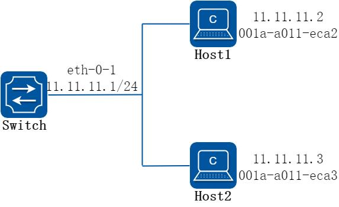
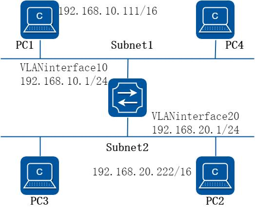
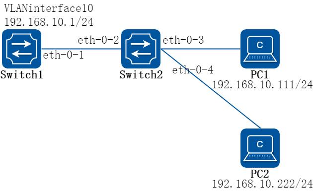
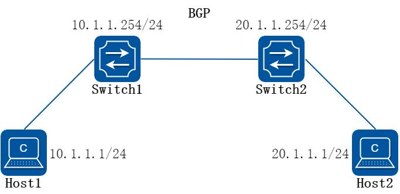
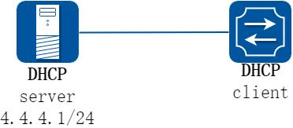
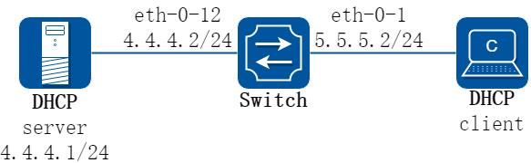
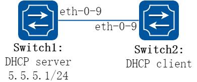
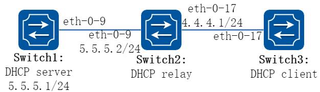
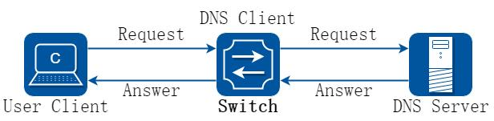

# 4 IP 业务配置指导

## 4.1 ARP配置

### 4.1.1 概述

#### 简介

ARP（Address Resolution Protocol，地址解析协议）用于将网络层的IP 地址解析为数据链路层的物理地址（MAC 地址）。ARP 缓存IP 和MAC 地址的映射。当一个接口请求的地址映射不在缓存中，则设备将会缓存接收到的报文并在相应的子网内广播一个地址请求，如果获得响应，则生成新的地址映射并且发送缓存的报文。ARP 在等待地址映射回应消息的时候最多缓存一个报文，而且只有最近传输的报文才会被保存。如果目的主机在3 次请求后都无法响应，则主机被认为故障，同时相应的错误消息将被返回。如果目的主机在一段时间内（通常为一小时）不发送消息，主机被认为可能出现问题，在删除ARP 表项之前几个请求（一般为6 个，3 个是单播和3 个是广播）将被发送到主机上。

ARP 表项可以通过手工添加、删除、修改。手工添加的表项是永久的。

### 4.1.2 配置举例

##### 1. 组网拓扑



**图4-1 arp**

在这个配置例子中，接口eth-0-1 被分配地址为11.11.11.1/24，子网地址为

11.11.11.0/24。有两个主机，IP 地址分别为11.11.11.2 和11.11.11.3，MAC 地址分别为001a-a011-eca2 和001a-a011-eca3。主机IP 为11.11.11.2 的ARP 条目通过手工添加，主机IP 为11.11.11.3 的ARP 条目通过动态添加。接口eth-0-1 的ARP 条目老化时间配置为20 分钟，ARP 请求重发延迟配置为2 秒。

##### 2. 配置步骤

##### 步骤1 进入配置模式

```
Switch# configure terminal
```

##### 步骤2 配置一个三层接口，并配置IP 地址

```
Switch(config)# interface eth-0-1
Switch(config-if)# no switchport
Switch(config-if)# ip address 11.11.11.1/24
```

##### 步骤3 配置arp 老化时间和请求重发延迟时间

```
Switch(config-if)# arp timeout 1200
Switch(config-if)# arp retry-interval 2
Switch(config-if)# exit
```

##### 步骤4 添加静态arp 条目

```
Switch(config)# arp 11.11.11.2 1a.a011.eca2
```

##### 步骤5 退出配置模式

```
Switch(config)# end
```

##### 步骤6 检查配置

使用下列命令查看arp 条目：

```
Switch# show ip arp
Protocol
Address
Age (min)
Hardware Addr
Interface
Internet
11.11.11.2
-
001a.a011.eca2
eth-0-1
Switch# show ip arp summary
1 IP ARP entries, with 0 of them incomplete
(Static:0,
Dyamic:0, Interface:1)
ARP Pkt Received is: 0
ARP Pkt Send number is: 0
ARP Pkt Dicard number is: 0
```

使用下列命令查看ARP 请求重发延迟和老化时间：

```
Switch# show interface eth-0-1
Interface eth-0-1
Interface current state: Administratively DOWN
Hardware is Ethernet, address is 6c02.530c.2300 (bia 6c02.530c.2300)
Bandwidth 1000000 kbits
Index 1 , Metric 1 , Encapsulation ARPA
Speed - Auto , Duplex - Auto
, Media type is 1000BASE_T
Link speed type is autonegotiation, Link duplex type is autonegotiation
Input flow-control is off, output flow-control is off
The Maximum Frame Size is 1534 bytes
VRF binding: not bound
Label switching is disabled
No virtual circuit configured
```

```
VRRP master of :
VRRP is not configured on this interface
ARP timeout 00:20:00,
ARP retry interval 2s
5 minute input rate 0 bits/sec, 0 packets/sec
5 minute output rate 0 bits/sec, 0 packets/sec
0 packets input, 0 bytes
Received 0 unicast, 0 broadcast, 0 multicast
0 runts, 0 giants, 0 input errors, 0 CRC
0 frame, 0 overrun, 0 pause input
0 input packets with dribble condition detected
0 packets output, 0 bytes
Transmitted 0 unicast, 0 broadcast, 0 multicast
0 underruns, 0 output errors, 0 pause output
```

## 4.2 ARP 代理配置

### 4.2.1 概述

#### 简介

代理ARP 是ARP 协议的一个变种。对于没有配置缺省网关的计算机要和其他网络中的计算机实现通信，网关收到源计算机的ARP 请求会使用自己的MAC 地址与目标计算机的IP 地址对源计算机进行应答。代理ARP 就是将一个主机作为对另一个主机ARP 进行应答。它能使得在不影响路由表的情况下添加一个新的Router，使得子网对该主机来说变得更透明化。同时也会带来巨大的风险，除了ARP 欺骗，和某个网段内的ARP 增加，最重要的就是无法对网络拓扑进行网络概括。proxy ARP 的最主要的一个优点在于能够在不影响其他router 的路由表的情况下在网络上添加一个新的router,这样使得子网的变化对主机是透明的。代理ARP 的使用一般是使用在没有配置默认网关和路由策略的网络上的。代理ARP 又分为普通的ARP 代理和本地ARP 代理。同一网段内连接到设备的不同VLAN 接口的主机，可以利用设备的代理ARP 功能，通过三层转发实现互通。为了实现三层互通，如果以太网交换机或其下挂的交换机开启了二层端口隔离功能，则需要开启本地代理ARP 功能。注意：本地ARP 代理功能开启后，ICMP 重定向功能将自动关闭。

### 4.2.2 配置举例

#### 配置普通ARP

##### 1. 组网拓扑



**图4-2 arp proxy**

如上图所示，PC1 属于VLAN10，PC2 属于VLAN20，在VLAN interface10 和VLAN interface

20 上各自配置ARP 代理以实现PC1 和PC2 之间的互通。按照下面的配置步骤在VLAN10和VLAN 20 上使能ARP 代理功能。

##### 2. 配置步骤

##### 步骤1 进入配置模式

```
Switch# configure terminal
```

##### 步骤2 进入vlan 配置模式并创建vlan

```
Switch(config)# vlan database
Switch(config-vlan)# vlan 10,20
Switch(config-vlan)# exit
```

##### 步骤3 进入接口配置模式并将接口加入vlan

```
Switch(config)# interface eth-0-22
Switch(config-if)# switchport access vlan 10
Switch(config-if)# no shutdown
Switch(config-if)# exit
Switch(config)# interface eth-0-23
Switch(config-if)# switchport access vlan 20
Switch(config-if)# no shutdown
Switch(config-if)# exit
```

##### 步骤4 创建三层接口并配置ip 地址，然后使能arp 代理功能

```
Switch(config)# interface vlan 10
Switch(config-if)# ip address 192.168.10.1/24
```

```
Switch(config-if)# proxy-arp enable
Switch(config-if)# exit
Switch(config)# interface vlan 20
Switch(config-if)# ip address 192.168.20.1/24
Switch(config-if)# proxy-arp enable
Switch(config-if)# exit
```

##### 步骤5 退出配置模式

```
Switch(config)# end
```

##### 步骤6 检查配置

使用下列命令查看交换机上的arp proxy 配置：

```
Switch# show ip interface vlan 10
Interface vlan10
Interface current state: UP
Internet address(es):
192.168.10.1/24 broadcast 192.168.10.255
Joined group address(es):
224.0.0.1
The maximum transmit unit is 1500 bytes
ICMP error messages limited to one every 1000 milliseconds
ICMP redirects are always sent
ICMP unreachables are always sent
ICMP mask replies are always sent
ARP timeout 01:00:00,
ARP retry interval 1s
ARP Proxy is enabled, Local ARP Proxy is disabled
VRRP master of :
VRRP is not configured on this interface
Switch# show ip interface vlan 20
Interface vlan20
Interface current state: UP
Internet address(es):
192.168.20.1/24 broadcast 192.168.20.255
Joined group address(es):
224.0.0.1
The maximum transmit unit is 1500 bytes
ICMP error messages limited to one every 1000 milliseconds
ICMP redirects are always sent
ICMP unreachables are always sent
ICMP mask replies are always sent
ARP timeout 01:00:00,
ARP retry interval 1s
ARP Proxy is enabled, Local ARP Proxy is disabled
VRRP master of :
VRRP is not configured on this interface
```

使用下列命令查看arp 表项：

```
Switch# show ip arp
Protocol
Address
Age (min)
Hardware Addr
Interface
Internet
192.168.10.1
-
7cc3.11f1.aa00
vlan10
Internet
192.168.10.111
5
0cf9.11b6.6e2e
vlan10
Internet
192.168.20.1
-
7cc3.11f1.aa00
vlan20
Internet
192.168.20.222
6
5a94.031f.2357
vlan20
```

使用下列命令检查PC1 的状态：

```
[Host:~]$ ifconfig eth0
eth0
Link encap:Ethernet
HWaddr 0C:F9:11:B6:6E:2E
inet addr:192.168.10.111
Bcast:192.168.255.255
Mask:255.255.0.0
UP BROADCAST RUNNING MULTICAST
MTU:1600
Metric:1
RX packets:11 errors:0 dropped:0 overruns:0 frame:0
TX packets:10 errors:0 dropped:0 overruns:0 carrier:0
collisions:0 txqueuelen:1000
RX bytes:588 (588.0 b)
TX bytes:700 (700.0 b)
Interrupt:5
[Host:~]$ arp –a
? (192.168.20.222) at 7c:c3:11:f1:aa:00 [ether] on eth0
[Host: ~]$ route -v
Kernel IP routing table
Destination
Gateway
Genmask
Flags Metric Ref
Use Iface
192.168.0.0
*
255.255.0.0
U
0
0
0 eth0
[Host:~]$ ping 192.168.20.222
PING 192.168.20.222 (192.168.20.222) 56(84) bytes of data.
64 bytes from 192.168.20.222: icmp_seq=0 ttl=63 time=189 ms
64 bytes from 192.168.20.222: icmp_seq=1 ttl=63 time=65.2 ms
--- 192.168.20.222 ping statistics ---
2 packets transmitted, 2 received, 0% packet loss, time 1000ms
rtt min/avg/max/mdev = 65.209/127.226/189.244/62.018 ms, pipe 2
```

使用下列命令检查PC2 的状态：

```
[Host:~]$ ifconfig eth0
eth0
Link encap:Ethernet
HWaddr 5A:94:03:1F:23:57
inet addr:192.168.20.222
Bcast:192.168.255.255
Mask:255.255.0.0
UP BROADCAST RUNNING MULTICAST
MTU:1600
Metric:1
RX packets:14 errors:0 dropped:0 overruns:0 frame:0
TX packets:17 errors:0 dropped:0 overruns:0 carrier:0
collisions:0 txqueuelen:1000
RX bytes:784 (784.0 b)
TX bytes:1174 (1.1 KiB)
Interrupt:5
[Host:~]$ arp -a
? (192.168.10.111) at 7c:c3:11:f1:aa:00 [ether] on eth0
[Host: ~]$ route -v
Kernel IP routing table
Destination
Gateway
Genmask
Flags Metric Ref
Use Iface
192.168.0.0
*
255.255.0.0
U
0
0
0 eth0
[Host: ~]$ ping 192.168.10.111
PING 192.168.10.111 (192.168.10.111) 56(84) bytes of data.
64 bytes from 192.168.10.111: icmp_seq=0 ttl=63 time=53.8 ms
64 bytes from 192.168.10.111: icmp_seq=1 ttl=63 time=65.8 ms
--- 192.168.10.111 ping statistics ---
2 packets transmitted, 2 received, 0% packet loss, time 1007ms
rtt min/avg/max/mdev = 53.832/59.842/65.852/6.010 ms, pipe 2
```

#### 配置本地ARP

##### 1. 组网拓扑



**图4-3 local arp proxy**

如上图所示，Switch2 上的3 个2 层端口eth2，eth3 和eth4 都属于VLAN10，其中端口

3 和端口4 在同一个隔离组1，所以端口3 和端口4 不能互相通信。端口2 在隔离组3，所以端口2 能和端口3，4 互相通信。PC1 和PC2 分别连接到Switch2 的eth3 和eth4口，它们都属于VLAN10。通过如下配置步骤，使PC1 和PC2 之间实现3 层互通。

以下配置如无特殊说明则Switch1 和Switch2 的配置相同。

##### 2. 配置步骤

##### 步骤1 进入配置模式

```
Switch# configure terminal
```

##### 步骤2 进入vlan 配置模式并创建vlan

```
Switch(config)# vlan database
Switch(config-vlan)# vlan 10
Switch(config-vlan)# exit
```

##### 步骤3 进入接口配置模式并将接口加入vlan

Switch1 配置：

```
Switch1(config)# interface eth-0-1
Switch1(config-if)# switchport access vlan 10
Switch1(config-if)# no shutdown
Switch1(config-if)# exit
```

Switch2 配置：

```
Switch2(config)# interface range eth-0-2 to eth-0-4
Switch2(config-if-range# switchport access vlan 10
Switch2(config-if-range# no shutdown
Switch2(config-if-range# exit
```

##### 步骤4 创建三层接口并配置ip 地址，然后使能本地arp 代理功能

Switch1 配置：

```
Switch1(config)# interface vlan 10
Switch1(config-if)# ip address 192.168.10.1/24
Switch1(config-if)# local-proxy-arp enable
Switch1(config-if)# exit
```

##### 步骤5 配置端口隔离(可选)

Switch2 配置：

通过以下配置，使Switch2 上eth-0-3 和eth-0-4 之间不能二层互通，但是eth-0-3 和eth-0-4 分别可以和eth-0-2 二层互通。

```
Switch2(config)# port-isolate mode l2
Switch2(config)# interface range eth-0-3 to eth-0-4
Switch2(config-if-range# port-isolate group 1
Switch2(config-if-range# exit
Switch2(config)# interface eth-0-2
Switch2(config-if)# port-isolate group 3
Switch2(config-if)# exit
```

##### 步骤6 退出配置模式

```
Switch(config)# end
```

##### 步骤7 检查配置

使用下列命令查看Switch1 上的arp 表项：

```
Switch1# show ip arp
Protocol
Address
Age (min)
Hardware Addr
Interface
Internet
192.168.10.1
-
eeb4.2a8d.6c00
vlan10
Internet
192.168.10.111
0
34b0.b279.5f67
vlan10
Internet
192.168.10.222
0
2a65.9618.57fa
vlan10
```

使用下列命令查看Switch1 上的arp proxy 相关配置：

```
Switc1# show ip interface vlan 10
Interface vlan10
Interface current state: UP
Internet address(es):
192.168.10.1/24 broadcast 192.168.10.255
Joined group address(es):
224.0.0.1
The maximum transmit unit is 1500 bytes
ICMP error messages limited to one every 1000 milliseconds
ICMP redirects are never sent
ICMP unreachables are always sent
ICMP mask replies are always sent
ARP timeout 01:00:00,
ARP retry interval 1s
ARP Proxy is disabled, Local ARP Proxy is enabled
VRRP master of :
VRRP is not configured on this interface
```

使用下列命令检查PC1 的状态：

```
[Host: ~]$ ifconfig eth0
eth0
Link encap:Ethernet
HWaddr 34:B0:B2:79:5F:67
```

```
inet addr:192.168.10.111
Bcast:192.168.10.255
Mask:255.255.255.0
UP BROADCAST RUNNING MULTICAST
MTU:1600
Metric:1
RX packets:22 errors:0 dropped:0 overruns:0 frame:0
TX packets:28 errors:0 dropped:0 overruns:0 carrier:0
collisions:0 txqueuelen:1000
RX bytes:1344 (1.3 KiB)
TX bytes:2240 (2.1 KiB)
Interrupt:5
[Host: ~]$ arp -a
? (192.168.10.222) at ee:b4:2a:8d:6c:00 [ether] on eth0
[Host: ~]$ ping 192.168.10.222
PING 192.168.10.222 (192.168.10.222) 56(84) bytes of data.
64 bytes from 192.168.10.222: icmp_seq=0 ttl=63 time=131 ms
64 bytes from 192.168.10.222: icmp_seq=1 ttl=63 time=159 ms
--- 192.168.10.222 ping statistics ---
2 packets transmitted, 2 received, 0% packet loss, time 1003ms
rtt min/avg/max/mdev = 131.078/145.266/159.454/14.188 ms, pipe 2
```

使用下列命令检查PC2 的状态：

```
[Host:~]$ ifconfig eth0
eth0
Link encap:Ethernet
HWaddr 2A:65:96:18:57:FA
inet addr:192.168.10.222
Bcast:192.168.10.255
Mask:255.255.255.0
UP BROADCAST RUNNING MULTICAST
MTU:1600
Metric:1
RX packets:19 errors:0 dropped:0 overruns:0 frame:0
TX packets:20 errors:0 dropped:0 overruns:0 carrier:0
collisions:0 txqueuelen:1000
RX bytes:1148 (1.1 KiB)
TX bytes:1524 (1.4 KiB)
Interrupt:5
[Host:~]$ arp -a
? (192.168.10.111) at ee:b4:2a:8d:6c:00 [ether] on eth0
[Host: ~]$ ping 192.168.10.111
PING 192.168.10.111 (192.168.10.111) 56(84) bytes of data.
64 bytes from 192.168.10.111: icmp_seq=0 ttl=63 time=198 ms
64 bytes from 192.168.10.111: icmp_seq=1 ttl=63 time=140 ms
64 bytes from 192.168.10.111: icmp_seq=2 ttl=63 time=146 ms
--- 192.168.10.111 ping statistics ---
3 packets transmitted, 3 received, 0% packet loss, time 2008ms
rtt min/avg/max/mdev = 140.196/161.959/198.912/26.267 ms, pipe 2
```

## 4.3 ARP 主机路由配置

### 4.3.1 概述

#### 简介

ARP 主机路由功能用于将设备的ARP 表项转化为主机路由重发布给路由协议。功能在接口下使能，会将接口下有效的ARP 表项重发布出去。在路由协议中，将该功能产生的主机路由视作直连路由。

### 4.3.2 配置举例

#### 配置ARP 主机路由

##### 1. 组网拓扑



**图4-4 ARP 主机路由**

在这个配置例子中，Host1 和Host2 通过三层接口interface eth-0-1 分别接入到Switch1 和Switch2。Switch1 和Switch2 之间建立ebgp 连接。在Switch1 和Switch2与两台主机连接的接口上开启ARP 主机路由功能后，交换机可以将主机的ARP 表项转化为主机路由重发布到路由协议中。再通过路由策略，可以实现仅发布主机路由、不发布网段路由，减少由于发布网段路由而引入的无效流量。

##### 2. 配置步骤

##### 步骤1 进入配置模式

```
Switch# configure terminal
```

##### 步骤2 配置一个三层接口，并配置IP 地址

```
Switch(config)# interface eth-0-1
Switch(config-if)# no shutdown
Switch(config-if)# no switchport
Switch(config-if)# ip address 10.1.1.254/24
```

##### 步骤3 在接口下开启ARP 主机路由功能

```
Switch(config-if)# arp host-route enable
Switch(config-if)# exit
```

##### 步骤4 添加静态ARP 条目

```
Switch(config)# arp 10.1.1.2 1.1.1
```

##### 步骤5 开启BGP 直连路由重发布功能

```
Switch(config)# router bgp 100
Switch(config-router)# redistribute connected
```

##### 步骤6 退出配置模式

```
Switch(config-router)# end
```

##### 步骤7 检查配置结果

使用下列命令检查BGP 中的路由信息

```
Switch# show ip bgp
BGP table version is 1, local router ID is 10.1.1.1
Status codes: s suppressed, d damped, h history, * valid, > best, i - internal,
l - labeled
S Stale
Origin codes: i - IGP, e - EGP, ? - incomplete
Network
Next Hop
Metric LocPrf Weight Path
*> 10.1.1.0/24
0.0.0.0
32768 ?
*> 10.1.1.2/32
0.0.0.0
32768 ?
Total number of prefixes 2
```

## 4.4 DHCP Client配置

### 4.4.1 概述

#### 简介

DHCP（Dynamic Host Configuration Protocol）client 通过DHCP 协议从DHCP server动态获得ip 地址和配置参数。若客户端和服务器都在一个子网内，则客户端和服务器之间可以直接进行DHCP协议的交互，否则需要有DHCP relay agent转发DHCP消息。DHCP client 通过DHCP 广播报文向DHCP server 请求ip 地址，在获得ip 地址和相应的租期后，配置地址并设置租期的时间。在租期过半的时候开始发送DHCP 报文请求继续使用当前的ip 地址，并期望获得新的租期。在成功续租后，DHCP client 更新租期的时间。

DHCP client 可以向server 请求的选项包括：router，static-route，classless-static-route，classless-static-route-ms，tftp-server-address，dns-nameserver ，domain-name，netbios-nameserver，vendor-specific。选项router，static-route，classless-static-route，classless-static-route-ms，tftp-server-address 默认是被请求的，可以通过命令取消这些请求。

### 4.4.2 配置举例

##### 1. 组网拓扑



**图4-5 dhcp client**

##### 2. 配置步骤

##### 步骤1 进入配置模式

```
Switch# configure terminal
```

##### 步骤2 进入接口配置模式，设置接口属性并使能接口

```
Switch(config)# interface eth-0-1
Switch(config-if)# no switchport
Switch(config-if)# no shutdown
```

##### 步骤3 取消static-route 选项请求并启用DHCP client

```
Switch(config-if)# no dhcp client request static-route
Switch(config-if)# ip address dhcp
```

##### 步骤4 退出配置模式

```
Switch(config-if)# end
```

##### 步骤5 检查配置

检查接口配置

```
Switch# show running-config interface eth-0-1
Building configuration...
!
interface eth-0-1
no switchport
ip address dhcp
no dhcp client request static-route
!
```

检查DHCP client 工作状态

```
Switch# show dhcp client verbose
DHCP client informations:
============================================================
eth-0-1 DHCP client information:
Current state: BOUND
Allocated IP: 4.4.4.199 255.255.255.0
Lease/renewal/rebinding: 1187/517/1037 seconds
Lease from 2011-11-18 05:59:59 to 2011-11-18 06:19:59
Will Renewal in 0 days 0 hours 8 minutes 37 seconds
DHCP server: 4.4.4.1
Transaction ID: 0x68857f54
Client ID: switch-7e39.3457.b700-eth-0-1
```

显示DHCPclient 统计

```
Switch# show dhcp client statistics
DHCP client packet statistics:
============================================================
DHCP OFFERS
received: 1
DHCP ACKs
received: 2
```

```
DHCP NAKs
received: 0
DHCP Others
received: 0
DHCP DISCOVER
sent: 1
DHCP DECLINE
sent: 0
DHCP RELEASE
sent: 0
DHCP REQUEST
sent: 2
DHCP packet send failed: 0
```

## 4.5 DHCP Relay配置

### 4.5.1 概述

#### 简介

DHCP 服务器和客户端都在一个子网内，则客户端和服务器之间可以直接进行DHCP 协议的交互，这时不需要启动DHCP Relay 功能。如果DHCP 服务器和客户端不在一个子网内，则需要启动DHCP Relay 功能将DHCP 报文转发到外部的DHCP 服务器。

DHCP Relay 转发同正常的IP 路由转发不同，IP 路由转发的IP 数据包在网络之间透明交换，而DHCP Relay 代理接收DHCP 消息同时产生一个新的DHCP 消息发送到另一个接口。DHCP Relay 代理在报文中设置网关地址，添加中继代理信息（option82），转发到DHCP 服务器端。通过DHCP Relay 代理，在收到服务器响应的消息时，会移除消息中option82 内容后，转发给客户端。

### 4.5.2 配置举例

##### 1. 组网拓扑



**图4-6 DHCP relay**

上图为测试DHCP 中继代理功能的网络拓扑，需要两台PC 机和一台交换机构建测试环境。

计算机A 作为DHCP 服务器计算机B 作为DHCP 客户端交换机作为DHCP 中继代理

##### 2. 配置步骤

##### 步骤1 进入配置模式

```
Switch# configure terminal
```

##### 步骤2 进入接口配置模式，配置接口属性和ip 地址

```
Switch(config)# interface eth-0-12
Switch(config-if)# no switchport
Switch(config-if)# ip address 4.4.4.2/24
Switch(config-if)# no shutdown
Switch(config-if)# exit
Switch(config)# interface eth-0-1
Switch(config-if)# no switchport
Switch(config-if)# ip address 5.5.5.2/24
Switch(config-if)# no shutdown
Switch(config-if)# exit
```

##### 步骤3 创建DHCP 服务器

```
Switch(config)# dhcp-server 1 4.4.4.1
```

##### 步骤4 端口使能DHCP 服务器、启用option82

```
Switch(config)# interface eth-0-1
Switch(config-if)# dhcp relay information trusted
Switch(config-if)# dhcp-server 1
Switch(config-if)# exit
```

##### 步骤5 全局使能DHCP 服务器和DHCP relay 功能

```
Switch(config)# service dhcp enable
Switch(config)# dhcp relay
```

##### 步骤6 退出配置模式

```
Switch(config)# end
```

##### 步骤7 检查配置

检查接口配置。

```
Switch# show running-config interface eth-0-12
!
interface eth-0-12
no switchport
ip address 4.4.4.2/24
!
Switch# show running-config interface eth-0-1
!
interface eth-0-1
no switchport
dhcp relay information trusted
dhcp-server 1
ip address 5.5.5.2/24
!
```

检查DHCP 服务器状态。

```
Switch# show services
Networking services configuration:
Service Name
Status
```

```
===========================================================
dhcp
enable
```

检查DHCP 服务器组配置。

```
Switch# show dhcp-server
DHCP server group information:
===========================================================
group 1 ip address list:
[1] 4.4.4.1
```

显示DHCP 中继统计检查DHCP 中继统计。

```
Switch# show dhcp relay statistics
DHCP relay packet statistics:
===========================================================
Client relayed packets:
20
Server relayed packets:
20
Client error packets:
20
Server error packets:
0
Bogus GIADDR drops:
0
Bad circuit ID packets:
0
Corrupted agent options:
0
Missing agent options:
0
Missing circuit IDs:
0
```

检查计算机从DHCP 服务器获取的IP 地址。

```
Ipconfig /all
Dhcp Enabled. . . . . . . . . . . : Yes
Autoconfiguration Enabled . . . . : Yes
IP Address. . . . . . . . . . . . : 5.5.5.1
Subnet Mask . . . . . . . . . . . : 255.255.255.0
Default Gateway . . . . . . . . . : 5.5.5.2
DHCP Server . . . . . . . . . . . : 4.4.4.1
DNS Servers . . . . . . . . . . . : 4.4.4.1
```

## 4.6 DHCP Server配置

### 4.6.1 概述

#### 简介

DHCP server 通过DHCP 协议为client 提供ip 地址和网络配置参数。为了能够给客户端提供DHCP 服务，DHCP server 需要完成一些基本的配置，例如，地址池的分配，默认网关的设置，网络参数的设置。在实际工作的时候，DHCP server 会从设置的地址池内找到可用的地址分配给请求地址的DHCP client，同时，将client 请求的网络配置参数发送给client。这些分配的地址和参数都有一个有效期限（租约），client 需要在到期之前向server 发出续约请求，保留自己的ip 地址，同时更新租约。

在实际环境中，若DHCP server 和DHCP client 在同一子网内，则DHCP server 在直接相连后就可以正常工作。若它们不在同一网段内，则DHCP server 需要DHCP relay 协助转发DHCP 消息，才能为client 提供DHCP 服务。

DHCP server 支持的主要option 包括：bootfile-name，dns-server，domain-name，gateway，netbios-name-server，netbios-node-type，tftp-server-address。同时，支持通过option 命令配置部分自定义的option。已经有专门命令行的DHCP 选项以及DHCP server 无需支持的选项不支持用option 命令来配置，不支持用option 命令配置的自定义option 列表如下：3, 6, 15, 44, 46, 50, 51, 52, 53, 54, 55, 57, 58, 59,61, 67, 82 and 150。

### 4.6.2 配置举例

#### 配置DHCP server

##### 1. 组网拓扑



**图4-7 DHCP server**

##### 2. 配置步骤

##### 步骤1 进入配置模式

```
Switch# configure terminal
```

##### 步骤2 全局启用DHCP 服务，配置地址池

在Switch1 上配置：

```
Switch1(config)#service dhcp enable
Switch1(config)#dhcp server
Switch1(config)#dhcp pool pool5
Switch1(dhcp-config)#network 5.5.5.0/24
Switch1(dhcp-config)#gateway 5.5.5.1
Switch1(dhcp-config)#exit
```

##### 步骤3 进入接口配置模式，配置接口属性和IP 地址

在Switch1 上配置：

```
Switch1(config)#interface eth-0-9
Switch1(config-if)#no switchport
Switch1(config-if)# no shutdown
Switch1(config-if)# ip address 5.5.5.1/24
Switch1(config-if)# dhcp server enable
Switch1(config-if)#exit
```

在Switch2 上配置：

```
Switch2(config)#interface eth-0-9
Switch2(config-if)# no switchport
Switch2(config-if)# no shutdown
```

```
Switch2(config-if)# ip address dhcp
Switch2(config-if)# exit
```

##### 步骤4 退出配置模式

```
Switch(config)# end
```

##### 步骤5 检查配置

查看DHCP Server（Switch1）配置：

```
Switch1# show running-config
!
service dhcp enable
!
interface eth-0-9
no switchport
dhcp server enable
ip address 5.5.5.1/24!
!
dhcp server
dhcp pool pool5
network 5.5.5.0/24
gateway 5.5.5.1
```

DHCP Client（Switch2）上查看DHCP client 状态：

```
Switch2# show dhcp client verbose
DHCP client informations:
============================================================
eth-0-9 DHCP client information:
Current state: BOUND
Allocated IP: 5.5.5.2 255.255.255.0
Lease/renewal/rebinding: 1194/546/1044 seconds
Lease from 2012-02-04 07:40:12 to 2012-02-04 08:00:12
Will Renewal in 0 days 0 hours 9 minutes 6 seconds
DHCP server: 5.5.5.1
Transaction ID: 0x45b0b27b
Default router: 5.5.5.1
Classless static route:
Destination: 5.5.4.0, mask: 255.255.255.0, Nexthop: 5.5.5.1
TFTP server addresses: 5.5.5.3
Client ID: switch-6e6e.361f.8400-eth-0-9
```

DHCP Server（Switch1）上查看DHCP server 统计：

```
Switch1# show dhcp server statistics
DHCP server packet statistics:
============================================================
Message Received:
BOOTREQUEST:
0
DHCPDISCOVER:
1
DHCPREQUEST:
1
DHCPDECLINE:
0
DHCPRELEASE:
0
DHCPINFORM:
0
Message Sent:
BOOTREPLY:
0
```

```
DHCPOFFER:
1
DHCPACK:
1
DHCPNAK:
0
```

DHCP Server（Switch1）上查看DHCP server 地址分配及接口信息：

```
Switch1# show dhcp server binding all
IP address
Client-ID/
Lease expiration
Type
Hardware address
5.5.5.2
6e:6e:36:1f:84:00
Sat 2012.02.04 08:00:12
Dynamic
Switch# show dhcp server interfaces
List of DHCP server enabled interface(s):
DHCP server service status: enabled
Interface Name
============================================================
eth-0-9
```

#### 配置有DHCP relay 的dhcp server

##### 1. 组网拓扑



**图4-8 DHCP relay**

##### 2. 配置步骤

##### 步骤1 进入配置模式

```
Switch# configure terminal
```

##### 步骤2 全局启用DHCP 服务，配置地址池，配置DHCP relay

在Switch1 上配置：

```
Switch1(config)#service dhcp enable
Switch1(config)#dhcp server
Switch1(dhcp-config)#dhcp pool pool4
Switch1(dhcp-config)#network 4.4.4.0/24
Switch1(dhcp-config)#gateway 4.4.4.1
Switch1(dhcp-config)#exit
```

在Switch2 上配置：

```
Switch2(config)#service dhcp enable
Switch2(config)#dhcp relay
Switch2(config)#dhcp-server 1 5.5.5.1
```

##### 步骤3 配置路由

在Switch1 上配置：

```
Switch1(config)#ip route 4.4.4.0/24 5.5.5.2
```

##### 步骤4 进入接口配置模式，配置接口属性和IP 地址

在Switch1 上配置：

```
Switch1(config)#interface eth-0-9
Switch1(config-if)#no switchport
Switch1(config-if)# no shutdown
Switch1(config-if)# ip address 5.5.5.1/24
Switch1(config-if)# dhcp server enable
Switch1(config-if)#exit
```

在Switch2 上配置：

```
Switch2(config)#interface eth-0-17
Switch2(config-if)#no switchport
Switch2(config-if)# no shutdown
Switch2(config-if)# ip address 4.4.4.1/24
Switch2(config-if)# dhcp-server 1
Switch2(config-if)#interface eth-0-9
Switch2(config-if)#no switchport
Switch2(config-if)# no shutdown
Switch2(config-if)# ip address 5.5.5.2/24
Switch2(config-if)#exit
```

在Switch3 上配置：

```
Switch3(config)#interface eth-0-17
Switch3(config-if)# no switchport
Switch3(config-if)# no shutdown
Switch3(config-if)# ip address dhcp
Switch3(config-if)# exit
```

##### 步骤5 退出配置模式

```
Switch(config)# end
```

##### 步骤6 Validation

查看DHCP Server（Switch1）配置：

```
Switch1# show running-config
!
service dhcp enable
!
interface eth-0-9
no switchport
dhcp server enable
ip address 5.5.5.1/24!
!
ip route 4.4.4.0/24 5.5.5.2
!
dhcp server
dhcp pool pool4
```

```
network 4.4.4.0/24
gateway 4.4.4.1
```

DHCP Server（Switch1）上查看DHCP client 状态：

```
Switch1# show dhcp client verbose
DHCP client informations:
============================================================
eth-0-17 DHCP client information:
Current state: BOUND
Allocated IP: 4.4.4.5 255.255.255.0
Lease/renewal/rebinding: 1199/517/1049 seconds
Lease from 2012-02-06 05:23:09 to 2012-02-06 05:43:09
Will Renewal in 0 days 0 hours 8 minutes 37 seconds
DHCP server: 5.5.5.1
Transaction ID: 0x192a4f7d
Default router: 4.4.4.1
Classless static route:
Destination: 5.5.4.0, mask: 255.255.255.0, Nexthop: 4.4.4.1
TFTP server addresses: 5.5.5.3
Client ID: switch-3c9a.b29a.ba00-eth-0-17
```

DHCP Server（Switch1）上查看DHCP server 统计：

```
Switch1# show dhcp server statistics
DHCP server packet statistics:
============================================================
Message Received:
BOOTREQUEST:
0
DHCPDISCOVER:
1
DHCPREQUEST:
1
DHCPDECLINE:
0
DHCPRELEASE:
0
DHCPINFORM:
0
Message Sent:
BOOTREPLY:
0
DHCPOFFER:
1
DHCPACK:
1
DHCPNAK:
0
```

DHCP Server（Switch1）上查看DHCP server 地址分配及接口信息：

```
Switch1# show dhcp server binding all
IP address
Client-ID/
Lease expiration
Type
Hardware address
4.4.4.5
3c:9a:b2:9a:ba:00
Mon 2012.02.06 05:43:09
Dynamic
Switch# show dhcp server interfaces
List of DHCP server enabled interface(s):
DHCP server service status: enabled
Interface Name
============================================================
eth-0-9
```

## 4.7 DNS配置

### 4.7.1 概述

#### 简介

DNS 是域名系统(Domain Name System)的缩写，通过这个分布式数据库，你可以将主机名称映射到IP 地址。当你在交换机上配置DNS 时，你可以在所有与IP 相关的命令，如ping、telnet、connect 以及telnet 支持的其他相关操作中用主机名代替IP 地址。IP被定义为一个有层次的名称摘要。这些域名使用点(.)分隔。要解析域名,必须要定义一个域名服务器，该服务器保存了将域名解析为IP 地址的域名缓存(或数据库)。为了能够将域名解析为ip 地址，用户必须指定本网络中有效的服务器，然后再启用DNS。

### 4.7.2 配置举例

##### 1. 组网拓扑



**图4-9 DNS**

##### 2. 配置步骤

##### 步骤1 进入配置模式

```
Switch# configure terminal
```

##### 步骤2 配置dns 域名和服务器地址

```
Switch(config)#dns domain server1
Switch(config)#dns server 202.100.10.20
```

##### 步骤3 设置静态域名解析表中主机名及其对应的主机IPv4 地址（可选）

```
Switch(config)# ip host www.example1.com 192.0.2.141
```

##### 步骤4 退出配置模式

```
Switch(config)# end
```

##### 步骤5 检查配置

```
Switch# show dns server
Current DNS name server configuration:
Server
IP Address
--------------------------------------------------------------
1
nameserver
202.100.10.20
```
