# 5 IP 路由配置指导

## 5.1 IP 单播路由配置

### 5.1.1 概述

#### 简介

静态路由是一种特殊的路由，由管理员手工配置。当网络结构比较简单时，只需配置静态路由就可以使网络正常工作。合理设置和使用静态路由可以改进网络性能，并可为重要的网络应用保证带宽。静态路由的缺点在于：当网络发生故障或者拓扑发生变化后，可能会出现路由不可达，从而导致网络中断。此时必须由网络管理员手工修改静态路由的配置。

静态路由在小型网络中非常有用，提供使几个目的地可达的简单解决方案。大型网络建议使用动态路由协议。

静态路由是由网络前缀（主机地址）和下一跳（网关）组成。

### 5.1.2 配置举例

##### 1. 组网拓扑

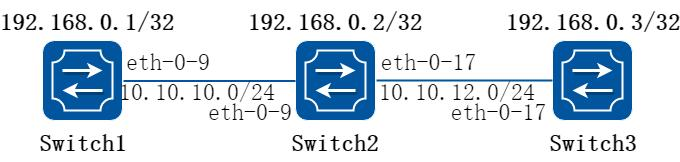

**图5-1 ip unicast routing**

这个例子说明在一个简单的网络拓扑结构下如何使能静态路由。

路由器Switch1 配置三个静态路由，一个是远程网络10.10.12.0/24，另外两个是到路由器Switch2 和Switch3 的环回地址（主机地址）。路由器Switch3 配置了一条默认静态路由，相当于单独的静态路由配置使用相同的网关或下一跳地址。路由器Switch2 有两条路由，每一条路由的目的地都是远端路由器的环回口地址。

##### 2. 配置步骤

##### 步骤1 进入配置模式

```
Switch# configure terminal
```

##### 步骤2 进入接口配置模式，配置接口属性和ip 地址

在Switch1 配置：

```
Switch1(config)# interface eth-0-9
Switch1(config-if)# no shutdown
Switch1(config-if)# no switchport
Switch1(config-if)# ip address 10.10.10.1/24
Switch1(config-if)# exit
Switch1(config)# interface loopback 0
Switch1(config-if)# ip address 192.168.0.1/32
Switch1(config-if)# exit
```

在Switch2 配置：

```
Switch2(config)# interface eth-0-9
Switch2(config-if)# no shutdown
Switch2(config-if)# no switchport
Switch2(config-if)# ip address 10.10.10.2/24
Switch2(config-if)# exit
Switch2(config)# interface eth-0-17
Switch2(config-if)# no shutdown
Switch2(config-if)# no switchport
Switch2(config-if)# ip address 10.10.12.2/24
Switch2(config-if)# exit
Switch2(config)# interface loopback 0
Switch2(config-if)# ip address 192.168.0.2/32
Switch2(config-if)# exit
```

在Switch3 配置：

```
Switch3(config)# interface eth-0-17
Switch3(config-if)# no shutdown
Switch3(config-if)# no switchport
Switch3(config-if)# ip address 10.10.12.3/24
Switch3(config-if)# exit
Switch3(config)# interface loopback 0
Switch3(config-if)# ip add 192.168.0.3/32
Switch3(config-if)# exit
```

##### 步骤3 配置静态路由

在Switch1 配置：

说明：指定目的前缀和掩码网关所需网络，例如，10.10.12.0/24，为他们每个添加网关（对此所有情况下为10.10.10.2）。由于Switch2 是唯一可用的下一跳，可以配置默认路由而不是配置为单独的地址

```
Switch1(config)# ip route 10.10.12.0/24 10.10.10.2
Switch1(config)# ip route 192.168.0.2/32 10.10.10.2
Switch1(config)# ip route 192.168.0.3/32 10.10.10.2
```

在Switch2 配置：

```
Switch2(config)# ip route 192.168.0.1/32 10.10.10.1
Switch2(config)# ip route 192.168.0.3/32 10.10.12.3
```

在Switch3 配置：

说明：指定10.10.12.2 作为到达任意网络的默认网关，因为10.10.12.2 是唯一的一条可以指定默认网关，而不是单个网络或主机的网关指定。

```
Switch3(config)# ip route 0.0.0.0/0 10.10.12.2
```

##### 步骤4 退出配置模式

```
Switch(config)# end
```

##### 步骤5 检查配置

使用下列命令，查看Switch1 上的路由：

```
Switch1# show ip route
Codes: K - kernel, C - connected, S - static, R - RIP, B - BGP
O - OSPF, IA - OSPF inter area
N1 - OSPF NSSA external type 1, N2 - OSPF NSSA external type 2
E1 - OSPF external type 1, E2 - OSPF external type 2
i - IS-IS, L1 - IS-IS level-1, L2 - IS-IS level-2, ia - IS-IS inter area
[*] - [AD/Metric]
* - candidate default
C
10.10.10.0/24 is directly connected, eth-0-9
C
10.10.10.1/32 is in local loopback, eth-0-9
S
10.10.12.0/24 [1/0] via 10.10.10.2, eth-0-9
C
192.168.0.1/32 is directly connected, loopback0
S
192.168.0.2/32 [1/0] via 10.10.10.2, eth-0-9
S
192.168.0.3/32 [1/0] via 10.10.10.2, eth-0-9
```

使用下列命令，查看Switch2 上的路由：

```
Switch2# show ip route
Codes: K - kernel, C - connected, S - static, R - RIP, B - BGP
O - OSPF, IA - OSPF inter area
N1 - OSPF NSSA external type 1, N2 - OSPF NSSA external type 2
E1 - OSPF external type 1, E2 - OSPF external type 2
i - IS-IS, L1 - IS-IS level-1, L2 - IS-IS level-2, ia - IS-IS inter area
[*] - [AD/Metric]
* - candidate default
C
10.10.10.0/24 is directly connected, eth-0-9
C
10.10.10.2/32 is in local loopback, eth-0-9
C
10.10.12.0/24 is directly connected, eth-0-17
C
10.10.12.2/32 is in local loopback, eth-0-17
S
192.168.0.1/32 [1/0] via 10.10.10.1, eth-0-9
C
192.168.0.2/32 is directly connected, loopback0
S
192.168.0.3/32 [1/0] via 10.10.12.3, eth-0-17
```

使用下列命令，查看Switch3 上的路由：

```
Switch3# show ip route
Codes: K - kernel, C - connected, S - static, R - RIP, B - BGP
O - OSPF, IA - OSPF inter area
N1 - OSPF NSSA external type 1, N2 - OSPF NSSA external type 2
E1 - OSPF external type 1, E2 - OSPF external type 2
i - IS-IS, L1 - IS-IS level-1, L2 - IS-IS level-2, ia - IS-IS inter area
[*] - [AD/Metric]
* - candidate default
Gateway of last resort is 10.10.12.2 to network 0.0.0.0
S*
0.0.0.0/0 [1/0] via 10.10.12.2, eth-0-17
C
10.10.12.0/24 is directly connected, eth-0-17
C
10.10.12.3/32 is in local loopback, eth-0-17
C
192.168.0.3/32 is directly connected, loopback0
```

## 5.2 RIP配置

### 5.2.1 概述

#### 简介

RIP（Routing Information Protocol，路由信息协议）是一种较为简单的内部网关协议（Interior Gateway Protocol，IGP），主要用于规模较小的网络中。

RIP 是一种基于距离矢量（Distance-Vector）算法的协议，它通过UDP 报文进行路由信息的交换。RIP 使用跳数（Hop Count）来衡量到达目的地址的距离，称为路由权

（RoutingCost）。在RIP 中，路由器到与它直接相连网络的跳数为0，通过一个路由器可达的网络的跳数为1，其余依此类推。为限制收敛时间，RIP 规定cost 的取值为0～15之间的整数，cost 取值大于或等于16 的跳数被定义为无穷大，即目的网络或主机不可达。

为提高性能，防止产生路由环，RIP 支持水平分割（Split Horizon）。RIP 还可引入其它路由协议所得到的路由。

#### 原理描述

参考2453

### 5.2.2 配置举例

#### 配置启用rip

##### 1. 组网拓扑

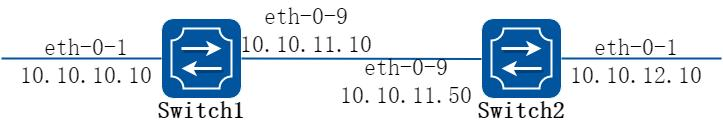

**图5-2 enable rip**

##### 2. 配置步骤

##### 步骤1 进入配置模式

```
Switch# configure terminal
```

##### 步骤2 进入接口配置模式，配置接口属性和ip 地址

在Switch1 配置：

```
Switch1(config)# interface eth-0-1
Switch1(config-if)# no switchport
Switch1(config-if)# no shutdown
Switch1(config-if)# ip address 10.10.10.10/24
Switch1(config-if)# exit
Switch1(config)# interface eth-0-9
Switch1(config-if)# no switchport
Switch1(config-if)# no shutdown
Switch1(config-if)# ip address 10.10.11.10/24
Switch1(config-if)# exit
```

在Switch2 配置：

```
Switch2(config)# interface eth-0-1
Switch2(config-if)# no switchport
Switch2(config-if)# no shutdown
Switch2(config-if)# ip address 10.10.12.10/24
Switch2(config-if)# exit
Switch2(config)# interface eth-0-9
Switch2(config-if)# no switchport
Switch2(config-if)# no shutdown
Switch2(config-if)# ip address 10.10.11.50/24
Switch2(config-if)# exit
```

##### 步骤3 启用rip 路由，发布需要的网段

在Switch1 配置：

```
Switch1(config)# router rip
Switch1(config-router)#network 10.10.10.0/24
Switch1(config-router)#network 10.10.11.0/24
Switch1(config-router)# exit
```

在Switch2 配置：

```
Switch2(config)# router rip
Switch2(config-router)#network 10.10.11.0/24
Switch2(config-router)#network 10.10.12.0/24
Switch2(config-router)# exit
```

##### 步骤4 退出配置模式

```
Switch(config)# end
```

##### 步骤5 检查配置

使用下列命令查看Switch1 rip 数据库：

```
Switch1# show ip rip database
Codes：R - RIP, Rc - RIP connected, Rs - RIP static, K - Kernel,
C - Connected, S - Static, O - OSPF, I - IS-IS, B - BGP
Network
Next Hop
Metric From
If
Time
Rc 10.10.10.0/24
1
eth-0-1
Rc 10.10.11.0/24
1
eth-0-9
R
10.10.12.0/24
10.10.11.50
2 10.10.11.50
eth-0-9
00：02：52
```

使用下列命令查看Switch1 rip 协议运行状态：

```
Switch1# show ip protocols rip
Routing protocol is "rip"
Sending updates every 30 seconds with +/-5 seconds, next due in 17 seconds
Timeout after 180 seconds, Garbage collect after 120 seconds
Outgoing update filter list for all interface is not set
Incoming update filter list for all interface is not set
Default redistribution metric is 1
Redistributing：
Default version control：send version 2, receive version 2
Interface
Send
Recv
Key-chain
eth-0-1
2
2
eth-0-9
2
2
Routing for Networks：
10.10.10.0/24
10.10.11.0/24
Routing Information Sources：
Gateway
Distance
Last Update
Bad Packets
Bad Routes
10.10.11.50
120
00：00：22
0
0
Number of routes (including connected)：3
Distance：(default is 120)
```

使用下列命令查看Switch1 rip 端口状态：

```
Switch1# show ip rip interface
eth-0-1 is up, line protocol is up
Routing Protocol：RIP
Receive RIP packets
Send RIP packets
Passive interface：Disabled
Split horizon：Enabled with Poisoned Reversed
IP interface address：
10.10.10.10/24
eth-0-9 is up, line protocol is up
Routing Protocol：RIP
Receive RIP packets
Send RIP packets
Passive interface：Disabled
Split horizon：Enabled with Poisoned Reversed
IP interface address：
10.10.11.10/24
```

使用下列命令查看Switch1 上的路由：

```
Switch1# show ip route
Codes：K - kernel, C - connected, S - static, R - RIP, B - BGP
O - OSPF, IA - OSPF inter area
N1 - OSPF NSSA external type 1, N2 - OSPF NSSA external type 2
E1 - OSPF external type 1, E2 - OSPF external type 2
i - IS-IS, L1 - IS-IS level-1, L2 - IS-IS level-2, ia - IS-IS inter area
[*] - [AD/Metric]
* - candidate default
C
10.10.10.0/24 is directly connected, eth-0-1
C
10.10.10.10/32 is in local loopback, eth-0-1
C
10.10.11.0/24 is directly connected, eth-0-9
C
10.10.11.10/32 is in local loopback, eth-0-9
R
10.10.12.0/24 [120/2] via 10.10.11.50, eth-0-9, 00：25：50
```

#### 配置rip 版本

##### 1. 组网拓扑

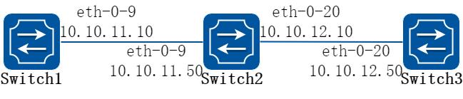

**图5-3 rip version**

配置路由接口发送接收的RIP 版本。在下面例子中Switch2 在eth-0-9 和eth-0-20 上面发送和接收的RIP 版本是v1 和v2。

##### 2. 配置步骤

##### 步骤1 进入配置模式

以下配置在Switch2 进行：

```
Switch2# configure terminal
```

##### 步骤2 启用路由协议

```
Switch2(config)# router rip
Switch2(config-router)# exit
```

##### 步骤3 进入接口配置模式，配置接口rip 版本信息

```
Switch2(config)# interface eth-0-9
Switch2(config-if)# ip rip send version 1 2
Switch2(config-if)# ip rip receive version 1 2
Switch2(config-if)# quit
Switch2(config)# interface eth-0-20
Switch2(config-if)# ip rip send version 1 2
Switch2(config-if)# ip rip receive version 1 2
Switch2(config-if)# quit
```

##### 步骤4 退出配置模式

```
Switch2(config)# end
```

##### 步骤5 检查配置

使用下列命令，查看Switch1 配置：

```
Switch1# show running-config
interface eth-0-9
no switchport
ip address 10.10.11.10/24
!
router rip
network 10.10.11.0/24
```

使用下列命令，查看Switch2 的rip 数据库信息：

```
Switch2# show ip rip database
Codes：R - RIP, Rc - RIP connected, Rs - RIP static, K - Kernel,
C - Connected, S - Static, O - OSPF, I - IS-IS, B - BGP
Network
Next Hop
Metric From
If
Time
R
10.0.0.0/8
1
eth-0-9
Rc 10.10.11.0/24
1
eth-0-9
Rc 10.10.12.0/24
1
eth-0-20
```

使用下列命令，查看Switch2 的rip 协议运行状态信息：

```
Switch2# show ip protocols rip
Routing protocol is "rip"
Sending updates every 30 seconds with +/-5 seconds, next due in 1 seconds
Timeout after 180 seconds, Garbage collect after 120 seconds
Outgoing update filter list for all interface is not set
Incoming update filter list for all interface is not set
Default redistribution metric is 1
Redistributing：
Default version control：send version 2, receive version 2
Interface
Send
Recv
Key-chain
eth-0-9
1 2
1 2
eth-0-20
1 2
1 2
Routing for Networks：
10.10.11.0/24
10.10.12.0/24
Routing Information Sources：
Gateway
Distance
Last Update
Bad Packets
Bad Routes
10.10.11.10
120
00：00：22
0
0
10.10.12.50
120
00：00：27
0
0
Number of routes (including connected)：3
Distance：(default is 120)
```

使用下列命令，查看Switch2 的使用下列命令查看rip 端口状态：

```
Switch2# show ip rip interface
eth-0-9 is up, line protocol is up
Routing Protocol：RIP
Receive RIPv1 and RIPv2 packets
Send RIPv1 and RIPv2 packets
Passive interface：Disabled
Split horizon：Enabled with Poisoned Reversed
IP interface address：
```

```
10.10.11.50/24
eth-0-20 is up, line protocol is up
Routing Protocol：RIP
Receive RIPv1 and RIPv2 packets
Send RIPv1 and RIPv2 packets
Passive interface：Disabled
Split horizon：Enabled with Poisoned Reversed
IP interface address：
10.10.12.10/24
```

使用下列命令，查看Switch2 的配置：

```
Switch2# show run
interface eth-0-9
no switchport
ip address 10.10.11.50/24
ip rip send version 1 2
ip rip receive version 1 2
!
interface eth-0-20
no switchport
ip address 10.10.12.10/24
ip rip send version 1 2
ip rip receive version 1 2
!
router rip
network 10.10.11.0/24
network 10.10.12.0/24
```

使用下列命令，查看Switch3 配置：

```
Switch3# show running-config
interface eth-0-20
no switchport
ip address 10.10.12.50/24
!
router rip
network 10.10.12.0/24
```

#### 配置Metric 参数

##### 1. 组网拓扑

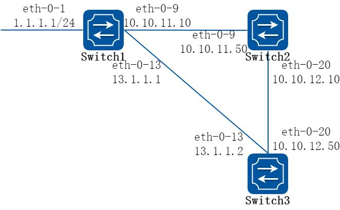

**图5-4 rip metric**

附加度量值是附加在RIP 路由上的输入输出度量值，包括发送附加度量值和接收附加度量值。发送附加度量值不会改变路由表中的路由度量值，仅当接口发送RIP 路由信息时才会添加到发送路由上；接收附加度量值会影响接收到的路由度量值，接口接收到一条合法的RIP 路由时，在将其加入路由表前会把度量值附加到该路由上。附加度量值一般包括如下的参数：

指定增加路由Metric 的ACL，参数说明如下：

In：应用在从邻居路由器学习到的RIP 的路由上Out：应用在发布给邻居路由器RIP 通告上匹配ACL 路由的偏移值Metric应用偏移列表的接口如果有一个路由匹配全局偏移表（不指定接口）和一个基于接口的偏移列表，此时基于接口的偏移列表优先。在这种情况下，基于接口的偏移列表的度量值是被加到路由上。

下面例子讲述如何在Switch1 上将1.1.1.0 在eth-0-13 接口上增加metric 3。

##### 2. 配置步骤

##### 步骤1 环境准备, 检查已有配置

Switch1

```
interface eth-0-1
no switchport
ip address 1.1.1.1/24
!
interface eth-0-9
no switchport
ip address 10.10.11.10/24
!
interface eth-0-13
```

```
no switchport
ip address 13.1.1.1/24
!
router rip
network 1.1.1.0/24
network 10.10.11.0/24
network 13.1.1.0/24
```

Switch2

```
interface eth-0-9
no switchport
ip address 10.10.11.50/24
!
interface eth-0-20
no switchport
ip address 10.10.12.10/24
!
router rip
network 10.10.11.0/24
network 10.10.12.0/24
```

Switch3

```
interface eth-0-13
no switchport
ip address 13.1.1.2/24
!
interface eth-0-20
no switchport
ip address 10.10.12.50/24
!
router rip
network 10.10.12.0/24
network 13.1.1.0/24
```

Switch3 上已学到rip 路由，显示如下：

```
Switch# show ip route rip
R
1.1.1.0/24 [120/2] via 13.1.1.1, eth-0-13, 00：07：46
R
10.10.11.0/24 [120/2] via 13.1.1.1, eth-0-13, 00：07：39
[120/2] via 10.10.12.10, eth-0-20, 00：07：39
Change router 1.1.1.0/24 via 10.10.12.10
```

##### 步骤2 进入配置模式

以下配置在Switch1 进行：

```
Switch1# configure terminal
```

##### 步骤3 配置ACL

```
Switch1(config)#ip access-list ripoffset
Switch1(config-ip-acl)#permit any 1.1.1.0 0.0.0.255 any
```

##### 步骤4 启用rip 路由，设置偏移列表的Metric 值

```
Switch1(config-ip-acl)# router rip
Switch1(config-router)# offset-list ripoffset out 3 eth-0-13
```

##### 步骤5 退出配置模式

```
Switch1(config-router)# end
```

##### 步骤6 检查配置

Switch3 上学到rip 路由，其中Switch1 发布的路由metric 变为3，显示如下：

```
Switch3# show ip route rip
R
1.1.1.0/24 [120/3] via 10.10.12.10, eth-0-20, 00：00：02
R
10.10.11.0/24 [120/2] via 13.1.1.1, eth-0-13, 00：11：40
[120/2] via 10.10.12.10, eth-0-20, 00：11：40
```

#### 配置管理距离

##### 1. 组网拓扑

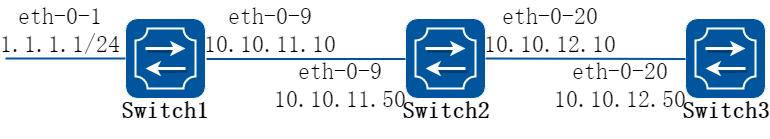

**图5-5 rip distance**

默认情况下，RIP 的管理距离是120。比较路由时，管理距离越低，路由越容易被选中。

下面例子讲述了如何修改RIP 的管理距离，通过以下步骤改变Switch3 上的1.1.1.0 网段的RIP 管理距离。

##### 2. 配置步骤

##### 步骤1 环境准备, 检查已有配置

Switch1

```
interface eth-0-1
no switchport
ip address 1.1.1.1/24
!
interface eth-0-9
no switchport
ip address 10.10.11.10/24
!
router ospf
network 1.1.1.0/24 area 0
network 10.10.11.0/24 area 0
!
router rip
network 1.1.1.0/24
network 10.10.11.0/24
```

Switch2

```
interface eth-0-9
no switchport
```

```
ip address 10.10.11.50/24
!
interface eth-0-20
no switchport
ip address 10.10.12.10/24
!
router ospf
network 10.10.11.0/24 area 0
network 10.10.12.0/24 area 0
!
router rip
network 10.10.11.0/24
network 10.10.12.0/24
```

Switch3

```
interface eth-0-20
no switchport
ip address 10.10.12.50/24
!
router ospf
network 10.10.12.0/24 area 0
!
router rip
network 10.10.12.0/24
```

Switch3 上已学到的路由，显示如下：

```
Switch3# show ip route
Codes：K - kernel, C - connected, S - static, R - RIP, B - BGP
O - OSPF, IA - OSPF inter area
N1 - OSPF NSSA external type 1, N2 - OSPF NSSA external type 2
E1 - OSPF external type 1, E2 - OSPF external type 2
i - IS-IS, L1 - IS-IS level-1, L2 - IS-IS level-2, ia - IS-IS inter area
[*] - [AD/Metric]
* - candidate default
O
1.1.1.0/24 [110/3] via 10.10.12.10, eth-0-20, 01：05：49
O
10.10.11.0/24 [110/2] via 10.10.12.10, eth-0-20, 01：05：49
C
10.10.12.0/24 is directly connected, eth-0-20
C
10.10.12.50/32 is in local loopback, eth-0-20
```

##### 步骤2 进入配置模式

以下配置在Switch3 进行：

```
Switch3# configure terminal
```

##### 步骤3 配置ACL

```
Switch3(config)#ip access-list ripdistancelist
Switch3(config-ip-acl)#permit any 1.1.1.0 0.0.0.255 any
```

##### 步骤4 启用rip 路由，设置RIP 路由的管理距离

```
Switch3(config-ip-acl)# router rip
Switch3(config-router)# distance 100 0.0.0.0/0 ripdistancelist
```

##### 步骤5 退出配置模式

```
Switch3(config-router)# end
```

##### 步骤6 检查配置

Switch3 上学到rip 路由，其中rip 路由管理距离变为100，显示如下：

```
Switch3# show ip route
Codes：K - kernel, C - connected, S - static, R - RIP, B - BGP
O - OSPF, IA - OSPF inter area
N1 - OSPF NSSA external type 1, N2 - OSPF NSSA external type 2
E1 - OSPF external type 1, E2 - OSPF external type 2
i - IS-IS, L1 - IS-IS level-1, L2 - IS-IS level-2, ia - IS-IS inter area
[*] - [AD/Metric]
* - candidate default
R
1.1.1.0/24 [100/3] via 10.10.12.10, eth-0-20, 00：00：02
O
10.10.11.0/24 [110/2] via 10.10.12.10, eth-0-20, 01：10：42
C
10.10.12.0/24 is directly connected, eth-0-20
C
10.10.12.50/32 is in local loopback, eth-0-20
```

#### 配置重发布

##### 1. 组网拓扑

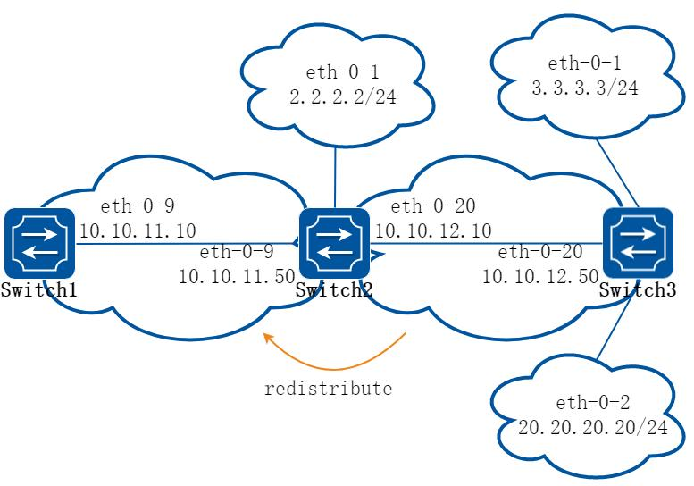

**图5-6 rip redistribute**

用户可以将静态路由，直连路由以及其他路由协议比如OSPF 的路由重分布到RIP 中并被RIP 发送给它的邻居。

默认RIP 的重发布Metric 为1，最大16。

将特定的路由重发布到RIP 上，其度量值可以是默认的，也可以是修改后的。下面例子讲述如何重分布其他的路由信息到RIP。

##### 2. 配置步骤

##### 步骤1 环境准备, 检查已有配置

Switch1

```
interface eth-0-9
no switchport
ip address 10.10.11.10/24
!
router rip
network 10.10.11.0/24
```

Switch2

```
interface eth-0-1
no switchport
ip address 2.2.2.2/24
!
interface eth-0-9
no switchport
ip address 10.10.11.50/24
!
interface eth-0-20
no switchport
ip address 10.10.12.10/24
!
router ospf
network 10.10.12.0/24 area 0
!
router rip
network 10.10.11.0/24
!
ip route 20.20.20.0/24 10.10.12.50
```

Switch3

```
interface eth-0-1
no switchport
ip address 3.3.3.3/24
!
interface eth-0-2
no switchport
ip address 20.20.20.20/24
!
interface eth-0-20
no switchport
ip address 10.10.12.50/24
!
router ospf
network 3.3.3.0/24 area 0
network 10.10.12.0/24 area 0
```

Switch1 上已学到的路由，显示如下：

```
Switch1# show ip route
Codes：K - kernel, C - connected, S - static, R - RIP, B - BGP
O - OSPF, IA - OSPF inter area
N1 - OSPF NSSA external type 1, N2 - OSPF NSSA external type 2
E1 - OSPF external type 1, E2 - OSPF external type 2
i - IS-IS, L1 - IS-IS level-1, L2 - IS-IS level-2, ia - IS-IS inter area
```

```
[*] - [AD/Metric]
* - candidate default
C
10.10.11.0/24 is directly connected, eth-0-9
C
10.10.11.10/32 is in local loopback, eth-0-9
```

Switch2 上已学到的路由，显示如下：

```
Switch2# show ip route
Codes：K - kernel, C - connected, S - static, R - RIP, B - BGP
O - OSPF, IA - OSPF inter area
N1 - OSPF NSSA external type 1, N2 - OSPF NSSA external type 2
E1 - OSPF external type 1, E2 - OSPF external type 2
i - IS-IS, L1 - IS-IS level-1, L2 - IS-IS level-2, ia - IS-IS inter area
[*] - [AD/Metric]
* - candidate default
C
2.2.2.0/24 is directly connected, eth-0-1
C
2.2.2.02/32 is in local loopback, eth-0-1
O
3.3.3.0/24 [110/2] via 10.10.12.50, eth-0-20, 01：05：41
C
10.10.11.0/24 is directly connected, eth-0-9
C
10.10.11.50/32 is in local loopback, eth-0-9
C
10.10.12.0/24 is directly connected, eth-0-20
C
10.10.12.10/24 is in local loopback, eth-0-20
S
20.20.20.0/24 [1/0] via 10.10.12.50, eth-0-20
```

##### 步骤2 进入配置模式

以下配置在Switch2 进行：

```
Switch2# configure terminal
```

##### 步骤3 启用rip 路由，设置metric，设置需要重发布的路由类型

```
Switch2(config)# router rip
Switch2(config-router)# default-metric 2
Switch2(config-router)# redistribute static
Switch2(config-router)# redistribute connected
Switch2(config-router)# redistribute ospf metric 5
```

ospf 重发布直连路由（可选）：

```
Switch2(config)# router ospf
Switch2(config-router)# redistribute connected
```

##### 步骤4 退出配置模式

```
Switch2(config-router)# end
```

##### 步骤5 检查配置

Switch1 上学到的路由，显示如下：

```
Switch1# show ip route
Codes：K - kernel, C - connected, S - static, R - RIP, B - BGP
O - OSPF, IA - OSPF inter area
N1 - OSPF NSSA external type 1, N2 - OSPF NSSA external type 2
E1 - OSPF external type 1, E2 - OSPF external type 2
i - IS-IS, L1 - IS-IS level-1, L2 - IS-IS level-2, ia - IS-IS inter area
[*] - [AD/Metric]
* - candidate default
```

```
R
2.2.2.0/24 [120/3] via 10.10.11.50, eth-0-9, 00：02：36
R
3.3.3.0/24 [120/6] via 10.10.11.50, eth-0-9, 00：02：26
C
10.10.11.0/24 is directly connected, eth-0-9
C
10.10.11.10/32 is in local loopback eth-0-9
R
10.10.12.0/24 [120/3] via 10.10.11.50, eth-0-9, 00：02：36
R
20.20.20.0/24 [120/3] via 10.10.11.50, eth-0-9, 00：02：41
```

#### 配置水平分割参数

##### 1. 组网拓扑

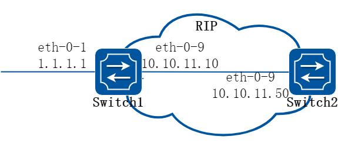

**图5-7 rip split-horizon**

通常情况下，连接到广播网络并且使用距离矢量路由协议的路由器，使用水平分割机制来避免环路。配置水平分割可以使得从一个接口学到的路由不能通过此接口向外发布，这通常优化了多个路由器之间的通信，尤其在链路中断时。

配置毒性逆转可以使得从一个接口学到的路由还可以从这个接口向外发布，但这些路由的度量值已设置为16，即不可达。

##### 2. 配置步骤

##### 步骤1 环境准备, 检查已有配置

Switch1

```
interface eth-0-1
no switchport
ip address 1.1.1.1/24
!
interface eth-0-9
no switchport
ip address 10.10.11.10/24
!
router rip
network 10.10.11.0/24
redistribute connected
```

Switch2

```
interface eth-0-9
no switchport
ip address 10.10.11.50/24
!
```

```
router rip
network 10.10.11.0/24
```

##### 步骤2 在Switch2 打开debug 开关（可选）

```
Switch# debug rip packet send detail
Switch# terminal monitor
```

##### 步骤3 进入配置模式

以下配置在Switch2 进行：

```
Switch2# configure terminal
```

##### 步骤4 进入接口配置模式，设置水平分割

禁用水平分割：

```
Switch2(config)#interface eth-0-9
Switch2(config-if)# no ip rip split-horizon
```

当debug 开关打开时，有如下信息显示：

```
Apr
8 06：24：25 Switch RIP4-7：SEND[eth-0-9]：Send to 224.0.0.9：520
Apr
8 06：24：25 Switch RIP4-7：SEND[eth-0-9]：RESPONSE version 2 packet size 44
Apr
8 06：24：25 Switch RIP4-7：1.1.1.0/24 -> 0.0.0.0 family 2 tag 0 metric 2
Apr
8 06：24：25 Switch RIP4-7：10.10.11.0/24 -> 0.0.0.0 family 2 tag 0 metric 1
```

启用水平分割和毒性逆转：

```
Switch2(config-if)# ip rip split-horizon
Switch2(config-if)# ip rip split-horizon poisoned
```

当debug 开关打开时，有如下提示显示：

```
Apr
8 06：38：35 Switch RIP4-7：SEND[eth-0-9]：Send to 224.0.0.9：520
Apr
8 06：38：35 Switch RIP4-7：SEND[eth-0-9]：RESPONSE version 2 packet size 44
Apr
8 06：38：35 Switch RIP4-7：1.1.1.0/24 -> 0.0.0.0 family 2 tag 0 metric 16
Apr
8 06：38：35 Switch RIP4-7：10.10.11.0/24 -> 0.0.0.0 family 2 tag 0 metric 16
```

##### 步骤5 退出配置模式

```
Switch2(config-router)# end
```

##### 步骤6 检查配置

使用如下命令，验证上述配置：

```
Switch2# show running-config
interface eth-0-9
no switchport
ip address 10.10.11.50/24
!
router rip
network 10.10.11.0/24
!
```

使用如下命令，查看rip 接口配置

```
Switch2# show ip rip interface
eth-0-9 is up, line protocol is up
```

```
Routing Protocol：RIP
Receive RIP packets
Send RIP packets
Passive interface：Disabled
Split horizon：Enabled with Poisoned Reversed
IP interface address：
10.10.11.50/24
```

#### 配置定时器

RIP 受多个定时器的控制，比如路由更新的频率，路由失效的时间等等。用户可以调整这些计时器以调整RIP 的性能，以更好地满足网络工作的需要。如下参数可供调整：

Update 定时器，定义了发送更新报文的时间间隔。

Timeout 定时器，定义了路由老化时间。如果在老化时间内没有收到关于某条路由的更新报文，则该条路由在路由表中的度量值将会被设置为16。

Garbage-Collect 定时器，定义了一条路由从度量值变为16 开始，直到它从路由表里被删除所经过的时间。

##### 步骤1 进入配置模式

```
Switch# configure terminal
```

##### 步骤2 启用rip 路由协议并配置定时器

指定路由表update timer 10 秒，指定路由信息超时180 秒，垃圾信息收集时间120 秒：

```
Switch(config)# router rip
Switch(config-router)# timers basic 10 180 120
```

##### 步骤3 退出配置模式

```
Switch(config-router)# end
```

##### 步骤4 检查配置

使用如下命令，验证上述配置：

```
Switch# show ip protocols rip
Routing protocol is "rip"
Sending updates every 10 seconds with +/-5 seconds, next due in 2 seconds
Timeout after 180 seconds, Garbage collect after 120 seconds
Outgoing update filter list for all interface is not set
Incoming update filter list for all interface is not set
Default redistribution metric is 1
Redistributing：
Default version control：send version 2, receive version 2
Interface
Send
Recv
Key-chain
eth-0-9
2
2
Routing for Networks：
10.10.11.0/24
Routing Information Sources：
Gateway
Distance
Last Update
Bad Packets
Bad Routes
10.10.11.50
120
00：00：02
0
0
Number of routes (including connected)：5
Distance：(default is 120)
```

#### 配置RIP 路由过滤列表

##### 1. 组网拓扑

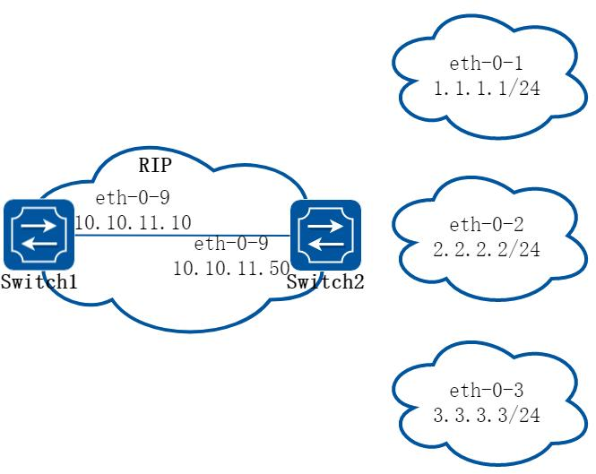

**图5-8 rip filter list**

路由器提供路由信息过滤功能，通过指定访问控制列表和地址前缀列表，可以配置入口或出口过滤策略，对接收或发布的路由进行过滤。一个路由过滤列表通常包括如下参数：

一个被用作过滤器的ACL 或prefix list。

方向。

In 方向：过滤器被应用在学习到的路由上Out 方向：过滤器被应用在发布的路由上应用过滤器的接口（可选）。

##### 2. 配置步骤

##### 步骤1 环境准备, 检查已有配置

Switch1

```
interface eth-0-9
no switchport
ip address 10.10.11.10/24
!
router rip
network 10.10.11.0/24
```

Switch2

```
interface eth-0-1
no switchport
ip address 1.1.1.1/24
!
interface eth-0-2
```

```
no switchport
ip address 2.2.2.2/24
!
interface eth-0-3
no switchport
ip address 3.3.3.3/24
!
interface eth-0-9
no switchport
ip address 10.10.11.50/24
!
router rip
network 1.1.1.0/24
network 2.2.2.0/24
network 3.3.3.0/24
network 10.10.11.0/24
```

Switch1 上已学到的路由，显示如下：

```
Switch1# show ip route
Codes: K - kernel, C - connected, S - static, R - RIP, B - BGP
O - OSPF, IA - OSPF inter area
N1 - OSPF NSSA external type 1, N2 - OSPF NSSA external type 2
E1 - OSPF external type 1, E2 - OSPF external type 2
i - IS-IS, L1 - IS-IS level-1, L2 - IS-IS level-2, ia - IS-IS inter area
[*] - [AD/Metric]
* - candidate default
R
1.1.1.0/24 [120/2] via 10.10.11.50, eth-0-9, 00:01:50
R
2.2.2.0/24 [120/2] via 10.10.11.50, eth-0-9, 00:01:50
R
3.3.3.0/24 [120/2] via 10.10.11.50, eth-0-9, 00:01:50
C
10.10.11.0/24 is directly connected, eth-0-9
C
10.10.11.10/32 is in local loopback, eth-0-9
```

##### 步骤2 进入配置模式

以下配置在Switch2 进行：

```
Switch2# configure terminal
```

##### 步骤3 配置过滤列表

```
Switch2(config)# ip prefix-list 1 deny 1.1.1.0/24
Switch2(config)# ip prefix-list 1 permit any
```

##### 步骤4 应用过滤列表

```
Switch2(config)# router rip
Switch2(config-router)# distribute-list prefix 1 out
```

##### 步骤5 退出配置模式

```
Switch2(config-router)# end
```

##### 步骤6 检查配置

Switch1 上学到的路由，显示如下：

```
Switch1# show ip route
Codes: K - kernel, C - connected, S - static, R - RIP, B - BGP
```

```
O - OSPF, IA - OSPF inter area
N1 - OSPF NSSA external type 1, N2 - OSPF NSSA external type 2
E1 - OSPF external type 1, E2 - OSPF external type 2
i - IS-IS, L1 - IS-IS level-1, L2 - IS-IS level-2, ia - IS-IS inter area
[*] - [AD/Metric]
* - candidate default
R
2.2.2.0/24 [120/2] via 10.10.11.50, eth-0-9, 00:00:08
R
3.3.3.0/24 [120/2] via 10.10.11.50, eth-0-9, 00:00:08
C
10.10.11.0/24 is directly connected, eth-0-9
C
10.10.11.10/32 is in local loopback, eth-0-9
```

#### 配置RIPv2 验证(single key)

##### 1. 组网拓扑

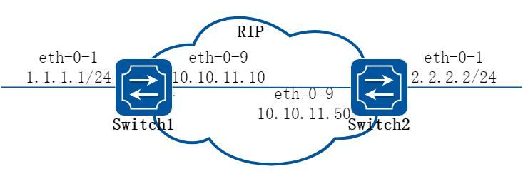

**图5-9 rip authentication**

RIP-2 支持两种认证方式：明文认证和MD5 密文认证。这个例子说明如何使用明文进行认证。Switch1 和2 是在运行RIP 路由协议，如果要在交换机上配置明文认证，需要执行如下步骤：

指定一个接口，然后定义该接口的密码。

指定认证模式为明文。

任何从这个指定接口接收的RIP 数据包应该有相同的字符串作为密码。同样的，Switch B 上也要定义相同的密码和身份验证模式。

##### 2. 配置步骤

##### 步骤1 进入配置模式

```
Switch# configure terminal
```

##### 步骤2 进入接口配置模式，配置接口属性和ip 地址

Switch1 配置：

```
Switch1(config)# interface eth-0-1
Switch1(config-if)# no switchport
Switch1(config-if)# no shutdown
Switch1(config-if)# ip address 1.1.1.1/24
Switch1(config-if)# exit
Switch1(config-if)# interface eth-0-9
Switch1(config-if)# no switchport
```

```
Switch1(config-if)# no shutdown
Switch1(config-if)# ip address 10.10.11.10/24
Switch1(config-if)# exit
```

Switch2 配置：

```
Switch2(config)# interface eth-0-1
Switch2(config-if)# no switchport
Switch2(config-if)# no shutdown
Switch2(config-if)# ip address 2.2.2.2/24
Switch2(config-if)# exit
Switch2(config-if)# interface eth-0-9
Switch2(config-if)# no switchport
Switch2(config-if)# no shutdown
Switch2(config-if)# ip address 10.10.11.50/24
Switch2(config-if)# exit
```

##### 步骤3 启用rip 路由并配置相关参数

```
Switch(config)# router rip
Switch(config-router)# network 10.10.11.0/24
Switch(config-router)# redistribute connected
Switch(config-router)# exit
```

##### 步骤4 指定验证的字符串和模式

```
Switch(config)# interface eth-0-9
Switch(config-if)# ip rip authentication string Auth1
Switch(config-if)# ip rip authentication mode text
Switch(config-if)# exit
```

##### 步骤5 退出配置模式

```
Switch(config)# end
```

##### 步骤6 检查配置

使用如下命令查看rip 数据库：

```
Switch# show ip rip database
Codes: R - RIP, Rc - RIP connected, Rs - RIP static, K - Kernel,
C - Connected, S - Static, O - OSPF, I - IS-IS, B - BGP
Network
Next Hop
Metric From
If
Time
R
2.2.2.0/24
10.10.11.50
2 10.10.11.50
eth-0-9
00:02:52
Rc 10.10.11.0/24
```

使用如下命令查看rip 协议运行状态：

```
Switch# show ip protocols rip
Routing protocol is "rip"
Sending updates every 30 seconds with +/-5 seconds, next due in 23 seconds
Timeout after 180 seconds, Garbage collect after 120 seconds
Outgoing update filter list for all interface is not set
Incoming update filter list for all interface is not set
Default redistribution metric is 1
Redistributing:
```

```
connected
metric default
Default version control: send version 2, receive version 2
Interface
Send
Recv
Key-chain
eth-0-9
2
2
Routing for Networks:
10.10.11.0/24
Routing Information Sources:
Gateway
Distance
Last Update
Bad Packets
Bad Routes
10.10.11.50
120
00:00:45
1
0
Number of routes (including connected): 2
Distance: (default is 120)
```

使用如下命令查看rip 端口信息：

```
Switch# show ip rip interface
eth-0-9 is up, line protocol is up
Routing Protocol: RIP
Receive RIP packets
Send RIP packets
Passive interface: Disabled
Split horizon: Enabled with Poisoned Reversed
IP interface address:
10.10.11.10/24
```

使用如下命令查看设备路由信息：

```
Switch# show ip route
Codes: K - kernel, C - connected, S - static, R - RIP, B - BGP
O - OSPF, IA - OSPF inter area
N1 - OSPF NSSA external type 1, N2 - OSPF NSSA external type 2
E1 - OSPF external type 1, E2 - OSPF external type 2
i - IS-IS, L1 - IS-IS level-1, L2 - IS-IS level-2, ia - IS-IS inter area
Dc - DHCP Client
[*] - [AD/Metric]
* - candidate default
R
2.2.2.0/24 [120/2] via 10.10.11.50, eth-0-9, 00:02:28
C
10.10.11.0/24 is directly connected, eth-0-9
C
10.10.11.10/32 is in local loopback, eth-0-9
```

#### 配置RIPv2 MD5 验证(multiple keys)

##### 1. 组网拓扑


**图5-10 rip authentication**

这个例子说明了如何使用MD5 进行RIP 路由信息交换过程中的验证。对于需要使用MD5认证的Switch A 和B 来说，首先定义一个钥匙链，然后指定key 并且配置认证的字符串或密码，然后通过指定接收或者发送的时间来定义key 生效的时间。最后将该钥匙链应用到接口上并且指定接口的认证模式为MD5。Switch A 和B 的密钥配置必须是一样的才能保证RIP 路由更新信息交换成功。在MD5 认证中，key ID 和key 字符串需要同时匹配。在下面的例子中，我们还配置了key 生效的时间，这样，每隔5 天，key 就会更新一次。

##### 2. 配置步骤

##### 步骤1 进入配置模式

```
Switch# configure terminal
```

##### 步骤2 进入接口配置模式，配置接口属性和ip 地址

Switch1 配置：

```
Switch1(config)# interface eth-0-1
Switch1(config-if)# no switchport
Switch1(config-if)# no shutdown
Switch1(config-if)# ip address 1.1.1.1/24
Switch1(config-if)# exit
Switch1(config-if)# interface eth-0-9
Switch1(config-if)# no switchport
Switch1(config-if)# no shutdown
Switch1(config-if)# ip address 10.10.11.10/24
Switch1(config-if)# exit
```

Switch2 配置：

```
Switch2(config)# interface eth-0-1
Switch2(config-if)# no switchport
Switch2(config-if)# no shutdown
Switch2(config-if)# ip address 2.2.2.2/24
Switch2(config-if)# exit
Switch2(config-if)# interface eth-0-9
Switch2(config-if)# no switchport
Switch2(config-if)# no shutdown
Switch2(config-if)# ip address 10.10.11.50/24
Switch2(config-if)# exit
```

##### 步骤3 启用rip 路由并配置相关参数

```
Switch(config)# router rip
Switch(config-router)# network 10.10.11.0/24
Switch(config-router)# redistribute connected
Switch(config-router)# exit
```

##### 步骤4 定义key chain，设置密码和应用的时间范围

```
Switch(config)# key chain CHAIN1
Switch(config-keychain)# key 1
Switch(config-keychain-key)# key-string key1
Switch(config-keychain-key)# accept-lifetime 12:00:00 Mar 2 2012 14:00:00 Mar 7 2012
Switch(config-keychain-key)# send-lifetime 12:00:00 Mar 2 2012 12:00:00 Mar 7 2012
Switch(config-keychain-key)# exit
```

第二个key（可选）

```
Switch(config-keychain)# key 2
Switch(config-keychain-key)# key-string Earth
Switch(config-keychain-key)# accept-lifetime 12:00:00 Mar 7 2012 14:00:00 Mar 12 2012
Switch(config-keychain-key)# send-lifetime 12:00:00 Mar 7 2012 12:00:00 Mar 12 2012
Switch(config-keychain-key)# exit
```

退出：

```
Switch(config-keychain)# exit
```

##### 步骤5 指定验证的字符串和模式

```
Switch(config)# interface eth-0-9
Switch(config-if)# ip rip authentication key-chain CHAIN1
Switch(config-if)# ip rip authentication mode md5
Switch(config-if)# exit
```

##### 步骤6 退出配置模式

```
Switch(config)# end
```

##### 步骤7 检查配置

使用如下命令查看rip 数据库：

```
Switch# show ip rip database
Codes: R - RIP, Rc - RIP connected, Rs - RIP static, K - Kernel,
C - Connected, S - Static, O - OSPF, I - IS-IS, B - BGP
Network
Next Hop
Metric From
If
Time
R
2.2.2.0/24
10.10.11.50
2 10.10.11.50
eth-0-9
00:01:10
Rc 10.10.11.0/24
1
eth-0-9
```

使用如下命令查看rip 协议运行状态：

```
Switch# show ip protocols rip
Routing protocol is "rip"
Sending updates every 30 seconds with +/-5 seconds, next due in 17 seconds
Timeout after 180 seconds, Garbage collect after 120 seconds
Outgoing update filter list for all interface is not set
Incoming update filter list for all interface is not set
Default redistribution metric is 1
Redistributing:
connected
metric default
Default version control: send version 2, receive version 2
Interface
Send
Recv
Key-chain
eth-0-9
2
2
CHAIN1
Routing for Networks:
10.10.11.0/24
```

```
Routing Information Sources:
Gateway
Distance
Last Update
Bad Packets
Bad Routes
Number of routes (including connected): 2
Distance: (default is 120)
```

使用如下命令查看rip 端口信息：

```
Switch# show ip rip interface
eth-0-9 is up, line protocol is up
Routing Protocol: RIP
Receive RIP packets
Send RIP packets
Passive interface: Disabled
Split horizon: Enabled with Poisoned Reversed
IP interface address:
10.10.11.10/24
```

使用下列命令查看设备路由信息：

```
Switch# show ip route
Codes: K - kernel, C - connected, S - static, R - RIP, B - BGP
O - OSPF, IA - OSPF inter area
N1 - OSPF NSSA external type 1, N2 - OSPF NSSA external type 2
E1 - OSPF external type 1, E2 - OSPF external type 2
i - IS-IS, L1 - IS-IS level-1, L2 - IS-IS level-2, ia - IS-IS inter area
Dc - DHCP Client
[*] - [AD/Metric]
* - candidate default
C
1.1.1.0/24 is directly connected, eth-0-1
C
1.1.1.1/32 is in local loopback, eth-0-1
R
2.2.2.0/24 [120/2] via 10.10.11.50, eth-0-9, 00:02:27
C
10.10.11.0/24 is directly connected, eth-0-9
C
10.10.11.10/32 is in local loopback, eth-0-9
```

使用如下命令查看key chain 信息：

```
Switch# show key chain
key chain CHAIN1:
key 1 -- text "key1"
accept-lifetime <12:00:00 Mar 02 2012> - <14:00:00 Mar 07 2012>
send-lifetime <12:00:00 Mar 02 2012> - < 12:00:00 Mar 07 2012>
key 2 -- text "Earth"
accept-lifetime <12:00:00 Mar 07 2012> - <14:00:00 Mar 12 2012>
send-lifetime <12:00:00 Mar 07 2012> - < 12:00:00 Mar 12 2012>
Switch#
```

## 5.3 OSPF配置

### 5.3.1 概述

#### 简介

开放最短路径优先协议OSPF（Open Shortest Path First）是IETF 组织开发的一个基于链路状态的内部网关协议，它支持IP 子网化以及对外部路由做标记。目前使用的是版本2（RFC2328），其特性如下：

适应范围：支持各种规模的网络，最多可支持几百台路由器。

快速收敛：在网络的拓扑结构发生变化后立即发送更新报文，使这一变化在自治系统中同步。

无自环：由于OSPF 根据收集到的链路状态用最短路径树算法计算路由，从算法本身保证了不会生成自环路由。

区域划分：允许自治系统的网络被划分成区域来管理，区域间传送的路由信息被进一步抽象，从而减少了占用的网络带宽。

等价路由：支持到同一目的地址的多条等价路由。

路由分级：使用4 类不同的路由，按优先顺序来说分别是：区域内路由、区域间路由、第一类外部路由、第二类外部路由。

支持验证：支持基于接口的报文验证以保证路由计算的安全性。

组播发送：协议报文支持以组播形式发送。

当前的系统支持如下OSPF 特性：

支持末梢区域：支持路由重分布，这包括将其他路由协议学到的路由导入OSPF 或者将OSPF 学到的路由导出到其他路由协议中。

支持明文和MD5 两种认证模式：支持OSPF interface 上的参数配置，包括输出度量值，重传时间，发送延时时间，路由器优先级，路由器hello 报文时间间隔，认证密码等等。

OSPF 需要多个路由器协同工作，包括区域边界路由器(ABR)，自治系统边界路由器(ASBR)，内部路由器等。最简单的OSPF 配置只需要使用默认的参数，并且将所有的OSPF interface 加入同一个区域就可以了。

#### 原理描述

参考RFC 2328。

### 5.3.2 配置举例

#### 配置基本OSPF

##### 步骤1 进入配置模式

```
Switch# configure terminal
```

##### 步骤2 创建ospf 实例，发布需要的网段到指定域

```
Switch(config)# router ospf 100
Switch(config-router)# network 10.10.10.0/24 area 0
Switch(config-router)# quit
```

说明：删除该ospf 实例的方法为

```
Switch(config)# no router ospf 100
```

##### 步骤3 退出配置模式

```
Switch(config)# end
```

##### 步骤4 检查配置

```
Switch# show ip protocols
Routing Protocol is "ospf 100"
Redistributing:
Routing for Networks:
10.10.10.0/24
Distance: (default is 110)
```

#### 启用OSPF

##### 1. 组网拓扑

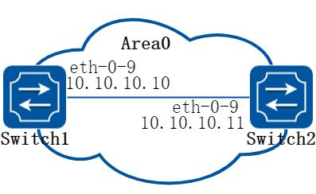

**图5-11 ospf**

这个例子显示了一个接口上启用OSPF 所需的最低配置。

一个接口只能属于一个区域，不同的接口可以属于不同的区域

##### 2. 配置步骤

##### 步骤1 进入配置模式

```
Switch# configure terminal
```

##### 步骤2 进入接口配置模式，配置接口属性和ip 地址

在Switch1 配置：

```
Switch1(config)# interface eth-0-9
Switch1(config-if)# no switchport
Switch1(config-if)# no shutdown
Switch1(config-if)# ip address 10.10.10.10/24
Switch1(config-if)# exit
```

在Switch2 配置：

```
Switch2(config)# interface eth-0-9
Switch2(config-if)# no switchport
Switch2(config-if)# no shutdown
Switch2(config-if)# ip address 10.10.10.11/24
Switch2(config-if)# exit
```

##### 步骤3 创建ospf 实例，发布需要的网段到指定域

在Switch1 配置：

```
Switch1(config)# router ospf 100
Switch1(config-router)# network 10.10.10.0/24 area 0
```

在Switch2 配置：

```
Switch2(config)# router ospf 200
Switch2(config-router)# network 10.10.10.0/24 area 0
```

说明：直连的两个设备配置ospf，area 必须相同。ospf 的实例号可以相同也可以不同。

##### 步骤4 退出配置模式

```
Switch(config-router)# end
```

##### 步骤5 检查配置

使用下列命令查看ospf 数据库：

```
Switch# show ip ospf database
OSPF Router with ID (10.10.10.10) (Process ID 100)
Router Link States (Area 0)
Link ID
ADV Router
Age
Seq#
CkSum
Link count
10.10.10.10
10.10.10.10
26 0x80000006 0x1499 1
10.10.10.11
10.10.10.11
27 0x80000003 0x1895 1
Net Link States (Area 0)
Link ID
ADV Router
Age
Seq#
CkSum
10.10.10.10
10.10.10.10
26 0x80000001 0xdfd8
```

使用下列命令查看ospf 端口状态：

```
Switch# show ip ospf interface
eth-0-9 is up, line protocol is up
Internet Address 10.10.10.10/24, Area 0, MTU 1500
Process ID 100, Router ID 10.10.10.10, Network Type BROADCAST, Cost: 1
Transmit Delay is 1 sec, State DR, Priority 1, TE Metric 1
Designated Router (ID) 10.10.10.10, Interface Address 10.10.10.10
Backup Designated Router (ID) 10.10.10.11, Interface Address 10.10.10.11
Timer intervals configured, Hello 10, Dead 40, Wait 40, Retransmit 5
Hello due in 00:00:06
Neighbor Count is 1, Adjacent neighbor count is 1
Crypt Sequence Number is 1527047183
Hello received 25 sent 576, DD received 4 sent 4
```

```
LS-Req received 1 sent 1, LS-Upd received 3 sent 3
LS-Ack received 2 sent 2, Discarded 0
```

使用下列命令查看ospf 邻居：

Switch1：

```
Switch1# show ip ospf neighbor
OSPF process 100:
Neighbor ID
Pri
State
Dead Time
Address
Interface
10.10.10.11
1
Full/Backup
00:00:33
10.10.10.11
eth-0-9
```

Switch2：

```
Switch2# show ip ospf neighbor
OSPF process 200:
Neighbor ID
Pri
State
Dead Time
Address
Interface
10.10.10.10
1
Full/DR
00:00:33
10.10.10.10
eth-0-9
```

使用下列命令查看ospf 路由：

```
Switch# show
ip ospf route
OSPF process 100:
Codes: C - connected, D - Discard, O - OSPF, IA - OSPF inter area
N1 - OSPF NSSA external type 1, N2 - OSPF NSSA external type 2
E1 - OSPF external type 1, E2 - OSPF external type 2
C
10.10.10.0/24 [1] is directly connected, eth-0-9, Area 0
```

#### 配置优先级

##### 1. 组网拓扑

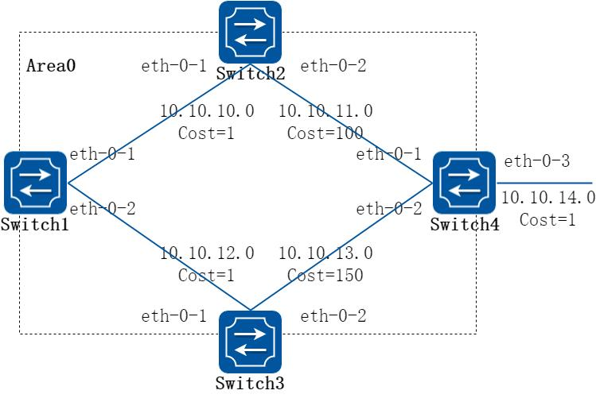

**图5-12 ospf priority**

这个例子主要讲述了如何配置接口优先级，优先级高的成为DR。优先级为0 的不参与DR 选举。Switch3 的优先级是10，这比Switch1 和Switch2 的默认优先级1 要高，因此Switch3 将成为这个网络内的DR。

##### 2. 配置步骤

##### 步骤1 进入配置模式

```
Switch# configure terminal
```

##### 步骤2 进入接口配置模式，配置接口属性和ip 地址

在Switch1 配置：

```
Switch1(config)# interface eth-0-17
Switch1(config-if)# no switchport
Switch1(config-if)# no shutdown
Switch1(config-if)# ip address 10.10.10.10/24
Switch1(config-if)# quit
```

在Switch2 配置：

```
Switch2(config)# interface eth-0-13
Switch2(config-if)# no switchport
Switch2(config-if)# no shutdown
Switch2(config-if)# ip address 10.10.10.11/24
Switch2(config-if)# quit
```

在Switch3 配置：

```
Switch3(config)# interface eth-0-9
Switch3(config-if)# no switchport
Switch3(config-if)# no shutdown
Switch3(config-if)# ip address 10.10.10.13/24
Switch3(config-if)# quit
```

在L2 switch 配置：

```
Switch4(config)# interface eth-0-9
Switch4(config-if)# no shutdown
Switch4(config-if)# quit
Switch4(config)# interface eth-0-13
Switch4(config-if)# no shutdown
Switch4(config-if)# quit
Switch4(config)# interface eth-0-17
Switch4(config-if)# no shutdown
Switch4(config-if)# quit
```

##### 步骤3 配置ospf 接口优先级

在Switch3 配置：

```
Switch3(config)# interface eth-0-9
Switch3(config-if)# ip ospf priority 10
Switch3(config-if)# quit
```

##### 步骤4 创建ospf 实例，发布需要的网段到指定域

```
Switch(config)# router ospf 100
Switch(config-router)# network 10.10.10.0/24 area 0
Switch(config-if)# quit
```

##### 步骤5 退出配置模式

```
Switch(config)# end
```

##### 步骤6 检查配置

使用下列命令查看ospf 邻居：

Switch1：

```
Switch1# show ip ospf neighbor
OSPF process 100:
Neighbor ID
Pri
State
Dead Time
Address
Interface
10.10.10.11
1
Full/Backup
00:00:31
10.10.10.11
eth-0-17
10.10.10.13
10
Full/DR
00:00:38
10.10.10.13
eth-0-17
```

Switch2：

```
Switch2# show ip ospf neighbor
OSPF process 100:
Neighbor ID
Pri
State
Dead Time
Address
Interface
10.10.10.10
1
Full/DROther
00:00:39
10.10.10.10
eth-0-13
10.10.10.13
10
Full/DR
00:00:32
10.10.10.13
eth-0-13
```

Switch3：

```
Switch3# show ip ospf neighbor
OSPF process 100:
Neighbor ID
Pri
State
Dead Time
Address
Interface
10.10.10.10
1
Full/DROther
00:00:37
10.10.10.10
eth-0-9
10.10.10.11
1
Full/Backup
00:00:32
10.10.10.11
eth-0-9
```

使用下列命令查看ospf 端口状态：

Switch1：

```
Switch1# show ip ospf interface
eth-0-17 is up, line protocol is up
Internet Address 10.10.10.10/24, Area 0, MTU 1500
Process ID 100, Router ID 10.10.10.10, Network Type BROADCAST, Cost: 1
Transmit Delay is 1 sec, State DROther, Priority 1, TE Metric 1
Designated Router (ID) 10.10.10.13, Interface Address 10.10.10.13
Backup Designated Router (ID) 10.10.10.11, Interface Address 10.10.10.11
Timer intervals configured, Hello 10, Dead 40, Wait 40, Retransmit 5
Hello due in 00:00:10
Neighbor Count is 2, Adjacent neighbor count is 2
Crypt Sequence Number is 1527056133
Hello received 106 sent 54, DD received 8 sent 9
LS-Req received 2 sent 3, LS-Upd received 8 sent 5
LS-Ack received 9 sent 5, Discarded 3
```

Switch2：

```
Switch2# show ip ospf interface
eth-0-13 is up, line protocol is up
Internet Address 10.10.10.11/24, Area 0, MTU 1500
Process ID 100, Router ID 10.10.10.11, Network Type BROADCAST, Cost: 1
Transmit Delay is 1 sec, State Backup, Priority 1, TE Metric 1
Designated Router (ID) 10.10.10.13, Interface Address 10.10.10.13
Backup Designated Router (ID) 10.10.10.11, Interface Address 10.10.10.11
Timer intervals configured, Hello 10, Dead 40, Wait 40, Retransmit 5
Hello due in 00:00:10
Neighbor Count is 2, Adjacent neighbor count is 2
Crypt Sequence Number is 1527056130
Hello received 110 sent 56, DD received 8 sent 7
LS-Req received 3 sent 2, LS-Upd received 12 sent 6
LS-Ack received 11 sent 8, Discarded 0
```

Switch3：

```
Switch3# show ip ospf interface
eth-0-9 is up, line protocol is up
Internet Address 10.10.10.13/24, Area 0, MTU 1500
Process ID 100, Router ID 10.10.10.13, Network Type BROADCAST, Cost: 1
Transmit Delay is 1 sec, State DR, Priority 10, TE Metric 1
Designated Router (ID) 10.10.10.13, Interface Address 10.10.10.13
Backup Designated Router (ID) 10.10.10.11, Interface Address 10.10.10.11
Timer intervals configured, Hello 10, Dead 40, Wait 40, Retransmit 5
Hello due in 00:00:01
Neighbor Count is 2, Adjacent neighbor count is 2
Crypt Sequence Number is 1527056127
Hello received 32 sent 16, DD received 9 sent 9
LS-Req received 2 sent 2, LS-Upd received 11 sent 8
LS-Ack received 10 sent 8, Discarded 0
```

#### 配置OSPF 区域参数

##### 1. 组网拓扑

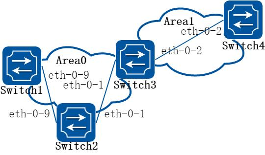

**图5-13 ospf area**

您可以选择性地配置多个OSPF 区域参数。这些参数包括用于防止访问未经授权的区域的认证密码，以及将区域配置为末梢区域(Stub)。Stub 区域是一些特定的区域，Stub区域的ABR 不传播它们接收到的自治系统外部路由，在这些区域中路由器的路由表规模以及路由信息传递的数量都会大大减少。为保证到自治系统外的路由依旧可达，该区域的ABR 将生成一条缺省路由，并发布给Stub 区域中的其他非ABR 路由器。

路由聚合是指ABR 或ASBR 将具有相同前缀的路由信息聚合，只发布一条路由到其它区域。AS 被划分成不同的区域后，区域间可以通过路由聚合来减少路由信息，减小路由表的规模，提高路由器的运算速度。如果网络号是连续的，你可以使用area range 命令将这些连续的网段聚合成一个网段。这样ABR 只发送一条聚合后的LSA，所有属于本命令指定的聚合网段范围的LSA 将不再会被单独发送出去，这样可减少其它区域中LSDB的规模。

##### 2. 配置步骤

##### 步骤1 进入配置模式

```
Switch# configure terminal
```

##### 步骤2 进入接口配置模式，配置接口属性和ip 地址

在Switch1 配置：

```
Switch1(config)# interface eth-0-17
Switch1(config-if)# no switchport
Switch1(config-if)# no shutdown
Switch1(config-if)# ip address 10.10.10.10/24
Switch1(config-if)# quit
```

在Switch2 配置：

```
Switch2(config)# interface eth-0-13
Switch2(config-if)# no switchport
Switch2(config-if)# no shutdown
Switch2(config-if)# ip address 10.10.10.11/24
Switch2(config-if)# quit
Switch2(config)# interface eth-0-21
Switch2(config-if)# no switchport
Switch2(config-if)# no shutdown
Switch2(config-if)# ip address 10.10.11.11/24
Switch2(config-if)# quit
```

在Switch3 配置：

```
Switch3(config)# interface eth-0-9
Switch3(config-if)# no switchport
Switch3(config-if)# no shutdown
Switch3(config-if)# ip address 10.10.10.13/24
Switch3(config-if)# quit
```

在Switch4 配置：

```
Switch4(config)# interface eth-0-21
Switch4(config-if)# no switchport
Switch4(config-if)# no shutdown
Switch4(config-if)# ip address 10.10.11.12/24
Switch4(config-if)# quit
```

在L2 switch 配置：

```
Switch5(config)# interface eth-0-9
Switch5(config-if)# no shutdown
Switch5(config-if)# quit
Switch5(config)# interface eth-0-13
Switch5(config-if)# no shutdown
Switch5(config-if)# quit
Switch5(config)# interface eth-0-17
Switch5(config-if)# no shutdown
Switch5(config-if)# quit
```

##### 步骤3 配置ospf 接口优先级

在Switch3 配置：

```
Switch3(config)# interface eth-0-9
Switch3(config-if)# ip ospf priority 10
Switch3(config-if)# quit
```

##### 步骤4 创建ospf 实例，发布需要的网段到指定域

在Switch1 配置：

```
Switch1(config)# router ospf 100
Switch1(config-router)# network 10.10.10.0/24 area 0
Switch1(config-router)# quit
```

在Switch2 配置：

```
Switch2(config)# router ospf 100
Switch2(config-router)# network 10.10.10.0/24 area 0
Switch2(config-router)# network 10.10.11.0/24 area 1
Switch2(config-router)# area 0 range 10.10.10.0/24
Switch2(config-router)# area 1 stub no-summary
Switch2(config-router)# quit
```

在Switch3 配置：

```
Switch3(config)# router ospf 100
Switch3(config-router)# network 10.10.10.0/24 area 0
Switch3(config-router)# quit
```

在Switch4 配置：

```
Switch4(config)# router ospf 200
Switch4(config-router)# network 10.10.11.0/24 area 1
Switch4(config-router)# area 1 stub no-summary
Switch4(config-router)# quit
```

##### 步骤5 退出配置模式

```
Switch(config)# end
```

##### 步骤6 检查配置

使用下列命令查看ospf 路由：

Switch1：

```
Switch1# show ip route
Codes: K - kernel, C - connected, S - static, R - RIP, B - BGP
O - OSPF, IA - OSPF inter area
```

```
N1 - OSPF NSSA external type 1, N2 - OSPF NSSA external type 2
E1 - OSPF external type 1, E2 - OSPF external type 2
i - IS-IS, L1 - IS-IS level-1, L2 - IS-IS level-2, ia - IS-IS inter area
Dc - DHCP Client
[*] - [AD/Metric]
* - candidate default
C
10.10.10.0/24 is directly connected, eth-0-17
C
10.10.10.10/32 is in local loopback, eth-0-17
O IA
10.10.11.0/24 [110/2] via 10.10.10.11, eth-0-17, 00:00:04
```

Switch2：

```
Switch2# show ip route
Codes: K - kernel, C - connected, S - static, R - RIP, B - BGP
O - OSPF, IA - OSPF inter area
N1 - OSPF NSSA external type 1, N2 - OSPF NSSA external type 2
E1 - OSPF external type 1, E2 - OSPF external type 2
i - IS-IS, L1 - IS-IS level-1, L2 - IS-IS level-2, ia - IS-IS inter area
Dc - DHCP Client
[*] - [AD/Metric]
* - candidate default
C
10.10.10.0/24 is directly connected, eth-0-13
C
10.10.10.11/32 is in local loopback, eth-0-13
C
10.10.11.0/24 is directly connected, eth-0-21
C
10.10.11.11/32 is in local loopback, eth-0-21
```

Switch3：

```
Switch3# show ip route
Codes: K - kernel, C - connected, S - static, R - RIP, B - BGP
O - OSPF, IA - OSPF inter area
N1 - OSPF NSSA external type 1, N2 - OSPF NSSA external type 2
E1 - OSPF external type 1, E2 - OSPF external type 2
i - IS-IS, L1 - IS-IS level-1, L2 - IS-IS level-2, ia - IS-IS inter area
Dc - DHCP Client
[*] - [AD/Metric]
* - candidate default
C
10.10.10.0/24 is directly connected, eth-0-9
C
10.10.10.13/32 is in local loopback, eth-0-9
O IA
10.10.11.0/24 [110/2] via 10.10.10.11, eth-0-9, 00:06:29
```

Switch4：

```
Switch4# show ip route
Codes: K - kernel, C - connected, S - static, R - RIP, B - BGP
O - OSPF, IA - OSPF inter area
N1 - OSPF NSSA external type 1, N2 - OSPF NSSA external type 2
E1 - OSPF external type 1, E2 - OSPF external type 2
i - IS-IS, L1 - IS-IS level-1, L2 - IS-IS level-2, ia - IS-IS inter area
Dc - DHCP Client
[*] - [AD/Metric]
* - candidate default
Gateway of last resort is 10.10.11.11 to network 0.0.0.0
O*IA
0.0.0.0/0 [110/2] via 10.10.11.11, eth-0-21, 00:12:46
```

```
C
10.10.10.0/24 is directly connected, eth-0-21
C
10.10.10.12/32 is in local loopback, eth-0-21
```

#### 配置OSPF 重分布路由

##### 1. 组网拓扑

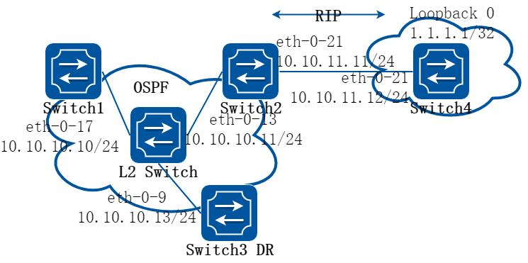

**图5-14 ospf redistribute**

区域内和区域间路由描述的是AS 内部的网络结构，外部路由则描述了应该如何选择到AS 以外目的地址的路由。OSPF 将引入的AS 外部路由分为两类：Type1 和Type2。

第一类外部路由是指接收的是IGP（Interior Gateway Protocol，内部网关协议）路由

（例如静态路由和RIP 路由）。由于这类路由的可信程度较高，并且和OSPF 自身路由的开销具有可比性，所以到第一类外部路由的开销等于本路由器到相应的ASBR 的开销与ASBR 到该路由目的地址的开销之和。

第二类外部路由是指接收的是EGP（Exterior Gateway Protocol，外部网关协议）路由。

由于这类路由的可信度比较低，所以OSPF 协议认为从ASBR 到自治系统之外的开销远远大于在自治系统之内到达ASBR 的开销。所以计算路由开销时将主要考虑前者，即到第二类外部路由的开销等于ASBR 到该路由目的地址的开销。如果计算出开销值相等的两条路由，再考虑本路由器到相应的ASBR 的开销。下面例子RIP 路由将作为外部路由被重分布到OSPF 网络中。

##### 2. 配置步骤

##### 步骤1 进入配置模式

```
Switch# configure terminal
```

##### 步骤2 进入接口配置模式，配置接口属性和ip 地址

在Switch1 配置：

```
Switch1(config)# interface eth-0-17
Switch1(config-if)# no switchport
Switch1(config-if)# no shutdown
Switch1(config-if)# ip address 10.10.10.10/24
Switch1(config-if)# quit
```

在Switch2 配置：

```
Switch2(config)# interface eth-0-13
Switch2(config-if)# no switchport
Switch2(config-if)# no shutdown
Switch2(config-if)# ip address 10.10.10.11/24
Switch2(config-if)# quit
Switch2(config)# interface eth-0-21
Switch2(config-if)# no switchport
Switch2(config-if)# no shutdown
Switch2(config-if)# ip address 10.10.11.11/24
Switch2(config-if)# quit
```

在Switch3 配置：

```
Switch3(config)# interface eth-0-9
Switch3(config-if)# no switchport
Switch3(config-if)# no shutdown
Switch3(config-if)# ip address 10.10.10.13/24
Switch3(config-if)# quit
```

在Switch4 配置：

```
Switch4(config)# interface eth-0-21
Switch4(config-if)# no switchport
Switch4(config-if)# no shutdown
Switch4(config-if)# ip address 10.10.11.12/24
Switch4(config-if)# quit
Switch4(config)# interface loopback 0
Switch4(config-if)# ip address 1.1.1.1/32
Switch4(config-if)# quit
```

在L2 switch 配置：

```
Switch5(config)# interface eth-0-9
Switch5(config-if)# no shutdown
Switch5(config-if)# quit
Switch5(config)# interface eth-0-13
Switch5(config-if)# no shutdown
Switch5(config-if)# quit
Switch5(config)# interface eth-0-17
Switch5(config-if)# no shutdown
Switch5(config-if)# quit
```

##### 步骤3 配置ospf 接口优先级

在Switch3 配置：

```
Switch3(config)# interface eth-0-9
Switch3(config-if)# ip ospf priority 10
Switch3(config-if)# quit
```

##### 步骤4 创建ospf 实例，发布需要的网段到指定域

在Switch1 配置：

```
Switch1(config)# router ospf 100
Switch1(config-router)# network 10.10.10.0/24 area 0
Switch1(config-router)# quit
```

在Switch2 配置：

```
Switch2(config)# router ospf 100
Switch2(config-router)# network 10.10.10.0/24 area 0
Switch2(config-router)# redistribute connected
Switch2(config-router)# redistribute rip
Switch2(config-router)# quit
```

在Switch3 配置：

```
Switch3(config)# router ospf 100
Switch3(config-router)# network 10.10.10.0/24 area 0
Switch3(config-router)# quit
```

##### 步骤5 创建rip 实例，发布需要的网段

在Switch2 配置：

```
Switch2(config)# router rip
Switch2(config-router)# network 10.10.11.0/24
Switch2(config-router)#redistribute connected
Switch2(config-router)# quit
```

在Switch4 配置：

```
Switch4(config)# router rip
Switch4(config-router)# network 10.10.11.0/24
Switch4(config-router)# network 1.1.1.1/32
Switch4(config-router)# redistribute connected
Switch4(config-router)# quit
```

##### 步骤6 退出配置模式

```
Switch(config)# end
```

##### 步骤7 检查配置

使用下列命令查看ospf 路由：

Switch1：

```
Switch1# show ip route
Codes: K - kernel, C - connected, S - static, R - RIP, B - BGP
O - OSPF, IA - OSPF inter area
N1 - OSPF NSSA external type 1, N2 - OSPF NSSA external type 2
E1 - OSPF external type 1, E2 - OSPF external type 2
i - IS-IS, L1 - IS-IS level-1, L2 - IS-IS level-2, ia - IS-IS inter area
Dc - DHCP Client
[*] - [AD/Metric]
* - candidate default
O E2
1.1.1.1/32 [110/20] via 10.10.10.11, eth-0-17, 00:01:54
C
10.10.10.0/24 is directly connected, eth-0-17
C
10.10.10.10/32 is in local loopback, eth-0-17
O E2
10.10.11.0/24 [110/20] via 10.10.10.11, eth-0-17, 00:03:49
```

Switch2：

```
Switch2# show
ip route
Codes: K - kernel, C - connected, S - static, R - RIP, B - BGP
```

```
O - OSPF, IA - OSPF inter area
N1 - OSPF NSSA external type 1, N2 - OSPF NSSA external type 2
E1 - OSPF external type 1, E2 - OSPF external type 2
i - IS-IS, L1 - IS-IS level-1, L2 - IS-IS level-2, ia - IS-IS inter area
Dc - DHCP Client
[*] - [AD/Metric]
* - candidate default
R
1.1.1.1/32 [120/2] via 10.10.11.12, eth-0-21, 00:02:27
C
10.10.10.0/24 is directly connected, eth-0-13
C
10.10.10.11/32 is in local loopback, eth-0-13
C
10.10.11.0/24 is directly connected, eth-0-21
C
10.10.11.11/32 is in local loopback, eth-0-21
```

Switch3：

```
Switch3# show ip route
Codes: K - kernel, C - connected, S - static, R - RIP, B - BGP
O - OSPF, IA - OSPF inter area
N1 - OSPF NSSA external type 1, N2 - OSPF NSSA external type 2
E1 - OSPF external type 1, E2 - OSPF external type 2
i - IS-IS, L1 - IS-IS level-1, L2 - IS-IS level-2, ia - IS-IS inter area
Dc - DHCP Client
[*] - [AD/Metric]
* - candidate default
O E2
1.1.1.1/32 [110/20] via 10.10.10.11, eth-0-9, 00:03:01
C
10.10.10.0/24 is directly connected, eth-0-9
C
10.10.10.13/32 is in local loopback, eth-0-9
O E2
10.10.11.0/24 [110/20] via 10.10.10.11, eth-0-9, 00:04:57
```

Switch4：

```
Switch4# show ip route
Codes: K - kernel, C - connected, S - static, R - RIP, B - BGP
O - OSPF, IA - OSPF inter area
N1 - OSPF NSSA external type 1, N2 - OSPF NSSA external type 2
E1 - OSPF external type 1, E2 - OSPF external type 2
i - IS-IS, L1 - IS-IS level-1, L2 - IS-IS level-2, ia - IS-IS inter area
Dc - DHCP Client
[*] - [AD/Metric]
* - candidate default
C
1.1.1.1/32 is directly connected, loopback0
R
10.10.10.0/24 [120/2] via 10.10.11.11, eth-0-21, 00:17:36
C
10.10.11.0/24 is directly connected, eth-0-21
C
10.10.11.12/32 is in local loopback, eth-0-21
```

使用下列命令查看ospf 数据库：

Switch1：

```
Switch1# show ip ospf database external
OSPF Router with ID (10.10.10.10) (Process ID 100)
AS External Link States
```

```
LS age: 317
Options: 0x2 (*|-|-|-|-|-|E|-)
LS Type: AS-external-LSA
Link State ID: 1.1.1.1 (External Network Number)
Advertising Router: 10.10.10.11
LS Seq Number: 80000001
Checksum: 0x4a47
Length: 36
Network Mask: /32
Metric Type: 2 (Larger than any link state path)
TOS: 0
Metric: 20
Forward Address: 0.0.0.0
External Route Tag: 0
LS age: 438
Options: 0x2 (*|-|-|-|-|-|E|-)
LS Type: AS-external-LSA
Link State ID: 10.10.11.0 (External Network Number)
Advertising Router: 10.10.10.11
LS Seq Number: 80000001
Checksum: 0x0472
Length: 36
Network Mask: /24
Metric Type: 2 (Larger than any link state path)
TOS: 0
Metric: 20
Forward Address: 0.0.0.0
External Route Tag: 0
```

Switch2：

```
Switch2# show ip ospf database external
OSPF Router with ID (10.10.10.11) (Process ID 100)
AS External Link States
LS age: 367
Options: 0x2 (*|-|-|-|-|-|E|-)
LS Type: AS-external-LSA
Link State ID: 1.1.1.1 (External Network Number)
Advertising Router: 10.10.10.11
LS Seq Number: 80000001
Checksum: 0x4a47
Length: 36
Network Mask: /32
Metric Type: 2 (Larger than any link state path)
TOS: 0
Metric: 20
Forward Address: 0.0.0.0
External Route Tag: 0
LS age: 487
Options: 0x2 (*|-|-|-|-|-|E|-)
```

```
LS Type: AS-external-LSA
Link State ID: 10.10.11.0 (External Network Number)
Advertising Router: 10.10.10.11
LS Seq Number: 80000001
Checksum: 0x0472
Length: 36
Network Mask: /24
Metric Type: 2 (Larger than any link state path)
TOS: 0
Metric: 20
Forward Address: 0.0.0.0
External Route Tag: 0
```

Switch3：

```
Switch3# show ip ospf database external
OSPF Router with ID (10.10.10.13) (Process ID 100)
AS External Link States
LS age: 396
Options: 0x2 (*|-|-|-|-|-|E|-)
LS Type: AS-external-LSA
Link State ID: 1.1.1.1 (External Network Number)
Advertising Router: 10.10.10.11
LS Seq Number: 80000001
Checksum: 0x4a47
Length: 36
Network Mask: /32
Metric Type: 2 (Larger than any link state path)
TOS: 0
Metric: 20
Forward Address: 0.0.0.0
External Route Tag: 0
LS age: 517
Options: 0x2 (*|-|-|-|-|-|E|-)
LS Type: AS-external-LSA
Link State ID: 10.10.11.0 (External Network Number)
Advertising Router: 10.10.10.11
LS Seq Number: 80000001
Checksum: 0x0472
Length: 36
Network Mask: /24
Metric Type: 2 (Larger than any link state path)
TOS: 0
Metric: 20
Forward Address: 0.0.0.0
External Route Tag: 0
```

#### 配置OSPF Cost

##### 1. 组网拓扑


**图5-15 ospf cost**

用户可以通过修改接口的COST 值来使路由成为最优路由。在下面的例子中，通过修改COST 值可以使Switch2 成为Switch1 的下一跳。

默认接口的COST 值是1(1000M speed)。Switch2 的eth-0-2 优先级100，Switch3 的eth-0-2 优先级150. 那么到达Switch4 的网络10.10.14.0 的Cost 值将不一样：

Switch2: 1+1+100 = 102 Switch3: 1+1+150 = 152

##### 2. 配置步骤

##### 步骤1 进入配置模式

```
Switch# configure terminal
```

##### 步骤2 进入接口配置模式，配置接口属性和ip 地址。在接口配置模式下，设置该接口的ospfcost 值

在Switch1 配置：

```
Switch1(config)# interface eth-0-1
Switch1(config-if)# no switchport
Switch1(config-if)# ip address 10.10.10.1/24
Switch1(config-if)# exit
Switch1(config)# interface eth-0-2
Switch1(config-if)# no switchport
Switch1(config-if)# ip address 10.10.12.1/24
Switch1(config-if)# exit
```

在Switch2 配置：

```
Switch2(config)# interface eth-0-1
Switch2(config-if)# no switchport
Switch2(config-if)# ip address 10.10.10.2/24
Switch2(config-if)# exit
Switch2(config)# interface eth-0-2
Switch2(config-if)# no switchport
Switch2(config-if)# ip address 10.10.11.2/24
Switch2(config-if)# ip ospf cost 100
Switch2(config-if)# exit
```

在Switch3 配置：

```
Switch3(config)# interface eth-0-1
Switch3(config-if)# no switchport
Switch3(config-if)# ip address 10.10.12.2/24
Switch3(config-if)# exit
Switch3(config)# interface eth-0-2
Switch3(config-if)# no switchport
Switch3(config-if)# ip address 10.10.13.2/24
Switch3(config-if)# ip ospf cost 150
Switch3(config-if)# exit
```

在Switch4 配置：

```
Switch4(config)# interface eth-0-1
Switch4(config-if)# no switchport
Switch4(config-if)# ip address 10.10.11.1/24
Switch4(config-if)# exit
Switch4(config)# interface eth-0-2
Switch4(config-if)# no switchport
Switch4(config-if)# ip address 10.10.13.1/24
Switch4(config-if)# exit
Switch4(config)# interface eth-0-3
Switch4(config-if)# no switchport
Switch4(config-if)# ip address 10.10.14.1/24
Switch4(config-if)# exit
```

##### 步骤3 创建ospf 实例，发布需要的网段到指定域

在Switch1 配置：

```
Switch1(config)# router ospf 100
Switch1(config-router)# network 10.10.10.0/24 area 0
Switch1(config-router)# network 10.10.12.0/24 area 0
Switch1(config-router)# exit
```

在Switch2 配置：

```
Switch2(config)# router ospf 100
Switch2(config-router)# network 10.10.10.0/24 area 0
Switch2(config-router)# network 10.10.11.0/24 area 0
Switch2(config-router)# exit
```

在Switch3 配置：

```
Switch3(config)# router ospf 100
Switch3(config-router)# network 10.10.12.0/24 area 0
Switch3(config-router)# network 10.10.13.0/24 area 0
Switch3(config-router)# exit
```

在Switch4 配置：

```
Switch4(config)# router ospf 100
Switch4(config-router)# network 10.10.11.0/24 area 0
Switch4(config-router)# network 10.10.13.0/24 area 0
Switch4(config-router)# network 10.10.14.0/24 area 0
Switch4(config-router)# exit
```

##### 步骤4 退出配置模式

```
Switch(config)# end
```

##### 步骤5 检查配置

使用下列命令查看ospf 路由：

Switch1：

```
Switch1# show ip ospf route
OSPF process 0:
Codes: C - connected, D - Discard, O - OSPF, IA - OSPF inter area
N1 - OSPF NSSA external type 1, N2 - OSPF NSSA external type 2
E1 - OSPF external type 1, E2 - OSPF external type 2
C
10.10.10.0/24 [1] is directly connected, eth-0-1, Area 0
O
10.10.11.0/24 [101] via 10.10.10.2, eth-0-1, Area 0
C
10.10.12.0/24 [1] is directly connected, eth-0-2, Area 0
O
10.10.13.0/24 [102] via 10.10.10.2, eth-0-1, Area 0
O
10.10.14.0/24 [102] via 10.10.10.2, eth-0-1, Area 0
```

Switch2：

```
Switch2# show ip ospf route
OSPF process 100:
Codes: C - connected, D - Discard, O - OSPF, IA - OSPF inter area
N1 - OSPF NSSA external type 1, N2 - OSPF NSSA external type 2
E1 - OSPF external type 1, E2 - OSPF external type 2
C
10.10.10.0/24 [10] is directly connected, eth-0-1, Area 0
C
10.10.11.0/24 [100] is directly connected, eth-0-2, Area 0
O
10.10.12.0/24 [11] via 10.10.10.1, eth-0-1, Area 0
O
10.10.13.0/24 [101] via 10.10.11.1, eth-0-2, Area 0
O
10.10.14.0/24 [101] via 10.10.11.1, eth-0-2, Area 0
```

Switch3：

```
Switch3# show ip ospf route
OSPF process 100:
Codes: C - connected, D - Discard, O - OSPF, IA - OSPF inter area
N1 - OSPF NSSA external type 1, N2 - OSPF NSSA external type 2
E1 - OSPF external type 1, E2 - OSPF external type 2
O
10.10.10.0/24 [1] via 10.10.12.1, eth-0-1, Area 0
O
10.10.11.0/24 [101] via 10.10.12.1, eth-0-1, Area 0
C
10.10.12.0/24 [1] is directly connected, eth-0-1, Area 0
O
10.10.13.0/24 [102] via 10.10.12.1, eth-0-1, Area 0
O
10.10.14.0/24 [102] via 10.10.12.1, eth-0-1, Area 0
```

Switch4：

```
Switch4# show ip route
Codes: K - kernel, C - connected, S - static, R - RIP, B - BGP
```

```
O - OSPF, IA - OSPF inter area
N1 - OSPF NSSA external type 1, N2 - OSPF NSSA external type 2
E1 - OSPF external type 1, E2 - OSPF external type 2
i - IS-IS, L1 - IS-IS level-1, L2 - IS-IS level-2, ia - IS-IS inter area
[*] - [AD/Metric]
* - candidate default
O
10.10.10.0/24 [110/1] via 10.10.11.2, eth-0-1, 00:06:27
C
10.10.11.0/24 is directly connected, eth-0-1
O
10.10.12.0/24 [110/1] via 10.10.13.2, eth-0-2, 00:06:17
C
10.10.13.0/24 is directly connected, eth-0-2
C
10.10.14.0/24 is directly connected, eth-0-3
```

#### 配置OSPF 认证

##### 1. 组网拓扑


**图5-16 ospf authentication**

系统目前支持三种类型的OSPF 认证：无认证（类型0），明文认证（类型1）和MD5 认证（类型2）。无认证，网络中的路由信息交换不需要经过任何认证。明文认证，所有的路由器上配置的认证模式和密码都必须是一样的。MD5 认证，你需要在每台路由器上配置相同的密钥和密钥ID。路由器会根据密钥，密钥ID 和OSPF 报文内容生成消息摘要加到OSPF 报文里面。

认证类型可以基于area 配置，也可以基于interface 配置，这两者可以同时使用。如果interface 上配置的认证类型和区域内配置的认证类型不一样，则优先使用interface 上的认证类型。如果interface 上没有配置认证类型，那么就使用区域内配置的认证类型。.下面例子简单介绍了下OSPF 的三种类型的验证。Switch1 和Switch2 之间不使用认证；

Switch2 和Switch3 之间使用明文认证；Switch3 和Switch4 之间使用MD5 认证。

##### 2. 配置步骤

##### 步骤1 进入配置模式

```
Switch# configure terminal
```

##### 步骤2 进入接口配置模式，配置接口属性和ip 地址。在接口配置模式下，设置该接口的认证类型

在Switch1 配置：

```
Switch1(config)#interface eth-0-9
Switch1(config-if)#no switchport
Switch1(config-if)#ip address 9.9.9.1/24
Switch1(config-if)#ip ospf authentication
Switch1(config-if)#ip ospf authentication null
Switch1(config-if)# exit
```

在Switch2 配置：

```
Switch2(config)#interface eth-0-1
Switch2(config-if)#no switchport
Switch2(config-if)#ip address 1.1.1.1/24
Switch2(config-if)#ip ospf authentication
Switch2(config-if)#ip ospf authentication-key test
Switch2(config-if)# exit
Switch2(config)#interface eth-0-9
Switch2(config-if)#no switchport
Switch2(config-if)#ip address 9.9.9.2/24
Switch2(config-if)#ip ospf authentication
Switch2(config-if)#ip ospf authentication null
Switch2(config-if)# exit
```

在Switch3 配置：

```
Switch3(config)#interface eth-0-2
Switch3(config-if)#no switchport
Switch3(config-if)#ip address 2.2.2.1/24
Switch3(config-if)# ip ospf message-digest-key 2 md5 ospf
Switch3(config-if)# exit
Switch3(config)#interface eth-0-1
Switch3(config-if)#no switchport
Switch3(config-if)#ip address 1.1.1.2/24
Switch3(config-if)#ip ospf authentication
Switch3(config-if)# ip ospf authentication-key test
Switch3(config-if)# exit
```

在Switch4 配置：

```
Switch4(config)#interface eth-0-2
Switch4(config-if)#no switchport
Switch4(config-if)#ip address 2.2.2.2/24
Switch4(config-if)# ip ospf message-digest-key 2 md5 ospf
Switch4(config-if)# exit
```

##### 步骤3 创建ospf 实例，发布需要的网段到指定域

在Switch1 配置：

```
Switch1(config)# router ospf
Switch1(config-router)# network 9.9.9.0/24 area 0
Switch1(config-router)# exit
```

在Switch2 配置：

```
Switch2(config)# router ospf
Switch2(config-router)# network 9.9.9.0/24 area 0
Switch2(config-router)# network 1.1.1.0/24 area 0
Switch2(config-router)# exit
```

在Switch3 配置：

```
Switch3(config)# router ospf
Switch3(config-router)# area 1 authentication message-digest
Switch3(config-router)# network 2.2.2.0/24 area 1
Switch3(config-router)# network 1.1.1.0/24 area 0
Switch3(config-router)# exit
```

在Switch4 配置：

```
Switch4(config)# router ospf
Switch4(config-router)# area 1 authentication message-digest
Switch4(config-router)# network 2.2.2.0/24 area 1
Switch4(config-router)# exit
```

##### 步骤4 退出配置模式

```
Switch(config)# end
```

##### 步骤5 检查配置

使用下列命令查看ospf 邻居：

Switch1:

```
Switch1# show ip ospf neighbor
OSPF process 0:
Neighbor ID
Pri
State
Dead Time
Address
Interface
9.9.9.2
1
Full/DR
00:00:38
9.9.9.2
eth-0-9
```

Switch2:

```
Switch2# show ip ospf neighbor
OSPF process 0:
Neighbor ID
Pri
State
Dead Time
Address
Interface
2.2.2.1
1
Full/Backup
00:00:35
1.1.1.2
eth-0-1
1.1.1.1
1
Full/Backup
00:00:38
9.9.9.1
eth-0-9
```

Switch3:

```
Switch3# show ip ospf neighbor
OSPF process 0:
Neighbor ID
Pri
State
Dead Time
Address
Interface
9.9.9.2
1
Full/DR
00:00:35
1.1.1.1
eth-0-1
2.2.2.2
1
Full/DR
00:00:38
2.2.2.2
eth-0-2
```

Switch4:

```
Switch4# show ip ospf neighbor
OSPF process 0:
Neighbor ID
Pri
State
Dead Time
Address
Interface
2.2.2.1
1
Full/Backup
00:00:35
2.2.2.1
eth-0-2
```

使用下列命令查看ospf 端口状态：

Switch3：

```
Switch3# show ip ospf interface
eth-0-1 is up, line protocol is up
Internet Address 1.1.1.2/24, Area 0, MTU 1500
```

```
Process ID 0, Router ID 2.2.2.1, Network Type BROADCAST, Cost: 1
Transmit Delay is 1 sec, State Backup, Priority 1, TE Metric 1
Designated Router (ID) 9.9.9.2, Interface Address 1.1.1.1
Backup Designated Router (ID) 2.2.2.1, Interface Address 1.1.1.2
Timer intervals configured, Hello 10, Dead 40, Wait 40, Retransmit 5
Hello due in 00:00:01
Neighbor Count is 1, Adjacent neighbor count is 1
Crypt Sequence Number is 1301244696
Hello received 385 sent 384, DD received 3 sent 5
LS-Req received 1 sent 1, LS-Upd received 11 sent 14
LS-Ack received 12 sent 10, Discarded 1
Simple password authentication enabled
```

使用下列命令查看ospf 协议状态：

Switch3：

```
Switch3# show ip ospf
Routing Process "ospf 0" with ID 2.2.2.1
Process uptime is 1 hour 7 minutes
Process bound to VRF default
Conforms to RFC2328, and RFC1583 Compatibility flag is disabled
Supports only single TOS(TOS0) routes
Supports opaque LSA
This router is an ABR, ABR Type is Alternative (RFC3509)
SPF schedule delay 5 secs, Hold time between two SPFs 10 secs
Refresh timer 10 secs
Number of incomming current DD exchange neighbors 0/5
Number of outgoing current DD exchange neighbors 0/5
Number of external LSA 0. Checksum 0x000000
Number of opaque AS LSA 0. Checksum 0x000000
Number of non-default external LSA 0
External LSA database is unlimited.
Number of LSA originated 17
Number of LSA received 57
Number of areas attached to this router: 2
Area 0 (BACKBONE)
Number of interfaces in this area is 1(1)
Number of fully adjacent neighbors in this area is 1
Area has no authentication
SPF algorithm last executed 01:06:56.340 ago
SPF algorithm executed 16 times
Number of LSA 6. Checksum 0x034b09
Area 1
Number of interfaces in this area is 1(1)
Number of fully adjacent neighbors in this area is 1
Number of fully adjacent virtual neighbors through this area is 0
Area has message digest authentication
SPF algorithm last executed 00:03:29.430 ago
SPF algorithm executed 17 times
Number of LSA 5. Checksum 0x0230e3
```

#### 配置OSPF 认证密文(明文认证方式)

目前配置OSPF 认证，其密钥都是以明文形式配置和显示，为增加系统安全性增加OSPF明文密钥以密文显示，同时支持OSPF 密钥密文配置

##### 步骤1 进入配置模式

```
Switch# configure terminal
```

##### 步骤2 进入接口配置模式，配置接口属性和ip 地址。在接口配置模式下，设置该接口的认证类型，配置密钥

```
Switch(config)#interface eth-0-9
Switch(config-if)#no switchport
Switch(config-if)#ip address 9.9.9.1/24
Switch(config-if)#ip ospf authentication
Switch(config-if)#ip ospf authentication-key test
Switch(config-if)# exit
```

##### 步骤3 进入配置模式，转换明密文密钥显示

```
Switch(config)# service password-encryption
Switch(config)# show running-config
!
service password-encryption
!
interface eth-0-9
no switchport
ip address 9.9.9.1/24
ip ospf authentication-key 8 af0443346357baf8
!
```

##### 步骤4 去使能密文显示，删除原有密钥重新配置并显示

```
Switch(config)#no service password-encryption
Switch(config)#interface eth-0-9
Switch(config-if)#no ip ospf authentication-key
Switch(config-if)#ip ospf authentication-key test123
Switch(config-if)# exit
Switch(config)# show running-config
!
no service password-encryption
!
interface eth-0-9
no switchport
ip address 9.9.9.1/24
ip ospf authentication-key test123
!
```

##### 步骤5 配置OSPF 密文密钥

```
Switch(config)#interface eth-0-9
Switch(config-if)#no ip ospf authentication-key
Switch(config-if)#ip ospf authentication-key 8 af0443346357baf8
Switch(config-if)# exit
Switch(config)# show running-config
!
no service password-encryption
!
interface eth-0-9
no switchport
```

```
ip address 9.9.9.1/24
ip ospf authentication-key test123
!
```

#### 配置OSPF 认证密文(MD5 认证方式)

##### 步骤1 进入配置模式

```
Switch# configure terminal
```

##### 步骤2 进入接口配置模式，配置接口属性和ip 地址。在接口配置模式下，设置该接口的认证类型，配置密钥

```
Switch(config)#interface eth-0-9
Switch(config-if)#no switchport
Switch(config-if)#ip address 9.9.9.1/24
Switch(config-if)#ip ospf authentication message-digest
Switch(config-if)#ip ospf message-digest-key 1 md5 ospf
Switch(config-if)# exit
```

##### 步骤3 进入配置模式，转换明密文密钥显示

```
Switch(config)# service password-encryption
Switch(config)# show running-config
!
service password-encryption
!
interface eth-0-9
no switchport
ip address 9.9.9.1/24
ip ospf authentication message-digest
ip ospf message-digest-key 1 md5 8 1f0276567f2db31f
!
```

##### 步骤4 去使能密文显示，删除原有密钥重新配置并显示

```
Switch(config)#no service password-encryption
Switch(config)#interface eth-0-9
Switch(config-if)#no ip ospf message-digest-key 1
Switch(config-if)#ip ospf message-digest-key 1 md5 ospf123
Switch(config-if)# exit
Switch(config)# show running-config
!
no service password-encryption
!
interface eth-0-9
no switchport
ip address 9.9.9.1/24
ip ospf authentication message-digest
ip ospf message-digest-key 1 md5 ospf123
!
```

##### 步骤5 配置OSPF 密文密钥

```
Switch(config)#interface eth-0-9
Switch(config-if)#no ip ospf message-digest-key 1
Switch(config-if)#ip ospf message-digest-key 1 md5 8 1f0276567f2db31f
```

```
Switch(config-if)# exit
Switch(config)# show running-config
!
no service password-encryption
!
interface eth-0-9
no switchport
ip address 9.9.9.1/24
ip ospf authentication message-digest
ip ospf message-digest-key 1 md5 8 1f0276567f2db31f
!
```

#### 配置OSPF GR

GR（Graceful Restart，平滑重启），是一种用于保证路由协议重启时数据能够正常转发的机制。OSPF GR 可以保证运行OSPF 协议的设备在进行主备切换的时候，能够通知周边设备，使得该设备与周边设备的邻接关系在一定时间之内保持稳定，并且转发业务可以正常进行。在OSPF GR 期间，周边设备会协助重启设备进行信息同步，包括TOPO 信息、路由信息等，尽可能地迅速同步数据，将状态恢复到OSPF 重启之前的状态。

GR Restarter：发生协议重启事件并拥有GR 能力的设备。

GR Helper：和GR Restarter 具有邻居关系，并且需要协助其完成GR 的设备。

当前配置OSPF GR，遵循IETF 标准，Stacking 设备可以充当GR Restarter 和GR Helper，而非Stacking 设备只能充当GR Helper。Stacking 设备作为GR Restarter 之后，设备发生主板宕机或者发生主备倒换，备板转换为主板并触发OSPF GR，维持数据转发的正常进行。

下面的例子演示了如何在Stacking 设备上配置GR Restarter，在非Stacking 设备上配置GR Helper。

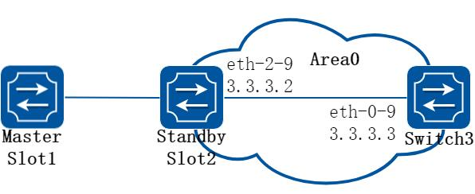

**图5-17 ospf gr**

##### 步骤2 进入配置模式

```
Switch# configure terminal
```

##### 步骤3 Stacking 设备和Switch3 建立OSPF 邻居

在Stacking slot1 配置：

```
Switch1(config)#router ospf 1
Switch1(config-router)#router-id 1.1.1.1
Switch1(config-router)#network 3.3.3.0/24 area 0
Switch1(config-router)#exit
Switch1(config)#interface eth-2-9
```

```
Switch1(config-if)#no shutdown
Switch1(config-if)#no switchport
Switch1(config-if)#ip address 3.3.3.2/24
Switch1(config-if)# exit
```

在Switch3 配置：

```
Switch3(config)#router ospf 1
Switch3(config-router)#router-id 3.3.3.3
Switch3(config-router)#network 3.3.3.0/24 area 0
Switch3(config-router)#exit
Switch3(config)#interface eth-0-9
Switch3(config-if)#no shutdown
Switch3(config-if)#no switchport
Switch3(config-if)#ip address 3.3.3.3/24
Switch3(config-if)# exit
```

使用下列命令查看ospf 邻居：

Stacking slot1:

```
Switch1(config)# end
Switch1# show ip ospf neighbor
OSPF process 1:
Neighbor ID
Pri
State
Dead Time
Address
Interface
3.3.3.3
1
Full/Backup
00:00:38
3.3.3.3
eth-2-9
```

Switch3:

```
Switch3(config)# end
Switch3# show ip ospf neighbor
OSPF process 0:
Neighbor ID
Pri
State
Dead Time
Address
Interface
1.1.1.1
1
Full/DR
00:00:38
3.3.3.2
eth-0-9
```

##### 步骤4 配置OSPF GR

在Stacking slot1 配置GR Restarter：

```
Switch1# configure terminal
Switch1(config)# ospf restart ietf
Switch1(config)# ospf restart grace-period 300
```

在Switch3 配置GR Helper：

```
Switch3# configure terminal
Switch3(config)# ospf restart helper enable
```

##### 步骤5 退出配置模式

```
Switch(config)# end
```

##### 步骤6 检查配置

使用下列命令查看ospf 邻居，即使主板宕机，备板升主之后依然持续维持full 邻居状态：

Stacking：

```
Switch1# show ip ospf neighbor
OSPF process 1:
Neighbor ID
Pri
State
Dead Time
Address
Interface
3.3.3.3
1
Full/Backup
00:00:33
3.3.3.3
eth-2-9
```

Switch3：

```
Switch3# show ip ospf neighbor
OSPF process 0:
Neighbor ID
Pri
State
Dead Time
Address
Interface
1.1.1.1
1
Full/DR
00:00:33
3.3.3.2
eth-0-9
```

## 5.4 Prefix List配置

### 5.4.1 概述

#### 简介

路由策略（Routing Policy）是为了改变网络流量所经过的途径而修改路由信息的技术，主要通过改变路由属性（包括可达性）来实现。地址前缀列表是路由策略的一种，作用比较灵活。一个地址前缀列表由前缀列表名标识。每个前缀列表可以包含多个表项，每个表项可以独立指定一个网络前缀形式的匹配范围，并用一个索引号来标识，索引号指明了进行匹配检查的顺序。在匹配的过程中，交换机按升序依次检查由索引号标识的各个表项。只要有某一表项满足条件，就意味着本次匹配过程结束，而不再进行下一个表项的匹配。

### 5.4.2 配置举例

#### 基础配置

##### 步骤1 进入配置模式

```
Switch# configure terminal
```

##### 步骤2 创建地址前缀列表

说明：创建一个地址前缀列表，如不指定sequence，则自动分配。支持不同的行为，如permit 和deny。支持为列表创建说明字符串。

```
Switch(config)# ip prefix-list test seq 1 deny 35.0.0.0/8 le 16
Switch(config)# ip prefix-list test permit any
Switch(config)# ip prefix-list test description this prefix list is fot test
Switch(config)# ip prefix-list test permit 36.0.0.0/24
```

##### 步骤3 退出配置模式

```
Switch(config)# end
```

##### 步骤4 检查配置

使用下列命令，查看已经配置的地址前缀列表：

```
Switch# show ip prefix-list detail
Prefix-list list number: 1
Prefix-list entry number: 3
Prefix-list with the last deletion/insertion: test
ip prefix-list test:
Description: this prefix list is fot test
count: 3, range entries: 0, sequences: 1 - 10
seq 1 deny 35.0.0.0/8 le 16 (hit count: 0, refcount: 0)
seq 5 permit any (hit count: 0, refcount: 0)
seq 10 permit 36.0.0.0/24 (hit count: 0, refcount: 0)
```

#### 配置Rip 简单应用

##### 步骤1 进入配置模式

```
Switch# configure terminal
```

##### 步骤2 创建地址前缀列表

```
Switch(config)# ip prefix-list aa seq 11 deny 35.0.0.0/8 le 16
Switch(config)# ip prefix-list aa permit any
```

##### 步骤3 在rip 路由模式中应用前缀列表

```
Switch(config)# router rip
Switch(config-router)# distribute-list prefix aa out
Switch(config-router)# exit
```

##### 步骤4 退出配置模式

```
Switch(config)# end
```

##### 步骤5 检查配置

使用下列命令，查看已经配置的地址前缀列表：

```
Switch# show ip prefix-list
ip prefix-list aa: 2 entries
seq 11 deny 35.0.0.0/8 le 16
seq 15 permit any
```

使用下列命令，查看当前设备配置：

```
Switch# show running-config
Building configuration...
…
ip prefix-list aa seq 11 deny 35.0.0.0/8 le 16
ip prefix-list aa seq 15 permit any
…
router rip
distribute-list prefix aa out
```

#### 配置Route-map 简单应用

##### 步骤1 进入配置模式

```
Switch# configure terminal
```

##### 步骤2 创建地址前缀列表

```
Switch(config)# ip prefix-list aa seq 11 deny 3.3.3.0/8 le 24
Switch(config)# ip prefix-list aa permit any
```

##### 步骤3 创建route map，匹配地址前缀列表

```
Switch(config)# route-map abc permit
Switch(config-route-map)# match ip address prefix-list aa
Switch(config-route-map)# set local-preference 200
Switch(config-route-map)# exit
Switch(config)# route-map abc permit 20
Switch(config-route-map)# exit
```

##### 步骤4 进入bgp 路由模式，并应用route map

```
Switch(config)# router bgp 1
Switch(config-router)# neighbor 1.1.1.2 remote-as 1
Switch(config-router)# neighbor 1.1.1.2 route-map abc out
Switch(config-router)# network 2.2.2.2/32
Switch(config-router)# network 3.3.3.3/32
```

##### 步骤5 退出配置模式

```
Switch(config-router)# end
```

##### 步骤6 检查配置

使用下列命令，查看已经配置的route map：

```
Switch # show route-map
route-map abc, permit, sequence 10
Match clauses:
ip address prefix-list aa
Set clauses:
local-preference 200
route-map abc, permit, sequence 20
Match clauses:
Set clauses:
```

使用下列命令，查看当前设备配置：

```
Switch # show running-config
Building configuration...
…
ip prefix-list aa seq 11 deny 3.3.3.0/8 le 24
ip prefix-list aa seq 15 permit any
!
!
route-map abc permit 10
match ip address prefix-list aa
set local-preference 200
!
route-map abc permit 20
…
router bgp 1
neighbor 1.1.1.2 remote-as 1
!
address-family ipv4
```

```
no synchronization
network 2.2.2.2 mask 255.255.255.255
network 3.3.3.3 mask 255.255.255.255
neighbor 1.1.1.2 activate
neighbor 1.1.1.2 route-map abc out
exit-address-family
!
address-family vpnv4 unicast
no synchronization
exit-address-family
```

## 5.5 Route Map配置

### 5.5.1 概述

#### 简介

路由策略（Routing Policy）是为了改变网络流量所经过的途径而修改路由信息的技术，主要通过改变路由属性（包括可达性）来实现。

路由器在发布与接收路由信息时，可能需要实施一些策略，以便对路由信息进行过滤，例如只接收或发布满足一定条件的路由信息。一种路由协议可能需要引入其它的路由协议发现的路由信息，路由器在引入其它路由协议的路由信息时，可能只需要引入一部分满足条件的路由信息，并控制所引入的路由信息的某些属性，以使其满足本协议的要求。

为实现路由策略，首先要定义将要实施路由策略的路由信息的特征，即定义一组匹配规则。可以以路由信息中的不同属性作为匹配依据进行设置，如目的地址、发布路由信息的路由器地址等。匹配规则可以预先设置好，然后再将它们应用于路由的发布、接收和引入等过程的路由策略中。

### 5.5.2 配置举例

#### 配置route-map 应用到OSPF

##### 步骤1 进入配置模式

```
Switch# configure terminal
```

##### 步骤2 创建路由策略，设置规则和行为

route-map 的名字最长20 个字符，支持大小写和数字，在这个例子中为“abc”。支持permit 和deny 两种行为，如果不选则默认为permit。sequence number 的范围是1-65535，在创建第一条规则时如未指定，则默认分配10。

```
Switch(config)# route-map abc permit
Switch(config-route-map)# match metric 20
Switch(config-route-map)# set tag 2
Switch(config-route-map)# exit
Switch(config)# route-map abc permit 20
Switch(config-route-map)# exit
```

##### 步骤3 进入ospf 路由模式，把RIP 协议重分布到OSPF 中，并且使用策略

```
Switch(config)# router ospf 100
Switch(config-router)# redistribute rip route-map abc
Switch(config-router)# exit
```

##### 步骤4 退出配置模式

```
Switch(config)# end
```

##### 步骤5 检查配置

```
Switch# show route-map
route-map abc, permit, sequence 10
Match clauses:
metric 20
Set clauses:
tag 2
route-map abc, permit, sequence 20
Match clauses:
Set clauses:
```

#### 配置route-map 应用到BGP

##### 步骤1 进入配置模式

```
Switch# configure terminal
```

##### 步骤2 创建ip 访问控制列表

```
Switch(config)# ip access-list acl1
Switch(config-ip-acl)# permit any 3.3.3.0 0.0.0.255 any
Switch(config-ip-acl)# exit
```

##### 步骤3 创建路由策略，匹配访问控制列表规则，并设置行为

```
Switch(config)# route-map abc permit
Switch(config-route-map)# match ip address acl1
Switch(config-route-map)# set local-preference 200
Switch(config-route-map)# exit
Switch(config)# route-map abc permit 20
Switch(config-route-map)# exit
```

##### 步骤4 进入bgp 路由模式，并且使用策略

```
Switch(config)# router bgp 1
Switch(config-router)# neighbor 1.1.1.2 remote-as 1
Switch(config-router)# neighbor 1.1.1.2 route-map abc out
Switch(config-router)# network 2.2.2.2/32
Switch(config-router)# network 3.3.3.3/32
Switch(config-router)# exit
```

##### 步骤5 退出配置模式

```
Switch(config)# end
```

##### 步骤6 检查配置

```
DUT1# show route-map
route-map abc, permit, sequence 10
Match clauses:
ip address acl1
Set clauses:
local-preference 200
route-map abc, permit, sequence 20
Match clauses:
Set clauses:
DUT2# show ip bgp
BGP table version is 6, local router ID is 1.1.1.2
Status codes: s suppressed, d damped, h history, * valid, > best, i - internal,
S Stale
Origin codes: i - IGP, e - EGP, ? - incomplete
Network
Next Hop
Metric LocPrf Weight Path
*>i2.2.2.2/32
1.1.1.1
0
100
0 i
*>i3.3.3.3/32
1.1.1.1
0
200
0 i
```

## 5.6 策略路由(PBR)配置

### 5.6.1 概述

#### 简介

与单纯根据IP 报文的目的地址进行转发不同，策略路由是一种根据用户制定的策略进行路由转发的机制。

### 5.6.2 配置举例

#### PBR 配置

##### 1. 组网拓扑

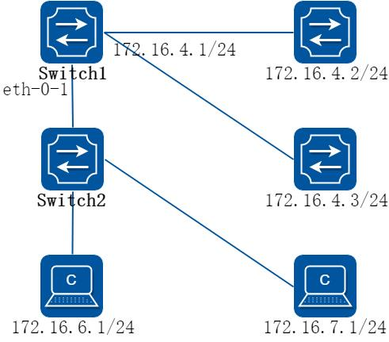

**图5-18 pbr**

上图是策略路由的一个典型配置：可以在Switch1 的eth-0-1 端口上应用一个策略路由，源地址是172.16.6.1 的报文将会被转发给172.16.4.2, 其余报文进行普通的路由转发，到172.16.4.3。

以下配置在Switch1 上进行：

##### 2. 配置步骤

##### 步骤1 进入配置模式

```
Switch# configure terminal
```

##### 步骤2 创建ip 访问控制列表，规则匹配源地址

```
Switch(config)# ip access-list acl1
Switch(config-ip-acl)# 10 permit any 172.16.6.0 0.0.0.255 any
Switch(config-ip-acl)# exit
```

##### 步骤3 创建一个route map，匹配ip 访问控制列表，并设置下一跳地址

```
Switch(config)# route-map rmap permit 10
Switch(config-route-map)# match ip address acl1
Switch(config-route-map)# set ip next-hop 172.16.4.2
Switch(config-route-map)# exit
```

##### 步骤4 进入接口配置模式，配置接口属性，应用策略路由

```
Switch(config)# interface eth-0-1
Switch(config-if)# no switchport
Switch(config-if)# ip address 172.16.5.2/24
Switch(config-if)# no shutdown
Switch(config-if)# ip policy route-map rmap
Switch(config-if)# exit
```

##### 步骤5 创建下一跳为172.16.4.3 的静态路由（可选）

为实现“其余报文进行普通的路由转发”，可以使用静态路由来实现。也可以使用动态路由协议，视实际网络运行情况而定。

```
Switch(config)# ip route 0.0.0.0/0 172.16.4.3
```

##### 步骤6 退出配置模式

```
Switch(config)# end
```

##### 步骤7 检查配置

```
Switch# show ip policy route-map
Route-map
interface
rmap
eth-0-1
```

#### 配置PBR 与BFD 联动

##### 1. 组网拓扑

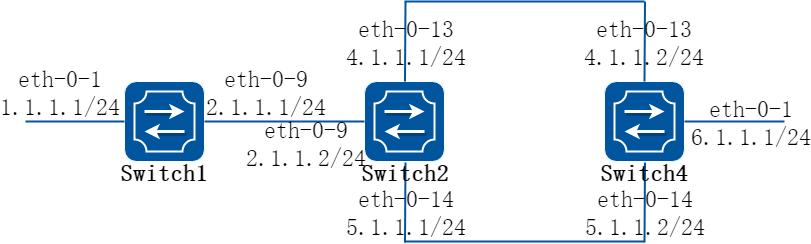

**图5-19 pbr**

上图是PBR 与BFD 联动的一个配置示例：根据PBR 路由，switch2 向端口eth-0-13 转发报文，当switch4 的eth-0-13 口down 时，bfd 会话状态会切换到down 状态，与之绑定的track 1 也会转为down，PBR 下一跳4.1.1.2 会变为无效的，然后报文从switch2 的eth-0-14 口转发。

##### 2. 配置步骤

##### 步骤1 在Switch1 上配置

```
Switch1# configure terminal
Switch1(config)# interface eth-0-1
Switch1(config-if)# no shutdown
Switch1(config-if)# no switchport
Switch1(config-if)# ip address 1.1.1.1/24
Switch1(config-if)# exit
Switch1(config)# interface eth-0-9
Switch1(config-if)# no shutdown
Switch1(config-if)# no switchport
Switch1(config-if)# ip address 2.1.1.1/24
Switch1(config-if)# exit
Switch1(config)# ip route 5.1.1.0/24 2.1.1.2
Switch1(config)# ip route 6.1.1.0/24 2.1.1.2
Switch1(config)# end
```

##### 步骤2 在Switch2 上配置

```
Switch2# configure terminal
Switch2(config)# ip access-list acl1
Switch2(config-ip-acl)# 10 permit any host 2.1.1.1 any
Switch2(config-ip-acl)# quit
Switch2(config)# route-map rmap permit 10
Switch2(config-route-map)# match ip address acl1
Switch2(config-route-map)# set ip next-hop 4.1.1.2 track 1
Switch2(config-route-map)# quit
Switch2(config)# interface eth-0-9
Switch2(config-if)# no shutdown
Switch2(config-if)# no switchport
Switch2(config-if)# ip address 2.1.1.2/24
Switch2(config-if)# ip policy route-map rmap
```

```
Switch2(config-if)# exit
Switch2(config)# interface eth-0-13
Switch2(config-if)# no shutdown
Switch2(config-if)# no switchport
Switch2(config-if)# ip address 4.1.1.1/24
Switch2(config-if)# exit
Switch2(config)# interface eth-0-14
Switch2(config-if)# no shutdown
Switch2(config-if)# no switchport
Switch2(config-if)# ip address 5.1.1.1/24
Switch2(config-if)# exit
Switch2(config)# track 1 bfd source interface eth-0-13 destination 4.1.1.2
Switch2(config-track)# quit
Switch2(config)# ip route 1.1.1.0/24 2.1.1.1
Switch2(config)# ip route 6.1.1.0/24 5.1.1.2
Switch2(config)# end
```

##### 步骤3 在Switch4 上配置

```
Switch4# configure terminal
Switch4(config)# interface eth-0-1
Switch4(config-if)# no shutdown
Switch4(config-if)# no switchport
Switch4(config-if)# ip address 6.1.1.1/24
Switch4(config-if)# exit
Switch4(config)# interface eth-0-13
Switch4(config-if)# no shutdown
Switch4(config-if)# no switchport
Switch4(config-if)# ip address 4.1.1.2/24
Switch4(config-if)# exit
Switch4(config)# interface eth-0-14
Switch4(config-if)# no shutdown
Switch4(config-if)# no switchport
Switch4(config-if)# ip address 5.1.1.2/24
Switch4(config-if)# quit
Switch4(config)# track 1 bfd source interface eth-0-13 destination 4.1.1.1
Switch4(config-track)# quit
Switch4(config)# ip route 1.1.1.0/24 5.1.1.1
Switch4(config)# ip route 2.1.1.0/24 5.1.1.1
Switch4(config)# end
```

##### 步骤4 ping 6.1.1.1 Switch2 会向eth-0-13 口转发报文

```
Switch1# ping 6.1.1.1
PING 6.1.1.1 (6.1.1.1) 56(84) bytes of data.
64 bytes from 6.1.1.1: icmp_seq=1 ttl=63 time=417 ms
64 bytes from 6.1.1.1: icmp_seq=2 ttl=63 time=428 ms
64 bytes from 6.1.1.1: icmp_seq=3 ttl=63 time=441 ms
64 bytes from 6.1.1.1: icmp_seq=4 ttl=63 time=469 ms
64 bytes from 6.1.1.1: icmp_seq=5 ttl=63 time=461 ms
--- 6.1.1.1 ping statistics ---
5 packets transmitted, 5 received, 0% packet loss, time 6810ms
rtt min/avg/max/mdev = 417.834/443.810/469.720/19.470 ms
```

##### 步骤5 关闭Switch4 的eth-0-13 口

```
Switch4# configure terminal
Switch4(config)# interface eth-0-13
Switch4(config-if)# shutdown
Switch4(config-if)# end
```

##### 步骤6 检查配置

```
Switch2# show track
Track 1
Type
: BFD state
Source interface
: eth-0-13
Destination IP
: 4.1.1.2
BFD Local discr
: 8192
rmap
: pref 10 track 1
State
: down
Switch2# show bfd session
Abbreviation:
LD: Local Discriminator.
RD: Remote Discriminator
S: Single hop session.
M: Multi hop session.
SD: Static Discriminator.
DD: Dynamic Discriminator
SBFD: Seamless BFD
A: Admin down.
D:Down.
I:Init.
U:Up.
============================================================================
LD
RD
TYPE ST
UP-Time
Remote-Addr
Sbfd-Type VRF
8192
0
S-DD D
00:00:00
4.1.1.2
None
default
Number of Sessions:
1
```

报文从Switch2 的eth-0-14 口转发

```
Switch1# ping 6.1.1.1
PING 6.1.1.1 (6.1.1.1) 56(84) bytes of data.
64 bytes from 6.1.1.1: icmp_seq=1 ttl=63 time=414 ms
64 bytes from 6.1.1.1: icmp_seq=2 ttl=63 time=432 ms
64 bytes from 6.1.1.1: icmp_seq=3 ttl=63 time=424 ms
64 bytes from 6.1.1.1: icmp_seq=4 ttl=63 time=525 ms
64 bytes from 6.1.1.1: icmp_seq=5 ttl=63 time=437 ms
--- 6.1.1.1 ping statistics ---
5 packets transmitted, 5 received, 0% packet loss, time 6563ms
rtt min/avg/max/mdev = 414.720/446.816/525.276/39.949 ms
```

## 5.7 BGP配置

### 5.7.1 概述

#### 简介

边界网关协议（BGP）是一个内部自治系统路由协议。

BGP 通告系统的主要功能，是用其他的BGP 系统来交换网络上的可达信息。这个网络可达信息包括自治系统（AS）中的可达性信息。这个信息，对构建一个可联通的AS（如果出现路由环路的话会被切断，以及在这个AS 级别中，有些策略会被强制执行）来说，是足够的。

BGP-4 提供了一组机制，来支持无类域内路由（CIDR）[RFC1518, RFC1519]. 这些机制包括发布一组IP 前缀的目的地址，已经消除BGP 中“类”的概念。BGP-4 也引入了一些允许路由集合（包括AS 路径的集合）这样的概念。

被BGP 交换的路由信息只支持基于目的的范例，假定路由器只通过在IP 报文头中的目的地址来转发报文。这样，反过来说，反而导致了这些策略决策是否可以被强制的使用BGP。BGP 可以支持那些基于目的地址转发的策略。

#### 原理描述

参考1771, RFC 4271。

### 5.7.2 配置举例

#### 配置EBGP

##### 1. 组网拓扑

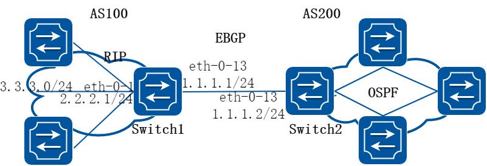

**图5-20 EBGP**

##### 2. 配置步骤

##### 步骤1 进入配置模式

```
Switch# configure terminal
```

##### 步骤2 进入接口配置模式，配置接口属性

Switch1:

```
Switch1(config)# interface eth-0-13
Switch1(config-if)# no shutdown
Switch1(config-if)# no switchport
Switch1(config-if)# ip address 1.1.1.1/24
Switch1(config-if)# exit
Switch1(config)# interface eth-0-1
Switch1(config-if)# no shutdown
```

```
Switch1(config-if)# no switchport
Switch1(config-if)# ip address 2.2.2.1/24
Switch1(config-if)# exit
```

Switch2:

```
Switch2(config)# interface eth-0-13
Switch2(config-if)# no shutdown
Switch2(config-if)# no switchport
Switch2(config-if)# ip address 1.1.1.2/24
Switch2(config-if)# exit
```

##### 步骤3 配置静态路由

Switch1:

```
Switch1(config)# ip route 3.3.3.0/24 2.2.2.2
```

##### 步骤4 创建BGP 路由实例，配置router id、邻居、宣告网络和配置重发布等属性

Switch1:

```
Switch1(config)# router bgp 100
Switch1(config-router)# bgp router-id 10.10.10.10
Switch1(config-router)# neighbor 1.1.1.2 remote-as 200
Switch1(config-router)# neighbor 1.1.1.2 ebgp-multihop
Switch1(config-router)# network 4.0.0.0/8
Switch1(config-router)# redistribute static
Switch1(config-router)# redistribute connected
Switch1(config-router)# exit
```

Switch2:

```
Switch2(config)# router bgp 200
Switch2(config-router)# bgp router-id 11.11.11.11
Switch2(config-router)# neighbor 1.1.1.1 remote-as 100
Switch2(config-router)# neighbor 1.1.1.1 ebgp-multihop
Switch2(config-router)# redistribute connected
Switch2(config-router)# exit
```

##### 步骤5 退出配置模式

```
Switch(config)# end
```

##### 步骤6 检查配置

Switch1:

```
Switch1# show ip bgp neighbors
BGP neighbor is 1.1.1.2, remote AS 200, local AS 100, external link
BGP version 4, remote router ID 11.11.11.11
BGP state = Established, up for 00:00:10
Last read 00:00:08, hold time is 180, keepalive interval is 60 seconds
Neighbor capabilities:
Route refresh: advertised and received (old and new)
4-Octet ASN Capability: advertised and received
Address family IPv4 Unicast: advertised and received
Received 5 messages, 1 notifications, 0 in queue
Sent 8 messages, 0 notifications, 0 in queue
Route refresh request: received 0, sent 0
```

```
Minimum time between advertisement runs is 30 seconds
For address family: IPv4 Unicast
BGP table version 1, neighbor version 1
Index 0, Offset 0, Mask 0x1
1 accepted prefixes
1 announced prefixes
Connections established 2; dropped 1
External BGP neighbor may be up to 255 hops away.
Local host: 1.1.1.1, Local port: 48036
Foreign host: 1.1.1.2, Foreign port: 179
Nexthop: 1.1.1.1
Nexthop global: ::
Nexthop local: ::
BGP connection: non shared network
Last Reset: 00:00:18, due to BGP Notification received
Notification Error Message: (Cease/Other Configuration Change.)
```

Switch2:

```
Switch2# show ip bgp neighbors
BGP neighbor is 1.1.1.1, remote AS 100, local AS 200, external link
BGP version 4, remote router ID 10.10.10.10
BGP state = Established, up for 00:00:16
Last read 00:00:15, hold time is 180, keepalive interval is 60 seconds
Neighbor capabilities:
Route refresh: advertised and received (old and new)
4-Octet ASN Capability: advertised and received
Address family IPv4 Unicast: advertised and received
Received 4 messages, 0 notifications, 0 in queue
Sent 6 messages, 1 notifications, 0 in queue
Route refresh request: received 0, sent 0
Minimum time between advertisement runs is 30 seconds
For address family: IPv4 Unicast
BGP table version 1, neighbor version 1
Index 1, Offset 0, Mask 0x2
1 accepted prefixes
1 announced prefixes
Connections established 1; dropped 1
External BGP neighbor may be up to 255 hops away.
Local host: 1.1.1.2, Local port: 179
Foreign host: 1.1.1.1, Foreign port: 48036
Nexthop: 1.1.1.2
Nexthop global: ::
Nexthop local: ::
BGP connection: non shared network
Last Reset: 00:00:19, due to BGP Notification sent
Notification Error Message: (Cease/Other Configuration Change.)
```

#### 配置IBGP

##### 1. 组网拓扑

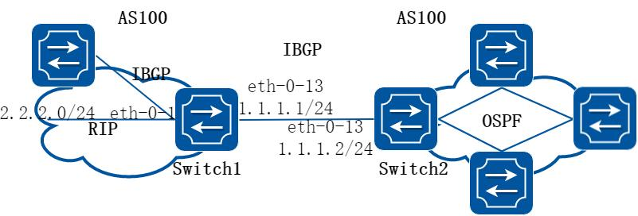

**图5-21 IBGP**

##### 2. 配置步骤

##### 步骤1 进入配置模式

```
Switch# configure terminal
```

##### 步骤2 进入接口配置模式，配置接口属性

Switch1:

```
Switch1(config)# interface eth-0-1
Switch1(config-if)# no shutdown
Switch1(config-if)# no switchport
Switch1(config-if)# ip address 2.2.2.1/24
Switch1(config-if)# exit
Switch1(config)# interface eth-0-13
Switch1(config-if)# no shutdown
Switch1(config-if)# no switchport
Switch1(config-if)# ip address 1.1.1.1/24
Switch1(config-if)# exit
Switch1(config)#interface loopback 0
Switch1(config-if)# ip address 10.10.10.10/32
Switch1(config-if)# exit
```

Switch2:

```
Switch2(config)# interface eth-0-13
Switch2(config-if)# no shutdown
Switch2(config-if)# no switchport
Switch2(config-if)# ip address 1.1.1.2/24
Switch2(config-if)# exit
Switch2(config)# interface loopback 0
Switch2(config-if)# ip address 11.11.11.11/32
Switch2(config-if)# exit
```

##### 步骤3 配置静态路由

Switch1:

```
Switch1(config)# ip route 11.11.11.11/32 1.1.1.2
```

Switch2:

```
Switch2(config)# ip route 10.10.10.10/32 1.1.1.1
```

##### 步骤4 创建BGP 路由实例，配置router id、邻居、宣告网络和配置重发布等属性

Switch1:

```
Switch1(config)# router bgp 100
Switch1(config-router)# bgp router-id 10.10.10.10
Switch1(config-router)# neighbor 11.11.11.11 remote-as 100
Switch1(config-router)# neighbor 11.11.11.11 update-source loopback 0
Switch1(config-router)# network 4.0.0.0/8
Switch1(config-router)# redistribute static
Switch1(config-router)# redistribute connected
Switch1(config-router)# exit
```

Switch2:

```
Switch2(config)# router bgp 100
Switch2(config-router)# bgp router-id 11.11.11.11
Switch2(config-router)# neighbor 10.10.10.10 remote-as 100
Switch2(config-router)# neighbor 10.10.10.10 update-source loopback 0
Switch2(config-router)# redistribute connected
Switch2(config-router)# exit
```

##### 步骤5 退出配置模式

```
Switch(config)# end
```

##### 步骤6 检查配置

Switch1:

```
Switch1# show ip bgp neighbors
BGP neighbor is 11.11.11.11, remote AS 100, local AS 100, internal link
BGP version 4, remote router ID 11.11.11.11
BGP state = Established, up for 00:00:06
Last read 00:00:06, hold time is 180, keepalive interval is 60 seconds
Neighbor capabilities:
Route refresh: advertised and received (old and new)
4-Octet ASN Capability: advertised and received
Address family IPv4 Unicast: advertised and received
Received 4 messages, 1 notifications, 0 in queue
Sent 4 messages, 0 notifications, 0 in queue
Route refresh request: received 0, sent 0
Minimum time between advertisement runs is 5 seconds
Update source is loopback0
For address family: IPv4 Unicast
BGP table version 1, neighbor version 1
Index 0, Offset 0, Mask 0x1
0 accepted prefixes
0 announced prefixes
Connections established 2; dropped 1
Local host: 10.10.10.10, Local port: 179
Foreign host: 11.11.11.11, Foreign port: 38689
Nexthop: 10.10.10.10
Nexthop global: ::
```

```
Nexthop local: ::
BGP connection: non shared network
Last Reset: 00:00:15, due to BGP Notification received
Notification Error Message: (Cease/Other Configuration Change.)
```

Switch2:

```
Switch2# show ip bgp neighbors
BGP neighbor is 10.10.10.10, remote AS 100, local AS 100, internal link
BGP version 4, remote router ID 10.10.10.10
BGP state = Established, up for 00:00:00
Last read 00:00:00, hold time is 180, keepalive interval is 60 seconds
Neighbor capabilities:
Route refresh: advertised and received (old and new)
4-Octet ASN Capability: advertised and received
Address family IPv4 Unicast: advertised and received
Received 4 messages, 0 notifications, 0 in queue
Sent 4 messages, 1 notifications, 0 in queue
Route refresh request: received 0, sent 0
Minimum time between advertisement runs is 5 seconds
Update source is loopback0
For address family: IPv4 Unicast
BGP table version 1, neighbor version 0
Index 0, Offset 0, Mask 0x1
0 accepted prefixes
0 announced prefixes
Connections established 2; dropped 1
Local host: 11.11.11.11, Local port: 38689
Foreign host: 10.10.10.10, Foreign port: 179
Nexthop: 11.11.11.11
Nexthop global: ::
Nexthop local: ::
BGP connection: non shared network
Last Reset: 00:00:10, due to BGP Notification sent
Notification Error Message: (Cease/Other Configuration Change.)
```

#### 配置BGP 网段侦听

##### 1. 组网拓扑

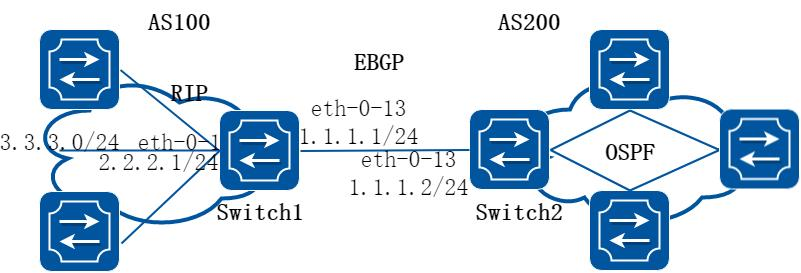

**图5-22 EBGP**

##### 2. 配置步骤

##### 步骤1 进入配置模式

```
Switch# configure terminal
```

##### 步骤2 进入接口配置模式，配置接口属性

Switch1:

```
Switch1(config)# interface eth-0-13
Switch1(config-if)# no shutdown
Switch1(config-if)# no switchport
Switch1(config-if)# ip address 1.1.1.1/24
Switch1(config-if)# exit
```

Switch2:

```
Switch2(config)# interface eth-0-13
Switch2(config-if)# no shutdown
Switch2(config-if)# no switchport
Switch2(config-if)# ip address 1.1.1.2/24
Switch2(config-if)# exit
```

##### 步骤3 创建BGP 路由实例，配置router id、邻居、宣告网络和配置重发布等属性

Switch1:

```
Switch1(config)# router bgp 100
Switch1(config-router)# bgp router-id 10.10.10.10
Switch1(config-router)# neighbor group1 peer-group listen external
Switch1(config-router)# neighbor group1 listen-as 200
Switch1(config-router)# neighbor group1 listen-net 1.1.1.0/24
Switch1(config-router)# exit
```

Switch2:

```
Switch2(config)# router bgp 200
Switch2(config-router)# bgp router-id 11.11.11.11
Switch2(config-router)# neighbor 1.1.1.1 remote-as 100
Switch2(config-router)# exit
```

##### 步骤4 退出配置模式

```
Switch(config)# end
```

##### 步骤5 检查配置

Switch1:

```
Switch1# show ip bgp neighbors
BGP neighbor is 1.1.1.2, remote AS 200, local AS 100, external link
Member of peer-group group1 for session parameters, learned by bgp listen-net dynamically
BGP version 4, remote router ID 11.11.11.11
BGP state = Established, up for 00:00:01
Last read 00:00:02, hold time is 180, keepalive interval is 60 seconds
```

```
Neighbor capabilities:
Route refresh: advertised and received (old and new)
4-Octet ASN Capability: advertised and received
Address family IPv4 Unicast: advertised and received
Received 2 messages, 0 notifications, 0 in queue
Sent 2 messages, 0 notifications, 0 in queue
Route refresh request: received 0, sent 0
Minimum time between advertisement runs is 30 seconds
For address family: IPv4 Unicast
BGP table version 1, neighbor version 0
Index 1, Offset 0, Mask 0x2
group1 peer-group member
0 accepted prefixes
0 announced prefixes
Connections established 1; dropped 0
Local host: 1.1.1.1, Local port: 48022
Foreign host: 1.1.1.2, Foreign port: 179
Nexthop: 1.1.1.1
Nexthop global: ::
Nexthop local: ::
BGP connection: non shared network
```

Switch2:

```
Switch2# show ip bgp neighbors
BGP neighbor is 1.1.1.1, remote AS 100, local AS 200, external link
BGP version 4, remote router ID 10.10.10.10
BGP state = Established, up for 00:00:07
Last read 00:00:07, hold time is 180, keepalive interval is 60 seconds
Neighbor capabilities:
Route refresh: advertised and received (old and new)
4-Octet ASN Capability: advertised and received
Address family IPv4 Unicast: advertised and received
Received 2 messages, 0 notifications, 0 in queue
Sent 4 messages, 0 notifications, 0 in queue
Route refresh request: received 0, sent 0
Minimum time between advertisement runs is 30 seconds
For address family: IPv4 Unicast
BGP table version 1, neighbor version 1
Index 1, Offset 0, Mask 0x2
0 accepted prefixes
0 announced prefixes
Connections established 1; dropped 0
Local host: 1.1.1.2, Local port: 179
Foreign host: 1.1.1.1, Foreign port: 48022
Nexthop: 1.1.1.2
Nexthop global: ::
Nexthop local: ::
BGP connection: non shared network
```

## 5.8 ISIS配置

### 5.8.1 概述

#### 简介

中间系统到中间系统ISIS 是一种链路状态路由协议，使用最短路径优先SPF 算法进行路由算法，实际上与OSPF 非常相似，它也使用Hello 协议寻找毗邻节点，使用一个传播协议发送链接信息。ISIS 可以在不同的子网上操作，包括广播型的LAN、WAN 和点到点链路。

#### 原理描述

##### 1. NET

NET（Network Entity Title，网络实体名称）指示的是IS 本身的网络层信息，不包括传输层信息（SEL＝0），可以看作是一类特殊的NSAP，即SEL 为0 的NSAP 地址。因此，NET 的长度与NSAP 的相同，最多为20 个字节，最少为8 个字节。

通常情况下，一台路由器配置一个NET 即可，当区域需要重新划分时，例如将多个区域合并，或者将一个区域划分为多个区域，这种情况下配置多个NET 可以在重新配置时仍然能够保证路由的正确性。由于一台路由器默认最多可配置3 个区域地址，所以最多也只能配置3 个NET。在配置多个NET 时，必须保证它们的System ID 都相同。

例如NET 为：ab.cdef.1234.5678.9abc.00，则其中Area 为ab.cdef，System ID 为

1234.5678.9abc，SEL 为00。

##### 2. ISIS 区域

1.两级结构为了支持大规模的路由网络，IS-IS 在路由域内采用两级的分层结构。一个大的路由域被分成一个或多个区域（Areas）。区域内的路由通过Level-1 路由器管理，区域间的路由通过Level-2 路由器管理。

2.Level-1 与Level-2 Level-1 路由器Level-1 路由器负责区域内的路由，它只与属于同一区域的Level-1 和Level-1-2 路由器形成邻居关系，维护一个Level-1 的LSDB，该LSDB包含本区域的路由信息，到区域外的报文转发给最近的Level-1-2 路由器。

Level-2 路由器Level-2 路由器负责区域间的路由，可以与同一区域或者其它区域的Level-2 和Level-1-2 路由器形成邻居关系，维护一个Level-2 的LSDB，该LSDB包含区域间的路由信息。所有Level-2 路由器和Level-1-2 路由器组成路由域的骨干网，负责在不同区域间通信，路由域中的Level-2 路由器必须是物理连续的，以保证骨干网的连续性。只有Level-2 路由器才能直接与路由域外的路由器交换数据报文或路由信息。

Level-1-2 路由器同时属于Level-1 和Level-2 的路由器称为Level-1-2 路由器，可以与同一区域的Level-1 和Level-1-2 路由器形成Level-1 邻居关系，也可以与同一区域或者其他区域的Level-2 和Level-1-2 路由器形成Level-2 的邻居关系。

Level-1 路由器必须通过Level-1-2 路由器才能连接至其他区域。Level-1-2 路由器维护两个LSDB，Level-1 的LSDB 用于区域内路由，Level-2 的LSDB 用于区域间路由。

3.接口的路由层次类型对于类型是Level-1-2 的路由器，可能需要与某个对端只建立Level-1 的邻接关系，与另一个对端只建立Level-2 的邻接关系。可以通过设置相应接口的路由层次类型来限制接口上所能建立的邻接关系，如Level-1 的接口只能建立Level-1 的邻接关系，Level-2 的接口只能建立Level-2 的邻接关系。对于Level-1-2 的路由器，通过将某些接口配置为Level-2，还可以防止将Level-1 的Hello 报文发送到Level-2 骨干网上，从而节省带宽。

4.路由渗透（Route Leaking）通常情况下，IS-IS 的区域也称为Level-1 区域，区域内的路由通过Level-1 的路由器进行管理。所有的Level-2 路由器构成一个Level-2 区域。因此，一个IS-IS 的路由域可以包含多个Level-1 区域，但只有一个Level-2 区域。Level-1 区域必须且只能与Level-2区域相连，不同的Level-1 区域之间并不相连。Level-1 区域内的路由信息通过Level-1-2 路由器发布到Level-2 区域，因此，Level-2 路由器知道整个IS-IS 路由域的路由信息。但是，在缺省情况下，Level-2 路由器并不将自己知道的其他Level-1 区域以及Level-2 区域的路由信息发布到Level-1 区域。这样，Level-1 路由器将不了解本区域以外的路由信息，Level-1 路由器只将去往其它区域的报文发送到最近的Level-1-2 路由器，所以可能导致对本区域之外的目的地址无法选择最佳的路由。为解决上述问题，IS-IS 提供了路由渗透功能，使Level-1-2 路由器可以将己知的其他Level-1 区域以及Level-2 区域的路由信息发布到指定的Level-1 区域。

### 5.8.2 配置举例

#### 配置基本ISIS

##### 1. 组网拓扑

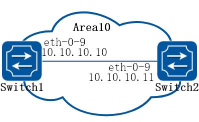

**图5-23 ISIS**

##### 2. 配置步骤

##### 步骤1 进入配置模式

```
Switch# configure terminal
```

##### 步骤2 创建isis 实例，配置net

Switch1 的配置：

```
Switch1(config)# router isis
Switch1(config-router)# net 10.0000.0000.0001.00
Switch1(config-router)# exit
```

Switch2 的配置：

```
Switch2(config)# router isis
Switch2(config-router)# net 10.0000.0000.0002.00
Switch2(config-router)# exit
```

##### 步骤3 接口使能ipv4 isis

Switch1 的配置：

```
Switch1(config)# interface eth-0-9
Switch1(config-if)# no switchport
Switch1(config-if)# ip address 10.10.10.10/24
Switch1(config-if)# ip router isis
Switch1(config)# interface loopback 0
Switch1(config-if)# ip address 1.1.1.1/32
Switch1(config-if)# ip router isis
Switch1(config-if)# exit
```

Switch2 的配置：

```
Switch2(config)# interface eth-0-9
Switch2(config-if)# no switchport
Switch2(config-if)# ip address 10.10.10.11/24
Switch2(config-if)# ip router isis
Switch2(config)# interface loopback 0
Switch2(config-if)# ip address 2.2.2.2/32
Switch2(config-if)# ip router isis
Switch2(config-if)# exit
```

##### 步骤4 退出配置模式

```
Switch(config)# end
```

##### 步骤5 检查配置

Switch1 显示结果：

```
Switch1# show clns neighbors
Area (null):
System Id
Interface
SNPA
State
Holdtime
Type Protocol
0000.0000.0002 eth-0-9
4a98.a825.3d00
Up
21
L1
IS-IS
Up
21
L2
IS-IS
Switch1# show isis database verbose
Area (null):
IS-IS Level-1 Link State Database:
LSPID
LSP Seq Num
LSP Checksum
LSP Holdtime
ATT/P/OL
0000.0000.0001.00-00* 0x00000004
0x3244
1082
0/0/0
Area Address: 10
NLPID:
IPV4
IP Address:
10.10.10.10
Metric:
10
IS 0000.0000.0001.01
Metric:
10
IP 10.10.10.0 255.255.255.0
Metric:
10
IP 1.1.1.1 255.255.255.255
0000.0000.0001.01-00* 0x00000001
0x21B9
895
0/0/0
Metric:
0
IS 0000.0000.0001.00
Metric:
0
IS 0000.0000.0002.00
0000.0000.0002.00-00
0x00000004
0xFA75
1076
0/0/0
```

```
Area Address: 10
NLPID:
IPV4
IP Address:
10.10.10.11
Metric:
10
IS 0000.0000.0001.01
Metric:
10
IP 10.10.10.0 255.255.255.0
Metric:
10
IP 2.2.2.2 255.255.255.255
IS-IS Level-2 Link State Database:
LSPID
LSP Seq Num
LSP Checksum
LSP Holdtime
ATT/P/OL
0000.0000.0001.00-00* 0x00000005
0xFCCE
1109
0/0/0
Area Address: 10
NLPID:
IPV4
IP Address:
10.10.10.10
Metric:
10
IS 0000.0000.0001.01
Metric:
10
IP 10.10.10.0 255.255.255.0
Metric:
20
IP 2.2.2.2 255.255.255.255
Metric:
10
IP 1.1.1.1 255.255.255.255
0000.0000.0001.01-00* 0x00000001
0x21B9
895
0/0/0
Metric:
0
IS 0000.0000.0001.00
Metric:
0
IS 0000.0000.0002.00
0000.0000.0002.00-00
0x00000005
0x7B4E
1107
0/0/0
Area Address: 10
NLPID:
IPV4
IP Address:
10.10.10.11
Metric:
10
IS 0000.0000.0001.01
Metric:
10
IP 10.10.10.0 255.255.255.0
Metric:
10
IP 2.2.2.2 255.255.255.255
Metric:
20
IP 1.1.1.1 255.255.255.255
Switch1# show ip isis route
Codes: C - connected, E - external, L1 - IS-IS level-1, L2 - IS-IS level-2
ia - IS-IS inter area, D - discard, e - external metric
Area (null):
Destination
Metric
Next-Hop
Interface
Tag
C
1.1.1.1/32
10
--
loopback0
0
L1
2.2.2.2/32
20
10.10.10.11
eth-0-9
0
C
10.10.10.0/24
10
--
eth-0-9
0
```

Switch2 显示结果：

```
Switch2# show clns neighbors
Area (null):
System Id
Interface
SNPA
State
Holdtime
Type Protocol
0000.0000.0001 eth-0-9
a821.1873.ae00
Up
9
L1
IS-IS
Up
9
L2
IS-IS
Switch2# show isis database verbose
Area (null):
IS-IS Level-1 Link State Database:
LSPID
LSP Seq Num
LSP Checksum
LSP Holdtime
ATT/P/OL
0000.0000.0001.00-00
0x00000004
0x3244
934
0/0/0
Area Address: 10
NLPID:
IPV4
```

```
IP Address:
10.10.10.10
Metric:
10
IS 0000.0000.0001.01
Metric:
10
IP 10.10.10.0 255.255.255.0
Metric:
10
IP 1.1.1.1 255.255.255.255
0000.0000.0001.01-00
0x00000001
0x21B9
745
0/0/0
Metric:
0
IS 0000.0000.0001.00
Metric:
0
IS 0000.0000.0002.00
0000.0000.0002.00-00* 0x00000004
0xFA75
930
0/0/0
Area Address: 10
NLPID:
IPV4
IP Address:
10.10.10.11
Metric:
10
IS 0000.0000.0001.01
Metric:
10
IP 10.10.10.0 255.255.255.0
Metric:
10
IP 2.2.2.2 255.255.255.255
IS-IS Level-2 Link State Database:
LSPID
LSP Seq Num
LSP Checksum
LSP Holdtime
ATT/P/OL
0000.0000.0001.00-00
0x00000005
0xFCCE
961
0/0/0
Area Address: 10
NLPID:
IPV4
IP Address:
10.10.10.10
Metric:
10
IS 0000.0000.0001.01
Metric:
10
IP 10.10.10.0 255.255.255.0
Metric:
20
IP 2.2.2.2 255.255.255.255
Metric:
10
IP 1.1.1.1 255.255.255.255
0000.0000.0001.01-00
0x00000001
0x21B9
747
0/0/0
Metric:
0
IS 0000.0000.0001.00
Metric:
0
IS 0000.0000.0002.00
0000.0000.0002.00-00* 0x00000005
0x7B4E
960
0/0/0
Area Address: 10
NLPID:
IPV4
IP Address:
10.10.10.11
Metric:
10
IS 0000.0000.0001.01
Metric:
10
IP 10.10.10.0 255.255.255.0
Metric:
10
IP 2.2.2.2 255.255.255.255
Metric:
20
IP 1.1.1.1 255.255.255.255
Switch2# show ip isis route
Codes: C - connected, E - external, L1 - IS-IS level-1, L2 - IS-IS level-2
ia - IS-IS inter area, D - discard, e - external metric
Area (null):
Destination
Metric
Next-Hop
Interface
Tag
L1
1.1.1.1/32
20
10.10.10.10
eth-0-9
0
C
2.2.2.2/32
10
--
loopback0
0
C
10.10.10.0/24
10
--
eth-0-9
0
```
