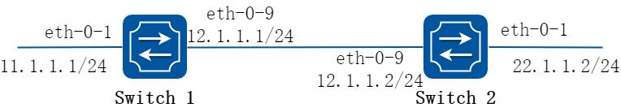
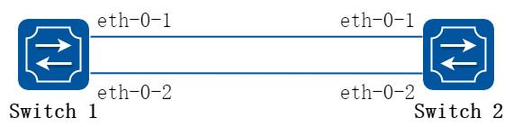
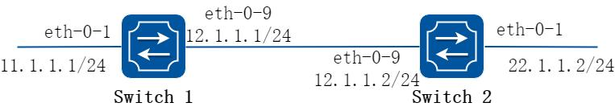
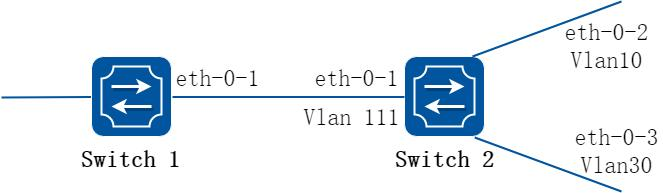

# 6 组播配置指导

## 6.1 IP 组播路由配置

### 6.1.1 概述

#### 简介

随着Internet 网络的不断发展，网络数据、语音、视频信息等多种交互业务与日俱增。

另外，新兴的电子商务、网上会议、网上拍卖、视频点播、远程教学等对带宽和实时数据交互要求较高的服务逐渐兴起，这些服务对信息安全性、可计费性、网络带宽提出了更高的要求。

当网络中需要某信息的用户量不确定时，单播和广播方式的效率会很低，IP 组播技术的出现改变了这一现状。当网络中的某些用户需要特定信息时，组播信息发送者（即组播源）仅发送一次信息，借助组播路由协议为组播数据包建立树型路由，被传递的信息在距离用户端尽可能近的节点才开始复制和分发。

通过组播路由协议，多个接收者能跨越不同网络接收到组播数据。

IGMP(Internet Group Management Protocol，因特网组管理协议)是TCP/IP 协议族中负责IP 组播成员管理的协议。它用来在IP 主机和与其直接相邻的组播路由器之间建立、维护组播组成员关系。

PIM（Protocol Independent Multicast，协议无关组播），用于组播路由器或多层交换机之间。为IP 组播提供路由的单播路由协议，可以是静态路由、RIP、OSPF、IS-IS、BGP 等，组播路由和单播路由协议无关，只要单播路由协议能产生路由表项即可。借助RPF（Reverse Path Forwarding，逆向路径转发）机制，PIM 实现了在网络中传递组播信息。为了描述上的方便，我们把由支持PIM 协议的组播路由器所组成的网络称为PIM 组播域，PIM 有两种模式：密集模式和稀疏模式。

### 6.1.2 配置举例

#### 配置组播路由规格

##### 步骤1 进入配置模式

```
Switch# configure terminal
```

##### 步骤2 设置组播路由的最大规格

```
Switch(config)# ip multicast route-limit 1000
```

##### 步骤3 退出配置模式

```
Switch(config)# end
```

##### 步骤4 检查配置

```
Switch# show ip mroute route-limit
Max Multicast Route Limit Number: 1000
Multicast Route Limit Warning Threshold: 1000
Multicast Hardware Route Limit: 1023
Current Multicast Route Entry Number: 0
```

## 6.2 IGMP配置

### 6.2.1 概述

#### 简介

参与IP 组播的主机、路由器、多层交换机必须具备IGMP 功能。该协议定义了查询器和主机角色：

网络设备的查询器发送查询消息给网络中特定组来发现组播中的成员。

主机发送IGMP 报告报文(响应查询报文)来通知查询者主机要加入相应的组播组列表中。

一个组播组的成员是动态的，主机可以随时加入和离开。一个多播组成员在位置或数量上没有限制。

一个主机可同时加入多个组播组。在网络中，组播组的存在可以持续很长一段时间，也可以非常短暂。

IGMP 报文使用下面的组播地址：

IGMP 普通组查询以224.0.0.1 为目的地址(在一个子网中的所有系统)。

IGMP 特定组的查询以特定组IP 地址为目的查询。

IGMP 组成员发送Report 报文给特定的组播IP 地址。

IGMP 版本2(IGMPv2)离开组播组时，发送离开消息给224.0.0.2。

#### 原理描述

参考RFC 1112，RFC 2236，RFC 3376

### 6.2.2 配置举例

IGMP 的使能依赖于组播路由协议的使能，当接口上使能PIM，IGMP 将会在接口上自动启用。

在IGMP 开始工作之前，IP 播路由必须在全局模式启用。

系统支持动态学习IGMP 组记录，也可以配置静态IGMP 组记录。

##### 步骤1 进入配置模式

```
Switch# configure terminal
```

##### 步骤2 全局使能组播路由

```
Switch(config)# ip multicast-routing
```

##### 步骤3 进入接口配置模式，配置接口属性和IP 地址

```
Switch(config)# interface eth-0-1
Switch(config-if)# no switchport
Switch(config-if)# ip address 10.10.10.10/24
Switch(config-if)# exit
Switch(config)# interface eth-0-2
Switch(config-if)# no switchport
Switch(config-if)# ip address 10.10.11.10/24
Switch(config-if)# exit
```

##### 步骤4 接口启用pim-sm

```
Switch(config)# interface eth-0-1
Switch(config-if)# ip pim sparse-mode
Switch(config-if)# exit
Switch(config)# interface eth-0-2
Switch(config-if)# ip pim sparse-mode
Switch(config-if)# exit
```

##### 步骤5 配置接口IGMP 参数

```
Switch(config)# interface eth-0-1
Switch(config-if)# ip igmp version 2
Switch(config-if)# ip igmp query-interval 120
Switch(config-if)# ip igmp query-max-response-time 12
Switch(config-if)# ip igmp robustness-variable 3
Switch(config-if)# ip igmp last-member-query-count 3
Switch(config-if)# ip igmp last-member-query-interval 2000
Switch(config-if)# exit
```

##### 步骤6 配置最大IGMP 组数目(可选)

全局和接口可以分别配置IGMP 的组数目：

```
Switch(config)# ip igmp limit 2000
Switch(config)# interface eth-0-1
Switch(config-if)# ip igmp limit 1000
```

##### 步骤7 配置静态IGMP 组

```
Switch(config-if)# ip igmp static-group 228.1.1.1
Switch(config-if)# exit
```

##### 步骤8 配置IGMP 代理(可选)

```
Switch(config)# interface eth-0-1
Switch(config-if)# ip igmp proxy-service
Switch(config-if)# exit
Switch(config)# interface eth-0-2
Switch(config-if)# ip igmp mroute-proxy eth-0-1
Switch(config-if)# exit
```

##### 步骤9 退出配置模式

```
Switch(config)# end
```

##### 步骤10 检查配置

使用下列命令，显示IGMP 接口信息：

```
Switch# show ip igmp interface
Interface eth-0-1 (Index 1)
IGMP Inactive, Version 2 (default) proxy-service
IGMP host version 2
IGMP global limit is 2000
IGMP global limit states count is currently 0
IGMP interface limit is 1000
IGMP interface has 0 group-record states
IGMP activity: 0 joins, 0 leaves
IGMP query interval is 120 seconds
IGMP querier timeout is 366 seconds
IGMP max query response time is 12 seconds
Last member query response interval is 2000 milliseconds
Group Membership interval is 372 seconds
Last memeber query count is 3
Robustness Variable is 3
Interface eth-0-2 (Index 2)
IGMP Inactive, Version 2 (default)
IGMP mroute-proxy interface is eth-0-1
IGMP global limit is 2000
IGMP global limit states count is currently 0
IGMP interface limit is 16384
IGMP interface has 0 group-record states
IGMP activity: 0 joins, 0 leaves
IGMP query interval is 125 seconds
IGMP querier timeout is 255 seconds
IGMP max query response time is 10 seconds
Last member query response interval is 1000 milliseconds
Group Membership interval is 260 seconds
Last memeber query count is 2
Robustness Variable is 2
```

使用下列命令，显示IGMP 组信息：

```
Switch# show ip igmp groups
IGMP Connected Group Membership
Group Address
Interface
Uptime
Expires Last Reporter
228.1.1.1
eth-0-1
00:00:05 stopped
-
```

## 6.3 PIM-SM配置

### 6.3.1 概述

#### 简介

协议无关组播稀疏模式(PIM-SM)是一个组播路由协议，用来将稀疏分散的组播设备联系起来协同工作。它将有助于分散的网络节点节约带宽和通过发送单一流量到多个接受着来降低网络流量。

PIM-SM 使用的IP 组播模型中，接收者需要主动发起请求成为组成员。支持共享和最短路径树，并使用软状态机制，以适应不断变化的网络条件。它依赖于单播路由协议来建立和维护路由器间的组播路由。

#### 原理描述

参考RFC 4601以下是PIM-SM 协议概念的简要描述：

汇聚点(RP / Rendezvous Point）：在SM 模式中作为组播的汇聚点，发送者和接收者在RP 处进行汇聚。对于所有的组播路由器，必须知道某个组播组对应哪个RP。

组播数据需要在RP 上注册，然后所有需要组播数据的接收者通过向RP 发送JOIN报文来请求数据。源的注册机制就是让RP 知道现在网络内有什么源的数据。

组播路由信息库(MRIB)：组播路由表是从单播路由表的获得的。在PIM-SM 中，MRIB是用来决定向何处发送加入/剪枝消息。它还提供了目的网络的路由度量。发送和处理的Assert 消息时将使用这些度量。

反向路径转发（RPF）：反向路径转发是指路由器在接受数据包从源A 通过接口IF1时，只有IF1 是到达源A 的出接口时才会接受这个包。反向路径转发通过使用单播路由表来决定入端口是否正确。这个数据包将被转发是由于单播路由表表明了接口IF1 是到达源A 的最短路径。单播路由表为组播数据选择最短路径。

组播树状态信息库(TIB)：组播树状态信息库是组播路由器上保存所有组播转发树信息的一个信息库，通过收到PIM 加入/剪枝消息，Assert 消息和IGMP 消息建立起来。

上游Upstream：朝向树根，树根可能是源或RP。

下游Downstream：远离树根，树根可能是源或RP。

基于源的树：基于源的树的转发路径是到达源的最短转发路径，如果单播路由度量是跳数，基于源的树的转发路径的跳数最小，如果单播路由度量是延迟，基于源的树的转发路径的延迟最小。对于每个组播源，有一个对应的组播转发树直接将源和接收者连接起来。所有发往指定组的流量沿着对应的转发树进行转发。

共享树：共享树依赖于汇聚点(RP)，所有流量从源都发往那个汇聚点，然后汇聚点再将流量发送给接收者。对于每一个组播组来说，不管有多少个源，只有一个转发树。共享树是单向的，流量只会从RP 流向接收者。如果一个源要发送组播数据，首先组播数据要被发到RP，然后在从RP 发送到接收者。

自举路由器(BSR)：当一个组播源开始发送组播数据或者一个接收者开始发送加入信息到RP，组播路由器必须知道汇聚点的信息。自举路由器负责在PIM-SM 网络启动后，收集网络内的RP 信息，为每个组选举出RP，然后将RP 集（即组-RP 映射数据库）发布到整个PIM-SM 网络。

数据流从源到接收者：发送Hello 消息|PIM 路由器定期的发送Hello 消息来发现PIM 路由器邻居。Hello 消息是组播报文，使用224.0.0.13 这个地址。PIM 路由器对Hello 消息进行响应，Hello 消息中的Hold 时间来决定信息的有效时间。

选举指定路由器：在一个多路访问的网络中如果有多个组播路由器，只能有一个组播路由器被选为指定路由器，负责为本地网络的组播接收者往RP 发送加入/剪枝消息。

RP 发现：PIM-SM 通过自举路由器来产生自举消息，然后发布RP 信息给所有的组播路由器。组播路由器接收和保存自举消息，当DR 从直连host 收到一个IGMP 报文或组播数据，DR 计算出该组播组的RP，然后发送加入/剪枝到RP 或者封装reigster报文到RP。在小网络环境下可以静态指定RP。

加入共享树：要加入一个多播组，主机发送一个IGMP 消息给上游路由器，组播路由器向RP 方向的上游的PIM 邻居发送加入报文。当组播路由器接收到下游设备的加入请求后，检查本地的组播组是否存在。如果存在，说明加入消息被送到共享树，收到消息的接口被成为outgoing 的接口.如果不存在，条目将被创建，收到消息接口的被加入到outgoing 中并再次向RP 方向的上游的PIM 邻居发送加入报文。

组播源注册：与组播源S 直接相连的路由器接收到该组播报文后，就将该报文封装成Register 注册报文，并单播发送给对应的RP。当RP 接收到来自组播源S 的注册消息后，一方面解封装注册消息并将组播信息沿着RPT 树转发到接收者，另一方面朝组播源S 逐跳发送（S，G）加入消息，从而让RP 和组播源S 之间的所有路由器上都生成了（S，G）表项，这些沿途经过的路由器就形成了SPT 树的一个分支。SPT源树以组播源S 为根，以RP 为目的地组播源S 发出的组播信息沿着已经建立好的SPT 树到达RP，然后由RP 将信息沿着RPT 共享树进行转发。

发送注册停止消息：当RP 从组播源接收到注册报文后也收到未封装的组播报文，将发送注册停止消息给组播源一侧的DR，当DR 收到注册停止消息后将不再发送注册消息给RP 了。

剪枝端口：接收者侧的组播路由器向RP 方向的上游的PIM 邻居发送剪枝报文，当上联组播路由器收到剪枝报文后，将收到剪枝报文的端口从转发端口中删除，当本路由器上没有其他接收者后会继续向RP 方向的上游的PIM 邻居发送剪枝报文。转发组播数据：PIM-SM 路由器将组播数据发往那些已经明确表示加入组播组的接收者。

组播路由器将进行RPF检查，只有检查通过的组播数据包才将通过出端口发送出去。

### 6.3.2 配置举例



**图6-1 Pim sm**

PIM-SM 是一个软状态协议。要求所需的接口上启用PIM-SM 协议，并通过静态或动态的方法正确配置的RP 信息。所有组播组的状态依据IGMP 报告/离开和PIM 加入/剪枝消息动态的维护。

本节分别提供了静态PR 和动态PR 配置的例子。使用的网络拓扑如上图所示。

#### 配置通用PIM Sparse-mode(静态RP)

以下例子中Switch1 是RP，所有的路由器都配置静态RP每个路由器配置静态RP 地址11.1.1.1。

所有接口上必须启用PIM-SM 功能。

##### 步骤1 进入配置模式

```
Switch# configure terminal
```

##### 步骤2 进入接口配置模式，配置接口属性和ip 地址，并使能pim sm

在Switch1 配置：

```
Switch(config)# interface eth-0-1
Switch(config-if)# no shutdown
Switch(config-if)# no switchport
Switch(config-if)# ip address 11.1.1.1/24
Switch(config-if)# ip pim sparse-mode
Switch(config-if)# exit
Switch(config)# interface eth-0-9
Switch(config-if)# no shutdown
Switch(config-if)# no switchport
Switch(config-if)# ip address 12.1.1.1/24
Switch(config-if)# ip pim sparse-mode
Switch(config-if)# exit
```

在Switch2 配置：

```
Switch(config)# interface eth-0-1
Switch(config-if)# no shutdown
Switch(config-if)# no switchport
Switch(config-if)# ip address 22.1.1.2/24
Switch(config-if)# ip pim sparse-mode
Switch(config-if)# exit
Switch(config)# interface eth-0-9
Switch(config-if)# no shutdown
Switch(config-if)# no switchport
Switch(config-if)# ip address 12.1.1.2/24
Switch(config-if)# ip pim sparse-mode
Switch(config-if)# exit
```

##### 步骤3 配置静态路由

在Switch1 配置：

```
Switch(config)# ip route 22.1.1.0/24 12.1.1.2
```

在Switch2 配置：

```
Switch(config)# ip route 11.1.1.0/24 12.1.1.1
```

##### 步骤4 配置静态RP 地址

```
Switch(config)# ip pim rp-address 11.1.1.1
```

##### 步骤5 退出配置模式

```
Switch(config)# end
```

##### 步骤6 检查配置

使用下列命令，显示rp 对应映射关系。11.1.1.1 是对所有组播组224.0.0.0/4 静态配置的RP：

```
Switch# show ip pim sparse-mode rp mapping
PIM group-to-RP mappings
Group(s): 224.0.0.0/4, Static
RP: 11.1.1.1
Uptime: 00:08:21
```

使用下列命令，显示接口的组播信息：

```
Switch# show ip pim sparse-mode interface
Address
Interface VIFindex Ver/
Nbr
DR
DR
HoldTime
Mode
Count
Prior
11.1.1.1
eth-0-1
2
v2/S
0
1
11.1.1.1
105
12.1.1.1
eth-0-9
0
v2/S
1
1
12.1.1.2
105
```

使用下列命令，显示PIM-SM 的组播路由表：

Switch1：

```
Switch# show ip pim sparse-mode mroute detail
IP Multicast Routing Table
(*,*,RP) Entries: 0
(*,G) Entries: 1
(S,G) Entries: 0
(S,G,rpt) Entries: 0
FCR Entries: 0
(*, 224.1.1.1) Uptime: 00:01:32
RP: 11.1.1.1, RPF nbr: None, RPF idx: None
Upstream:
State: JOINED, SPT Switch: Enabled, JT: off
Macro state: Join Desired,
Downstream:
eth-0-9:
State: JOINED, ET Expiry: 179 secs, PPT: off
Assert State: NO INFO, AT: off
Winner: 0.0.0.0, Metric: 4294967295, Pref: 4294967295, RPT bit: on
Macro state: Could Assert, Assert Track
Join Olist:
eth-0-9
```

Switch2：

```
Switch# show ip pim sparse-mode mroute detail
IP Multicast Routing Table
(*,*,RP) Entries: 0
(*,G) Entries: 1
(S,G) Entries: 0
(S,G,rpt) Entries: 0
FCR Entries: 0
(*, 224.1.1.1) Uptime: 00:00:43
RP: 11.1.1.1, RPF nbr: 12.1.1.1, RPF idx: eth-0-9
Upstream:
```

```
State: JOINED, SPT Switch: Enabled, JT Expiry: 18 secs
Macro state: Join Desired,
Downstream:
eth-0-1:
State: NO INFO, ET: off, PPT: off
Assert State: NO INFO, AT: off
Winner: 0.0.0.0, Metric: 4294967295, Pref: 4294967295, RPT bit: on
Macro state: Could Assert, Assert Track
Local Olist:
eth-0-1
```

#### 配置通用PIM Sparse-mode(动态RP)

在小型并且简单的网络中，组播信息量少，全网络仅依靠一个RP 进行信息转发即可，此时可以在SM 域中各路由器上静态指定RP 位置。但是更多的情况下，PIM-SM 网络规模都很大，通过RP 转发的组播信息量巨大，为了缓解RP 的负担同时优化共享树的拓扑结构，不同组播组应该对应不同的RP，此时就需要自举机制来动态选举RP。

##### 步骤1 进入配置模式

```
Switch# configure terminal
```

##### 步骤2 进入接口配置模式，配置接口属性和ip 地址，并使能pim sm

在Switch1 配置：

```
Switch(config)# interface eth-0-1
Switch(config-if)# no shutdown
Switch(config-if)# no switchport
Switch(config-if)# ip address 11.1.1.1/24
Switch(config-if)# ip pim sparse-mode
Switch(config-if)# exit
Switch(config)# interface eth-0-9
Switch(config-if)# no shutdown
Switch(config-if)# no switchport
Switch(config-if)# ip address 12.1.1.1/24
Switch(config-if)# ip pim sparse-mode
Switch(config-if)# exit
```

在Switch2 配置：

```
Switch(config)# interface eth-0-1
Switch(config-if)# no shutdown
Switch(config-if)# no switchport
Switch(config-if)# ip address 22.1.1.2/24
Switch(config-if)# ip pim sparse-mode
Switch(config-if)# exit
Switch(config)# interface eth-0-9
Switch(config-if)# no shutdown
Switch(config-if)# no switchport
Switch(config-if)# ip address 12.1.1.2/24
Switch(config-if)# ip pim sparse-mode
Switch(config-if)# exit
```

##### 步骤3 配置静态路由

在Switch1 配置：

```
Switch(config)# ip route 22.1.1.0/24 12.1.1.2
```

在Switch2 配置：

```
Switch(config)# ip route 11.1.1.0/24 12.1.1.1
```

##### 步骤4 配置候选RP 接口

在Switch1 配置：

```
Switch(config)# ip pim rp-candidate eth-0-1
```

在Switch2 配置：

```
Switch(config)# ip pim rp-candidate eth-0-9
Switch(config)# ip pim bsr-candidate eth-0-9
```

选择最高优先级的路由器为RP。如果有两个或多个路由器的优先级相同，使用BSR 机制的哈希函数来选择RP，确保在PIM 域内所有路由器的同一个组都选择相同的RP。可以使用ip pim rp-candidate IFNAME PRIORITY 命令来改变候选RP 的默认的优先级。

##### 步骤5 退出配置模式

```
Switch(config)# end
```

##### 步骤6 检查配置

使用show ip pim sparse-mode rp mapping 命令，来显示组-RP 的映射的详细信息，输出内容是候选RP 信息。对组的范围224.0.0.0 / 4 的组有两个候选RP。候选RP 11.1.1.1默认的优先级192，而候选RP 12.1.1.2 的优先级被配置为2。由于候选RP 12.1.1.2由于具有更高的优先权，它被选中作为组播组224.0.0.0/24 的RP。

Switch2：

```
switch# show ip pim sparse-mode rp mapping
PIM group-to-RP mappings
This system is the bootstrap router (v2)
Group(s): 224.0.0.0/4
RP: 12.1.1.2
Info source: 12.1.1.2, via bootstrap, priority 2
Uptime: 01:55:20, expires: 00:02:17
RP: 11.1.1.1
Info source: 11.1.1.1, via bootstrap, priority 192
Uptime: 01:55:23, expires: 00:02:13
```

要显示特定组的RP 路由器的信息，使用下面的命令。此输出显示，12.1.1.2 已经选择

224.1.1.1 的组播组的RP。

Switch2：

```
switch# show ip pim sparse-mode rp-hash 224.1.1.1
RP: 12.1.1.2
Info source: 12.1.1.2, via bootstrap
```

RP 信息需要通知域中的所有PIM 路由器，通过各种状态机保持所有路由器的组成员的加入/剪枝的结果。要显示接口的详细信息和组播路由表的信息，请参见以上配置RP 的静态部分。

#### 配置自举路由器

##### 1. 组网拓扑



**图6-2 bsr**

每个组播组需要有一个为它服务的RP，这个RP 作为基于组播组的分发树的根。为了组播数据能从发送者到达接收者，在一个组播域内的组播路由器需要使用同样的组播组

-RP 的映射。为了选择指定组播组的RP，组播路由器需要维护一系列的组播组-RP 的映射关系，这被称为RP 集。自举路由器的机制就是用来让在同一个组播域内的组播路由器能够学习到这个RP 集。

BSR 是PIM-SM 网络里的管理核心，主要负责：

负责收集网络中Candidate-RP（C-RP）发来的Advertisement 宣告信息。

为每个组播组选择部分C-RP 信息以组成RP-Set 集（即组播组和RP 的映射数据库）。

发布到整个PIM-SM 网络，从而使网络内的所有路由器（包括DR）都会知道RP 的位置。

PIM 域中，需要配置一个或多个候选BSR，候选BSR 之间通过自动选举，产生自举路由器BSR，负责收集并发布RP 信息。下面简单描述一下候选BSR 之间的自动选举：

在将路由器配置为候选BSR 时，必须同时指定一个启动了PIM-SM 的接口。

每个候选BSR 开始都认为自己是本PIM-SM 的BSR，并使用这个接口的IP 地址作为BSR 地址，发送自举报文（Bootstrap message）。

当候选BSR 收到其它路由器发来的自举报文时，它将新收到的自举报文的BSR 地址与自己的BSR 地址进行比较，比较标准包括优先级和IP 地址，优先级相同的情况下，较大的IP 地址被认为是更好的。如果前者更好，则将这个新的BSR 地址替换自己的BSR 地址，并且不再认为自己是BSR。否则，保留自己的BSR 地址，继续将自己视为BSR。

备选RP 将自己的RP 信息报告给自举路由器，然后自举路由器将汇聚的RP 集通过自举报文发布到整个组播域的所有路由器。

##### 2. 配置步骤

##### 步骤1 进入配置模式

```
Switch# configure terminal
```

##### 步骤2 配置BSR 候选端口

Switch1：

```
Switch(config)# ip pim bsr-candidate eth-0-1
```

Switch2：

```
Switch(config)# ip pim bsr-candidate eth-0-1 10 25
Switch(config)# ip pim rp-candidate eth-0-1 priority 0
```

##### 步骤3 配置rp 候选端口

```
Switch(config)# ip pim rp-candidate eth-0-1 priority 0
```

##### 步骤4 配置dr 优先级，使能单播收发bsm 报文

```
Switch(config)# interface eth-0-1
Switch(config-if)# ip pim dr-priority 10
Switch(config-if)# ip pim unicast-bsm
```

##### 步骤5 退出配置模式

```
Switch(config-if)# end
```

##### 步骤6 检查配置

检查候选BSR 路由器

```
Switch# show ip pim sparse-mode bsr-router
PIMv2 Bootstrap information
This system is the Bootstrap Router (BSR)
BSR address: 20.0.1.21
Uptime: 00:37:12, BSR Priority: 64, Hash mask length: 10
Next bootstrap message in 00:00:04
Role: Candidate BSR
State: Elected BSR
```

检查候选BSR 路由器

```
Switch# show ip pim sparse-mode bsr-router
PIMv2 Bootstrap information
BSR address: 20.0.1.21
Uptime: 00:02:39, BSR Priority: 64, Hash mask length: 10
Expires: 00:00:03
Role: Candidate BSR
State: Pending BSR
Switch# show ip pim sparse-mode bsr-router
PIMv2 Bootstrap information
BSR address: 20.0.1.21
Uptime: 00:40:20, BSR Priority: 64, Hash mask length: 10
Expires: 00:02:07
Role: Candidate BSR
State: Candidate BSR
```

在E-BSR 上检查RP

```
Switch# sh ip pim sparse-mode rp mapping
PIM Group-to-RP Mappings
This system is the Bootstrap Router (v2)
Group(s): 224.0.0.0/4
RP: 20.0.1.11
```

```
Info source: 20.0.1.11, via bootstrap, priority 0
Uptime: 00:00:30, expires: 00:02:04
```

在C-BSR 上检查RP

```
Switch# show ip pim sparse-mode rp mapping
PIM Group-to-RP Mappings
Group(s): 224.0.0.0/4
RP: 20.0.1.11
Info source: 20.0.1.21, via bootstrap, priority 0
Uptime: 00:00:12, expires: 00:02:18
```

#### 配置PIM-SSM

PIM-SSM 是借助PIM-SM 的部分技术和IGMPv3 来实现的，其建立组播转发树的过程与PIM-SM 创建SPT 树的过程相似，即接收者DR 在知道组播数据源的具体位置后，直接向组播数据源发送Join 消息，将组播数据流发送到接收者。

默认情况下，SSM 组播组地址的范围为232.0.0.0~232.255.255.255。当用户加入的组播组属于SSM 组地址范围内，通过PIM-SSM 的进行处理；当用户加入的组播组不属于SSM 组地址范围，通过PIM-SM 的进行处理。

PIM-SSM 的特点是网络用户能够预先知道组播源的具体位置。因此用户在加入组播组时，可以明确指定从哪些源接收信息。组成员端DR 了解到用户的需求后，直接向组播源的方向发送Join 消息。Join 消息逐跳向上传输，在源与组成员之间建立SPT。

PIM-SSM 只使用了PIM-SM 的部分技术：无需维护RP、无需构建RPT、无需注册组播源，可以直接在源与组成员之间建立SPT。

PIM-SSM 可以跟PIM-SM 在组播路由器上一起工作。PIM-SSM 默认是disable 的

##### 步骤1 进入配置模式

```
Switch# configure terminal
```

##### 步骤2 使能PIM-SSM

使能ssm：

```
Switch(config)# ip pim ssm default
```

或者根据指定的acl 来设置PIM-SSM 的组范围：

```
Switch(config)# ip pim ssm range ipacl
```

以上两种配置方式只能同时存在一种，二选一。后配覆盖先配。

##### 步骤3 退出配置模式

```
Switch(config)# end
```

##### 步骤4 检查配置

```
Switch# show running-config | include pim
ip pim ssm range ipacl
```

## 6.4 PIM-DM配置

### 6.4.1 概述

#### 简介

协议无关组播密集模式(PIM-DM)是一个组播路由协议，用来将密集分布的组播设备联系起来协同工作。它将有助于分散的网络节点节约带宽和通过发送单一流量到多个接收者来降低网络流量。

PIM-DM 设想当一个组播源开始发送组播流的时候，所有的下游系统都期望接受这个组播流。刚开始组播流被泛洪到整个网络。当泛洪的时候，PIM-DM 使用RPF 来防止组播流的环路。如果某些网络区域没有该组播组的接收成员，PIM-DM 会把转发分支通过剪枝来删除掉。

剪枝状态有一个生命周期，当生命周期超时后，组播数据将再一次开始转发，每个(S,G)对应的组播组都有自己的剪枝状态。当某个组播组有新的接收者出现在已经被剪枝的区域里，路由器会通过朝组播源发送”graft”消息来把剪枝状态转换成转发路径。

#### 原理描述

在PIM-DM 模块是基于以下的IETF 标准：RFC 3973

### 6.4.2 配置举例

##### 1. 组网拓扑



**图6-3 Pim dm**

PIM-DM 是一个软状态协议，要求在所需的接口上启用PIM-DM 协议，所有组播组的状态通过IGMP 报告/离开消息和PIM 消息来动态的维护。

本节提供了两个PIM-DM 配置的相关的场景。下面的例子中使用的网络拓扑如上图；

组播流从Switch1 的eth-0-1 口进来，接收者来与Switch2 的eth-0-1 相连。

##### 2. 配置步骤

##### 步骤1 进入配置模式

```
Switch# configure terminal
```

##### 步骤2 进入接口配置模式，配置接口属性和IP 地址，并使能pim-dm

在Switch1 配置：

```
Switch1(config)# interface eth-0-1
Switch1(config-if)# no shutdown
Switch1(config-if)# no switchport
Switch1(config-if)# ip address 11.1.1.1/24
Switch1(config-if)# ip pim dense-mode
Switch1(config-if)# exit
Switch1(config)# interface eth-0-9
Switch1(config-if)# no shutdown
Switch1(config-if)# no switchport
Switch1(config-if)# ip address 12.1.1.1/24
Switch1(config-if)# ip pim dense-mode
Switch1(config-if)# exit
```

在Switch2 配置：

```
Switch2(config)# interface eth-0-1
Switch2(config-if)# no shutdown
Switch2(config-if)# no switchport
Switch2(config-if)# ip address 22.1.1.2/24
Switch2(config-if)# ip pim dense-mode
Switch2(config-if)# exit
Switch2(config)# interface eth-0-9
Switch2(config-if)# no shutdown
Switch2(config-if)# no switchport
Switch2(config-if)# ip address 12.1.1.2/24
Switch2(config-if)# ip pim dense-mode
Switch2(config-if)# exit
```

##### 步骤3 配置静态路由

在Switch1 配置：

```
Switch1(config)# ip route 22.1.1.0/24 12.1.1.2
```

在Switch2 配置：

```
Switch2(config)# ip route 11.1.1.0/24 12.1.1.1
```

##### 步骤4 退出配置模式

```
Switch(config)# end
```

##### 步骤5 检查配置

用show ip pim dense-mode interface 来显示Switch1 上接口的详细信息.

```
Switch1# show ip pim dense-mode interface
Address
Interface VIFIndex Ver/
Nbr
Mode
Count
11.1.1.1
eth-0-1
0
v2/D
0
12.1.1.1
eth-0-9
1
v2/D
1
```

用show ip pim dense-mode neighbor 来显示Switch1 上邻居的详细信息：

```
Switch1# show ip pim dense-mode neighbor
Neighbor-Address Interface
Uptime/Expires
Ver
12.1.1.2
eth-0-9
00:01:00/00:01:44 v2
```

用show ip pim dense-mode mroute detail 来显示PIM-DM 组播路由表的信息：

Switch1：

```
Switch1# show ip pim dense-mode mroute
PIM-DM Multicast Routing Table
(11.1.1.2, 225.1.1.1)
Source directly connected on eth-0-1
State-Refresh Originator State: Originator
Upstream IF: eth-0-1
Upstream State: Forwarding
Assert State: NoInfo
Downstream IF List:
eth-0-9, in 'olist':
Downstream State: NoInfo
Assert State: NoInfo
```

Switch2：

```
Switch2# show ip pim dense-mode mroute
PIM-DM Multicast Routing Table
(11.1.1.2, 225.1.1.1)
RPF Neighbor: none
Upstream IF: eth-0-9
Upstream State: AckPending
Assert State: NoInfo
Downstream IF List:
eth-0-1, in 'olist':
Downstream State: NoInfo
Assert State: NoInfo
```

## 6.5 IGMP Snooping配置

### 6.5.1 概述

#### 简介

IGMP Snooping（Internet Group Management Protocol Snooping，IGMP 侦听）是运行在二层以太网交换机上的组播约束机制，用于管理和控制组播组。

二层交换机通过IGMP Snooping 来控制组播流量的泛洪。当二层以太网交换收到主机和路由器之间传递的IGMP 报文时，IGMP Snooping 将对IGMP 报文所带的信息进行分析，将端口和MAC 组播地址建立起映射关系，并根据这样的映射关系转发组播数据。组播路由器定期发送通用组查询来维护组播组成员关系。所有接收者将将发送IGMP 报告报文来响应这个查询，交换机通过这个监听IGMP 报告报文来建立转发表项。

二层的组播组可以通过IGMP 报文动态建立，也可以静态配置。静态配置的组播组将覆盖动态学的组播组。

限制和指导：

VRRP，RIP，OSPF 等协议使用了组播IP，因此在使能了IGMP Snooping 的网络中，要避免使用这些IP 组播地址，以免产生冲突而导致异常：

VRRP 使用了224.0.0.18，因此组播MAC 0100.5E00.0012 映射出的组播IP 在IGMP Snooping 和VRRP 的网络中避免使用。

RIP 使用了224.0.0.9，因此组播MAC 0100.5E00.0009 映射出的组播IP 在IGMP Snooping 和RIP 的网络中避免使用。

OSPF 使用了224.0.0.5，因此组播MAC 0100.5E00.0005 映射出的组播IP 在IGMP Snooping 和OSPF 的网络中避免使用。

### 6.5.2 配置举例

#### 配置启用IGMP Snooping

IGMP Snooping 需要在全局和VLAN 启用。当IGMP Snooping 在全局模式下关闭时，此时仅仅在VLAN 下启用IGMP Snooping 是无效的。当IGMP Snooping 在全局模式下开启时，可以选择性的在某些VLAN 下关闭IGMP Snooping。

默认情况下，IGMP Snooping 在全局和每个VLAN 上都已使能。

##### 步骤1 进入配置模式

```
Switch#configure terminal
```

##### 步骤2 分别在全局和vlan 上使能igmp snooping

```
Switch(config)# ip igmp snooping
Switch(config)# ip igmp snooping vlan 1
```

##### 步骤3 退出配置模式

```
Switch(config)# end
```

##### 步骤4 检查配置

使用下列命令检查vlan 上的igmp snooping 状态：

```
Switch # show ip igmp snooping vlan 1
Global Igmp Snooping Configuration
-------------------------------------------------
Igmp Snooping
:Enabled
Igmp Snooping Fast-Leave
:Disabled
Igmp Snooping Version
:2
Igmp Snooping Robustness Variable
:2
Igmp Snooping Max-Member-Number
:2048
Igmp Snooping Unknown Multicast Behavior
:Flood
Igmp Snooping Report-Suppression
:Enabled
Vlan 1
-----------
Igmp Snooping
:Enabled
Igmp Snooping Fast-Leave
:Disabled
Igmp Snooping Report-Suppression
:Enabled
Igmp Snooping Version
:2
Igmp Snooping Robustness Variable
:2
Igmp Snooping Max-Member-Number
:2048
Igmp Snooping Unknown Multicast Behavior
:Flood
Igmp Snooping Group Access-list
:N/A
```

```
Igmp Snooping Mrouter Port
:
Igmp Snooping Mrouter Port Aging Interval(sec) :255
```

#### 配置IGMP Snooping 快速离开

正常情况下，IGMP Snooping 在接收到IGMP 离开报文后不会直接将端口从组播组中删除，而是发送IGMP 特定组查询报文，如果等待一段时间后没有得到响应，才将该端口从组播组中删除。启动快速删除功能后，IGMP Snooping 收到IGMP 离开报文时，直接将端口从组播组中删除。当端口下只有一个用户时，快速删除可以节省带宽。

##### 步骤1 进入配置模式

```
Switch#configure terminal
```

##### 步骤2 分别在全局和vlan 上使能igmp 快速离开功能

```
Switch(config)#ip igmp snooping fast-leave
Switch(config)#ip igmp snooping vlan 1 fast-leave
```

##### 步骤3 退出配置模式

```
Switch(config)# end
```

##### 步骤4 检查配置

```
Switch # show ip igmp snooping vlan 1
Global Igmp Snooping Configuration
-------------------------------------------------
Igmp Snooping
:Enabled
Igmp Snooping Fast-Leave
:Enabled
Igmp Snooping Version
:2
Igmp Snooping Robustness Variable
:2
Igmp Snooping Max-Member-Number
:2048
Igmp Snooping Unknown Multicast Behavior
:Flood
Igmp Snooping Report-Suppression
:Enabled
Vlan 1
-----------
Igmp Snooping
:Enabled
Igmp Snooping Fast-Leave
:Enabled
Igmp Snooping Report-Suppression
:Enabled
Igmp Snooping Version
:2
Igmp Snooping Robustness Variable
:2
Igmp Snooping Max-Member-Number
:2048
Igmp Snooping Unknown Multicast Behavior
:Flood
Igmp Snooping Group Access-list
:N/A
Igmp Snooping Mrouter Port
:
Igmp Snooping Mrouter Port Aging Interval(sec) :255
```

#### 配置IGMP Snooping 查询参数

三层交换机在所连接的网段上周期性的发送IGMP 通用查询报文，通过解析返回的IGMP主机报告报文，获知该网段内哪些组播组有成员。组播路由器周期性地发送查询报文，当得到某一组成员的IGMP 主机报告报文的时候，刷新该网段相应的组成员关系信息。

##### 步骤1 进入配置模式

```
Switch#configure terminal
```

##### 步骤2 配置igmp snooping 全局参数

```
Switch(config)# ip igmp snooping query-interval 100
Switch(config)# ip igmp snooping query-max-response-time 5
Switch(config)# ip igmp snooping last-member-query-interval 2000
Switch(config)# ip igmp snooping discard-unknown
```

##### 步骤3 配置igmp snooping vlan 参数

```
Switch(config)# ip igmp snooping vlan 1 querier address 10.10.10.1
Switch(config)# ip igmp snooping vlan 1 querier
Switch(config)# ip igmp snooping vlan 1 query-interval 200
Switch(config)# ip igmp snooping vlan 1 query-max-response-time 5
Switch(config)# ip igmp snooping vlan 1 querier-timeout 100
Switch(config)# ip igmp snooping vlan 1 last-member-query-interval 2000
Switch(config)# ip igmp snooping vlan 1 discard-unknown
```

##### 步骤4 退出配置模式

```
Switch(config)# end
```

##### 步骤5 检查配置

```
Switch # show ip igmp snooping querier
Global Igmp Snooping Querier Configuration
-------------------------------------------------
Version
:2
Last-Member-Query-Interval (msec) :2000
Last-Member-Query-Count
:2
Max-Query-Response-Time (sec)
:5
Query-Interval (sec)
:100
Global Source-Address
:0.0.0.0
TCN Query Count
:2
TCN Query Interval (sec)
:10
TCN Query Max Respose Time (sec)
:5
Vlan 1:
IGMP snooping querier status
--------------------------------------------
Elected querier is : 0.0.0.0
--------------------------------------------
Admin state
:Enabled
Admin version
:2
Operational state
:Non-Querier
Querier operational address
:10.10.10.1
Querier configure address
:10.10.10.1
Last-Member-Query-Interval (msec) :2000
Last-Member-Query-Count
:2
Max-Query-Response-Time (sec)
:5
Query-Interval (sec)
:200
Querier-Timeout (sec)
:100
```

#### 配置IGMP Snooping 组播路由端口

组播路由端口是交换机上连接到组播路由器的端口，可以动态学习或者静态配置。当某个VLAN 的端口上收到IGMP 通用组查询报文或者是PIMv2 Hello 报文，该端口成为这个VLAN 的组播路由端口。所有从组播路由端口上收到的的IGMP 查询报文要在所属VLAN内广播。所有VLAN 上收到IGMP 报告/离开报文也将从组播路由端口转发(报文抑制关闭的情况下)，另外所有从该VLAN 上收到的组播流量将从组播路由端口转发。

##### 步骤1 进入配置模式

```
Switch#configure terminal
```

##### 步骤2 全局启用IGMP Snooping 的报告抑制功能

```
Switch(config)# ip igmp snooping report-suppression
```

##### 步骤3 vlan 上配置静态组播路由端口，启用报告抑制功能，配置动态组播路由端口老化时间

```
Switch(config)# ip igmp snooping vlan 1 mrouter interface eth-0-1
Switch(config)# ip igmp snooping vlan 1 report-suppression
Switch(config)# ip igmp snooping vlan 1 mrouter-aging-interval 200
```

##### 步骤4 退出配置模式

```
Switch(config)# end
```

##### 步骤5 检查配置

```
Switch# show ip igmp snooping vlan 1
Global Igmp Snooping Configuration
-------------------------------------------------
Igmp Snooping
:Enabled
Igmp Snooping Fast-Leave
:Disabled
Igmp Snooping Version
:2
Igmp Snooping Robustness Variable
:2
Igmp Snooping Max-Member-Number
:2048
Igmp Snooping Unknown Multicast Behavior
:Flood
Igmp Snooping Report-Suppression
:Enabled
Vlan 1
-----------
Igmp Snooping
:Enabled
Igmp Snooping Fast-Leave
:Disabled
Igmp Snooping Report-Suppression
:Enabled
Igmp Snooping Version
:2
Igmp Snooping Robustness Variable
:2
Igmp Snooping Max-Member-Number
:2048
Igmp Snooping Unknown Multicast Behavior
:Flood
Igmp Snooping Group Access-list
:N/A
Igmp Snooping Mrouter Port
:eth-0-1
Igmp Snooping Mrouter Port Aging Interval(sec) :200
```

#### 配置IGMP Snooping 查询TCN

可以通过配置TCN 的时间间隔以及查询次数来适应STP 收敛拓扑后的组播组学习以及更新。

##### 步骤1 进入配置模式

```
Switch#configure terminal
```

##### 步骤2 设置TCN 的查询次数和TCN 的查询时间间隔

```
Switch(config)# ip igmp snooping querier tcn query-count 5
Switch(config)# ip igmp snooping querier tcn query-interval 20
```

##### 步骤3 退出配置模式

```
Switch(config)# end
```

##### 步骤4 检查配置

```
Switch # show ip igmp snooping querier
Global Igmp Snooping Querier Configuration
-------------------------------------------------
Version
:2
Last-Member-Query-Interval (msec) :1000
Max-Query-Response-Time (sec)
:10
Query-Interval (sec)
:125
Global Source-Address
:0.0.0.0
TCN Query Count
:5
TCN Query Interval (sec)
:20
Vlan 1:
IGMP snooping querier status
--------------------------------------------
Elected querier is : 0.0.0.0
--------------------------------------------
Admin state
:Disabled
Admin version
:2
Operational state
:Non-Querier
Querier operational address
:0.0.0.0
Querier configure address
:N/A
Last-Member-Query-Interval (msec) :1000
Max-Query-Response-Time (sec)
:10
Query-Interval (sec)
:125
Querier-Timeout (sec)
:255
```

#### 配置IGMP Snooping 报告抑制

交换机使用IGMP 报告抑制功能来防止同一个IGMP 报文重复发送给组播路由器。当IGMP路由器抑制使能时(默认情况下使能抑制)，交换机将第一个IGMP 报告报文发送给组播路由器，其余同样的IGMP 报告报文将不再发送给组播路由器。这样就阻止了重复IGMP报告报文发送给组播路由器了。

##### 步骤1 进入配置模式

```
Switch#configure terminal
```

##### 步骤2 在全局和vlan 使能报告抑制

```
Switch(config)# ip igmp snooping report-suppression
Switch(config)# ip igmp snooping vlan 1 report-suppression
```

##### 步骤3 退出配置模式

```
Switch(config)# end
```

##### 步骤4 检查配置

```
Switch # show ip igmp snooping
Global Igmp Snooping Configuration
-------------------------------------------------
```

```
Igmp Snooping
:Enabled
Igmp Snooping Fast-Leave
:Disabled
Igmp Snooping Version
:2
Igmp Snooping Robustness Variable
:2
Igmp Snooping Max-Member-Number
:2048
Igmp Snooping Unknown Multicast Behavior
:Flood
Igmp Snooping Report-Suppression
:Enabled
Vlan 1
-----------
Igmp Snooping
:Enabled
Igmp Snooping Fast-Leave
:Disabled
Igmp Snooping Report-Suppression
:Enabled
Igmp Snooping Version
:2
Igmp Snooping Robustness Variable
:2
Igmp Snooping Max-Member-Number
:2048
Igmp Snooping Unknown Multicast Behavior
:Flood
Igmp Snooping Group Access-list
:N/A
Igmp Snooping Mrouter Port
:
Igmp Snooping Mrouter Port Aging Interval(sec) :255
```

#### 配置静态组播组

交换机在二层端口上收到IGMP 报文时会建立IGMP Snooping 的组记录。目前系统中也支持静态配置IGMP Snoopoing 的组记录，在静态配置时需要指定组地址，二层端口，以及二层端口所属的VLAN。

##### 步骤1 进入配置模式

```
Switch#configure terminal
```

##### 步骤2 配置静态组播组

```
Switch(config)# ip igmp snooping vlan 1 static-group 229.1.1.1 interface eth-0-2
```

##### 步骤3 退出配置模式

```
Switch(config)# end
```

##### 步骤4 检查配置

```
Switch# show ip igmp snooping groups
VLAN
Interface
Group-Address
Uptime
Expires-time
1
eth-0-2
229.1.1.1
00:01:08
stopped
```

## 6.6 MVR配置

### 6.6.1 概述

#### 简介

在传统的组播点播方式下，汇聚组播路由器下连一些接入交换机，接入交换机上连接了分布在不同VLAN 中的用户。当这些不同VLAN 的用户点播相同Group 的节目时，汇聚的组播路由器需要为每个VLAN 内的用户复制一份数据，每个VLAN 的组播流量都要占用接入交换机的带宽。这样即增加了汇聚路由器的负担，也浪费接入设备的带宽。

MVR(组播VLAN 注册)功能能够很好的解决这个问题。在靠近用户侧的接入交换机上启用组播VLAN，汇聚路由器只需把组播数据在源VLAN 内发送给接入交换机，而不必在每个用户VLAN 内都复制一份，接入交换机收到组播数据后再根据用户请求进行复制，给每个VLAN 内的用户发送一份组播数据。从而节省了网络带宽，也减轻了三层设备的负担。

MVR 依赖于IGMP Snooping 进行工作，而且只有MVR 全局配置的Group 才会生效。如果在MVR 的下游口上接收的IGMP 报文中组播组不在MVR 全局Group 中，该报文将被忽略。

通过在MVR 的下游口上接收的IGMP 报告/离开报文来维护接收者信息，MVR 上游口收到组播数据后根据下游口的组播组信息来决定将组播数据从哪些VLAN 的端口转发出去。

#### 原理描述

以下是MVR 协议概念的简要描述：

MVR：组播VLAN 注册Source vlan：组播VLAN 的源VLAN Source port：MVR 网络中的上游口，连接组播路由器的端口Receiver port：MVR 网络中的下游口，连接接收者的端口

### 6.6.2 配置举例

##### 1. 组网拓扑



**图6-4 mvr**

在Switch1 的eth-0-1 上启用IGMP&PIM-SM。

配置Switch2：eth-0-1 属于vlan111，eth-0-2 属于vlan10，eth-0-3 属于vlan30。

在Switch2 启用MVR，从Switch1 到Switch2 上拷贝一份组播流，在Switch2 上再将这个组播流进行复制，从eth-0-2 和eth-0-3 发送出去。

##### 2. 配置步骤

##### 步骤1 进入配置模式

```
Switch# configure terminal
```

##### 步骤2 进入vlan 配置模式，创建vlan

在Switch2 配置：

```
Switch2(config)# vlan database
Switch2(config-vlan)# vlan 111,10,30
Switch2(config-vlan)# quit
```

##### 步骤3 进入接口配置模式，设置接口属性，使能pim

在Switch1 配置：

```
switch1(config)# interface eth-0-1
switch1(config-if)# no switchport
switch1(config-if)# no shutdown
switch1(config-if)# ip address 12.12.12.12/24
switch1(config-if)# ip pim sparse-mode
switch1(config-if)# exit
```

在Switch2 配置：

```
Switch2(config)# interface vlan 111
Switch2(config-if)# exit
Switch2(config)# interface vlan 10
Switch2(config-if)# exit
Switch2(config)# interface vlan 30
Switch2(config-if)# exit
Switch2(config)# interface eth-0-1
Switch2(config-if)# switchport access vlan 111
Switch2(config)# interface eth-0-2
Switch2(config-if)# switchport access vlan 10
Switch2(config)# interface eth-0-3
Switch2(config-if)# switchport access vlan 30
Switch2(config-if)# exit
```

##### 步骤4 启用MVR

在Switch2 配置：

```
Switch2(config)# no ip multicast-routing
Switch2(config)# mvr
Switch2(config)# mvr vlan 111
Switch2(config)# mvr group 238.255.0.1 64
Switch2(config)# mvr source-address 12.12.12.1
Switch2(config)# interface eth-0-1
Switch2(config-if)# mvr type source
Switch2(config-if)# exit
Switch2(config)# interface eth-0-2
Switch2(config-if)# mvr type receiver vlan 10
Switch2(config-if)# exit
Switch2(config)# interface eth-0-3
Switch2(config-if)# mvr type receiver vlan 30
Switch2(config-if)# exit
```

##### 步骤5 退出配置模式

```
Switch(config)# end
```

##### 步骤6 检查配置

Switch1

```
Switch1# show ip igmp groups
IGMP Connected Group Membership
Group Address
Interface
Uptime
Expires
Last Reporter
238.255.0.1
eth-0-1
00:01:16 00:03:49 12.12.12.1
238.255.0.2
eth-0-1
00:01:16 00:03:49 12.12.12.1
238.255.0.3
eth-0-1
00:01:16 00:03:49 12.12.12.1
238.255.0.4
eth-0-1
00:01:16 00:03:49 12.12.12.1
238.255.0.5
eth-0-1
00:01:16 00:03:49 12.12.12.1
238.255.0.6
eth-0-1
00:01:16 00:03:49 12.12.12.1
238.255.0.7
eth-0-1
00:01:16 00:03:49 12.12.12.1
238.255.0.8
eth-0-1
00:01:16 00:03:49 12.12.12.1
238.255.0.9
eth-0-1
00:01:16 00:03:49 12.12.12.1
238.255.0.10
eth-0-1
00:01:16 00:03:49 12.12.12.1
……
238.255.0.64
eth-0-1
00:01:16 00:03:49 12.12.12.1
```

Switch2

```
Switch2# show mvr
MVR Running: TRUE
MVR Multicast VLAN: 111
MVR Source-address: 12.12.12.1
MVR Max Multicast Groups: 1024
MVR Hw Rt Limit: 508
MVR Current Multicast Groups: 255
Switch2# show mvr groups
VLAN
Interface
Group-Address
Uptime
Expires-time
10
eth-0-2
238.255.0.1
00:03:23
00:02:03
10
eth-0-2
238.255.0.2
00:02:16
00:02:03
10
eth-0-2
238.255.0.3
00:02:16
00:02:03
10
eth-0-2
238.255.0.4
00:02:16
00:02:03
10
eth-0-2
238.255.0.5
00:02:16
00:02:03
10
eth-0-2
238.255.0.6
00:02:16
00:02:04
10
eth-0-2
238.255.0.7
00:02:16
00:02:04
10
eth-0-2
238.255.0.8
00:02:16
00:02:04
10
eth-0-2
238.255.0.9
00:02:16
00:02:04
10
eth-0-2
238.255.0.10
00:02:16
00:02:04
……
10
eth-0-2
238.255.0.64
00:01:50
00:02:29
```
