# 7 安全性配置指导

## 7.1 端口安全配置

### 7.1.1 概述

#### 简介

端口安全功能用来限制端口上可信任的MAC 地址的数量。该端口只转发源MAC 地址是可信MAC 的数据包。可信MAC 地址可以是静态配置的，也可以是动态学习的。

当可信MAC 地址数量达到端口安全功能限制的最大值以后，无法继续配置或学习新的可信MAC 地址。这时候收到的数据包，如果其源MAC 地址不匹配当前端口上的已有的可信MAC 地址列表中的任何表项，则数据包会被认为是不安全的，从而被丢弃。

注意，端口安全功能是将一系列它认为可信的MAC 地址“绑定”到端口上的。在使能了端口安全功能的端口上，收到的数据包如果其源MAC 地址不存在任何表项中，或者该地址被“绑定”到了其他的端口，这个数据包都会被认为是不安全的。

可信MAC 地址表项有两种方式创建：

在接口配置模式下，通过命令行”switchport port-security mac-address”来配置。

动态自动学习。

收到不安全的报文并丢弃的同时，还有三种处理方式供选择，可以通过”switchport port-security violation”命令配置：

errdisable: 丢弃报文并将端口设为errdisable 状态。请参考以太网配置指导中关于errdisable 的章节。

protect: 仅丢弃报文，不作其他处理。

restrict：丢弃报文并记录log。

### 7.1.2 配置举例

##### 1. 组网拓扑

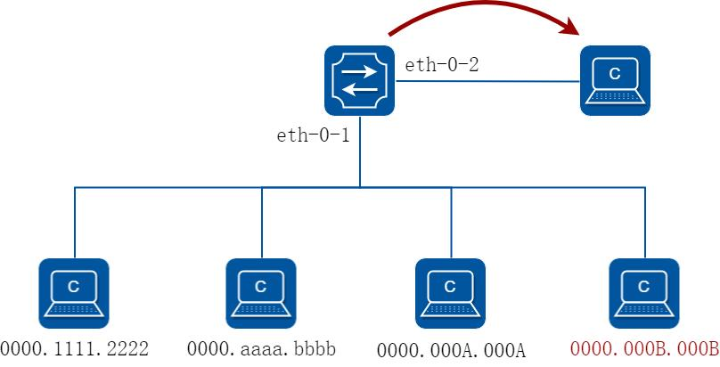

**图7-1 Port Security**

通过以下配置，在上述拓扑中，只会学习前三条mac 地址，将最后一条丢弃。

##### 2. 配置步骤

##### 步骤1 进入配置模式

```
Switch# configure terminal
```

##### 步骤2 进入接口配置模式，配置接口属性，并使能端口安全功能

```
Switch(config)# interface eth-0-1
Switch(config-if)# switchport
Switch(config-if)# switchport port-security
Switch(config-if)# switchport port-security maximum 3
Switch(config-if)# switchport port-security mac-address 0000.1111.2222 vlan 1
Switch(config-if)# switchport port-security mac-address 0000.aaaa.bbbb vlan 1
Switch(config-if)# switchport port-security violation restrict
Switch(config-if)# exit
```

##### 步骤3 退出配置模式

```
Switch(config)# end
```

##### 步骤4 检查配置

```
Switch# show port-security
Port Security Work Mode: Hardware
Secure Port
MaxSecureAddr
CurrentAddr
SecurityViolationMode
(Count)
(DynamicCount)
---------------------------------------------------------------
eth-0-1
3
2
restrict
Switch# show port-security address-table
Secure MAC address table
```

```
--------------------------------------------------------
Vlan
Mac Address
Type
Ports
----
-----------
-------
-------
1
0000.1111.2222
SecureConfigured
eth-0-1
1
0000.aaaa.bbbb
SecureConfigured
eth-0-1
Switch# show port-security interface eth-0-1
Port security
: enabled
Violation mode
: discard packet and log
Maximum MAC addresses
: 3
Total MAC addresses
: 2
Static configured MAC addresses
: 2
```

## 7.2 VLAN安全配置

### 7.2.1 概述

#### 简介

VLAN 安全功能通过限制VLAN 内MAC 地址的数量，达到保护VLAN 的目的。MAC 地址可以是用户手动添加的，也可以是自动学习的。Vlan 内MAC 地址达到限制数量后，未知源MAC 的报文可以按预先设置的行为进行处理。

系统支持两种类型的MAC 地址：

静态MAC 地址：手工配置的MAC 地址动态MAC 地址：通过动态学习的MAC 地址用户可以指定当VLAN 内MAC 达到限制数量时的行为，通过命令行”vlan X mac-limit action”配置。支持的行为有下列三种：

Discard：丢弃未知源MAC 地址的报文Warn：丢弃未知的源MAC 地址报文，并且在LOG 中提示Forward：报文正常转发，但是MAC 不会进行学习。

系统还支持开、关VLAN 内MAC 地址学习功能。

### 7.2.2 配置举例

#### 配置VLAN MAC 地址限制

##### 步骤1 进入配置模式

```
Switch# configure terminal
```

步骤2 进入vlan 配置模式，创建vlan，设置vlan 的最大mac 地址数量和超过最大数量后的行

##### 为

```
Switch(config)# vlan database
Switch(config)# vlan 2
Switch(config-vlan)# vlan 2 mac-limit maximum 100
```

```
Switch(config-vlan)# vlan 2 mac-limit action discard
Switch(config-vlan)# exit
```

##### 步骤3 退出配置模式

```
Switch(config)# end
```

##### 步骤4 检查配置

```
Switch# show vlan-security
Vlan
learning-en
max-mac-count
cur-mac-count
action
- $$-----------------------------------------------------
2
Enable
100
0
Discard
```

#### 配置VLAN MAC 地址学习

##### 步骤1 进入配置模式

```
Switch# configure terminal
```

##### 步骤2 进入vlan 配置模式，创建vlan，设置vlan 的mac 地址学习开关

```
Switch(config)# vlan database
Switch(config)# vlan 2
Switch(config-vlan)# vlan 2 mac learning disable
Switch(config-vlan)# exit
```

##### 步骤3 退出配置模式

```
Switch(config)# end
```

##### 步骤4 检查配置

```
Switch# show vlan-security
Vlan
learning-en
max-mac-count
cur-mac-count
action
- $$-----------------------------------------------------
2
Disable
100
0
Discard
```

## 7.3 时间段配置

### 7.3.1 概述

#### 简介

Time range 定义了一段时间，这段时间可以是绝对时间，也可以是相对的周期性时间。

Time range 本身没有意义，通常被用在基于时间的协议或者应用中（比如acl）。在实际应用中，它可以表示在这段时间内，某些规则或操作有效。Time range 定义的时间依赖于系统时钟。

### 7.3.2 配置举例

#### 配置绝对时间段

##### 步骤1 进入配置模式

```
Switch# configure terminal
```

##### 步骤2 创建time range，配置绝对时间

```
Switch(config)# time-range test-absolute
Switch(config-tm-range)# absolute start 1:1:2 jan 1 2012 end 1:1:3 jan 7 2012
Switch(config-tm-range)# exit
```

##### 步骤3 退出配置模式

```
Switch(config)# end
```

##### 步骤4 检查配置

```
DUT1# show time-range
time-range test-absolute
absolute start 01:01:02 Jan 01 2012 end 01:01:03 Jan 07 2012
```

#### 配置周期时间段

##### 步骤1 进入配置模式

```
Switch# configure terminal
```

##### 步骤2 创建time range，配置周期时间

```
Switch(config)# time-range test-periodic
Switch(config-tm-range)# periodic 1:1 mon to 1:1 wed
Switch(config-tm-range)# exit
```

##### 步骤3 退出配置模式

```
Switch(config)# end
```

##### 步骤4 检查配置

```
DUT1# show time-range
time-range test-periodic
periodic 01:01 Mon to 01:01 Wed
```

## 7.4 访问控制列表配置

### 7.4.1 概述

#### 简介

ACL（Access Control List，访问控制列表）主要用来实现流识别、访问控制功能。网络设备为了过滤数据包，需要配置一系列的匹配规则，以识别需要过滤的报文。在识别出特定的报文之后，才能根据预先设定的策略允许或禁止相应的数据包通过。ACL 通过一系列的匹配条件对数据包进行分类，这些条件可以是数据包的源地址、目的地址、端口号等。

网络在生活、生产中日益普及，人们对网络越来越依赖的同时也越来越重视网络的安全，ACL 可以在很多场景下实现保护网络安全的作用，如：

限制网络访问。为了确保网络安全，通过配置安全ACL，可以限制用户访问一些服务（如只需要访问WWW 和电子邮件服务，其他服务如Telnet 则禁止），或者允许在给定的时间内访问，或者只允许一些主机访问网络等。

Internet 病毒攻击企业网内部，通过安全ACL 可以阻止病毒数据进入企业网内部。

企业的服务器资源容易泄露机密信息，通过安全ACL 可以控制访问。

管理员需要监控某个用户的网络访问，可以通过策略ACL 将该用户的网络流量镜像到监控设备。

管理员需要将某些数据流先引到防火墙设备中进行安全检查，可以通过策略ACL 将这些数据流重定向到指定端口下的防火墙设备，进行安全检查。

#### 原理描述

##### 1. 术语和概念

访问控制条目（ACE）：每一个ACE 包括一个动作元素（允许或者拒绝）和一系列基于标准的过滤元素，例如源地址、目的地址、协议、特定协议参数等等。

MAC ACL：MAC ACL 可以根据MAC-SA 和MAC-DA 过滤报文，MAC 地址可以配置掩码，或者配置为主机MAC。MAC ACL 也可以根据其他二层字段过滤报文，例如COS、VLAN-ID、INNER-COS、INNER-VLAN-ID、L2 type、L3 type。

IPv4 ACL：IPv4 ACL 可以根据IP-SA 和IP-DA 过滤报文，IP 地址可以配置掩码或者配置为主机IP 地址。IPv4 ACL 也可以根据其他三层字段过滤报文，例如DSCP、L4 Protocol 字段以及其他字段（TCP 端口、UDP 端口等等）。

时间段：定义一个时间段或时间周期，在这段时间内，ACE 是有效的；在这个时间段或周期之外，ACE 无效。

##### 2. 规则的组成

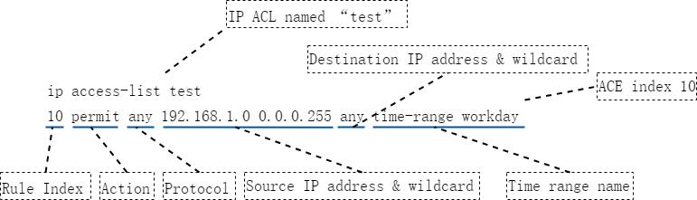

**图7-2 ACL 规则的组成**

[ACL 名称]用于区分不同的ACL。

[ACE]全称Access control entry，一个ACL 下面所定义的一条规则，叫做ACE，一个ACL 下可以存在多条ACE。

[规格编号]一方面用于标识不同的ACE，删除ACE 的时候可以直接用规则编号来删除；另一方面规则编号的大小也反应了ACE 在一个ACL 里面的位置，规格编号的取值范围是1-131071，所有ACE 均按照规格编号从小到大进行排列，系统按照规格编号从小到大的顺序，将规则依次与报文匹配。

[动作]包括permit/deny 两种动作，表示允许匹配到的报文通过/禁止匹配到的报文通过。

[匹配项]提供丰富的匹配项。除了上述示意图中的报文类型、源IP 地址、目的IP地址和生效时间段，ACL 还提供了很多其他规则匹配项。例如：二层以太网帧头信息（如源MAC、目的MAC、以太帧协议类型、VLAN），DSCP、TTL、是否分片、TCP、TCP Flags 等等。

##### 3. 规则的匹配

ACL 的匹配模式分为两种，一种是match-any 模式（默认），另一种为match-all 模式。

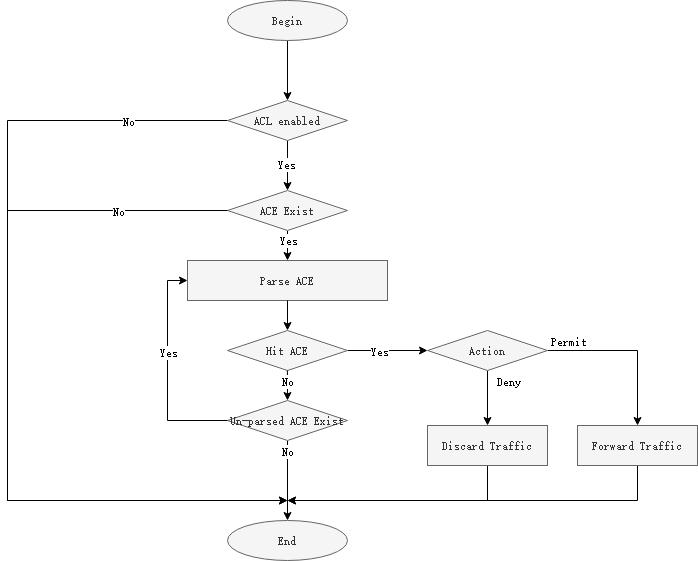

**图7-3 ACL match-any 模式的匹配流程**

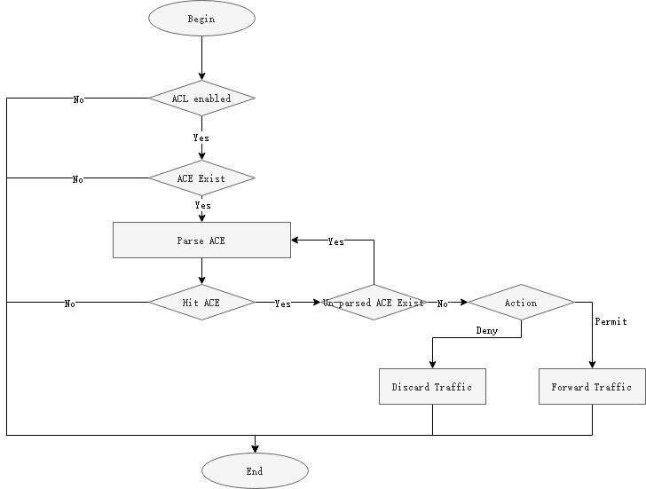

**图7-4 ACL match-all 模式的匹配流程**

对于未匹配到ACL 的业务报文，默认行为为允许通过。

在同一设备镜像出来的报文或者重定向出来的报文，出方向的ACL 无法命中。

match-all 模式下，一个ACL 中的ACE 的动作（permit 或者deny）必须一致，否则无法配置下去。

因为match-all 模式为全匹配模式，既报文需要匹配到全部的ACE，才算匹配到，所以一个ACL 下的ACE 不允许有相冲突的匹配项，否则无法配置下去。

##### 4. 常用匹配项

ACL 支持非常丰富的匹配项，下面介绍最常用的几个匹配项。

源/目的IP 地址及其通配符掩码ACL 中IP 地址匹配项有三种格式:Any：匹配所有源或者目的IP 地址。

host ... ：只匹配单个IP 地址，不需要配置通配符掩码。

A.B.C.D ... ：匹配某个范围内的IP 地址，需要配置通配符掩码。

IP 地址的通配符掩码与IP 地址的反向子网掩码类似，也是一个32 比特位的数字字符串，用于指示IP 地址中的那些位将被检查。各比特位中，“0”表示检查相应的比特位；“1”

表示不检查相应的比特位。但是与IP 地址子网掩码不同的是，子网掩码中的”0”和”1”

要求必须连续，而通配符掩码中的”0”和”1”可以不连续，且通配符掩码中的”0”

和”1”所代表的意义正好与IP 地址子网掩码中的”0”和”1”恰恰相反。

示例：希望来自192.168.1.0/24 网段的所有IP 地址能够通过，可以配置如下规则：

permit any 192.168.1.0 0.0.0.255 any

**表7-1 参数说明**

| 项目 | 十进制等价值 | 二进制等价值 |
|---|---|---|
| 参照地址 | 192.168.1.0 | 11000000.10101000.00000001.0<br>0000000 |
| 通配符掩码 | 0.0.0.255 | 00000000.00000000.00000000.1<br>1111111 |
| 确定地址范围 | 192.164.1.0-192.168.1.255 之<br>间的IP 地址 | 11000000.10101000.00000001.X<br>XXXXXXX X 既可以是0 也可以是1 |

源/目的MAC 地址及其通配掩码ACL 中源/目的MAC 的匹配项配置规则与IP 地址的类似，区别在于MAC 地址用的是16进制且有48 比特位，IP 地址用的是10 进制且有32 比特位。使用方法请参考”源/目的IP 地址及其通配掩码”的说明。

IP 协议类型ACL 中IP 协议类型匹配项分为三类格式：

Any : 匹配所有IP 协议类型。

IP protocol number ：用户自定义配置IP 协议类型的值，范围为0-255。

Gre | icmp | igmp | nvgre | tcp | udp ：系统已经封装好的常用的一些协议号。

常用的协议类型包括：ICMP（协议号1）、TCP（协议号6）、UDP（协议号17）、GRE（协议号47）、IGMP（协议号2）、IPinIP（协议号4）、OSPF（协议号89）。

TCP/UDP 端口号源端口号格式：src-port { eq port | gt port | lt port | range port-start port-end}目的端口号格式：dst-port { eq port | gt port | lt port | range port-start port-end}eq port : 指定等于源或者目的端口号。

gt port : 指定大于源或者目的端口号。

lt port : 指定小于源或者目的端口号。

range port-start port-end ：指定源或者目的端口号的范围。Port-start 是端口范围的起始值，Port-end 是端口范围的结束值。

**表7-2 常见TCP 端口号及对应的协议**

| 端口号 | 协议 | 说明 |
|---|---|---|
| 7 | Echo | Echo 服务 |
| 9 | Discard | 用于连接测试的空服务 |
| 13 | Daytime | 给请求主机发送日期和时间 |
| 19 | Character generator | 字符生成服务；发送无止境的字<br>符流 |
| 20 | FTP data connections | FTP 数据端口 |
| 21 | File Transfer Protocol(FTP) | 文件传输协议（FTP）端口 |
| 23 | Telnet | Telnet 服务 |
| 25 | Simple Mail Transport<br>Protocol (SMTP) | 简单邮件传输协议 |
| 37 | Time | 时间协议 |
| 43 | Nicname（WHOIS） | 目录服务 |
| 49 | TAC Access Control System<br>(TACACS) | 用于基于TCP/IP 验证和访问的<br>访问控制系统（TACACS 登录主机<br>协议） |
| 53 | Domain Name Service (DNS) | 域名服务 |
| 70 | Gopher | 信息检索协议（互联网文档搜寻<br>和检索） |
| 79 | Finger | 用于用户联系信息的Finger 服<br>务，查询远程主机在线用户等信<br>息 |
| 80 | World Wide Web (HTTP) | 用于万维网（WWW）服务的超文本<br>传输协议（HTTP），用于网页浏<br>览 |
| 101 | NIC hostname server | NIC 机器上的主机名服务 |
| 109 | Post Office Protocol v2 | 邮件协议-版本2 |
| 110 | Post Office Protocol v3 | 邮件协议-版本3 |
| 111 | Remote Procedure Call<br>(RPC) | 远程过程调用（RPC）<br>协议，用于远程命令执行，被网<br>络文件系统（NFS）使用 |
| 119 | Network News Transport<br>Protocol (NNTP) | 网络新闻传输协议，承载USENET<br>通信 |
| 179 | Border Gateway Protocol (BGP) | 边界网关协议 |
| 194 | Internet Relay Chat (IRC) | 互联网中继聊天（多线交谈协议） |
| 512 | Exec (rsh) | 用于对远程执行的进程进行验证 |
| 513 | Login (rlogin) | 远程登录 |
| 514 | Remote commands | 远程命令，不必登录的远程<br>shell（rshell）和远程复制（rcp） |
| 515 | Printer service | 打印机（lpr）假脱机 |
| 517 | Talk | 远程对话服务和客户 |
| 540 | Unix-to-Unix Copy Program | Unix 到Unix 复制服务 |
| 543 | Kerberos login | Kerberos 版本5（v5）远程登录 |
| 544 | Kerberos shell | Kerberos 版本5（v5）远程shell |

**表7-3 常见UDP 端口号及对应的协议**

| 端口号 | 协议 | 说明 |
|---|---|---|
| 7 | Echo | Echo 服务 |
| 9 | Discard | 用于连接测试的空服务 |
| 37 | Time | 时间协议 |
| 42 | Host Name Server | 主机名服务 |
| 53 | Domain Name Service (DNS) | 域名服务 |
| 65 | TACACS-Database Service | TACACS 数据库服务 |
| 67 | Bootstrap Protocol Server | 引导程序协议（BOOTP）服务端，<br>DHCP 服务使用 |
| 68 | Bootstrap Protocol Client | 引导程序协议（BOOTP）客户端，<br>DHCP 客户使用 |
| 69 | Trivial File Transfer<br>Protocol (TFTP) | 小文件传输协议 |
| 90 | DNSIX Security Attribute<br>Token Map | DNSIX 安全属性标记图 |
| 111 | Remote Procedure Call<br>(RPC) | 远程过程调用（RPC）<br>协议，用于远程命令执行，被网<br>络文件系统（NFS）使用 |
| 123 | Network Time Protocol (NTP) | 网络时间协议，蠕虫病毒会利用 |
| 137 | NETBIOS Name Service | NETBIOS 名称服务 |
| 138 | NETBIOS Datagram Service | NETBIOS 数据报服务 |
| 139 | NETBIOS Session Service | NETBIOS 会话服务 |
| 161 | SNMP | 简单网络管理协议 |
| 162 | SNMPTRAP | SNMP 陷阱 |
| 177 | X Display Manager Control<br>Protocol (XDMCP) | X 显示管理器控制协议 |
| 434 | MobileIP-Agent | 移动IP 代理 |
| 435 | MobileIP-MN | 移动IP 管理 |
| 512 | Mail notify | 异步邮件，可用来通知用户有邮<br>件到达 |
| 513 | Who | 登录的用户列表 |
| 514 | Syslog | UNIX 系统日志服务 |
| 517 | Talk | 远程对话服务器和客户端 |
| 520 | Routing Information Protocol | RIP 路由协议 |

TCP 标识信息TCP 标识信息匹配项有三种模式：

Match-any 模式：match-any { ack | fin | psh | rst | syn | urg } TCP 标识信息在match-any 后面可以同时配置多个，但是只要匹配到其中一个，就认为匹配成功。

Match-all 模式：match-all { ack | fin | psh | rst | syn | urg } TCP 标识信息在match-all 后面可以同时配置多个，且报文需要全部匹配这些配置的TCP 标识，才认为匹配成功。

Established：表示标识位为ACK 或者RST。

TCP 报文头中的6 个标志位：

URG(100000)：标识紧急指针有效ACK(010000)：标识确认序号有效PSH(001000)：标识接收方应该尽快将这个报文段上交给应用层RST(000100)：标识重建连接SYN(000010)：同步序号，用来发起一个连接FIN(000001)：标识发送方完成发送任务

### 7.4.2 应用场景

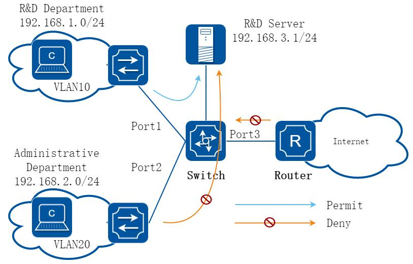

**图7-5 ACL 典型应用场景**

某企业为了保证研发数据安全，禁止非研发部门访问研发服务器。企业网内部安全，禁止internet 病毒入侵。实现方式：

在port 2 的入方向部署安全ACL（可以通过报文的目的IP 来做匹配），禁止行政部门访问研发服务器的报文通过。

在port 3 的入方向部署安全ACL，将病毒经常使用的TCP。

### 7.4.3 配置举例

#### 基本MAC/IP 过滤

##### 1. 组网拓扑

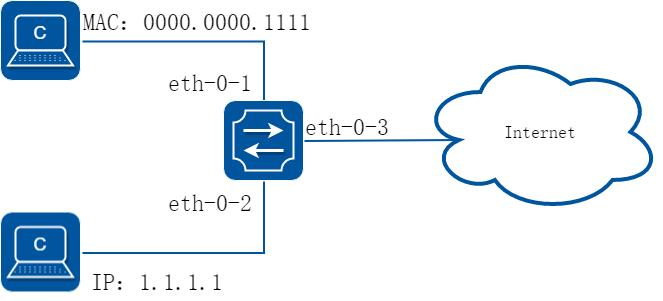

**图7-6 acl**

在这个例子中，在端口eth-0-1 上使用MAC ACL，允许源MAC 地址为0000.0000.1111的报文通过，拒绝其他报文。在eth-0-2 使用IPv4 ACL，允许源IP 地址为1.1.1.1/24的报文通过，拒绝其他报文。

##### 2. 配置步骤

##### 步骤1 进入配置模式

```
Switch# configure terminal
```

##### 步骤2 创建访问控制列表

mac 访问控制列表：

```
Switch(config)# mac access-list mac
Switch(config-mac-acl)# permit src-mac host 0000.0000.1111 dest-mac any
Switch(config-mac-acl)# deny src-mac any dest-mac any
Switch(config-mac-acl)# exit
```

ip 访问控制列表：

```
Switch(config)# ip access-list ipv4
Switch(config-ip-acl)# permit any 1.1.1.1 0.0.0.255 any
Switch(config-ip-acl)# deny any any any
Switch(config-ip-acl)# exit
```

##### 步骤3 创建分类器，绑定访问控制列表

```
Switch(config)# class-map cmap1
Switch(config-cmap)# match access-group mac
Switch(config-cmap)# exit
Switch(config)# class-map cmap2
Switch(config-cmap)# match access-group ipv4
Switch(config-cmap)# exit
```

##### 步骤4 创建策略，绑定分类器

```
Switch(config)# policy-map pmap1
Switch(config-pmap)# class cmap1
Switch(config-pmap-c)# exit
Switch(config-pmap)# exit
Switch(config)# policy-map pmap2
Switch(config-pmap)# class cmap2
Switch(config-pmap-c)# exit
Switch(config-pmap)# exit
```

##### 步骤5 在接口上应用策略

```
Switch(config)# interface eth-0-1
Switch(config-if)# service-policy input pmap1
Switch(config-if)# exit
Switch(config)# interface eth-0-2
Switch(config-if)# service-policy input pmap2
Switch(config-if)# exit
```

##### 步骤6 退出配置模式

```
Switch(config)# end
```

##### 步骤7 检查配置

使用命令show running-config，屏幕回显内容如下所示。

```
Switch# show running-config
mac access-list mac
10 permit src-mac host 0000.0000.1111 dest-mac any
20 deny src-mac any dest-mac any
!
ip access-list ipv4
10 permit any 1.1.1.0 0.0.0.255 any
20 deny any any any
!
class-map match-any cmap1
match access-group mac
!
class-map match-any cmap2
match access-group ipv4
!
policy-map pmap1
class cmap1
!
policy-map pmap2
class cmap2
!
interface eth-0-1
service-policy input pmap1
!
interface eth-0-2
service-policy input pmap2
!
```

#### 限制用户在特定时间内访问特定服务器的示例

##### 1. 组网拓扑

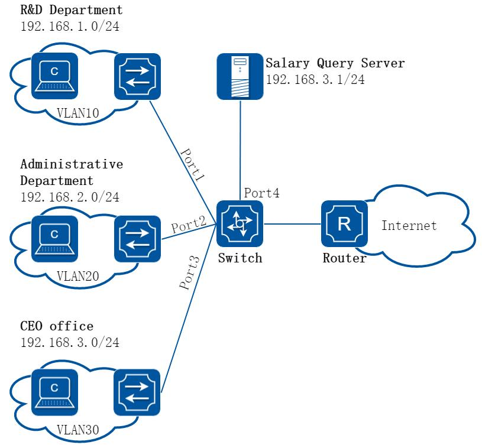

**图7-7 企业跨部门组网示例**

##### 2. 配置思路

公司要求禁止研发部门和行政部门在上班时间（9:00 – 18:00）访问工资查询服务器

（IP 地址为192.168.10.10），总经理办公室不受限制。

##### 3. 配置步骤

##### 步骤1 进入配置模式

```
Switch# configure terminal
```

##### 步骤2 创建VLAN 10,20 和30

```
Switch(config)# vlan database
Switch(config-vlan)# vlan 10,20,30
Switch(config-vlan)# exit
```

##### 步骤3 配置port 1-3 接口为trunk 口，并分别加入VLAN 10,20 和30

```
Switch(config)# interface eth-0-1
Switch(config-if)# switchport mode trunk
Switch(config-if)# switchport trunk allowed vlan add 10
```

```
Switch(config-if)# exit
Switch(config)# interface eth-0-2
Switch(config-if)# switchport mode trunk
Switch(config-if)# switchport trunk allowed vlan add 20
Switch(config-if)# exit
Switch(config)# interface eth-0-3
Switch(config-if)# switchport mode trunk
Switch(config-if)# switchport trunk allowed vlan add 30
Switch(config-if)# exit
```

##### 步骤4 配置VLAN interface 的ip 地址

```
Switch(config)# interface vlan 10
Switch(config-if)# ip address 192.168.1.254/24
Switch(config-if)# exit
Switch(config)# interface vlan 20
Switch(config-if)# ip address 192.168.2.254/24
Switch(config-if)# exit
Switch(config)# interface vlan 30
Switch(config-if)# ip address 192.168.3.254/24
Switch(config-if)# exit
```

##### 步骤5 配置port 4 为三层端口并配置IP 地址

```
Switch(config)# interface eth-0-4
Switch(config-if)# no switchport
Switch(config-if)# ip address 192.168.10.254/24
Switch(config-if)# exit
```

##### 步骤6 配置一个时间段，包含每周一至周五，9:00 至18:00

```
Switch(config)# time-range time-1
Switch(config-tm-range)# periodic 09:00 weekdays to 18:00
Switch(config-tm-range)# exit
```

##### 步骤7 配置研发部门到工资查询服务器的访问规则

```
Switch(config)# ip access-list test
Switch(config-ip-acl)# deny any 192.168.1.0 0.0.0.255 host 192.168.10.10 time-range time-1
Switch(config-ip-acl)# exit
```

##### 步骤8 配置行政部门到工资查询服务器的访问规则

```
Switch(config)# ip access-list test
Switch(config-ip-acl)# deny any 192.168.2.0 0.0.0.255 host 192.168.10.10 time-range time-1
Switch(config-ip-acl)# exit
```

##### 步骤9 创建一个流分类，将ACL 规则添加到创建的流分类中

```
Switch(config)# class-map match-any cmap
Switch(config-cmap)# match access-group test
Switch(config-cmap)# exit
```

##### 步骤10 创建一个流策略，将上一步创建的流分类添加到流策略中，并打开ACL 计数功能

```
Switch(config)# policy-map pmap
Switch(config-pmap)# class cmap
Switch(config-pmap-c)# statistics enable
```

```
Switch(config-pmap-c)# exit
Switch(config-pmap)# exit
```

##### 步骤11 在接口应用策略

研发部门访问服务器的数据流从接口eth-0-1 进入交换机，所以应该在eth-0-1 的入方向应用流策略

```
Switch(config)# interface eth-0-1
Switch(config-if)# service-policy input pmap
Switch(config-if)# exit
```

行政部门访问服务器的数据流从接口eth-0-2 进入交换机，所以应该在eth-0-2 的入方向应用流策略

```
Switch(config)# interface eth-0-2
Switch(config-if)# service-policy input pmap
Switch(config-if)# exit
```

##### 步骤12 退出配置模式

```
Switch(config)# end
```

##### 4. 验证配置

查看ACL 的配置信息

```
Switch# show access-list ip
ip access-list test
10 deny any 192.168.1.0 0.0.0.255 host 192.168.10.10 time-range time-1
20 deny any 192.168.2.0 0.0.0.255 host 192.168.10.10 time-range time-1
```

查看流分类的配置信息

```
Switch# show class-map
CLASS-MAP-NAME: class-default (match-any)
CLASS-MAP-NAME: cmap (match-any)
match access-group: test
```

查看流策略的配置信息

```
Switch# show policy-map
POLICY-MAP-NAME: pmap
State: attached
CLASS-MAP-NAME: cmap
match access-group: test
statistics
: enable
```

查看ACL 的匹配到的报文计数

```
Switch# show policy-map statistics interface eth-0-1 input ace ace-based
Interface: eth-0-1
Ingress service policy: pmap
Class name: cmap, operator : match-any
access-group test
10 deny any 192.168.1.0 0.0.0.255 host 192.168.10.10 time-range time-1 ( 0 match 0 bytes)
```

```
20 deny any 192.168.2.0 0.0.0.255 host 192.168.10.10 time-range time-1 ( 0 match 0 bytes)
total 0 match 0 bytes
```

##### 5. 配置文件

交换机的ACL 完整配置

```
vlan database
vlan 10,20,30
periodic 09:00 weekdays to 18:00
!
ip access-list test
10 deny any 192.168.1.0 0.0.0.255 host 192.168.10.10 time-range time-1
20 deny any 192.168.2.0 0.0.0.255 host 192.168.10.10 time-range time-1
!
class-map match-any cmap
match access-group test
!
policy-map pmap
class cmap
statistics enable
!
interface eth-0-1
switchport mode trunk
switchport trunk allowed vlan add 10
service-policy input pmap
!
time-range time-1
interface eth-0-2
switchport mode trunk
switchport trunk allowed vlan add 20
service-policy input pmap
!
interface eth-0-3
switchport mode trunk
switchport trunk allowed vlan add 30
!
interface eth-0-4
no switchport
ip address 192.168.10.254/24
!
interface vlan10
ip address 192.168.1.254/24
!
interface vlan20
ip address 192.168.2.254/24
!
interface vlan30
ip address 192.168.3.254/24
!
```

#### 使用ACL 限制不同VLAN(网段)的用户互相访问示例

##### 1. 组网拓扑

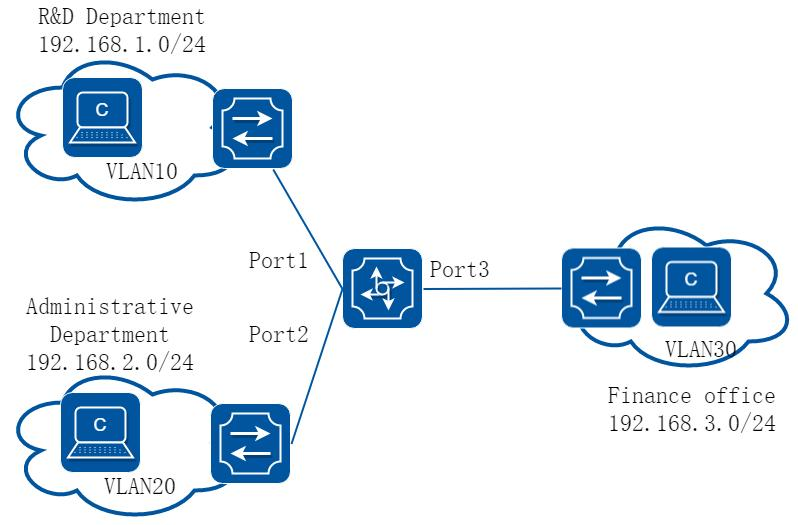

**图7-8 企业跨部门组网示例**

##### 2. 配置思路

网络管理员将公司不同部门划分为不同的VLAN，隔离广播域，同时不同的VLAN 也分配了不同的网段IP。现为了防止各部门之间互相泄露公司机密信息，现要求通过交换机禁止不同部门之间的互相访问，即不同的VLAN 之间禁止通信。

##### 3. 配置步骤

##### 步骤1 进入配置模式

```
Switch# configure terminal
```

##### 步骤2 创建VLAN 10,20 和30

```
Switch(config)# vlan database
Switch(config-vlan)# vlan 10,20,30
Switch(config-vlan)# exit
```

##### 步骤3 配置port 1-3 接口为trunk 口，并分别加入VLAN 10,20 和30

```
Switch(config)# interface eth-0-1
Switch(config-if)# switchport mode trunk
Switch(config-if)# switchport trunk allowed vlan add 10
Switch(config-if)# exit
Switch(config)# interface eth-0-2
Switch(config-if)# switchport mode trunk
Switch(config-if)# switchport trunk allowed vlan add 20
Switch(config-if)# exit
Switch(config)# interface eth-0-3
```

```
Switch(config-if)# switchport mode trunk
Switch(config-if)# switchport trunk allowed vlan add 30
Switch(config-if)# exit
```

##### 步骤4 配置VLAN interface 的ip 地址

```
Switch(config)# interface vlan 10
Switch(config-if)# ip address 192.168.1.254/24
Switch(config-if)# exit
Switch(config)# interface vlan 20
Switch(config-if)# ip address 192.168.2.254/24
Switch(config-if)# exit
Switch(config)# interface vlan 30
Switch(config-if)# ip address 192.168.3.254/24
Switch(config-if)# exit
```

##### 步骤5 创建ACL “for-rd”，禁止研发部门访问行政部门以及财务部门的报文通过

```
Switch(config)# ip access-list for-rd
Switch(config-ip-acl)# deny any 192.168.1.0
0.0.0.255
192.168.2.0
0.0.0.255
Switch(config-ip-acl)# deny any 192.168.1.0
0.0.0.255
192.168.3.0
0.0.0.255
Switch(config-ip-acl)# exit
```

步骤6 创建ACL”for-administrative”，禁止行政部门访问研发部门以及财务部门的报文通

##### 过

```
Switch(config)# ip access-list for-administrative
Switch(config-ip-acl)# deny any 192.168.2.0
0.0.0.255
192.168.1.0
0.0.0.255
Switch(config-ip-acl)# deny any 192.168.2.0
0.0.0.255
192.168.3.0
0.0.0.255
Switch(config-ip-acl)# exit
```

##### 步骤7 创建ACL”for-finance”，禁止财务部门访问研发部门以及行政部门的报文通过

```
Switch(config)# ip access-list for-finance
Switch(config-ip-acl)# deny any 192.168.3.0
0.0.0.255
192.168.1.0
0.0.0.255
Switch(config-ip-acl)# deny any 192.168.3.0
0.0.0.255
192.168.2.0
0.0.0.255
Switch(config-ip-acl)# exit
```

##### 步骤8 创建流分类”cmap-rd”，将ACL “for-rd”应用到该流分类中

```
Switch(config)# class-map match-any cmap-rd
Switch(config-cmap)# match access-group for-rd
Switch(config-cmap)# exit
```

步骤9 创建流分类”cmap-administrative”，将ACL”for-administrative”应用到该流分类

##### 中

```
Switch(config)# class-map match-any cmap-administrative
Switch(config-cmap)# match access-group for-administrative
Switch(config-cmap)# exit
```

步骤10 创建流分类”cmap-finance”，将ACL “for-finance”应用到该流分类中

```
Switch(config)# class-map match-any cmap-finance
Switch(config-cmap)# match access-group for-finance
Switch(config-cmap)# exit
```

步骤11 创建流策略”pmap-rd”，将流分类“cmap-rd”应用到该流策略中，并打开ACL 计数

##### 功能

```
Switch(config)# policy-map pmap-rd
Switch(config-pmap)# class cmap-rd
Switch(config-pmap-c)# statistics enable
Switch(config-pmap-c)# exit
Switch(config-pmap)# exit
```

步骤12 创建流策略”pmap-administrative”，将流分类“cmap- administrative”应用到该

##### 流策略中，并打开ACL 计数功能

```
Switch(config)# policy-map pmap-administrative
Switch(config-pmap)# class cmap-administrative
Switch(config-pmap-c)# statistics enable
Switch(config-pmap-c)# exit
Switch(config-pmap)# exit
```

步骤13 创建流策略”pmap-finance”，将流分类”cmap-finance”应用到该流策略中，并打开

##### ACL 计数功能

```
Switch(config)# policy-map pmap-finance
Switch(config-pmap)# class cmap-finance
Switch(config-pmap-c)# statistics enable
Switch(config-pmap-c)# exit
Switch(config-pmap)# exit
```

##### 步骤14 在VLAN 10(研发部门)上应用流策略pmap-rd

```
Switch(config)# interface vlan 10
Switch(config-if)# service-policy input pmap-rd
Switch(config-if)# exit
```

##### 步骤15 在VLAN 20(行政部门)上应用流策略pmap-administrative

```
Switch(config)# interface vlan 20
Switch(config-if)# service-policy input pmap-administrative
```

##### 步骤16 在VLAN 30(财务部门)上应用流策略pmap–administrative

```
Switch(config)# interface vlan 30
Switch(config-if)# service-policy input pmap-finance
Switch(config-if)# exit
```

##### 步骤17 退出配置模式

```
Switch(config)# end
```

##### 4. 验证配置

查看ACL 规则的配置信息

```
Switch# show access-list ip
ip access-list for-rd
10 deny any 192.168.1.0 0.0.0.255 192.168.2.0 0.0.0.255
20 deny any 192.168.1.0 0.0.0.255 192.168.3.0 0.0.0.255
ip access-list for-administrative
30 deny any 192.168.2.0 0.0.0.255 192.168.1.0 0.0.0.255
40 deny any 192.168.2.0 0.0.0.255 192.168.3.0 0.0.0.255
ip access-list for-finance
```

```
30 deny any 192.168.3.0 0.0.0.255 192.168.1.0 0.0.0.255
40 deny any 192.168.3.0 0.0.0.255 192.168.2.0 0.0.0.255
```

查看流分类的配置信息

```
Switch# show class-map
CLASS-MAP-NAME: class-default (match-any)
CLASS-MAP-NAME: cmap-rd (match-any)
match access-group: for-rd
CLASS-MAP-NAME: cmap-administrative (match-any)
match access-group: for-administrative
CLASS-MAP-NAME: cmap-finance (match-any)
match access-group: for-finance
```

查看流策略的配置信息

```
Switch# show policy-map
POLICY-MAP-NAME: pmap-rd
State: attached
CLASS-MAP-NAME: cmap-rd
match access-group: for-rd
statistics
: enable
POLICY-MAP-NAME: pmap-administrative
State: attached
CLASS-MAP-NAME: cmap-administrative
match access-group: for-administrative
statistics
: enable
POLICY-MAP-NAME: pmap-finance
State: attached
CLASS-MAP-NAME: cmap-finance
match access-group: for-finance
statistics
: enable
```

##### 5. 配置文件

交换机的ACL 完整配置

```
vlan database
vlan 10,20,30
!
ip access-list for-rd
10 deny any 192.168.1.0 0.0.0.255 192.168.2.0 0.0.0.255
20 deny any 192.168.1.0 0.0.0.255 192.168.3.0 0.0.0.255
ip access-list for-administrative
10 deny any 192.168.2.0 0.0.0.255 192.168.1.0 0.0.0.255
20 deny any 192.168.2.0 0.0.0.255 192.168.3.0 0.0.0.255
ip access-list for-finance
10 deny any 192.168.3.0 0.0.0.255 192.168.1.0 0.0.0.255
20 deny any 192.168.3.0 0.0.0.255 192.168.2.0 0.0.0.255
!
class-map match-any cmap-rd
match access-group for-rd
!
class-map match-any cmap-administrative
match access-group for-administrative
!
```

```
class-map match-any cmap-finance
match access-group for-finance
!
policy-map pmap-rd
class cmap-rd
statistics enable
!
policy-map pmap-administrative
class cmap-administrative
statistics enable
!
policy-map pmap-finance
class cmap-finance
statistics enable
!
interface eth-0-1
switchport mode trunk
switchport trunk allowed vlan add 10
!
interface eth-0-2
switchport mode trunk
switchport trunk allowed vlan add 20
!
interface eth-0-3
switchport mode trunk
switchport trunk allowed vlan add 30
!
interface eth-0-4
no switchport
ip address 192.168.10.254/24
!
interface vlan10
service-policy input pmap-rd
ip address 192.168.1.254/24
!
interface vlan20
service-policy input pmap-administrative
ip address 192.168.2.254/24
!
interface vlan30
service-policy input pmap-finance
ip address 192.168.3.254/24
```

在VLAN interface 上应用ACL 规则，可以对该VLAN 内的所有物理接口都生效，但是仅限于对三层转发的报文生效。

VLAN 上应用的ACL 规则，也可对该VLAN 的所有物理接口都生效，对于二层转发以及三层转发的报文都生效。

当前配置示例，将创建的不同的ACL 分别应用到不同的流分类以及流策略中，这种配置方法可以节约ACL 的资源。如果不考虑节约ACL 的资源，也可以将所有的ACL都应用到一个流分类和流策略中，这样配置过程较为简便。

#### 使用ACL 实现基于流的重定向

##### 1. 组网拓扑

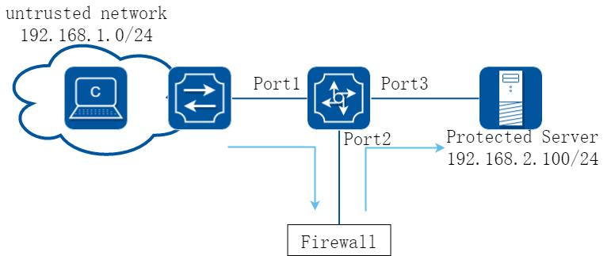

**图7-9 ACL 重定向**

##### 2. 配置思路

网络管理员需要将来自不信任网络中访问需要保护的服务器的流量引导防火墙，进行安全检查过滤，防火墙安全检查过滤完毕后，将流量再送回交换机。

##### 3. 配置步骤

##### 步骤1 进入配置模式

```
Switch# configure terminal
```

##### 步骤2 创建VLAN 10 和20

```
Switch(config)# vlan database
Switch(config-vlan)# vlan 10,20
Switch(config-vlan)# exit
```

##### 步骤3 配置端口1、2、3 为trunk 口，且加入相应的VLAN

```
Switch(config)# interface eth-0-1
Switch(config-if)# switchport mode trunk
Switch(config-if)# switchport trunk allowed vlan add 10
Switch(config-if)# exit
Switch(config)# interface eth-0-2
Switch(config-if)# switchport mode trunk
Switch(config-if)# switchport trunk allowed vlan add 10
Switch(config-if)# exit
Switch(config)# interface eth-0-3
Switch(config-if)# switchport mode trunk
Switch(config-if)# switchport trunk allowed vlan add 20
Switch(config-if)# exit
```

##### 步骤4 配置VLAN 的IP 地址

```
Switch(config)# interface vlan 10
Switch(config-if)# ip address 192.168.1.254/24
```

```
Switch(config-if)# exit
Switch(config)# interface vlan 20
Switch(config-if)# ip address 192.168.2.254/24
Switch(config-if)# exit
```

##### 步骤5 创建一条ACL 规则，匹配不信任网络到达受保护服务器的流量

```
Switch(config)# ip access-list test
Switch(config-ip-acl)# permit any any host 192.168.2.100
```

##### 步骤6 创建一个流分类，将ACL 规则应用到该流分类中

```
Switch(config)# class-map cmap
Switch(config-cmap)# match access-group test
Switch(config-cmap)# exit
```

##### 步骤7 创建流策略，将流分类应用到流策略中，并打开计数功能和重定向功能

```
Switch(config)# policy-map pmap
Switch(config-pmap)# class cmap
Switch(config-pmap-c)# statistics enable
Switch(config-pmap-c)# redirect to interface eth-0-2
Switch(config-pmap-c)# exit
Switch(config-pmap)# exit
```

##### 步骤8 关闭端口eth-0-2 的MAC 学习功能

```
Switch(config)# interface eth-0-2
Switch(config-if)# mac learning disable
Switch(config-if)# exit
```

##### 步骤9 将policy-map 应用在端口上

```
Switch(config)#interface eth-0-1
Switch(config-if) service-policy input pmap
Switch(config-if)# exit
```

##### 步骤10 退出配置模式

```
Switch(config)# end
```

##### 4. 验证配置

查看ACL 规则的配置信息

```
Switch# show access-list ip
ip access-list test
10 permit any any host 192.168.2.100
```

查看流分类的配置信息

```
Switch# show class-map
CLASS-MAP-NAME: class-default (match-any)
CLASS-MAP-NAME: cmap (match-any)
match access-group: test
```

查看流策略的配置信息

```
Switch# show policy-map
POLICY-MAP-NAME: pmap
State: detached
CLASS-MAP-NAME: cmap
match access-group: test
statistics
: enable
redirect
: interface eth-0-2
```

##### 5. 配置文件

交换机的ACL 完整配置

```
vlan database
vlan 10,20
!
ip access-list test
10 permit any any host 192.168.2.100
!
class-map match-any cmap
match access-group test
!
policy-map pmap
class cmap
statistics enable
redirect to interface eth-0-2
!
interface eth-0-1
switchport mode trunk
switchport trunk allowed vlan add 10
service-policy input pmap
!
interface eth-0-2
switchport mode trunk
switchport trunk allowed vlan add 10
mac learning disable
!
interface eth-0-3
switchport mode trunk
switchport trunk allowed vlan add 20
!
interface vlan10
ip address 192.168.1.254/24
!
interface vlan20
ip address 192.168.2.254/24
```

因为防火墙将报文处理完后，原封不动的送回交换机，如果不关闭eth-0-2 端口的MAC学习功能，就会导致交换机的eth-0-1 和eth-0-2 学习到相同的MAC 地址，导致MAC 迁移现象，以及服务器回复的报文无法正常送到eth-0-1 端口，所以需要将eth-0-2 端口的MAC 学习功能关闭。

如果需要使用基于流的镜像功能，也可以参考以上示例的配置。

#### 使用ACL 实现登陆设备访问控制

##### 步骤1 进入配置模式

```
Switch# configure terminal
```

下面拒绝ip 为192.168.1.1 的设备通过ssh/telnet 连接交换机进行配置举例

##### 步骤2 创建acl

```
Switch(config)# ip access-list test
Switch(config-ip-acl)# deny tcp host 192.168.1.1 any
Switch(config-ip-acl)# exit
```

##### 步骤3 将ACL 应用在telnet 或者ssh 上

```
Switch(config)# ip ssh server acl test
Switch(config)# ip telnet server acl test
```

telnet、ssh 应用上acl 之后，对管理口以及业务口均可以生效。

若是需要限制ipv6 地址对设备进行管理，需要创建ipv6 acl。

##### 步骤4 退出配置模式

```
Switch(config)# end
```

## 7.5 扩展访问控制列表配置

### 7.5.1 概述

#### 简介

扩展IPV4 ACL 包含MAC ACE 和IP ACE，MAC ACE 匹配所有非IPV6 和非MPLS 报文，IP ACE匹配所有IPV4 报文。

#### 原理描述

下面介绍了扩展ACL 有关的术语和概念：

扩展IPV4 ACL：包含MAC ACE 和IP ACE。

MAC ACE：可以根据MAC-SA 和MAC-DA 过滤报文，MAC 地址可以配置掩码，或者配置为主机MAC；也可以根据其他二层字段过滤报文，例如COS、VLAN-ID、INNER-COS、INNER-VLAN-ID、L2 type、L3 type。

IPv4 ACE：可以根据IP-SA 和IP-DA 过滤报文，IP 地址可以配置掩码或者配置为主机IP 地址；也可以根据其他三层字段过滤报文，例如DSCP、L4 Protocol 字段以及其他字段（TCP 端口、UDP 端口等等）。

用户可以通过MAC ACE 和IP ACE 各种组合，以及不同的顺序实现不同的需求。

### 7.5.2 配置举例

##### 1. 组网拓扑

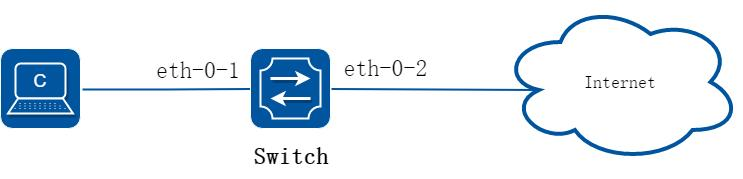

**图7-10 extern acl**

下面的例子描述如何通过扩展IPV4 ACL 实现在端口eth-0-1 上允许源MAC 为0.0.1111报文COS 为2 的报文，允许所有TCP 的报文，禁止其他报文进入系统。

##### 2. 配置步骤

##### 步骤1 进入配置模式

```
Switch# configure terminal
```

##### 步骤2 创建访问控制列表

```
Switch(config)# ip access-list ipxacl extend
Switch(config-ex-ip-acl)# permit src-mac host 0000.0000.1111 dest-mac any cos 2
Switch(config-ex-ip-acl)# permit tcp any any
Switch(config-ex-ip-acl)# deny src-mac any dest-mac any
Switch(config-ex-ip-acl)# exit
```

##### 步骤3 创建分类器，绑定访问控制列表

```
Switch(config)# class-map cmap
Switch(config-cmap)# match access-group ipxacl
Switch(config-cmap)# exit
```

##### 步骤4 创建策略，绑定分类器

```
Switch(config)# policy-map pmap
Switch(config-pmap)# class cmap
Switch(config-pmap-c)# exit
Switch(config-pmap)# exit
```

##### 步骤5 在接口上应用策略

```
Switch(config)# interface eth-0-1
Switch(config-if)# service-policy input pmap
Switch(config-if)# exit
```

##### 步骤6 退出配置模式

```
Switch(config)# end
```

##### 步骤7 检查配置

使用如下命令验证配置结果：

```
Switch# show running-config
ip access-list ipxacl extend
10 permit src-mac host 0000.0000.1111 dest-mac any cos 2
20 permit tcp any any
30 deny src-mac any dest-mac any
!
class-map match-any cmap
match access-group ipxacl
!
policy-map pmap
class cmap
!
interface eth-0-1
service-policy input pmap
!
Switch# show access-list ip
ip access-list ipxacl extend
10 permit src-mac host 0000.0000.1111 dest-mac any cos 2
20 permit tcp any any
30 deny src-mac any dest-mac any
```

## 7.6 IPv6访问控制列表配置

### 7.6.1 概述

#### 简介

ACLv6（Access Control List，访问控制列表）主要用来实现IPv6 流识别、访问控制功能。网络设备为了过滤数据包，需要配置一系列的匹配规则，以识别需要过滤的报文。

在识别出特定的报文之后，才能根据预先设定的策略允许或禁止相应的数据包通过。ACL通过一系列的匹配条件对数据包进行分类，这些条件可以是数据包的源地址、目的地址、端口号等。

#### 原理描述

下面简要介绍用于描述ACLv6 相关的术语和概念：

访问控制条目（ACE）：每一个ACE 包括一个动作元素（允许或者拒绝）和一个基于标准的过滤元素，例如源地址、目的地址、协议、特定协议参数等等。

IPv6 ACL：IPv6 ACL 可以根据IP-SA 和IP-DA 过滤报文，IP 地址可以配置掩码或者配置为主机IP 地址。IPv6 ACL 也可以根据其他三层字段过滤报文，例如L4 Protocol 字段以及其他字段（TCP 端口、UDP 端口等等）。

时间段：定义一个时间段或时间周期，在这段时间内，ACE 是有效的；在这个时间段或周期之外，ACE 无效。

### 7.6.2 配置举例

##### 1. 组网拓扑

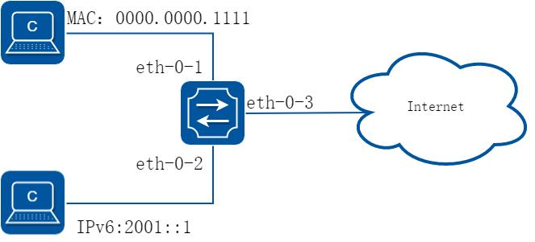

**图7-11 ipv6 acl**

##### 2. 配置步骤

##### 步骤1 进入配置模式

```
Switch# configure terminal
```

##### 步骤2 全局使能ipv6

```
Switch(config)# ipv6 enable
```

##### 步骤3 创建访问控制列表

mac 访问控制列表：

```
Switch(config)# mac access-list mac
Switch(config-mac-acl)# permit src-mac host 0000.0000.1111 dest-mac any
Switch(config-mac-acl)# deny src-mac any dest-mac any
Switch(config-mac-acl)# exit
```

ipv6 访问控制列表：

```
Switch(config)# ipv6 access-list ipv6
Switch(config-ipv6-acl)# permit any 2001::/64 any
Switch(config-ipv6-acl)# deny any any any
Switch(config-ipv6-acl)# exit
```

##### 步骤4 创建分类器，绑定访问控制列表

```
Switch(config)# class-map cmap1
Switch(config-cmap)# match access-group mac
Switch(config-cmap)# exit
Switch(config)# class-map cmap2
Switch(config-cmap)# match access-group ipv6
Switch(config-cmap)# exit
```

##### 步骤5 创建策略，绑定分类器

```
Switch(config)# policy-map pmap1
Switch(config-pmap)# class cmap1
```

```
Switch(config-pmap-c)# exit
Switch(config-pmap)# exit
Switch(config)# policy-map pmap2
Switch(config-pmap)# class cmap2
Switch(config-pmap-c)# exit
Switch(config-pmap)# exit
```

##### 步骤6 在接口上应用策略

```
Switch(config)# interface eth-0-1
Switch(config-if)# service-policy input pmap1
Switch(config-if)# exit
Switch(config-if)# interface eth-0-2
Switch(config-if)# service-policy input pmap2
Switch(config-if)# exit
```

##### 步骤7 退出配置模式

```
Switch(config)# end
```

##### 步骤8 检查配置

使用命令show running-config，屏幕回显内容如下所示：

```
Switch# show running-config
mac access-list mac
10 permit src-mac host 0000.0000.1111 dest-mac any
20 deny src-mac any dest-mac any
!
ipv6 access-list ipv6
10 permit any 2001::/64 any
20 deny any any any
!
class-map match-any cmap1
match access-group mac
!
class-map match-any cmap2
match access-group ipv4
!
policy-map pmap1
class cmap1
!
policy-map pmap2
class cmap2
!
interface eth-0-1
service-policy input pmap1
!
interface eth-0-2
service-policy input pmap2
!
```

## 7.7 Port-Group配置

### 7.7.1 概述

#### 简介

系统包装port-group 的概念，专门用来实现基于ACL 规则的端口的聚合组，可以将多个端口加入一个port-group，端口支持普通物理口和AGG 端口。用户基于port-group应用ACL 策略，这个时候一个port-group 只会下一份规则，同时ACL 的Action 也是聚合的效果。

### 7.7.2 配置举例

#### 配置端口聚合组

##### 步骤1 进入配置模式

```
Switch# configure terminal
```

##### 步骤2 创建聚合端口(可选)

支持聚合端口作为port group 的成员，聚合端口需要提前创建。

```
Switch(config)# interface eth-0-2
Switch(config-if)# static-channel-group 1
Switch(config-if)# no shutdown
Switch(config-if)# exit
```

##### 步骤3 创建port group，添加成员口

```
Switch(config)# port-group port_group_1
Switch(config-port-group)# member interface eth-0-1
Switch(config-port-group)# member interface agg 1
Switch(config-port-group)# exit
```

##### 步骤4 退出配置模式

```
Switch(config)# end
```

##### 步骤5 检查配置

```
DUT1# show running-config port-group
port-group port_group_1
member interface eth-0-1
member interface agg1
```

## 7.8 VLAN-Group配置

### 7.8.1 概述

#### 简介

系统包装vlan-group 的概念，专门用来实现基于ACL 规则的VLAN 的聚合组，可以将多个VLAN 加入一个vlan-group。用户基于vlan-group 应用ACL 策略，这个时候一个vlan-group 只会下一份规则，同时ACL 的Action 也是聚合的效果。

### 7.8.2 配置举例

#### 配置Vlan 聚合组

##### 步骤1 进入配置模式

```
Switch# configure terminal
```

##### 步骤2 进入vlan 配置模式并创建vlan

```
Switch(config)# vlan database
Switch(config-vlan)# vlan 10
Switch(config-vlan)# vlan 20
Switch(config-vlan)# exit
```

##### 步骤3 创建vlan group，添加成员vlan

```
Switch(config)# vlan-group vlan_group_1
Switch(config-vlan-group)# member vlan 10
Switch(config-vlan-group)# member vlan 20
Switch(config-vlan-group)# exit
```

##### 步骤4 退出配置模式

```
Switch(config)# end
```

##### 步骤5 检查配置

```
Switch# show running-config vlan-group
vlan-group vlan_group_1
member vlan 10
member vlan 20
```

## 7.9 COPP控制面策略配置

### 7.9.1 概述

#### 简介

COPP（control-plane protect）主要用来对上送CPU 的报文进行过滤和限速。它主要将上送CPU 的报文数量限制在一定范围内，保证CPU 对业务的正常处理，在原有exception 基础上对上从CPU 的报文做更精细的控制。

#### 原理描述

下面简要介绍用于描述ACL 相关的术语和概念：

访问控制条目（ACE）：每一个ACE 包括一个动作元素（允许或者拒绝）和一系列基于标准的过滤元素，例如源地址、目的地址、协议、特定协议参数等等。

COPP ACL: copp acl 是根据报文上CPU 的exception 处理报文的，系统支持如下exception：any, ipda, fwd-to-cpu,slow-protocol, bpdu, erps, eapol,smart-link, dhcp, rip, ospf, pim, bgp, vrrp,ldp, ptp, rsvp, icmp-redirect,mcast-rpf-fail, macsa-mismatch,vlan-security-discard,port-security-discard, ip-option, udld,dot1x-mac-bypass,12protocol-tunnel, arp, igmp,ssh,mlag,telnet。COPP 仅仅对上送CPU 的报文进行限速或者过滤，不处理转发的报文.时间段：定义一个时间段或时间周期，在这段时间内，ACE 是有效的；在这个时间段或周期之外，ACE 无效。

### 7.9.2 配置举例

##### 1. 组网拓扑

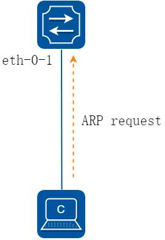

**图7-12 copp_acl**

下面这个例子中，在端口eth-0-1 上使用COPP ACL，对arp 的报文进行过滤。

##### 2. 配置步骤

##### 步骤1 进入配置模式

```
Switch# configure terminal
```

##### 步骤2 创建控制面板策略

copp 控制面板策略：

```
Switch(config)# control-plane access-list test1
Switch(config-cp-acl)# deny exception arp arp-request
Switch(config-cp-acl)# exit
```

##### 步骤3 创建分类器，绑定copp 控制面板策略

```
Switch(config)# class-map type control-plane cmap1
Switch(config-cmap-cp)# match access-group test1
Switch(config-cmap-cp)# exit
```

##### 步骤4 创建策略，绑定分类器

```
Switch(config)#policy-map type control-plane pmap1
Switch(config-pmap-cp)#class type control-plane cmap1
Switch(config-pmap-cp-c)#exit
Switch(config-pmap-cp)#exit
```

##### 步骤5 在全局应用策略

```
Switch(config)#control-plane
Switch(config-control-plane)#service-policy type control-plane input pmap1
```

##### 步骤6 退出配置模式

```
Switch(config)# end
```

##### 步骤7 检查配置

使用命令show running-config，屏幕回显内容如下所示。

```
Switch# show running-config
control-plane access-list test1
10 deny exception arp arp-request
!
class-map type control-plane cmap1
match access-group test1
!
policy-map type control-plane pmap1
class type control-plane cmap1
!
control-plane
service-policy type control-plane input pmap1
```

使用命令show cpu traffic-statistics receive ，屏幕回显内容如下所示。

```
Switch# show cpu traffic-statistics receive
statistics rate time is 5 second(s)
```

```
reason
count(packets)
rate(pps)
arp
1029059
0
total
1029059
0
```

## 7.10 Dot1x配置

### 7.10.1 概述

#### 简介

IEEE 802 网络在实际部署中，不可避免的会出现未经授权的设备在物理上接入到网络中。

802.1x 协议提供一种基于端口的网络接入控制协议（port based network access control protocol）。“基于端口的网络接入控制”是指在局域网接入设备的端口这一级对所接入的用户设备进行认证和控制。连接在端口上的用户设备如果能通过认证，就可以访问局域网中的资源；如果不能通过认证，则无法访问局域网中的资源。

使用802.1x 的系统为典型的Client/Server 体系结构，包括三个实体：

客户端设备（PC）：请求访问LAN 和交换机服务，响应来自交换机的请求。工作站必须运行符合802.1X 协议的客户端软件，如Linux 的xsupplicant。

认证服务器：执行客户端的实际认证。认证服务器验证客户的身份，并通知交换机客户端是否具有访问LAN 和交换机服务的权限。由于交换机作为代理，认证服务对客户端是透明的。在此版本中，支持可扩展身份验证协议（EAP）的远程身份验证拨号用户服务（RADIUS）服务器是唯一支持的认证服务器。RADIUS 工作于客户机/服务器模式，服务器和多个RADIUS 客户端之间交换安全的身份验证信息。

交换机（边缘交换机或无线接入点）：控制基于客户端的认证状态网络的物理访问。

交换机作为客户端和认证服务器之间的中介（代理），从客户端请求身份信息，通过认证服务器检查这些信息，并将认证结果返回到客户端。交换机包含RADIUS 客户端，负责EAP 帧的封装和解封，以及与认证服务器交互。当交换机收到EAPOL 帧并中继到身份验证服务器时，以太网报头被剥离，剩下的EAP 帧则重新封装为RADIUS 格式。EAP 帧在封装期间不会被修改或审查，并且验证服务器必须支持EAP在本机的帧格式。当交换机接收到来自验证服务器的报文，将服务器的帧头去掉，然后将剩下的EAP 帧封装为以太网报文格式并发送到客户端。我们可以在Access端口或者三层路由端口上配置dot1x。

#### 原理描述

参考IEEE Std 802.1X-2004

### 7.10.2 配置举例

#### dot1x 基础配置

##### 1. 组网拓扑

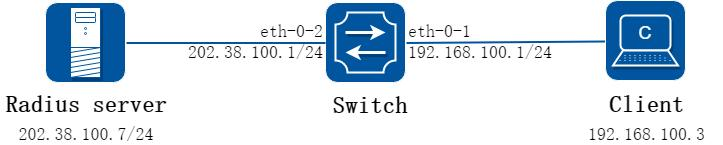

**图7-13 dot1x**

##### 2. 配置步骤

##### 步骤1 进入配置模式

```
Switch# configure terminal
```

##### 步骤2 全局使能dot1x

```
Switch(config)# dot1x system-auth-ctrl
```

##### 步骤3 进入接口配置模式，配置接口属性，并使能dot1x

```
Switch(config)# interface eth-0-1
Switch(config-if)# switchport mode access
Switch(config-if)# dot1x port-control auto
Switch(config-if)# no shutdown
Switch(config-if)# exit
Switch(config)# interface vlan 1
Switch(config-if)# ip address 192.168.100.1/24
Switch(config-if)# exit
```

##### 步骤4 配置三层接口属性并配置Radius 服务器

```
Switch(config)# interface eth-0-2
Switch(config-if)# no switchport
Switch(config-if)# ip address 202.38.100.1/24
Switch(config-if)# no shutdown
Switch(config-if)# exit
Switch(config)# radius-server host 202.38.100.7
Switch(config)# radius-server host 2001:1000::1
Switch(config)# radius-server key test
```

##### 步骤5 退出配置模式

```
Switch(config)# end
```

##### 步骤6 检查配置

```
Switch# show dot1x
802.1X Port-Based Authentication Enabled
RADIUS server address: 2001:1000::1:1812
Next radius message ID: 0
RADIUS server address: 202.38.100.7:1812
Next radius message ID: 0
Switch# show dot1x interface eth-0-1
802.1X info for interface eth-0-1
portEnabled
: true
portControl
: Auto
portMode
: Port based
portStatus
: Authorized
Mac Auth bypass
: disabled
reAuthenticate
: disabled
reAuthPeriod
: 3600
Max user number
: 255
Current session number : 1
Accept user number
: 1
Reject user number
: 0
Guest VLAN
: N/A
Assign VLAN
: N/A
QuietPeriod
: 60
ReqMax
: 2
TxPeriod
: 30
SuppTimeout
: 30
ServerTimeout
: 30
CD: adminControlledDirections : in
CD: operControlledDirections
: in
CD: bridgeDetected
: false
========================================
session 1: 1 - 0011.0100.0001
----------------------------------------
user name : admin
abort:F fail:F start:F timeout:F success:T
PAE: state: Authenticated - portMode: Auto
PAE: reAuthCount: 0 - rxRespId: 0
BE: state: Idle - reqCount: 0 - idFromServer: 5
```

#### 在路由接口上启用dot1x

上述基础配置介绍了在access 口上启用dot1x。该功能也可以在路由接口上启用。配置如下：

```
Switch# configure terminal
Switch(config)# interface eth-0-1
Switch(config-if)# no switchport
Switch(config-if)# ip address 192.168.100.1/24
Switch(config-if)# dot1x port-control auto
Switch(config-if)# no shutdown
Switch(config-if)# end
```

#### 采用强制模式

可以将dot1x 认证状态设置为强制认证通过，或者强制未通过：

强制认证通过：

```
Switch# configure terminal
Switch(config)# interface eth-0-1
Switch(config-if)# dot1x port-control force-authorized
Switch(config-if)# exit
```

强制未通过：

```
Switch(config)# interface eth-0-1
Switch(config-if)# dot1x port-control force-unauthorized
Switch(config-if)# exit
```

force-authorized 和force-unauthorized，以及前面例子提到的auto，三者只能为其一，以最后一次配置为准。

#### 开启dot1x 计费功能

Dot1x 计费功能可以在用户认证通过后记录网络资源的使用情况，默认dot1x 的计费功能是关闭的，需要在全局配置模式打开该功能。

使能dot1x 计费：

```
Switch# configure terminal
Switch(config)# dot1x accounting-mode radius
```

Dot1x 计费使能后，如果用户上线，设备会向服务器发送计费开启请求，如果服务器未响应设备的请求，则会造成计费失败，需要执行相应的开始计费失败的策略：

online：为了避免因网络故障导致的计费失败对用户造成影响，可以配置onine 参数，允许用户上线。

offline：只要计费失败就停止为用户提供服务，可以配置offline 参数，拒绝用户上线。

默认开始计费失败后执行offline 策略。

```
Switch(config)# dot1x accounting start-fail online
```

用户可以配置使能实时计费功能，设备向计费服务器定时发送实时计费报文，计费服务器收到实时计费报文后才进行计费，避免服务器无法收到计费停止报文而异常计费的情况。同时，用户可以配置允许的实时计费请求最大无响应次数，以及实时计费失败后采取的策略。缺省情况下，允许的实时计费请求最大无响应次数为3 次，实时计费失败后允许用户在线。

```
Switch(config)# dot1x accounting realtime 60
Switch(config)# dot1x accounting interim-fail max-times 2 offline
```

#### dot1x 其他可选参数

服务器定时器：重新激活RADIUS 服务器的等待时间；RADIUS 请求发送到服务器的最大可以失败的次数；RADIUS 服务器无响应的超时时间。

```
Switch# configure terminal
Switch(config)# radius-server deadtime 10
Switch(config)# radius-server retransmit 5
Switch(config)# radius-server timeout 10
```

端口属性：未经授权之前重新验证尝试的次数；协议版本；在HELD 状态下的静默时间；

使能重新认证；重新认证的时间间隔；认证服务器响应超时时间；客户端响应超时时间；

向客户端请求身份信息的时间间隔; 使能与客户端的握手保活功能，保活周期配置。

```
Switch(config)# interface eth-0-1
Switch(config-if)# dot1x port-control auto
Switch(config-if)# dot1x max-req 5
Switch(config-if)# dot1x protocol-version 1
Switch(config-if)# dot1x timeout quiet-period 120
Switch(config-if)# dot1x reauthentication
Switch(config-if)# dot1x timeout re-authperiod 1800
Switch(config-if)# dot1x timeout server-timeout 60
Switch(config-if)# dot1x timeout supp-timeout 60
Switch(config-if)# dot1x timeout tx-period 60
Switch(config-if)# dot1x handshake
Switch(config-if)# dot1x timeout handshake-period 5
Switch(config-if)# exit
```

#### 服务器端配置

##### 步骤1 配置Radius 服务器的密码共享密钥、认证端口和计费端口]步骤2 在服务器端配置用户名和密码

## 7.11 Guest VLAN配置

### 7.11.1 概述

#### 简介

如果用户因为没有专用的认证客户端或者客户端版本过低等原因，导致无法认证成功，用户所在的端口会被加入GuestVlan。GuestVlan 是一个不经认证也可以访问的VLAN。

在该VLAN 内，用户可以进行例如客户端下载以及升级等操作。当用户利用这些资源，安装或者升级了认证客户端后，又可以进行正常的认证过程，从而访问其他的网络资源。

开启802.1x 特性、正确配置GuestVlan 后，当设备从某一端口发送触发认证报文

（EAP-Request/Identity）超过设定的最大次数而没有收到客户端的任何回应报文后，该端口会被加入到GuestVlan 内。此时用户发起认证，若认证失败，则端口仍然处于guest vlan 中；如果认证成功，则端口返回到用户配置的VLAN。

Guest VLAN 的功能只能配置在Access 端口上，不能作用于3 层物理口(routed port)或者trunk 端口上。

### 7.11.2 配置举例

##### 1. 组网拓扑

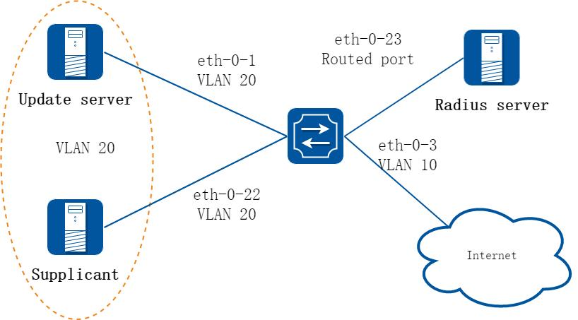

**图7-14 Guest vlan: before authenticated**

如图所示，eth-0-22 是一个使能了802.1x 功能的端口，它处于VLAN 10 内。Update server是用于客户端下载和升级的服务器，处于VLAN 20 内。在eth-0-22 上使能guest vlan特性，当设备从端口触发认证报文超过设定的最大次数而没有收到任何回应报文后，端口被加入guest VLAN 20 中。此时客户端和update server 都在VLAN 20 内，客户端可以访问update server 并下载802.1x 客户端。

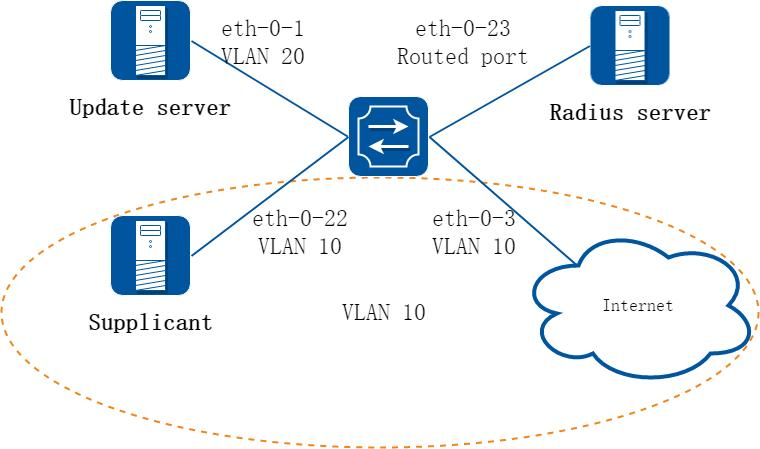

**图7-15 Guest vlan: after authenticated**

连接认证服务器radius server 的上行端口eth-0-23 使一个3 层物理口，它的IP 地址为202.38.100.1，radius server 的地址为202.38.100.7。当认证成功之后，端口eth-0-22 重新处于VLAN 10 内，客户端可以访问internet 了。

##### 2. 配置步骤

##### 步骤1 进入配置模式

```
Switch# configure terminal
```

##### 步骤2 进入vlan 配置模式并创建vlan

```
Switch(config)# vlan database
Switch(config-vlan)# vlan 10
Switch(config-vlan)# vlan 20
Switch(config-vlan)# exit
```

##### 步骤3 全局使能dot1x

```
Switch(config)# dot1x system-auth-ctrl
```

##### 步骤4 进入接口配置模式，配置接口属性，并使能dot1x，配置guest vlan

```
Switch(config)# interface eth-0-22
Switch(config-if)# switchport mode access
Switch(config-if)# switchport access vlan 10
Switch(config-if)# dot1x port-control auto
Switch( config-if)# no shutdown
Switch(config-if)# dot1x guest-vlan 20
Switch(config-if)# exit
```

##### 步骤5 配置三层接口属性并配置Radius 服务器

```
Switch(config)# interface eth-0-23
Switch(config-if)# no switchport
Switch(config-if)# ip address 202.38.100.1/24
Switch(config-if)# no shutdown
Switch(config-if)# exit
Switch(config)# radius-server host 202.38.100.7
Switch(config)# radius-server key test
```

##### 步骤6 退出配置模式

```
Switch(config)# end
```

##### 步骤7 检查配置

在未配置Guest VLAN 之前的初始状态如命令show running-config 的屏显内容所示。

```
Switch# show running-config
dot1x system-auth-ctrl
radius-server host 202.38.100.7 key test
vlan database
vlan 10,20
!
interface eth-0-22
switchport access vlan 10
dot1x port-control auto
dot1x guest-vlan 20
!
interface eth-0-23
no switchport
ip address 202.38.100.1/24
!
Switch# show dot1x interface eth-0-22
```

```
802.1X info for interface eth-0-22
portEnabled
: true
portControl
: Auto
portMode
: Port based
portStatus
: Unauthorized
Mac Auth bypass
: disabled
reAuthenticate
: disabled
reAuthPeriod
: 3600
Max user number
: 255
Current session number : 0
Accept user number
: 0
Reject user number
: 0
Guest VLAN
: 20
Assign VLAN
: N/A
QuietPeriod
: 60
ReqMax
: 2
TxPeriod
: 30
SuppTimeout
: 30
ServerTimeout
: 30
CD: adminControlledDirections : in
CD: operControlledDirections
: in
CD: bridgeDetected
: false
========================================
Switch# show vlan brief
VLAN ID
Name
State
STP ID
DSCP
Member ports
(u)-Untagged, (t)-Tagged
======= ================ ======= ======= ======= ========================
1
default
ACTIVE
0
Disable eth-0-1(u) eth-0-2(u)
eth-0-3(u) eth-0-4(u)
eth-0-5(u) eth-0-6(u)
eth-0-7(u) eth-0-8(u)
eth-0-9(u) eth-0-10(u)
eth-0-11(u) eth-0-12(u)
eth-0-13(u) eth-0-14(u)
eth-0-15(u) eth-0-16(u)
eth-0-17(u) eth-0-18(u)
eth-0-19(u) eth-0-20(u)
eth-0-21(u) eth-0-24(u)
eth-0-25(u) eth-0-26(u)
eth-0-27(u) eth-0-28(u)
eth-0-29(u) eth-0-30(u)
eth-0-31(u) eth-0-32(u)
eth-0-33(u) eth-0-34(u)
eth-0-35(u) eth-0-36(u)
eth-0-37(u) eth-0-38(u)
eth-0-39(u) eth-0-40(u)
eth-0-41(u) eth-0-42(u)
eth-0-43(u) eth-0-44(u)
eth-0-45(u) eth-0-46(u)
eth-0-47(u) eth-0-48(u)
10
VLAN0010
ACTIVE
0
Disable eth-0-22(u)
20
VLAN0020
ACTIVE
0
Disable
```

配置Guest VLAN 之后，客户端的状态信息如下面屏幕回显信息所示。

通过认证前：

```
Switch# show dot1x interface eth-0-22
802.1X info for interface eth-0-22
portEnabled
: true
portControl
: Auto
portMode
: Port based
portStatus
: Unauthorized
Mac Auth bypass
: disabled
reAuthenticate
: disabled
reAuthPeriod
: 3600
Max user number
: 255
Current session number : 1
Accept user number
: 0
Reject user number
: 1
Guest VLAN
: 20(Port Authorized by guest vlan)
Assign VLAN
: N/A
QuietPeriod
: 60
ReqMax
: 2
TxPeriod
: 30
SuppTimeout
: 30
ServerTimeout
: 30
CD: adminControlledDirections : in
CD: operControlledDirections
: in
CD: bridgeDetected
: false
========================================
session 1: 1 - 0011.0100.0001
----------------------------------------
user name : admin
abort:F fail:T start:F timeout:F success:F
PAE: state: Held - portMode: Auto
PAE: reAuthCount: 1 - rxRespId: 0
BE: state: Idle - reqCount: 0 - idFromServer: 92
Switch# show vlan brief
VLAN ID
Name
State
STP ID
DSCP
Member ports
(u)-Untagged, (t)-Tagged
======= ================ ======= ======= ======= ========================
1
default
ACTIVE
0
Disable eth-0-1(u) eth-0-2(u)
eth-0-3(u) eth-0-4(u)
eth-0-5(u) eth-0-6(u)
eth-0-7(u) eth-0-8(u)
eth-0-9(u) eth-0-10(u)
eth-0-11(u) eth-0-12(u)
eth-0-13(u) eth-0-14(u)
eth-0-15(u) eth-0-16(u)
eth-0-17(u) eth-0-18(u)
eth-0-19(u) eth-0-20(u)
eth-0-21(u) eth-0-24(u)
eth-0-25(u) eth-0-26(u)
eth-0-27(u) eth-0-28(u)
eth-0-29(u) eth-0-30(u)
eth-0-31(u) eth-0-32(u)
eth-0-33(u) eth-0-34(u)
eth-0-35(u) eth-0-36(u)
```

```
eth-0-37(u) eth-0-38(u)
eth-0-39(u) eth-0-40(u)
eth-0-41(u) eth-0-42(u)
eth-0-43(u) eth-0-44(u)
eth-0-45(u) eth-0-46(u)
eth-0-47(u) eth-0-48(u)
10
VLAN0010
ACTIVE
0
Disable
20
VLAN0020
ACTIVE
0
Disable eth-0-22(u)
Client is authenticated
```

通过认证后：

```
Switch# show dot1x interface eth-0-22
802.1X info for interface eth-0-22
portEnabled
: true
portControl
: Auto
portMode
: Port based
portStatus
: Authorized
Mac Auth bypass
: disabled
reAuthenticate
: disabled
reAuthPeriod
: 3600
Max user number
: 255
Current session number : 1
Accept user number
: 1
Reject user number
: 0
Guest VLAN
: 20
Assign VLAN
: N/A
QuietPeriod
: 60
ReqMax
: 2
TxPeriod
: 30
SuppTimeout
: 30
ServerTimeout
: 30
CD: adminControlledDirections : in
CD: operControlledDirections
: in
CD: bridgeDetected
: false
========================================
session 1: 1 - 0011.0100.0001
----------------------------------------
user name : admin
abort:F fail:F start:F timeout:F success:T
PAE: state: Authenticated - portMode: Auto
PAE: reAuthCount: 0 - rxRespId: 0
BE: state: Idle - reqCount: 0 - idFromServer: 207
Switch# show vlan brief
VLAN ID
Name
State
STP ID
DSCP
Member ports
(u)-Untagged, (t)-Tagged
======= ================ ======= ======= ======= ========================
1
default
ACTIVE
0
Disable eth-0-1(u) eth-0-2(u)
eth-0-3(u) eth-0-4(u)
eth-0-5(u) eth-0-6(u)
eth-0-7(u) eth-0-8(u)
eth-0-9(u) eth-0-10(u)
eth-0-11(u) eth-0-12(u)
eth-0-13(u) eth-0-14(u)
```

```
eth-0-15(u) eth-0-16(u)
eth-0-17(u) eth-0-18(u)
eth-0-19(u) eth-0-20(u)
eth-0-21(u) eth-0-24(u)
eth-0-25(u) eth-0-26(u)
eth-0-27(u) eth-0-28(u)
eth-0-29(u) eth-0-30(u)
eth-0-31(u) eth-0-32(u)
eth-0-33(u) eth-0-34(u)
eth-0-35(u) eth-0-36(u)
eth-0-37(u) eth-0-38(u)
eth-0-39(u) eth-0-40(u)
eth-0-41(u) eth-0-42(u)
eth-0-43(u) eth-0-44(u)
eth-0-45(u) eth-0-46(u)
eth-0-47(u) eth-0-48(u)
10
VLAN0010
ACTIVE
0
Disable eth-0-22(u)
20
VLAN0020
ACTIVE
0
Disable
Switch# show dot1x
802.1X Port-Based Authentication Enabled
RADIUS server address: 202.38.100.7:1812
Next radius message ID: 0
Switch# show dot1x statistics
=====================================
802.1X statistics for interface eth-0-22
EAPOL Frames Rx: 52 - EAPOL Frames Tx: 4270
EAPOL Start Frames Rx: 18 - EAPOL Logoff Frames Rx: 2
EAP Rsp/Id Frames Rx: 29 - EAP Response Frames Rx: 3
EAP Req/Id Frames Tx: 3196 - EAP Request Frames Tx: 3
Invalid EAPOL Frames Rx: 0 - EAP Length Error Frames Rx: 0
EAPOL Last Frame Version Rx: 2 - EAPOL Last Frame Src: ae38.3288.f046
```

## 7.12 ARP Inspection配置

### 7.12.1 概述

#### 简介

缺省情况下，所有的ARP 报文都将按照规则通过交换机。用户可以通过启用ARP Inspection 功能监控ARP 报文；该功能可以通过对ARP 报文的有效性检查来过滤无效的ARP 报文，也可以通过设置规则，让特定ARP 报文通过，或者丢弃特定的ARP 报文，以提高系统的安全性，并在一定程度上抑制ARP 报文攻击。

ARP 检查是一个在网络中验证ARP 报文的安全特性，可以对ARP 报文中IP-MAC 绑定关系不正确的报文进行检查、记录日志并丢弃。这些功能可以保护网络免受人为攻击。ARP检测确保只有有效的ARP 请求和响应被执行，交换机执行的行为包括：

在不信任端口上拦截所有ARP 请求和响应。

在更新本地ARP 缓存或者转发到特定目的地址的报文之前，需要验证每个检测的报文是否都是有效的。

丢弃无效APR 报文：ARP 检测，是根据存在的DHCP snooping 数据库中有效IP 到MAC 的绑定决定一个ARP 报文的有效性。在信任端口上，交换机转发报文不需要任何检查，在不信任端口上，交换机只在有效情况下实现转发。

#### 原理描述

下面简要介绍用于描述ARP Inspection 相关的术语和概念:DHCP Snooping：DHCP snooping 是一个在不可信主机和可信DHCP 服务器之间执行防火墙的功能的安全特性，这个特性建立和维护DHCP snooping 数据库，这个数据库包含租用IP 地址的不信任主机信息。

Address Resolution Protocol (ARP)：ARP 通过映射IP 地址和MAC 地址，提供在二层广播域的IP 通信。例如主机B 想要发送信息到主机A 上，但是没有主机A 的MAC 地址，主机B 在广播域内产生一个广播报文对所有主机获取主机A 的MAC 地址。

在广播域内的所有主机接收ARP 请求，主机A 返回它的MAC 地址。

### 7.12.2 配置举例

##### 1. 组网拓扑

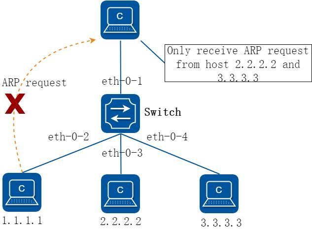

**图7-16 arp inspection**

##### 2. 配置步骤

##### 步骤1 进入配置模式

```
Switch# configure terminal
```

##### 步骤2 进入vlan 配置模式并创建vlan

```
Switch(config)# vlan database
Switch(config-vlan)# vlan 2
Switch(config-vlan)# exit
```

##### 步骤3 进入接口配置模式，将接口添加到vlan 中

```
Switch(config)# interface eth-0-1
Switch(config-if)# switchport access vlan 2
Switch(config-if)# exit
Switch(config)# interface eth-0-2
Switch(config-if)# switchport access vlan 2
Switch(config-if)# exit
Switch(config)# interface eth-0-3
Switch(config-if)# switchport access vlan 2
Switch(config-if)# exit
Switch(config)# interface eth-0-4
Switch(config-if)# switchport access vlan 2
Switch(config-if)# exit
```

##### 步骤4 配置arp 检查

```
Switch(config)# interface eth-0-1
Switch(config-if)# ip arp inspection trust
Switch(config-if)# exit
Switch(config)# ip arp inspection vlan 2
Switch(config)# ip arp inspection validate src-mac ip dst-mac
```

##### 步骤5 添加arp 访问控制列表

```
Switch(config)# arp access-list test
Switch(config-arp-acl)# deny request ip host 1.1.1.1 mac any
Switch(config-arp-acl)# exit
Switch(config)# ip arp inspection filter test vlan 2
```

##### 步骤6 退出配置模式

```
Switch(config)# end
```

##### 步骤7 检查配置

在交换机上检查ARP 检测的配置是否正确，详细步骤参见如下描述。

```
Switch# show ip arp inspection
Source Mac Validation
: Enabled
Destination Mac Validation
: Enabled
IP Address Validation
: Enabled
Vlan
Configuration
ACL Match
Static ACL
=================================================================
2
enabled
test
Vlan
ACL Logging
DHCP Logging
=================================================================
2
deny
deny
Vlan
Forwarded
Dropped
DHCP Drops
ACL Drops
=================================================================
2
0
0
0
0
Vlan
DHCP Permits
ACL Permits
Source MAC Failures
=================================================================
2
0
0
0
Vlan
Dest MAC Failures
IP Validation Failures
Invalid Protocol Data
=================================================================
2
0
0
0
```

在交换机上查看ARP Inspection 的日志记录信息：

```
Switch# show ip arp inspection log
Total Log Buffer Size : 32
Syslog rate : 5 entries per 1 seconds.
1970-01-02 00:30:47 : Drop an ARP packet by ACL on vlan 2
1970-01-02 00:30:47 : Drop an ARP packet by ACL on vlan 2
1970-01-02 00:30:47 : Drop an ARP packet by ACL on vlan 2
1970-01-02 00:30:47 : Drop an ARP packet by ACL on vlan 2
1970-01-02 00:30:47 : Drop an ARP packet by ACL on vlan 2
1970-01-02 00:30:47 : Drop an ARP packet by ACL on vlan 2
1970-01-02 00:30:47 : Drop an ARP packet by ACL on vlan 2
1970-01-02 00:30:47 : Drop an ARP packet by ACL on vlan 2
1970-01-02 00:30:47 : Drop an ARP packet by ACL on vlan 2
1970-01-02 00:30:47 : Drop an ARP packet by ACL on vlan 2
1970-01-02 00:30:47 : Drop an ARP packet by ACL on vlan 2
```

## 7.13 DHCP Snooping配置

### 7.13.1 概述

#### 简介

DHCP Snooping 是一种安全功能，包括不受信任的主机和信任的DHCP 服务器之间的防火墙行为。

DHCP Snooping 功能执行如下：

验证DHCP 消息接收来自不信任的源和过滤掉无效消息。

建立和维护DHCP Snooping 绑定数据库，其中包含不信任主机租用的IP 地址信息。

利用DHCP Snooping 绑定数据库来验证来自不受信任的主机的后续请求。

还有其他的安全功能，如，动态ARP 监测，也可以使用DHCP Snooping 绑定数据库中存储的信息，每个VLAN 的基础上启用DHCP Snooping 功能，该功能在默认情况下在所有VLAN 上都无效。你可以在一个单独的VLAN 或者VLAN 范围使能该功能，DHCP Snooping功能在软件中实现，所有DHCP 消息在芯片中被拦截直接发往CPU 进行处理。

### 7.13.2 配置举例

##### 1. 组网拓扑

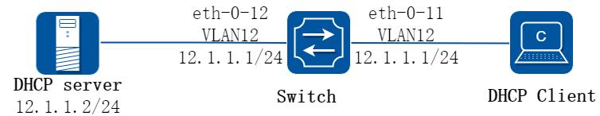

**图7-17 dhcp snooping**

上图为测试DHCP snooping 功能的网络拓扑，需要两台PC 机和一台交换机构建测试环境，具体分配可参照如下描述：

计算机A 作为DHCP 服务器计算机B 作为DHCP 客户端交换机启用DHCP snooping

##### 2. 配置步骤

##### 步骤1 进入配置模式

```
Switch# configure terminal
```

##### 步骤2 进入vlan 配置模式并创建vlan

```
Switch(config)# vlan database
Switch(config-vlan)# vlan 12
Switch(config-vlan)# exit
```

##### 步骤3 进入接口配置模式，配置接口属性和IP 地址

```
Switch(config)# interface eth-0-12
Switch(config-if)# switchport
Switch(config-if)# switchport access vlan 12
Switch(config-if)# dhcp snooping trust
Switch(config-if)# no shutdown
Switch(config-if)# exit
Switch(config)# interface eth-0-11
Switch(config-if)# switchport
Switch(config-if)# switchport access vlan 12
Switch(config-if)# no shutdown
Switch(config-if)# exit
Switch(config)# interface vlan 12
Switch(config-if)# ip address 12.1.1.1/24
Switch(config-if)# exit
```

##### 步骤4 配置DHCP 属性

```
Switch(config)# dhcp snooping verify mac-address
Switch(config)# service dhcp enable
Switch(config)# dhcp snooping
Switch(config)# dhcp snooping vlan 12
```

##### 步骤5 退出配置模式

```
Switch(config)# exit
```

##### 步骤6 检查配置

根据如下步骤，检查接口配置是否正确。

```
Switch(config)# show running-config interface eth-0-12
!
interface eth-0-12
dhcp snooping trust
switchport access vlan 12
!
Switch(config)# show running-config interface eth-0-11
!
interface eth-0-11
```

```
switchport access vlan 12
!
```

使用如下命令，检查DHCP 服务状态。

```
Switch# show services
Networking services configuration:
Service Name
Status
============================================================
dhcp
enable
```

使用如下命令，打印dhcp snooping 配置，检查当前配置。

```
Switch# show dhcp snooping config
dhcp snooping service: enabled
dhcp snooping switch: enabled
Verification of hwaddr field: enabled
Insertion of relay agent information (option 82): disable
Relay agent information (option 82) on untrusted port: not allowed
dhcp snooping vlan 12
```

使用如下命令，检查dhcp snooping 的统计信息。

```
Switch# show dhcp snooping statistics
DHCP snooping statistics:
============================================================
DHCP packets
17
BOOTP packets
0
Packets forwarded
30
Packets invalid
0
Packets MAC address verify failed
0
Packets dropped
0
```

使用如下命令，显示dhcp snooping 绑定信息。

```
Switch# show dhcp snooping binding all
DHCP snooping binding table:
VLAN MAC Address
Interface
Lease(s)
IP Address
============================================================
12
0016.76a1.7ed9 eth-0-11
691190
12.1.1.65
```

## 7.14 IP Source Guard配置

### 7.14.1 概述

#### 简介

通过IP Source Guard 绑定功能，可以对端口转发的报文进行过滤控制，防止非法IP 地址和MAC 地址的报文通过端口，提高了端口的安全性。端口接收到报文后，通过查找IP Source Guard 绑定表项，对报文进行如下处理：

对于IP+Port 的绑定表项，如果报文中的源IP 地址与绑定表项中记录的IP 地址相同，端口将转发该报文；若不相同，则丢弃；

对于IP+Port+MAC 的绑定表项，如果报文中的源MAC 地址和源IP 地址与绑定表项中记录的MAC 地址和IP 地址相同，端口将转发该报文；若不相同，则丢弃。

对于IP+Port+MAC+VLAN 的绑定表项，如果报文中的源MAC 地址，源IP 地址和VLAN与绑定表项中记录的MAC 地址，IP 地址和VLAN 相同，端口将转发该报文；若不相同，则丢弃。

接口开启ip source guard 时，应同时在全局配置模式下使能arp as-layer-3，使得匹配ip source guard 表项的arp 报文能正常转发；若不使能则会被丢弃，影响网络通信。

#### 原理描述

以下是一些用来描述IP source guard 的术语和概念的简要描述：

动态主机配置协议(DHCP)：动态主机配置协议(DHCP) 是一个客户机/服务器的协议，它会自动提供IP 地址以及其它相关的子网掩码和默认网关等信息给一个互联网协议（IP）的主机。

DHCP Snooping：DHCP Snooping 是一种安全功能，包括不受信任的主机和信任的DHCP 服务器之间的防火墙行为。此功能建立和维护DHCP Snooping 绑定数据库，其中包含不可信主机租用的IP 地址信息。

ACL：访问控制列表。

### 7.14.2 配置举例

#### 配置ip source guard

##### 1. 组网拓扑

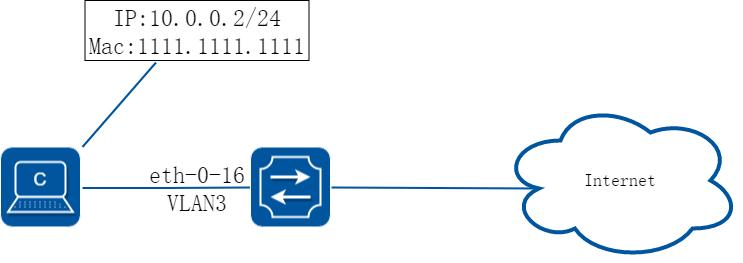

**图7-18 ip source guard**

##### 2. 配置步骤

##### 步骤1 进入配置模式

```
Switch# configure terminal
```

##### 步骤2 配置arp as-layer-3

```
Switch(config)# arp as-layer-3 enable
```

##### 步骤3 进入vlan 配置模式并创建vlan

```
Switch(config)# vlan database
Switch(config-vlan)# vlan 3
Switch(config-vlan)# exit
```

##### 步骤4 进入接口配置模式，配置接口属性

```
Switch(config)# interface eth-0-16
Switch(config-if)# switchport
Switch(config-if)# no shutdown
Switch(config-if)# switchport access vlan 3
Switch(config-if)# exit
```

##### 步骤5 配置ip 绑定条目

```
Switch(config)# ip source maximal binding number per-port 15
Switch(config)# ip source binding mac 1111.1111.1111 vlan 3 ip 10.0.0.2 interface eth-0-16
```

##### 步骤6 在接口使能ip 绑定

```
Switch(config)# interface eth-0-16
Switch(config-if)# ip verify source ip
Switch(config-if)# exit
```

##### 步骤7 退出配置模式

```
Switch(config)# exit
```

##### 步骤8 检查配置

```
Switch#show running-config interface eth-0-16
!
interface eth-0-16
ip verify source ip
switchport access vlan 3
```

##### 3. 删除ip source guard 的步骤

##### 步骤1 进入配置模式

```
Switch# configure terminal
```

删除单个表项：

```
Switch(config)# no ip source binding mac 1111.1111.1111 vlan 3 ip 10.0.0.2 interface eth-0-16
```

按接口删除：

```
Switch(config)# no ip source binding entries interface eth-0-16
```

按vlan 删除：

```
Switch(config)# no ip source binding entries vlan 3
```

全部删除：

```
Switch(config)# no ip source binding entries
```

## 7.15 私有VLAN配置

### 7.15.1 概述

#### 简介

私有vlan 属性在同一vlan 内部实现的二层流量的隔离和互通。可根据需要，提供灵活的组网方法。

### 7.15.2 配置举例

##### 1. 组网拓扑

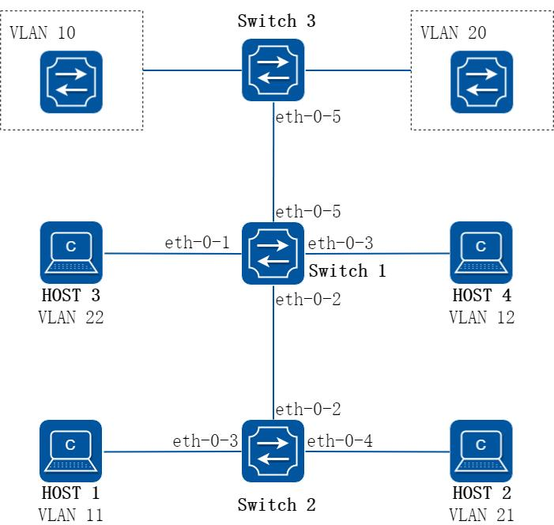

**图7-19 private vlan**

如上图所示：

PVLAN：Private-vlan，分为primary vlan 和secondary vlan，secondary vlan又分为isolated vlan 和community vlan。

系统支持5 类PVLAN端口：promiscuous port，host isolated port，host community port，trunk promiscuous port，trunk secondary port。

Switch1 端口eth-0-1 是host isolated 端口，属于isolated vlan 22。只能和同一私有vlan 中(trunk|) promiscuous 端口双向通信，和其他类型的端口隔离。端口转发出去报文时剥掉tag。

Switch1 端口eth-0-2 是trunk secondary 端口，属于isolated vlan 11 和community vlan 21。其中isolated vlan 11 只能和同一私有vlan 中(trunk|)promiscuous 端口双向通信，和其他类型的端口隔离。community vlan 21 可以与同一私有vlan 中(trunk|) promiscuous 端口、同community vlan 21 的host community port 和trunk secondary port 互通，但不能和其他PVLAN 组端口或者isolated 端口通信。端口转发出去报文时，如果是primary vlan，替换成secondary vlan 再转发。

Switch1 端口eth-0-3 是host community 端口，属于community vlan 12。可与同一私有vlan 中(trunk|) promiscuous 端口、同community vlan 12 的host community port 和trunk secondary port 互通，但不能和其他PVLAN 组端口或者isolated 端口通信。端口转发出去报文时剥掉tag。

Switch1 端口eth-0-5 是trunk promiscuous 端口，属于primary vlan 10 和20。

可以和PVLAN 内的所有端口进行通信。端口转发出去报文时，如果是secondary vlan，替换成primary vlan 再转发。

Switch2 Switch3 为不支持PVLAN 功能的普通设备。

##### 2. 配置步骤

##### 步骤1 进入配置模式

```
Switch# configure terminal
```

##### 步骤2 进入vlan 配置模式并创建vlan，指定PVLAN 类型

```
Switch(config)# vlan database
Switch(config-vlan)# vlan 10-12
Switch(config-vlan)# vlan 20-22
Switch(config-vlan)# quit
Switch(config)# vlan 10
Switch(config-vlan)# private-vlan
Switch(config-vlan)# secondary isolated 11
Switch(config-vlan)# secondary community 12
Switch(config-vlan)# quit
Switch(config)# vlan 20
Switch(config-vlan)# private-vlan
Switch(config-vlan)# secondary isolated 22
Switch(config-vlan)# secondary community 21
Switch(config-vlan)# quit
```

##### 步骤3 进入接口配置模式，配置接口属性

Host 隔离端口：

```
Switch(config)# interface eth-0-1
Switch(config-if)# switchport access vlan 22
Switch(config-if)# switchport access allowed vlan add 20
Switch(config-if)# switchport private-vlan enable vlan 22
Switch(config-if)# exit
```

Trunk secondary 端口：

```
Switch(config-if)# interface eth-0-2
Switch(config-if)# switchport mode trunk
Switch(config-if)# switchport trunk allowed vlan add 10,11,20,21
Switch(config-if)# switchport private-vlan enable vlan 11,21
Switch(config-if)# exit
```

互通端口：

```
Switch(config-if)# interface eth-0-3
Switch(config-if)# switchport access vlan 12
Switch(config-if)# switchport access allowed vlan add 10
Switch(config-if)# switchport private-vlan enable vlan 12
Switch(config-if)# exit
```

Trunk 混杂端口：

```
Switch(config-if)# interface eth-0-5
Switch(config-if)# switchport mode trunk
Switch(config-if)# switchport trunk allowed vlan add 10-12,20-22
Switch(config-if)# switchport private-vlan enable vlan 10,20
Switch(config-if)# exit
```

##### 步骤4 退出配置模式

```
Switch(config)# end
```

##### 步骤5 检查配置

Host 1、Host 4 和VLAN 10 的上行设备二层流量互通。

Host 2、Host 3 和VLAN 20 的上行设备二层流量互通。

Host 1、Host 2、Host 3、Host 4 二层流量不通。

显示结果如下：

```
Switch# show vlan private-vlan
Primary
Secondary Type
Ports
--------------------------------------------------------------------------------
10
--
primary
eth-0-5
10
11
isolate
eth-0-2
10
12
community
eth-0-3
20
--
primary
eth-0-5
20
22
isolate
eth-0-1
20
21
community
eth-0-2
```

## 7.16 AAA配置

### 7.16.1 概述

#### 简介

交换机提供用户的接入功能，用户分为管理员用户和接入用户两大类。当用户接入交换机时，交换机需要对这些用户进行接入控制管理。如对用户进行身份认证，授权给用户接入后可进行的业务及根据用户的业务进行计费，即AAA 管理机制。

系统可以使用AAA 认证的方法去验证访问网络和网络服务的用户。RADIUS 认证是AAA认证方法之一。RADIUS 是防止未经授权的访问，确保网络安全的分布式客户机/服务器系统。RADIUS 为网络环境中广泛使用的协议。它通常用于嵌入式网络设备如路由器，调制解调器服务器，交换机等。RADIUS 客户端通常在支持RADIUS 的路由器和交换机上运行。客户端发送认证请求到RADIUS 服务器，RADIUS 服务器包含所有的用户认证和网络服务访问信息。

TACACS+认证也是AAA 认证方法之一。TACACS+是防止未经授权的访问，确保网络安全的分布式客户机/服务器系统。TACACS+为网络环境中广泛使用的协议。它通常用于嵌入式网络设备如路由器，调制解调器服务器，交换机等支持TACACS+的路由器和交换机上运行的客户。客户端发送认证请求到TACACS+服务器，TACACS+服务器包含所有的用户认证和网络服务访问信息。

AAA 是Authentication（认证）、Authorization（授权）和Accounting（计费）的简称，是网络安全的一种管理机制。AAA 提供对用户进行认证、授权和计费等安全功能，防止非法用户登录设备，增强设备系统安全性。这三种安全功能的具体作用如下：

认证：验证用户是否可以获得网络访问权。

授权：授权用户可以使用哪些服务。

计费：记录用户使用网络资源的情况。

#### 原理描述

##### 1. AAA 的基本架构

AAA 通常采用“客户端—服务器”结构。这种结构既具有良好的可扩展性，又便于集中管理用户信息。

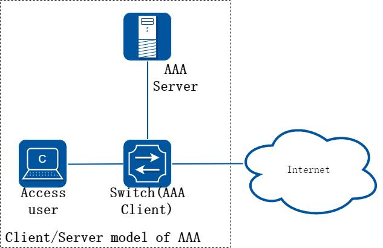

**图7-20 AAA 的基本框架示意图**

##### 2. RADIUS 协议

RADIUS 是一种分布式的、客户端/服务器结构的信息交互协议，能保护网络不受未授权访问的干扰，常应用在既要求较高安全性、又允许远程用户访问的各种网络环境中。该协议定义了基于UDP（User Datagram Protocol）的RADIUS 报文格式及其传输机制，并规定UDP 端口1812、1813 分别作为认证、计费端口。目前设备支持基于RADIUS 协议的认证，授权及EXEC 计费。

##### 3. TACACS-Plus 协议

TACACS-Plus 协议与RADIUS 协议类似，都实现了认证、授权、计费的功能，与RADIUS相比，TACACS-Plus 具有更加可靠的传输和加密特性，更加适用于安全控制。目前设备支持基于TACACS-Plus 协议的认证，授权，EXEC 计费及Command 计费。

### 7.16.2 限制与注意事项

SSH 使用tacacs 或radius 认证、授权、计费只能使用default 模板

### 7.16.3 配置举例

#### 配置Radius 认证

##### 1. 组网拓扑

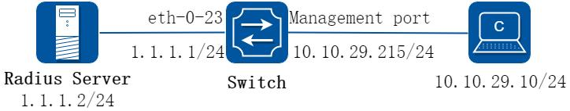

**图7-21 Radius**

上图为RADIUS 的网络拓扑。一台PC 机作为RADIUS 服务器，配置网卡地址为

1.1.1.2/24。

设置Switch 的eth-0-23 接口的IP 地址为1.1.1.1/24。交换机的管理口IP 地址为

10.10.29.215,连接交换机管理口的PC 机IP 地址为10.10.29.10。

##### 2. 交换机配置步骤

##### 步骤1 进入配置模式

```
Switch# configure terminal
```

##### 步骤2 使能aaa

```
Switch(config)# aaa new-model
Switch(config)# aaa authentication login radius-login radius local
```

##### 步骤3 配置Radius server

```
Switch(config)# radius-server host 1.1.1.2 auth-port 1819 key keyname
```

交换机支持服务器使用IPv6 地址，配置方法如下：

```
Switch(config)# radius-server host 2001:1000::1 auth-port 1819 key keyname
```

##### 步骤4 配置三层接口ip 地址

```
Switch(config)# interface eth-0-23
Switch(config-if)# no switchport
```

```
Switch(config-if)# ip address 1.1.1.1/24
Switch(config-if)# quit
```

##### 步骤5 配置验证方式

```
Switch(config)# line vty 0 7
Switch(config-line)# login authentication radius-login
Switch(config-line)# privilege level 4
Switch(config-line)# no line-password
Switch(config-line)# exit
```

##### 步骤6 退出配置模式

```
Switch(config)# end
```

##### 步骤7 检查配置

使用show 命令检查交换机的工作状态

```
Switch# show aaa status
aaa status:
Authentication enable
```

可以使用show 命令来显示交换机中的关键信息

```
Switch# show aaa method-lists authentication
authen queue=AAA_ML_AUTHEN_LOGIN
Name = default
state = ALIVE :
local
Name = radius-login
state = ALIVE :
radius
local
```

不要忘记打开RADIUS 验证功能。

确认线缆连接的正确性。若交换机无法进行RADIUS 认证，可以使用命令检查系统日志信息：

```
Switch# show logging buffer
```

##### 3. Radius server 配置建议

##### 步骤1 检查IP 地址并测试客户机和服务器之间的连通性

根据组网拓扑，服务器所在电脑的IP 地址为1.1.1.2。

在服务器尝试ping 交换机接口，如下所示

```
C:> ping 1.1.1.1
Pinging 1.1.1.1 with 32 bytes of data:
Reply from 1.1.1.1: bytes=32 time=1ms TTL=64
Reply from 1.1.1.1: bytes=32 time<1ms TTL=64
Reply from 1.1.1.1: bytes=32 time<1ms TTL=64
Reply from 1.1.1.1: bytes=32 time<1ms TTL=64
Ping statistics for 1.1.1.1:
Packets: Sent = 4, Received = 4, Lost = 0 (0% loss),
Approximate round trip times in milli-seconds:
Minimum = 0ms, maximum = 1ms, Average = 0ms
```

```
C:>_
```

##### 步骤2 配置服务器参数

根据交换机的配置，在服务器设置密码，这里为“keyname”；配置认证端口为1819。

##### 步骤3 在服务器上配置一个用户，同时设置密码

例如，用户名admin，密码password。

##### 4. 从直连管理口的PC 验证配置

##### 步骤1 使用ping 命令检查连通情况，如下所示：

```
C:> ping 10.10.29.215
Pinging 10.10.29.215 with 32 bytes of data:
Reply from 10.10.29.215: bytes=32 time<1ms TTL=63
Reply from 10.10.29.215: bytes=32 time<1ms TTL=63
Reply from 10.10.29.215: bytes=32 time<1ms TTL=63
Reply from 10.10.29.215: bytes=32 time<1ms TTL=63
Ping statistics for 10.10.29.215:
Packets: Sent = 4, Received = 4, Lost = 0 (0% loss),
Approximate round trip times in milli-seconds:
Minimum = 0ms, maximum = 0ms, Average = 0ms
C:>_
```

##### 步骤2 进行Telnet 测试，如配置正确，则Telnet 连接的结果信息如下所示：

```
User Access Verification
Username: admin
Password:
Switch# _
```

#### 配置TACACS+ 认证

##### 1. 组网拓扑

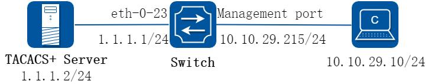

**图7-22 TACACS+**

上图是TACACS+的网络拓扑。一台PC 机作为TACACS+服务器，配置网卡地址为

1.1.1.2/24。设置Switch 的eth-0-23 接口的IP 地址为1.1.1.1/24。交换机的管理口IP 地址为10.10.29.215，连接交换机管理口（仅限带内管理口）的PC 机IP 地址为

10.10.29.10。

##### 2. 交换机配置步骤

##### 步骤1 进入配置模式

```
Switch# configure terminal
```

##### 步骤2 使能aaa

```
Switch(config)# aaa new-model
Switch(config)# aaa authentication login tac-login tacacs-plus local
Switch(config)# aaa authorization exec default tacacs-plus
Switch(config)# aaa accounting exec default start-stop tacacs-plus
Switch(config)# aaa accounting commands default tacacs-plus
```

##### 步骤3 配置TACACS+服务器

```
Switch(config)# tacacs-server host 1.1.1.2 port 123 key keyname primary
```

##### 步骤4 配置三层接口ip 地址

```
Switch(config)# interface eth-0-23
Switch(config-if)# no switchport
Switch(config-if)# ip address 1.1.1.1/24
Switch(config-if)# quit
```

##### 步骤5 配置验证方式

```
Switch(config)# line vty 0 7
Switch(config-line)# login authentication tac-login
Switch(config-line)# privilege level 4
Switch(config-line)# no line-password
Switch(config-line)# exit
```

##### 步骤6 退出配置模式

```
Switch(config)# end
```

##### 步骤7 检查配置

使用show aaa status 命令检查配置：

```
Switch# show aaa status
aaa stats:
Authentication enable
```

使用show aaa method-lists authentication 命令检查AAA 配置：

```
Switch# show aaa method-lists authentication
authen queue=AAA_ML_AUTHEN_LOGIN
Name = default
state = ALIVE :
local
Name = tac-login
state = ALIVE :
tacacs-plus local
```

##### 3. Tacacs server 配置建议

##### 步骤1 检查IP 地址并测试客户机和服务器之间的连通性

根据组网拓扑，服务器所在电脑的IP 地址为1.1.1.2。

在服务器尝试ping 交换机接口，如下所示

```
C:> ping 1.1.1.1
Pinging 1.1.1.1 with 32 bytes of data:
Reply from 1.1.1.1: bytes=32 time=1ms TTL=64
Reply from 1.1.1.1: bytes=32 time<1ms TTL=64
Reply from 1.1.1.1: bytes=32 time<1ms TTL=64
Reply from 1.1.1.1: bytes=32 time<1ms TTL=64
Ping statistics for 1.1.1.1:
Packets: Sent = 4, Received = 4, Lost = 0 (0% loss),
Approximate round trip times in milli-seconds:
Minimum = 0ms, maximum = 1ms, Average = 0ms
C:>_
```

##### 步骤2 配置服务器参数

根据交换机的配置，在服务器设置密码，这里为“keyname”；配置认证端口为123。

##### 步骤3 在服务器上配置一个用户，同时设置密码

例如，用户名admin，密码password。

##### 4. 从直连管理口的PC 验证配置

##### 步骤1 使用ping 命令检查连通情况，如下所示：

```
C:> ping 10.10.29.215
Pinging 10.10.29.215 with 32 bytes of data:
Reply from 10.10.29.215: bytes=32 time<1ms TTL=63
Reply from 10.10.29.215: bytes=32 time<1ms TTL=63
Reply from 10.10.29.215: bytes=32 time<1ms TTL=63
Reply from 10.10.29.215: bytes=32 time<1ms TTL=63
Ping statistics for 10.10.29.215:
Packets: Sent = 4, Received = 4, Lost = 0 (0% loss),
Approximate round trip times in milli-seconds:
Minimum = 0ms, maximum = 0ms, Average = 0ms
C:>_
```

##### 步骤2 进行Telnet 测试，如配置正确，则Telnet 连接的结果信息如下所示：

```
User Access Verification
```

```
Username: admin
Password:
Switch# _
```

#### 采用RADIUS 进行认证、授权和计费

##### 1. 组网需求

Switch 使用带内口连接AAA Server 进行管理。

Switch 对接入用户先用RADIUS 服务器进行认证，如果认证没有响应，再使用本地认证。

Switch 对接入用户先用RADIUS 服务器进行授权，如果授权没有响应，再使用本地授权。

Switch 对接入用户采用RADIUS 协议的exec 计费。

AAA Server 服务器地址为10.10.38.210/23。

Switch 支持接入用户使用Telnet 及SSH 协议。

RADIUS 协议的认证和授权是绑定在一起的，不能单独使用RADIUS 进行授权。

##### 2. 组网拓扑

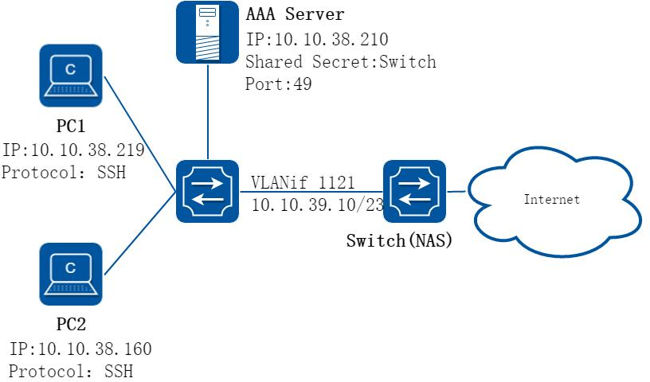

**图7-23 RADIUS 进行认证、授权和计费**

##### 3. 配置思路

采用如下的思路配置对用户使用本地和RADIUS 认证、授权，计费。

配置radius-server 参数配置认证，授权，计费方案列表在line vty 下应用相关方案列表配置带内口管理IP

##### 4. 配置步骤

##### 步骤1 进入配置模式

```
Switch# configure terminal
```

##### 步骤2 使能AAA 功能

```
Enter configuration commands, one per line.
End with CNTL/Z.
Switch(config)# aaa new-model
Switch(config)#
```

##### 步骤3 配置radius 服务器的IP 地址和共享密钥

```
Switch(config)# radius-server host 10.10.38.210 key Switch
```

请确保设备上的共享密钥与服务器上的配置保持一致，认证端口号默认使用1812。对AAA 认证来说，共享密钥是可选项，建议AAA Server 和交换机均配置共享密钥。

##### 步骤4 配置默认认证方案、默认授权方案、默认计费方案

配置认证方案default，认证模式为先进行radius 认证，Server 无响应后进行本地认证。

```
Switch(config)# aaa authentication login default radius local
```

配置授权方案default，授权模式为先进行radius 授权，Server 无响应后进行本地授权。

```
Switch(config)# aaa authorization exec default radius local
```

配置exec 计费方案default，计费模式为仅进行radius 计费。

```
Switch(config)# aaa accounting exec default start-stop radius
```

##### 步骤5 （可选步骤）配置自定义认证方案、自定义授权方案、自定义计费方案

此步骤只需要自定义方案列表名，其余操作可参考配置默认认证、授权、计费方案。

```
Switch(config)# aaa authentication login method_t1 radius local
Switch(config)# aaa authorization exec method_t1 radius local
Switch(config)# aaa accounting exec method_t1 start-stop radius
```

交换机使能AAA 认证后，使用SSH 方式登录的用户都会自动使用default 认证方案列表，授权及计费可应用自定义方案列表。目前推荐用户只配置并使用AAA default 方案列表。

##### 步骤6 （可选步骤）配置SSH 方式接入用户使用密钥进行身份认证

导入终端工具生成的公钥。

```
Switch(config)# rsa key K1 import url flash:/key_160305.pub public ssh2
% Import RSA key successed
Switch(config)#
```

创建本地用户并指定其对应公钥。

```
Switch(config)# username pc2
Switch(config)# username pc2 assign rsa key K1
```

交换机可导入终端工具生成的密钥对。SSH 登录方式使用密钥的方式进行身份认证，必须在本地创建用户并为其指定对应的公钥。使用密钥身份认证不再触发Authentication，但Authorization 及Accounting 还需连到AAA Server 上进行，请确保服务器上已配置对应用户的规则。

##### 步骤7 在line 配置模式下，应用方案列表

在line 0 下应用自定义AAA 方案列表：

```
Switch(config)# line vty 0
Switch(config-line)# login authentication method_t1
Switch(config-line)# authorization exec method_t1
Switch(config-line)# accounting exec method_t1
Switch(config-line)# exit
```

如果以上步骤中仅配置了AAA default 方案列表，则可忽略此步骤，因为vty下默认就应用了AAA default 方案列表。推荐用户仅使用AAA default 列表。

##### 步骤8 创建带内管理口

```
Switch (config)# vlan database
Switch (config-vlan)# vlan 1121
Switch (config-vlan)# exit
Switch (config)# interface eth-0-24
Switch (config-if)# switchport access vlan 1121
Switch (config-if)# exit
Switch (config)# interface vlan 1121
Switch (config-if)# ip address 10.10.39.10/23
Switch (config-if)# exit
Switch (config)# ip route 0.0.0.0/0 10.10.39.254
```

##### 步骤9 (可选步骤) 配置用户级别映射表

将服务器上Privilege0 映射为交换机的Privilege1，服务器Privilege1 映射为交换机Privilege2，服务器Privilege2~14 映射为交换机Privilege3，服务器Privilege15映射为交换机Privilege4。

交换机用户和命令行级别都只分为1~4 级且相互对应。交换机提供此命令行配置AAA 特权映射关系，用户可通过“show aaa privilege mapping” 命令查看当前映射关系。

```
Switch(config)# aaa privilege mapping 0 1 14
```

##### 步骤10 退出配置模式

```
Switch(config)# end
```

##### 5. 验证配置

前期工作准备：

服务器上需要先创建好用户pc1, pc2服务器上创建规则为pc1 下发privilege1服务器上创建规则为pc2 下发privilege10 Switch 与AAA Server 连通正常

步骤1 PC1 使用telnet 方式接入Switch。

```
Username: pc1
Password:
Switch# show users
Line
User
Host(s)
Idle
Location
0 con
0
idle
00:00:40
127.0.0.1
*130 vty
0
pc1
idle
00:00:00
10.10.38.219
Switch# show privilege
Current privilege level is 2
Switch#
```

步骤2 查看服务器上的计费记录。

##### 6. 配置文件

Switch 的配置文件

```
!
rsa key K1
key type public
key format der
308188
028180
DD3A96D4 CD2B0139 5A9E90C9 B8BD6802 867D7986 E3A1C868 5159B77D 127C6616
B27CD54A 544437BE 2765414E 6E0EB5F5 07CB9DA3 A3507D14 84918BE4 047DD305
9F2F8190 1D6A5B99 394228B5 0834829D 2C7994B6 CA531A4A E7A5C9EC 3A86F271
4F8FA2B6 EB66D9EE 5CD0593F AA51907D 9A1D7E11 F58949EB 2A1C09E9 FC3B6929
0203
010001
key string end
!
username pc2
username pc2 assign rsa key K1
!
aaa new-model
aaa privilege mapping 0 1 14
aaa authentication login default radius local
aaa authentication login method_t1 radius local
aaa authorization exec default radius local
aaa authorization exec method_t1 radius local
aaa accounting exec default start-stop radius
aaa accounting exec method_t1 start-stop radius
!
radius-server host 10.10.38.210 key Switch
!
vlan database
vlan 1121
!
interface eth-0-24
speed 1000
```

```
switchport access vlan 1121
!
interface vlan1121
ip address 10.10.39.10/23
!
ip route 0.0.0.0/0 10.10.39.254
!
line vty 0
exec-timeout 0 0
privilege level 4
no line-password
login authentication method_t1
authorization exec method_t1
accounting exec method_t1
line vty 1 7
exec-timeout 0 0
privilege level 4
no line-password
!
```

#### 采用TACACS-Plus 进行认证、授权和计费

##### 1. 组网需求

Switch 使用带内口连接AAA Server 进行管理。

Switch 对接入用户先用TACACS+服务器进行认证，如果认证没有响应，再使用本地认证。

Switch 对接入用户先用TACACS+服务器进行授权，如果授权没有响应，再使用本地授权。

Switch 对接入用户采用Tacacs-Plus 计费，包含exec 计费和commands 计费。

AAA Server 服务器地址为10.10.38.210/23。

Switch 支持接入用户使用Telnet 及SSH 协议。

##### 2. 组网拓扑


**图7-24 Radius**

##### 3. 配置思路

采用如下的思路配置对用户使用本地和Tacacs-Plus 认证、授权，计费：

配置tacacs-server 参数配置认证，授权，计费方案列表在line vty 下应用相关方案列表配置带内口管理IP

##### 4. 配置步骤

##### 步骤1 进入配置模式

```
Switch# configure terminal
```

##### 步骤2 使能AAA 功能

```
Enter configuration commands, one per line.
End with CNTL/Z.
Switch(config)# aaa new-model
Switch(config)#
```

##### 步骤3 配置tacacs-plus 服务器的IP 地址和共享密钥

```
Switch(config)# tacacs-server host 10.10.38.210 key Switch
```

请确保设备上的共享密钥与服务器上的配置保持一致，端口号默认使用49。

##### 步骤4 配置默认认证方案、默认授权方案、默认计费方案

配置认证方案default，认证模式为先进行tacacs-plus 认证，Server 无响应后进行本地认证。

```
Switch(config)# aaa authentication login default tacacs-plus local
```

配置授权方案default，授权模式为先进行tacacs-plus 授权，Server 无响应后进行本地授权。

```
Switch(config)# aaa authorization exec default tacacs-plus local
```

配置exec 计费方案default，计费模式为仅进行tacacs-plus 计费。

```
Switch(config)# aaa accounting exec default start-stop tacacs-plus
```

配置commands 计费方案default，计费模式为仅进行tacacs-plus 计费。

```
Switch(config)# aaa accounting commands default tacacs-plus
```

##### 步骤5 （可选步骤）配置自定义认证方案、自定义授权方案、自定义计费方案

此步骤只需要自定义方案列表名，其余操作可参考配置默认认证、授权、计费方案。

```
Switch(config)# aaa authentication login method_t1 tacacs-plus local
Switch(config)# aaa authorization exec method_t1 tacacs-plus local
Switch(config)# aaa accounting exec method_t1 start-stop tacacs-plus
Switch(config)# aaa accounting commands method_t1 tacacs-plus
```

目前交换机AAA 使用SSH 方式接入的用户都会自动使用default 认证方案列表，授权及计费可根据线路应用自定义方案列表。所以目前推荐用户只配置并使用AAA default 方案列表。此步骤只需要自定义方案列表名，其余操作可参考配置默认认证、授权、计费方案。

##### 步骤6 （可选步骤）配置SSH 方式接入用户使用密钥进行身份认证

导入终端工具生成的公钥。

```
Switch(config)# rsa key K1 import url flash:/key_160305.pub public ssh2
% Import RSA key successed
Switch(config)#
```

创建本地用户并指定其对应公钥。

```
Switch(config)# username pc2
Switch(config)# username pc2 assign rsa key K1
```

交换机可导入终端工具生成的密钥对。如使用密钥的方式进行身份认证，必须在本地创建用户并为其指定对应的公钥。使用密钥身份认证不再触发Authentication，但Authorization 及Accounting 还需连到AAA Server 上进行，请确保服务器上已配置对应用户的规则。

##### 步骤7 在line 配置模式下，应用方案列表

在line 0 下应用自定义AAA 方案列表：

```
Switch(config)# line vty 0
Switch(config-line)# login authentication method_t1
Switch(config-line)# authorization exec method_t1
Switch(config-line)# accounting exec method_t1
Switch(config-line)# accounting commands method_t1
Switch(config-line)# exit
```

如果以上步骤中仅配置了AAA default 方案列表，则可忽略此步骤，因为vty下默认就应用了AAA default 方案列表。推荐用户仅使用AAA default 列表。

##### 步骤8 创建带内管理口

```
Switch(config)# vlan database
Switch(config-vlan)# vlan 1121
Switch(config-vlan)# exit
Switch(config)# interface eth-0-24
Switch(config-if)# switchport access vlan 1121
Switch(config-if)# exit
Switch(config)# interface vlan 1121
Switch(config-if)# ip address 10.10.39.10/23
Switch(config-if)# exit
Switch(config)# ip route 0.0.0.0/0 10.10.39.254
```

##### 步骤9 (可选步骤) 配置用户级别映射表

将服务器上Privilege0 映射为交换机Privilege1，服务器Privilege1 映射为交换机Privilege2，服务器Privilege2~14 映射为交换机Privilege3，服务器Privilege15映射为交换机Privilege4。

```
Switch(config)# aaa privilege mapping 0 1 14
```

交换机用户和命令行级别都只分为1~4 级且相互对应；交换机提供此命令行配置AAA 特权映射关系，用户可通过“show aaa privilege mapping” 命令查看当前映射关系。

##### 步骤10 退出配置模式

```
Switch(config)# end
```

##### 5. 验证配置

前期工作准备服务器上需要先创建好用户pc1, pc2服务器上创建规则为pc1 下发privilege1服务器上创建规则为pc2 下发privilege10 Switch 与AAA Server 连通正常

步骤1 PC1 使用telnet 方式接入Switch。

```
Username: pc1
Password:
Switch# show users
Line
User
Host(s)
Idle
Location
0 con
0
idle
00:00:40
127.0.0.1
*130 vty
0
pc1
idle
00:00:00
10.10.38.219
Switch# show privilege
Current privilege level is 2
Switch#
```

步骤2 查看服务器上的计费记录。

##### 6. 配置文件

Switch 的配置文件

```
!
rsa key K1
key type public
key format der
308188
028180
DD3A96D4 CD2B0139 5A9E90C9 B8BD6802 867D7986 E3A1C868 5159B77D 127C6616
B27CD54A 544437BE 2765414E 6E0EB5F5 07CB9DA3 A3507D14 84918BE4 047DD305
9F2F8190 1D6A5B99 394228B5 0834829D 2C7994B6 CA531A4A E7A5C9EC 3A86F271
4F8FA2B6 EB66D9EE 5CD0593F AA51907D 9A1D7E11 F58949EB 2A1C09E9 FC3B6929
0203
010001
key string end
!
username pc2
username pc2 assign rsa key K1
!
```

```
aaa new-model
aaa privilege mapping 0 1 14
aaa authentication login default tacacs-plus local
aaa authentication login method_t1 tacacs-plus local
aaa authorization exec default tacacs-plus local
aaa authorization exec method_t1 tacacs-plus local
aaa accounting commands default tacacs-plus
aaa accounting commands method_t1 tacacs-plus
aaa accounting exec default start-stop tacacs-plus
aaa accounting exec method_t1 start-stop tacacs-plus
!
tacacs-server host 10.10.38.210 key Switch
!
vlan database
vlan 1121
!
interface eth-0-24
speed 1000
switchport access vlan 1121
!
interface vlan1121
ip address 10.10.39.10/23
!
ip route 0.0.0.0/0 10.10.39.254
!
line vty 0
exec-timeout 0 0
privilege level 4
no line-password
login authentication method_t1
authorization exec method_t1
accounting exec method_t1
accounting commands method_t1
line vty 1 7
exec-timeout 0 0
privilege level 4
no line-password
!
```

## 7.17 端口隔离配置

### 7.17.1 概述

#### 简介

通过Port-Isolated 端口隔离特性，可以实现不同用户的端口属于同一个VLAN，但是不同端口之间不能互通。从而增强了网络的安全性，提供了灵活的组网方案，同时节省了大量的VLAN 资源。

### 7.17.2 配置举例

##### 1. 组网拓扑

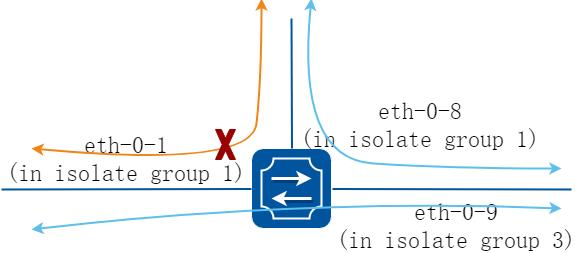

**图7-25 Port Isolate**

上图显示了基本的端口隔离拓扑。

端口1 和端口8 在同一个隔离组1,所以端口1 和端口8 不能互相通信。端口9 在隔离组3.所以端口9 能和端口1，8 互相通信。

##### 2. 配置步骤

##### 步骤1 进入配置模式

```
Switch# configure terminal
```

##### 步骤2 选择全局端口隔离模式

l2 表示只隔离二层转发的报文。all 表示隔离所有符合隔离条件的报文，包括路由转发的报文。

```
Switch(config)# port-isolate mode l2
```

##### 步骤3 进入接口配置模式，设置端口隔离组

```
Switch(config-if)# interface eth-0-1
Switch(config-if)# port-isolate group 1
Switch(config-if)# exit
Switch(config)# interface eth-0-8
Switch(config-if)# port-isolate group 1
Switch(config-if)# exit
Switch(config)# interface eth-0-9
Switch(config-if)# port-isolate group 3
Switch(config-if)# exit
```

##### 步骤4 退出配置模式

```
Switch(config)# end
```

##### 步骤5 检查配置

使用如下命令显示端口隔离的配置。

```
switch# show port-isolate
------------------------------------------------------------------
Port Isolate Groups:
```

```
------------------------------------------------------------------
Groups ID: 1
eth-0-1，eth-0-8
------------------------------------------------------------------
Groups ID: 3
eth-0-9
```

## 7.18 DDoS配置

### 7.18.1 概述

#### 简介

DDoS 攻击全名是distributed denial-of-service attack，分布式拒绝服务攻击，是由DoS(denial-of-service)攻击发展而来，攻击原理是利用合理的服务请求来占用过多的服务资源，从而使服务器无法处理合法用户的指令。DDoS 攻击利用处于不同位置的多个攻击者同时向一个或者数个目标发起攻击，或者一个或多个攻击者控制了位于不同位置的多台机器(傀儡机)并利用这些机器对受害者同时实施攻击。DDoS 攻击将造成网络资源浪费、链路带宽堵塞、服务器资源耗尽而业务中断。

DDoS 防御特性可以保护我们交换机抵挡DDos 攻击，拦截该种类型攻击对应的数据包。

目前支持的类型有下面这些：

ICMP 泛洪：该攻击通过向目标IP 发送大量ICMP 包，占用带宽，从而导致合法报文无法达到目的地，达到攻击目的。

Smurf 攻击：攻击者先使用受害主机的地址，向一个广播地址发送ICMP 回响请求，在此广播网络上，潜在的计算机会做出响应，大量响应将发送到受害主机，此攻击后果同ICMP 泛洪，但比之更为隐秘。

SYN 泛洪：蓄意侵入tcp 三次握手并打开大量的TCP/IP 连接而进行的攻击，该攻击利用IP 欺骗，向受害者的系统发送看起来合法的SYN 请求，而事实上该源地址不存在或当时不在线，因而回应的ACK 消息无法到达目的，而受害者的系统被大量的这种半开连接充满，资源耗尽，而合法的连接无法被响应。

UDP 泛洪：该攻击通过向目标IP 发送大量UDP 包，占用带宽，消耗资源。

Fraggle 攻击：该攻击是smurf 的变种，针对防火墙对ICMP 包检查比较严格的前提下，不再向广播地址发ICMP 请求包，而是改为发送UDP 包。

Small-packet 攻击：IP 小报文攻击是发送大量的小报文到被攻击系统来消耗系统的资源。

bad mac intercept ：目的MAC 地址等于源MAC 地址的报文攻击。

bad ip equal：目的IP 地址等于源IP 地址的报文攻击。

### 7.18.2 配置举例

##### 1. 组网拓扑

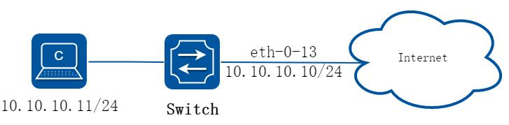

**图7-26 Topology for DDoS test**

##### 2. 配置步骤

##### 步骤1 进入配置模式

```
Switch# configure terminal
```

##### 步骤2 设置ddos 防御

使能ICMP 泛洪检测，设置每秒接收ICMP 报文个数最大为100

```
Switch(config)# ip icmp intercept maxcount 100
```

使能UDP 泛洪检测，设置每秒接收UDP 报文个数最大为100

```
Switch(config)# ip udp intercept maxcount 100
```

使能smurf 攻击检测

```
Switch(config)# ip smurf intercept
```

使能SYN 泛洪检测，设置每秒接收TCP 的SYN 报文个数最大为100

```
Switch(config)# ip tcp intercept maxcount 100
```

使能Fraggle 攻击检测

```
Switch(config)# ip fraggle intercept
```

使能Small-packet 攻击检测，设置接收IP 报文长度最小为32 字节。

```
Switch(config)# ip small-packet intercept length 32
```

使能检测源IP 地址等于目的IP 地址的报文攻击

```
Switch(config)# ip ipeq intercept
```

使能检测源MAC 地址等于目的MAC 地址的报文攻击

```
Switch(config)# ip maceq intercept
```

##### 步骤3 退出配置模式

```
Switch(config)# end
```

##### 步骤4 检查配置

```
Switch# show ip-intercept config
Current DDoS Prevent configuration:
============================================================
ICMP Flood Intercept
:Enable
Maxcount:500
UDP Flood Intercept
:Enable
Maxcount:500
SYN Flood Intercept
:Enable
Maxcount:500
Small-packet Attack Intercept
:Enable
Packet Length:45
Smurf Attack Intercept
:Enable
Fraggle Attack Intercept
:Enable
MAC Equal Intercept
:Enable
IP Equal Intercept
:Enable
Switch# show ip-intercept statistics
Current DDoS Prevent statistics:
============================================================
Resist Small-packet Attack packets number
:
1730
Resist ICMP Flood packets number
:
0
Resist SYN Flood packets number
:
0
Resist Fraggle Attack packets number
:
0
Resist UDP Flood packets number
:
0
Current DDoS Prevent mgmt-if statistics:
============================================================
Resist ICMP Flood packets number
:
0
Resist SYN Flood packets number
:
0
Resist Fraggle Attack packets number
:
0
Resist UDP Flood packets number
:
0
```

## 7.19 Key Chain配置

### 7.19.1 概述

#### 简介

密钥链是一种通用的认证方法，适用于需要共享密钥的实体在建立相互信任之前交换密钥完成认证。这种认证方法通常被用在路由协议和网络应用中，可以增强对等体之间通信的安全性。

密钥链提供了一种包含密钥控制和基于生命周期的转滚法的安全机制，它将一连串的密钥通过生命周期联系在一起，并将它们按照序号挂在密钥链里。密钥链在使用时会依次比对链中的各个密钥，找到密钥则通过验证。

为了发挥生命周期的作用，在使用密钥链之前，必须要定义密钥的有效时间，并且为了保持稳定性，最好能同时使用一个以上的有效密钥。

### 7.19.2 配置举例

##### 步骤1 进入配置模式

```
Switch# configure terminal
```

##### 步骤2 创建key chain，并设置密钥

```
Switch(config)# key chain test
Switch(config-keychain)# key 1
Switch(config-keychain-key)# key-string ##test_keystring_1##
Switch(config-keychain-key)# accept-lifetime 0:0:1 1 jan 2012 infinite
Switch(config-keychain)# key 2
Switch(config-keychain-key)# key-string ##test_keystring_2##
Switch(config-keychain-key)# send-lifetime 0:0:1 2 jan 2012 infinite
```

##### 步骤3 退出配置模式

```
Switch(config)# end
```

##### 步骤4 检查配置

在特权模式下使用命令show key chain，显示key chain 的配置。

```
Switch # show key chain
key chain test:
key 1 -- text "key-string ##test_keystring_1##"
accept-lifetime <00:00:01 Jan 01 2012> - <infinite>
send-lifetime <always valid> - <always valid> [valid now]
key 2 -- text "key-string ##test_keystring_2##"
accept-lifetime <always valid> - <always valid> [valid now]
send-lifetime <00:00:01 Jan 02 2012> - <infinite>
```

## 7.20 Port-Block配置

### 7.20.1 概述

#### 简介

默认情况下，端口泛洪报文都是没有目的MAC 地址的。如果这些报文被送到保护端口上，将有可能出现安全问题。为了避免目的MAC 地址未知或者已知的单播或组播传输到其他端口，可以阻塞该端口以避免发送单播或者组播出去。

### 7.20.2 配置举例

##### 步骤1 进入配置模式

```
Switch# configure terminal
```

##### 步骤2 进入接口配置模式，阻塞未知单播

```
Switch(config)# interface eth-0-1
Switch(config-if)# port-block unknown-unicast
Switch(config-if)# exit
```

##### 步骤3 退出配置模式

```
Switch(config)# end
```

##### 步骤4 检查配置

在端口下配置port-block，并show 出配置信息：

```
Switch # show port-block interface eth-0-1
Known unicast blocked: Enabled
Known multicast blocked: Disabled
Unknown unicast blocked: Disabled
Unknown multicast blocked: Disabled
Broadcast blocked: Disabled
```

## 7.21 MACSec配置

### 7.21.1 概述

#### 简介

MACsec 可为用户提供安全的MAC 层数据发送和接收服务，包括用户数据加密、数据帧完整性检查及数据源真实性校验。MACsec 通常与802.1X 认证框架配合使用，通过使用MKA

（MACsec Key Agreement，MACsec 密钥协商）协议协商生成的密钥对已认证的用户数据进行加密和完整性检查，避免端口处理未认证设备的报文或者经过篡改的报文。

### 7.21.2 配置举例

##### 1. 组网拓扑

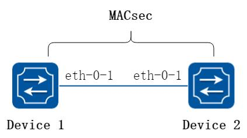

**图7-27 MACsec**

在这个例子中，在Device1 端口eth-0-1 上和Device2 端口eth-0-1 上分别使能MACsec功能，让该链路上的数据报文都被MACsec 加密。

##### 2. 配置步骤

##### 步骤1 进入配置模式

```
Switch# configure terminal
```

##### 步骤2 在Device1 eth-0-1 上使能MACsec

```
Switch(config)# interface eth-0-1
Switch(config-if)# macsec desire
Switch(config-if)# mka priority 1
Switch(config-if)# mka psk ckn abcd cak simple 12345678
Switch(config-if)# mka enable
Switch(config-if)# exit
```

##### 步骤3 在Device2 eth-0-1 上使能MACsec

```
Switch(config)# interface eth-0-1
Switch(config-if)# macsec desire
Switch(config-if)# mka priority 2
Switch(config-if)# mka psk ckn abcd cak simple 12345678
Switch(config-if)# mka enable
Switch(config-if)# exit
```

##### 步骤4 退出配置模式

```
Switch(config)# end
```

##### 步骤5 检查配置

在Device1 上使用命令show mka session interface eth-0-1，屏幕回显内容如下所示。

```
Interface eth-0-1:
Tx-SCI
: 46B4 4F5D 460A 000A
Priority
: 1
Capability
: 3
CKN for participant
: ABCD 0000 0000 0000 0000 0000 0000 0000
Key server
: yes
MI (MN)
: 1031 5011 1031 3070 4060 7100 (6)
Principal actor
: yes
MKA session status
: succeeded
Confidentiality offset
: 0 bytes
Current SAK status
: rx & tx
Current SAK AN
: 0
Current SAK KI (KN)
: 52E7 918F 2F77 3715 3913 A045 F777 5AE3 (1)
Previous SAK status
: N/A
Previous SAK AN
: N/A
Previous SAK KI (KN)
: N/A
Peer list:
MI
MN
Priority
Capability Rx-SCI
B0B5 2514 95A5 15B4 8080 0091
4
2
3
FEFA CE24 C80A 000A
```

在Device2 上使用命令show mka session interface eth-0-1，屏幕回显内容如下所示。

```
Interface eth-0-1:
Tx-SCI
: FEFA CE24 C80A 000A
Priority
: 2
Capability
: 3
CKN for participant
: ABCD 0000 0000 0000 0000 0000 0000 0000
Key server
: no
MI (MN)
: B0B5 2514 95A5 15B4 8080 0091 (13)
Principal actor
: yes
MKA session status
: succeeded
Confidentiality offset
: 0 bytes
Current SAK status
: rx & tx
Current SAK AN
: 0
Current SAK KI (KN)
: 52E7 918F 2F77 3715 3913 A045 F777 5AE3 (1)
Previous SAK status
: N/A
Previous SAK AN
: N/A
Previous SAK KI (KN)
: N/A
Peer list:
MI
MN
Priority
Capability Rx-SCI
```

```
1031 5011 1031 3070 4060 7100
13
1
3
46B4 4F5D 460A 000A
```

## 7.22 全局ACL配置

### 7.22.1 概述

#### 简介

系统提供global acl 使能命令和相关配置，使得port acl，vlan/vlanif acl，global acl 同时配置时，其优先级是port acl > vlan/vlanif acl> global acl。

具体行为是：当设备收到或转发流量时，按优先级依次查找匹配流量，一旦命中ACL 规则立刻转发。如果上一级ACL 查找后未命中流量，则继续下级ACL 查找，直到所有acl均未命中，正常转发流量。

### 7.22.2 配置举例

#### 全局ACL 配置

##### 步骤1 进入配置模式

```
Switch# configure terminal
```

##### 步骤2 使能全局ACL，保存重启后生效

```
Switch(config)# global-acl enable
```

##### 步骤3 全局acl 应用流策略

```
Switch(config)# service-policy global input pmap
```

##### 步骤4 全局acl 应用控制组

```
Switch(config)# access-group global input aaa
```

##### 步骤5 检查配置

```
DUT1# show running-config
global-acl enable
service-policy global input pmap
access-group global input aaa
```
