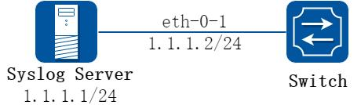
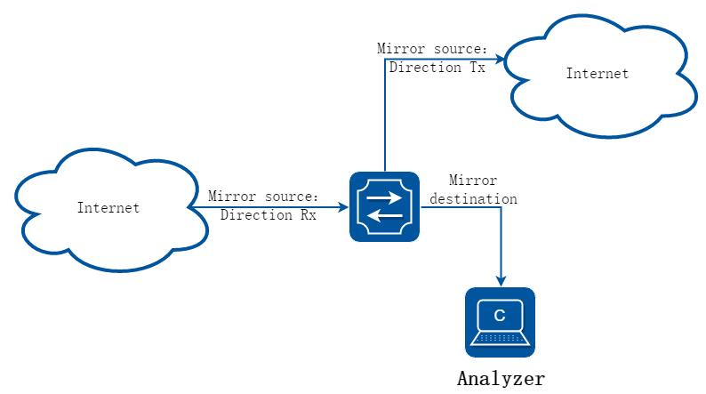
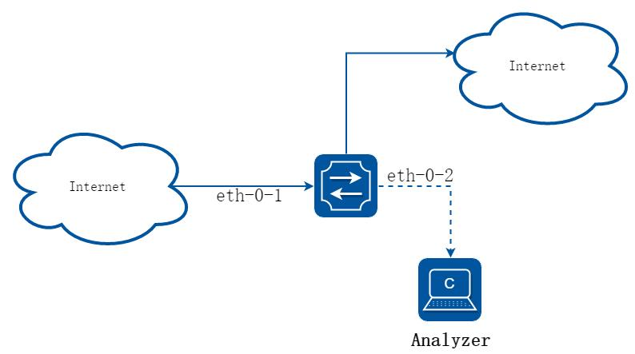
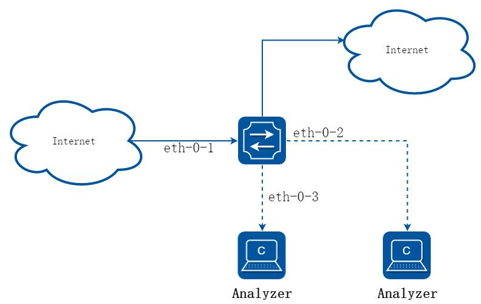
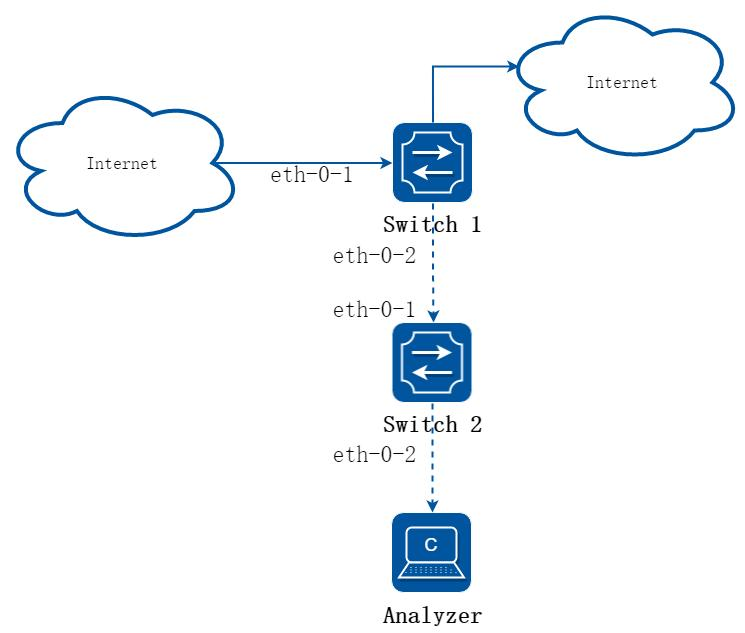
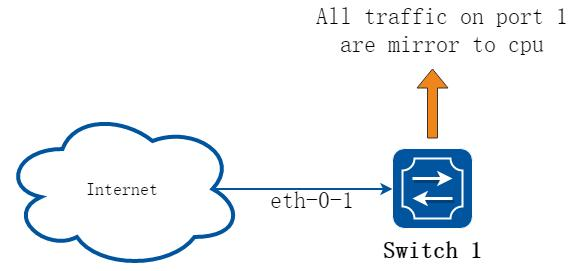
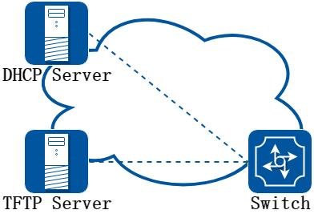
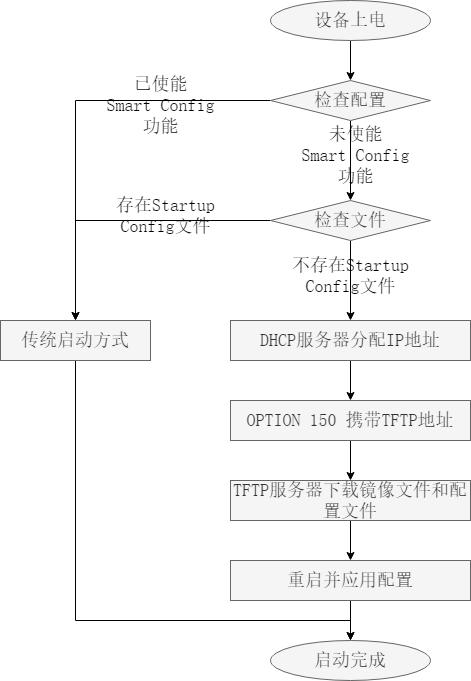
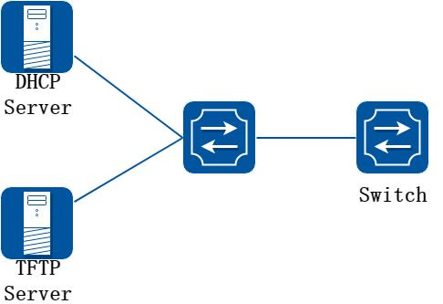
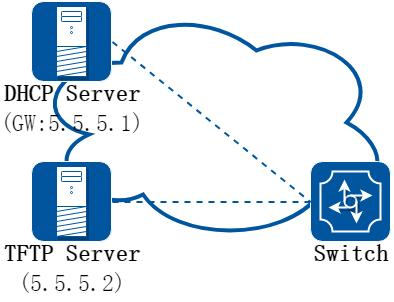

# 8 设备管理配置指导

## 8.1 STM配置

### 8.1.1 概述

#### 简介

交换机表项管理（STM）是通过配置交换机的系统资源来支持优化特定功能。您可以选择一个配置文件提供来发挥系统的最大功能，例如，使用默认的配置文件以平衡资源；

使用VLAN 配置文件，以获得最大的MAC 条目。为了在不同的场合下最大限度的利用TCAM资源，STM 提供了不同特性的系统优化功能。目前的版本中支持的STM 模版包括：

layer3：路由模板，支持最大数目的路由，通常应用在在网络中心的路由器或聚合层。

layer2：VLAN 模板，支持单播MAC 地址的最大数量。它通常会被选定为第2 层交换机。

ipv6：ipv6 模板，支持ipv6 特性。

mpls：mpls 模板，支持最大数目的MPLS/MAC 条目。

default：默认模板，平衡分配所有特性的资源。


当您配置了（或当前使用的）STM 模式不存在于下一个要启动的image 里时，那么当这个image 启动的时候就会使用默认的硬编码配置，这个配置可能和正常的default 模式是不一样的。

### 8.1.2 配置举例

通过配置指南来选择正确的STM profiles：

修改配置后必须重启交换机。

STM layer2 模板，一般适用于2 层交换机且没有路由交换的场合。

当交换机上没有使能路由功能的时候就不需要切换到layer3 模版

##### 步骤1 进入配置模式

```
Switch# configure terminal
```

##### 步骤2 设置STM profile，以layer3 为例

```
Switch(config)# stm prefer layer3
```

##### 步骤3 退出配置模式

```
Switch(config)# end
```

##### 步骤4 检查配置

下面的例子显示了使用路由模版后的输出结果：

```
Switch# show stm prefer
Current profile is: default
Next profile is: layer3
Current profile info is:
number of vlan instance
: 4094
number of vlan stats
: 256
number of unicast mac address
: 122880
number of multicast mac address
: 2048
number of blackhole mac address
: 128
number of max applied vlan mapping
: 3072
number of bfd sessions
: 256
number of CFM local&remote MEPs
: 1024
number of CFM lm
: 256
number of CFM lck
: 24
number of G8031 groups
: 256
number of G8032 rings
: 128
number of G8032 member ports
: 256
number of mac based vlan class
: 512
number of ipv4 based vlan class
: 448
number of ipv4 subnet based vlan class
: 128
number of ipv6 based vlan class
: 32
number of protocol based vlan class
: 7
number of dot1x mac based
: 512
number of unicast ipv4 host routes
: 16384
number of unicast ipv4 indirect routes
: 61440
number of unicast ipv4 policy based routes
: 1024
number of unicast ipv6 host routes
: 4096
number of unicast ipv6 indirect routes
: 4096
number of unicast ecmp groups
: 240
number of unicast ip tunnel peers
: 8
number of multicast ipv4 routes
: 2048
number of multicast ipv4 member
: 4096
number of multicast ipv6 routes
: 256
number of multicast ipv6 member
: 512
number of mvr entries
: 2048
number of mvr6 entries
: 256
number of ipv4 source guard entries
: 2048
number of ipv6 source guard entries
: 1024
number of ingress security acl flow entries
: 5949
number of ingress security acl flow stats
: 5949
number of ingress qos flow entries
: 6126
number of ingress qos flow stats
: 6126
number of ingress telnet flow entries
: 64
number of ingress ssh flow entries
: 64
number of ingress worm anti-attack flow entries
: 32
```

```
number of ingress ipfix flow entries
: 2048
number of ingress udf acl flow entries
: 1024
number of ingress udf acl flow stats
: 1024
number of ingress copp flow entries
: 4072
number of ingress copp flow stats
: 4072
number of egress security acl flow entries
: 1901
number of egress security acl flow stats
: 1901
number of ipfix cache
: 65536
number of ifit flow
: 1024
number of ifit flow acl
: 0
```

##### 步骤5 重启设备

```
Switch# reload
```

## 8.2 系统日志配置

### 8.2.1 概述

#### 简介

系统消息可以保存在日志文件中，也可以发送到其他服务器设备。系统消息管理模块有如下功能：

记录日志信息以便监测和故障排除可以选择记录日志信息的类型可以选择日志的目的地默认情况下，交换机会记录重要的系统信息记录到其内部缓冲区，同时也会发送到系统控制台。用户可以指定保存的消息级别。消息都会添加发生时间，便于实时调试和管理。

您可以使用交换机的命令行界面（CLI）来读取系统消息，也可以通过将它保存到一个日志服务器的形式来获取消息。交换机的日志缓冲区最多可存储1000 条信息。用户可以通过Telnet 或控制台端口登录设备后打开终端监控来实时监控系统日志。

#### 原理描述

以下是系统日志相关的术语：

| 概念 | 解释 |
|---|---|
| Logging | 当前日志配置 |
| Show | 显示日志配置 |
| Levels | 安全等级信息 |
| Enable | 开启日志保存到本地文件 |
| Disable | 关闭日志保存到本地文件 |

系统消息类型:

| 名称 | 定义 |
|---|---|
| kern | kernel 消息 |
| user | 随机用户等级消息 |
| mail | 邮件系统 |
| daemon | 系统进程 |
| auth | 安全/验证消息 |
| syslog | 通过syslogd 生成系统内部消息 |
| lpr | 行式打印机子系统 |
| news | 网络新闻子系统 |
| uucp | UUCP 子系统 |
| cron | 时钟进程 |
| authpriv | 私有的安全/验证消息 |
| ftp | FTP 进程 |

安全等级的定义:

| 严重等级 | 定义 |
|---|---|
| emergency | 系统无法使用 |
| alert | 必须立即采取行动 |
| critical | 严重事件 |
| error | 错误事件 |
| warning | 警告事件 |
| notice | 正常的，但重要的事件 |
| information | 信息 |
| debug | 调试级别的消息 |

### 8.2.2 配置举例

#### 配置日志服务器

##### 1. 组网拓扑



**图8-1 syslog server**

##### 2. 配置步骤

##### 步骤1 进入配置模式

```
Switch# configure terminal
```

##### 步骤2 使能日志服务器并配置相关参数

```
Switch(config)# logging server enable
Switch(config)# logging server address 1.1.1.1
Switch(config)# logging server address 2001:1000::2
Switch(config)# logging server severity debug
Switch(config)# logging server facility mail
```

##### 步骤3 退出配置模式

```
Switch(config)# end
```

##### 步骤4 检查配置

```
Switch# show logging
Current logging configuration:
============================================================
logging buffer 500
logging timestamp bsd
logging file enable
logging level file warning
logging level module debug
logging server enable
logging server severity debug
logging server facility mail
logging server address 1.1.1.1
logging server address 2001:1000::2
logging alarm-trap enable
logging alarm-trap level middle
logging merge enable
logging merge fifo-size 1024
logging merge timeout 10
logging operate disable
```

#### 设置日志缓冲大小

默认情况下，日志缓冲区只保存500 条最新的消息日志。用户也可以通过命令将范围改为10 和1000 之间的任何值。

##### 步骤1 进入配置模式

```
Switch# configure terminal
```

##### 步骤2 设置日志缓冲区

```
Switch(config)# logging buffer 700
```

##### 步骤3 退出配置模式

```
Switch(config)# end
```

##### 步骤4 检查配置

```
Switch# show logging
Current logging configuration:
============================================================
logging buffer 700
logging timestamp bsd
```

```
logging file enable
logging level file warning
logging level module debug
logging server enable
logging server severity debug
logging server facility mail
logging server address 1.1.1.1
logging alarm-trap enable
logging alarm-trap level middle
logging merge enable
logging merge fifo-size 1024
logging merge timeout 10
logging operate disable
```

你可以使用命令检查日志信息。当配置了日志服务器，确保链路是通的并且能够ping 通。在向日志服务器发送消息之前，必须配置好日志软件。最后就可以在日志软件上看到日志了。

## 8.3 镜像配置

### 8.3.1 概述

#### 简介

通过镜像功能，用户可以将设备端口、vlan 或cpu 收发的报文复制一份（或多份），从设备的另一个（或多个）端口送出去，在这一个（或多个）端口连上测试仪或其他报文收集设备，可达到对原始报文进行捕获和分析的目的；也可将被复制报文发送到CPU 并被保存下来，便于用户或程序员快速分析报文。

镜像功能不影响交换机上原始的网络流量。

#### 原理描述



镜像功能有如下几个基本的要素：

##### 1. 镜像会话

镜像会话是一组镜像源和一个镜像目的的集合。一个可以正常工作的镜像会话，需要配置镜像目，以及至少一个镜像源。镜像源和镜像目的会在后面介绍。

系统最多支持三组镜像会话。

镜像功能不应干扰正常业务。

在一组镜像会话中，如果镜像源的总流量超过了镜像目的接口的转发能力，例如用一个最大速率为10Gbps 的目的端口去监控100Gbps 的流量，将会产生丢包。

##### 2. 镜像方向

镜像会话可以配置三种方向：

接收方向镜像（RX）：对一个端口或VLAN 做接收方向的镜像，原则是将这个端口或VLAN上的收到的流量，在系统对这些报文做任何修改和处理之前，尽可能完整、真实的复制出来。对于镜像源端口来说，有如下限制：CRC 错误的报文将不能被镜像复制。对于镜像源VLAN 来说，有如下限制：BPDU, LACPDU, BMGPDU 报文，IP-MAC 绑定检查不通过的报文，CRC 错误的报文，不能被镜像复制。除此以外的其他功能，例如QOS 的修改DSCP值、VLAN translation、VLAN classification，ACL，VLAN’s ingress filter, MAC filter,STP, VLAN tag control, port security, unknown routing packets 等功能，对报文进行修改或丢弃，都不应影响到接收方向的镜像功能。复制到目的端口的报文，应该和镜像源收到的报文完全一致。

发送方向镜像（TX）：对一个端口或VLAN 做发送方向的镜像，原则是将这个端口或VLAN上的发送出去的流量，尽可能真实的复制出来。从端口或VLAN 送出之前就被丢弃的报文，不会被镜像复制。当镜像源是VLAN 的时候，有如下限制：来自CPU 的报文不能被镜像复制。

双向镜像（BOTH）：在一个镜像会话中，用户可以监控同一个镜像源上接收和发送两个方向的报文流量。

##### 3. 镜像源

镜像源是指被监测的原始的网络流量。目前支持以下几种类型：

源端口：一个需要被监控或分析的二层或三层端口。支持物理端口和聚合组（link agg）。

聚合组的成员端口不能单独配置成镜像源。

源VLAN：源VLAN 是一个需要被监控或分析的VLAN。必须创建vlan interface 才能将vlan 设为镜像源。

CPU：用户可以将CPU 作为镜像源配置。当需要将上报cpu 报文或者cpu 下发的报文镜像复制时，可以启用CPU 镜像源配置，值得注意的是镜像复制出来的报文是cpu-traffic-limit 限速之前的。目前只允许session 1 配置cpu mirror source。

##### 4. 镜像目的

镜像目的是是指通过镜像功能复制出来的流量所要送达的目的。目前支持以下几种类型：

本地镜像目的端口：本地镜像目的端口可以是一个物理口，也可以是聚合组。但不能是聚合组成员。目的端口有下面这些特性：

它必须和镜像源处在同一台设备上。

端口不能是shutdown 状态的。

只能在一个镜像会话中作为目的端口。

不能配置为任何镜像会话的镜像源端口。

端口不传输任何镜像功能以外的流量。

该端口的所有其他系统功能的相关配置继续保留，但是不能工作。直到在此端口不再作为镜像会话的目的端口。

镜像目的端口不学习MAC。

实时速率/双工状态可能会和显示的数值不一致。

多目的镜像：支持用多个目的端口（检测端口）来接收复制出来的报文。多目的端口中的每个端口特性与单目的端口相同。全局只支持一个多目的端口组。

远程镜像目的：远程镜像目的包括一个物理出接口以及一个VLAN，复制后的报文从指定的物理出接口送出，并封装了指定的vlan tag。一个远程镜像目的特性如下：

是一个指定的端口和一个VLAN 的组合远程VLAN 范围在2-4094，如果在系统中没有创建VLAN，用户不能将这个VLAN 作为远程镜像VLAN出端口应该是一个普通的物理端口，需要用户的配置来保证这个端口可以传输镜像报文，并且不被其他功能的流量所干扰。

镜像源的报文将被加上指定的远程VLAN ID Tag，然后从指定的出接口发出去，到达远端设备上。

使用二层接口为远程镜像的目的端口，并且用户需要将这个端口加入到指定的远程VLAN 中，否则镜像报文将不能成功发送出去。

CPU 镜像目的：将镜像功能复制的报文送到当前设备的CPU。当该设备无法连接上测试仪或者其他报文收集设备，需要将被复制报文发送到CPU 并被保存下来，便于用户或开发者快速分析报文。目前镜像报文上送CPU 的速率是系统默认限制速率，也可以用户指定限速速率。CPU 作为镜像目的时，只能用于一个session。

### 8.3.2 配置举例

#### 配置本地端口镜像

##### 1. 组网拓扑



**图8-2 port Mirror**

将eth-0-1 收发的报文复制到eth-0-2。

##### 2. 配置步骤

##### 步骤1 进入配置模式

```
Switch# configure terminal
```

##### 步骤2 配置镜像目的

```
Switch(config)# interface eth-0-2
Switch(config-if)# no shutdown
Switch(config-if)# exit
Switch(config)# monitor session 1 destination interface eth-0-2
```

##### 步骤3 配置镜像源

```
Switch(config)# monitor session 1 source interface eth-0-1 both
```

##### 步骤4 退出配置模式

```
Switch(config)# end
```

##### 步骤5 检查配置

```
Switch# show monitor session 1
Session
1
----------
Status
: Valid
Type
: Local Session
Source Ports
:
```

```
Receive Only
:
Transmit Only
:
Both
: eth-0-1
Source VLANs
:
Receive Only
:
Transmit Only
:
Both
:
Destination Port
: eth-0-2
```

#### 配置vlan 作为端口镜像的源

将vlan 10 收到的报文复制到eth-0-2

##### 步骤1 进入配置模式

```
Switch# configure terminal
```

##### 步骤2 配置镜像目的

```
Switch(config)# interface eth-0-2
Switch(config-if)# no shutdown
Switch(config-if)# exit
Switch(config)# monitor session 1 destination interface eth-0-2
```

##### 步骤3 进入vlan 配置模式，创建vlan

```
Switch(config)# vlan database
Switch(config-vlan)# vlan 10
Switch(config-vlan)# exit
```

##### 步骤4 创建vlan interface

```
Switch(config)# interface vlan10
Switch(config-if)# exit
```

##### 步骤5 配置镜像源

```
Switch(config)# monitor session 1 source vlan 10 rx
```

##### 步骤6 退出配置模式

```
Switch(config)# end
```

##### 步骤7 检查配置

```
Switch# show monitor session 1
Session
1
----------
Status
: Valid
Type
: Local Session
Source Ports
:
Receive Only
:
Transmit Only
:
Both
:
Source VLANs
:
Receive Only
: 10
Transmit Only
:
Both
:
Destination Port
: eth-0-2
```

#### 配置cpu 作为端口镜像的源

将送cpu 和cpu 发出的报文复制到eth-0-1

##### 步骤1 进入配置模式

```
Switch# configure terminal
```

##### 步骤2 配置镜像目的

```
Switch(config)# interface eth-0-1
Switch(config-if)# no shutdown
Switch(config-if)# exit
Switch(config)# monitor session 1 destination interface eth-0-1
```

##### 步骤3 配置镜像源

```
Switch(config)# monitor session 1 source cpu both
```

##### 步骤4 退出配置模式

```
Switch(config)# end
```

##### 步骤5 检查配置

```
Switch# show monitor session 1
Session
1
----------
Status
: Valid
Type
: Cpu Session
Source Ports
:
Receive Only
:
Transmit Only
:
Both
: cpu
Source VLANs
:
Receive Only
:
Transmit Only
:
Both
:
Destination Port
:eth-0-1
```

#### 配置多目的端口镜像

##### 1. 组网拓扑



**图8-3 Multi-destination Mirror**

将eth-0-1 收发的报文复制到eth-0-2 和eth-0-3。镜像源的规则与本地单目的的端口镜像一样，可以是port 也可以是vlan，下面仅以port 为例。

##### 2. 配置步骤

##### 步骤1 进入配置模式

```
Switch# configure terminal
```

##### 步骤2 配置镜像目的组

```
Switch(config)# interface eth-0-2
Switch(config-if)# no shutdown
Switch(config-if)# exit
Switch(config)# interface eth-0-3
Switch(config-if)# no shutdown
Switch(config-if)# exit
Switch(config)# monitor session 1 destination group 1
Switch(config-monitor-d-group)# member eth-0-2
Switch(config-monitor-d-group)# member eth-0-3
Switch(config-monitor-d-group)# exit
```

##### 步骤3 配置镜像源

```
Switch(config)# interface eth-0-1
Switch(config-if)# no shutdown
Switch(config-if)# exit
Switch(config)# monitor session 1 source interface eth-0-1
```

##### 步骤4 退出配置模式

```
Switch(config)# end
```

##### 步骤5 检查配置

```
Session
1
----------
Status
:
Valid
Type
:
Local Session
Source Ports
:
Receive Only
:
Transmit Only
:
Both
: eth-0-1
Source VLANs
:
Receive Only
:
Transmit Only
:
Both
:
Destination Port
: eth-0-2 eth-0-3
```

#### 配置远程端口镜像

##### 1. 组网拓扑



**图8-4 Remote Mirror**

在本地设备无法直接连接测试仪或其他分析设备时，也可以选择远程镜像。远程镜像目的指定一个物理端口作为出接口，同时指定一个VLAN 用以封装镜像报文。在远端设备上可以通过该VLAN，将镜像报文和其他流量分离开。所以建议在配置远程镜像的时候，选择一个无业务流量的VLAN。

这个例子中，将Switch1 上eth-0-1 收发的报文封装VLAN 15 送到Switch2。Switch2将收到的报文送到测试仪或分析设备。

下面是Switch1 的配置：

##### 2. 配置步骤

##### 步骤1 进入配置模式

```
Switch1# configure terminal
```

##### 步骤2 配置镜像目的

```
Switch1(config)# vlan database
Switch1(config-vlan)# vlan 15
Switch1(config-vlan)# exit
Switch1(config)# interface eth-0-2
Switch1(config-if)# no shutdown
Switch1(config-if)# switchport mode trunk
Switch1(config-if)# switchport trunk allowed vlan add 15
Switch1(config-if)# exit
Switch1(config)# monitor session 1 destination remote vlan 15 interface eth-0-2
```

##### 步骤3 配置镜像源

```
Switch1(config)# interface eth-0-1
Switch1(config-if)# no shutdown
Switch1(config-if)# exit
Switch1(config)# monitor session 1 source interface eth-0-1 both
```

##### 步骤4 退出配置模式

```
Switch1(config)# end
```

##### 步骤5 检查配置

```
Switch1# show monitor session 1
Session
1
----------
Status
: Valid
Type
:
Remote Session
Source Ports
:
Receive Only
:
Transmit Only
:
Both
: eth-0-1
Source VLANs
:
Receive Only
:
Transmit Only
:
Both
:
Destination Port
: eth-0-2
Destination remote VLAN : 15
```

下面是Switch2 的配置：

在这个例子中，Switch2 可以通过下面几种方法，将vlan 15 的报文送到分析设备。

##### 3. 利用vlan 作为镜像源，仍然使用镜像功能，将vlan 15 收到的报文送到镜像目的目的端口

```
Switch2# configure terminal
Switch2(config)# vlan database
```

```
Switch2(config-vlan)# vlan 15
Switch2(config-vlan)# exit
Switch2(config)# interface vlan15
Switch2(config-if)# exit
Switch2(config)# interface eth-0-2
Switch2(config-if)# no shutdown
Switch2(config)# interface eth-0-1
Switch2(config-if)# no shutdown
Switch2(config-if)# switchport mode trunk
Switch2(config-if)# switchport trunk allowed vlan add 15
Switch2(config-if)# exit
Switch2(config)# monitor session 1 destination interface eth-0-2
Switch2(config)# monitor session 1 source vlan 15 rx
Switch2(config)# end
```

##### 4. 将收到报文的端口和连接测试仪的端口都加入vlan 15，通过二层转发送达

```
Switch2# configure terminal
Switch2(config)# no monitor session 1
Switch2(config)# no spanning-tree enable
Switch2(config)# vlan database
Switch2(config-vlan)# vlan 15
Switch2(config-vlan)# exit
Switch2(config)# interface eth-0-2
Switch2(config-if)# no shutdown
Switch2(config-if)# switchport mode access
Switch2(config-if)# switchport access vlan 15
Switch2(config)# interface eth-0-1
Switch2(config-if)# no shutdown
Switch2(config-if)# switchport mode trunk
Switch2(config-if)# switchport trunk allowed vlan add 15
Switch2(config-if)# end
```

这里将直连测试仪的eth-0-2 配成access 端口，收到的报文会将vlan tag 15剥掉。

##### 5. 保留vlan tag 15

如果希望保留vlan tag 15，可以将eth-0-2 改成trunk 口：

```
Switch2# configure terminal
Switch2(config)# interface eth-0-2
Switch2(config-if)# no shutdown
Switch2(config-if)# switchport mode trunk
Switch2(config-if)# switchport trunk allowed vlan add 15
Switch2(config-if)# end
```

#### 配置cpu 作为镜像目的

##### 1. 组网拓扑



**图8-5 Mirror to cpu**

##### 2. 配置步骤

##### 步骤1 进入配置模式

```
Switch# configure terminal
```

##### 步骤2 配置镜像目的

```
Switch(config)# monitor session 1 destination cpu
```

设置缓冲区大小和上cpu 速率：

```
Switch(config)# monitor cpu set packet buffer 100
Switch(config)# cpu-traffic-limit reason mirror-to-cpu rate 128
```

##### 步骤3 配置镜像源

```
Switch(config)# monitor session 1 source interface eth-0-1 both
```

##### 步骤4 退出配置模式

```
Switch(config)# end
```

##### 步骤5 可选

开启或关闭mirror cpu 的文件写入功能，该功能开启后把存储在内存中的包写入到指定txt 文件中

```
Switch#
monitor cpu capture packet start
Switch#
monitor cpu capture packet stop
```

将.txt 文本文件转成.pcap 文件

```
Switch# pcap convert flash:/mirror/MirCpuPkt-2016-02-05-18-31-13.txt flash:/MirCpuPkt-2016-02-05.pcap
```

配置mirror cpu 的抓包策略：drop 表示当内存空间写满之后，丢弃新包；replace 表示当内存空间写满之后，新包替换最旧包

```
Switch# configure terminal
Switch(config)# monitor cpu capture strategy drop
```

```
Switch(config)# monitor cpu capture strategy replace
Switch(config)# end
```

##### 步骤6 检查配置

示例中创建了会话1 用以监控源端口eth-0-1 的流量，并通过show 命令查看mirror to cpu 的报文。可以使用显示会话命令查看配置：

```
Switch# show monitor session 1
DUT1# show monitor session 1
Session
1
----------
Status
: Valid
Type
: Cpu Session
Source Ports
:
Receive Only
:
Transmit Only
:
Both
: eth-0-1
Source VLANs
:
Receive Only
:
Transmit Only
:
Both
:
Destination Port
: cpu
```

查看报文mirror 到cpu 后内存存储的包

```
Switch# show monitor cpu packet all
-----------------show all mirror to cpu packet info-----------------
packet: 1
Source port: eth-0-1
MACDA:264e.ad52.d800, MACSA:0000.0000.1111
vlan tag:100
IPv4 Packet, IP Protocol is 0
IPDA:3.3.3.3, IPSA: 10.0.0.2
Data length: 47
Data:
264e ad52 d800 0000 0000 1111 8100 0064
0800 4500 001d 0001 0000 4000 6ad9 0a00
0002 0303 0303 6365 6e74 6563 796f
75
```

查看配置mirror cpu 内存buffer 大小

```
Switch# show monitor cpu packet buffer
--------------------show packet buffer size ---------------------
The mirror-to-cpu packet buffer size of user set is: 100
```

查看配置mirror cpu 的报文上cpu 的速率

```
Switch# show cpu traffic-limit | include mirror-to-cpu
mirror-to-cpu
128
0
```

查看mirror cpu 报文的存储文件

```
Switch# ls flash:/mirror
Directory of flash:/mirror
total 8
-rw-r-----
1 2287 Dec 23 01:16 MirCpuPkt-2016-12-23-01-15-54.txt
```

```
-rw-r-----
1 2568 Jan
3 11:41 MirCpuPkt-2017-01-03-11-41-33.txt
14.8T bytes total (7.9T bytes free)
Switch# more flash:/mirror/ MirCpuPkt-2017-01-03-11-41-33.txt
sequence
srcPort
1
eth-0-1
++++++++1483443444:648884
8c 1d cd 93 51 00 00 00 00 00 11 11 08 00 45 00
00 26 00 01 00 00 40 00 72 d0 01 01 01 01 03 03
03 03 63 65 6e 74 65 63 79 6f 75 63 65 6e 74 65
63 79 6f 75
--------
sequence
srcPort
2
eth-0-1
++++++++1483443445:546440
8c 1d cd 93 51 00 00 00 00 00 11 11 08 00 45 00
00 26 00 01 00 00 40 00 72 d0 01 01 01 01 03 03
03 03 63 65 6e 74 65 63 79 6f 75 63 65 6e 74 65
63 79 6f 75
```

查看flash 上的文件。在转换成pcap 文件后，可以通过抓包分析软件（例如wireshark）

打开。如何将设备上的文件下载到本地，请参考ftp、tftp 章节。

```
Switch#ls flash:/mirror
Directory of flash:/mirror
total 12
-rw-r-----
1 2287 Dec 23 01:16 MirCpuPkt-2016-12-23-01-15-54.txt
-rw-r-----
1 2568 Jan
3 11:41 MirCpuPkt-2017-01-03-11-41-33.txt
-rw-r--r--
1
704 Jan
3 13:07 test.pcap
14.8T bytes total (7.9T bytes free)
```

查看mirror cpu 的抓包策略

```
Switch# show monitor cpu capture strategy
The capture strategy of cpu mirror is: replace (add new packet and remove oldest
packet when buffer is full)
```

## 8.4 设备管理配置

### 8.4.1 概述

#### 简介

用户可以通过管理端口管理交换机。交换机有2 类管理端口：以太网口和串口。

### 8.4.2 配置举例

#### 配置串口

交换机的默认串口配置如下：

波特率为115200数据位为8停止位为1无奇偶校验在配置交换机之前，请先确认已经将交换机串口与PC 或其他终端的串口相连，且PC 或终端的串口配置与上述交换机串口默认配置一致。当登录到交换机上后，可以修改串口配置参数。

##### 步骤1 进入配置模式

```
Switch# configure terminal
```

##### 步骤2 进入串口配置模式，设置串口波特率

```
Switch(config)# line console 0
Switch(config-line)# speed 19200
```

##### 步骤3 退出配置模式

```
Switch(config-line)# end
```

##### 步骤4 检查配置

完成上述配置后，串口参数已经被修改，此时PC 或终端无法再通过串口配置交换机。

必须修改PC 或终端的串口属性，将波特率从115200 修改为19200，才能够重新连上交换机进行配置。

#### 配置带外管理端口

为了通过带外管理端口配置交换机，必须先通过串口为带外管理端口配置管理IP 地址。

##### 步骤1 进入配置模式

```
Switch# configure terminal
```

##### 步骤2 配置交换机管理口的IP 地址

IPv4 和IPv6 都可支持，举例如下：

```
Switch(config)# management ip address 10.10.38.106/24
Switch(config)# management ipv6 address 2001:1000::1/96
```

##### 步骤3 退出配置模式

```
Switch(config)# end
```

##### 步骤4 检查配置

```
Switch# show management ip address
Management IP address is:
10.10.38.106/24
Gateway: 0.0.0.0
Switch # show management ipv6 address
Management IPv6 address is:
2001:1000::1/96
Gateway: ::
```

#### 配置温度管理

交换机支持温度告警管理功能。用户可以设置3 个温度阈值：低温告警阈值，高温告警阈值，超高温断电保护阈值。当交换机温度低于低温告警阈值，或者高于高温告警阈值，交换机将自动产生告警信息。当交换机温度高于超高温断电保护阈值，交换机将通过自动切断电源来保护系统。

##### 步骤1 进入配置模式

```
Switch# configure terminal
```

##### 步骤2 设置温度阈值

低温告警阈值5℃；高温告警阈值70℃；超高温断电阈值90℃。

```
Switch(config)# temperature 5 70 90
```

##### 步骤3 退出配置模式

```
Switch(config)# end
```

##### 步骤4 检查配置

```
Switch# show environment
---------------------------------------------------------
Sensor status (Degree Centigrade):
Index Temperature
Lower_alarm
Upper_alarm Critical_limit
1
50
5
70
90
```

#### 配置风扇管理

交换机支持自动管理风扇。当风扇盘不在位或者风扇坏掉，交换机能自动产生告警信息。

如果风扇盘支持风扇速度调节，交换机将根据系统内部实时温度值自动调节风扇转速。

交换机风扇速度调节有3 个温度阈值: low=50°C, high=65°C, crit=80°C。当实时温度小于low 时，风扇将停止转动；当实时温度在low（含）和high 之间时，风扇将以30%的速率转动；当实时温度在high（含）和Crit 之间时，风扇将以70%的速率转动；

当实时温度达到或超过crit 时，风扇将全速转动。

风扇自动调节还支持设置迟滞值hyst=2°C，当之前的温度高于某阈值，风扇转速上升一个级别，现在温度又下降到低于该阈值时，风扇转速不会立即下降一个级别，必须等到实时温度比该阈值还低hyst（2°C）时，才会调节风扇转速，下降一个级别。举例如下：

当前温度为58 摄氏度，风扇转速为30%；(low < 58 < high)。

当温度上升到65 摄氏度时，风扇转速自动调节为70%；（high==65)当温度又下降到63 摄氏度时，风扇转速仍旧为70%；(high-hyst ==63)当温度下降到62 摄氏度时，风扇转速降为30%。(62 < Thigh-Thyst)low、high、crit 和hyst 以及对应的风扇转速都是系统预定义的，不支持用户调节。

```
Switch# show environment
Fan tray status:
Index
Status
1
PRESENT
FanIndex
Status SpeedRate Mode
1-1
OK
30%
Auto
```

```
1-2
OK
30%
Auto
1-3
OK
30%
Auto
1-4
OK
30%
Auto
---------------------------------------------------------
```

#### 配置电源管理

交换机支持自动电源管理。当某个电源坏掉（双电源模式时）或者电源风扇坏掉，交换机能够自动发出告警信息。当电源模块拔插时，交换机也会发出通告信息。

用户可以通过命令行指令来查看电源的运行状态

```
Switch# show environment
---------------------------------------------------------
Power status:
Index
Status
Power
Type
Fans
Control
1
PRESENT
OK
AC
-
-
2
ABSENT
-
-
-
-
3
PRESENT
OK
DC(PoE)
-
-
---------------------------------------------------------
```

#### 配置光模块

交换机支持管理光模块信息，这些管理信息包括基本信息和诊断信息。其中基本信息包括光模块类型、序列号、产品号以及相应支持的光波长和链路长度。诊断信息包括光模块的实时温度、电压、电流、发送光功率和接收光功率以及这些实时信息对应的预定义正常工作范围、提醒阈值和告警阈值。当光模块拔插或者实时信息超出正常工作范围，交换机将自动发出通告或告警信息。

用户可以通过命令行指令来查看光模块的运行状态

```
Switch# show transceiver detail
Port eth-1-2 transceiver info:
Transceiver Type: 10G Base-SR
Transceiver Vendor Name : OEM
Transceiver PN
: SFP-10GB-SR
Transceiver S/N
: 201033PST1077C
Transceiver Output Wavelength: 850 nm
Supported Link Type and Length:
Link Length for 50/125um multi-mode fiber: 80 m
Link Length for 62.5/125um multi-mode fiber: 30 m
----------------------------------------------------------------------------
Transceiver is internally calibrated.
mA: milliamperes, dBm: decibels (milliwatts), NA or N/A: not applicable.
++ : high alarm, +
: high warning, -
: low warning, -- : low alarm.
The threshold values are calibrated.
----------------------------------------------------------------------------
High Alarm
High Warn
Low Warn
Low Alarm
Temperature
Threshold
Threshold
Threshold
Threshold
Port
(Celsius)
(Celsius)
(Celsius)
(Celsius)
(Celsius)
--------- ------------------
----------
----------
----------
----------
eth-1-2
25.92
95.00
90.00
-20.00
-25.00
--------------------------------------------------------------------------------------------------
High Alarm
High Warn
Low Warn
Low Alarm
Voltage
Threshold
Threshold
Threshold
Threshold
```

```
Port
(Volts)
(Volts)
(Volts)
(Volts)
(Volts)
--------- ----------------- ----------------
----------------
---------------
---------------
eth-1-2
3.32
3.80
3.70
2.90
2.80
---------------------------------------------------------------------------------------------------
High Alarm
High Warn
Low Warn
Low Alarm
Current
Threshold
Threshold
Threshold
Threshold
Port
(milliamperes)
(mA)
(mA)
(mA)
(mA)
--------- ------------------
---------------
----------------
-----------------
-------------
eth-1-2
6.41
20.00
18.00
1.00
0.50
----------------------------------------------------------------------------------------------------
-
Optical
High Alarm
High Warn
Low Warn
Low Alarm
Transmit Power
Threshold
Threshold
Threshold
Threshold
Port
(dBm)
(dBm)
(dBm)
(dBm)
(dBm)
--------- ------------------
---------------
----------------
----------------
---------------
eth-1-2
-2.41
2.01
1.00
-6.99
-7.96
----------------------------------------------------------------------------------------------------
---
Optical
High Alarm
High Warn
Low Warn
Low Alarm
Receive Power
Threshold
Threshold
Threshold
Threshold
Port
(dBm)
(dBm)
(dBm)
(dBm)
(dBm)
--------- ------------------
---------------
-----------------
----------------
----------------
eth-1-2
-12
-
1.00
0.00
-19.00
-20.00
----------------------------------------------------------------------------------------------------
---
```

#### 升级Bootrom 程序

交换机支持在线升级Bootrom 程序，当升级完后，必须重启才能生效。

##### 步骤1 将Bootrom 拷贝到flash 中

```
Switch# copy mgmt-if tftp://10.10.38.160/bootrom.bin flash:/boot/
```

##### 步骤2 进入配置模式

```
Switch# configure terminal
```

##### 步骤3 升级bootrom

```
Switch(config)# update bootrom flash:/boot/bootrom.bin
```

##### 步骤4 退出配置模式

```
Switch(config)# end
```

##### 步骤5 重启设备

```
Switch# reboot
```

##### 步骤6 检查配置

当完成上述配置，系统重启结束，可查看系统当前运行的bootrom 版本号。

```
Switch# show version
……
EPLD Version is 1
BootRom Version is 3.0.2
```

#### 升级EPLD 程序

交换机支持在线升级EPLD 程序，当升级完成后，必须断电重启系统，否则系统将无法正常工作。

##### 步骤1 将epld 文件拷贝到flash 中

```
Switch# copy mgmt-if tftp://10.10.38.160/vme_v1.0 flash:/boot/vme_v1.0
```

##### 步骤2 进入配置模式

```
Switch# configure terminal
```

##### 步骤3 升级epld

```
Switch(config)# update epld flash:/boot/vme_v1.0
```

##### 步骤4 退出配置模式

```
Switch(config)# exit
```

##### 步骤5 重启设备

```
Switch# reboot
```

##### 步骤6 检查配置

当完成上述配置，系统重启结束，可查看系统当前运行的EPLD 版本号

```
Switch# show version
……
EPLD Version is 1
BootRom Version is 3.0.2
```

## 8.5 Bootrom配置

### 8.5.1 概述

#### 简介

U-boot 的主要功能是简单地初始化设备和在启动时加载系统镜像。在U-boot 模式下，你可以使用一些必要的命令。

U-boot 既能从TFTP 服务器上加载系统镜像，又能从硬盘里加载，例如flash。如果从TFTP 服务器上启动系统，需要配置本地设备和TFTP 服务器的IP 地址。

### 8.5.2 配置举例

#### 从TFTP 服务器上加载镜像

##### 1. 方式1: 从TFTP 服务器上加载镜像

需要保存配置后重启：

```
bootrom:> setenv bootcmd boot_tftp OS-ms-v3.1.9.it.r.bin
bootrom:> saveenv
bootrom:> reset
```

##### 2. 方式2: 从TFTP 服务器上加载镜像，不需要密码

需要保存配置后重启：

```
bootrom:> setenv bootcmd boot_tftp_nopass OS-ms-v3.1.9.it.r.bin
bootrom:> saveenv
bootrom:> reset
```

##### 3. 方式3: 从TFTP 服务器上加载镜像后直接重启板子

```
bootrom:> boot_tftp OS-ms-v3.1.9.it.r.bin
```

##### 4. 方式4: 从TFTP 服务器上加载镜像后直接重启板子，不需要密码

```
bootrom:> boot_tftp_nopass OS-ms-v3.1.9.it.r.bin
```

##### 5. 检查配置

在以上配置命令之后，你可以验证配置信息。

```
bootrom:> reset
………………..
TFTP from server 10.10.29.160; our IP address is 10.10.29.118
Filename 'OS-ms-v3.1.9.it.r.bin'.
Load address: 0xaa00000
Loading: octeth0: Up 100 Mbps Full duplex (port
0)
#################################################################
#####################
done
Bytes transferred = 12314539 (bbe7ab hex), 1829 Kbytes/sec
```

#### 从Flash 上加载镜像

##### 1. 方式1 从flash 加载镜像

需要保存配置后重启：

```
bootrom:> setenv bootcmd boot_flash OS-ms-v3.1.9.it.r.bin
bootrom:> saveenv
bootrom:> reset
```

##### 2. 方式2 从flash 加载镜像，并恢复系统默认登录密码配置

需要保存配置后重启：

```
bootrom:> setenv bootcmd boot_flash_nopass OS-ms-v3.1.9.it.r.bin
bootrom:> saveenv
bootrom:> reset
Do you want to revert to the default config file ? [Y|N|E]:Y
```

##### 3. 方式3 从flash 加载镜像后直接启动系统

```
bootrom:> boot_flash OS-ms-v3.1.9.it.r.bin
```

##### 4. 方式4 从flash 加载镜像后直接启动系统，并恢复系统默认登录密码配置

```
bootrom:> boot_flash_nopass OS-ms-v3.1.9.it.r.bin
Do you want to
revert
to the default config file ? [Y|N|E]:Y
```

##### 5. 检查配置

在以上配置命令之后，你可以验证配置信息。

```
bootrom:> reset
……
Do you want to
revert
to the default config file ? [Y|N|E]:Y
### JFFS2 loading '/boot/OS-ms-v3.1.9.it.r.bin' to 0xaa00000
Scanning JFFS2 FS: . done.
### JFFS2 load complete: 12314539 bytes loaded to 0xaa00000
## Booting image at 0aa00000 ...
Verifying Checksum ... OK
Uncompressing Kernel Image ... OK
……
```

#### 配置Boot IP

##### 步骤1 设置本地设备的IP 并保存配置

```
bootrom:> setenv ipaddr 10.10.29.101
bootrom:> saveenv
```

##### 步骤2 指定TFTP 服务器IP 并保存配置

```
bootrom:> setenv serverip 10.10.29.160
bootrom:> saveenv
```

##### 步骤3 检查配置

在以上配置命令之后，你可以验证配置信息。

```
bootrom:> printenv
printenv
bootdelay=5
baudrate=9600
download_baudrate=9600
…………………
stderr=serial
ipaddr=10.10.29.101
```

```
serverip=10.10.29.160
Environment size: 856/2044 bytes
```

#### 在线升级Bootrom

##### 步骤1 选定bootrom 文件在线升级

```
bootrom:> upgrade_uboot bootrom.bin
```

##### 步骤2 检查配置

在以上配置命令之后，你可以验证配置信息。

```
bootrom:> version
version
Bootrom 3.0.3 (Development build) (Build time: Aug
4 2011 - 11:47:06)
```

#### 设定bootrom 的网关

##### 步骤1 设置本地设备的网关并保存配置

```
bootrom:> setenv gatewayip 10.10.37.1
bootrom:> saveenv
```

##### 步骤2 设置本地设备的子网掩码并保存配置

```
bootrom:> setenv netmask 255.255.255.0
bootrom:> saveenv
```

##### 步骤3 检查配置

在以上配置命令之后，你可以验证配置信息：

```
bootrom:> printenv
printenv
bootdelay=5
baudrate=9600
download_baudrate=9600
…………………
stderr=serial
gatewayip=10.10.38.1
netmask=255.255.255.0
Environment size: 856/2044 bytes
```

## 8.6 启动诊断配置

### 8.6.1 概述

#### 简介

启动诊断可以在交换机重新启动后，帮助用户诊断交换机的各个硬件组件是否工作正常。

其中诊断项包括：EPLD，EEPROM，PHY，MAC 等。

### 8.6.2 配置举例

##### 步骤1 进入配置模式

```
Switch# configure terminal
```

##### 步骤2 设置诊断等级

```
Switch(config)# diagnostic bootup level minimal
```

##### 步骤3 退出配置模式

```
Switch(config)# exit
```

##### 步骤4 检查配置

当前没有配置诊断等级。需要下一次重启后生效。

```
Switch# show diagnostic bootup level
The current running is no diagnostic bootup level
The next running bootup diag level is minimal
```

##### 步骤5 重启设备

```
Switch# reboot
```

##### 步骤6 检查配置

```
Switch# show diagnostic bootup result detail
#########################################################
Item Name
Attribute Result Time(usec)
1
EPLD TEST
C
Pass
57
2
EEPROM0 TEST
C
Pass
101262
3
PHY TEST
C
Pass
1161
4
FAN TEST
C
Pass
4668
5
SENSOR TEST
C
Pass
5472
6
PSU TEST
C
Pass
1370
7
L2 UCAST FUNC TEST
C
Pass
40126
```

## 8.7 Smart Config配置

### 8.7.1 概述

#### 简介

##### 1. 缩略语说明

| 缩略语 | 英文全称 | 翻译与解释 |
|---|---|---|
| DHCP | Dynamic Host Configuration<br>Protocol | 动态主机配置协议 |
| FTP | File Transfer Protocol | 文件传输协议 |
| TFTP | Trivial File Transfer | 简单文件传输协议 |
|  | Protocol |  |

在SmartConfig 技术诞生之前，每当部署网络设备，在硬件完成安装后，仍然需要管理人员在现场进行软件的配置和调试。如果设备较多、地理位置比较分散，原有的配置方式显得效率很低，人力成本也很大。因此，我们提供了SmartConfig 功能。

SmartConfig 是一种交换机配置的方法，相对于手动设置交换机的启动参数，它提供更加智能的方式。通过SmartConfig，交换机在启动时不需要每次手动设置参数，可以自动通过网络获得配置文件和镜像文件,并在安装重启后自动完成配置。

SmartConfig 需要同DHCP Client 同时工作，通过DHCP Client 动态获取IP 地址和TFTP服务器地址，获得配置文件和镜像文件的文件名。通过TFTP 下载并安装文件，重启后即可自动完成配置。

#### 背景

Smart config 出现之前，交换机的配置一般通过串口或管理口登录到设备，使用命令行对设备进行配置。网络中每增加一台新的设备，需要有专业人员进行配置。为了防止意外，所有的配置内容需要备份，备份工作也需要手动执行。

Smart Config 提高了配置效率，减少人为重复劳动，同时减少发生错误的可能性。

#### 原理描述

SmartConfig 是一种智能初始化配置方法。在设置启用SmartConfig 功能后，交换机启动时发现没有startup-config 文件，则开始从服务器上下载配置文件或image 文件。

在完成下载配置后，如果发现下载了image 文件，则需要重新启动系统。

需要注意的是我们是通过中间文件控制交换机下载的image 文件和配置文件。交换机将会从XML 格式的中间文件里，找到自己需要下载的文件。



**图8-6 Smart config 最简配置拓扑示意图**

上图是实现Smart config 的最简拓扑，在网络中，需要有一台DHCP 服务器、一台TFTP服务器，和一台支持Smart config 的交换机设备。

在实际应用中，Smart config 启动分如下几步：

交换机上电。判断是否需要执行smart config。执行smart config 需要满足三项条件：

交换机使能了smart config 功能（默认情况下是使能的）。

```
−
```

flash 目录不存在startup-config 文件。

```
−
```

flash:/boot 目录不存在startup-config 文件。

```
−
```

交换机通过管理口向DHCP 服务器请求IP 地址，DHCP 服务器回包中会带有option 150，携带TFTP 服务器地址。

交换机在TFTP 服务器上找到startup-config 文件和镜像文件，下载到本地，重启并应用。



**图8-7 Smart Config 启动过程**

需要使用smart-config 启动时候应删除flash:/boot/ 和flash:/ 目录下的startup-config.conf 文件，否则无法smart-config 模式启动仅管理口支持smart-config 启动smart-config 启用成功时会有如下串口打印:

```
Waiting the system initialize............Done!
SmartConfig enabled...
Loading startup configuration file..... Done!
```

在中间文件里有三种类型标签分别是MAC，product-id，SN。交换机会按照MAC, SN，product-id 的顺序从中找到自己需要的image 文件和配置文件。因此，我们只需要在文件中定义交换机需要的文件，并把所有的文件放到tftp 服务器上。

### 8.7.2 配置举例

#### Smart Config 典型配置

##### 1. 组网拓扑



**图8-8 smart config**

上图为测试SmartConfig 的网络拓扑，需要两台交换机和两台pc 构建测试环境。switch是我们启用SmartConfig 功能的交换机。需要注意的是, 上图中DHCP server 提供的TFTP server 地址必须是switch 可以直接连接或者通过路由器连接的。

##### 2. 启用SmartConfig

##### 步骤1 进入配置模式

```
Switch#configure terminal
```

##### 步骤2 设置启用SmartConfig

```
Switch(config)#smart-config initial-switch-deployment
```

##### 步骤3 退出配置模式

```
Switch(config)# end
```

##### 步骤4 检查配置

检查SmartConfig 配置:

```
Switch# show smart-config config
Smart-Config config:
initial-switch-deployment: on
hostname-prefix: on
Send log message to console: on
```

##### 3. 让SmartConfig 生效

默认是启动SmartConfig 功能的，所以只要startup-config 文件不存在，交换机就会在启动时开始SmartConfig 工作流程。也可以手动删除startup-config 文件，这样在下次启动时，Smartconfig 就会工作。

具体的配置步骤如下：

##### 步骤1 配置文件smartdeploy.xml

配置文件smartdeploy.xml ，将该文件和image 文件，configuration 文件放到tftp server 上。目录结构如下(配置文件放在conf 目录下，镜像文件放在images 目录下) ：

```
smartconfig/
|--conf/
|--images/
|--smartdeploy.xml
```

##### 步骤2 配置DHCP server

配置DHCP server，必须要设置tftp server address 选项

##### 步骤3 其他检查工作

确保交换机没有startup-config.conf 文件

##### 步骤4 启动或重启系统

#### 使用Smart config 部署新设备

##### 1. 组网拓扑



**图8-9 smart config**

##### 2. 配置准备工作

DHCP 服务器准备：

地址池网段：network 5.5.5.0/24地址池网关：gateway 5.5.5.1支持Option 150，携带服务器地址5.5.5.2 TFTP 服务器准备：

服务器地址5.5.5.2使用Smart config 的要点如下：

目录结构如下(其中smartconfig/目录位于TFTP 服务器的根目录下，配置文件放在conf目录下，镜像文件放在images 目录下) ：

```
smartconfig/
|--conf/
|--images/
|--smartdeploy.xml
```

其中smartdeploy.xml,具体的内容大致如下：

```
<SmartDeploy>
<ftype>init</ftype>
<hostprefix>Bruce</hostprefix>
<defItem>
<option>enable</option>
----smart config 是否使能
<image>def.bin</image>
<config>def.cfg</config>
</defItem>
<groups>
<Item>
<type>MAC</type>
----设备1 相关配置，标识方式为MAC 地址
<value>001e.0808.9100</value>
----设备1MAC 地址
<image>switchOs.bin</image>
----设备1 启动镜像
<config>startup.cfg</config>
----设备1 启动配置文件
</Item>
<Item>
<type>productid</type>
----设备2 相关配置，标识方式为产品ID
<value>09SWITCH-E48-10</value>
----设备2 产品ID，show version 中的Hardware type
<image>productid.bin</image>
----设备2 启动镜像
<config>productid.cfg</config>
----设备2 启动配置文件
</Item>
<Item>
<type>SN</type>
----设备3 相关配置，标识方式为序列号
<value>E054GD116004</value>
----设备3 序列号
<image>sn.bin</image>
----设备3 启动镜像
<config>sn.cfg</config>
----设备3 启动配置文件
</Item>
</groups>
</SmartDeploy>
```

说明：在xml 文件里有三种类型标签分别是MAC，product-id，SN。

交换机会按照MAC, SN，product-id 的顺序从中找到自己需要的image 文件和配置文件。

因此，我们只需要在文件中定义交换机需要的文件名，并把所有的文件放到tftp 服务器上，按规定的路径放好。

设备Smart config 功能可以通过命令行开启和关闭。

默认情况下，smart config 是开着的，无需特意修改配置。

Smart config 只在设备flash 上不存在配置文件时候才会生效，已经部署好的设备不需要smart config。

对于新加入的设备，确定需要使用smart config 开机的情况下，可以手动删除配置文件后重启。删除配置文件的方式如下：

```
Switch# delete flash:/startup-config.conf
Are you sure to delete startup configuration file? [confirm]y
Switch# delete flash:/boot/startup-config.conf
Are you sure to delete startup configuration file? [confirm]y
```

注意：删除的配置文件无法恢复，请注意做好备份。

### 8.7.3 参考文献

DHCP 参考RFC 2131, Dynamic Host Configuration Protocol。

TFTP 参考RFC 1350, Trivial File Transfer Protocol。

## 8.8 重启记录配置

### 8.8.1 概述

#### 简介

交换机支持显示重启记录，从重启记录中可以区分出来板子是掉电重启，还是手动重启，或者是其他原因导致的重启。


使用该命令最多显示50 条重启记录显示结果说明如下：

| 重启类型 | 说明 |
|---|---|
| POWER | 断电重启 |
| MANUAL | 系统下手动reboot/reload 重启 |
| HIGH-TMPR | 高温异常重启 |
| BHMDOG BHM | 看门狗重启，用于监控系统各个功能模块 |
| LCMDOG LCM | 看门狗重启，用于监控LC |
| SCHEDULE | 定时重启 |
| SNMP-RELOAD SNMP | 重启 |
| HALFAIL | HAGT 与HSRV 通讯异常重启，需要stack 功能开启 |
| ABNORMAL | 系统非正常方式重启，包括shell 下的reboot |
| CTCINTR | 按键重启 |
| LCATTACH | LC 匹配异常重启 |
| OTHER | 其他重启 |

### 8.8.2 配置举例

重启记录默认开启，不需要设置。可以通过下面方法查看。

##### 步骤1 显示重启记录

```
Switch# show reboot-info
Times
Reboot Type
Reboot Time (UTC)
----------+---------------+--------------------
1
MANUAL
2023-01-04 20:54:22
2
MANUAL
2023-01-04 21:00:30
3
MANUAL
2023-01-04 21:06:53
4
MANUAL
2023-01-04 21:10:13
5
MANUAL
2023-01-04 21:14:16
6
MANUAL
2023-01-04 21:20:50
```
