# 9 网络管理配置指导

## 9.1 网络诊断配置

### 9.1.1 概述

#### 简介

Ping 是一个计算机网络的管理工具，用于测试一台主机通过IP 协议的可达性和衡量每次从源到目的主机的时间(round trip time)。它的名字来源于主动声纳的术语。

Ping 通过向目的主机发送ICMP echo 请求报文，等待ICMP 回应来实现。在运作过程中，它测量每一次发送到接收到响应的时间间隔(round trip time)，并且记录所有的丢包。

测试结果会用一个统计汇总数据来显示接收到的所有报文，包括最小，最大和平均的round-trip time，有时会打印平均的标准偏差值。

Traceroute 是一个在IP 网上用于测量路由选路和报文传输时间的工具。

Traceroute 向目的主机发送一个ICMP 序列报文，通过TTL 参数跟踪通过的中间路由。

中间路由器会将过路报文的TTL 参数值减1，当TTL 值减为0 时丢弃报文并回送一个ICMP错误消息(ICMP Timer Exceeded)给发送源。

### 9.1.2 配置举例

#### Ping 内部接口的IP 地址

```
Switch# ping 10.10.29.247
Switch# ping ipv6 2001:1000::1
```

#### Ping 管理口的IP

```
Switch# ping mgmt-if 10.10.29.247
Switch# ping mgmt-if ipv6 2001:1000::1
```

#### Ping VRF 实例的IP

```
Switch# ping vrf vrf1 10.10.10.1
```

#### Traceroute 内部接口IP

```
Switch# traceroute 1.1.1.2
Switch# traceroute ipv6 2001:1000::1
```

#### Ping 命令举例

```
Switch # ping mgmt-if 192.168.100.101
PING 192.168.100.101 (192.168.100.101) 56(84) bytes of data.
64 bytes from 192.168.100.101: icmp_seq=0 ttl=64 time=0.092 ms
64 bytes from 192.168.100.101: icmp_seq=1 ttl=64 time=0.081 ms
64 bytes from 192.168.100.101: icmp_seq=2 ttl=64 time=0.693 ms
64 bytes from 192.168.100.101: icmp_seq=3 ttl=64 time=0.071 ms
64 bytes from 192.168.100.101: icmp_seq=4 ttl=64 time=1.10 ms
--- 192.168.100.101 ping statistics ---
5 packets transmitted, 5 received, 0% packet loss, time 4054ms
rtt min/avg/max/mdev = 0.071/0.408/1.104/0.421 ms, pipe 2
```

#### traceroute 命令举例

```
Switch# traceroute 1.1.1.2
traceroute to 1.1.1.2 (1.1.1.2), 30 hops max, 38 byte packets
1
1.1.1.2 (1.1.1.2)
112.465 ms
102.257 ms
131.948 ms
Switch # ping mgmt-if ipv6 2001:1000::1
PING 2001:1000::1(2001:1000::1) 56 data bytes
64 bytes from 2001:1000::1: icmp_seq=1 ttl=64 time=0.291 ms
64 bytes from 2001:1000::1: icmp_seq=2 ttl=64 time=0.262 ms
64 bytes from 2001:1000::1: icmp_seq=3 ttl=64 time=0.264 ms
64 bytes from 2001:1000::1: icmp_seq=4 ttl=64 time=0.270 ms
64 bytes from 2001:1000::1: icmp_seq=5 ttl=64 time=0.274 ms
--- 2001:1000::1 ping statistics ---
5 packets transmitted, 5 received, 0% packet loss, time 3997ms
rtt min/avg/max/mdev = 0.262/0.272/0.291/0.014 ms
```

## 9.2 NTP配置

### 9.2.1 概述

#### 简介

NTP 是一个具有冗余能力的分层时间分布系统。NTP 测量内网延迟和设备上运行它的算法的延误。使用这样的技术，NTP 可以使LAN 内的设备时间同步，精度达到毫秒级，WAN上的设备时间同步，精度达到百毫秒级。NTP 时间分布树的分层特性使用户能通过一个等级（层级）选择需要的精度。一台时间服务器，放置在树的高端（低层级），提供了高精度的UTC 标准时间。

主机可作为时间服务器，他们提供了他们认为是正确的时间到其他主机。主机也可作为客户端，向服务器请求时间同步。主机也可既充当客户端又当服务器，因为这些主机是在一个链路上，正确的时间从一个主机转发到另一个主机上。作为这个链路的一部分，首先一台主机作为一个客户端从另一台作为时间服务器的主机获取正确的时间。然后作为其他主机同步时间的时间服务器。

### 9.2.2 配置举例

#### 配置client/server 模式带内连接方式

配置NTP 客户端之前请确认NTP 服务器已开启NTP 服务：

##### 1. 组网拓扑


**图9-1 带内口连接NTP 服务器**

##### 2. 配置步骤

##### 步骤1 进入配置模式

```
Switch#configure terminal
```

##### 步骤2 配置设备与服务器之间的三层网络

进入vlan 配置模式，并创建vlan

```
Switch(config)# vlan database
Switch(config-vlan)# vlan 10
Switch(config-vlan)# exit
```

进入接口配置模式，并打开接口，加入vlan

```
Switch(config)# interface eth-0-1
Switch(config-if)# switch access vlan 10
Switch(config-if)# no shutdown
Switch(config-if)# exit
```

创建三层接口并配置IP 地址

```
Switch(config)# interface vlan10
Switch(config-if)# ip address 6.6.6.5/24
Switch(config-if)# exit
```

##### 步骤3 配置NTP 鉴权key(可选)

配置NTP 鉴权key 1, 并设置为信任key：

```
Switch(config)# ntp key 1 serverkey
Switch(config)# ntp trustedkey 1
```

##### 步骤4 配置NTP 服务器

```
Switch(config)# ntp server 6.6.6.6
```

如果使用鉴权key，则在配置server 的同时指定(可选)：

```
Switch(config)# ntp server 6.6.6.6 key 1
```

##### 步骤5 配置NTP 鉴权功能(可选)

一旦使能authentication，客户端交换机仅发送time-of-day 请求到信任NTP 服务器。

```
Switch(config)# ntp authentication enable
```

##### 步骤6 配置NTP 服务器/对端设备的访问控制规则(ACE)(可选)

```
Switch(config)# ntp ace 6.6.6.6 none
```

##### 步骤7 退出配置模式

```
Switch(config)# end
```

##### 步骤8 检查配置

```
Switch# show ntp
Current NTP configuration:
============================================================
NTP access control list:
6.6.6.6 mask 255.255.255.255 none
Unicast peer:
Unicast server:
6.6.6.6 key 1
Authentication: enabled
Local reference clock:
Disable management interface
Switch# show ntp status
Current NTP status:
============================================================
clock is synchronized
stratum:
7
reference clock: 6.6.6.6
frequency:
17.365 ppm
precision:
2**20
reference time:
d14797dd.70b196a2
( 1:54:37.440 UTC
Thu Apr
7 2011)
root delay:
0.787 ms
root dispersion: 23.993 ms
peer dispersion: 57.717 ms
clock offset:
-0.231 ms
stability:
6.222 ppm
Switch# show ntp associations
Current NTP associations:
remote
refid
st
when poll reach
delay
offset
disp
============================================================================
*6.6.6.6
127.127.1.0
6
50
128
37
0.778
-0.234
71.945
synchronized, + candidate, # selected, x falsetick, . excess, - outlier
```

#### 配置client/server 模式带外连接方式

##### 1. 组网拓扑

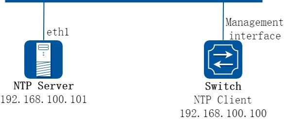

**图9-2 管理口连接NTP 服务器**

##### 2. 配置步骤

使用带外口连接，除了配置NTP 服务器需要加上mgmt-if 关键词，其它NTP 相关配置均与带内口相似。

##### 步骤1 进入配置模式

```
Switch# configure terminal
```

##### 步骤2 配置NTP 鉴权key (可选)

配置NTP 鉴权key 1, 并设置为信任key：

```
Switch(config)# ntp key 1 serverkey
Switch(config)# ntp trustedkey 1
```

##### 步骤3 配置NTP 服务器

```
Switch(config)# ntp server mgmt-if 192.168.100.101
```

如果使用鉴权key，则在配置server 的同时指定(可选)：

```
Switch(config)# ntp server 192.168.100.101 key 1
```

##### 步骤4 配置NTP 鉴权功能(可选)

一旦使能authentication，客户端交换机仅发送time-of-day 请求到信任NTP 服务器。

```
Switch(config)# ntp authentication enable
```

##### 步骤5 配置NTP 服务器/对端设备的访问控制规则(ACE)(可选)

```
Switch(config)# ntp ace 192.168.100.101 none
```

##### 步骤6 退出配置模式

```
Switch(config)# end
```

##### 步骤7 检查配置

```
Switch# show ntp
Current NTP configuration:
============================================================
```

```
NTP access control list:
192.168.100.101 mask 255.255.255.255 none
Unicast peer:
Unicast server:
192.168.100.101(mgmt-if) key 1
Authentication: enabled
Local reference clock:
Only management interface
Switch# show ntp associations
Current NTP associations:
remote
refid
st when poll reach
delay
offset
disp
==============================================================================
*192.168.100.101 127.127.1.0
3
27
64
1
1.328
2.033 433.075
* sys.peer, + candidate, # selected, x falsetick, . excess, - outlyer
```

#### NTP 服务器配置

下面以linux 下的ntpd 为例简单介绍以下网络中如何配置NTP 服务器。

##### 步骤1 配置服务器与交换机之间的三层网络

显示接口eth1 的IP 地址

```
[root@localhost octeon]# ifconfig eth1
eth1
Link encap:Ethernet
HWaddr 00:08:C7:89:4B:AA
inet addr:6.6.6.6
Bcast:6.6.6.255
Mask:255.255.255.0
inet6 addr: fe80::208:c7ff:fe89:4baa/64 Scope:Link
UP BROADCAST RUNNING MULTICAST
MTU:1500
Metric:1
RX packets:3453 errors:1 dropped:0 overruns:0 frame:1
TX packets:3459 errors:0 dropped:0 overruns:0 carrier:0
collisions:0 txqueuelen:1000
RX bytes:368070 (359.4 KiB)
TX bytes:318042 (310.5 KiB)
```

通过ping 命令检查网络连接是否可达

```
[root@localhost octeon]# ping 6.6.6.5
PING 6.6.6.5 (6.6.6.5) 56(84) bytes of data.
64 bytes from 6.6.6.5: icmp_seq=0 ttl=64 time=0.951 ms
64 bytes from 6.6.6.5: icmp_seq=1 ttl=64 time=0.811 ms
64 bytes from 6.6.6.5: icmp_seq=2 ttl=64 time=0.790 ms
```

##### 步骤2 配置ntp.conf

```
[root@localhost octeon]# vi /etc/ntp.conf
server
127.127.1.0
# local clock
fudge
127.127.1.0 stratum 5
#
# Drift file.
Put this in a directory which the daemon can write to.
# No symbolic links allowed, either, since the daemon updates the file
# by creating a temporary in the same directory and then rename()'ing
# it to the file.
#
driftfile /var/lib/ntp/drift
broadcastdelay
0.008
broadcast 6.6.6.255
#
```

```
# PLEASE DO NOT USE THE DEFAULT VALUES HERE. Pick your own, or remote
# systems might be able to reset your clock at will. Note also that
# ntpd is started with a -A flag, disabling authentication, that
# will have to be removed as well.
#
#disable auth
keys
/etc/ntp/keys
trustedkey 1
```

##### 步骤3 配置keys

```
[root@localhost octeon]# vi /etc/ntp/keys
#
# PLEASE DO NOT USE THE DEFAULT VALUES HERE. Pick your own, or remote
# systems might be able to reset your clock at will. Note also that
# ntpd is started with a -A flag, disabling authentication, that
# will have to be removed as well.
#
1 M serverkey
```

##### 步骤4 启动ntpd 服务器

```
[root@localhost octeon]# ntpd
```

## 9.3 PTP配置

### 9.3.1 概述

#### 简介

PTP（Precision Time Protocol）是一种用于同步计算机时钟的协议，由IEEE 1588 标准定义。PTP 旨在通过网络精确同步分布式系统中的时钟，以实现高精度的时间戳和时间同步，常用于工业自动化、交通运输、电力系统等需要高精度时间同步的领域。

PTP 协议基于主从架构，其中一台设备充当主时钟（master）角色，其余设备充当从时钟（slave）角色。主时钟是网络中的时间源，它通过向从时钟传递时间戳来同步所有设备的时钟。PTP 协议主要包含以下几个重要组件和步骤：

同步过程：主时钟在网络中发布时间信息，从时钟接收到时间信息后，会将其本地时钟调整到主时钟的时间。

传播延迟测量：主时钟会测量它自己发送时间信息到从时钟的传播延迟，以便从时钟可以校正自身时间。

时间偏移计算：从时钟根据主时钟的时间信息和自身接收到的本地时间信息，计算出自身时间与主时钟时间的偏移量。

时间校正：从时钟根据计算出的偏移量调整其本地时间，使本地时间与主时钟时间保持一致。

PTP 协议包括1588 和G.8275.1 两个版本。1588 包括1588v1 和1588v2，1588v1 只能达到亚毫秒级的时间同步精度，而1588v2 可以达到亚微秒级同步精度。G.8275.1 标准是由ITUT 定义的精确时间同步标准，其与IEEE 1588 标准类似，都是为了解决全网时间同步的问题。

在无线网络中，移动承载网与基站之间需要保持时钟同步。1588v2 借助硬件辅助处理，可以达到亚微秒级的时间同步精度；同时成本更低，减小了对GPS 的依赖。

#### 背景

PTP（Precision Time Protocol）是一种用于同步计算机时钟的协议，由IEEE 1588 标准定义。PTP 协议的背景源于对高精度时间同步的需求，在许多领域如工业自动化、交通运输、电力系统等都需要高精度的时间同步。在这些应用场景中，分布式系统中的各个设备需要时间上的协调，以保证系统的稳定性和可靠性。

PTP 协议解决的问题是提供一种高精度的时间同步解决方案，以确保分布式系统中的设备时间保持一致。相比于以前的技术，PTP 协议具有以下优点：

高精度时间同步：PTP 协议能够实现亚微秒级的时间同步精度，这比传统的NTP

（Network Time Protocol）协议的亚秒级精度要高得多。高精度时间同步能够更好地满足许多实时应用的需求。

适用于任意网络拓扑：PTP 协议适用于任意网络拓扑结构，无论是星型、树型还是网状结构，都能实现高精度的同步。这使得PTP 协议具有更广泛的适用性。

硬件辅助处理：PTP 协议借助硬件辅助处理，能够实现更快速的时间同步。硬件辅助处理可以大幅提高同步速度，降低延迟，提高系统的实时性能。

可扩展性：PTP 协议设计灵活，可扩展性好，方便支持更多的设备和传感器。这使得PTP 协议在物联网、智能家居等领域中得到了广泛应用。

独立于特定的传输介质：PTP 协议不依赖于特定的传输介质，可以在以太网、光纤等传输介质上实现高精度时间同步。这使得PTP协议在实际应用中更加灵活和可靠。

总之，PTP 协议作为一种高精度时间同步协议，相比以前的技术具有更高的精度、更广泛的适用性、更快速的处理速度、更好的扩展性和灵活性等优点。这使得PTP 协议在许多领域中得到了广泛应用，成为一种重要的时间同步技术。

#### 原理描述

##### 缩略语与名词解释

**表9-1 缩略语**

| 缩略语 | 含义 |
|---|---|
| GPS | 全球定位系统 |
| NTP | 网络时间协议 |
| PTP | 精确时间协议 |
| UTC | 协调世界时 |
| TAI | 国际原子时 |

##### 基本概念

以下是PTP 中的一些重要概念，有助于用户理解PTP 的功能，并基于这些理解来进行配置。

PTP 域PTP 域（Precision Time Protocol domain）是指应用了PTP 协议的网络，也称为PTP域。在一个PTP 域中，有且只有一个主时钟，所有的设备都与该时钟保持同步。PTP 域中的设备可以通过PTP 协议交换时间信息，并进行时间校准和同步。

目前支持的PTP 域范围为0-255，可通过命令行配置。默认属于域0。

时钟节点PTP 协议中有以下三种时钟类型：

边界时钟(BC)：同一个PTP 域内，存在两个及以上端口参与PTP 时间同步的节点称为边界时钟。设备通过其中一个端口从上游设备同步时间，通过其余端口向下游设备发布时间。时钟源设备有两个及以上端口可以向下游发布时间时，也认为是边界时钟。

普通时钟(OC)：同一个PTP 域内，只存在单个端口参与PTP 时间同步的节点称为普通时钟。普通时钟要么作为主时钟提供时钟源，要么作为最末一级终端，从其他的时钟源获取时钟，而不能作为中间节点把时钟向其他节点传递。

透传时钟(TC)：透传时钟作为中间节点，收到PTP 报文之后不进行终结，其内部有一个驻留时间桥来计算报文在本节点的驻留时间，并以此来修正时间标签再向下传递。延时测量支持端到端和点到点两种测量机制。

端口设备上使能PTP 协议的端口称为PTP 端口，分为以下三种类型主端口：发布同步时间的端口，可存在于BC 或OC 上。从端口：接收同步时间的端口，可存在于BC 或OC 上。被动端口：不接收同步时间，也不对外发布同步时间，闲置备用的端口，只存在于BC 上。

最优时钟最优时钟（Grandmaster Clock，GM）是PTP 域中的最高层次时钟，也是整个PTP 域的参考时间。PTP 域中所有的时钟节点都按一定层次组织在一起，通过各时钟节点间PTP协议报文的交互，最优时钟的时间最终将被同步到整个PTP 域中，因此也称其为时钟源。

最优时钟可以通过手工配置静态指定，也可以通过BMC（Best Master Clock，最佳主时钟）协议动态选举。

BMC 算法在BMC 算法中，最优时钟是通过各时钟节点间PTP 协议报文的交互进行动态选举的。各时钟节点之间通过交互Announce 报文中所携带的最优时钟优先级、时间等级、时间精度等信息，最终选出一个节点作为PTP 域的最优时钟。

BMC 算法用来选取最优时钟时，基于以下可配置的字段：

Priority1：时钟优先级1，支持用户配置，取值范围是0-255，取值越小优先级越高。默认为128。

Clock-Class：时钟级别，支持6/7/13/14/52/58/187/193/248，取值越低级别越高。默认为248。

Clock-Accuracy：时钟精度，支持0x20-0x31/0xFE，取值越低精确度越高。默认为0xFE。

Priority2：时钟优先级2，支持用户配置，取值范围是0-255，取值越小优先级越高。默认为128。

优先级选择的排序是Priority1＞Clock-Class＞Clock-Accuracy＞Priority2，即先比较参选时间源的Priority1，若Priority1 相同再比较Clock-Class，以此类推，优先级高、级别高、精度好的时钟成为最优时钟。

##### 报文封装

PTP 的时间同步过程通过PTP 报文交互来实现。下游设备通过报文中携带的时间戳信息，计算出与主时钟之间的偏移和延迟，从而调整本地时钟来与主时钟同步。

PTP 报文的时间戳是由芯片来打，芯片操作性能远远优于软件操作，因此可以更好的保证PTP 时间同步的精度。

PTP 报文支持二层封装(MAC 封装)和三层封装(UDP 封装)，其中三层支持IPv4 和IPv6。

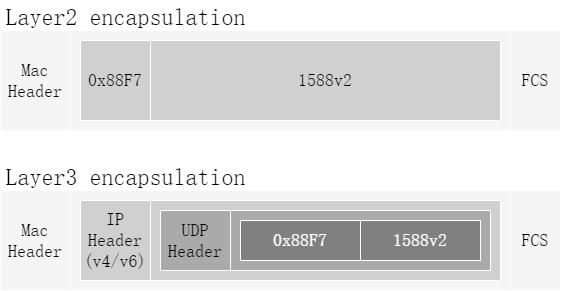

**图9-3 PTP 报文封装**

##### 同步过程

PTP 时间同步的过程包括以下步骤：

选择主从时钟：在PTP 同步过程中，选择一个节点作为Master 时钟，其他节点作为Slave 时钟。Master 时钟拥有高精度的时钟源，并通过网络将时间信息发送给Slave 时钟，Slave 时钟则通过校正自身时钟来实现同步。

时钟识别与初始化：节点首先需要识别各个时钟，并初始化Master 时钟和Slave时钟的相关参数，包括时钟频率、延迟等。

时钟间的消息传递：PTP 同步的核心机制是通过网络传递消息来实现时间同步。

Master 时钟会周期性地向网络中发送Sync 消息，Slave 时钟接收到Sync 消息后会返回对应的Follow Up 消息。

延迟补偿与校正：在PTP 同步过程中，由于消息传输的延迟，需要对延迟进行补偿。

通过计算消息的传输时间，可以补偿延迟，从而保证时间的准确性。同时，根据Master 时钟和Slave 时钟之间的时间差，Slave 时钟对其时钟进行校正。

容错机制与优化：在实际网络中，由于网络拓扑复杂、链路质量不稳定等因素，可能会导致PTP 同步的失败或者失去精度。因此，在PTP 同步过程中，需要考虑容错机制的设计，提高系统的稳定性。同时，根据网络情况，可以对PTP 同步过程进行优化，如选择更优的Master 时钟、调整同步周期等。

时间一致性的验证：PTP 同步过程中，还需要对时间一致性进行验证。常用的验证方法包括对Master 时钟和Slave 时钟之间的时间差进行监测，以及对同步精度进行评估。

这个过程可以通过IEEE 1588 标准中的延迟请求-响应机制进行详细描述。主时钟会周期性发送Sync 报文并记录报文离开的精确时间t1；从时钟会记录Sync 报文到达的精确时间t2；主时钟发送包含t1 时间的Follow_up 报文；从时钟发送Delay_Req 报文并记录报文离开的精确时间t3；主时钟记录Delay_Req 报文到达的精确时间t4；随后，主时钟发送包含t4 时间的Delay_Resp 报文给从时钟。通过这种方式，主从时钟可以实现时间同步。

##### 默认配置

**表9-2 默认配置**

| 配置项 | 默认值 |
|---|---|
| PTP 功能 | 禁用 |
| PTP 设备类型 | 普通时钟 |
| PTP 优先级一与优先级二 | 128 |
| PTP 时戳模式 | 两步模式 |
| PTP Announce 周期 | 2 秒 |
| PTP Announce 超时周期 | 8 秒 |
| PTP Delay Req 最小周期<br>_ | 1 秒 |
| PTP Pdelay Req 最小周期<br>_ | 1 秒 |
| PTP Sync 周期 | 1 秒 |

### 9.3.2 配置举例

#### 配置边界时钟/普通时钟

##### 1. 组网拓扑


**图9-4 PTP 时钟域**

如图所示，设置Switch1 为主时钟，向下游发布时间。Switch2 从Switch1 接收时间，更新本地时钟，并继续向下游设备发布时间。Switch3 只接收时间。

##### 2. 配置步骤

##### 步骤1 进入配置模式

```
Switch# configure terminal
```

Switch1 配置

##### 步骤2 全局使能PTP，并配置优先级一

Switch 1 为普通时钟，只有一个端口用于发布时间。

配置优先级一为0，Switch 1 为这个时钟域中最高优先级，成为该时钟域中的主时钟。

```
Switch1(config)# ptp global-enable
Switch1(config)# ptp priority1 0
```

##### 步骤3 设置clock-step (可选）

PTP 报文打时间戳支持one-step 和two-step 两种模式，默认为two-step 模式。

one-step: Sync 报文带有本报文的时间戳。

two-step：Sync 报文不带有本报文的时间戳，后续Follow_UP 报文带上Sync 报文的时间戳。

建议统一PTP 时钟域内设备选择相同的clock step。

```
Switch1(config)# ptp clock-step two-step
```

##### 步骤4 设置延时测量机制(可选）

延时测量机制支持如下两种：Normal 和Peer。

Normal：延时请求应答机制，根据主从时钟之间的整体链路延迟，计算时钟时间。

（如果中间有透传时钟，应设为端到端模式）

peer：对端延时机制，根据主从时钟之间的每一段链路延迟，计算时钟时间。（如果中间有透传时钟，应设为点到点模式）

默认配置为Normal 模式。

```
Switch1(config)# interface eth-0-9
Switch1(config-if)# ptp delay-mechanism peer
```

##### 步骤5 接口使能PTP

```
Switch1(config)# interface eth-0-9
Switch1(config-if)# ptp enable
```

Switch2 配置

##### 步骤6 配置设备类型为边界时钟，全局使能PTP

Switch2 从Switch1 接收时间，同时向Swith3 发布时间，配置为边界时钟。

```
Switch2(config)# ptp device-type bc
Switch2(config)# ptp global-enable
```

##### 步骤7 设置延时测量机制(可选）

注意：与Switch1 的延时测量机制保持一致。

```
Switch2(config)# interface eth-0-9
Switch2(config-if)# ptp delay-mechanism peer
Switch2(config-if)# exit
Switch2(config)# interface eth-0-18
Switch2(config-if)# ptp delay-mechanism peer
Switch2(config-if)# exit
```

##### 步骤8 接口使能PTP

```
Switch2(config)# interface eth-0-9
Switch2(config-if)# ptp enable
```

```
Switch2(config-if)# exit
Switch2(config)# interface eth-0-18
Switch2(config-if)# ptp enable
Switch2(config-if)# exit
```

Switch3 配置

##### 步骤9 配置Switch3 为从时钟，全局使能PTP

```
Switch3(config)# ptp global-enable
Switch3(config)# ptp slave-only
```

##### 步骤10 设置延时测量机制(可选）

注意：与Switch2 的延时测量机制保持一致。

```
Switch3(config)# interface eth-0-18
Switch3(config-if)# ptp delay-mechanism peer
Switch3(config-if)# exit
```

##### 步骤11 接口使能PTP

```
Switch3(config)# interface eth-0-18
Switch3(config-if)# ptp enable
Switch3(config-if)# exit
```

##### 步骤12 退出配置模式

```
Switch(config)# end
```

##### 步骤13 验证配置

验证Switch1 全局PTP 状态

```
Switch1# show ptp
----------------------
Global Configure
----------------------
PTP State
: enable
Port Number
: 1
Domain
: 0
Slave Only
: false
Clock Type
: ordinary clock
Priority1
: 0
Priority2
: 128
Clock Accuracy
: 0xfe
Clock Class
: 248
Time Source
: internal-oscillator(160)
UTC Offset
: 34
Leap59
: false
Leap61
: false
Local Clock Identity
: 60:4D:39:FF:FE:FF:C5:00
Set systime via PTP:
: false
-----------------------
BMC Properties
-----------------------
Receive Member
: (null)
Parent Clock Identity
: 60:4D:39:FF:FE:FF:C5:00
Parent Port Number
: 0
Mean Path Delay
: 0
Offset From Master
: 0
Step Removed
: 0
GM Clock Identity
: 60:4D:39:FF:FE:FF:C5:00
```

```
GM Priority1
: 0
GM Priority2
: 128
GM Clock Accuracy
: 0xfe
GM Clock Class
: 248
GM Time Source
: internal-oscillator(160)
GM UTC Offset
: 34
GM UTC Offset Valid
: false
GM Time Scale
: PTP
GM Time Traceable
: false
GM Leap59
: false
GM Leap61
: false
GM Frequency Traceable
: false
```

验证Switch1 接口PTP 状态

```
Switch1# show ptp interface eth-0-9
---------------------------------------------------------------
Interface
: eth-0-9
-----------------------
Port Configure
-----------------------
PTP state
: enable
Port ID
: 60:4D:39:FF:FE:FF:C5:00@9
Delay Mechanism
: peer
Step Mode
: two
Port State
: master
Announce Interval
: 1
Sync Interval
: 0
Announce Receipt Timeout
: 4
PDelay_Req Interval
: 0
Peer Mean Path Delay
: 0
-----------------------
Port Statistic
-----------------------
Recv Packet Statistics
---------------------------------------------------------------
Announce
: 5
Sync
: 0
Delay_Req
: 0
Pdelay_Req
: 5248
Delay_Resp
: 0
Pdelay_Resp
: 5249
Follow_Up
: 0
Pdelay_Resp_Follow_Up
: 5249
Unknown
: 0
Send Packet Statistics
---------------------------------------------------------------
Announce
: 5345
Sync
: 10609
Delay_Req
: 0
Pdelay_Req
: 10617
Delay_Resp
: 0
Pdelay_Resp
: 5248
Follow_Up
: 10607
Pdelay_Resp_Follow_Up
: 5248
Unknown
: 0
Discard Packet Statistics
---------------------------------------------------------------
Announce
: 0
Sync
: 9
Delay_Req
: 0
Pdelay_Req
: 0
Delay_Resp
: 0
Pdelay_Resp
: 0
Follow_Up
: 9
Pdelay_Resp_Follow_Up
: 0
Unknown
: 0
```

验证Switch2 全局PTP 状态

```
Switch2# show ptp
----------------------
Global Configure
----------------------
PTP State
: enable
```

```
Port Number
: 2
Domain
: 0
Slave Only
: false
Clock Type
: boundary clock
Priority1
: 128
Priority2
: 128
Clock Accuracy
: 0xfe
Clock Class
: 248
Time Source
: internal-oscillator(160)
UTC Offset
: 34
Leap59
: false
Leap61
: false
Local Clock Identity
: 5E:C4:DC:FF:FE:AE:78:00
Set systime via PTP:
: false
-----------------------
BMC Properties
-----------------------
Receive Member
: eth-0-9
Parent Clock Identity
: 60:4D:39:FF:FE:FF:C5:00
Parent Port Number
: 9
Mean Path Delay
: 0
Offset From Master
: 0
Step Removed
: 1
GM Clock Identity
: 60:4D:39:FF:FE:FF:C5:00
GM Priority1
: 0
GM Priority2
: 128
GM Clock Accuracy
: 0xfe
GM Clock Class
: 248
GM Time Source
: internal-oscillator(160)
GM UTC Offset
: 34
GM UTC Offset Valid
: false
GM Time Scale
: PTP
GM Time Traceable
: false
GM Leap59
: false
GM Leap61
: false
GM Frequency Traceable
: false
```

验证Switch2 外部PTP 主时钟信息

```
Switch2# show ptp foreign-master
Foreign_master_port_identity
Qualification
Interface
---------------------------------------------------------------
*60:4D:39:FF:FE:FF:C5:00@9
true
eth-0-9
```

验证Switch2 接口PTP 状态

```
Switch2# show ptp interface eth-0-9
---------------------------------------------------------------
Interface
: eth-0-9
-----------------------
Port Configure
-----------------------
PTP state
: enable
Port ID
: 5E:C4:DC:FF:FE:AE:78:00@9
Delay Mechanism
: peer
Step Mode
: two
Port State
: slave
Announce Interval
: 1
Sync Interval
: 0
Announce Receipt Timeout
: 4
PDelay_Req Interval
: 0
```

```
Peer Mean Path Delay
: 0
-----------------------
Port Statistic
-----------------------
Recv Packet Statistics
---------------------------------------------------------------
Announce
: 2944
Sync
: 5837
Delay_Req
: 0
Pdelay_Req
: 5876
Delay_Resp
: 0
Pdelay_Resp
: 5876
Follow_Up
: 5837
Pdelay_Resp_Follow_Up
: 5875
Unknown
: 0
Send Packet Statistics
---------------------------------------------------------------
Announce
: 15
Sync
: 30
Delay_Req
: 0
Pdelay_Req
: 5876
Delay_Resp
: 0
Pdelay_Resp
: 5876
Follow_Up
: 27
Pdelay_Resp_Follow_Up
: 5876
Unknown
: 0
Discard Packet Statistics
---------------------------------------------------------------
Announce
: 0
Sync
: 9
Delay_Req
: 0
Pdelay_Req
: 0
Delay_Resp
: 0
Pdelay_Resp
: 0
Follow_Up
: 9
Pdelay_Resp_Follow_Up
: 0
Unknown
: 0
Switch2# show ptp interface eth-0-18
---------------------------------------------------------------
Interface
: eth-0-18
-----------------------
Port Configure
-----------------------
PTP state
: enable
Port ID
: 5E:C4:DC:FF:FE:AE:78:00@18
Delay Mechanism
: peer
Step Mode
: two
Port State
: master
Announce Interval
: 1
Sync Interval
: 0
Announce Receipt Timeout
: 4
PDelay_Req Interval
: 0
Peer Mean Path Delay
: 0
-----------------------
Port Statistic
-----------------------
Recv Packet Statistics
---------------------------------------------------------------
Announce
: 0
Sync
: 0
Delay_Req
: 0
Pdelay_Req
: 5680
Delay_Resp
: 0
Pdelay_Resp
: 5680
Follow_Up
: 0
Pdelay_Resp_Follow_Up
: 5680
Unknown
: 0
Send Packet Statistics
---------------------------------------------------------------
Announce
:2950
Sync
: 5860
Delay_Req
: 0
Pdelay_Req
: 5868
Delay_Resp
: 0
Pdelay_Resp
: 5680
Follow_Up
: 5858
Pdelay_Resp_Follow_Up
: 5680
Unknown
: 0
Discard Packet Statistics
---------------------------------------------------------------
```

```
Announce
: 0
Sync
: 0
Delay_Req
: 0
Pdelay_Req
: 0
Delay_Resp
: 0
Pdelay_Resp
: 0
Follow_Up
: 0
Pdelay_Resp_Follow_Up
: 0
Unknown
: 0
```

验证Switch3 全局PTP 状态

```
Switch3# show ptp
----------------------
Global Configure
----------------------
PTP State
: enable
Port Number
: 1
Domain
: 0
Slave Only
: true
Clock Type
: ordinary clock
Priority1
: 128
Priority2
: 128
Clock Accuracy
: 0xfe
Clock Class
: 255
Time Source
: internal-oscillator(160)
UTC Offset
: 34
Leap59
: false
Leap61
: false
Local Clock Identity
: A0:D2:25:FF:FE:B1:F8:00
Set systime via PTP:
: false
-----------------------
BMC Properties
-----------------------
Receive Member
: eth-0-18
Parent Clock Identity
: 5E:C4:DC:FF:FE:AE:78:00
Parent Port Number
: 18
Mean Path Delay
: 0
Offset From Master
: 0
Step Removed
: 2
GM Clock Identity
: 60:4D:39:FF:FE:FF:C5:00
GM Priority1
: 0
GM Priority2
: 128
GM Clock Accuracy
: 0xfe
GM Clock Class
: 248
GM Time Source
: internal-oscillator(160)
GM UTC Offset
: 34
GM UTC Offset Valid
: false
GM Time Scale
: PTP
GM Time Traceable
: false
GM Leap59
: false
GM Leap61
: false
GM Frequency Traceable
: false
```

验证Switch3 外部PTP 主时钟信息

```
Switch3# show ptp foreign-master
Foreign_master_port_identity
Qualification
Interface
---------------------------------------------------------------
*5E:C4:DC:FF:FE:AE:78:00@18
true
eth-0-18
```

验证Switch 3 接口PTP 状态

```
Switch3# show ptp interface eth-0-18
---------------------------------------------------------------
```

```
Interface
: eth-0-18
-----------------------
Port Configure
-----------------------
PTP state
: enable
Port ID
: A0:D2:25:FF:FE:B1:F8:00@18
Delay Mechanism
: peer
Step Mode
: two
Port State
: slave
Announce Interval
: 1
Sync Interval
: 0
Announce Receipt Timeout
: 4
PDelay_Req Interval
: 0
Peer Mean Path Delay
: 0
-----------------------
Port Statistic
-----------------------
Recv Packet Statistics
---------------------------------------------------------------
Announce
: 3472
Sync
: 6884
Delay_Req
: 0
Pdelay_Req
: 6919
Delay_Resp
: 0
Pdelay_Resp
: 6917
Follow_Up
: 6884
Pdelay_Resp_Follow_Up
: 6917
Unknown
: 0
Send Packet Statistics
---------------------------------------------------------------
Announce
: 0
Sync
: 0
Delay_Req
: 0
Pdelay_Req
: 6920
Delay_Resp
: 0
Pdelay_Resp
: 6919
Follow_Up
: 0
Pdelay_Resp_Follow_Up
: 6919
Unknown
: 0
Discard Packet Statistics
---------------------------------------------------------------
Announce
: 0
Sync
: 11
Delay_Req
: 0
Pdelay_Req
: 0
Delay_Resp
: 0
Pdelay_Resp
: 3
Follow_Up
: 11
Pdelay_Resp_Follow_Up
: 3
Unknown
: 0
```

#### 配置透传时钟

##### 1. 组网拓扑


**图9-5 PTP 时钟域**

如图所示，设置Switch1 为主时钟，向下游发布时间。Switch2 从Switch1 接收时间，计算本设备上的延时，并继续向下游设备发布时间，但是Switch2 不更新本地时钟。

Switch3 只接收时间。

##### 2. 配置步骤

Switch2 配置在这个例子中，Switch1 和Switch3 的配置与前例相同。下面修改Swith2 的配置。

##### 步骤1 进入配置模式

```
Switch2# configure terminal
```

##### 步骤2 配置设备类型为透传时钟，全局使能PTP

透传时钟支持p2ptc 和e2etc.p2ptc: 对应的普通时钟/边界时钟上，延时测量机制应该为peer e2etc: 对应的普通时钟/边界时钟上，延时测量机制应该为normal

```
Switch2(config)# ptp device-type p2ptc
Switch2(config)# ptp global-enable
```

##### 步骤3 接口模式启用PTP

```
Switch2(config)# interface range eth-0-9 , eth-0-18
Switch2(config-if)# ptp enable
Switch2(config-if)# exit
```

##### 步骤4 退出配置模式

```
Switch2(config)# end
```

##### 步骤5 验证配置

验证Switch 2 全局PTP 状态

```
Switch2# show ptp
----------------------
Global Configure
----------------------
PTP State
: enable
Port Number
: 2
Primary Domain
: 0
Clock Type
: peer-to-peer transparent clock
Local Clock ID
: 5E:C4:DC:FF:FE:AE:78:00
```

验证Switch2 接口PTP 状态

```
Switch2# show ptp interface eth-0-9
---------------------------------------------------------------
Interface
: eth-0-9
-----------------------
Port Configure
-----------------------
PTP state
: enable
Port ID
: 5E:C4:DC:FF:FE:AE:78:00@9
Delay Mechanism
: peer
Step Mode
: two
Port State
: normal
PDelay_Req Interval
: 0
Peer Mean Path Delay
: 0
-----------------------
Port Statistic
-----------------------
Recv Packet Statistics
---------------------------------------------------------------
Announce
: 6545
Sync
: 12985
```

```
Delay_Req
: 0
Pdelay_Req
: 13024
Delay_Resp
: 0
Pdelay_Resp
: 13016
Follow_Up
: 12985
Pdelay_Resp_Follow_Up
: 13016
Unknown
: 0
Send Packet Statistics
---------------------------------------------------------------
Announce
: 15
Sync
: 30
Delay_Req
: 0
Pdelay_Req
: 13021
Delay_Resp
: 0
Pdelay_Resp
: 13024
Follow_Up
: 27
Pdelay_Resp_Follow_Up
: 13024
Unknown
: 0
Discard Packet Statistics
---------------------------------------------------------------
Announce
: 0
Sync
: 9
Delay_Req
: 0
Pdelay_Req
: 0
Delay_Resp
: 0
Pdelay_Resp
: 5
Follow_Up
: 9
Pdelay_Resp_Follow_Up
: 5
Unknown
: 0
Switch2# show ptp interface eth-0-18
---------------------------------------------------------------
Interface
: eth-0-18
-----------------------
Port Configure
-----------------------
PTP state
: enable
Port ID
: 5E:C4:DC:FF:FE:AE:78:00@18
Delay Mechanism
: peer
Step Mode
: two
Port State
: normal
PDelay_Req Interval
: 0
Peer Mean Path Delay
: 0
-----------------------
Port Statistic
-----------------------
Recv Packet Statistics
---------------------------------------------------------------
Announce
: 0
Sync
: 0
Delay_Req
: 0
Pdelay_Req
: 13026
Delay_Resp
: 0
Pdelay_Resp
: 13019
Follow_Up
: 0
Pdelay_Resp_Follow_Up
: 13019
Unknown
: 0
Send Packet Statistics
---------------------------------------------------------------
Announce
: 6651
Sync
: 13208
Delay_Req
: 0
Pdelay_Req
: 13212
Delay_Resp
: 0
Pdelay_Resp
: 13026
Follow_Up
: 13208
Pdelay_Resp_Follow_Up
: 13026
Unknown
: 0
Discard Packet Statistics
---------------------------------------------------------------
Announce
: 0
Sync
: 0
Delay_Req
: 0
Pdelay_Req
: 0
Delay_Resp
: 0
Pdelay_Resp
: 6
Follow_Up
: 0
Pdelay_Resp_Follow_Up
: 6
Unknown
: 0
```

验证Switch3 全局PTP 状态

```
Switch3# show ptp
----------------------
Global Configure
----------------------
PTP State
: enable
Port Number
: 1
Domain
: 0
Slave Only
: true
Clock Type
: ordinary clock
Priority1
: 128
Priority2
: 128
Clock Accuracy
: 0xfe
Clock Class
: 255
Time Source
: internal-oscillator(160)
UTC Offset
: 34
Leap59
: false
Leap61
: false
Local Clock Identity
: A0:D2:25:FF:FE:B1:F8:00
Set systime via PTP:
: false
-----------------------
BMC Properties
-----------------------
Receive Member
: eth-0-18
Parent Clock Identity
: 60:4D:39:FF:FE:FF:C5:00
Parent Port Number
: 9
Mean Path Delay
: 0
Offset From Master
: 0
Step Removed
: 1
GM Clock Identity
: 60:4D:39:FF:FE:FF:C5:00
GM Priority1
: 0
GM Priority2
: 128
GM Clock Accuracy
: 0xfe
GM Clock Class
: 248
GM Time Source
: internal-oscillator(160)
GM UTC Offset
: 34
GM UTC Offset Valid
: false
GM Time Scale
: PTP
GM Time Traceable
: false
GM Leap59
: false
GM Leap61
: false
GM Frequency Traceable
: false
```

验证Switch3 外部PTP 主时钟信息

```
Switch3# show ptp foreign-master
Foreign_master_port_identity
Qualification
Interface
---------------------------------------------------------------
*60:4D:39:FF:FE:FF:C5:00@9
true
eth-0-18
```

### 9.3.3 参考文献

IEEE std 1588TM-2008: IEEE Standard for a Precision Clock Synchronization Protocol for Networked Measurement and Control Systems.ITU-T G.8275.1/Y.1369.1 AMD 1-2017: Precision time protocol telecom profile for phase/time synchronization with full timing support from the network;Amendment 1

## 9.4 Loopback配置

### 9.4.1 概述

#### 简介

loopback 是一个私有的模块，实现物理层的环回功能。它包含两种环回模式：一种是internal,另一种是external。

loopback 只能配置在物理口上：

如果配置为internal 模式，所有期望从此端口出去的报文被环回到该端口。

如果配置为external 模式，所有进入此端口的报文被环回回去，此模式还可以指定是否进行源、目的MAC 的交换，如果交换MAC，芯片会重新计算CRC 校验和

### 9.4.2 配置举例

#### 配置external 环回模式

##### 1. 组网拓扑


**图9-6 external topology**

##### 2. 配置步骤

##### 步骤1 进入配置模式

```
Switch# configure terminal
```

##### 步骤2 进入接口配置模式，并配置为external 环回模式, 并且指定进行源、目的MAC 交换

```
Switch(config)# interface eth-0-1
Switch(config-if)# no shutdown
Switch(config-if)# loopback external mac-address swap
```

##### 步骤3 退出配置模式

```
Switch(config-if)# end
```

##### 步骤4 检查配置

```
Switch# show loopback
Interface
Type
DestIntf
SwapMac
- $$------------------------------------------
eth-0-1
external
-
yes
- $$------------------------------------------
```

#### 配置internal 环回模式

##### 1. 组网拓扑


**图9-7 Internal topology**

##### 2. 配置步骤

##### 步骤1 进入配置模式

```
Switch# configure terminal
```

##### 步骤2 进入接口配置模式，配置为internal 环回模式

```
Switch(config)# interface eth-0-1
Switch(config-if)# no shutdown
Switch(config-if)# exit
Switch(config)# interface eth-0-2
Switch(config-if)# no shutdown
Switch(config-if)# loopback internal
```

##### 步骤3 退出配置模式

```
Switch(config-if)# end
```

##### 步骤4 检查配置

```
Switch# show loopback
Interface
Type
DestIntf
SwapMac
- $$------------------------------------------
eth-0-2
internal
-
-
- $$------------------------------------------
```

## 9.5 L2 Ping配置

### 9.5.1 概述

#### 简介

L2 ping 是一个用于检测交换机间的连通性的工具。Window、Linux 上的IP ping 是通过ICMP 协议实现，工作在3 层网络上的，而L2 ping 工作在二层网络。

当系统发出L2 Ping 请求时，以ether type 0x9009 为标志的协议报文将进入二层网络，当通过二层网络到达对端指定目的端口时，如果该端口上使能了l2 ping response，对端系统就会回复l2 ping 请求。

### 9.5.2 配置举例

##### 1. 组网拓扑


**图9-8 ping a switch port**

##### 2. 配置步骤

以下配置无特殊说明的部分，Switch1 和Switch2 相同：

##### 步骤1 进入配置模式

```
Switch# configure terminal
```

##### 步骤2 全局使能l2 ping

```
Switch(config)# l2 ping enable
```

##### 步骤3 进入接口配置模式并打开接口

```
Switch(config)# interface eth-0-1
Switch(config-if)# no shutdown
```

##### 步骤4 使能l2 ping 回复功能

在Switch2 配置：

```
Switch2(config-if)# l2 ping response enable
```

##### 步骤5 退出配置模式

```
Switch(config-if)# end
```

##### 步骤6 使用L2 Ping

在Switch1 执行：

```
Switch1# l2 ping 001e.0808.58f1 interface eth-0-1 count 10 interval 1 timeout 2
Sending 10 L2 ping message(s):
64 bytes from 001e.0808.58f1: sequence = 0, time = 10ms
64 bytes from 001e.0808.58f1: sequence = 1, time = 15ms
64 bytes from 001e.0808.58f1: sequence = 2, time = 13ms
64 bytes from 001e.0808.58f1: sequence = 3, time = 12ms
64 bytes from 001e.0808.58f1: sequence = 4, time = 20ms
64 bytes from 001e.0808.58f1: sequence = 5, time = 21ms
64 bytes from 001e.0808.58f1: sequence = 6, time = 12ms
64 bytes from 001e.0808.58f1: sequence = 7, time = 16ms
64 bytes from 001e.0808.58f1: sequence = 8, time = 14ms
64 bytes from 001e.0808.58f1: sequence = 9, time = 17ms
L2 ping completed.
```

```
- $$---------------------------------
10 packet(s) transmitted, 10 received, 0 % packet loss
```

001e.0808.58f1 是对端接口地址。用户可以指定ping 的次数、间隔、以及超时时间。

## 9.6 RMON配置

### 9.6.1 概述

#### 简介

RMON 是一个Internet 工程任务组（IETF）标准的监测规范，允许不同的网络代理和控制台系统交换网的监测数据。用户可以结合RMON 和交换机中的简单网络管理协议（SNMP）

代理来监控网络中流经交换机的数据流量。RMON 是一种标准的监测规范，它定义了一套统计与RMON 兼容的控制台系统或网络探头一起提供全面的网络故障诊断，规划和性能优化的信息。

### 9.6.2 配置举例

##### 1. 组网拓扑

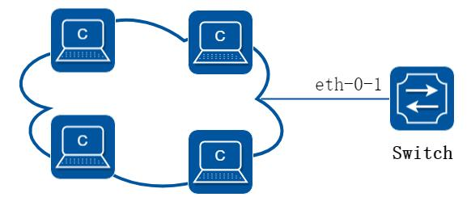

**图9-9 rmon**

##### 2. 配置步骤

##### 步骤1 进入配置模式

```
Switch# configure terminal
```

##### 步骤2 进入接口配置模式并创建一条统计和一条历史记录

```
Switch(config)# interface eth-0-1
Switch(config-if)# rmon collection stats 1 owner test
Switch(config-if)# rmon collection history 1 buckets 100 interval 1000 owner test
Switch(config-if)# exit
```

##### 步骤3 创建一条事件，并指定触发事件后行为是发送log 和trap

```
Switch(config)# rmon event 1 log trap public description test_event owner test
```

步骤4 创建一条警告，关注ETHERSTATSBROADCASTPKTS 这个值，每1000 秒统计一次，如果超

##### 过1000 或者低于1 都会触发事件1

```
Switch(config)# rmon alarm 1 etherStatsEntry.6.1 interval 1000 delta rising-threshold 1000 event 1
falling-threshold 1 event 1 owner test
```

##### 步骤5 退出配置模式

```
Switch(config)# end
```

##### 步骤6 检查配置

```
Switch# show rmon statistics
Rmon collection index 1
Statistics ifindex = 1, Owner: test
Input packets 0, octets 0, dropped 0
Broadcast packets 0, multicast packets 0, CRC alignment errors 0, collisions 0
Undersized packets 0, oversized packets 0, fragments 0, jabbers 0
# of packets received of length (in octets):
64: 0,
65-127: 0, 128-255: 0
256-511: 0,
512-1023: 0, 1024-max: 0
Switch# show rmon history
History index = 1
Data source ifindex = 1
Buckets requested = 100
Buckets granted = 100
Interval = 1000
Owner: test
Switch# show rmon event
Event Index = 1
Description: test_event
Event type Log & Trap
Event community name: public
Last Time Sent = 00:00:00
Owner: test
Switch# show rmon alarm
Alarm Index = 1
Alarm status = VALID
Alarm Interval = 1000
Alarm Type is Delta
Alarm Value = 00
Alarm Rising Threshold = 1000
Alarm Rising Event = 1
Alarm Falling Threshold = 1
Alarm Falling Event = 1
Alarm Owner is test
```

## 9.7 SNMP网络管理配置

### 9.7.1 概述

#### 简介

SNMP 是管理进程（NMS）和代理进程（Agent）之间的通信协议。它规定了在网络环境中对设备进行监视和管理的标准化管理框架、通信的公共语言、相应的安全和访问控制机制。网络管理员使用SNMP 功能可以查询设备信息、修改设备的参数值、监控设备状态、自动发现网络故障、生成报告等。SNMP 具有以下技术优点：

基于TCP/IP 互联网的标准协议，传输层协议一般采用UDP。

自动化网络管理。网络管理员可以利用SNMP 平台在网络上的节点检索信息、修改信息、发现故障、完成故障诊断、进行容量规划和生成报告。

屏蔽不同设备的物理差异，实现自动化管理。SNMP 只提供最基本的功能集，使得管理任务与被管设备的物理特性和实际网络类型相对独立。

简单的请求—应答方式和主动通告方式相结合，并有超时和重传机制。

报文种类少，报文格式简单，方便解析，易于实现。

SNMPv3 版本提供了认证和加密安全机制，以及基于用户和视图的访问控制功能，增强了安全性。

#### 原理描述

SNMP 基于以下RFC：

SNMPv1：在RFC1157 中定义SNMPv2C：在RFC1901 中定义SNMPv3：在RFC2273 至2275 中定义以下简单描述了SNMP 协议的条目和概念：

Agent：Agent 是网络设备中的一个应用模块，用于维护被管理设备的信息数据并响应NMS 的请求，把管理数据汇报给发送请求的NMS。Agent 接收到NMS 的请求信息后，完成查询或修改操作，并把操作结果发送给NMS，完成响应。同时，当设备发生故障或者其他事件的时候，Agent 会主动发送Trap 信息给NMS，通知设备当前的状态变化。

Management Information Base (MIB)：任何一个被管理的资源都表示成一个对象，称为被管理的对象。MIB 是被管理对象的集合。它定义了被管理对象的一系列属性：

对象的名称、对象的访问权限和对象的数据类型等。每个Agent 都有自己的MIB。

MIB 也可以看作是NMS 和Agent 之间的一个接口，通过这个接口，NMS 可以对Agent中的每一个被管理对象进行读/写操作，从而达到管理和监控设备的目的。

Engine ID：一个网络节点的唯一ID Trap：Trap 是Agent 主动向NMS 发送的信息，用于报告一些紧急的重要事件（如被管理设备重新启动等）。Trap 报文有两种：通用Trap 和企业自定义Trap。设备支持的通用Trap 包括authentication、coldstart、linkdown、linkup 和warmstart 五种，其它均为企业自定义Trap。企业自定义Trap 由模块生成。因为Trap 信息通常较多，会占用设备内存，从而影响设备性能，所以建议用户根据需要开启指定模块的Trap 功能，生成相应的Trap 报文。

### 9.7.2 配置举例

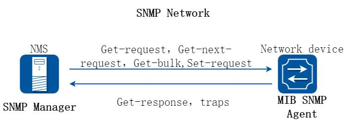

**图9-10 snmp**

如图所示，SNMP 代理从MIB 收集数据。SNMP 代理可以发送trap 或通报特定事件给接收和处理trap 的管理员。Trap 用于向管理员通报一些异常信息，如用户认证异常，设备重启，链路状态变化（端口打开或关闭），MAC 地址追踪等等。SNMP 也能响应管理员发出的MIB 相关的请求，例如get、get-next、set 等。

#### 启用SNMP

##### 步骤1 进入配置模式

```
Switch# configure terminal
```

##### 步骤2 全局使能snmp

```
Switch(config)# snmp-server enable
```

##### 步骤3 退出配置模式

```
Switch(config)# end
```

##### 步骤4 检查配置

```
Switch# show running-config
snmp-server enable
```

#### 团体字符串配置

您可以使用SNMP 团体字符串来定义的SNMP 管理者和代理之间的关系。团体字符串的行为就像一个密码，以允许访问代理交换机。您可以指定一个或多个团体字符。

一个MIB 视图，它定义了所有给定团体可访问的MIB 对象子集。

设置访问的MIB 对象的读、写权限。

在特权EXEC 模式，开始按照下列步骤来配置交换机上的一个团体字符串，以下步骤配置完成后，就可以实现SNMP 的基本读写功能。

##### 步骤1 进入配置模式

```
Switch# configure terminal
```

##### 步骤2 团体字符串

配置一个视图名字“DUT”（可选）。配置团体名字“public” 读写权限，可访问的视图为“DUT”。View DUT 为可选字段。

```
Switch(config)# snmp-server view DUT included 1.1.1
Switch(config)# snmp-server community public read-write view DUT
```

##### 步骤3 退出配置模式

```
Switch(config)# end
```

##### 步骤4 检查配置

```
Switch# show running-config
snmp-server enable
snmp-server view DUT included 1.1.1
snmp-server community public read-only view DUT
```

#### SNMPv3 Groups, Users and Accesses 配置

你可以为SNMP 服务器指定一个(engine ID)，创建一个SNMP 组，在SNMP 组中加入用户、设置权限。

在特权EXEC 模式，开始按照下列步骤操作，在交换机上配置SNMP。

##### 步骤1 进入配置模式

```
Switch# configure terminal
```

##### 步骤2 配置snmp 全局属性

配置engineID；配置用户名和密码以及验证类型；创建SNMP 组；设置组内成员的权限。

```
Switch(config)# snmp-server engineID 8000123456
Switch(config)# snmp-server usm-user usr1 authentication md5 mypassword privacy des yourpassword
Switch(config)# snmp-server group grp1 user usr1 security-model usm
Switch(config)# snmp-server access grp1 security-model usm noauth
```

##### 步骤3 退出配置模式

```
Switch(config)# end
```

##### 步骤4 检查配置

```
Switch# show running-config
snmp-server engineID 8000123456
snmp-server usm-user usr1 authentication md5 mypassword privacy des yourpassword
snmp-server group grp1 user usr1 security-model usm
snmp-server access grp1 security-model usm noauth
```

#### SNMPv1 和SNMPv2 的notifications 配置

在特权EXEC 模式，开始在交换机上配置的SNMP 按照下列步骤操作。

##### 步骤1 进入配置模式

```
Switch# configure terminal
```

##### 步骤2 配置snmp 全局属性

开启所有Trap；配置目的IPv4 地址以及团体名Public；配置源IPv4 地址；配置目的IPv6 地址以及团体名Public；配置源IPv6 地址。

```
Switch(config)# snmp-server trap enable all
Switch(config)# snmp-server trap target-address 10.0.0.2 community public
Switch(config)# snmp-server trap source-address 1.1.1.1
Switch(config)# snmp-server trap target-address 2001:1000::1 community public
Switch(config)# snmp-server trap source-address 3001::2
```

##### 步骤3 退出配置模式

```
Switch(config)# end
```

##### 步骤4 检查配置

```
Switch# show running-config
snmp-server trap target-address 10.0.0.2 community public
snmp-server trap target-address 2001:1000::1 community public
snmp-server trap source-address 1.1.1.1
snmp-server trap source-address 3001::2
snmp-server trap enable vrrp
snmp-server trap enable igmp snooping
snmp-server trap enable ospf
snmp-server trap enable pim
snmp-server trap enable stp
snmp-server trap enable system
snmp-server trap enable coldstart
snmp-server trap enable warmstart
snmp-server trap enable linkdown
snmp-server trap enable linkup
```

#### SNMPv3 的notifications 配置

##### 步骤1 进入配置模式

```
Switch# configure terminal
```

##### 步骤2 配置snmp 全局属性

开启所有Trap；创建一个Trap 消息条目；配置目的IPv4 地址以及notification 类型；配置目的IPv6 地址以及notification 类型；配置用户的地址参数。

```
Switch(config)# snmp-server trap enable all
Switch(config)# snmp-server notify notif1 tag tmptag trap
Switch(config)# snmp-server target-address targ1 param parm1 10.0.0.2 taglist tmptag
Switch(config)# snmp-server target-address t1 param p1 2001:1000::1 taglist tag1
Switch(config)# snmp-server target-params parm1 user usr1 security-model v3 message-processing v3 noauth
```

##### 步骤3 退出配置模式

```
Switch(config)# end
```

##### 步骤4 检查配置

```
Switch# show running-config
snmp-server notify notif1 tag tmptag trap
snmp-server target-address t1 param p1
2001:1000::1 taglist tag1
snmp-server target-address targ1 param parm1
10.0.0.2 taglist tmptag
```

```
snmp-server target-params parm1 user usr1 security-model v3 message-processing v3 noauth
snmp-server trap enable vrrp
snmp-server trap enable igmp snooping
snmp-server trap enable ospf
snmp-server trap enable pim
snmp-server trap enable stp
snmp-server trap enable system
snmp-server trap enable coldstart
snmp-server trap enable warmstart
snmp-server trap enable linkdown
snmp-server trap enable linkup
```

## 9.8 Sflow配置

### 9.8.1 概述

#### 简介

Sflow 即Sampled Flow，是一种监视进入设备流量的技术。它在监视设备上应用，通过一种采样机制以一定速率采样，然后将采样信息送到监视server。在server 端可以查看多个agent 的流量情况。Sflow 有两种类型的采样信息：一种是端口的统计信息，一种是被采样报文的头部。

sflow 的一些默认配置如下：

| 参数 | 默认值 |
|---|---|
| Global sflow | disabled |
| sflow on port | disable |
| Collector udp port | 6343 |
| counter interval time | 20 seconds |

### 9.8.2 配置举例

##### 1. 组网拓扑

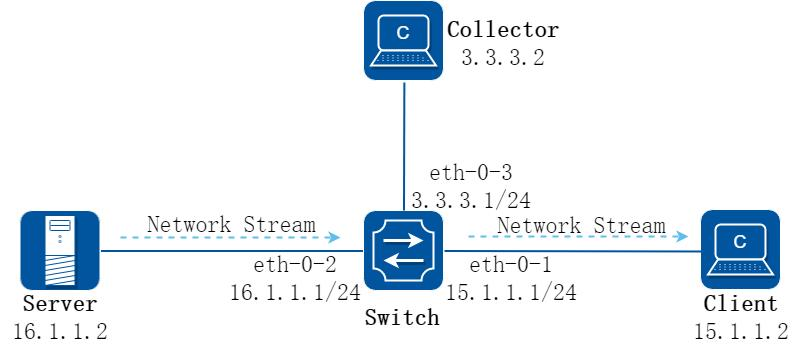

**图9-11 sflow**

##### 2. 配置步骤

##### 步骤1 进入配置模式

```
Switch# configure terminal
```

##### 步骤2 全局使能sflow

```
Switch(config)# sflow enable
```

##### 步骤3 设置sflow 全局属性

配置本地直连监视器端口的agent IP 地址和监视器的地址和UDP 端口号，UDP 端口号可以不配，表示用默认端口6343。

```
Switch(config)# sflow agent ip 3.3.3.1
Switch(config)# sflow collector 3.3.3.2 6342
```

IPv6 的Agent 地址和监视器地址配置：

```
Switch(config)# sflow agent ipv6 2001:2000::2
Switch(config)# sflow collector 2001:2000::1
```

sflow 功能正常工作，agent 和监视器都至少需要配置一个。不关心具体是IPv4或IPv6 的。

修改端口的统计信息每15 秒（默认20）发送一次（可选）：

```
Switch(config)# sflow counter interval 15
```

##### 步骤4 进入接口配置模式并配置接口属性

```
Switch(config)# interface eth-0-1
Switch(config-if)# no switchport
Switch(config-if)# no shutdown
Switch(config-if)# ip address 15.1.1.1/24
Switch(config-if)# exit
Switch(config)# interface eth-0-2
Switch(config-if)#no switchport
Switch(config-if)# no shutdown
Switch(config-if)# ip address 16.1.1.1/24
Switch(config-if)# exit
Switch(config)# interface eth-0-3
Switch(config-if)# no switchport
Switch(config-if)# no shutdown
Switch(config-if)# ip address 3.3.3.1/24
Switch(config-if)# exit
```

##### 步骤5 在eth-0-1 入方向使能sflow

```
Switch(config)# interface eth-0-1
Switch(config-if)# sflow flow-sampling rate 8192
Switch(config-if)# sflow flow-sampling enable input
```

```
Switch(config-if)# sflow counter-sampling enable
Switch(config-if)# exit
```

##### 步骤6 退出配置模式

```
Switch(config)# end
```

##### 步骤7 检查配置

用如下命令查看sflow 配置：

```
Switch# show sflow
sFlow Version: 5
sFlow Global Information:
Agent IPv4 address
: 3.3.3.1
Agent IPv6 address
: 2001:1000::2
Counter Sampling Interval
: 15 seconds
Collector 1:
IPv4 Address: 3.3.3.2
vrf: N/A
Port: 6342
Collector 2:
IPv6 Address: 2001:1000::1
vrf: N/A
Port: 6343
sFlow Port Information:
Flow-Sample
Flow-Sample
Port
Counter
Flow
Direction
Rate
- $$------------------------------------------------------
eth-0-1
Enable
Enable
Input
8192
```

## 9.9 LLDP配置

### 9.9.1 概述

#### 简介

链路层发现协议LLDP（Link Layer Discovery Protocol）是IEEE 802.1ab 中定义的第二层发现协议。第二层发现（Layer 2 Discovery）可以准确定位设备附带的接口及其连接的信息，包括端口的VLAN 属性和支持的协议类型等，并显示出了客户端、交换机、路由器和应用服务器以及网络服务器之间的路径。这些详细的信息对快速获取相连设备的拓扑状态、设备间的配置冲突、查询网络失败的根源将很有帮助。

### 9.9.2 配置举例

##### 1. 组网拓扑


**图9-12 lldp**

##### 2. 配置步骤

##### 步骤1 进入配置模式

```
Switch# configure terminal
```

##### 步骤2 全局使能lldp

```
Switch(config)# lldp enable
```

##### 步骤3 进入接口配置模式，配置接口lldp 属性

```
Switch(config)# interface eth-0-9
Switch(config)# no shutdown
Switch(config-if)# no lldp tlv 8021-org-specific vlan-name
Switch(config-if)# lldp tlv med location-id ecs-elin 1234567890
Switch(config-if)# lldp enable txrx
Switch(config-if)# exit
```

##### 步骤4 配置定时器（可选）

配置LLDP 报文传输间隔为40 秒；配置LLDP 报文传输延迟为3 秒；配置LLDP 重新使能延迟为1 秒。

```
Switch(config)# lldp timer msg-tx-interval 40
Switch(config)# lldp timer tx-delay 3
Switch(config)# lldp timer reinit-delay 1
```

##### 步骤5 退出配置模式

```
Switch(config)# end
```

##### 步骤6 检查配置

用如下命令查看LLDP 配置：

```
Switch# show lldp local config
LLDP global configuration:
============================================================
LLDP function global enabled : YES
LLDP msgTxHold
: 4
LLDP msgTxInterval : 40
LLDP reinitDelay
: 1
LLDP txDelay
: 3
Switch# show lldp local config interface eth-0-9
LLDP configuration on interface eth-0-9 :
============================================================
LLDP admin status : TXRX
Basic optional TLV Enabled:
Port Description TLV
System Name TLV
System Description TLV
System Capabilities TLV
Management Address TLV
IEEE 802.1 TLV Enabled:
Port Vlan ID TLV
```

```
Port and Protocol Vlan ID TLV
Protocol Identity TLV
IEEE 802.3 TLV Enabled:
MAC/PHY Configuration/Status TLV
Power Via MDI TLV
Link Aggregation TLV
Maximum Frame Size TLV
LLDP-MED TLV Enabled:
Med Capabilities TLV
Network Policy TLV
Location Identification TLV
Extended Power-via-MDI TLV
Inventory TLV
Switch# show running-config
!
lldp enable
lldp timer msg-tx-interval 40
lldp timer reinit-delay 1
lldp timer tx-delay 3
!
interface eth-0-9
lldp enable txrx
no lldp tlv 8021-org-specific vlan-name
lldp tlv med location-id ecs-elin 1234567890
!
Switch# show lldp neighbor
Local Port management interface has 0 neighbor(s)
Local Port eth-0-1 has 0 neighbor(s)
Local Port eth-0-2 has 0 neighbor(s)
…
Local Port eth-0-9 has 2 neighbor(s)
Remote LLDP Information of port eth-0-9
============================================================
Neighbor Index : 1
Chassis ID type: Mac address
Chassis ID
: 48:16:be:a4:d7:09
Port ID type
: Interface Name
Port ID
: eth-0-9
TTL : 160
Expired time: 134
…
Location Identification :
ECS ELIN: 1234567890
```

## 9.10 IPFIX配置

### 9.10.1 概述

#### 简介

我们把网络节点之间的数据流量看作一条条不同的流，这些流穿梭于数据网络之上。出于管理或其他需求，这些流所包含的信息非但有趣、有用，并且很有必要获取。为此，我们需要一个统一的机制来展示这些流的信息，在此之前，我们还需要将这些信息从不同的网络节点送往统一的收集设备。基于这样的需求，IPFIX 应运而生了。

#### 原理描述

协议标准：参考RFC7011/RFC7012 (IPFIX version 10)

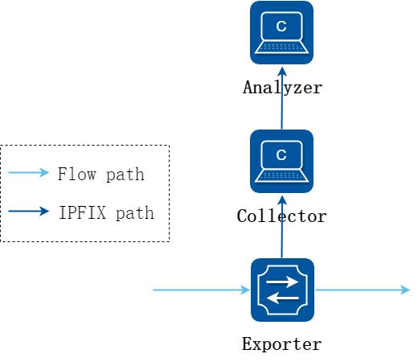

**图9-13 IPFIX 基本组网**

IPFIX 主要涉及到三个设备：Exporter、Collector 和Analyzer。

Exporter 对网络流量进行分析处理，并将统计结果发送给Collector。

Collector 和Analyzer 对数据进行解析、提取，提供后续处理，例如生成图像等。

交换机一般作为Exporter 工作，下面介绍Exporter 中的一些概念。

流的建立：交换机需要支持识别并建立一条流。这条流也许包含相同的MAC、相同的IP、相同的VLAN 等等。具体报文的哪些字段相同才会被认为是同一条流，可以由用户根据实际需求来配置。

流的老化：当一条流建立之后，如果它长时间没有流量通过，会占用系统资源。所以交换机需要支持流的老化。用户可以根据实际需求配置老化时间。如果不配置，系统也有默认的老化时间，目前是1800 秒。(一条流1800 秒之内没有任何报文通过，这条流就被删除了）

信息采集：支持设置间隔采样频率，例如100 个报文中随机采样1 个。采样间隔越大，则收集到的信息越粗略，但是系统负担较轻；反之如果采集所有报文，信息会很全面，但是系统性能压力大。用户可以自行选择一个适中的采样频率。

信息输出：交换机支持将收集的流信息送往收集器。用户可以指定发送报文的目的地址、出接口、DSCP 值等参数。

IPFIX 报文需要传输模版和流信息两类内容，模版用来告诉收集器和解析器如何解释后面的流信息，例如第一个字段为源MAC，第二字段为源IP……以此类推。流信息则根据这个模版来填充。用户可以分别设置模版和流信息的发送间隔、发送条件等。发送间隔如果不配置，默认都是600 秒。发送条件是指，流建立时立即发送、流老化时立即发送等。

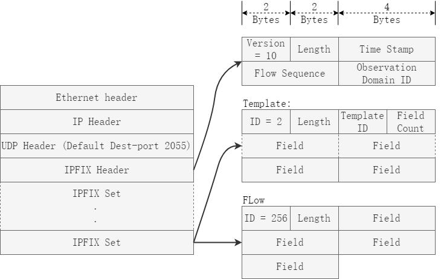

**图9-14 IPFIX 报文示意**

如上图所示，IPFIX 报文以UDP 格式封装，默认目的端口号为2055。IPFIX 报文主体中可包含多个Set，set 的内容可以是模版，也可以是流信息。

### 9.10.2 配置举例

#### IPFIX 基本配置

##### 1. 组网拓扑

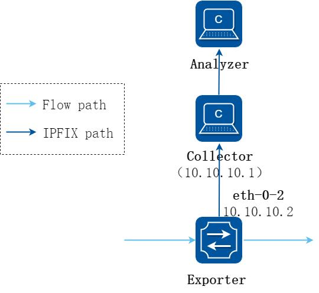

**图9-15 IPFIX 基本配置**

##### 2. 配置步骤

##### 步骤1 进入配置模式

```
Switch# configure terminal
```

##### 步骤2 配置三层接口

```
Switch(config)# interface eth-0-2
Switch(config-if)# no shutdown
Switch(config-if)# no switchport
Switch(config-if)# ip address 10.10.10.2/24
Switch(config-if)# exit
```

##### 步骤3 配置recorder

IPFIX 可以根据报文的五元组信息、VLAN、VNI 等信息来标记一条流。用户可以根据实际需求，在Recorder 中指定以那些特征来区分流。下面配置中，配置了源MAC、源目的IP、VNI，也就是当报文源MAC、源目的IP、VNI 全部都相同时，认为这些报文属于同一个流。

另外需要配置collect counter，下面配置中，collect counter bytes 和collect counter packets 都配置了，即同时记录字节数和报文数。

```
Switch(config)# ipfix recorder recorder1
Switch(Config-ipfix-reocrder)# match mac source address
Switch(Config-ipfix-reocrder)# match ipv4 source address mask 32
Switch(Config-ipfix-reocrder)# match ipv4 destination address mask 32
Switch(Config-ipfix-reocrder)# match vxlan-vni
```

```
Switch(Config-ipfix-reocrder)# collect counter bytes
Switch(Config-ipfix-reocrder)# collect counter packets
Switch(Config-ipfix-reocrder)# exit
```

##### 步骤4 配置流的老化时间（可选）

设置老化时间为300 秒。默认值1800 秒。

```
Switch(config)# ipfix global
Switch(Config-ipfix-global)# flow aging 300
```

##### 步骤5 配置sampler

在IPFIX sample 中，配置采样频率。下面配置中，频率为1/100。

```
Switch(config)# ipfix sampler sampler1
Switch(Config-ipfix-sampler)# 1 out-of 100
Switch(Config-ipfix- sampler)# exit
```

##### 步骤6 配置exporter

在IPFIX exporter 中，配置IPFIX 报文的封装、发送方式。在下面的配置中，发送报文的目的IP 为10.10.10.1(即Collector 的地址), 从eth-0-2 口发出，发送间隔为200秒。

“event flow end timeout”配置表示，当flow 超时之后，会立即发送数据报文给Collector。

```
Switch(config)# ipfix exporter exporter1
Switch(Config-ipfix-exporter)# destination 10.10.10.1
Switch(Config-ipfix-exporter)# source interface eth-0-2
Switch(Config-ipfix-exporter)# flow data timeout 200
Switch(Config-ipfix-exporter)# event flow end timeout
Switch(Config-ipfix-exporter)# exit
```

##### 步骤7 配置monitor

将上述recorder 和exporter 绑定到同一个monitor 下。

```
Switch(config)# ipfix monitor monitor1
Switch(Config-ipfix-monitor)# recorder recorder1
Switch(Config-ipfix-monitor)# exporter exporter1
Switch(Config-ipfix-monitor)# exit
```

##### 步骤8 进入接口配置模式，并在接口上应用ipfix monitor

可以同时指定monitor 和sampler，由sampler 配置决定采样率。(如果不选sample，那么默认的采样率为100%)

```
Switch(config)# interface eth-0-1
Switch(config-if)# ipfix monitor input monitor1 sampler sampler1
Switch(config-if)# exit
```

##### 步骤9 退出配置模式

```
Switch(config)# end
```

##### 步骤10 检查配置

用如下命令查看IPFIX 配置：

```
Switch# show ipfix global
IPFIX global information:
Flow cache aging interval
: 300 seconds
Flow cache export interval
: 5 seconds
Flow cache dropped packet wraparound threshold
: 1023
Flow cache jitter threshold
: 65535 ns
Flow cache latency threshold
: 16777215 ns
feature hardware-telemetry: disable
Switch# show ipfix recorder recorder1
IPFIX recorder information:
Name
: recorder1
Description
:
Match info
:
match Source Mac Address
match IPv4 Source Address
match IPv4 Destination Address
match Vxlanvni
Collect info
:
collect Flow Byte Number
collect Flow Packet Number
Switch# show ipfix exporter exporter1
IPFIX exporter information:
Name
: exporter1
Description
:
Exporter Interface
: eth-0-2
Domain ID
: 0
Collector Name
: 10.10.10.1
IPFIX message protocol
: UDP
IPFIX message destination Port
: 2055
IPFIX message TTL value
: 255
IPFIX message DSCP value
: 63
IPFIX data interval
: 200
IPFIX template interval
: 1800
IPFIX exporter events
:
Flow aging event
Switch# show ipfix sampler sampler1
IPFIX sampler information:
Name
: sampler1
Description
:
Rate
: 100
Switch# show ipfix monitor monitor1
IPFIX monitor information:
Name
: monitor1
Description
:
Recorder
: recorder1
exporter
: exporter1
flow mirror packet
: 0
flow mirror destination
: NA
```

## 9.11 Hardware Monitor配置

### 9.11.1 概述

#### 简介

Hardware Monitor 是一个在硬件层面实现的网络流量监控工具，它可以实时地监控网络拥塞情况，并及时上报网络管理员以采取相应的流量管理策略。Hardware Monitor 包括两个模块：Buffer Monitor 和Latency Monitor。

Buffer Monitor：Buffer Monitor 用来监控端口的buffer cell 的占用情况，并实时上报拥塞事件。

Latency Monitor：Latency Monitor 用来监控报文的转发时延，并实时上报延迟事件，以及丢弃高转发时延的报文。

除此之外，Hardware Monitor 还提供水印功能和通告功能。

水印功能：水印功能用来记录一段时间内端口的buffer cell 被占用的最大值和报文转发时延的最大值。

通告功能：通告功能用来将Hardware Monitor 模块采集到的数据及上报的事件发送给指定的通告服务器。

#### 原理描述

Hardware Monitor 分为Buffer Monitor 模块和Latency Monitor 模块，以下分别描述其原理。

##### 1. Buffer Monitor 原理描述

Buffer Monitor 模块原理示意图如下：

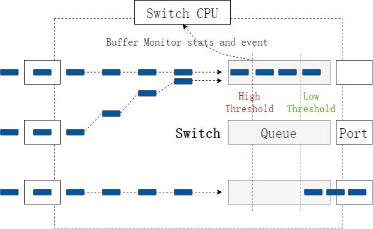

**图9-16 Buffer Monitor 原理示意图**

当转发到交换机某一接口的流量超过其最大的转发能力时，交换机会将无法立即转发的报文暂时缓存起来，等到拥塞缓解或解除的时候再转发。交换机芯片用来缓存报文的最小单元为buffer cell，通过监控端口的buffer cell 的占用情况可以判断网络的拥塞状况。

在使能了Buffer Monitor 功能的接口上，交换机会以10ms 为周期采样该接口的buffer cell 占用数值，并打上时间戳。当接口占用的buffer cell 的数量超过High Threshold时，交换机会立即向CPU 上报一个拥塞开始事件并附上事件发生时的时间戳；当接口占用的buffer cell 的数量由High Threshold 减少到低于Low Threshold 时，交换机会立即向CPU 上报一个拥塞结束事件并附上事件发生时的时间戳。如果开启了Buffer Monitor 模块的通告功能，系统会以管理员定义的时间间隔向通告服务器发送一个Buffer Stats Notify 报文，其内容是被监控端口的名称、buffer cell 占用情况以及数据上报时的时间戳；并且当拥塞事件发生和结束时，系统会立即向通告服务器发送一个Micro-burst Start Notify 和Micro-burst Stop Notify 报文，其内容也是被监控端口的名称、buffer cell 占用情况以及事件上报时的时间戳。

##### 2. Latency Monitor 原理描述

Latency Monitor 模块原理示意图如下：

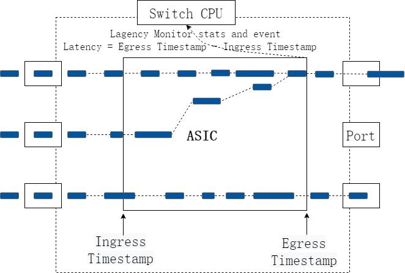

**图9-17 Latency Monitor 原理示意图**

Latency Monitor 模块可以统计一个报文在交换机内部的转发时延，用户可以配置8 个时间区间，在开启了Latency Monitor 功能的接口上，交换机会以10ms 为周期统计落在各个区间上的报文个数。

当报文的转发时延超过High Threshold 时，交换机会立即向CPU 上报一个延迟开始事件并附上事件发生时的时间戳、报文的转发时延和报文的入端口信息；当报文的转发时延低于Low Threshold 时，交换机会立即向CPU 上报一个延迟结束事件并附上事件发生时的时间戳、报文的转发时延和报文的入端口信息。在开启高转发时延报文丢弃功能的端口上，如果报文的的转发时延超过Drop Threshold 时，该报文会被丢弃。如果开启了Latency Monitor 的通告功能，系统会以管理员定义的时间间隔向通告服务器发送一个Latency Stats Notify 报文，其内容是被监控端口的名称和这段时间内落在各个时间区间上的报文个数；并且当延迟事件开始和结束时，系统会立即向通告服务器发送一个Latency Event Start Notify 和Latency Event Stop Notify 报文，其内容是被监控端口的名称，触发该事件的报文的入端口名称，触发该事件的报文的转发时延和该事件发生时的时间戳。

### 9.11.2 配置举例

#### Buffer Monitor 配置

如下示例，显示了如何使能eth-0-9 端口的Buffer Monitor 功能和系统的拥塞事件上报功能，配置触发拥塞事件上报的高、低阈值为3200 个buffer cell、64 个buffer cell。

##### 步骤1 进入配置模式

```
Switch# configure terminal
```

##### 步骤2 进入端口配置模式

```
Switch(config)# interface eth-0-9
```

##### 步骤3 开启该端口的buffer monitor 功能

```
Switch(config-if)# hardware buffer-monitor enable
```

##### 步骤4 退出端口配置模式

```
Switch(config-if)# exit
```

##### 步骤5 开启系统的拥塞事件上报功能

```
Switch(config)# hardware buffer-monitor micro-burst enable
```

##### 步骤6 配置触发拥塞事件的高低阈值

```
Switch(config)# hardware buffer-monitor micro-burst threshold low 64 high 3200
```

##### 步骤7 退出配置模式

```
Switch(config)# end
```

##### 步骤8 检查配置

```
Switch# show hardware buffer-monitor status
Hardware buffer micro-burst event: enable
Hardware buffer micro-burst threshold low: 64
high: 3200
Port
buffer monitor
-----------------------------------------------------------------------------
eth-0-1
disable
eth-0-2
disable
eth-0-3
disable
eth-0-4
disable
eth-0-5
disable
eth-0-6
disable
eth-0-7
disable
eth-0-8
disable
eth-0-9
enable
eth-0-10
disable
eth-0-11
disable
eth-0-12
disable
eth-0-13
disable
eth-0-14
disable
eth-0-15
disable
eth-0-16
disable
```

```
eth-0-17
disable
eth-0-18
disable
eth-0-19
disable
eth-0-20
disable
eth-0-21
disable
eth-0-22
disable
eth-0-23
disable
eth-0-24
disable
eth-0-25
disable
eth-0-26
disable
```

##### 步骤9 显示Buffer Monitor 统计数据

查看Buffer Monitor 在eth-0-9 端口记录的前20 条数据：

```
Switch# show hardware buffer-monitor interface eth-0-9 20
Brief CLI issued at : 08:39:15 UTC Fri Jan 28 2022
Flag (micro-burst)
: S - Start record
E - End record
U - Update record
Flag Time
Total count
--------------------------------------------------------
-
08:39:11.698066906
58368
-
08:39:11.688067287
58367
-
08:39:11.678067668
58365
-
08:39:11.668068049
58366
-
08:39:11.658068430
58369
-
08:39:11.648068811
58368
-
08:39:11.638069192
58367
-
08:39:11.628069573
58366
-
08:39:11.618069954
58370
-
08:39:11.608070335
58367
-
08:39:11.598070716
58368
-
08:39:11.588071097
58369
-
08:39:11.578071478
58368
-
08:39:11.568071859
58367
-
08:39:11.558072240
58367
-
08:39:11.548072621
58369
-
08:39:11.538073002
58366
-
08:39:11.528073383
58368
-
08:39:11.518073764
58369
-
08:39:11.508074145
58369
```

查看eth-0-9 端口上的拥塞事件：

```
Switch# show hardware buffer-monitor micro-burst interface eth-0-9
Brief CLI issued at : 09:20:11 UTC Fri Jan 28 2022
Flag (micro-burst)
: S - Start record
E - End record
Flag Time(ns)
Total count
Threshold level
---------------------------------------------------------------------
E
09:20:06.892459921
64
0
S
09:19:05.087003316
3200
0
```

#### Latency Monitor 配置

如下示例，显示了如何使能eth-0-9 端口的Latency Monitor 功能和高转发时延丢弃功能，配置系统的8 个延时时间区间与设置触发延迟事件的阈值和高转发时延报文丢弃的阈值。

##### 步骤1 进入配置模式

```
Switch# configure terminal
```

##### 步骤2 进入端口配置模式

```
Switch(config)# interface eth-0-9
```

##### 步骤3 开启该端口的Latency Monitor 功能

```
Switch(config-if)# hardware latency-monitor enable
```

##### 步骤4 开启该端口的高转发时延报文丢弃功能（可选）

```
Switch(config-if)# hardware latency-monitor drop
```

##### 步骤5 配置该端口丢弃高转发时延报文的阈值（可选）

配置丢弃高转发时延报文的阈值是第6 个时间区间：

```
Switch(config-if)# hardware latency-monitor threshold drop 6
```

##### 步骤6 退出端口配置模式

```
Switch(config-if)# exit
```

##### 步骤7 配置系统的8 个延迟时间区间

```
Switch(config)# hardware latency-monitor range 640 3200 6400 12800 25600 128000 256000
```

##### 步骤8 配置触发延迟事件的高低阈值

配置触发延迟事件的高阈值为报文的转发时延达到64000ns，低阈值为报文的转发时延降到1280ns：

```
Switch(config)# hardware latency-monitor threshold event low 1280 high 64000
```

##### 步骤9 退出配置模式

```
Switch(config)# end
```

##### 步骤10 检查配置

```
Switch# show hardware latency-monitor status
Hardware latency monitor range(ns)
Range1:
1-640
Range2:
640-3200
Range3:
3200-6400
Range4:
6400-12800
Range5: 12800-25600
Range6: 25600-128000
Range7:128000-256000
Range8:256000-more
Port
monitor
event low
event high
drop-threshold
-----------------------------------------------------------------------------
eth-0-1
disable
disable
disable
disable
eth-0-2
disable
disable
disable
disable
eth-0-3
disable
disable
disable
disable
eth-0-4
disable
disable
disable
disable
eth-0-5
disable
disable
disable
disable
eth-0-6
disable
disable
disable
disable
eth-0-7
disable
disable
disable
disable
eth-0-8
disable
disable
disable
disable
eth-0-9
enable
1280
64000
6
eth-0-10 disable
disable
disable
disable
eth-0-11 disable
disable
disable
disable
eth-0-12 disable
disable
disable
disable
```

```
eth-0-13 disable
disable
disable
disable
eth-0-14 disable
disable
disable
disable
eth-0-15 disable
disable
disable
disable
eth-0-16 disable
disable
disable
disable
eth-0-17 disable
disable
disable
disable
eth-0-18 disable
disable
disable
disable
eth-0-19 disable
disable
disable
disable
eth-0-20 disable
disable
disable
disable
eth-0-21 disable
disable
disable
disable
eth-0-22 disable
disable
disable
disable
eth-0-23 disable
disable
disable
disable
eth-0-24 disable
disable
disable
disable
eth-0-25 disable
disable
disable
disable
eth-0-26 disable
disable
disable
disable
```

##### 步骤11 显示Latency Monitor 统计数据

查看Latency Monitor 在eth-0-9 端口统计的前16 条数据：

```
Switch# show hardware latency-monitor interface eth-0-9 16
Brief CLI issued at: 19:32:34 UTC Mon Feb 07 2022
Format:
0-640 - the count of packets with latency between 0ns and 640ns
0
640
3200
6400
12800
25600
128000
256000
- $$
-
-
-
-
-
-
-
Time
640
3200
6400
12800
25600
128000
256000
more
09:52:57.366657807
35
2447
4492
3633
994
1256
1207
581
09:52:57.356657807
41
2519
4743
3675
1016
1463
1001
180
09:52:57.346657807
55
2752
5017
3957
961
1213
637
51
09:52:57.336657807
43
2463
4629
3519
877
1266
1123
721
09:52:57.326657807
41
2464
4827
3900
959
1243
805
403
09:52:57.316657807
37
2681
4951
3767
1015
1187
750
256
09:52:57.306657807
49
2411
4614
3541
848
1254
1175
754
09:52:57.296657807
32
2581
4571
3635
1038
1475
1138
167
09:52:57.286657807
41
2666
5036
3875
885
1057
874
207
09:52:57.276657807
38
2506
4802
3792
976
1163
1105
260
09:52:57.266657807
41
2464
4827
3900
959
1243
805
403
09:52:57.256657807
37
2681
4951
3767
1015
1187
750
256
09:52:57.246657807
49
2411
4614
3541
848
1254
1175
754
09:52:57.236657807
32
2581
4571
3635
1038
1475
1138
167
09:52:57.226657807
41
2666
5036
3875
885
1057
874
```

```
207
09:52:57.216657807
38
2506
4802
3792
976
1163
1105
260
```

查看Latency Monitor 在eth-0-9 端口的平均延迟的前16 条数据：

```
Switch# show hardware latency-monitor avg-latency interface eth-0-9 16
Average latency calculation interval : 5s
Time
Average Latency(ns)
----------------------------------------------------------------------
09:53:17.866657807
4924
09:53:12.866657807
4437
09:53:07.866657807
4170
09:53:02.866657807
4296
09:52:57.866657807
4278
09:52:52.866657807
4519
09:52:47.866657807
4146
09:52:42.866657807
4715
09:52:37.866657807
4360
09:52:32.866657807
4028
09:52:27.866657807
4278
09:52:22.866657807
4519
09:52:17.866657807
4146
09:52:12.866657807
4715
09:52:07.866657807
4360
09:52:02.866657807
4028
```

查看eth-0-9 端口上报的延迟事件：

```
Switch# show hardware latency-monitor event interface eth-0-9
Brief CLI issued at: 10:06:13 UTC Fri Jan 28 2022
Flags
: S - Start record
E - End record
Time
RangeId
Latency(ns)
Status
Source Port
----------------------------------------------------------------------------------
10:06:13.098854000
6
63994
S
eth-0-3
10:06:13.098849000
2
1280
E
eth-0-3
10:06:13.098845000
6
64032
S
eth-0-3
10:06:13.098840000
2
1282
E
eth-0-3
10:06:13.098836000
6
64036
S
eth-0-3
10:06:13.098832000
2
1304
E
eth-0-1
```

#### 通告功能配置

系统网络拓扑如下：

##### 1. 组网拓扑

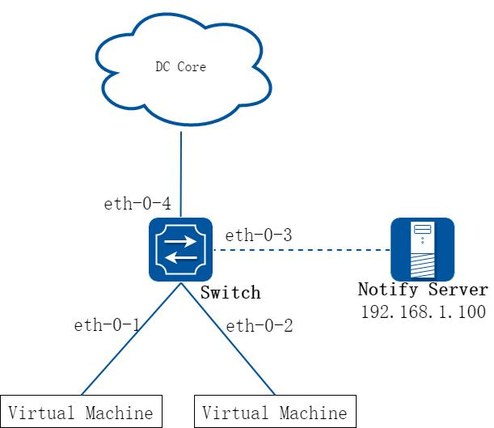

**图9-18 通告功能网络拓扑**

以下示例说明了如何开启eth-0-4 端口的Hardware Monitor 功能，并配置通告服务器地址为192.168.1.100，使能Hardware Monitor 的数据及事件上报功能。

##### 2. 配置步骤

##### 步骤1 进入配置模式

```
Switch# configure terminal
```

##### 步骤2 配置通告服务器IP 地址

```
Switch(config)# hardware monitor notify server 192.168.1.100
```

##### 步骤3 配置发送通告报文的周期

```
Switch(config)# hardware monitor notify interval 20
```

##### 步骤4 配置eth-0-3 端口为三层口

```
Switch(config)# interface eth-0-3
Switch(config-if)# no switchport
```

##### 步骤5 配置eth-0-3 端口的IP 地址

```
Switch(config-if)# ip address 192.168.1.1/24
```

##### 步骤6 退出端口配置模式

```
Switch(config-if)# exit
```

##### 步骤7 使能拥塞事件上报功能并配置触发拥塞事件的高低阈值

```
Switch(config)# hardware buffer-monitor micro-burst enable
Switch(config)# hardware buffer-monitor micro-burst threshold low 32 high 256
```

##### 步骤8 配置系统的8 个延迟时间区间和触发延迟事件的高低阈值

```
Switch(config)# hardware latency-monitor range 640 1280 2560 5120 10240 20480 40960
Switch(config)# hardware latency-monitor threshold event low 64 high 6400
```

##### 步骤9 进入端口配置模式

```
Switch(config)# interface eth-0-4
```

步骤10 开启该端口的Buffer monitor 功能及Buffer Monitor 相关的报文通告功能

```
Switch(config-if)# hardware buffer-monitor enable
Switch(config-if)# hardware buffer-monitor notify
```

步骤11 开启该端口的Latency Monitor 功能及Latency Monitor 相关的报文通告功能

```
Switch(config-if)# hardware latency-monitor enable
Switch(config-if)# hardware latency-monitor notify
```

##### 步骤12 退出配置模式

```
Switch(config-if)# end
```

##### 步骤13 检查配置

```
Switch# show hardware buffer-monitor
status
Hardware buffer micro-burst event: enable
Hardware buffer micro-burst threshold low: 32
high: 256
Port
buffer monitor
-----------------------------------------------------------------------------
eth-0-1
disable
eth-0-2
disable
eth-0-3
disable
eth-0-4
enable
eth-0-5
disable
eth-0-6
disable
eth-0-7
disable
eth-0-8
disable
eth-0-9
disable
eth-0-10
disable
eth-0-11
disable
eth-0-12
disable
eth-0-13
disable
eth-0-14
disable
eth-0-15
disable
eth-0-16
disable
eth-0-17
disable
eth-0-18
disable
eth-0-19
disable
eth-0-20
disable
Switch# show hardware latency-monitor status
Hardware latency monitor range(ns)
Range1:
1-640
Range2:
640-1280
Range3:
1280-2560
Range4:
2560-5120
Range5:
5120-10240
Range6: 10240-20480
Range7: 20480-40960
Range8: 40960-more
Port
monitor
event low
event high
drop-threshold
-----------------------------------------------------------------------------
eth-0-1
disable
disable
disable
disable
eth-0-2
disable
disable
disable
disable
```

```
eth-0-3
disable
disable
disable
disable
eth-0-4
enable
64
6400
disable
eth-0-5
disable
disable
disable
disable
eth-0-6
disable
disable
disable
disable
eth-0-7
disable
disable
disable
disable
eth-0-8
disable
disable
disable
disable
eth-0-9
disable
disable
disable
disable
eth-0-10 disable
disable
disable
disable
eth-0-11 disable
disable
disable
disable
eth-0-12 disable
disable
disable
disable
eth-0-13 disable
disable
disable
disable
eth-0-14 disable
disable
disable
disable
eth-0-15 disable
disable
disable
disable
eth-0-16 disable
disable
disable
disable
eth-0-17 disable
disable
disable
disable
eth-0-18 disable
disable
disable
disable
eth-0-19 disable
disable
disable
disable
eth-0-20 disable
disable
disable
disable
```
