# 10 流量管理配置指导

## 10.1 QoS配置

### 10.1.1 概述

#### 简介

##### 1. 缩略语说明

| 缩略语 | 英文全称 | 翻译与解释 |
|---|---|---|
| QoS | Quality of Service | 服务质量 |
| MQC | Modular QoS CLI | 模块化QoS 命令行 |
| ISP | Inernet Service Provider | 因特网服务提供商 |
| IntServ | Integrated Service | 综合服务 |
| DiffServ | Differentiated Service | 区分服务 |
| PHB | Per Hop Behavior | 单中继段行为 |
| CS | Class Selector | 类选择码 |
| EF | Expedited Forwarding | 加速转发 |
| AF | Assured Forwarding | 确保转发 |
| BF | Best Effort | 尽力转发 |
| CoS | Class of Service | 服务等级 |
| DSCP | DiffServ Code Point | 区分服务编码点 |
| SrTCM | Single Rate Three Color Marker | 单速率双桶模型 |
| TrTCM | Two Rate Three Color Marker | 双速率双桶模型 |
| CIR | Committed Information Rate | 承诺信息速率 |
| CBS | Committed Burst Size | 承诺突发尺寸 |
| EIR | Extended Information Rate | 超额信息速率 |
| EBS | Extended Burst Size | 超额突发尺寸 |
| PIR | Peak Information Rate | 峰值信息速率 |
| PBS | Peak Burst Size | 超额突发尺寸 |
| CF | Coupling Flag | 耦合标记 |
| CQ | Class Queue | 定制队列 |
| FIFO | First In First Out | 先进先出 |
| SP | Strict Priority | 严格优先级 |
| PQ | Priority Queuing | 优先队列 |
| RR | Round Robin | 轮询 |
| WRR | Weighted Round Robin | 加权轮询 |
| DRR | Deficit Round Robin | 差分轮询 |
| DWRR | Deficit Weighted Round Robin | 差分加权轮询 |
| WFQ | Weighted Fair Queuing | 加权公平队列 |
| TD | Tail Drop | 尾丢弃 |
| WTD | Weighted Tail Drop | 加权尾丢弃 |
| RED | Random Early Detection | 随机先期检测（随机早丢弃） |
| WRED | Weighted Random Early<br>Detection | 加权随机先期检测 |
| LR | Line Rate | 物理接口总速率限制 |

##### 2. 功能说明

QoS（Quality of Service，服务质量）是各种存在服务供需关系的场合中普遍存在的概念，它评估服务方满足客户服务需求的能力。评估通常不是精确的评分，而是注重分析在什么条件下服务是好的，在什么情况下还存在着不足，以便有针对性地作出改进。

在因特网中，QoS 所评估的就是网络投递分组的服务能力。由于网络提供的服务是多样的，因此对QoS 的评估可以基于不同方面。通常所说的QoS，是对分组投递过程中为延迟、延迟抖动、丢包率等核心需求提供支持的服务能力的评估。QoS 是网络的一种安全机制，是用来解决网络延迟和阻塞等问题的一种技术。在正常情况下，如果网络只用于特定的无时间限制的应用系统，并不需要QoS，比如Web 应用，或E-mail 设置等。但是对关键应用和多媒体应用就十分必要。当网络过载或拥塞时，QoS 能确保重要业务量不受延迟或丢弃，同时保证网络的高效运行。

QoS （Quality of Service）旨在针对各种应用的不同需求，为其提供不同的服务质量，例如：提供专用带宽、减少报文丢失率、降低报文传送时延及时延抖动等。为实现上述目的，QoS 通常采用不同的技术来实现，比如流分类和着色、流量监管、流量整形、网络拥塞管理、网络拥塞避免等，它们主要完成如下功能：

流分类：依据一定的匹配规则识别出对象；

流量监管：对进入网络设备的特定流量的规格进行监管。当流量超出规格时，可以采取限制或惩罚措施，以保护服务提供商的商业利益和网络资源不受损害；

流量整形：一种主动调整流的输出速率的流控措施，通常是为了使流量适配下游路由器可供给的网络资源，避免不必要的报文丢弃和拥塞；

拥塞管理：网络拥塞时必须采取的解决资源竞争的措施。通常是将报文放入队列中缓存，并采取某种调度算法安排报文的转发次序；

拥塞避免：过度的拥塞会对网络资源造成损害，拥塞避免监督网络资源的使用情况，当发现拥塞有加剧的趋势时采取主动丢弃报文的策略，通过调整流量来解除网络的过载；

在这些QoS 技术中，流分类是基础，它依据一定的匹配规则识别出报文，是实施QoS 的前提；而流量监管、流量整形、拥塞管理和拥塞避免从不同方面对网络流量及其分配的资源实施控制，是实施QoS 的具体体现。

#### 背景

在传统的IP 网络中，所有的报文都被无区别的等同对待，每个转发设备对所有的报文均采用先入先出（FIFO）的策略进行处理，它尽最大的努力（Best-Effort）将报文送到目的地，但对报文传送的可靠性、传送延迟等性能不提供任何保证。

网络发展日新月异，随着IP 网络上新应用的不断出现，对IP 网络的服务质量也提出了新的要求，例如VoIP 等实时业务就对报文的传输延迟提出了较高要求，如果报文传送延时太长，用户将不能接受（相对而言，E-Mail 和FTP 业务对时间延迟并不敏感）。为了支持具有不同服务需求的语音、视频以及数据等业务，要求网络能够区分出不同的通信，进而为之提供相应的服务。传统IP 网络的尽力服务不可能识别和区分出网络中的各种通信类别，而具备通信类别的区分能力正是为不同的通信提供不同服务的前提，所以说传统网络的尽力服务模式已不能满足应用的需要。

QoS 旨在针对各种应用的不同需求，为其提供不同的服务质量。

#### 原理描述

##### 1. QoS 术语和概念

访问控制列表（ACLs）

具有相同特征的流量进行分类。IP ACL 用来分类IP 流量，MAC ACL 用来分类除了IPV6和MPLS 以外的所有流量。

服务种类（CoS）

在网络的第2 层中确定报文优先级的字段。QoS 可以通过设置不同的CoS 值来区分不同优先级的流量。802.1Q 二层报文中可以携带2 字节的VLAN 标签，最高的3 个比特用于用户指定的优先级。其它类型的报文不能携带VLAN 标签。CoS 有3 个比特，其值的范围为0-7。

差分服务代码点（DSCP）

有6 个比特位，用来区分三层网络中的报文的优先级。DSCP 值范围是0-63。

IP-Precedence有3 个比特位，用来区分三层网络中报文的优先级。IP-Precedence 范围是0-7。

EXP有3 个比特位，用来区分MPLS 网络中的报文的优先级。MPLS EXP 值范围在0-7。

流分类（Traffic Classification）

指采用一定的规则识别出符合某类特征的报文。分类规则（classification rule）是用户根据管理需求配置的过滤规则。报文进入系统时，流分类处理引擎会为报文分配一个内部优先级，基于这个优先级，系统对报文进行一系列的处理。系统可以基于报文中的CoS、inner-CoS、DSCP、IP-Precedence，或者端口上的配置的默认CoS，或者依据policy-map 配置映射出的内部优先级。

流量整形（Shaping）

是通过缓存报文来改变并调节入方向的流速率，从而使出方向的流速率表现地更加平滑的一种方法。当入方向的流量出现高突发的时候，就需要将报文缓存并在后面发送，从而使出方向的流更加平滑，因此shaping 可能会增加报文的抖动。

流量整形可以应用在以下角色：

物理接口（port shaping）

出方向的队列（queue shaping）

当queue 应用双速率的shaping 时，需要保证该接口下所有queue 的CIR 之和不大于端口速率，并且不大于接口shaping 的速率。

流量监管（Policing）

会对流量进行测速，从而决定报文是保证速率内还是保证速率外，保证速率外的流量可能会被丢弃。

系统支持两种类型的policer：

配置在class-map 中，用于对匹配某个class-map 的流量限制带宽。

配置一个聚合policer，用户可以将匹配class-map 的流量加入这个policer 中。

聚合policer 限制的是其中所有的流量的带宽。

标记（Marking）

定义了对超出保证速率的流量的处理行为。系统采用两种行为中的一种：给报文标记颜色，后面会继续处理；直接丢弃报文。

标记能够在进口和出口方向使用。

Queueing每个出接口支持8 个单播队列，1 个组播队列以及1 个镜像队列。队列优先级越高，越先被调度。队列长度的单位是buffer cell。Buffer Cell 是报文的存储粒度单位，其大小为288 字节，报文越大，占用的buffer cell 越多。

Tail Drop是一种简单的丢弃算法，即队列中报文达到一定阈值（可配置）时，后来的报文会被丢弃。默认情况下，端口上的丢弃算法就是Tail Drop。系统支持在每个端口上为每个queue每种丢弃优先级制定一个Tail Drop 的阈值。

WRED（Weighted Random Early Detection）

WRED（Weighted Random Early Detection）可以提前以一定概率丢弃报文，达到避免拥塞的目的，通过提前丢弃报文，WRED 模式可以避免短时间内丢弃大量报文，导致大量TCP 连接同时触发慢启动和拥塞退避，网络带宽利用率瞬间降低的现象。系统支持在端口上为每个queue 每种丢弃优先级制定两个阈值。这两个阈值前者小于后者。当队列中报文达到前者时报文开始丢弃，队列中报文越多，丢弃概率越大。当队列中报文大于后一阈值时，报文全部丢弃。

Scheduling系统为每个队列分配一个优先级（class），范围是0 到7，数字越高表示优先级越高。

Basic 模式下端口上的8 个队列的优先级是可配置的。

QoS 启用，basic 模式下队列0 到7 对应的优先级为：0/1/2/3/4/5/6/7；

enterprise 模式下队列0 到7 对应的优先级为：3/3/4/4/4/4/5/7；enterprise advance模式下队列0 到11 对应的优先级为：3/3/4/4/4/4/5/7/0/1/2/3。QoS 禁用，所有队列的优先级均为0。

一个端口上，不同的优先级之间使用的SP 调度，即高优先级队列先被调度，当高优先级队列为空时才会调度低优先级队列。相同的优先级内的队列采用WDRR 调度。用户可以为各个队列设置权重。

QoS 启用，basic 模式下队列0 到7 对应的WDRR 权重为：1::1:1:1:1:1:1:1；

enterprise 模式下队列0 到7 对应的WDRR 权重为：1:1:4:10:10:10:1:1；enterprise advance 模式下队列0 到11 对应的WDRR 权重为：1:1:4:10:10:10:1:1:1:1:1:1 Class Map通过指定一些ACL 定义一组流。这些ACL 可以是match-all 或match-any 的，分别表示流量要同时匹配所有的ACL 或匹配任意的ACL。

Policy Map用来指定不同种类流量的具体行为，可实现如下需求：

将流按照指定的优先级和颜色区分出来为相应的优先级和颜色设置指定的信任策略为满足某个信任策略的流按照预先的配置做流量监管为指定的流做重定向为指定的流做镜像为指定的流做统计Policy Map 有如下属性：

一个Policy Map 可以包含多个流分类定义，并给出单独的行为每一个流分类定义可以匹配接口上的每一种流量每一个端口的每一个方向只能应用一个Policy Map。相同的Policy Map 可以在不同端口的不同方向上应用。

如果要使得Policy Map 生效，其必须被附加到一个端口上。

一个Policy Map 可以应用于物理接口（非聚合端口成员），聚合端口以及VLAN 接口。

Mapping Tables在QoS 处理中，交换机将所有流量都映射到内部优先级处理。

在流分类时，QoS 使用可配置的映射表进行报文映射，内部优先级共6 个比特，是从CoS、EXP、DSCP、IP-Precedence 的值映射而来，这些映射表包含了CoS-Priority-Color/CoS-PHB 表、EXP-Priority-Color/EXP-PHB 表、DSCP-Priority-Color/DSCP-PHB 表和IP-Precedence-Priority-Color/IP-Precedence-PHB。

在流量监管时，QoS 给报文分配一个新的优先级和颜色，比如依据Class-Map。

当流量结束调度阶段后，如果替换CoS 或者DSCP 被置起来，那么QoS 使用Priority-Color-Cos/PHB-CoS 或者Priority-Color-DSCP/PHB-DSCP 根据内部的优先级和颜色重新映射到CoS 或者DSCP每一个QoS 域的上述行为都是不同的Time-range通过使用Time-Range，Class-Map 的行为可以按照每周的特定时间来启用或者禁用。首先，定义Time-Range 的名字并设置其在一周内的时间，然后将其应用到ACE。可以使用Time-Range 来制定Class-Map 中独立的一条ACE 在每周的制定时间生效。

SRTCM单速率三色标记（Single Rate Three Color Marker）

TRTCM双速率三色标记（Two Rate Three Color Marker）

CIR承诺信息速率（Committed Information Rate）

CBS承诺突发尺寸（Committed Burst Size）

EIR超额信息速率（Excess Information Rate）

EBS超额突发尺寸（Excess Burst Size）

PIR峰值信息速率（Peak Information Rate）

PBS峰值突发尺寸（Peak Burst Size）

模块化的QoS 命令行入口流量应用QoS 策略进行分类。

class-map 类QoS用于定义一组流，定义的规则有CoS/DSCP/IP Precedence/EXP/ACL。

policy-map 类QoS用于划分流类型，相同类型的policy-map 关联同一个class-map 类QoS。

class-map 类流优先级用于定义流优先级，定义规则是流优先级。policy-map 类流优先级用于划分QoS 流量监管，相同类型的policy-map 关联同一个class-map 类流分类。

policy-map 类流优先级用于划分QoS 流量监管，相同类型的policy-map 关联同一个class-map 类流分类。

##### 2. MQC 术语和概念

交换机提供的MQC（Modular QoS CLI）配置方式将原始的基于接口的配置方式大大简化，网络管理员不再需要关心报文在进口和出口分别如何处理，只需要配置针对流的策略模板，再将策略模板应用到具体接口即可，对网络管理员和维护人员的要求大大降低。

分类模板和策略模板：

class-map：用于匹配报文和队列，并将匹配后的结果应用到对应的policy-map 中进行下一步操作；

policy-map：用于定义一组基于class-map 的分类集合，并对每个分类单独设置相应的策略；

分类模板（class-map）和策略模板（policy-map）均有两种类型：

qos：用于流分类，流量监管，关联队列和重标记优先级等操作，用在设备端口的入方向上；

traffic-class：用于设置队列的相关操作，如流量整形，丢弃策略，调度优先级和权重等；

系统MQC 配置流程如下：

配置class-map type qos 匹配报文，匹配依据可以为COS，DSCP 或者ACL；

将class-map type qos 应用到policy-map type qos 中，对不同的class-map 分别设置关联队列，流量监管，重标记优先级字段等操作，未匹配到的流归类为class-default，默认关联队列0 且无法更改。将此策略模板应用到报文入接口上使其生效；

配置class-map type traffic-class 匹配队列，支持直接配置队列1-7，0 为系统预留不提供用户配置；

将class-map type traffic-class 应用到policy-map type traffic-class 中，对不同的class-map 分别设置流量整形，设置丢弃类型，设置调度优先级、权重等操作，class-default 默认标记为队列0，不提供设置WDRR 调度权重的操作。将此策略模板应用到报文出接口上使其生效；

同一个policy-map 可以应用到多个接口上。

同一个接口同时只能应用一个入方向的policy-map（policy-map type qos）和一个出方向的policy-map（policy-map type traffic-class）。

##### 3. QoS 度量指标

QoS 采用如下参数来度量，为关键业务提供服务质量保证，使其获得可预期的服务水平。

带宽/吞吐量时延时延变化（抖动）

丢包率带宽/吞吐量带宽（bandwidth）也称为吞吐量（throughput），是指在一个固定的时间内（1 秒），从网络一端传输到另一端的最大数据位数，也可以理解为网络的两个节点之间特定数据流的平均速率。带宽的单位是比特/秒（bit/s，简写为bps）。

带宽可以用城市的水管做比喻来帮助理解它的含义：供水管道的直径可以衡量运水的能力。水管的直径好比是带宽，水就好比是网络传输的数据。使用粗管子就意味着拥有更宽的带宽，也就是有更大的数据传输能力。

在网络通信中，人们在使用网络时总是希望带宽越宽越好，特别是互联网功能日益强大，人们对互联网的需求不再是单一地浏览网页、查看新闻。新一代多媒体、影像传输、数据库、网络电视的信息量猛增使得带宽成为了严重的瓶颈。因此，带宽成为网络设计主要的设计点，也是分析网络运行情况的重要要素之一。


**图10-1 带宽对网络的影响**

时延时延（Latency）是指一个报文或分组从网络的一端传送到另一端所需要的时间。

以语音传输为例，时延是指从说话者开始说话到对方听到所说内容的时间。若时延太大，会引起通话声音不清晰、不连贯或破碎。

大多数用户察觉不到小于100 毫秒的延迟，当延迟在100 毫秒和300 毫秒之间时，说话者可以察觉到对方回复的轻微停顿，这种停顿可能会使通话双方都感觉到不舒服。超过300 毫秒，延迟就会很明显，用户开始互相等待对方的回复，当通话的一方不能及时接收到期望的回复时，说话者可能会重复之前所说的话，这样会与远端延迟的回复碰撞，导致重复。


**图10-2 时延对网络的影响**

时延变化（抖动）

时延变化，也称为抖动（Jitter），是指同一业务流中不同分组所呈现的时延不同。抖动主要是由于业务流中相继分组的排队等候时间不同引起的，是对服务质量影响最大的一个问题。

某些业务类型，特别是语音和视频等实时业务是极不容忍抖动的。分组到达时间的差异将在语音或视频中造成断续。

抖动也会影响一些网络协议的处理，有些协议是按固定的时间间隔发送交互性报文的，抖动过大会导致协议震荡。

所有传输系统都有抖动，只要抖动在规定容差之内就不会影响服务质量。利用缓存可以克服过量的抖动，但是这将会增加时延。

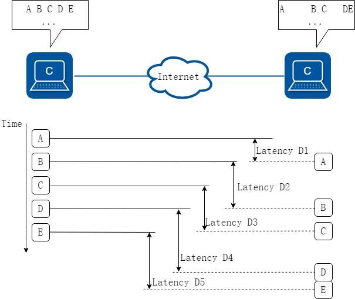

**图10-3 抖动对网络的影响**

丢包率少量的丢包（Loss）对业务的影响比较小，例如，在语音传输中，丢失一个比特或一个分组的信息，通话双方往往注意不到。在视频图像广播期间，丢失一个比特或一个分组可能造成在屏幕上瞬间的波形干扰，但视像很快恢复正常。使用传输控制协议（TCP）传送数据也能处理少量的丢包，因为传输控制协议允许丢失的信息重发。但大量的丢包会影响传输效率。所以，QoS 更关注的是丢包的统计数据——丢包率。丢包率是指在网络传输过程中丢失报文占传输报文的百分比。


**图10-4 丢包率对网络的影响**

常见业务QoS 指标在IP 网络上不同的业务对带宽、时延、时延抖动和丢包率等都有不同的需求。几种常见业务的QoS 指标如下表所示：

**表10-1 几种常见业务的QoS 指标**

| 企业业务类型 | 带宽/吞吐量 | 时延 | 抖动 | 丢包率 |
|---|---|---|---|---|
| 视频电话会议 | 带宽需求高 | 对时延非常敏感 | 对抖动非常敏感 | 要求可预计的时延<br>和丢包率 |
| 电子商务 | 带宽需求适当 | 对时延敏感 | 对抖动敏感 | 对丢包率敏感，必<br>须可靠传输 |
| 流媒体 | 带宽需求高 | 对时延比较敏感 | 对抖动比较敏感 | 要求可预计的时延<br>和丢包率 |
| 电子邮件、文件传<br>输 | 带宽需求低 | 容许时延 | 容许抖动 | 尽力而为传送 |
| HTML 网页浏览 | 带宽需求不定 | 容许适当时延 | 容许适当抖动 | 尽力而为传送 |
| 客户端/服务器<br>（FTP） | 带宽需求适当 | 对时延敏感 | 对抖动敏感 | 对丢包率敏感，必<br>须可靠传输 |

**表10-2 几种常见业务的QoS 定量指标**

| 企业业务类别 | 时延 | 抖动 | 丢包 |
|---|---|---|---|
| 视频电话会议 | ≤50ms | ≤10ms | ≤0.1% |
| 电子商务 | ≤200ms | ≤100ms | TCP 保证 |
| 流媒体 | ≤1s | ≤200ms | ≤0.1% |
| 电子邮件、文件传输 | N/A | N/A | TCP 保证 |
| HTML 网页浏览 | N/A | N/A | N/A |
| 客户端/服务器（FTP） | N/A | N/A | TCP 保证 |

**表10-3 MEF 论坛关于QoS 定量指标**

| 服务等级 | 服务特色 | 服务性能 |
|---|---|---|
| Premium (白金级) | 实时IP 电话/IP 视频应用 | 可用性>99.99% 时延<40ms 抖动<br><1ms 丢包率<0.1% 恢复时<br>间:50ms |
| Silver (白银级) | 存在突发流量的重要数据应用，<br>要求低延时、低丢包率。(例如<br>数据存储) | 可用性>99.99% 时延<50ms 抖动<br>：=N/A 丢包率=<0.1% 恢复时<br>间:200ms |
| Bronze (青铜级) | 存在突发流量的重要数据应用，<br>要求高带宽保障 | 可用性>99.99% 时延<500ms 抖<br>动=N/A 丢包率=N/A 恢复时<br>间:2s |
| Standard(标准级) | 尽力而为的服务 | 可用性>97.00% 时延=N/A 抖动<br>=N/A 丢包率=N/A 恢复时间:5s |

##### 4. QoS 服务模型

网络应用都是端到端的通信，两个主机进行通信，中间可能要跨越多个物理网络，经过多个交换机，因此要实现现端到端的QoS，就必须从全局考虑。QoS 的服务模型就是研究采用什么模式实现全局的服务质量保证。

QoS 有如下三种服务模型：

尽力而为（Best-Effort）服务模型综合服务（Integrated Service）模型，简称IntServ 模型差分服务（Differentiated Service）模型，简称DiffServ 模型尽力而为（Best-Effort）服务模型Best-Effort 是最简单的QoS 服务模型，应用程序可以在任何时候，发出任意数量的报文，而且不需要通知网络。对Best-Effort 服务，网络尽最大的可能性来发送报文，但对时延、可靠性等性能不提供任何保证。

Best-Effort 服务模型适用于对时延、可靠性等性能要求不高的业务进行质量保证，是现在Internet 的缺省服务模型，它适用于绝大多数网络应用，如FTP、E-Mail 等。

IntServ 服务模型IntServ 模型是指应用程序在发送报文前，需要通过信令（signaling）向网络描述它的流量参数，申请特定的QoS 服务。网络根据流量参数的描述，预留资源以承诺满足该请求。在收到确认信息，确定网络已经为这个应用程序的报文预留了资源后，应用程序才开始发送报文。应用程序发送的报文应该控制在流量参数描述的范围内。网络节点需要为每个流维护一个状态，并基于这个状态执行相应的QoS 动作，来满足对应用程序的承诺。

IntServ 模型原理类似于MPLS-TE 技术（或者说MPLS-TE 技术参考了IntServ 模型更加合适），都使用了RSVP（Resource Reservation Protocol）协议作为信令，在一条已知路径的网络拓扑上预先预留带宽、优先级等资源，路径沿途的各网元必须为每个要求服务质量保证的数据流预留想要的资源，这种资源预留的状态称为“软状态”。“软状态”

是一种临时性状态，被定期的RSVP 信息更新。通过RSVP 信息的预留，各网元可以判断是否有足够的资源可以预留。只有所有的网元都给RSVP 提供了足够的资源，“路径”

方可建立。

IntServ 模型为业务提供了一套端到端的保障制度，其优点显而易见，但是其局限性一样明显：

MPLS-TE 的可行是因为其部署在核心的网路中，网络规模可控；而IntServ 模型的对象是具体的端到端业务，其涉及的网络包含了核心层、汇聚层和接入层，包含的网元与MPLS-TE 相比更是要多得多，复杂的网络限制了其发展。

IntServ 模型要求端到端所有网络节点支持，而核心层、汇聚层和接入层的设备功能参差不齐，很难要求在这方面做到统一。

因此IntServ 模型在Internet 骨干网上无法得到广泛应用。

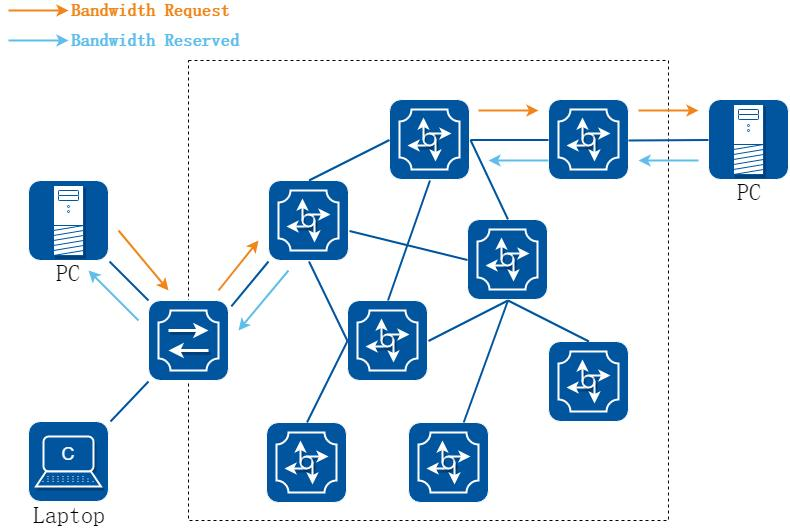

**图10-5 IntServ 服务模型**

DiffServ 服务模型DiffServ 模型的基本原理是将网络中的流量分成多个类，每个类享受不同的处理，尤其是网络出现拥塞时不同的类会享受不同的优先级处理，从而得到不同的丢包率、时延以及时延抖动。同一类的业务在网络中会被聚合起来统一发送，保证相同的延迟、抖动、丢包率等QoS 指标。

DiffServ 模型中，业务流分类和汇聚工作在网络边缘由边缘节点完成。边缘节点可以通过多种条件（比如报文的源地址和目的地址、ToS 域中的优先级、协议类型等）灵活地对报文进行分类，对不同的报文设置不同的标记字段，而其他节点只需要简单地识别报文中的这些标记，就可以进行资源分配和流量控制。因此，DiffServ 是一种基于报文流的QoS 模型。

与Intserv 模型相比，DiffServ 模型不需要信令。在DiffServ 模型中，应用程序发出报文前，不需要预先向网络提出资源申请，而是通过设置报文的QoS 参数信息，来告知网络节点它的QoS 需求。网络不需要为每个流维护状态，而是根据每个报文流指定的QoS参数信息来提供服务，对报文的服务等级划分，有差别地进行流量控制和转发，提供端到端的QoS 保证。

DiffServ 的基本思想是在网络边缘将进入网络的流分成各种不同的类型，将同种类型的流合并起来进行统一管理，保证相同的传输速率、延迟、抖动等服务质量参数，并对每一种类型的流在网络中分别进行处理。

业务分类和汇聚工作在网络的边缘节点进行，首先数据包被标识为一定的服务类型，并记录在包头字段里，然后将数据包按一定的流量控制策略送入网络。网络中心节点通过检查包头来确定对包进行何种处理。

DiffServ 模型充分考虑了IP 网络本身灵活性、可扩展性强的特点，将复杂的服务质量保证通过报文自身携带的信息转换为单跳行为，从而大大减少了信令的工作。因此，DiffServ 模型不但适合运营商环境使用，而且也大大加快了QoS 在实际网络中应用的进程，是当前网络中的主流服务模型。

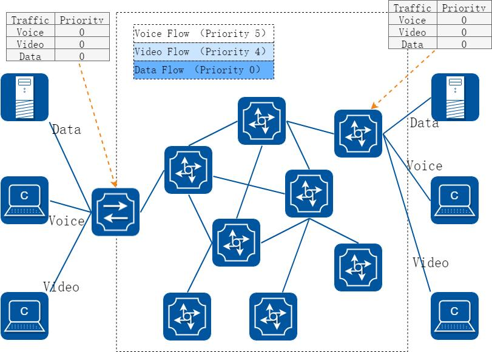

**图10-6 DiffServ 服务模型**

DiffServ 服务模型概念

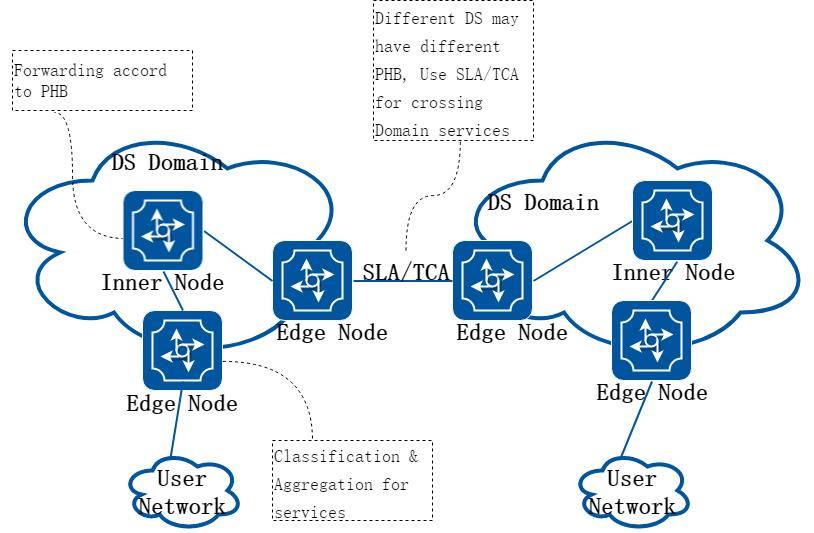

**图10-7 DiffServ 服务模型概念**

DS 节点：实现DiffServ 功能的网络节点称为DS 节点，上图中能看到的所有网元都是DS 节点。

DS 域（DS Domain）：一组对相同的流分类采用相同的服务提供策略和实现了相同PHB（Per Hop Behaviors）的相连DS 节点组成。一个DS 域由相同管理部门的一个或多个网络组成，如一个DS 域可以是一个ISP，也可以是一个企业的内部网。

DS 边界节点：负责连接另一个DS 域或者连接一个没有DS 功能的域的节点。DS边界节点负责将进入此DS 域的业务流进行分类和可能的流量调整。DS 内部节点：

用于在同一个DS 域中连接DS 边界节点和其他内部节点。DS 内部节点仅需基于DSCP 值进行简单的流分类以及对相应的流实施流量控制。

SLA/TCA：SLA 指用户（个人、企业、有业务往来的相邻ISP 等）和服务提供商签署的关于业务流在网络中传递时所应当获得的待遇。SLA 包括很多方面，例如付费协议，其中的技术说明部分称为服务等级规范SLS（Service Level Specification）。

SLS 的研究重点是流量控制说明TCS（Traffic Conditioning Specification），它描述了每个服务层次的详细性能参数，如平均速率、峰值速率、承诺突发尺寸、最大突发尺寸等，是DiffServ 网络进行流控的主要依据。

DS 区：一个或多个邻接的DS 域统称为DS 区。同一DS 区中的不同DS 域可有不同的PHB，以实现不同的服务提供策略，它们之间通过SLA（Service Level Agreements）和TCA（Traffic Conditioning Agreement）协调提供跨域服务。SLA/TCA指明了如何在DS 域边界节点调整从一个DS 域传向另一个DS 域的业务流。

DiffServ 模型与IntServ 模型的比较

**表10-4 DiffServ 模型与IntServ 模型的比较**

| 场景 | DiffServ 服务模型 | IntServ 服务模型 |
|---|---|---|
| 端到端保障 | DiffServ 模型通过多个DS 域之<br>间接力，间接实现端到端的QoS<br>保障。 | 直接实现端到端的QoS 保障。 |
| 网络规模 | 对于网络规模不敏感，对于大规<br>模网络可以通过多个DS 域划分<br>实现。 | 对网络规模敏感，过于庞大的网<br>络规模不利于部署。 |
| 网络开销 | 通过报文标志位通知其他设备报<br>文优先级，对网络无额外开销。 | 通过RSVP 信令通知其他设备，并<br>且定期刷新网络资源情况，带外<br>信令对网络有额外开销。 |
| 网元开销 | 网元无需预留资源，开销小。 | 网元需要提前预留资源，开销大。 |

IntServ 与DiffServ 之间的互通一般来讲，在提供IP 网络的QoS 时，为了适应不同规模的网络，在IP 骨干网往往需要采用DiffServ 体系结构；在IP 边缘网可以有两种选择：采用DiffServ 体系结构或采用IntServ 体系结构。目前在IP 边缘网络采用哪一种QoS 体系结构还没有定论，也许这两种会同时并存于IP 边缘网中。在IP 边缘网采用DiffServ 体系结构的情况下，IP骨干网与IP 边缘网之间的互通没有问题。在IP 边缘网采用IntServ 体系结构的情况下，需要解决IntServ 与DiffServ 之间的互通问题，包括RSVP 在DiffServ 域的处理方式、IntServ 支持的服务与DiffServ 支持的PHB 之间的映射。

RSVP 在DiffServ 域的处理可以有多种可选择的方式。例如下面两种：

一种方式为RSVP 对DiffServ 域透明，RSVP 在IntServ 域边界转发设备终结，DiffServ 域对IntServ 域采用静态资源提供方式。本方式实现相对简单，但可能造成DiffServ 域资源的浪费。

一种方式为DiffServ 域参与RSVP 协议处理，DiffServ 域对IntServ 域采用动态资源提供方式。本方式实现相对复杂，但可以优化DiffServ 域资源的使用。

根据IntServ 支持的服务和DiffServ 提供的PHB 的特点，IntServ 支持的服务与DiffServ 支持的PHB 之间的映射问题可以通过下面方式解决：

将IntServ 中的保证服务映射为DiffServ 中的EF。

将IntServ 中的负载控制服务映射为DiffServ 中的AF。

##### 5. QoS 功能综述

QoS 技术提供了下述功能：

流量分类和标记（classify & remark）：依据一定的匹配规则识别出对象，是有区别地实施服务的前提，通常作用在接口入方向。

流量监管（police）：对进入设备的特定流量的规格进行监管，通常作用在接口入方向。当流量超出规格时，可以采取限制或惩罚措施，以保护运营商的商业利益和网络资源不受损害。

拥塞管理（queue & schedule）：是必须采取的解决资源竞争的措施，将报文放入队列中缓存，并采取某种调度算法安排报文的转发次序，通常作用在接口出方向。

拥塞避免（drop）：过度的拥塞会对网络资源造成损害，拥塞避免监督网络资源的使用情况，当发现拥塞有加剧的趋势时采取主动丢弃报文的策略，通过调整流量来解除网络的过载，通常作用在接口出方向。

流量整形（shape）：一种主动调整流的输出速率的流控措施，是为了使流量适配下游设备可供给的网络资源，避免不必要的报文丢弃和拥塞，通常作用在接口方向。

##### 6. 流分类

流分类概述QoS 流分类包含两部分内容：

优先级映射：实现入报文携带的QoS Label 与设备内部优先级之间的转换，从而设备根据内部优先级提供有差别的QoS 服务质量。

重标记优先级：设置或改写出报文的QoS 优先级字段，用于向下一台设备传递差分服务的QoS 信息。

报文中的QoS Label 分为：

以太头：cos 字段（又称802.1p 字段），范围0~7。

IP、IPv6 头：dscp 字段，范围0~63。

MPLS 头：exp 字段，范围0~7。

网络设备内部优先级：

priority：调度优先级，配合queue 使用，决定报文进入哪个队列color：丢弃优先级，配合police 使用，决定报文丢弃顺序流分类标准简单流分类复杂流分类简单流分类过程实际上就是信任端口的上行报文携带的优先级标记，并进行优先级映射，即根据优先级映射表，将上行报文携带的QoS 优先级统一映射到设备内部的服务等级和颜色，将下行报文的内部的服务等级和颜色映射成为QoS 优先级。

简单流分类主要在网络的DS 域内部节点部署。

Trust：端口上的trust 状态决定了分类进来的报文的方法。所有报文会按照trust状态所提供的方法，分类报文并映射出优先级/颜色。

Replace：设置在出方向上的报文是否需要替换报文QoS Label。

Domain：用来QoS Label 到优先级/颜色或PHB 类型之间的映射关系。

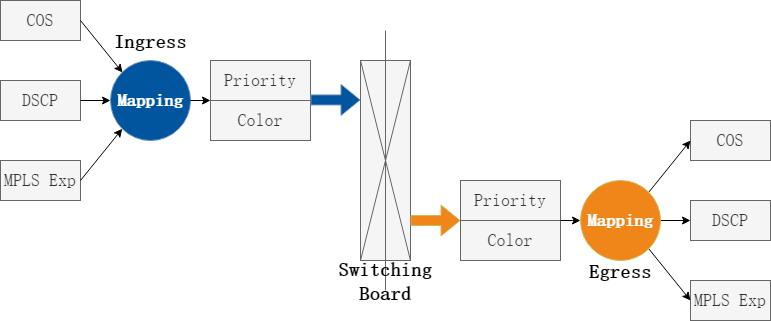

**图10-8 QoS 优先级映射**

复杂流分类是指采用复杂的规则，如由报文的源MAC、目的MAC、内外层Tag、源IP 地址、源端口号、目的IP 地址、目的端口号等对报文进行精细的分类。

复杂流分类主要部署在网络的边缘节点。

Classify：据收到的报文中优先级字段（如COS，DSCP 等）或者报文特征对报文进行分类。

Remark：在出口上对报文的优先级字段进行重标记。

##### 7. 流量监管

流量监管概述流量监管是一种通过对流量规格的监督，来限制流量及其资源使用的流量控制动作。通过配置流量监管，设备对符合流分类规则的报文的流量进行监督，对于超过规格的流量，可以采取丢弃、重标记颜色、重标记服务等级等动作。

企业网络中汇聚层交换机会连接多个接入交换机，当流量过大时会超过端口带宽，可以基于业务类型在入端口进行流量监管，对于超过规格的流量做响应处理。

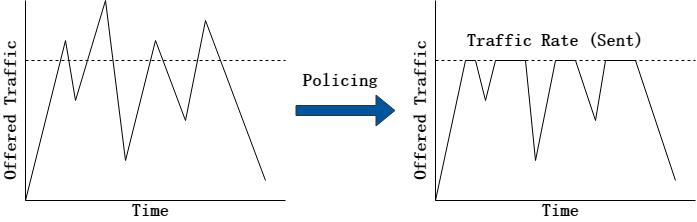

**图10-9 流量监管示意图**

流量监管标准SrTCM (RFC 2697)一种单速率双桶模型，只有一个速率，会向C 桶以一定的速率投放令牌，E 桶中的令牌来自C 桶，C 桶中的令牌溢出时会流入E 桶。

特点：允许报文尺寸的突发。

参数如下：

CIR：承诺信息速率，单位是bit/s，表示向令牌桶中投放令牌的速率。

CBS：承诺突发尺寸，单位是bit，用来定义在部分流量超过CIR 之前的最大突发流量，即为令牌桶的容量（深度）。承诺突发尺寸必须大于报文的最大长度（最大时一个分组可以领取桶中的全部令牌）。CBS 越大，表示所允许的突发量越大。

EBS：超额突发尺寸，用来定义在所有流量超过CIR 之前的最大突发量。

令牌桶结构如下：

双桶结构由两个桶实现，为方便将两个令牌桶称为C 桶和E 桶。C 桶容量为CBS，E 桶容量为EBS，总容量是CBS+EBS。如果不允许有突发流量，EBS 则设置成0。

当EBS≠0 时，称为单速双桶。当EBS=0，E 桶的令牌数始终为0，相当于只使用了一个令牌桶——C 桶，这种情况也称为单速单桶。

令牌添加方式如下：

先以CIR 的速率往C 桶中添加令牌，当C 桶容量到达CBS 后（C 桶满了），再以相同的速率往E 桶中添加令牌（E 桶的令牌用做以后临时超过CIR 的突发流量），当E 桶容量到达EBS 后（E 桶也满了），则新产生的令牌将会被丢弃。

初始状态下，C 桶和E 桶都是满的。

流量评估规则如下：

当报文到来后，直接与桶中的令牌数相比较，如果有足够的令牌就转发（通常用一个令牌关联一个比特的转发权限），如果没有足够的令牌则丢弃或缓存。

为方便表示，用Tc 和Te 表示桶中的令牌数量，Tc 和Te 初始化等于CBS 和EBS。

色盲模式规则如下：

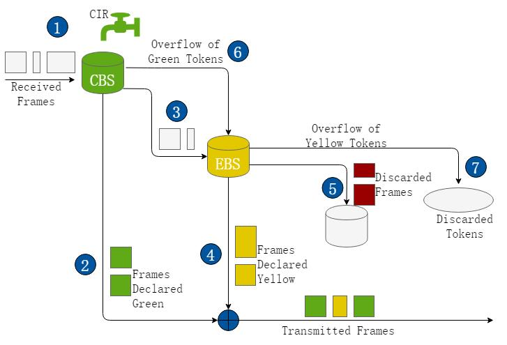

**图10-10 SrTCM 色盲模式**

在对到达报文（假设报文大小为B）进行评估时，遵循以下规则：

对于单速单桶（EBS=0）：

如果报文长度不超过C 桶中的令牌数Tc，则报文被标记为绿色，且Tc=Tc-B；

如果报文长度超过C 桶中的令牌数Tc，报文被标记为红色，Tc 值不变。

对于单速双桶（EBS≠0）：

如果报文长度不超过C 桶中的令牌数Tc，则报文被标记为绿色，且Tc=Tc-B；

如果报文长度超过C 桶中的令牌数Tc 但不超过E 桶中的令牌数Te，则报文被标记为黄色，且Te=Te-B；

如果报文长度超过E 桶中的令牌数Te，报文被标记为红色，但Tc 和Te 不变。

色敏模式规则如下：

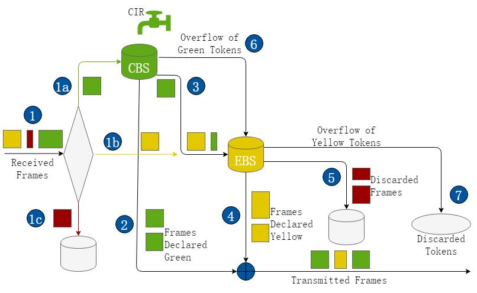

**图10-11 SrTCM 色敏模式**

在对到达报文（假设报文大小为B）进行评估时，遵循以下规则：

对于单速单桶（EBS=0）：

如果报文已被标记为绿色但报文长度不超过C 桶中的令牌数Tc，则报文被标记为绿色，且Tc=Tc-B；

如果报文已被标记为绿色且报文长度超过C 桶中的令牌数Tc，则报文被标记为红色，Tc 保持不变；

如果报文已被标记为黄色或红色，都直接将报文标记为红色，Tc 保持不变。

对于单速双桶（EBS≠0）：

如果报文已被标记为绿色且报文长度不超过C 桶中的令牌数Tc，则报文被标记为绿色，且Tc=Tc-B；

如果报文已被标记为绿色且报文长度超过C 桶中的令牌数Tc 但不超过E 桶中的令牌数Te，则报文被标记为黄色，且Te=Te-B；

如果报文已被标记为黄色但报文长度不超过E 桶中的令牌数Te，则报文被标记为黄色，且Te=Te-B；

如果报文已被标记为黄色且报文长度超过E 桶中的令牌数Te，则报文被标记为红色，且Te 保持不变；

如果报文已被标记为红色，直接将报文标记为红色，Tc 和Te 不变。

改进的TrTCM (RFC 4115)一种改进的双速率双桶模型，改进了RFC2698 中会丢弃高优先级报文的缺陷，本模型也有两个独立的速率，会同时向C 桶和E 桶以一定的速率投放令牌。

参数如下：

CIR：承诺信息速率，表示端口允许的信息流平均速率，单位是bit/s。

CBS：承诺突发尺寸，用来定义在部分流量超过CIR 之前的最大突发流量，单位为bit。承诺突发尺寸必须不小于报文的最大长度。

EIR：超额信息速率，用来定义在所有流量超过CIR 之前的最大速率。

EBS：超额突发尺寸，用来定义在所有流量超过CIR 之前的最大突发量。

CF：为0 时是RFC4115 算法，为1 时是BWP 算法（此处不作介绍）。

令牌桶结构如下：

业界都使用两个令牌桶，也使用两个独立的令牌桶，存在两个令牌填充速率。为方便将两个令牌桶称为C 桶和E 桶，C 桶容量为CBS，令牌填充速率为CIR，E 桶容量为EBS，令牌填充速率为EIR。

令牌添加方式如下：

初始状态时C 桶和E 桶都是满的。往C 桶和E 桶分别以CIR 和EIR 的速率填充令牌。

因这两个令牌桶是相互独立的，当其中一个桶被填满时，这个桶新产生的令牌将会被丢弃，而另一个桶则不受影响，继续填充令牌。

流量评估规则如下：

算法不再关注峰值速率，而关注超出速率，可以简单的认为CIR+EIR=PIR。

算法也有色盲模式和色敏模式两种。为方便用Tc 和Te 表示桶中的令牌数量，Tc 和Te初始化等于CBS 和EBS。

色盲模式规则如下：

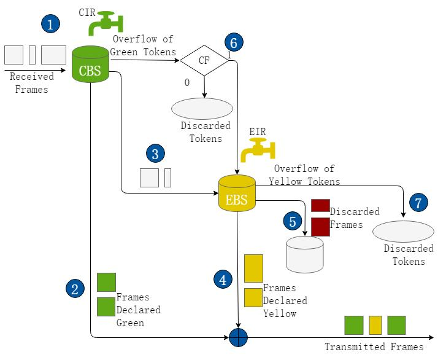

**图10-12 Modified TrTCM 色盲模式**

在对到达报文（假设报文大小为B）进行评估时，遵循以下规则：

如果报文长度不超过C 桶中的令牌数Tc，则报文被标记为绿色，且Tc=Tc-B；

如果报文长度超过C 桶中的令牌数Tc 但不超过E 桶中的令牌数Te，则报文被标记为黄色，且Te=Te-B；

如果报文长度超过E 桶中的令牌数Te，报文被标记为红色，但Tc 和Te 不变。

色敏模式规则如下

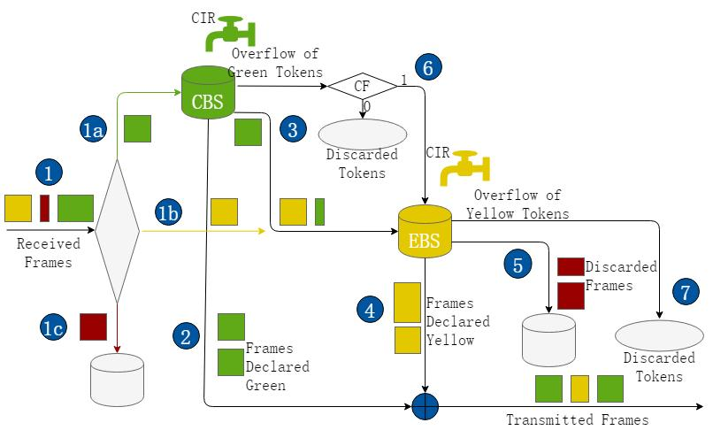

**图10-13 Modified TrTCM 色敏模式**

在对到达报文（假设报文大小为B）进行评估时，遵循以下规则：

如果报文已被标记为绿色且报文长度不超过C 桶中的令牌数Tc，则报文被标记为绿色，且Tc=Tc-B；

如果报文已被标记为绿色且报文长度超过C 桶中的令牌数Tc 但不超过E 桶中的令牌数Te，则报文被标记为黄色，且Te=Te-B；

如果报文已被标记为黄色但报文长度不超过E 桶中的令牌数Te，则报文被标记为黄色，且Te=Te-B；

如果报文已被标记为黄色且报文长度超过E 桶中的令牌数Te，则报文被标记为红色，且Te 保持不变；

如果报文已被标记为红色，直接将报文标记为红色，Tc 和Te 不变。

基于上述介绍，单桶双速和双桶双速的差异如下表所示:

**表10-5 单桶双速和双桶双速对比**

| 整形方式 | 优点 | 缺点 | 适用场景 |
|---|---|---|---|
| 单速双桶 | 除了带宽限制，还可以<br>容许一部分流量突发，<br>并且可以区分突发业务<br>和正常业务。 | 思路较单速单桶复杂，<br>需要考虑E 桶的容量。 | 较为重要的业务，或者<br>理解为容许有突发的业<br>务（如公司邮件数据，<br>邮件是IT 较为重要的业<br>务之一），对于突发流<br>量有宽容。 |
| 双速双桶 | 最为细致的流量带宽划<br>分，可以区别带宽小于<br>CIR 还是在CIR~PIR 之<br>间。 | 方案部署前需要充分考<br>虑CIR，CBS，PIR 和PBS<br>的取值，并且根据不同<br>业务做区分。 | 重要业务建议使用，可<br>以更好的监控流量的突<br>发程度，对流量分析起<br>到指导作用。 |

##### 8. 拥塞管理

拥塞管理概述拥塞管理指网络在发生拥塞时，如何进行管理和控制。处理的方法是使用队列技术，将从一个接口发出的所有报文放入多个队列，按照各个队列的优先级进行处理。不同的队列调度算法用来解决不同的问题，并产生不同的效果。

队列指的是在缓存中对报文进行排序的逻辑。当流量的速率超过接口带宽或超过为该流量设置的带宽时，报文就以队列的形式暂存在缓存中。报文离开队列的时间、顺序，以及各个队列之间报文离开的相互关系由队列调度算法决定。

客户针对不同业务打上不同的内部和外部优先级，而不同优先级的报文之所以可以被区别对待就是因为其可以安排在不同的队列中，不同队列享受不同的调度策略。因此，队列调度策略是报文优先级划分的目的，是报文能够被区别对待的手段之一。

拥塞管理标准QoS 支持多种形式的队列调度：PQ、RR、WRR、DRR、DWRR、WFQ。

当前系统支持配置PQ 和DWRR。

FIFO 调度单个队列的报文采用先进先出原则入队和出队，如下图所示：

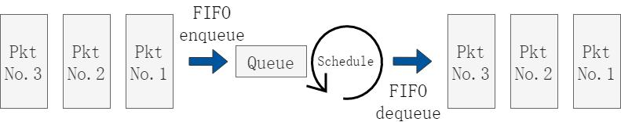

**图10-14 FIFO 处理流程**

PQ 调度（SP 调度）

严格按照队列优先级的高低顺序进行调度。只有高优先级队列中的报文全部调度完毕后，低优先级队列才有调度机会，如下图所示:

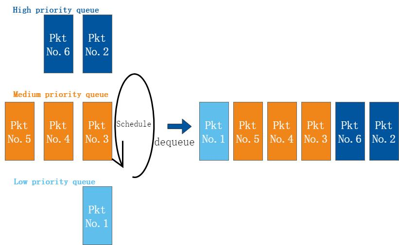

**图10-15 PQ 调度**

在报文出队的时候，首先让高优先队列中的报文出队并发送，直到高优先队列中的报文发送完，然后发送中优先队列中的报文，直到发送完，接着是低优先队列。在调度低优先级队列时，如果高优先级队列又有报文到来，则会优先调度高优先级队列。这样，较高优先级队列的报文将会得到优先发送，而较低优先级的报文后发送。

优点：将延迟敏感的关键业务放入高优先级队列，将非关键业务放入低优先级队列，从而确保关键业务被优先发送。

缺点：拥塞发生时，如果较高优先级队列中长时间有分组存在，那么低优先级队列中的报文就会由于得不到服务而“饿死”。

RR 调度采用轮询的方式，对多个队列进行调度。RR 以环形的方式轮询多个队列。如果轮询的队列不为空，则从该队列取走一个报文；如果该队列为空，则直接跳过该队列，调度器不等待，如下图所示：

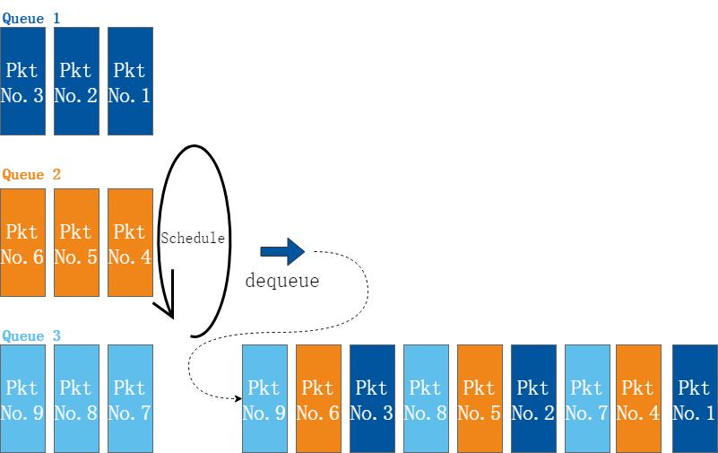

**图10-16 RR 调度**

优点：各个队列之间没有优先级之分，都能够有相等的概率得到调度。

缺点：所有队列无法体现优先级，对于延迟敏感的关键业务和非关键业务无法得到区别对待，使得关键业务无法及时得到处理。

WRR 调度在轮询的时候，WRR 每个队列享受的调度机会和该队列的权重成比例，如下图所示。RR调度相当于权值为1 的WRR 调度。

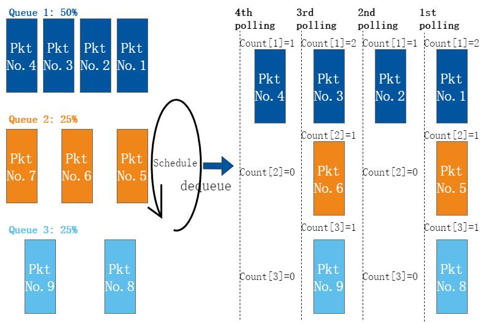

**图10-17 WRR 调度**

WRR 的实现方法是为每个队列设置一个计数器Count，根据权重进行初始化。每次轮询到一个队列时，该队列输出一个报文且计数器减一。当计数器为0 时停止调度该队列，但继续调度其他计数器不为0 的队列。当所有队列的计数器都为0 时，所有计数器重新根据权重初始化，开始新一轮调度。在一个循环中，权重大的队列被多次调度。

优点：解决RR 不能设置权重的不足。

缺点：

WRR 调度按照报文个数进行调度，因此每个队列没有固定的带宽，同等调度机会

```
−
```

下大尺寸报文获得的实际带宽要大于小尺寸报文获得的带宽。而用户一般关心的是带宽。当每个队列的平均报文长度相等或已知时，通过配置WRR 权重，用户能够获得想要的带宽；但是，当队列的平均报文长度变化时，用户就不能通过配置WRR 权重获取想要的带宽。

低延时需求业务（如语音）得不到及时调度。

```
−
```

DRR 调度调度实现原理与RR 调度基本相同。RR 调度是按照报文个数进行调度，而DRR 是按照报文长度进行调度，如下图所示：

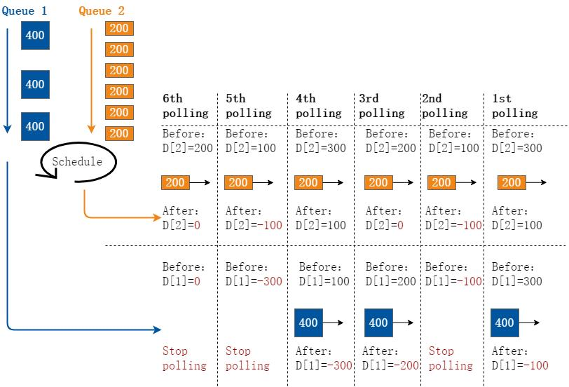

**图10-18 DRR 调度**

DRR 为每个队列设置一个计数器Deficit，Deficit 初始化为一次调度允许的最大字节数，一般为接口MTU。每次轮询到一个队列时，该队列输出一个报文且计数器Deficit 减去报文长度。如果报文长度超过了队列的调度能力，DRR 调度允许Deficit 出现负值，以保证长报文也能够得到调度。但下次轮循调度时该队列将不会被调度。当计数器为0 或负数时停止调度该队列，但继续调度其他计数器为正数的队列。当所有队列的Deficit都为0 或负数时，将所有队列的Deficit 计数器加上初始值，开始新一轮调度。

优点：避免了采用PQ 调度时低优先级队列中的报文可能长时间得不到服务的缺点。

缺点：不能设置权重，且也具有低延时需求业务（如语音）得不到及时调度的缺点。

DWRR 调度（WDRR 调度）

主要解决DRR 不能设置权重的不足。DRR 调度相当于权值为1 的DWRR 调度，如下图所示。

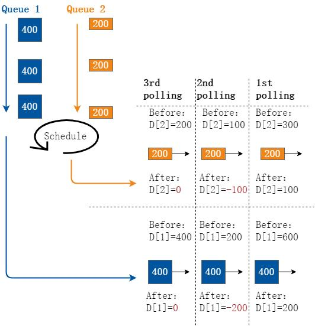

**图10-19 DWRR 调度**

DWRR 为每个队列设置一个计数器Deficit，Deficit 初始化为Weight*MTU。每次轮询到一个队列时，该队列输出一个报文且计数器Deficit 减去报文长度。当计数器为0 时停止调度该队列，但继续调度其他计数器不为0 的队列。当所有队列的计数器都为0 时，所有计数器的Deficit 都加上Weight*MTU，开始新一轮调度。

优点：避免了采用PQ 调度时低优先级队列中的报文可能长时间得不到服务的缺点。

缺点：

避免了各队列报文长度不等或变化较大时，WRR 调度不能按配置比例分配带宽

```
−
```

资源的缺点。

具有低延时需求业务（如语音）得不到及时调度的缺点。

```
−
```

##### 9. 拥塞避免

拥塞避免概述拥塞避免是指通过监视网络资源（如队列或内存缓冲区）的使用情况，在拥塞有加剧趋势时，主动丢弃报文，通过调整网络的流量来解除网络过载的一种流控机制。

拥塞避免标准支持两种丢弃策略：

尾丢弃加权随机先期检测（随机早丢弃）

TD同等的对待所有的报文，不对服务等级进行区分。在拥塞发生期间，队列尾部的数据报文将被全部丢弃，直到拥塞解除。

缺点：这种丢弃策略会引发TCP 全局同步现象。所谓TCP 全局同步现象，是指当多个队列同时丢弃多个TCP 连接报文时，将造成多个TCP 连接同时进入拥塞避免和慢启动状态，以降低并调整流量；而后这几个TCP 连接又会在某个时刻同时出现流量高峰。如此反复，使网络流量忽大忽小，影响链路利用率。

WRED在队列拥塞前进行报文丢弃的一种拥塞避免机制。

WRED 为每个队列都设定一对低门限和高门限值，并规定：

当队列长度小于低限时，不丢弃报文，丢弃概率为0%。

当队列长度超过高限时，丢弃所有新到来的报文，即进行尾丢弃，丢弃概率为100%。

当队列长度在低限和高限之间时，开始随机丢弃新到来的报文，且设定了一个最大丢弃概率，队列越长，丢弃概率越大。

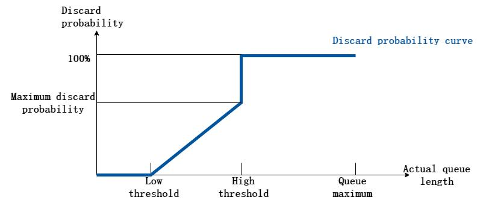

**图10-20 WRED 丢弃概率曲线**

如上图所示，队列越长，新到的报文被丢弃的可能性越高；相同队列长度时，最大丢弃概率配置得越大，丢弃可能性越高。

##### 10. 流量整形

流量整形概述流量整形是对输出报文的速率进行控制，使报文以均匀的速率发送出去。

流量整形通常是为了使报文速率与下游设备相匹配。当从高速链路向低速链路传输数据，或发生突发流量时，带宽会在低速链路出口处出现瓶颈，导致数据丢失严重。这种情况下，需要在进入低速链路的设备出口处进行流量整形，将上游不规整的流量进行削峰填谷，输出一条比较平整的流量，从而解决下游设备的瞬时拥塞问题。

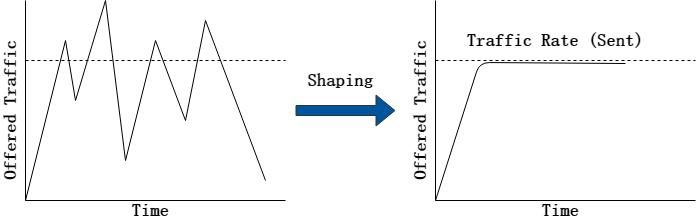

**图10-21 流量整形示意图**

流量整形分为两种：

接口流量整形队列流量整形接口流量整形也叫接口限速LR（Line rate），限制接口发送的所有报文（包括紧急报文）

的总速率，是对整个出接口进行流量整形，不区分优先级。

队列调度之后在出队的时候，对所有队列都进行令牌桶评估。

在令牌桶评估后，如果数据包速率符合要求，则转发；如果数据包速率超标，则将该数据包所在队列的状态改为不可调度，等空闲时再调度此队列。

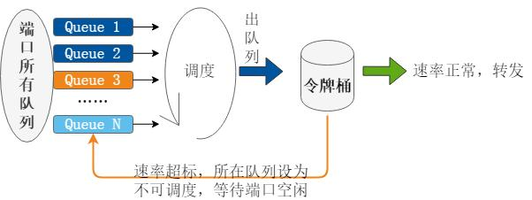

**图10-22 端口流量整形过程**

队列流量整形也就是所谓的Shaping，对出接口的每个队列进行流量整形，区分优先级。

队列调度之后在出队的时候，对于不需要整形的报文，直接转发；对于需要进行整形的报文，则先进行令牌桶评估。

在令牌桶评估后，如果数据包速率符合要求，则被标记为绿色并转发；如果数据包速率超标，则当前正在出队的数据包仍然转发出去，同时，将该数据包所在队列的状态改为不可调度，等令牌桶填充了新的令牌时再调度此队列。队列的状态改为不可调度后，该队列允许报文继续入队，但入队满了的时候会丢弃报文。因此，虽然流量整形使超额的数据能够从接口平滑地输出，但并不表示流量整形永远不会丢包。

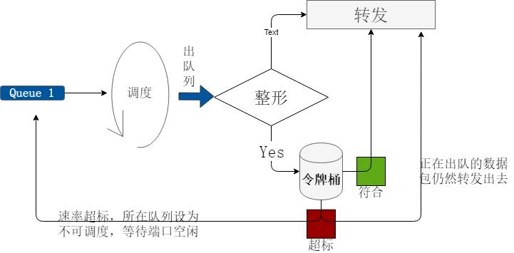

**图10-23 队列流量整形过程**

接口与队列流量整形对比如下表所示

**表10-6 表3-6 接口整形与流量整形对比**

| 流量整形方式 | 优点 | 缺点 | 适用场景 |
|---|---|---|---|
| 基于端口 | 思路和配置简单 | 这个端口使用统一的模<br>型，不能够基于业务区<br>别对待。 | 如果端口下挂的业务模<br>型比较单一（例如银行<br>企业交易网，端口下都<br>为财务交易数据；例如<br>110 警务平台，端口下都 |
|  |  |  | 为语音业务），可以考<br>虑使用端口流量整形。 |
| 基于队列 | 不同的业务使用不同队<br>列，可以基于业务进行<br>流量整形。 | 方案复杂，需要分别考<br>虑各种业务模型；配置<br>上较端口复杂。 | 如果端口下挂的是混合<br>业务模型（数据、语音<br>和视频业务混合），需<br>要针对不同业务进行整<br>形（指定具体业务整<br>形），可以考虑使用队<br>列流量整形。 |

### 10.1.2 配置举例

配置QoS 之前需知以下信息：

QoS policing 不能在LinkAGG 上配置。

只能在进口方向进行分类。

Class map 可以有多个ACL，一个ACL 可以有多个条目。

Policing 不能在交换机的虚拟接口上使用。

在部署QoS 流量策略时需要执行如下几个步骤。

识别并区分流量到不同的类别。

对不同的流量类别配置策略。

在接口上应用策略。

#### 使用ACL 实现流量分类

IP 流量可以使用IP ACL 作流量分类。下面的例子说明了如何创建IP ACL 来区分不同的流量并将其分类，在这个例子中，允许三类IP 地址的主机访问，网络地址主机部分对应为通配符，如果一台主机的IP 地址不在list 的匹配范围，则该主机将被拒绝访问。

##### 步骤1 进入配置模式

```
Switch# configure terminal
```

##### 步骤2 创建ACL,并根据需要创建一或多个ACE

```
Switch(config)# ip access-list ip-acl
Switch(config-ip-acl)# permit any 128.88.12.0 0.0.0.255 any
Switch(config-ip-acl)# permit any 28.88.0.0 0.0.255.255 any
Switch(config-ip-acl)# permit any 11.0.0.0 0.255.255.255 any
Switch(config-ip-acl)# exit
```

在全局配置模式下用no ip access-list 命令删除ACL，在ACL 模式下用no sequence-num 命令删除一条ACE。

名词解释：

ACL：Access Control List ACE：Access Control Entry

##### 步骤3 退出配置模式

```
Switch(config)# end
```

##### 步骤4 检查配置

```
Switch# show access-list ip ip-acl
ip access-list ip-acl
10 permit any 128.88.12.0 0.0.0.255 any
20 permit any 28.88.0.0 0.0.255.255 any
30 permit any 11.0.0.0 0.255.255.255 any
```

#### 创建分类映射表

下面的例子说明了如何将指定接口的IP 流量按照分类表作流量分类。期间涉及到创建分类映射表以及匹配准则。在这个例子中使用IP access list 创建一个名为cmap1 的分类映射表，允许任意源主机到目的主机的流量传输。

##### 步骤1 进入配置模式

```
Switch# configure terminal
```

##### 步骤2 创建ACL,并根据需要创建一或多个ACE

```
Switch(config)# ip access-list ip-acl
Switch(config-ip-acl)# permit any any any
Switch(config-ip-acl)# quit
```

##### 步骤3 创建分类映射表，并绑定ACL

```
Switch(config)# class-map cmap1
Switch (config-cmap)# match access-group ip-acl
Switch (config-cmap)# quit
```

match-any 表示映射表中的分类按照逻辑或的关系进行匹配，即分类映射表中至少匹配一条即可分类。默认是按照match-any 方式进行流量分类的。

match-all 表示映射表中的分类按照逻辑与的关系进行匹配，即分类映射表中必须所有都匹配才可分类。

##### 步骤4 退出配置模式

```
Switch(config)# end
```

##### 步骤5 检查配置

```
Switch# show class-map cmap1
CLASS-MAP-NAME: cmap1 (match-any)
match access-group: ip-acl
```

#### 配置流量监管

下面的例子说明了如何创建策略表用于对流量进行分类，标记和限流。在这个例子中创建了一个策略表，并应用到一个端口的进口流量。配置的IP ACL 允许来自10.1.00 地址的流量，如果这些流量的平均速率超过48000-kbps，将被丢弃。

##### 步骤1 进入配置模式

```
Switch# configure terminal
```

##### 步骤2 创建ACL,并根据需要创建一或多个ACE

```
Switch(config)# ip access-list ip-acl
Switch(config-ip-acl)# permit any 10.1.0.0 0.0.255.255 any
Switch(config-ip-acl)# quit
```

##### 步骤3 创建分类映射表，并绑定ACL

```
Switch(config)# class-map type qos cmap1
Switch(config-cmap)# match access-group ip-acl
Switch(config-cmap)# quit
```

##### 步骤4 创建策略表，并绑定分类映射表；在绑定的分类映射表中配置策略

```
switch(config)# policy-map type qos pmap1
switch(config-pmap)# class type qos cmap1
Switch(config-pmap-c)# policer color-blind cir 48000 cbs 10000 ebs 16000 violate drop
Switch(config-pmap-qos-c)# set traffic-class 5
Switch(config-pmap-qos-c)# set color yellow
Switch(config-pmap-c)# quit
Switch(config-pmap)# quit
```

在全局配置模式下no policy-map 命令可以删除已经存在的策略表；在策略表绑定分类表视图下，no policer 命令可以移除一个已存在的policer，no set 命令可将已经配置的优先级和颜色恢复默认值。（默认优先级0，颜色为green）

##### 步骤5 进入接口配置模式，并应用策略表

```
Switch(config)# interface eth-0-1
Switch(config-if)# service-policy type qos input pmap1
Switch(config-if)# exit
```

接口每一个方向只允许配置一个策略映射表。no service-policy input|output 命令在端口删除策略表配置。

##### 步骤6 退出配置模式

```
Switch(config)# end
```

##### 步骤7 检查配置

```
Switch# show policy-map pmap1
POLICY-MAP-NAME: pmap1 ( type qos)
State: detached
CLASS-MAP-NAME: cmap1
match access-group: ip-acl
set traffic-class
: 5
set color
: yellow
policer color-blind cir 48000 cbs 10000 ebs 16000 violate drop
```

#### 配置聚合流量监管

下面的例子说明了如何创建聚合策略表用于对流量进行分类，标记和限流。在这个例子中创建了一条聚合策略，并运用于策略表中的多个表项。示例中，IP ACLs 允许来自网络地址10.1.0.0 和主机地址为11.3.1.1 的流量，且配置了其平均速率。当流量平均速率超过48000-kbps 且流量大小超过8000-byte，该流量将被丢弃。该策略表运用于端口的进方向。

##### 步骤1 进入配置模式

```
Switch# configure terminal
```

##### 步骤2 创建ACL,并根据需要创建一或多个ACE

```
Switch(config)# ip access-list ip-acl1
Switch(config-ip-acl)# permit any 10.1.0.0 0.0.255.255 any
Switch(config-ip-acl)# exit
Switch(config)# ip access-list ip-acl2
Switch(config-ip-acl)# permit any host 11.3.1.1 any
Switch(config-ip-acl)# exit
```

##### 步骤3 指定聚合策略的各项参数

```
Switch(config)# qos aggregate-policer transmit1 color-blind cir 48000 cbs 8000 ebs 10000 violate drop
```

no qos aggregate-policer 命令删除一条聚合策略。

##### 步骤4 创建分类映射表，并绑定ACL

```
Switch(config)# class-map type qos cmap1
Switch(config-cmap)# match access-group ip-acl1
Switch(config-cmap)# exit
Switch(config)# class-map type qos cmap2
Switch(config-cmap)# match access-group ip-acl2
Switch(config-cmap)# exit
```

##### 步骤5 创建策略表，并绑定分类映射表；在绑定的分类映射表中应用聚合策略

```
Switch(config)# policy-map type qos aggflow1
Switch(config-pmap)# class type qos cmap1
Switch(config-pmap-c)# aggregate-policer transmit1
Switch(config-pmap-c)# exit
Switch(config-pmap)# class type qos cmap2
Switch(config-pmap-c)# aggregate-policer transmit1
Switch(config-pmap-c)# exit
Switch(config-pmap)# exit
```

在策略表绑定分类映射表视图下，no policer-aggregate 命令可以从策略表中删除一条聚合策略；

##### 步骤6 进入接口配置模式，并应用策略表

```
Switch(config)# interface eth-0-1
Switch(config-if)# service-policy type qos input aggflow1
Switch(config-if)# exit
```

##### 步骤7 退出配置模式

```
Switch(config)# end
```

##### 步骤8 检查配置

```
Switch# show qos aggregate-policer
Aggreate policer: transmit1
```

```
color blind
CIR 48000 kbps, CBS 8000 bytes, EBS 10000 bytes
drop violate packets
```

#### 配置队列调度

在不同的CLASS 之间，报文是按照SP（严格优先级）调度的；在同一个CLASS 之间，报文是按照WDRR 调度的。下面的例子显示了将queue 映射到不同的CLASS 中间并且配置WDRR 调度的权重。配置如下，编号为5 和6 的流的优先级是最高的值6，编号为2 的流的优先级是2，带宽为link 带宽的20%。

##### 步骤1 进入配置模式

```
Switch# configure terminal
```

##### 步骤2 创建分类模板，并配置优先级

```
Switch(config)# class-map type traffic-class tc5
Switch(config-cmap-tc)# match traffic-class 5
Switch(config-cmap-tc)# exit
Switch(config)# class-map type traffic-class tc6
Switch(config-cmap-tc)# match traffic-class 6
Switch(config-cmap-tc)# exit
Switch(config)# class-map type traffic-class tc2
Switch(config-cmap-tc)# match traffic-class 2
Switch(config-cmap-tc)# exit
```

##### 步骤3 创建策略模板，并关联之前定义的分类模板；在策略模板关联分类模板的模式下，配置优先级或带宽

```
Switch(config)# policy-map type traffic-class tc
Switch(config-pmap-tc)# class type traffic-class tc5
Switch(config-pmap-tc-c)# priority level 6
Switch(config-pmap-tc-c)# exit
Switch(config-pmap-tc)# class type traffic-class tc6
Switch(config-pmap-tc-c)# priority level 6
Switch(config-pmap-tc-c)# exit
Switch(config-pmap-tc)# class type traffic-class tc2
Switch(config-pmap-tc-c)# bandwidth percentage 20
Switch(config-pmap-tc-c)# exit
Switch(config-pmap-tc)# exit
```

##### 步骤4 进入接口配置模式，并应用策略模板

```
Switch(config)# interface eth-0-1
Switch(config-if)# service-policy type traffic-class tc
Switch(config-if)# exit
```

##### 步骤5 退出配置模式

```
Switch(config)# end
```

##### 步骤6 检查配置

```
Switch# show qos interface eth-0-1 egress
TC Priority Bandwidth Shaping(kbps) Drop-Mode
Max-Queue-Limit(Cell)
ECN
0
0
-
-
dynamic
level 10
-
1
0
-
-
random-drop 596
Disable
2
0
20
-
dynamic
level 10
-
3
0
-
-
tail-drop
2000
2000
4
0
-
-
dynamic
level 10
-
5
6
-
-
dynamic
level 10
-
6
6
-
-
dynamic
level 10
-
7
7
-
-
tail-drop
64
-
```

#### 配置队列尾丢弃

尾丢弃是默认的每个出口队列都启用的拥塞避免技术。在没有超过queue 长度的时候，报文会在queue 中缓存；超过queue 长度时则丢弃queue 尾部的报文。

下面例子说明了如何根据不同的丢弃优先级配置尾丢弃阈值。这个例子中对流优先级为

3 的报文尾丢弃阈值为2000。

##### 步骤1 进入配置模式

```
Switch# configure terminal
```

##### 步骤2 创建一个分类模板，并配置优先级

```
Switch(config)# class-map type traffic-class tc3
Switch(config-cmap-tc)# match traffic-class 3
Switch(config-cmap-tc)# exit
```

##### 步骤3 创建一个策略模板，并关联之前定义的分类模板

```
Switch(config)# policy-map type traffic-class tc
Switch(config-pmap-tc)# class type traffic-class tc3
```

##### 步骤4 在策略模板关联分类模板的模式下，设置该优先级的尾丢弃阈值

```
Switch(config-pmap-tc-c)# queue-limit 2000
Switch(config-pmap-tc-c)# exit
Switch(config-pmap-tc)# exit
```

##### 步骤5 进入接口配置模式，并应用策略模板

```
Switch(config)# interface eth-0-1
Switch(config-if)# service-policy type traffic-class tc
Switch(config-if)# exit
```

##### 步骤6 退出配置模式

```
Switch(config)# end
```

##### 步骤7 检查配置

```
Switch# show qos interface eth-0-1 egress
TC Priority Bandwidth Shaping(kbps) Drop-Mode
Max-Queue-Limit(Cell)
ECN
0
0
-
-
dynamic
level 10
-
1
0
-
-
dynamic
level 10
-
2
0
-
-
dynamic
level 10
-
3
0
-
-
tail-drop
2000
2000
4
0
-
-
dynamic
level 10
-
```

```
5
0
-
-
dynamic
level 10
-
6
0
-
-
dynamic
level 10
-
7
7
-
-
tail-drop
64
-
```

#### 配置队列随机早丢弃

WRED 通过选择性地丢弃部分报文，降低接口拥塞时发生尾丢弃的概率。通过早期选择性地丢弃部分报文而不是在queue 真正满时才开始丢弃，WRED 可以避免出现TCP 同步丢包的问题，从而提高网络的吞吐量。

下面的例子所示的是对流优先级为1 设定其WRED 丢包上限。其最大丢包上限为596，最小丢包上限为596/8=71。如果缓冲区中的报文超过最小丢包上限，后续收到的报文将随机丢弃。这个例子说明了如何针对不同颜色的报文配置相应的WRED 阈值。

##### 步骤1 进入配置模式

```
Switch# configure terminal
```

##### 步骤2 创建一个分类模板，并配置优先级

```
Switch(config)# class-map type traffic-class tc1
Switch(config-cmap-tc)# match traffic-class 1
Switch(config-cmap-tc)# exit
```

##### 步骤3 创建一个策略模板，并关联之前定义的分类模板

```
Switch(config)# policy-map type traffic-class tc
Switch(config-pmap-tc)# class type traffic-class tc1
```

##### 步骤4 在策略模板关联分类模板的模式下，配置对应的WRED 丢包上限

```
Switch(config-pmap-tc-c)# random-detect maximum-threshold 596
Switch(config-pmap-tc-c)# exit
Switch(config-pmap-tc)# exit
```

##### 步骤5 进入接口配置模式，并应用策略模板

```
Switch(config)# interface eth-0-1
Switch(config-if)# service-policy type traffic-class tc
Switch(config-if)# exit
```

##### 步骤6 退出配置模式

```
Switch(config)# end
```

##### 步骤7 检查配置

```
Switch# show qos interface eth-0-1 egress
TC Priority Bandwidth Shaping(kbps) Drop-Mode
Max-Queue-Limit(Cell)
ECN
0
0
-
-
dynamic
level 10
-
1
0
-
-
random-drop 596
Disable
2
0
-
-
dynamic
level 10
-
3
0
-
-
tail-drop
2000
2000
4
0
-
-
dynamic
level 10
-
5
0
-
-
dynamic
level 10
-
6
0
-
-
dynamic
level 10
-
7
7
-
-
tail-drop
64
-
```

#### 配置队列整形

流量在经过交换机出方向的队列的时候可以被整形，超过整形速率的流量会被缓存，但是如果缓存耗尽，则后续的报文会被丢弃直到缓存被释放。下面的例子显示了如何在出方向队列上配置流量整形。在这个例子中，对队列3 进行队列整形的配置；当队列3中流速率超过1000Mbps，将丢弃报文。

##### 步骤1 进入配置模式

```
Switch# configure terminal
```

##### 步骤2 创建分类模板，并配置优先级

```
Switch(config)# class-map type traffic-class tc3
Switch(config-cmap-tc)# match traffic-class 3
Switch(config-cmap-tc)# exit
```

##### 步骤3 创建策略模板，并关联之前定义的分类模板

```
Switch(config)# policy-map type traffic-class tc
Switch(config-pmap-tc)# class type traffic-class tc3
```

##### 步骤4 在策略模板关联分类模板的模式下，设置流量整形

```
Switch(config-pmap-tc-c)# shape rate pir 1000000
Switch(config-pmap-tc-c)# exit
Switch(config-pmap-tc)# exit
```

使用no shape rate 命令可以删除队列整形配置

##### 步骤5 进入接口配置模式，并应用策略模板

```
Switch(config)# interface eth-0-1
Switch(config-if)# service-policy type traffic-class tc
Switch(config-if)# exit
```

##### 步骤6 退出配置模式

```
Switch(config)# end
```

##### 步骤7 检查配置

```
Switch# show qos interface eth-0-1 egress
TC Priority Bandwidth Shaping(kbps) Drop-Mode
Max-Queue-Limit(Cell)
ECN
0
0
-
-
dynamic
level 10
-
1
0
-
-
random-drop 596
Disable
2
0
20
-
dynamic
level 10
-
3
0
-
1000000
tail-drop
2000
2000
4
0
-
-
dynamic
level 10
-
5
6
-
-
dynamic
level 10
-
6
6
-
-
dynamic
level 10
-
7
7
-
-
tail-drop
64
-
```

#### 配置端口流量监管

经过交换机物理接口的所有流量都可以设置保证速率，超过保证速率的流量都会被丢弃。

下面的例子说明了如何配置端口Policer 来实现保证速率。这个例子中端口收到的报文平均速率超过48000-kbps 时将被丢弃。

##### 步骤1 进入配置模式

```
Switch# configure terminal
```

##### 步骤2 进入接口配置模式，配置端口保证速率

```
Switch(config)# interface eth-0-1
Switch(config-if)# qos policer input color-blind cir 48000 cbs 10000 ebs 20000 violate drop
Switch(config-if)# exit
```

使用no port-policier input|output 命令可以删除端口Policer 配置。

##### 步骤3 退出配置模式

```
Switch(config)# end
```

##### 步骤4 检查配置

```
Switch# show qos interface eth-0-1 statistics policer input
Interface: eth-0-1
input port policer:
color blind
CIR 48000 kbps, CBS 10000 bytes, EBS 20000 bytes
drop violate packets
```

#### 配置端口流量整形

经过交换机物理接口的所有流量都可以被整形，超过整形速率的流量会被缓存，但是如果缓存耗尽，则后续的报文会被丢弃直到缓存被释放。

下面的例子说明了如何配置基于物理接口的流量整形。在这个例子中当接收流的速率超过1000Mbps 将被丢弃。

##### 步骤1 进入配置模式

```
Switch# configure terminal
```

##### 步骤2 进入接口配置模式，配置端口流量整形的阈值

```
Switch(config)# interface eth-0-1
Switch(config-if)# qos shape rate pir 1000000
Switch(config-if)# exit
```

使用no shape 命令可以删除该流量整形配置。

##### 步骤3 退出配置模式

```
Switch(config)# end
```

##### 步骤4 检查配置

```
Switch# show running-config interface eth-0-1
Building configuration...
!
interface eth-0-1
service-policy type traffic-class tc
qos policer input color-blind cir 48000 cbs 10000 ebs 20000 violate drop
```

```
qos shape rate pir 1000000
!
```

#### 配置ECN 标记

经过交换机物理接口的所有流量都可以被拥塞标记，超过ECN 水线的流量会被标记拥塞。

下面的例子说明了如何配置基于队列的拥塞标记。在这个例子中当队列缓存超过500 buffer cells 时将被拥塞标记。

##### 步骤1 进入配置模式

```
Switch# configure terminal
```

##### 步骤2 创建分类模板，并匹配优先级

```
Switch(config)# class-map type traffic-class tc5
Switch(config-cmap-tc)# match traffic-class 5
Switch(config-cmap-tc)# exit
```

##### 步骤3 创建策略模板，并关联之前定义的分类模板；在策略模板关联分类模板的模式下，配置ECN 标记

```
Switch(config)# policy-map type traffic-class tc
Switch(config-pmap-tc)# class type traffic-class tc5
Switch(config-pmap-tc-c)# queue-limit 6000 ecn-threshold 500
Switch(config-pmap-tc-c)# exit
```

##### 步骤4 进入接口配置模式，并应用策略模板

```
Switch(config)# interface eth-0-1
Switch(config-if)# service-policy type traffic-class tc
Switch(config-if)# exit
```

##### 步骤5 退出配置模式

```
Switch(config)# end
```

##### 步骤6 检查配置

```
Switch# show running-config interface eth-0-1
Building configuration...
!
class-map type traffic-class tc5
match traffic-class 5
!
policy-map type traffic-class tc
class type traffic-class tc5
queue-limit 6000 ecn-threshold 500
!
interface eth-0-1
service-policy type traffic-class tc
!
```

### 10.1.3 部署建议

#### MQC 典型应用场景

##### 1. 业务需求

| 业务 | CoS | 调度 | 业务特征 |
|---|---|---|---|
| 网络控制 | 6，7 | 最高优先级，但不能超<br>过50Mb | 数据量少，非常重要 |
| 即时语音 | 5 | 次高优先级，但不能超<br>过200Mb | 对延迟敏感，重要 |
| 视频点播 | 3，4 | 保底100M | 数据量大，比较重要 |
| 上网 | 2 | 剩余带宽的50% | 数据量小，尽力而为 |
| 数据传输 | 0，1 | 剩余带宽的50% | 数据量大，尽力而为 |

##### 2. 配置步骤

步骤1 配置分类模式class-map，匹配业务。

```
switch# configure terminal
Enter configuration commands, one per line.
End with CNTL/Z.
switch(config)# class-map type qos network-control
switch(config-cmap-qos)# match cos 6
switch(config-cmap-qos)# match cos 7
switch(config-cmap-qos)# exit
switch(config)# class-map type qos voice
switch(config-cmap-qos)# match cos 5
switch(config-cmap-qos)# exit
switch(config)# class-map type qos video
switch(config-cmap-qos)# match cos 3
switch(config-cmap-qos)# match cos 4
switch(config-cmap-qos)# exit
switch(config)# class-map type qos internet
switch(config-cmap-qos)# match cos 2
switch(config-cmap-qos)# exit
switch(config)# class-map type qos data
switch(config-cmap-qos)# match cos 0
switch(config-cmap-qos)# match cos 1
switch(config-cmap-qos)# end
```

##### 步骤2 配置分类模式policy-map，对业务分类并关联队列

```
switch# configure terminal
Enter configuration commands, one per line.
End with CNTL/Z.
switch(config)# policy-map type qos classify
switch(config-pmap-qos)# class type qos network-control
switch(config-pmap-qos-c)# set traffic-class 6
switch(config-pmap-qos-c)# exit
switch(config-pmap-qos)# class type qos voice
switch(config-pmap-qos-c)# set traffic-class 5
```

```
switch(config-pmap-qos-c)# exit
switch(config-pmap-qos)# class type qos video
switch(config-pmap-qos-c)# set traffic-class 4
switch(config-pmap-qos-c)# exit
switch(config-pmap-qos)# class type qos internet
switch(config-pmap-qos-c)# set traffic-class 3
switch(config-pmap-qos-c)# exit
switch(config-pmap-qos)# class type qos data
switch(config-pmap-qos-c)# set traffic-class 2
switch(config-pmap-qos-c)# end
```

##### 步骤3 配置队列模式class-map，匹配相应队列

```
switch# configure terminal
Enter configuration commands, one per line.
End with CNTL/Z.
switch(config)# class-map type traffic-class queue6
switch(config-cmap-tc)# match traffic-class 6
switch(config-cmap-tc)# exit
switch(config)# class-map type traffic-class queue5
switch(config-cmap-tc)# match traffic-class 5
switch(config-cmap-tc)# exit
switch(config)# class-map type traffic-class queue4
switch(config-cmap-tc)# match traffic-class 4
switch(config-cmap-tc)# exit
switch(config)# class-map type traffic-class queue3
switch(config-cmap-tc)# match traffic-class 3
switch(config-cmap-tc)# exit
switch(config)# class-map type traffic-class queue2
switch(config-cmap-tc)# match traffic-class 2
switch(config-cmap-tc)# end
```

##### 步骤4 配置队列模式policy-map，设置业务的调度优先级及带宽

```
switch# configure terminal
Enter configuration commands, one per line.
End with CNTL/Z.
switch(config)# policy-map type traffic-class queuing
switch(config-pmap-tc)# class type traffic-class queue6
switch(config-pmap-tc-c)# priority level 6
switch(config-pmap-tc-c)# shape rate pir 50000
switch(config-pmap-tc-c)# exit
switch(config-pmap-tc)# class type traffic-class queue5
switch(config-pmap-tc-c)# priority level 5
switch(config-pmap-tc-c)# shape rate pir 200000
switch(config-pmap-tc-c)# exit
switch(config-pmap-tc)# class type traffic-class queue4
switch(config-pmap-tc-c)# priority level 2
switch(config-pmap-tc-c)# shape rate cir 100000 pir 100000000
switch(config-pmap-tc-c)# exit
switch(config-pmap-tc)# class type traffic-class queue3
switch(config-pmap-tc-c)# priority level 1
switch(config-pmap-tc-c)# bandwidth percentage 50
switch(config-pmap-tc-c)# exit
switch(config-pmap-tc)# class type traffic-class queue2
switch(config-pmap-tc-c)# priority level 1
switch(config-pmap-tc-c)# bandwidth percentage 50
switch(config-pmap-tc-c)# end
```

##### 步骤5 将分类模式policy-map 应用到入接口，队列模式的policy-map 应用到出接口

```
switch# configure terminal
Enter configuration commands, one per line.
End with CNTL/Z.
switch(config)# interface eth-0-1
switch(config-if)# service-policy type qos input classify
switch(config-if)# exit
switch(config)# interface eth-0-2
switch(config-if)# service-policy type traffic-class queuing
switch(config-if)# end
```

##### 步骤6 验证配置结果

检查入接口业务分类情况

```
switch# show qos interface eth-0-1 ingress cos-policy
CoS
TC
Color
Mark-Type
Mark-Value
0
2
green
-
-
1
2
green
-
-
2
3
green
-
-
3
4
green
-
-
4
4
green
-
-
5
5
green
-
-
6
6
green
-
-
7
6
green
-
-
```

检查出接口队列调度及带宽分配情况

```
switch# show qos interface eth-0-2 egress
TC Priority Bandwidth Shaping(kbps) Drop-Mode
Max-Queue-Limit(Cell)
ECN
0
0
-
-
dynamic
level 10
-
1
0
-
-
dynamic
level 10
-
2
1
50
-
dynamic
level 10
-
3
1
50
-
dynamic
level 10
-
4
2
-
10000000
dynamic
level 10
-
5
5
-
200000
dynamic
level 10
-
6
6
-
50000
dynamic
level 10
-
7
7
-
-
tail-drop
64
-
```

丢弃类型和队列深度默认情况下均不需要设置即可满足绝大部分业务需求。

### 10.1.4 参考文献

RFC2697. A Single Rate Three Color Marker RFC4115. A Differentiated Service Two-Rate, Three-Color Marker with Efficient Handling of in-Profile Traffic
