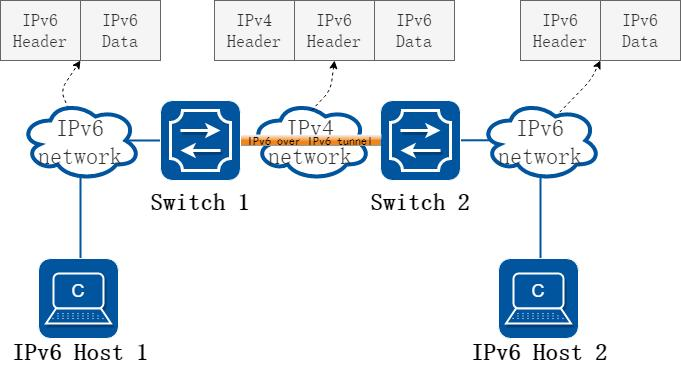
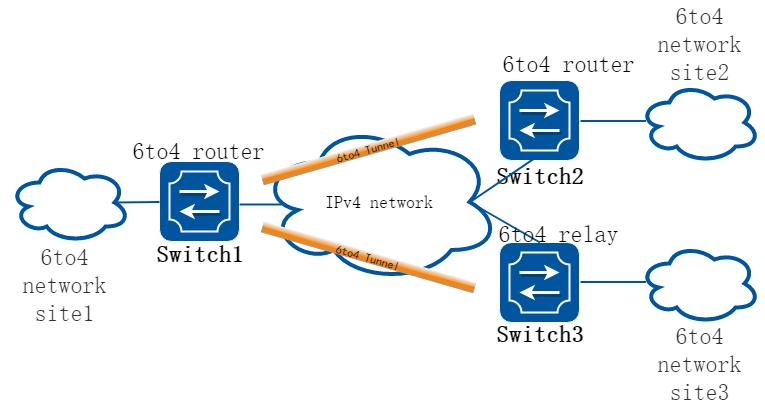
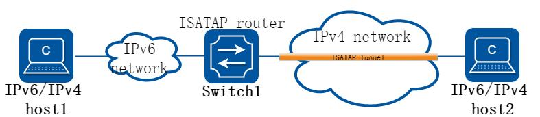
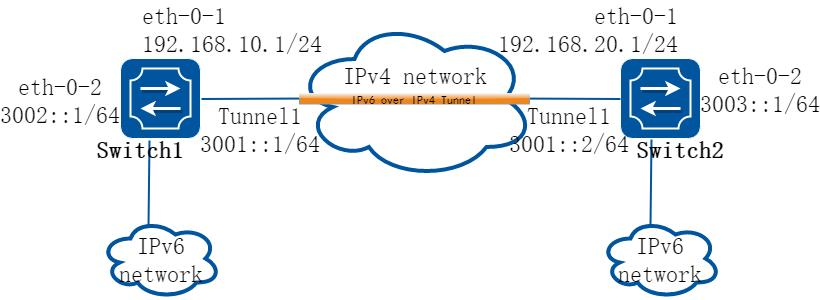
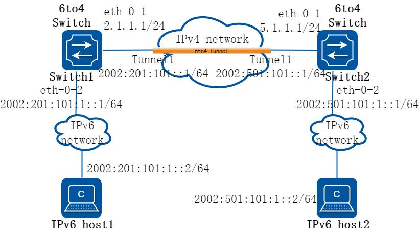
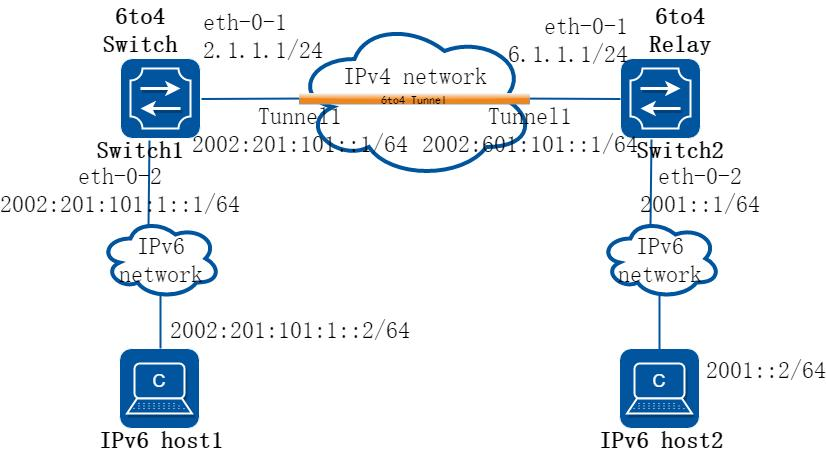
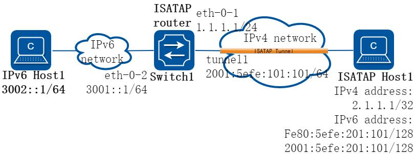
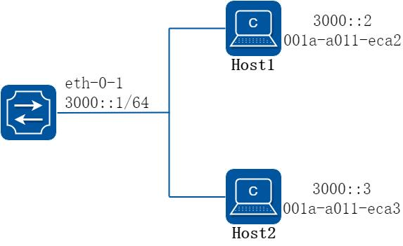
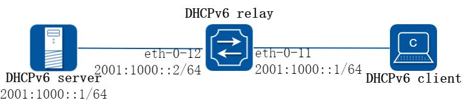

# 11 IPv6 业务配置指导

## 11.1 IPv6 over IPv4隧道配置

### 11.1.1 概述

#### 简介

隧道技术是一种封装技术，它利用一种网络协议来传输另一种网络协议，即一种网络协议将其他网络协议的数据报文封装在自己的报文中，然后在网络中传输。封装后的数据报文在网络中传输的路径，称为隧道。隧道是一条虚拟的点对点连接，隧道的两端需要对数据报文进行封装及解封装。隧道技术就是指包括数据封装、传输和解封装在内的全过程。

#### 原理描述



**图11-1 IPv6 over IPv4 Tunnel**

在IPv4 Internet 向IPv6 Internet 过渡的初期，IPv4 网络已被大量部署，而IPv6 网络只是散布在世界各地的一些孤岛。在IPv4 网络上用于连接IPv6 孤岛的隧道，称为IPv6 over IPv4 隧道，即IPv6 报文被封装在IPv4 报文中，实现IPv6 报文的透明传输。为了实现IPv6 over IPv4 隧道，需要在IPv4 网络与IPv6 网络交界的边界交换机上启动IPv4/IPv6 双协议栈。

IPv6 over IPv4 隧道对报文的处理过程如下：

IPv6 网络中的设备发送IPv6 报文，该报文到达隧道的源端设备Switch1。

Switch1 根据路由表判定该报文要通过隧道进行转发后，在IPv6 报文前封装上IPv4的报文头，通过隧道的实际物理接口将报文转发出去。

封装报文通过隧道到达隧道目的端设备Switch2，Switch2 判断该封装报文的目的地是本设备后，将对报文进行解封装。

Switch2 根据解封装后的IPv6 报文的目的地址转发该IPv6 报文。如果目的地就是本设备，则将IPv6 报文转给上层协议处理。

这种技术的优点是，不用把所有的设备都升级为双栈，只要求IPv4/IPv6 网络的边缘设备实现双栈和隧道功能。除边缘节点外，其它节点不需要支持双协议栈。可以大大利用现有的IPv4 网络投资。

根据隧道终点的IPv4 地址的获取方式不同，将隧道分为“配置隧道”和“自动隧道”：

如果IPv6 over IPv4 隧道的终点地址不能从IPv6 报文的目的地址中自动获取，需要进行手工配置，这样的隧道称为“配置隧道”。

如果IPv6 over IPv4 隧道的终点地址采用内嵌IPv4 地址的特殊IPv6 地址形式，则可以从IPv6 报文的目的地址中自动获取隧道终点的IPv4 地址，这样的隧道称为“自动隧道”。

目前，常用的IPv6 over IPv4 隧道模式有以下几种。

IPv6 over IPv4 手动隧道6to4 隧道ISATAP 隧道下面分别介绍一下上述三种隧道模式：

IPv6 over IPv4 手动隧道IPv6 手工配置隧道的源和目的地址是手工指定的，它提供了一个点到点的连接。IPv6手工配置隧道可以建立在两个边界路由器之间，为被IPv4 网络分离的IPv6 网络提供稳定的连接，或建立在终端系统与边界路由器之间，为终端系统访问IPv6 网络提供连接。

隧道的端点设备必须支持IPv6/IPv4 双协议栈。其它设备只需实现单协议栈即可。

IPv6 手工配置隧道要求在设备上手工配置隧道的源地址和目的地址，如果一个边界设备要与多个设备建立手工隧道，就需要在设备上配置多个隧道。所以手工隧道通常用于两个边界路由器之间，为两个IPv6 网络提供连接。

6to4 隧道普通6to4 隧道：

6to4 隧道是点到多点的自动隧道，主要用于将多个IPv6 孤岛通过IPv4 网络连接到IPv6 网络。6to4 隧道通过在IPv6 报文的目的地址中嵌入IPv4 地址，来实现自动获取隧道终点的IPv4 地址。

6to4 隧道使用了一种特殊的IPv6 地址，即6to4 地址，其格式为：2002:IPv4 地址:子网ID:接口ID 6to4 地址的前缀是2002:IPv4 地址，前缀长度为48bits。其中IPv4 地址是为IPv6孤岛申请的一个全球唯一的IPv4 地址。在IPv6/IPv4 边界交换机与IPv4 网络连接的物理接口上必须配置该IPv4 地址。子网ID 的长度为16bits，接口ID 的长度为64bits，均由用户在IPv6 孤岛内分配。

6to4 中继：

6to4 隧道只能用于前缀为2002::/16 的6to4 网络之间的通信，但在IPv6 网络中也会使用像2001::/16 这样的IPv6 网络地址。为了实现6to4 网络和其它IPv6 网络的通信，必须有一台6to4 路由器作为网关转发到IPv6 网络的报文，这台路由器就叫做6to4 中继（6to4 relay）路由器。（如果IPv6 报文的目的地址不是6to4 地址，但下一跳是6to4 地址，则从下一跳地址中取出IPv4 地址做为隧道的目的地址。）



**图11-2 IPv6 over IPv4 Tunnel**

如上图所示，IPv6 报文在到达边界路由器后，根据报文的IPv6 目的地址查找转发表，如果出接口是6to4 自动隧道的Tunnel 虚接口，且报文的目的地址是6to4 地址或下一跳是6to4 地址，则从6to4 地址中取出IPv4 地址做为隧道报文的目的地址，隧道报文的源地址是Tunnel 接口上配置的。

ISATAP 隧道随着IPv6 技术的推广，现有的IPv4 网络中将会出现越来越多的IPv6 主机，ISATAP 隧道技术为这种应用提供了一个较好的解决方案。ISATAP 隧道是点到多点的自动隧道技术，通过在IPv6 报文的目的地址中嵌入的IPv4 地址，可以自动获取隧道的终点。

使用ISATAP 隧道时，IPv6 报文的目的地址和隧道接口的IPv6 地址都要采用特殊的ISATAP 地址。

Prefix(64bit)::5EFE:IPv4-Address在创建ISATAP 隧道时，由于IPv4/IPv6 主机和ISATAP 交换机在同一个IPv4 网络里，ISATAP 地址中嵌入的IPv4 地址可以是公网地址，也可以是私网地址。ISATAP 隧道主要用于在IPv4 网络中IPv6 路由器和IPv6 路由器之间、以及IPv6 主机和IPv6 路由器之间的连接。



**图11-3 ISATAP Tunnel**

如上图所示，IPv4/IPv6 主机获得IPv6 地址的过程如下：

IPv4/IPv6 主机发送交换机请求消息：IPv4/IPv6 主机使用ISATAP 格式的链路本地地址向ISATAP 交换机发送交换机请求消息，该交换机请求消息被封装在IPv4 报文中。

ISATAP 交换机响应请求：ISATAP 交换机使用交换机通告消息响应主机的交换机请求。交换机通告消息中包含ISATAP 前缀（ISATAP 前缀在交换机上通过人工配置）。

IPv4/IPv6 主机得到自己的IPv6 地址：IPv4/IPv6 主机将ISATAP 前缀与5EFE:IPv4-Address 组合得到自己的IPv6 地址，并用此地址访问IPv6 主机。

### 11.1.2 配置举例

#### 配置手工隧道

##### 1. 组网拓扑



**图11-4 Manual Tunnel**

如上图所示，两个IPv6 网络分别通过Switch1 和Switch2 与IPv4 网络连接，要求在Switch1 和Switch2 之间建立IPv6 手动隧道，使两个IPv6 网络可以互通。

##### 2. 配置步骤

在配置之前，必须先全局使能IPv6 功能必须使IPv4 报文3 层路由可达，否则会造成tunnel 报文转发失败。

tunnel 接口上必须配置IPv6 地址，否则配置在该接口上的路由无效。

以下配置如未说明在哪个Switch 配置，则表示所有Switch 配置相同：

##### 步骤1 进入配置模式

```
Switch# configure terminal
```

##### 步骤2 全局使能ipv6

```
Switch(config)# ipv6 enable
```

##### 步骤3 进入接口配置模式，配置接口属性

Switch1 的接口配置：

```
Switch1(config)# interface eth-0-1
Switch1(config-if)# no switchport
Switch1(config-if)# ip address 192.168.10.1/24
Switch1(config-if)# tunnel enable
Switch1(config-if)# no shutdown
Switch1(config-if)# exit
Switch1(config)# interface eth-0-2
Switch1(config-if)# no switchport
Switch1(config-if)# ipv6 address 3002::1/64
Switch1(config-if)# no shutdown
Switch1(config-if)# exit
Switch1(config)# interface tunnel1
Switch1(config-if)# tunnel mode ipv6ip
Switch1(config-if)# tunnel source eth-0-1
Switch1(config-if)# tunnel destination 192.168.20.1
Switch1(config-if)# ipv6 address 3001::1/64
Switch1(config-if)# exit
```

Switch2 的接口配置：

```
Switch2(config)# interface eth-0-1
Switch2(config-if)# no switchport
Switch2(config-if)# ip address 192.168.20.1/24
Switch2(config-if)# tunnel enable
Switch2(config-if)# no shutdown
Switch2(config-if)# exit
Switch2(config)# interface eth-0-2
Switch2(config-if)# no switchport
Switch2(config-if)# ipv6 address 3003::1/64
Switch2(config-if)# no shutdown
Switch2(config-if)# exit
Switch2(config)# interface tunnel1
Switch2(config-if)# tunnel mode ipv6ip
Switch2(config-if)# tunnel source eth-0-1
Switch2(config-if)# tunnel destination 192.168.10.1
Switch2(config-if)# ipv6 address 3001::2/64
Switch2(config-if)# exit
```

##### 步骤4 配置静态路由

在switch1 配置：

```
Switch1(config)# ip route 192.168.20.0/24 192.168.10.2
Switch1(config)# ipv6 route 3003::/16 tunnel1
```

在switch2 配置：

```
Switch2(config)# ip route 192.168.10.0/24 192.168.20.2
Switch2(config)# ipv6 route 3002::/16 tunnel1
```

##### 步骤5 配置静态arp

在switch1 配置：

```
Switch1(config)# arp 192.168.10.2 0.0.2222
```

在switch2 配置：

```
Switch2(config)# arp 192.168.20.2 0.0.1111
```

##### 步骤6 退出配置模式

```
Switch(config)# end
```

##### 步骤7 检查配置

Switch1 显示结果：

```
Switch1# show interface tunnel1
Interface tunnel1
Interface current state: UP
Hardware is Tunnel
Index 8193 , Metric 1 , Encapsulation TUNNEL
VRF binding: not bound
Tunnel protocol/transport IPv6/IP, Status Valid
Tunnel source 192.168.10.1(eth-0-1), destination 192.168.20.1
Tunnel DSCP inherit,
Tunnel TTL 64
Tunnel transport MTU 1480 bytes
Switch1# show ipv6 interface tunnel1
Interface current state: UP
The maximum transmit unit is 1480 bytes
IPv6 is enabled, link-local address is fe80::c0a8:a01
Global unicast address(es):
3001::1, subnet is 3001::/64
ICMP error messages limited to one every 1000 milliseconds
ICMP redirects are always sent
ND DAD is enabled, number of DAD attempts: 1
ND router advertisement is disabled
ND reachable time is 30000 milliseconds
ND advertised reachable time is 0 milliseconds
ND retransmit interval is 1000 milliseconds
ND advertised retransmit interval is 0 milliseconds
ND router advertisements max interval: 600 secs
ND router advertisements min interval: 198 secs
ND router advertisements live for 1800 seconds
ND router advertisements hop-limit is 0
Hosts use stateless autoconfig for addresses.
```

Switch2 显示结果：

```
Switch2# show interface tunnel1
Interface tunnel1
Interface current state: UP
Hardware is Tunnel
Index 8193 , Metric 1 , Encapsulation TUNNEL
VRF binding: not bound
Tunnel protocol/transport IPv6/IP, Status Valid
Tunnel source 192.168.20.1(eth-0-1), destination 192.168.10.1
Tunnel DSCP inherit,
Tunnel TTL 64
Tunnel transport MTU 1480 bytes
Switch2# show ipv6 interface tunnel1
Interface current state: UP
The maximum transmit unit is 1480 bytes
IPv6 is enabled, link-local address is fe80::c0a8:1401
Global unicast address(es):
3001::2, subnet is 3001::/64
```

```
ICMP error messages limited to one every 1000 milliseconds
ICMP redirects are always sent
ND DAD is enabled, number of DAD attempts: 1
ND router advertisement is disabled
ND reachable time is 30000 milliseconds
ND advertised reachable time is 0 milliseconds
ND retransmit interval is 1000 milliseconds
ND advertised retransmit interval is 0 milliseconds
ND router advertisements max interval: 600 secs
ND router advertisements min interval: 198 secs
ND router advertisements live for 1800 seconds
ND router advertisements hop-limit is 0
Hosts use stateless autoconfig for addresses.
```

#### 配置6to4 隧道

##### 1. 组网拓扑



**图11-5 6to4 tunnel**

如上图所示，两个6to4 网络通过网络边缘6to4 switch（Switch1 和Switch2）与IPv4网络相连。在Switch1 和Switch2 之间建立6to4 隧道，实现6to4 网络中的主机Host1和Host2 之间的互通。

为了实现6to4 网络之间的互通，除了配置6to4 隧道外，还需要为6to4 网络内的主机及6to4 router 配置6to4 地址。

Switch1 上接口eth-0-1 的IPv4 地址为2.1.1.1/24，转换成IPv6 地址后使用6to4前缀2002:0201:0101::/48。对此前缀进行子网划分，Tunnel1 使用2002:0201:0101::/64 子网，eth-0-2 使用2002:0201:0101:1::/64 子网。

Switch2 上接口eth-0-1 的IPv4 地址为5.1.1.1/24，转换成IPv6 地址后使用6to4前缀2002:0501:0101::/48。对此前缀进行子网划分，Tunnel1 使用2002:0501:0101::/64 子网，eth-0-2 使用2002:0501:0101:1::/64 子网。

##### 2. 配置步骤

6to4 隧道无需配置目的地址。

对于自动隧道，使用同种封装协议的Tunnel 接口不能同时配置完全相同的源地址。

如果封装前IPv6 报文的目的IPv6 地址与Tunnel 接口的IPv6 地址不在同一个网段，则必须配置通过Tunnel 接口到达目的IPv6 地址的转发路由，以便需要进行封装的报文能正常转发。对于自动隧道，用户只能配置静态路由，指定到达目的IPv6地址的路由出接口为本端Tunnel 接口或下一跳为对端Tunnel 接口地址，不支持动态路由。

一台交换机上只允许存在一条6to4 隧道。

以下配置如未说明在哪个Switch 配置，则表示所有Switch 配置相同：

##### 步骤1 进入配置模式

```
Switch# configure terminal
```

##### 步骤2 全局使能ipv6

```
Switch(config)# ipv6 enable
```

##### 步骤3 进入接口配置模式，配置接口属性

Switch1 的接口配置：

```
Switch1(config)# interface eth-0-1
Switch1(config-if)# no switchport
Switch1(config-if)# ip address 2.1.1.1/24
Switch1(config-if)# tunnel enable
Switch1(config-if)# no shutdown
Switch1(config-if)# exit
Switch1(config)# interface eth-0-2
Switch1(config-if)# no switchport
Switch1(config-if)# ipv6 address 2002:201:101:1::1/64
Switch1(config-if)# no shutdown
Switch1(config-if)# exit
Switch1(config)# interface tunnel1
Switch1(config-if)# tunnel mode ipv6ip 6to4
Switch1(config-if)# tunnel source eth-0-1
Switch1(config-if)# ipv6 address 2002:201:101::1/64
Switch1(config-if)# exit
```

Switch2 的接口配置：

```
Switch2(config)# interface eth-0-1
Switch2(config-if)# no switchport
Switch2(config-if)# ip address 5.1.1.1/24
Switch2(config-if)# tunnel enable
Switch2(config-if)# no shutdown
Switch2(config-if)# exit
Switch2(config)# interface eth-0-2
Switch2(config-if)# no switchport
Switch2(config-if)# ipv6 address 2002:501:101:1::1/64
```

```
Switch2(config-if)# no shutdown
Switch2(config-if)# exit
Switch2(config)# interface tunnel1
Switch2(config-if)# tunnel mode ipv6ip 6to4
Switch2(config-if)# tunnel source eth-0-1
Switch2(config-if)# ipv6 address 2002:501:101::1/64
Switch2(config-if)# exit
```

##### 步骤4 配置静态路由

在switch1 配置：

```
Switch1(config)# ip route 5.1.1.0/24 2.1.1.2
Switch1(config)# ipv6 route 2002::/16 tunnel1
```

在switch2 配置：

```
Switch2(config)# ip route 2.1.1.0/24 5.1.1.2
Switch2(config)# ipv6 route 2002::/16 tunnel1
```

##### 步骤5 配置静态arp

在switch1 配置：

```
Switch1(config)# arp 2.1.1.2 0.0.2222
```

在switch2 配置：

```
Switch2(config)# arp 5.1.1.2 0.0.1111
```

##### 步骤6 退出配置模式

```
Switch(config)# end
```

##### 步骤7 检查配置

Switch1 显示结果：

```
Switch1# show interface tunnel1
Interface tunnel1
Interface current state: UP
Hardware is Tunnel
Index 8193 , Metric 1 , Encapsulation TUNNEL
VRF binding: not bound
Tunnel protocol/transport IPv6/IP 6to4, Status Valid
Tunnel source 2.1.1.1(eth-0-1), destination UNKNOWN
Tunnel DSCP inherit,
Tunnel TTL 64
Tunnel transport MTU 1480 bytes
```

Switch2 显示结果：

```
Switch2# show interface tunnel1
Interface tunnel1
Interface current state: UP
Hardware is Tunnel
Index 8193 , Metric 1 , Encapsulation TUNNEL
VRF binding: not bound
Tunnel protocol/transport IPv6/IP 6to4, Status Valid
Tunnel source 5.1.1.1(eth-0-1), destination UNKNOWN
```

```
Tunnel DSCP inherit,
Tunnel TTL 64
Tunnel transport MTU 1480 bytes
```

#### 配置6to4 中继

##### 1. 组网拓扑



**图11-6 6to4 relay**

如上图所示，Switch1 为6to4 交换机，其IPv6 侧的网络使用6to4 地址。Switch2 作为6to4 中继交换机，它和IPv6 网络（2001::/16）相连。要求在Switch1 和Switch2 之间配置6to4 隧道，使得6to4 网络中的主机与IPv6 网络中的主机互通。

##### 2. 配置步骤

6to4 中继交换机的配置与6to4 交换机的配置相同，但为实现6to4 网络与IPv6 网络的互通，需要在6to4 交换机上配置到IPv6 网络的路由。

当交换机上存在到达6to4 中继的路由时，不能切换隧道模式。

以下配置如未说明在哪个Switch 配置，则表示所有Switch 配置相同：

##### 步骤1 进入配置模式

```
Switch# configure terminal
```

##### 步骤2 全局使能ipv6

```
Switch(config)# ipv6 enable
```

##### 步骤3 进入接口配置模式，配置接口属性

Switch1 的接口配置：

```
Switch1(config)# interface eth-0-1
Switch1(config-if)# no switchport
Switch1(config-if)# ip address 2.1.1.1/24
Switch1(config-if)# tunnel enable
```

```
Switch1(config-if)# no shutdown
Switch1(config-if)# exit
Switch1(config)# interface eth-0-2
Switch1(config-if)# no switchport
Switch1(config-if)# ipv6 address 2002:201:101:1::1/64
Switch1(config-if)# no shutdown
Switch1(config-if)# exit
Switch1(config)# interface tunnel1
Switch1(config-if)# tunnel mode ipv6ip 6to4
Switch1(config-if)# tunnel source eth-0-1
Switch1(config-if)# ipv6 address 2002:201:101::1/64
Switch1(config-if)# exit
```

Switch2 的接口配置：

```
Switch2(config)# interface eth-0-1
Switch2(config-if)# no switchport
Switch2(config-if)# ip address 5.1.1.1/24
Switch2(config-if)# tunnel enable
Switch2(config-if)# no shutdown
Switch2(config-if)# exit
Switch2(config)# interface eth-0-2
Switch2(config-if)# no switchport
Switch2(config-if)# ipv6 address 2002:501:101:1::1/64
Switch2(config-if)# no shutdown
Switch2(config-if)# exit
Switch2(config)# interface tunnel1
Switch2(config-if)# tunnel mode ipv6ip 6to4
Switch2(config-if)# tunnel source eth-0-1
Switch2(config-if)# ipv6 address 2002:501:101::1/64
Switch2(config-if)# exit
```

##### 步骤4 配置静态路由

在switch1 配置：

```
Switch1(config)# ip route 6.1.1.0/24 2.1.1.2
Switch1(config)# ipv6 route 2001::/16 2002:601:101::1
Switch1(config)# ipv6 route 2002:601:101::/48 tunnel1
```

在switch2 配置：

```
Switch2(config)# ip route 2.1.1.0/24 6.1.1.2
Switch2(config)# ipv6 route 2002::/16 tunnel1
```

##### 步骤5 配置静态arp

在switch1 配置：

```
Switch1(config)# arp 2.1.1.2 0.0.2222
```

在switch2 配置：

```
Switch2(config)# arp 6.1.1.2 0.0.1111
```

##### 步骤6 退出配置模式

```
Switch(config)# end
```

##### 步骤7 检查配置

Switch1 显示结果：

```
Switch1# show interface tunnel1
Interface tunnel1
Interface current state: UP
Hardware is Tunnel
Index 8193 , Metric 1 , Encapsulation TUNNEL
VRF binding: not bound
Tunnel protocol/transport IPv6/IP 6to4, Status Valid
Tunnel source 2.1.1.1(eth-0-1), destination UNKNOWN
Tunnel DSCP inherit,
Tunnel TTL 64
Tunnel transport MTU 1480 bytes
Switch1# show ipv6 route
IPv6 Routing Table
Codes: C - connected, S - static, R - RIP, O - OSPF, I - IS-IS, B - BGP
[*] - [AD/Metric]
Timers: Uptime
S
2001::/16 [1/0]
via 2002:601:101::1 (recursive via ::, tunnel1), 00:00:32
C
2002:201:101::/64
via ::, tunnel1, 00:00:04
C
2002:201:101::1/128
via ::1, tunnel1, 00:00:04
S
2002:601:101::/48 [1/0]
via ::, tunnel1, 00:00:22
Switch1# show ipv6 interface tunnel1
Interface tunnel1
Interface current state: UP
The maximum transmit unit is 1480 bytes
IPv6 is enabled, link-local address is fe80::201:101
Global unicast address(es):
2002:201:101::1, subnet is 2002:201:101::/64
ICMP error messages limited to one every 1000 milliseconds
ICMP redirects are always sent
ND DAD is enabled, number of DAD attempts: 1
ND router advertisement is disabled
ND reachable time is 30000 milliseconds
ND advertised reachable time is 0 milliseconds
ND retransmit interval is 1000 milliseconds
ND advertised retransmit interval is 0 milliseconds
ND router advertisements max interval: 600 secs
ND router advertisements min interval: 198 secs
ND router advertisements live for 1800 seconds
ND router advertisements hop-limit is 0
Hosts use stateless autoconfig for addresses.
```

Switch2 显示结果：

```
Switch2# show interface tunnel1
Interface tunnel1
Interface current state: UP
Hardware is Tunnel
Index 8193 , Metric 1 , Encapsulation TUNNEL
```

```
VRF binding: not bound
Tunnel protocol/transport IPv6/IP 6to4, Status Valid
Tunnel source 6.1.1.1(eth-0-1), destination UNKNOWN
Tunnel DSCP inherit,
Tunnel TTL 64
Tunnel transport MTU 1480 bytes
```

#### 配置ISATAP 隧道

##### 1. 组网拓扑



**图11-7 ISATAP tunnel**

如上图所示，IPv6 网络和IPv4 网络通过ISATAP 交换机相连，在IPv4 网络侧分布着一些IPv6 主机。要求将IPv4 网络中的IPv6 主机通过ISATAP 隧道接入到IPv6 网络。

##### 2. 配置步骤

ISATAP 隧道无需配置目的地址。

对于自动隧道，使用同种封装协议的Tunnel 接口不能同时配置完全相同的源地址。

如果封装前IPv6 报文的目的IPv6 地址与Tunnel 接口的IPv6 地址不在同一个网段，则必须配置通过Tunnel 接口到达目的IPv6 地址的转发路由，以便需要进行封装的报文能正常转发。对于自动隧道，用户只能配置静态路由，指定到达目的IPv6 地址的路由出接口为本端Tunnel 接口或下一跳为对端Tunnel 接口地址，不支持动态路由。

##### 步骤1 进入配置模式

```
Switch# configure terminal
```

##### 步骤2 全局使能ipv6

```
Switch(config)# ipv6 enable
```

##### 步骤3 进入接口配置模式，配置接口属性

```
Switch(config)# interface eth-0-1
Switch(config-if)# no switchport
Switch(config-if)# ip address 1.1.1.1/24
Switch(config-if)# tunnel enable
```

```
Switch(config-if)# no shutdown
Switch(config-if)# exit
Switch(config)# interface eth-0-2
Switch(config-if)# no switchport
Switch(config-if)# ipv6 address 3001::1/64
Switch(config-if)# no shutdown
Switch(config-if)# exit
Switch(config)# interface tunnel1
Switch(config-if)# tunnel mode ipv6ip isatap
Switch(config-if)# tunnel source eth-0-1
Switch(config-if)# ipv6 address 2001::/64 eui-64
Switch(config-if)# no ipv6 nd ra suppress
Switch(config-if)# exit
```

##### 步骤4 配置静态路由

```
Switch(config)# ip route 2.1.1.0/24 1.1.1.2
Switch(config)# ipv6 route 2001::/16 tunnel1
```

##### 步骤5 配置静态arp

```
Switch(config)# arp 1.1.1.2 0.0.2222
```

##### 步骤6 退出配置模式

```
Switch(config)# end
```

##### 步骤7 检查配置

```
Switch# show interface tunnel1
Interface tunnel1
Interface current state: UP
Hardware is Tunnel
Index 8193 , Metric 1 , Encapsulation TUNNEL
VRF binding: not bound
Tunnel protocol/transport IPv6/IP ISATAP, Status Valid
Tunnel source 1.1.1.1(eth-0-1), destination UNKNOWN
Tunnel DSCP inherit,
Tunnel TTL 64
Tunnel transport MTU 1480 bytes
Switch# show ipv6 interface tunnel1
Interface tunnel1
Interface current state: UP
The maximum transmit unit is 1480 bytes
IPv6 is enabled, link-local address is fe80::101:101
Global unicast address(es):
2001::101:101, subnet is 2001::/64 [EUI]
ICMP error messages limited to one every 1000 milliseconds
ICMP redirects are always sent
ND DAD is enabled, number of DAD attempts: 1
ND router advertisement is enabled
ND reachable time is 30000 milliseconds
ND advertised reachable time is 0 milliseconds
ND retransmit interval is 1000 milliseconds
ND advertised retransmit interval is 0 milliseconds
ND router advertisements max interval: 600 secs
ND router advertisements min interval: 198 secs
ND next router advertisement due in 359 secs.
```

```
ND router advertisements live for 1800 seconds
ND router advertisements hop-limit is 0
Hosts use stateless autoconfig for addresses.
```

##### 步骤8 配置ISATAP 主机

ISATAP 主机上的具体配置与主机的操作系统有关，下面仅以Windows XP 操作系统为例进行说明。

在主机上安装IPv6 协议：

```
C:\>ipv6 install
```

在Windows XP 上，ISATAP 接口通常为接口2，只要在该接口上配置ISATAP 交换机的IPv4 地址即可完成主机侧的配置。先看看这个ISATAP 接口的信息：

```
Interface 2: Automatic Tunneling Pseudo-Interface
Guid {48FCE3FC-EC30-E50E-F1A7-71172AEEE3AE}
does not use Neighbor Discovery
does not use Router Discovery
routing preference 1
EUI-64 embedded IPv4 address: 0.0.0.0
router link-layer address: 0.0.0.0
preferred link-local fe80::5efe:2.1.1.1, life infinite
link MTU 1280 (true link MTU 65515)
current hop limit 128
reachable time 25000ms (base 30000ms)
retransmission interval 1000ms
DAD transmits 0
default site prefix length 48
```

为ISATAP 接口配置一个ipv4 地址：

```
C:\>ipv6 rlu 2 1.1.1.1
```

只需要这么一个命令，这就完成了主机的配置，我们再来看看这个ISATAP 接口的信息：

```
Interface 2: Automatic Tunneling Pseudo-Interface
Guid {48FCE3FC-EC30-E50E-F1A7-71172AEEE3AE}
does not use Neighbor Discovery
does not use Router Discovery
routing preference 1
EUI-64 embedded IPv4 address: 2.1.1.1
router link-layer address: 1.1.1.1
preferred global 2001::5efe:2.1.1.1, life 29d23h59m46s/6d23h59m46s (public)
preferred link-local fe80::5efe:2.1.1.1, life infinite
link MTU 1280 (true link MTU 65515)
current hop limit 128
reachable time 25000ms (base 30000ms)
retransmission interval 1000ms
DAD transmits 0
default site prefix length 48
```

## 11.2 NDP配置

### 11.2.1 概述

#### 简介

网络节点（主机和路由器）使用邻居发现协议（ND）来探测直连邻居的链路层地址。并且提供一种机制，快速验证一个已经缓存在表项中的邻居的有效性。

主机还能使用ND 来找到邻居的路由器。

网络节点之间利用该协议作为一种保活机制，定期探测邻居的有效性，探测邻居链路层地址的改变或邻居失效事件。

### 11.2.2 配置举例

##### 1. 组网拓扑



**图11-8 NDP**

在这个例子中，接口eth-0-1 的地址是3000::1/64。在3000::/64 网段中有两台主机，地址分别是3000::2 和3000::3。MAC 地址分别是001a-a011-eca2 和001a-a011-eca3。

其中3000::2 配置了静态邻居，3000::3 通过动态协议学习。将eth-0-1 的老化时间配置成10 分钟。NS 报文间隔配置成2 秒。

##### 2. 配置步骤

##### 步骤1 进入配置模式

```
Switch# configure terminal
```

##### 步骤2 进入接口配置模式，配置接口属性

```
Switch (config)# interface eth-0-1
Switch (config-if)# no switchport
Switch (config-if)# no shutdown
Switch (config-if)# ipv6 address 3000::1/64
Switch (config-if)# ipv6 nd reachable-time 600
```

```
Switch (config-if)# ipv6 nd ns-interval 2000
Switch (config-if)# exit
```

##### 步骤3 配置静态邻居表项

```
Switch (config)# ipv6 neighbor 3000::2 001a.a011.eca2
```

##### 步骤4 退出配置模式

```
Switch(config)# end
```

##### 步骤5 检查配置

```
Switch # show ipv6 neighbors
IPv6 address
Age
Link-Layer Addr State Interface
3000::2
-
001a-a011-eca2
REACH eth-0-1
3000::3
6
001a-a011-eca3
REACH eth-0-1
fe80::6d8:e8ff:fe4c:e700
6
001a-a011-eca3
STALE eth-0-1
```

## 11.3 DHCPv6 Relay 配置

### 11.3.1 概述

#### 简介

DHCPv6 服务器和客户端都在一个子网内，则客户端和服务器之间可以直接进行DHCPv6协议的交互，这时不需要启动DHCPv6 中继功能。如果DHCPv6 服务器和客户端不在一个子网内，则需要启动DHCPv6 中继功能将DHCPv6 报文转发到外部的DHCPv6 服务器。

DHCPv6 中继转发同正常的IPv6 路由转发不同，IPv6 路由转发的IPv6 数据包在网络之间透明交换，而DHCPv6 中继接收DHCPv6 消息同时产生一个新的DHCPv6 消息发送到另一个接口。DHCPv6 中继在报文中设置中继地址，同时可以添加中继信息（Remote-id），转发到DHCPv6 服务器端。

### 11.3.2 配置举例

##### 1. 组网拓扑



**图11-9 DHCP Relay**

上图为测试DHCPv6 中继代理功能的网络拓扑，需要两台PC 机和一台交换机构建测试环境。

计算机A 作为DHCPv6 服务器计算机B 作为DHCPv6 客户端交换机作为DHCPv6 中继

##### 2. 配置步骤

##### 步骤1 进入配置模式

```
Switch# configure terminal
```

##### 步骤2 使能DHCPv6 中继全局服务

```
Switch(config)# service dhcpv6 enable
Switch(config)# dhcpv6 relay
Switch(config)# dhcpv6 relay remote-id option
Switch(config)# dhcpv6 relay pd route
```

##### 步骤3 配置DHCPv6 服务器组

```
Switch(config)# dhcpv6-server 1 2001:1000::1
```

##### 步骤4 进入接口配置模式，配置接口属性

```
Switch(config)# interface eth-0-12
Switch(config-if)# no switchport
Switch(config-if)# ipv6 address 2001:1000::2/64
Switch(config-if)# no shutdown
Switch(config-if)# exit
Switch(config)# interface eth-0-11
Switch(config-if)# no switchport
Switch(config-if)# ipv6 address 2001:1001::1/64
Switch(config-if)# no shutdown
Switch(config-if)# dhcpv6-server 1
Switch(config-if)# exit
```

##### 步骤5 退出配置模式

```
Switch(config)# end
```

##### 步骤6 检查配置

检查接口配置。

```
Switch# show running-config interface eth-0-12
!
interface eth-0-12
no switchport
ipv6 address 2001:1000::1/64
!
Switch # show running-config interface eth-0-11
!
interface eth-0-11
no switchport
ipv6 address 2001:1001::1/64
dhcpv6-server 1
!
```

检查DHCPv6 服务器状态。

```
Switch# show services
Networking services configuration:
Service Name
Status
===========================================================
dhcp
disable
dhcpv6
enable
```

检查DHCPv6 服务器组配置。

```
Switch# show dhcpv6-server
DHCPv6 server group information:
============================================================
group 1 ipv6 address list:
[1] 2001:1000::1
```

显示DHCPv6 中继统计。

```
Switch# show dhcpv6 relay statistics
DHCPv6 relay packet statistics:
============================================================
Client relayed packets :
8
Server relayed packets :
8
Client error packets
:
0
Server error packets
:
0
```

显示记录的Prefix-delegation 客户端信息。

```
Switch# show dhcpv6 relay pd client
DHCPv6 prefix-delegation client information:
============================================================
Interface
: eth-0-11
Client DUID
: 000100011804ff38c2428f04970
Client IPv6 address
: fe80::beac:d8ff:fedf:c600
IA ID
: d8dfc60
IA Prefix :
2002:2:9:eebe::/64
prefered/max lifetime : 280/300
expired time :
2001-1-1 09:10:58
============================================================
```
