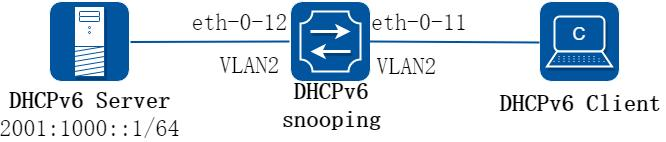
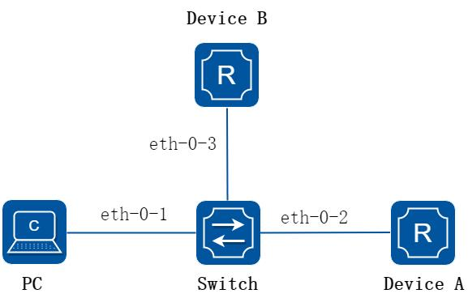
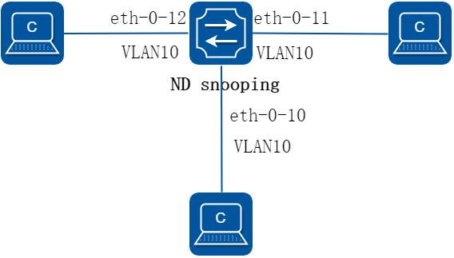

# 12 IPv6 安全配置指导

## 12.1 DHCPv6 Snooping配置

### 12.1.1 概述

#### 简介

DHCPv6 Snooping 是一种安全功能，包括不受信任的DHCPv6 客户端和信任的DHCPv6 服务器之间的防火墙功能，其功能行为如下：

验证从不受信任的源接收到的DHCPv6 消息，并过滤掉无效消息。

建立和维护DHCPv6 Snooping 绑定关系的数据库，其中包含DHCPv6 客户端租用的IPv6 地址信息。

DHCPv6 Snooping 功能在软件中实现，所有DHCPv6 消息在芯片中被拦截直接发往CPU 进行处理。

### 12.1.2 配置举例

##### 1. 组网拓扑



**图12-1 DHCPv6 Snooping**

上图为测试DHCPv6 snooping 功能的网络拓扑，需要两台PC 机和一台交换机构建测试环境，具体分配可参照如下描述：

计算机A 作为DHCPv6 服务器计算机B 作为DHCPv6 客户端交换机作为DHCPv6 snooping

##### 2. 配置步骤

##### 步骤1 进入配置模式

```
Switch# configure terminal
```

##### 步骤2 进入vlan 配置模式并创建vlan

```
Switch(config)# vlan database
Switch(config-vlan)# vlan 2
Switch(config-vlan)# exit
```

##### 步骤3 进入接口配置模式，配置接口属性

```
Switch(config)# interface eth-0-11
Switch(config-if)# switchport
Switch(config-if)# switchport access vlan 2
Switch(config-if)# no shutdown
Switch(config-if)# exit
Switch(config)# interface eth-0-12
Switch(config-if)# switchport
Switch(config-if)# switchport access vlan 2
Switch(config-if)# dhcpv6 snooping trust
Switch(config-if)# no shutdown
Switch(config-if)# exit
```

##### 步骤4 使能DHCPv6 snooping 全局特性

```
Switch(config)# service dhcpv6 enable
Switch(config)# dhcpv6 snooping
Switch(config)# dhcpv6 snooping vlan 2
```

##### 步骤5 退出配置模式

```
Switch(config)# end
```

##### 步骤6 检查配置

根据如下步骤，检查接口配置是否正确。

```
Switch# show running-config interface eth-0-12
!
interface eth-0-12
switchport access vlan 2
dhcpv6 snooping trust
!
Switch# show running-config interface eth-0-11
!
interface eth-0-11
switchport access vlan 2
!
```

使用如下命令，检查DHCPv6 服务状态。

```
Switch# show services
Networking services configuration:
Service Name
Status
```

```
============================================================
dhcp
disable
dhcpv6
enable
```

使用如下命令，打印dhcpv6 snooping 配置，检查当前配置。

```
Switch# show dhcpv6 snooping config
dhcpv6 snooping service: enabled
dhcpv6 snooping switch: enabled
dhcpv6 snooping vlan 2
```

使用如下命令，检查dhcpv6 snooping 的统计信息。

```
Switch# show dhcpv6 snooping statistics
DHCPv6 snooping statistics:
============================================================
DHCPv6 packets
21
Packets forwarded
21
Packets invalid
0
Packets dropped
0
```

使用如下命令，显示dhcpv6 snooping 绑定信息。

```
Switch# show dhcpv6 snooping binding all
DHCPv6 snooping binding table:
VLAN MAC Address
Lease(s)
Interface
IPv6 Address
============================================================
2
0016.76a1.7ed9 978
eth-0-11
2001:1000::2
```

## 12.2 IPv6 ND RA Guard配置

### 12.2.1 概述

#### 简介

攻击者仿冒网关向网络中的用户发送RA 报文，会导致用户使用错误的IPv6 配置参数，造成用户无法正常通信。

IPv6 ND Guard 提供两种方式在二层设备上阻止RA 报文攻击：

为端口配置角色。如果端口角色为host，直接丢弃RA 报文；如果端口角色为router，直接转发RA 报文；

为接口绑定ND RA guard 策略。根据策略下配置决定RA 报文是否被丢弃；

端口角色的优先级高于ND RA guard 策略。

### 12.2.2 配置举例

##### 1. 组网拓扑



**图12-2 IPv6 ND RA Guard**

上图为测试ND RA guard 功能的网络拓扑：

eth-0-1 连接的为PC，配置端口角色为host eth-0-2 连接的为路由器，配置端口角色为router eth-0-3 连接的为路由器，配置端口应用ND RA guard policy

##### 2. 配置步骤

##### 步骤1 进入配置模式

```
Switch# configure terminal
Switch(config)#
```

##### 步骤2 全局使能IPv6

```
Switch(config)# ipv6 enable
```

##### 步骤3 配置接口eth-0-1 ND RA guard role 为host

```
Switch(config)# interface eth-0-1
Switch(config-if)# no shutdown
Switch(config-if)# switchport
Switch(config-if)# ipv6 nd raguard role host
Switch(config-if)# exit
```

##### 步骤4 配置接口eth-0-2 ND RA guard role 为router

```
Switch(config)# interface eth-0-2
Switch(config-if)# no shutdown
Switch(config-if)# switchport
Switch(config-if)# ipv6 nd raguard role router
Switch(config-if)# exit
```

##### 步骤5 创建MAC ACL

```
Switch(config)# mac access-list mac_acl
Switch(config-mac-acl)# permit src-mac 0.0.1 0.0.0
Switch(config-if)# exit
```

##### 步骤6 创建ND RA guard 策略，并配置一些匹配项

```
Switch(config)# ipv6 nd raguard policy p1
Switch(config-raguard-policy)# managed-config-flag on
Switch(config-raguard-policy)# match mac-address mac_acl
Switch(config-raguard-policy)# exit
```

##### 步骤7 配置接口eth-0-3 应用ND RA guard 策略

```
Switch(config)# interface eth-0-3
Switch(config-if)# no shutdown
Switch(config-if)# switchport
Switch(config-if)# ipv6 nd raguard apply-policy p1
Switch(config-if)# exit
```

##### 步骤8 退出配置模式

```
Switch(config)# end
```

##### 步骤9 检查配置

查看ND RA guard 策略的相关配置。

```
Switch# show ipv6 nd raguard policy
RA guard policy resourse
: 1/128
ND RA guard policy:
p1
--------------------------------------------
Hoplimit minimum
: 1
Hoplimit maximum
: 255
Managed-config-flag
: on
Other-config-flag
: -
Preference maximum
: -
Source-mac-address acl
: mac_acl
IPv6 source-address acl
: -
IPv6 RA-prefix acl
: -
---------------------------------------------
```

显示端口eth-0-1 的ND RA guard 报文统计信息。

```
Switch# show ipv6 nd raguard statistics interface eth-0-1
ND RA guard statistics on:
eth-0-1
--------------------------------------------
Total receive
: 10
Total drop
: 10
Drop for role host
: 10
Drop for M-flag
: 0
Drop for O-flag
: 0
Drop for hoplimit
: 0
Drop for preference
: 0
Drop for src MAC acl
: 0
Drop for src IPv6 address acl : 0
Drop for RA prefix acl
: 0
Drop for others
: 0
---------------------------------------------
```

## 12.3 ND Snooping配置

### 12.3.1 概述

#### 简介

ND Snooping 是针对IPv6 ND（Neighbor Discovery，邻居发现）的一种安全特性，用于二层交换网络环境。通过侦听用户重复地址检测DAD（Duplicate AddressDetection）

过程的邻居请求报文NS（Neighbor Solicitation）来建立ND Snooping 动态绑定表，从而记录下报文的源IPv6 地址、源MAC 地址、所属VLAN、入端口等信息，以防止后续仿冒用户、仿冒网关的ND 报文攻击。

### 12.3.2 配置举例

##### 1. 组网拓扑



**图12-3 ND Snooping**

##### 2. 配置步骤

##### 步骤1 进入配置模式

```
Switch# configure terminal
Switch# ipv6 enable
```

##### 步骤2 进入vlan 配置模式并创建vlan

```
Switch(config)# vlan database
Switch(config-vlan)# vlan 10
Switch(config-vlan)# exit
```

##### 步骤3 进入接口配置模式，配置接口属性

```
Switch(config)# interface eth-0-10
Switch(config-if)# switchport
Switch(config-if)# switchport access vlan 10
Switch(config-if)# ipv6 nd snooping trust
Switch(config-if)# no shutdown
Switch(config-if)# exit
```

```
Switch(config)# interface range eth-0-11 to eth-0-12
Switch(config-if)# switchport
Switch(config-if)# switchport access vlan 10
Switch(config-if)# ipv6 nd snooping check na enable
Switch(config-if)# ipv6 nd snooping check ns enable
Switch(config-if)# ipv6 nd snooping check rs enable
Switch(config-if)# no shutdown
Switch(config-if)# exit
```

##### 步骤4 使能nd snooping 全局特性

```
Switch(config)# ipv6 nd snooping vlan 10 enable
Switch(config)# ipv6 nd snooping static-prefix 2003::/64 vlan 10
Switch(config)# ipv6 nd snooping max-prefix-number 100
Switch(config)# ipv6 nd snooping max-user-bind-number 100
```

##### 步骤5 退出配置模式

```
Switch(config)# end
```

##### 步骤6 检查配置

根据如下步骤，检查接口配置是否正确。

```
Switch# show running-config interface eth-0-10
!
interface eth-0-10
switchport access vlan 2
ipv6 nd snooping trust
!
Switch# show running-config interface eth-0-11
!
interface eth-0-11
switchport access vlan 2
ipv6 nd snooping check na enable
ipv6 nd snooping check ns enable
ipv6 nd snooping check rs enable
!
Switch# show running-config interface eth-0-12
!
interface eth-0-12
switchport access vlan 2
ipv6 nd snooping check na enable
ipv6 nd snooping check ns enable
ipv6 nd snooping check rs enable
!
```

使用如下命令，查看nd snooping 的相关配置。

```
Switch# show ipv6 nd snooping global information
ND Snooping Global Information:
----------------------------------------
ND Snooping enable on vlan
: 1/108
Prefix entry number
: 1/100
User bind entry number
: 1/100
ND Snooping Detection
: Disable
```

```
Detection transmit times
: 2
Detection tranmit interval(msec)
: 1000
Transmit times
: 2
Transmit interval(msec)
: 1000
----------------------------------------
```

使用如下命令，显示前缀管理表的相关信息。

```
Switch# show ipv6 nd snooping prefix
prefix table:
Prefix
Length Valid-Time Vlan Prefix-type
---------------------------------------+------+----------+----+-----------
2003::
64
-
10
static
Prefix table count: 1
Switch# show ipv6 nd snooping prefix detail
prefix table:
-------------------------------------------------------
Prefix
: 2003::
Prefix Length
: 64
Valid Lifetime(sec)
: -
Preferred Lifetime(sec): -
Interface
: -
VLAN ID
: 10
Prefix Type
: static
Aging Time Left(sec)
: -
-------------------------------------------------------
Prefix table count: 1
```

使用如下命令，显示动态绑定表的相关信息。

```
Switch# show ipv6 nd snooping user-bind
ND Snooping User bind Table:
----------------------------------------
Ipv6 Address
: 2003::1
Mac Address
: f48b.6f1d.ad00
VLAN ID
: 10
Interface
: eth-0-12
User state
: Bound
Aging Time Left(sec)
: 2516181
----------------------------------------
```

使用如下命令，显示nd snooping 的报文统计信息。

```
Switch# show ipv6 nd snooping statistics interface eth-0-10
ND Snooping statistics on:
eth-0-10
Packet Type Discard
Receive
Send
-----------+----------+----------+----------
NS
0
0
0
NA
0
0
-
RS
0
0
-
RA
0
1
-
Total
0
1
0
---------------------------------------------
DUT1# show ipv6 nd snooping statistics interface eth-0-12
ND Snooping statistics on:
eth-0-12
```

```
Packet Type Discard
Receive
Send
-----------+----------+----------+----------
NS
0
1
0
NA
0
0
-
RS
0
0
-
RA
0
0
-
Total
0
1
0
---------------------------------------------
```
