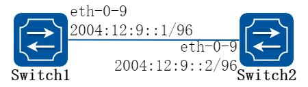
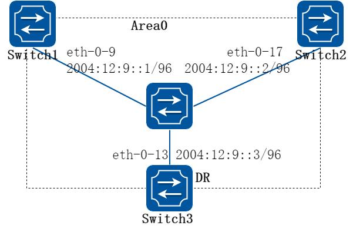
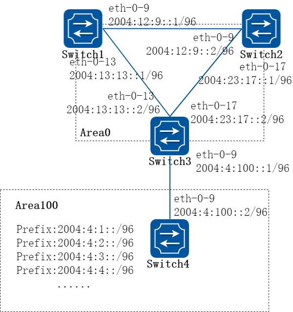
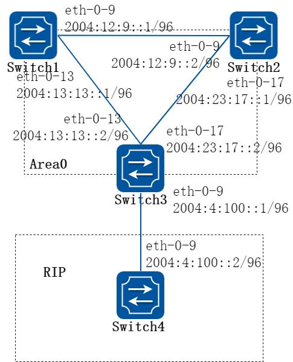
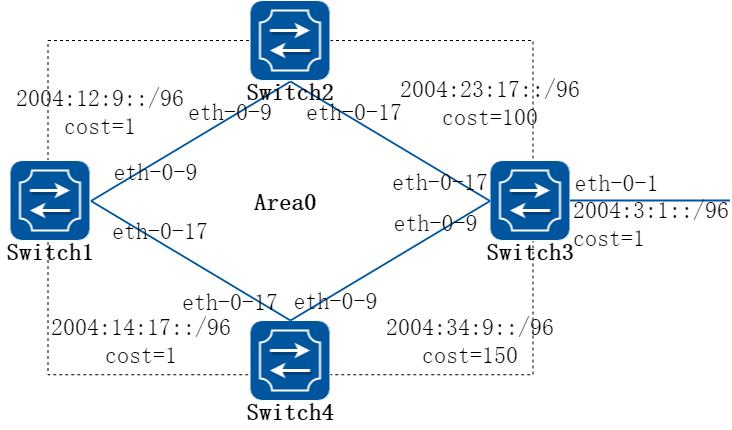
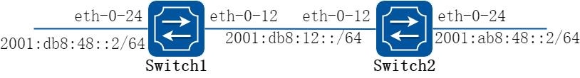
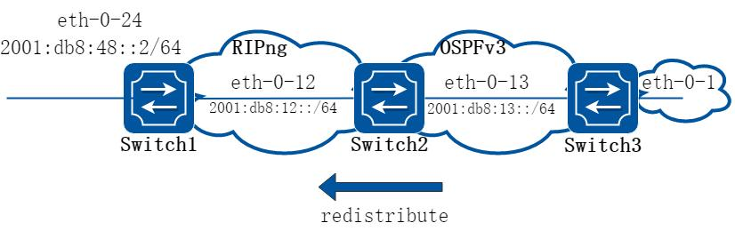
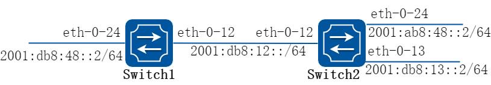
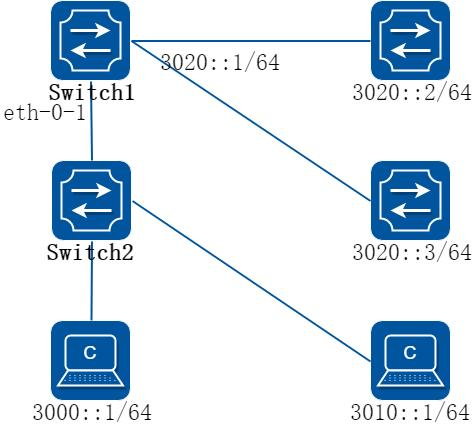

# 13 IPv6 路由配置指导

## 13.1 IPv6单播路由配置

### 13.1.1 概述

#### 简介

静态路由是一种特殊的路由，由管理员手工配置。当网络结构比较简单时，只需配置静态路由就可以使网络正常工作。合理设置和使用静态路由可以改进网络性能，并可为重要的网络应用保证带宽。

静态路由的缺点在于：当网络发生故障或者拓扑发生变化后，可能会出现路由不可达，从而导致网络中断。此时必须由网络管理员手工修改静态路由的配置。

静态路由是由网络前缀（主机地址）和下一跳（网关）组成。静态路由在小型网络中非常有用。静态路由可提供使几个目的地可达的简单解决方案。

大型网络推荐使用动态路由协议。

### 13.1.2 配置举例

##### 1. 组网拓扑


**图13-1 ipv6 unicast routing**

##### 2. 配置步骤

这个例子说明在一个简单的网络拓扑结构下如何使能静态路。

以下配置如未说明在哪个Switch 配置，则表示所有Switch 配置相同：

##### 步骤1 进入配置模式

```
Switch# configure terminal
```

##### 步骤2 全局使能ipv6

```
Switch(config)# ipv6 enable
```

##### 步骤3 进入接口配置模式，配置接口属性

Switch1 的接口配置：

```
Switch(config)# interface eth-0-9
Switch(config-if)# no switchport
Switch(config-if)# no shutdown
Switch(config-if)# ipv6 address auto link-local
Switch(config-if)# ipv6 address 2001:1::1/64
Switch(config-if)# exit
```

Switch2 的接口配置：

```
Switch(config)# interface eth-0-9
Switch(config-if)# no switchport
Switch(config-if)# no shutdown
Switch(config-if)# ipv6 address auto link-local
Switch(config-if)# ipv6 address 2001:1::2/64
Switch(config-if)# exit
Switch(config)# interface eth-0-17
Switch(config-if)# no switchport
Switch(config-if)# no shutdown
Switch(config-if)# ipv6 address auto link-local
Switch(config-if)# ipv6 address 2001:2::2/64
Switch(config-if)# exit
```

Switch3 的接口配置：

```
Switch(config)# interface eth-0-17
Switch(config-if)# no switchport
Switch(config-if)# no shutdown
Switch(config-if)# ipv6 address auto link-local
Switch(config-if)# ipv6 address 2001:2::3/64
Switch(config-if)# exit
```

##### 步骤4 配置静态路由

在switch1 配置：

```
Switch(config)# ipv6 route 2001:2::/64 2001:1::2
```

在switch3 配置：

```
Switch(config)# ipv6 route 2001:1::/64 2001:2::2
```

##### 步骤5 退出配置模式

```
Switch(config)# end
```

##### 步骤6 检查配置

Switch1 显示结果：

```
Switch# show ipv6 route
IPv6 Routing Table
Codes: C - connected, S - static, R - RIP, O - OSPF, I - IS-IS, B - BGP
```

```
[*] - [AD/Metric]
Timers: Uptime
C
2001:1::/64
via ::, eth-0-9, 02:08:50
C
2001:1::1/128
via ::1, eth-0-9, 02:08:50
S
2001:2::/64 [1/0]
via 2001:1::2, eth-0-9, 02:05:36
C
fe80::/10
via ::, Null0, 02:09:11
```

Switch2 显示结果：

```
Switch# show ipv6 route
IPv6 Routing Table
Codes: C - connected, S - static, R - RIP, O - OSPF, I - IS-IS, B - BGP
[*] - [AD/Metric]
Timers: Uptime
C
2001:1::/64
via ::, eth-0-9, 00:03:37
C
2001:1::2/128
via ::1, eth-0-9, 00:03:37
C
2001:2::/64
via ::, eth-0-17, 00:03:21
C
2001:2::2/128
via ::1, eth-0-17, 00:03:21
C
fe80::/10
via ::, Null0, 00:03:44
```

Switch3 显示结果：

```
Switch# show ipv6 route
IPv6 Routing Table
Codes: C - connected, S - static, R - RIP, O - OSPF, I - IS-IS, B - BGP
[*] - [AD/Metric]
Timers: Uptime
S
2001:1::/64 [1/0]
via 2001:2::2, eth-0-17, 00:02:14
C
2001:2::/64
via ::, eth-0-17, 00:03:28
C
2001:2::3/128
via ::1, eth-0-17, 00:03:28
C
fe80::/10
via ::, Null0, 00:03:53
```

在Switch1 上测试Switch3 的连通性：

```
Switch1# ping ipv6 2001:2::3
PING 2001:2::3(2001:2::3) 56 data bytes
64 bytes from 2001:2::3: icmp_seq=0 ttl=63 time=127 ms
64 bytes from 2001:2::3: icmp_seq=1 ttl=63 time=132 ms
64 bytes from 2001:2::3: icmp_seq=2 ttl=63 time=124 ms
64 bytes from 2001:2::3: icmp_seq=3 ttl=63 time=137 ms
64 bytes from 2001:2::3: icmp_seq=4 ttl=63 time=141 ms
--- 2001:2::3 ping statistics ---
5 packets transmitted, 5 received, 0% packet loss, time 4010ms
rtt min/avg/max/mdev = 124.950/132.719/141.251/5.923 ms, pipe 2
```

## 13.2 OSPFv3配置

### 13.2.1 概述

#### 简介

开放最短路径优先协议OSPF（Open Shortest Path First）是IETF 组织开发的一个基于链路状态的内部网关协议，OSPFv3 是OSPF 版本3 的简称，主要提供对IPv6 路由的支持，遵循的标准是RFC5340(OSPF for IPv6，OSPFv3 和OSPFv2 有很多方面是相同的：

Router ID，Area ID，LSA Link State ID 仍然是32 位的。

协议报文类型一样：Hello 报文、DD 报文、LSR 报文、LSU 报文和LSAck 报文。

邻居发现和邻接建立机制一样LSA 泛洪和老化机制一样。

OSPFv3 和OSPFv2 有如下不同点：

OSPFv3 是基于link 运行的，而OSPFv2 是基于network 运行的。

OSPFv3 在同一个link 上可以运行多个实例。

OSPFv3 的拓扑关系和IPv6 前缀信息分离。

使用Link-local 地址作为路由下一跳。

新增了link lsa 以及本地链路泛洪范围。

当前的系统支持如下OSPFv3 特性：

支持末梢区域：支持路由重分布，这包括将其他路由协议学到的路由导入OSPFv3或者将OSPFv3 学到的路由导出到其他路由协议中。

支持OSPFv3 多process。

支持link 上多instance。

#### 原理描述

参考：RFC 5340 – OSPF for IPv6

### 13.2.2 配置举例

#### 配置基本OSPFv3

##### 步骤1 进入配置模式

```
Switch# configure terminal
```

##### 步骤2 创建OSPFv3 实例

```
Switch(config)# router ipv6 ospf 100
Switch(config-router)# router-id 1.1.1.1
Switch(config-router)# exit
```

在全局模式下通过命令“no router ipv6 ospf process-id”取消OSPFv3 进程。

##### 步骤3 退出配置模式

```
Switch(config)# end
```

##### 步骤4 检查配置

```
Switch# show ipv6 protocols
Routing Protocol is "OSPFv3 (100)" with ID 1.1.1.1
Redistributing:
Routing for Networks:
Distance: (default is 110)
```

#### 启用OSPFv3

##### 1. 组网拓扑



**图13-2 OSPFv3**

##### 2. 配置步骤

这个例子显示了一个接口上启用OSPFv3 所需的最低配置。

以下配置如未说明在哪个Switch 配置，则表示所有Switch 配置相同：

##### 步骤1 进入配置模式

```
Switch# configure terminal
```

##### 步骤2 全局使能ipv6

```
Switch(config)# ipv6 enable
```

##### 步骤3 创建OSPFv3 实例

在switch1 配置：

```
Switch1(config)# router ipv6 ospf 100
Switch1(config-router)# router-id 1.1.1.1
Switch1(config-router)# exit
```

在switch2 配置：

```
Switch2(config)# router ipv6 ospf 200
Switch2(config-router)# router-id 2.2.2.2
Switch2(config-router)# exit
```

##### 步骤4 进入接口配置模式，配置接口属性

Switch1 的接口配置：

```
Switch1(config)# interface eth-0-9
Switch1(config-if)# no switchport
Switch1(config-if)# no shutdown
Switch1(config-if)# ipv6 address 2004:12:9::1/96
Switch1(config-if)# ipv6 router ospf 100 area 0 instance 0
Switch1(config-if)# exit
```

Switch2 的接口配置：

```
Switch2(config)# interface eth-0-9
Switch2(config-if)# no switchport
Switch2(config-if)# no shutdown
Switch2(config-if)# ipv6 address 2004:12:9::2/96
Switch2(config-if)# ipv6 router ospf 200 area 0 instance 0
Switch2(config-if)# exit
```

##### 步骤5 退出配置模式

```
Switch(config)# end
```

##### 步骤6 检查配置

Switch1 显示结果：

```
Switch1# show ipv6 ospf database
OSPFv3 Router with ID (1.1.1.1) (Process 100)
Link-LSA (Interface eth-0-9)
Link State ID
ADV Router
Age
Seq#
CkSum
Prefix
0.0.0.9
1.1.1.1
614 0x80000001 0x6a40
1
0.0.0.9
2.2.2.2
68 0x80000001 0x4316
1
Router-LSA (Area 0.0.0.0)
Link State ID
ADV Router
Age
Seq#
CkSum
Link
0.0.0.0
1.1.1.1
54 0x80000003 0xb74b
1
0.0.0.0
2.2.2.2
55 0x80000003 0x9965
1
Network-LSA (Area 0.0.0.0)
Link State ID
ADV Router
Age
Seq#
CkSum
0.0.0.9
1.1.1.1
54 0x80000001 0x3ed1
Intra-Area-Prefix-LSA (Area 0.0.0.0)
Link State ID
ADV Router
Age
Seq#
CkSum
Prefix
Reference
0.0.0.2
1.1.1.1
53 0x80000001 0x450a
1
Network-LSA
Switch1# show ipv6 ospf neighbor
OSPFv3 Process (100)
Neighbor ID
Pri
State
Dead Time
Interface
Instance ID
2.2.2.2
1
Full/Backup
00:00:33
eth-0-9
0
Switch# show ipv6 ospf route
OSPFv3 Process (100)
Codes: C - connected, D - Discard, O - OSPF, IA - OSPF inter area
E1 - OSPF external type 1, E2 - OSPF external type 2
Destination
Metric
Next-hop
C
2004:12:9::/96
1
directly connected, eth-0-9, Area 0.0.0.0
```

Switch2 显示结果：

```
Switch2# show ipv6 ospf database
OSPFv3 Router with ID (2.2.2.2) (Process 200)
Link-LSA (Interface eth-0-9)
Link State ID
ADV Router
Age
Seq#
CkSum
Prefix
0.0.0.9
1.1.1.1
774 0x80000001 0x6a40
1
0.0.0.9
2.2.2.2
228 0x80000001 0x4316
1
Router-LSA (Area 0.0.0.0)
Link State ID
ADV Router
Age
Seq#
CkSum
Link
0.0.0.0
1.1.1.1
217 0x80000003 0xb74b
1
0.0.0.0
2.2.2.2
214 0x80000003 0x9965
1
Network-LSA (Area 0.0.0.0)
Link State ID
ADV Router
Age
Seq#
CkSum
0.0.0.9
1.1.1.1
215 0x80000001 0x3ed1
Intra-Area-Prefix-LSA (Area 0.0.0.0)
Link State ID
ADV Router
Age
Seq#
CkSum
Prefix
Reference
0.0.0.2
1.1.1.1
214 0x80000001 0x450a
1
Network-LSA
Switch2# show ipv6 ospf neighbor
OSPFv3 Process (200)
Neighbor ID
Pri
State
Dead Time
Interface
Instance ID
1.1.1.1
1
Full/DR
00:00:35
eth-0-9
0
Switch# show ipv6 ospf route
OSPFv3 Process (200)
Codes: C - connected, D - Discard, O - OSPF, IA - OSPF inter area
E1 - OSPF external type 1, E2 - OSPF external type 2
Destination
Metric
Next-hop
C
2004:12:9::/96
1
directly connected, eth-0-9, Area 0.0.0.0
```

#### 配置优先级

##### 1. 组网拓扑



**图13-3 OSPFv3 priority**

##### 2. 配置步骤

这个例子主要讲述了如何配置接口优先级，优先级高的成为DR。优先级为0 的不参与DR 选举。Switch3 的优先级是10，这比Switch1 和Switch2 的默认优先级1 要高，因此Switch3 将成为这个网络内的DR。

以下配置如未说明在哪个Switch 配置，则表示所有Switch 配置相同：

##### 步骤1 进入配置模式

```
Switch# configure terminal
```

##### 步骤2 全局使能ipv6

```
Switch(config)# ipv6 enable
```

##### 步骤3 创建OSPFv3 实例

在switch1 配置：

```
Switch1(config)# router ipv6 ospf 100
Switch1(config-router)# router-id 1.1.1.1
Switch1(config-router)# exit
```

在switch2 配置：

```
Switch2(config)# router ipv6 ospf 200
Switch2(config-router)# router-id 2.2.2.2
Switch2(config-router)# exit
```

在switch3 配置：

```
Switch3(config)# router ipv6 ospf 300
Switch3(config-router)# router-id 3.3.3.3
Switch3(config-router)# exit
```

##### 步骤4 进入接口配置模式，配置接口属性

Switch1 的接口配置：

```
Switch1(config)# interface eth-0-9
Switch1(config-if)# no switchport
Switch1(config-if)# no shutdown
Switch1(config-if)# ipv6 address 2004:12:9::1/96
Switch1(config-if)# ipv6 router ospf 100 area 0 instance 0
Switch1(config-if)# exit
```

Switch2 的接口配置：

```
Switch2(config)# interface eth-0-17
Switch2(config-if)# no switchport
Switch2(config-if)# no shutdown
Switch2(config-if)# ipv6 address 2004:12:9::2/96
Switch2(config-if)# ipv6 router ospf 200 area 0 instance 0
Switch2(config-if)# exit
```

Switch3 的接口配置：

```
Switch3(config)# interface eth-0-13
Switch3(config-if)# no switchport
Switch3(config-if)# no shutdown
Switch3(config-if)# ipv6 address 2004:12:9::3/96
Switch3(config-if)# ipv6 router ospf 300 area 0 instance 0
Switch3(config-if)# ipv6 ospf priority 10
Switch3(config-if)# exit
```

##### 步骤5 退出配置模式

```
Switch(config)# end
```

##### 步骤6 检查配置

Switch1 显示结果：

```
Switch1# show ipv6 ospf neighbor
OSPFv3 Process (100)
Neighbor ID
Pri
State
Dead Time
Interface
Instance ID
2.2.2.2
1
Full/Backup
00:00:31
eth-0-9
0
3.3.3.3
10
Full/DR
00:00:36
eth-0-9
0
Switch1#
Switch1# show ipv6
interface
isis
mif
mld
mroute
mroute-rpf
multicast
neighbors
ospf
pim
prefix-list
protocols
rip
route
Switch1# show ipv6 ospf interface
eth-0-9 is up, line protocol is up
Interface ID 9
IPv6 Prefixes
fe80::20e6:7eff:fee2:d400/10 (Link-Local Address)
2004:12:9::1/96
OSPFv3 Process (100), Area 0.0.0.0, Instance ID 0
Router ID 1.1.1.1, Network Type BROADCAST, Cost: 1
Transmit Delay is 1 sec, State DROther, Priority 1
Designated Router (ID) 3.3.3.3
Interface Address fe80::ba5d:79ff:fe55:ed00
Backup Designated Router (ID) 2.2.2.2
Interface Address fe80::fcc8:7bff:fe3e:ec00
Timer interval configured, Hello 10, Dead 40, Wait 40, Retransmit 5
Hello due in 00:00:03
Neighbor Count is 2, Adjacent neighbor count is 2
```

Switch2 显示结果：

```
Switch2# show ipv6 ospf neighbor
OSPFv3 Process (200)
Neighbor ID
Pri
State
Dead Time
Interface
Instance ID
1.1.1.1
1
Full/DROther
00:00:31
eth-0-17
0
3.3.3.3
10
Full/DR
00:00:37
eth-0-17
0
Switch2# show ipv6 ospf interface
eth-0-17 is up, line protocol is up
Interface ID 17
IPv6 Prefixes
fe80::fcc8:7bff:fe3e:ec00/10 (Link-Local Address)
2004:12:9::2/96
```

```
OSPFv3 Process (200), Area 0.0.0.0, Instance ID 0
Router ID 2.2.2.2, Network Type BROADCAST, Cost: 1
Transmit Delay is 1 sec, State Backup, Priority 1
Designated Router (ID) 3.3.3.3
Interface Address fe80::ba5d:79ff:fe55:ed00
Backup Designated Router (ID) 2.2.2.2
Interface Address fe80::fcc8:7bff:fe3e:ec00
Timer interval configured, Hello 10, Dead 40, Wait 40, Retransmit 5
Hello due in 00:00:07
Neighbor Count is 2, Adjacent neighbor count is 2
```

Switch3 显示结果：

```
Switch3# show ipv6 ospf neighbor
OSPFv3 Process (300)
Neighbor ID
Pri
State
Dead Time
Interface
Instance ID
1.1.1.1
1
Full/DROther
00:00:40
eth-0-13
0
2.2.2.2
1
Full/Backup
00:00:29
eth-0-13
0
Switch3# show ipv6 ospf interface
eth-0-13 is up, line protocol is up
Interface ID 13
IPv6 Prefixes
fe80::ba5d:79ff:fe55:ed00/10 (Link-Local Address)
2004:12:9::3/96
OSPFv3 Process (300), Area 0.0.0.0, Instance ID 0
Router ID 3.3.3.3, Network Type BROADCAST, Cost: 1
Transmit Delay is 1 sec, State DR, Priority 10
Designated Router (ID) 3.3.3.3
Interface Address fe80::ba5d:79ff:fe55:ed00
Backup Designated Router (ID) 2.2.2.2
Interface Address fe80::fcc8:7bff:fe3e:ec00
Timer interval configured, Hello 10, Dead 40, Wait 40, Retransmit 5
Hello due in 00:00:06
Neighbor Count is 2, Adjacent neighbor count is 2
```

#### 配置OSPFv3 区域参数

##### 1. 组网拓扑



**图13-4 OSPFv3 area**

##### 2. 配置步骤

您可以选择性地配置多个OSPFv3 区域参数。这些参数将区域配置为末梢区域(Stub)。

Stub 区域是一些特定的区域，Stub 区域的ABR 不传播它们接收到的自治系统外部路由，在这些区域中路由器的路由表规模以及路由信息传递的数量都会大大减少。为保证到自治系统外的路由依旧可达，该区域的ABR 将生成一条缺省路由，并发布给Stub 区域中的其他非ABR 路由器。

路由聚合是指ABR 或ASBR 将具有相同前缀的路由信息聚合，只发布一条路由到其它区域。AS 被划分成不同的区域后，区域间可以通过路由聚合来减少路由信息，减小路由表的规模，提高路由器的运算速度。如果网络号是连续的，你可以使用area range 命令将这些连续的网段聚合成一个网段。这样ABR 只发送一条聚合后的LSA，所有属于本命令指定的聚合网段范围的LSA 将不再会被单独发送出去，这样可减少其它区域中LSDB的规模。

以下配置如未说明在哪个Switch 配置，则表示所有Switch 配置相同：

##### 步骤1 进入配置模式

```
Switch# configure terminal
```

##### 步骤2 全局使能ipv6

```
Switch(config)# ipv6 enable
```

##### 步骤3 创建OSPFv3 实例

在switch1 配置：

```
Switch1(config)# router ipv6 ospf 100
Switch1(config-router)# router-id 1.1.1.1
Switch1(config-router)# exit
```

在switch2 配置：

```
Switch2(config)# router ipv6 ospf 200
Switch2(config-router)# router-id 2.2.2.2
Switch2(config-router)# exit
```

在switch3 配置：

```
Switch3(config)# router ipv6 ospf 300
Switch3(config-router)# router-id 3.3.3.3
Switch3(config-router)# exit
Switch3(config)# router ipv6 ospf 300
Switch3(config-router)# area 100 range 2004:4::/32
Switch3(config-router)# area 100 stub no-summary
Switch3(config-router)# exit
```

在switch4 配置：

```
Switch4(config)# router ipv6 ospf 400
Switch4(config-router)# router-id 4.4.4.4
Switch4(config-router)# area 100 stub no-summary
Switch4(config-router)# exit
```

##### 步骤4 进入接口配置模式，配置接口属性

Switch1 的接口配置：

```
Switch1(config)# interface eth-0-9
Switch1(config-if)# no switchport
Switch1(config-if)# no shutdown
Switch1(config-if)# ipv6 address 2004:12:9::1/96
Switch1(config-if)# ipv6 router ospf 100 area 0 instance 0
Switch1(config-if)# exit
Switch1(config)#interface eth-0-13
Switch1(config-if)#no switchport
Switch1(config-if)#no shutdown
Switch1(config-if)# ipv6 address 2004:13:13::2/96
Switch1(config-if)# ipv6 router ospf 100 area 0 instance 0
Switch1(config-if)# exit
```

Switch2 的接口配置：

```
Switch2(config)# interface eth-0-9
Switch2(config-if)# no switchport
Switch2(config-if)# no shutdown
Switch2(config-if)# ipv6 address 2004:12:9::2/96
Switch2(config-if)# ipv6 router ospf 200 area 0 instance 0
Switch2(config-if)# exit
Switch2(config)#interface eth-0-17
Switch2(config-if)#no switchport
```

```
Switch2(config-if)#no shutdown
Switch2(config-if)# ipv6 address 2004:23:17::1/96
Switch2(config-if)# ipv6 router ospf 200 area 0 instance 0
Switch2(config-if)# exit
```

Switch3 的接口配置：

```
Switch3(config)# interface eth-0-9
Switch3(config-if)# no switchport
Switch3(config-if)# no shutdown
Switch3(config-if)# ipv6 address 2004:4:100::1/96
Switch3(config-if)# ipv6 router ospf 300 area 100 instance 0
Switch3(config-if)# exit
Switch3(config)# interface eth-0-13
Switch3(config-if)# no switchport
Switch3(config-if)# no shutdown
Switch3(config-if)# ipv6 address 2004:13:13::2/96
Switch3(config-if)# ipv6 router ospf 300 area 0 instance 0
Switch3(config-if)# exit
Switch3(config)# interface eth-0-17
Switch3(config-if)# no switchport
Switch3(config-if)# no shutdown
Switch3(config-if)# ipv6 address 2004:23:17::2/96
Switch3(config-if)# ipv6 router ospf 300 area 0 instance 0
Switch3(config-if)# exit
```

Switch4 的接口配置：

```
Switch4(config)# interface eth-0-1
Switch4(config-if)# no switchport
Switch4(config-if)# no shutdown
Switch4(config-if)# ipv6 address 2004:4:1::1/96
Switch4(config-if)# ipv6 router ospf 400 area 100 instance 0
Switch4(config-if)# exit
Switch4(config)# interface eth-0-2
Switch4(config-if)# no switchport
Switch4(config-if)# no shutdown
Switch4(config-if)# ipv6 address 2004:4:2::1/96
Switch4(config-if)# ipv6 router ospf 400 area 100 instance 0
Switch4(config-if)# exit
Switch4(config)# interface eth-0-3
Switch4(config-if)# no switchport
Switch4(config-if)# no shutdown
Switch4(config-if)# ipv6 address 2004:4:3::1/96
Switch4(config-if)# ipv6 router ospf 400 area 100 instance 0
Switch4(config-if)# exit
Switch4(config)# interface eth-0-4
Switch4(config-if)# no switchport
Switch4(config-if)# no shutdown
Switch4(config-if)# ipv6 address 2004:4:4::1/96
Switch4(config-if)# ipv6 router ospf 400 area 100 instance 0
Switch4(config-if)# exit
```

```
Switch4(config)# interface eth-0-9
Switch4(config-if)# no switchport
Switch4(config-if)# no shutdown
Switch4(config-if)# ipv6 address 2004:4:100::2/96
Switch4(config-if)# ipv6 router ospf 400 area 100 instance 0
Switch4(config-if)# exit
```

##### 步骤5 退出配置模式

```
Switch(config)# end
```

##### 步骤6 检查配置

Switch1 显示结果：

```
Switch1# show ipv6 route
IPv6 Routing Table
Codes: C - connected, S - static, R - RIP, I - IS-IS, B - BGP
O - OSPF, IA - OSPF inter area
N1 - OSPF NSSA external type 1, N2 - OSPF NSSA external type 2
E1 - OSPF external type 1, E2 - OSPF external type 2
Dr - DHCPV6 Relay
[*] - [AD/Metric]
Timers: Uptime
O IA
2004:4::/32 [110/3]
via fe80::c629:f2ff:fe02:3600, eth-0-13, 00:01:00
C
2004:12:9::/96
via ::, eth-0-9, 00:15:56
C
2004:12:9::1/128
via ::1, eth-0-9, 00:15:56
C
2004:13:13::/96
via ::, eth-0-13, 00:15:55
C
2004:13:13::2/128
via ::1, eth-0-13, 00:15:55
O
2004:23:17::/96 [110/2]
via fe80::bc22:aeff:fe64:aa00, eth-0-9, 00:08:10
via fe80::c629:f2ff:fe02:3600, eth-0-13, 00:08:10
C
fe80::/10
via ::, Null0, 00:15:57
```

Switch2 显示结果：

```
Switch2# show ipv6 route
IPv6 Routing Table
Codes: C - connected, S - static, R - RIP, I - IS-IS, B - BGP
O - OSPF, IA - OSPF inter area
N1 - OSPF NSSA external type 1, N2 - OSPF NSSA external type 2
E1 - OSPF external type 1, E2 - OSPF external type 2
Dr - DHCPV6 Relay
[*] - [AD/Metric]
Timers: Uptime
O IA
2004:4::/32 [110/3]
via fe80::c629:f2ff:fe02:3600, eth-0-17, 00:00:57
C
2004:12:9::/96
via ::, eth-0-9, 00:12:24
C
2004:12:9::2/128
```

```
via ::1, eth-0-9, 00:12:24
O
2004:13:13::/96 [110/2]
via fe80::b242:55ff:fe05:ff00, eth-0-9, 00:07:52
via fe80::c629:f2ff:fe02:3600, eth-0-17, 00:07:52
C
2004:23:17::/96
via ::, eth-0-17, 00:12:24
C
2004:23:17::1/128
via ::1, eth-0-17, 00:12:24
C
fe80::/10
via ::, Null0, 00:12:26
```

Switch3 显示结果：

```
Switch3# show ipv6 route
IPv6 Routing Table
Codes: C - connected, S - static, R - RIP, I - IS-IS, B - BGP
O - OSPF, IA - OSPF inter area
N1 - OSPF NSSA external type 1, N2 - OSPF NSSA external type 2
E1 - OSPF external type 1, E2 - OSPF external type 2
Dr - DHCPV6 Relay
[*] - [AD/Metric]
Timers: Uptime
O
2004:4::/32 [110/0]
via ::, Null0, 00:08:31
O
2004:4:1::/96 [110/2]
via fe80::ee66:91ff:fe45:db00, eth-0-9, 00:01:08
O
2004:4:2::/96 [110/2]
via fe80::ee66:91ff:fe45:db00, eth-0-9, 00:01:08
O
2004:4:3::/96 [110/2]
via fe80::ee66:91ff:fe45:db00, eth-0-9, 00:01:08
O
2004:4:4::/96 [110/2]
via fe80::ee66:91ff:fe45:db00, eth-0-9, 00:01:08
C
2004:4:100::/96
via ::, eth-0-9, 00:08:32
C
2004:4:100::1/128
via ::1, eth-0-9, 00:08:32
O
2004:12:9::/96 [110/2]
via fe80::b242:55ff:fe05:ff00, eth-0-13, 00:08:03
via fe80::bc22:aeff:fe64:aa00, eth-0-17, 00:08:03
O
2004:13:13::/96 [110/1]
via fe80::b242:55ff:fe05:ff00, eth-0-13, 00:08:18
C
2004:23:17::/96
via ::, eth-0-17, 00:08:32
C
2004:23:17::2/128
via ::1, eth-0-17, 00:08:32
C
fe80::/10
via ::, Null0, 00:08:34
```

Switch4 显示结果：

```
Switch4# show ipv6 route
IPv6 Routing Table
Codes: C - connected, S - static, R - RIP, I - IS-IS, B - BGP
O - OSPF, IA - OSPF inter area
N1 - OSPF NSSA external type 1, N2 - OSPF NSSA external type 2
E1 - OSPF external type 1, E2 - OSPF external type 2
Dr - DHCPV6 Relay
```

```
[*] - [AD/Metric]
Timers: Uptime
O IA
::/0 [110/2]
via fe80::c629:f2ff:fe02:3600, eth-0-9, 00:00:53
C
2004:4:1::/96
via ::, eth-0-1, 00:03:09
C
2004:4:1::1/128
via ::1, eth-0-1, 00:03:09
C
2004:4:2::/96
via ::, eth-0-2, 00:03:08
C
2004:4:2::1/128
via ::1, eth-0-2, 00:03:08
C
2004:4:3::/96
via ::, eth-0-3, 00:03:08
C
2004:4:3::1/128
via ::1, eth-0-3, 00:03:08
C
2004:4:4::/96
via ::, eth-0-4, 00:03:09
C
2004:4:4::1/128
via ::1, eth-0-4, 00:03:09
C
2004:4:100::/96
via ::, eth-0-9, 00:03:09
C
2004:4:100::2/128
via ::1, eth-0-9, 00:03:09
C
fe80::/10
via ::, Null0, 00:03:10
```

#### 配置OSPFv3 重分布路由

##### 1. 组网拓扑



**图13-5 OSPFv3 Redistribute**

##### 2. 配置步骤

区域内和区域间路由描述的是AS 内部的网络结构，外部路由则描述了应该如何选择到AS 以外目的地址的路由。OSPF 将引入的AS 外部路由分为两类：Type1 和Type2。

第一类外部路由是指接收的是IGP（Interior Gateway Protocol，内部网关协议）路由

（例如静态路由和RIPng 路由）。由于这类路由的可信程度较高，并且和OSPFv3 自身路由的开销具有可比性，所以到第一类外部路由的开销等于本路由器到相应的ASBR 的开销与ASBR 到该路由目的地址的开销之和。

第二类外部路由是指接收的是EGP（Exterior Gateway Protocol，外部网关协议）路由。

由于这类路由的可信度比较低，所以OSPFv3 协议认为从ASBR 到自治系统之外的开销远远大于在自治系统之内到达ASBR 的开销。所以计算路由开销时将主要考虑前者，即到第二类外部路由的开销等于ASBR 到该路由目的地址的开销。如果计算出开销值相等的两条路由，再考虑本路由器到相应的ASBR 的开销。下面例子RIP 路由将作为外部路由被重分布到OSPFv3 网络中。

以下配置如未说明在哪个Switch 配置，则表示所有Switch 配置相同：

##### 步骤1 进入配置模式

```
Switch# configure terminal
```

##### 步骤2 全局使能ipv6

```
Switch(config)# ipv6 enable
```

##### 步骤3 创建OSPFv3 实例

在switch1 配置：

```
Switch1(config)# router ipv6 ospf 100
Switch1(config-router)# router-id 1.1.1.1
Switch1(config-router)# exit
```

在switch2 配置：

```
Switch2(config)# router ipv6 ospf 200
Switch2(config-router)# router-id 2.2.2.2
Switch2(config-router)# exit
```

在switch3 配置：

```
Switch3(config)# router ipv6 ospf 300
Switch3(config-router)# router-id 3.3.3.3
Switch3(config-router)# redistribute ripng
Switch3(config-router)# exit
```

##### 步骤4 配置Rip 实例

在switch3 配置：

```
Switch3(config)# router ipv6 rip
Switch3(config-router)# exit
```

在switch4 配置：

```
Switch(config)# router ipv6 rip
Switch(config-router)# exit
```

##### 步骤5 进入接口配置模式，配置接口属性

Switch1 的接口配置：

```
Switch1(config)# interface eth-0-9
Switch1(config-if)# no switchport
Switch1(config-if)# no shutdown
Switch1(config-if)# ipv6 address 2004:12:9::1/96
Switch1(config-if)# ipv6 router ospf 100 area 0 instance 0
Switch1(config-if)# exit
Switch1(config)#interface eth-0-13
Switch1(config-if)# no switchport
Switch1(config-if)# no shutdown
Switch1(config-if)# ipv6 address 2004:13:13::2/96
Switch1(config-if)# ipv6 router ospf 100 area 0 instance 0
Switch1(config-if)# exit
```

Switch2 的接口配置：

```
Switch2(config)# interface eth-0-9
Switch2(config-if)# no switchport
Switch2(config-if)# no shutdown
Switch2(config-if)# ipv6 address 2004:12:9::2/96
Switch2(config-if)# ipv6 router ospf 200 area 0 instance 0
Switch2(config-if)# exit
Switch2(config)#interface eth-0-17
Switch2(config-if)#no switchport
Switch2(config-if)#no shutdown
Switch2(config-if)# ipv6 address 2004:23:17::1/96
Switch2(config-if)# ipv6 router ospf 200 area 0 instance 0
Switch2(config-if)# exit
```

Switch3 的接口配置：

```
Switch3(config)# interface eth-0-9
Switch3(config-if)# no switchport
Switch3(config-if)# no shutdown
Switch3(config-if)# ipv6 address 2004:4:100::1/96
Switch3(config-if)# ipv6 router rip
Switch3(config-if)# exit
Switch3(config)# interface eth-0-13
Switch3(config-if)# no switchport
Switch3(config-if)# no shutdown
Switch3(config-if)# ipv6 address 2004:13:13::2/96
Switch3(config-if)# ipv6 router ospf 300 area 0 instance 0
Switch3(config-if)# exit
Switch3(config)# interface eth-0-17
Switch3(config-if)# no switchport
Switch3(config-if)# no shutdown
Switch3(config-if)# ipv6 address 2004:23:17::2/96
```

```
Switch3(config-if)# ipv6 router ospf 300 area 0 instance 0
Switch3(config-if)# exit
```

Switch4 的接口配置：

```
Switch4(config)# interface eth-0-1
Switch4(config-if)# no switchport
Switch4(config-if)# no shutdown
Switch4(config-if)# ipv6 address 2004:4:1::1/96
Switch4(config-if)# ipv6 router rip
Switch4(config-if)# exit
Switch4(config)# interface eth-0-9
Switch4(config-if)# no switchport
Switch4(config-if)# no shutdown
Switch4(config-if)# ipv6 address 2004:4:100::2/96
Switch4(config-if)# ipv6 router rip
Switch4(config-if)# exit
```

##### 步骤6 退出配置模式

```
Switch(config)# end
```

##### 步骤7 检查配置

Switch1 显示结果：

```
Switch1# show ipv6 route
IPv6 Routing Table
Codes: C - connected, S - static, R - RIP, I - IS-IS, B - BGP
O - OSPF, IA - OSPF inter area
N1 - OSPF NSSA external type 1, N2 - OSPF NSSA external type 2
E1 - OSPF external type 1, E2 - OSPF external type 2
Dr - DHCPV6 Relay
[*] - [AD/Metric]
Timers: Uptime
O E2
2004:4:1::/96 [110/20]
via fe80::c629:f2ff:fe02:3600, eth-0-13, 00:00:03
C
2004:12:9::/96
via ::, eth-0-9, 00:34:20
C
2004:12:9::1/128
via ::1, eth-0-9, 00:34:20
C
2004:13:13::/96
via ::, eth-0-13, 00:34:19
C
2004:13:13::2/128
via ::1, eth-0-13, 00:34:19
O
2004:23:17::/96 [110/2]
via fe80::bc22:aeff:fe64:aa00, eth-0-9, 00:26:34
via fe80::c629:f2ff:fe02:3600, eth-0-13, 00:26:34
C
fe80::/10
via ::, Null0, 00:34:21
Switch1# show ipv6 ospf database external
OSPFv3 Router with ID (1.1.1.1) (Process 100)
AS-external-LSA
LS age: 140
LS Type: AS-External-LSA
```

```
Link State ID: 0.0.0.1
Advertising Router: 3.3.3.3
LS Seq Number: 0x80000001
Checksum: 0x66F7
Length: 44
Metric Type: 2 (Larger than any link state path)
Metric: 20
Prefix: 2004:4:1::/96
Prefix Options: 0 (-|-|-|-)
External Route Tag: 0
```

Switch2 显示结果：

```
Switch2# show ipv6 route
IPv6 Routing Table
Codes: C - connected, S - static, R - RIP, I - IS-IS, B - BGP
O - OSPF, IA - OSPF inter area
N1 - OSPF NSSA external type 1, N2 - OSPF NSSA external type 2
E1 - OSPF external type 1, E2 - OSPF external type 2
Dr - DHCPV6 Relay
[*] - [AD/Metric]
Timers: Uptime
O E2
2004:4:1::/96 [110/20]
via fe80::c629:f2ff:fe02:3600, eth-0-17, 00:02:43
C
2004:12:9::/96
via ::, eth-0-9, 00:33:31
C
2004:12:9::2/128
via ::1, eth-0-9, 00:33:31
O
2004:13:13::/96 [110/2]
via fe80::b242:55ff:fe05:ff00, eth-0-9, 00:28:59
via fe80::c629:f2ff:fe02:3600, eth-0-17, 00:28:59
C
2004:23:17::/96
via ::, eth-0-17, 00:33:31
C
2004:23:17::1/128
via ::1, eth-0-17, 00:33:31
C
fe80::/10
via ::, Null0, 00:33:33
Switch2# show ipv6 ospf database external
show ipv6 ospf database external
OSPFv3 Router with ID (2.2.2.2) (Process 200)
AS-external-LSA
LS age: 195
LS Type: AS-External-LSA
Link State ID: 0.0.0.1
Advertising Router: 3.3.3.3
LS Seq Number: 0x80000001
Checksum: 0x66F7
Length: 44
Metric Type: 2 (Larger than any link state path)
Metric: 20
Prefix: 2004:4:1::/96
Prefix Options: 0 (-|-|-|-)
External Route Tag: 0
```

Switch3 显示结果：

```
Switch3# show ipv6 route
IPv6 Routing Table
Codes: C - connected, S - static, R - RIP, I - IS-IS, B - BGP
O - OSPF, IA - OSPF inter area
N1 - OSPF NSSA external type 1, N2 - OSPF NSSA external type 2
E1 - OSPF external type 1, E2 - OSPF external type 2
Dr - DHCPV6 Relay
[*] - [AD/Metric]
Timers: Uptime
R
2004:4:1::/96 [120/2]
via fe80::ee66:91ff:fe45:db00, eth-0-9, 00:03:43
C
2004:4:100::/96
via ::, eth-0-9, 00:07:01
C
2004:4:100::1/128
via ::1, eth-0-9, 00:07:01
O
2004:12:9::/96 [110/2]
via fe80::b242:55ff:fe05:ff00, eth-0-13, 00:29:57
via fe80::bc22:aeff:fe64:aa00, eth-0-17, 00:29:57
O
2004:13:13::/96 [110/1]
via fe80::b242:55ff:fe05:ff00, eth-0-13, 00:30:12
C
2004:23:17::/96
via ::, eth-0-17, 00:30:26
C
2004:23:17::2/128
via ::1, eth-0-17, 00:30:26
C
fe80::/10
via ::, Null0, 00:30:28
Switch3# show ipv6 ospf database external
show ipv6 ospf database external
OSPFv3 Router with ID (3.3.3.3) (Process 300)
AS-external-LSA
LS age: 250
LS Type: AS-External-LSA
Link State ID: 0.0.0.1
Advertising Router: 3.3.3.3
LS Seq Number: 0x80000001
Checksum: 0x66F7
Length: 44
Metric Type: 2 (Larger than any link state path)
Metric: 20
Prefix: 2004:4:1::/96
Prefix Options: 0 (-|-|-|-)
External Route Tag: 0
```

Switch4 显示结果：

```
Switch4# show ipv6 route
IPv6 Routing Table
Codes: C - connected, S - static, R - RIP, I - IS-IS, B - BGP
O - OSPF, IA - OSPF inter area
N1 - OSPF NSSA external type 1, N2 - OSPF NSSA external type 2
E1 - OSPF external type 1, E2 - OSPF external type 2
Dr - DHCPV6 Relay
[*] - [AD/Metric]
Timers: Uptime
C
2004:4:1::/96
```

```
via ::, eth-0-1, 00:04:48
C
2004:4:1::1/128
via ::1, eth-0-1, 00:04:48
C
2004:4:100::/96
via ::, eth-0-9, 00:06:59
C
2004:4:100::2/128
via ::1, eth-0-9, 00:06:59
C
fe80::/10
via ::, Null0, 00:07:00
```

#### 配置OSPFv3 Cost

##### 1. 组网拓扑



**图13-6 OSPFv3 Cost**

##### 2. 配置步骤

你可以通过修改接口的COST 值来使路由成为最优路由。在下面的例子中，通过修改COST值可以使Switch2 成为Switch1 的下一跳。

默认接口的COST 值是1(1000M speed)。Switch2 的eth-0-17 优先级100，Switch4 的eth-0-9 优先级150. 那么到达Switch3 的网络2004:3:1::/96 的Cost 值将不一样：

Switch2: 1+1+100 = 102 Switch3: 1+1+150 = 152

##### 步骤1 进入配置模式

```
Switch# configure terminal
```

##### 步骤2 全局使能ipv6

```
Switch(config)# ipv6 enable
```

##### 步骤3 创建OSPFv3 实例

在switch1 配置：

```
Switch1(config)# router ipv6 ospf 100
Switch1(config-router)# router-id 1.1.1.1
Switch1(config-router)# exit
```

在switch2 配置：

```
Switch2(config)# router ipv6 ospf 200
Switch2(config-router)# router-id 2.2.2.2
Switch2(config-router)# exit
```

在switch3 配置：

```
Switch3(config)# router ipv6 ospf 300
Switch3(config-router)# router-id 3.3.3.3
Switch3(config-router)# exit
```

在switch4 配置：

```
Switch4(config)# router ipv6 ospf 400
Switch4(config-router)# router-id 4.4.4.4
Switch4(config-router)# exit
```

##### 步骤4 进入接口配置模式，配置接口属性

Switch1 的接口配置：

```
Switch1(config)# interface eth-0-9
Switch1(config-if)# no switchport
Switch1(config-if)# no shutdown
Switch1(config-if)# ipv6 address 2004:12:9::1/96
Switch1(config-if)# ipv6 router ospf 100 area 0 instance 0
Switch1(config-if)# exit
Switch1(config)#interface eth-0-17
Switch1(config-if)#no switchport
Switch1(config-if)#no shutdown
Switch1(config-if)# ipv6 address 2004:14:17::1/96
Switch1(config-if)# ipv6 router ospf 100 area 0 instance 0
Switch1(config-if)# exit
```

Switch2 的接口配置：

```
Switch2(config)# interface eth-0-9
Switch2(config-if)# no switchport
Switch2(config-if)# no shutdown
Switch2(config-if)# ipv6 address 2004:12:9::2/96
Switch2(config-if)# ipv6 router ospf 200 area 0 instance 0
Switch2(config-if)# exit
Switch2(config)#interface eth-0-17
Switch2(config-if)#no switchport
Switch2(config-if)#no shutdown
Switch2(config-if)# ipv6 address 2004:23:17::1/96
Switch2(config-if)# ipv6 router ospf 200 area 0 instance 0
Switch2(config-if)# ipv6 ospf cost 100
Switch2(config-if)# exit
```

Switch3 的接口配置：

```
Switch3(config)# interface eth-0-1
Switch3(config-if)# no switchport
Switch3(config-if)# no shutdown
Switch3(config-if)# ipv6 address 2004:3:1::1/96
Switch3(config-if)# ipv6 router ospf 300 area 0 instance 0
Switch3(config-if)# exit
Switch3(config)# interface eth-0-9
Switch3(config-if)# no switchport
Switch3(config-if)# no shutdown
Switch3(config-if)# ipv6 address 2004:34:9::1/96
Switch3(config-if)# ipv6 router ospf 300 area 0 instance 0
Switch3(config-if)# exit
Switch3(config)# interface eth-0-17
Switch3(config-if)# no switchport
Switch3(config-if)# no shutdown
Switch3(config-if)# ipv6 address 2004:23:17::2/96
Switch3(config-if)# ipv6 router ospf 300 area 0 instance 0
Switch3(config-if)# exit
```

Switch4 的接口配置：

```
Switch4(config)# interface eth-0-9
Switch4(config-if)# no switchport
Switch4(config-if)# no shutdown
Switch4(config-if)# ipv6 address 2004:34:9::2/96
Switch4(config-if)# ipv6 router ospf 400 area 0 instance 0
Switch4(config-if)# ipv6 ospf cost 150
Switch4(config-if)# exit
Switch4(config)# interface eth-0-17
Switch4(config-if)# no switchport
Switch4(config-if)# no shutdown
Switch4(config-if)# ipv6 address 2004:14:17::2/96
Switch4(config-if)# ipv6 router ospf 400 area 0 instance 0
Switch4(config-if)# exit
```

##### 步骤5 退出配置模式

```
Switch(config)# end
```

##### 步骤6 检查配置

Switch1 显示结果：

```
Switch1# show ipv6 ospf route
IPv6 Routing Table
Codes: C - connected, S - static, R - RIP, I - IS-IS, B - BGP
O - OSPF, IA - OSPF inter area
N1 - OSPF NSSA external type 1, N2 - OSPF NSSA external type 2
E1 - OSPF external type 1, E2 - OSPF external type 2
Dr - DHCPV6 Relay
[*] - [AD/Metric]
Timers: Uptime
O
2004:3:1::/96 [110/102]
via fe80::bc22:aeff:fe64:aa00, eth-0-9, 00:08:06
```

```
C
2004:12:9::/96
via ::, eth-0-9, 01:15:43
C
2004:12:9::1/128
via ::1, eth-0-9, 01:15:43
C
2004:14:17::/96
via ::, eth-0-17, 00:18:38
C
2004:14:17::1/128
via ::1, eth-0-17, 00:18:38
O
2004:23:17::/96 [110/101]
via fe80::bc22:aeff:fe64:aa00, eth-0-9, 00:08:06
O
2004:34:9::/96 [110/102]
via fe80::bc22:aeff:fe64:aa00, eth-0-9, 00:03:56
C
fe80::/10
via ::, Null0, 01:15:44
```

Switch2 显示结果：

```
Switch2# show ipv6 ospf route
IPv6 Routing Table
Codes: C - connected, S - static, R - RIP, I - IS-IS, B - BGP
O - OSPF, IA - OSPF inter area
N1 - OSPF NSSA external type 1, N2 - OSPF NSSA external type 2
E1 - OSPF external type 1, E2 - OSPF external type 2
Dr - DHCPV6 Relay
[*] - [AD/Metric]
Timers: Uptime
O
2004:3:1::/96 [110/101]
via fe80::c629:f2ff:fe02:3600, eth-0-17, 00:08:33
C
2004:12:9::/96
via ::, eth-0-9, 01:12:40
C
2004:12:9::2/128
via ::1, eth-0-9, 01:12:40
O
2004:14:17::/96 [110/2]
via fe80::b242:55ff:fe05:ff00, eth-0-9, 00:18:43
C
2004:23:17::/96
via ::, eth-0-17, 01:12:40
C
2004:23:17::1/128
via ::1, eth-0-17, 01:12:40
O
2004:34:9::/96 [110/101]
via fe80::c629:f2ff:fe02:3600, eth-0-17, 00:04:23
C
fe80::/10
via ::, Null0, 01:12:42
```

Switch3 显示结果：

```
Switch3# show ipv6 ospf route
IPv6 Routing Table
Codes: C - connected, S - static, R - RIP, I - IS-IS, B - BGP
O - OSPF, IA - OSPF inter area
N1 - OSPF NSSA external type 1, N2 - OSPF NSSA external type 2
E1 - OSPF external type 1, E2 - OSPF external type 2
Dr - DHCPV6 Relay
[*] - [AD/Metric]
Timers: Uptime
C
2004:3:1::/96
via ::, eth-0-1, 00:13:54
C
2004:3:1::1/128
```

```
via ::1, eth-0-1, 00:13:54
O
2004:12:9::/96 [110/2]
via fe80::bc22:aeff:fe64:aa00, eth-0-17, 00:19:47
O
2004:14:17::/96 [110/2]
via fe80::ee66:91ff:fe45:db00, eth-0-9, 00:02:27
C
2004:23:17::/96
via ::, eth-0-17, 01:09:02
C
2004:23:17::2/128
via ::1, eth-0-17, 01:09:02
C
2004:34:9::/96
via ::, eth-0-9, 00:04:52
C
2004:34:9::1/128
via ::1, eth-0-9, 00:04:52
C
fe80::/10
via ::, Null0, 01:09:04
```

Switch4 显示结果：

```
Switch4# show ipv6 route
IPv6 Routing Table
Codes: C - connected, S - static, R - RIP, I - IS-IS, B - BGP
O - OSPF, IA - OSPF inter area
N1 - OSPF NSSA external type 1, N2 - OSPF NSSA external type 2
E1 - OSPF external type 1, E2 - OSPF external type 2
Dr - DHCPV6 Relay
[*] - [AD/Metric]
Timers: Uptime
O
2004:3:1::/96 [110/103]
via fe80::b242:55ff:fe05:ff00, eth-0-17, 00:02:35
O
2004:12:9::/96 [110/2]
via fe80::b242:55ff:fe05:ff00, eth-0-17, 00:02:35
C
2004:14:17::/96
via ::, eth-0-17, 00:04:09
C
2004:14:17::2/128
via ::1, eth-0-17, 00:04:09
O
2004:23:17::/96 [110/102]
via fe80::b242:55ff:fe05:ff00, eth-0-17, 00:02:35
C
2004:34:9::/96
via ::, eth-0-9, 00:06:06
C
2004:34:9::2/128
via ::1, eth-0-9, 00:06:06
C
fe80::/10
via ::, Null0, 00:44:59
```

#### 配置监听OSPFv3

您可以通过命令显示具体的统计数据，如IPv6 路由表的内容，缓存和数据库。

##### 1. 显示OSPF 进程信息

```
Switch# show ipv6 ospf
Routing Process "OSPFv3 (300)" with ID 3.3.3.3
Process uptime is 3 hours 23 minutes
SPF schedule delay min 0.500 secs, SPF schedule delay max 50.0 secs
Minimum LSA interval 5 secs, Minimum LSA arrival 1 secs
```

```
Number of incomming current DD exchange neighbors 0/5
Number of outgoing current DD exchange neighbors 0/5
Number of external LSA 0. Checksum Sum 0x0000
Number of AS-Scoped Unknown LSA 0
Number of LSA originated 6
Number of LSA received 43
Number of areas in this router is 1
Area BACKBONE(0)
Number of interfaces in this area is 1(1)
SPF algorithm executed 14 times
Number of LSA 5.
Checksum Sum 0x30DCD
Number of Unknown LSA 0
```

##### 2. 显示OSPF 链路状态信息库

```
Switch# show ipv6 ospf database database-summary
OSPFv3 Router with ID (3.3.3.3) (Process ID 300)
Area (0.0.0.0) database summary
LSA Type
Count
MaxAge
Router
3
0
Network
1
0
Inter-Prefix
0
0
Inter-Router
0
0
Intra-Prefix
1
0
Subtotal
5
0
Process 300 database summary
LSA Type
Count
MaxAge
Router
3
0
Network
1
0
Inter-Prefix
0
0
Inter-Router
0
0
Type-5 Ext
0
0
Link
3
0
Intra-Prefix
1
0
Total
8
0
Switch# show ipv6 ospf database router
OSPFv3 Router with ID (3.3.3.3) (Process 300)
Router-LSA (Area 0.0.0.0)
LS age: 600
LS Type: Router-LSA
Link State ID: 0.0.0.0
Advertising Router: 1.1.1.1
LS Seq Number: 0x80000008
Checksum: 0x9A57
Length: 40
Flags: 0x00 (-|-|-|-|-)
Options: 0x000013 (-|R|-|-|E|V6)
Link connected to: a Transit Network
```

```
Metric: 1
Interface ID: 9
Neighbor Interface ID: 13
Neighbor Router ID: 3.3.3.3
LS age: 597
LS Type: Router-LSA
Link State ID: 0.0.0.0
Advertising Router: 2.2.2.2
LS Seq Number: 0x8000000D
Checksum: 0xE2FD
Length: 40
Flags: 0x00 (-|-|-|-|-)
Options: 0x000013 (-|R|-|-|E|V6)
Link connected to: a Transit Network
Metric: 1
Interface ID: 17
Neighbor Interface ID: 13
Neighbor Router ID: 3.3.3.3
LS age: 599
LS Type: Router-LSA
Link State ID: 0.0.0.0
Advertising Router: 3.3.3.3
LS Seq Number: 0x8000000C
Length: 40
Flags: 0x00 (-|-|-|-|-)
Options: 0x000013 (-|R|-|-|E|V6)
Link connected to: a Transit Network
Metric: 1
Interface ID: 13
Neighbor Interface ID: 13
Neighbor Router ID: 3.3.3.3
Switch# show ipv6 ospf database network self-originate
OSPFv3 Router with ID (3.3.3.3) (Process 300)
Network-LSA (Area 0.0.0.0)
LS age: 1261
LS Type: Network-LSA
Link State ID: 0.0.0.13
Advertising Router: 3.3.3.3
LS Seq Number: 0x80000004
Checksum: 0x727E
Length: 36
Options: 0x000013 (-|R|-|-|E|V6)
Attached Router: 3.3.3.3
Attached Router: 1.1.1.1
Attached Router: 2.2.2.2
Switch# show ipv6 ospf database inter-router
```

```
OSPFv3 Router with ID (3.3.3.3) (Process 300)
Switch# show ipv6 ospf database intra-prefix
OSPFv3 Router with ID (3.3.3.3) (Process 300)
Intra-Area-Prefix-LSA (Area 0.0.0.0)
LS age: 1623
LS Type: Intra-Area-Prefix-LSA
Link State ID: 0.0.0.2
Advertising Router: 3.3.3.3
LS Seq Number: 0x80000004
Checksum: 0x8FA8
Length: 48
Number of Prefixes: 1
Referenced LS Type: 0x2002
Referenced Link State ID: 0.0.0.13
Referenced Advertising Router: 3.3.3.3
Prefix: 2004:12:9::/96
Prefix Options: 0 (-|-|-|-)
Metric: 0
Switch# show ipv6 ospf database inter-prefix
OSPFv3 Router with ID (3.3.3.3) (Process 300)
Switch# show ipv6 ospf database link
OSPFv3 Router with ID (3.3.3.3) (Process 300)
Link-LSA (Interface eth-0-13)
LS age: 641
LS Type: Link-LSA
Link State ID: 0.0.0.9
Advertising Router: 1.1.1.1
LS Seq Number: 0x80000005
Checksum: 0x9C1C
Length: 60
Priority: 1
Options: 0x000013 (-|R|-|-|E|V6)
Link-Local Address: fe80::20e6:7eff:fee2:d400
Number of Prefixes: 1
Prefix: 2004:12:9::/96
Prefix Options: 0 (-|-|-|-)
LS age: 698
LS Type: Link-LSA
Link State ID: 0.0.0.17
Advertising Router: 2.2.2.2
LS Seq Number: 0x80000008
```

```
Checksum: 0x2159
Length: 60
Priority: 1
Options: 0x000013 (-|R|-|-|E|V6)
Link-Local Address: fe80::fcc8:7bff:fe3e:ec00
Number of Prefixes: 1
Prefix: 2004:12:9::/96
Prefix Options: 0 (-|-|-|-)
LS age: 1535
LS Type: Link-LSA
Link State ID: 0.0.0.13
Advertising Router: 3.3.3.3
LS Seq Number: 0x80000008
Checksum: 0x6E9A
Length: 60
Priority: 10
Options: 0x000013 (-|R|-|-|E|V6)
Link-Local Address: fe80::ba5d:79ff:fe55:ed00
Number of Prefixes: 1
Prefix: 2004:12:9::/96
Prefix Options: 0 (-|-|-|-)
Switch# show ipv6 ospf database external
OSPFv3 Router with ID (3.3.3.3) (Process 300)
```

##### 3. 显示OSPFv3 接口信息

```
Switch# show ipv6 ospf interface
eth-0-13 is up, line protocol is up
Interface ID 13
IPv6 Prefixes
fe80::ba5d:79ff:fe55:ed00/10 (Link-Local Address)
2004:12:9::3/96
OSPFv3 Process (300), Area 0.0.0.0, Instance ID 0
Router ID 3.3.3.3, Network Type BROADCAST, Cost: 1
Transmit Delay is 1 sec, State DR, Priority 10
Designated Router (ID) 3.3.3.3
Interface Address fe80::ba5d:79ff:fe55:ed00
Backup Designated Router (ID) 2.2.2.2
Interface Address fe80::fcc8:7bff:fe3e:ec00
Timer interval configured, Hello 10, Dead 40, Wait 40, Retransmit 5
Hello due in 00:00:01
Neighbor Count is 2, Adjacent neighbor count is 2
```

##### 4. 显示OSPFv3 邻居信息

```
Switch# show ipv6 ospf neighbor
OSPFv3 Process (300)
Neighbor ID
Pri
State
Dead Time
Interface
Instance ID
```

```
1.1.1.1
1
Full/DROther
00:00:39
eth-0-13
0
2.2.2.2
1
Full/Backup
00:00:33
eth-0-13
0
```

## 13.3 RIPng配置

### 13.3.1 概述

#### 简介

RIPng（Routing Information Protocol Next Generation）是对原来的IPv4 网络中RIP-2协议的扩展，RIP-2 的大多数概念都可以用于RIPng。RIPng 是一种较为简单的内部网关协议（Interior Gateway Protocol，IGP），主要用于规模较小的网络中。

RIPng 是一种基于距离矢量（Distance-Vector）算法的协议，它通过UDP 报文进行路由信息的交换。RIPng 使用跳数（Hop Count）来衡量到达目的地址的距离，也称为路由开销（Routing Cost）。在RIPng 中，一个路由器到达与它直连的网络的跳数为0，到与它相隔一个路由器的网络的跳数为1，以此类推。为限制收敛时间，RIP 规定cost 的取值为0～15 之间的整数，cost 取值大于或等于16 的跳数被定义为无穷大，即目的网络或主机不可达。

为提高性能，防止产生路由环，RIPng 支持水平分割（Split Horizon）。RIPng 还可引入其它路由协议所得到的路由。

为了在IPv6 网络中应用，RIPng 对原有的RIP 协议进行了修改：

UDP 端口号：使用UDP 的521 端口发送和接收路由信息。

组播地址：使用FF02::9 作为链路本地范围内的RIPng 路由器组播地址。

下一跳地址：使用128 比特的IPv6 地址。

源地址：使用链路本地地址FE80::/10 作为源地址发送RIPng 路由信息更新报文。

#### 原理描述

参考：RFC 2080 – RIPng for IPv6

### 13.3.2 配置举例

#### 配置启用RIPng

##### 1. 组网拓扑



**图13-7 RIPng**

##### 2. 配置步骤

在两个交换机上启用RIPng 路由协议的配置步骤如下所示。

以下配置如未说明在哪个Switch 配置，则表示所有Switch 配置相同：

##### 步骤1 进入配置模式

```
Switch# configure terminal
```

##### 步骤2 全局使能ipv6

```
Switch(config)# ipv6 enable
```

##### 步骤3 进入接口配置模式，配置接口属性

Switch1 的接口配置：

```
Switch1(config)# interface eth-0-12
Switch1(config-if)# no switchport
Switch1(config-if)# no shutdown
Switch1(config-if)# ipv6 address 2001:db8:12::1/64
Switch1(config-if)# ipv6 router rip
Switch1(config-if)# exit
Switch1(config)# interface eth-0-24
Switch1(config-if)# no switchport
Switch1(config-if)# no shutdown
Switch1(config-if)# ipv6 address 2001:db8:48::2/64
Switch1(config-if)# ipv6 router rip
Switch1(config-if)# exit
```

Switch2 的接口配置：

```
Switch2(config)# interface eth-0-12
Switch2(config-if)# no switchport
Switch2(config-if)# no shutdown
Switch2(config-if)# ipv6 address
2001:db8:12::2/64
Switch2(config-if)# ipv6 router rip
Switch2(config-if)# exit
Switch2(config)# interface eth-0-24
Switch2(config-if)# no switchport
Switch2(config-if)# no shutdown
Switch2(config-if)# ipv6 address 2001:ab8:49::2/64
Switch2(config-if)# ipv6 router rip
Switch2(config-if)# exit
```

##### 步骤4 退出配置模式

```
Switch(config)# end
```

##### 步骤5 检查配置

Switch1 显示结果：

```
Switch1# show ipv6 rip database
Codes: R - RIP, Rc - RIP connected, Rs - RIP static, Ra - RIP aggregated,
Rcx - RIP connect suppressed, Rsx - RIP static suppressed,
K - Kernel, C - Connected, S - Static, O - OSPF, I - IS-IS, B - BGP
Network
Next Hop
If
Met Tag Time
R
2001:ab8:49::/64
fe80::1271:d1ff:fec8:3300 eth-0-12 5
0
00:02:34
Rc 2001:db8:12::/64
::
eth-0-12 1
0
Rc 2001:db8:48::/64
::
eth-0-24 1
0
Switch1# show ipv6 rip interface
eth-0-12 is up, line protocol is up
Routing Protocol: RIPng
Passive interface: Disabled
Split horizon: Enabled with Poisoned Reversed
IPv6 interface address:
2001:db8:12::1/64
fe80::7e14:63ff:fe76:8900/10
eth-0-24 is up, line protocol is up
Routing Protocol: RIPng
Passive interface: Disabled
Split horizon: Enabled with Poisoned Reversed
IPv6 interface address:
2001:db8:48::2/64
fe80::7e14:63ff:fe76:8900/10
Switch1# show ipv6 protocols rip
Routing Protocol is "ripng"
Sending updates every 30 seconds with +/-5 seconds, next due in 7 seconds
Timeout after 180 seconds, garbage collect after 120 seconds
Outgoing update filter list for all interface is not set
Incoming update filter list for all interface is not set
Default redistribute metric is 1
Redistributing:
Interface
eth-0-12
eth-0-24
Routing for Networks:
Number of routes (including connected): 3
Distance: (default is 120)
Switch1# show ipv6 route rip
IPv6 Routing Table
Codes: C - connected, S - static, R - RIP, I - IS-IS, B - BGP
O - OSPF, IA - OSPF inter area
N1 - OSPF NSSA external type 1, N2 - OSPF NSSA external type 2
E1 - OSPF external type 1, E2 - OSPF external type 2
Dr - DHCPV6 Relay
[*] - [AD/Metric]
Timers: Uptime
R
2001:ab8:49::/64 [120/5]
via fe80::1271:d1ff:fec8:3300, eth-0-12, 00:26:05
```

Switch2 显示结果：

```
Switch2# show ipv6 rip database
Codes: R - RIP, Rc - RIP connected, Rs - RIP static, Ra - RIP aggregated,
```

```
Rcx - RIP connect suppressed, Rsx - RIP static suppressed,
K - Kernel, C - Connected, S - Static, O - OSPF, I - IS-IS, B - BGP
Network
Next Hop
If
Met Tag Time
Rc 2001:ab8:49::/64
::
eth-0-24 1
0
Rc 2001:db8:12::/64
::
eth-0-12 1
0
R
2001:db8:48::/64
fe80::7e14:63ff:fe76:8900 eth-0-12 2
0
00:02:33
Switch2# show ipv6 rip interface
eth-0-12 is up, line protocol is up
Routing Protocol: RIPng
Passive interface: Disabled
Split horizon: Enabled with Poisoned Reversed
IPv6 interface address:
2001:db8:12::2/64
fe80::1271:d1ff:fec8:3300/10
eth-0-24 is up, line protocol is up
Routing Protocol: RIPng
Passive interface: Disabled
Split horizon: Enabled with Poisoned Reversed
IPv6 interface address:
2001:ab8:49::2/64
fe80::1271:d1ff:fec8:3300/10
Switch2# show ipv6 protocols rip
Routing Protocol is "ripng"
Sending updates every 30 seconds with +/-5 seconds, next due in 13 seconds
Timeout after 180 seconds, garbage collect after 120 seconds
Outgoing update filter list for all interface is not set
Incoming update filter list for all interface is not set
Outgoing routes will have 3 added to metric if on list ripng_acl
Default redistribute metric is 1
Redistributing:
Interface
eth-0-12
eth-0-24
Routing for Networks:
Number of routes (including connected): 3
Distance: (default is 120)
Switch2# show ipv6 route rip
IPv6 Routing Table
Codes: C - connected, S - static, R - RIP, I - IS-IS, B - BGP
O - OSPF, IA - OSPF inter area
N1 - OSPF NSSA external type 1, N2 - OSPF NSSA external type 2
E1 - OSPF external type 1, E2 - OSPF external type 2
Dr - DHCPV6 Relay
[*] - [AD/Metric]
Timers: Uptime
R
2001:db8:48::/64 [120/2]
via fe80::7e14:63ff:fe76:8900, eth-0-12, 00:23:31
```

#### 配置Metric 参数

偏移度量值是附加在RIPng 路由上的输入输出度量值，包括发送偏移度量值和接收偏移度量值。发送偏移度量值不会改变路由表中的路由度量值，仅当接口发送RIP 路由信息时才会添加到发送路由上；接收偏移度量值会影响接收到的路由度量值，接口接收到一条合法的RIP 路由时，在将其加入路由表前会把度量值附加到该路由上。偏移度量值一般包括如下的参数：

指定增加路由Metric 的ACL 参数说明如下：

In：应用在从邻居路由器学习到的RIPng 的路由上Out：应用在发布给邻居路由器RIPng 通告上匹配ACL 路由的偏移值Metric应用偏移列表的接口如果一个路由匹配全局偏移表（不指定接口）和一个基于接口的偏移列表，此时基于接口的偏移列表优先。在这种情况下，基于接口的偏移列表的度量值会被加到路由上。

##### 1. 组网拓扑

下面例子讲述如何在Switch1 上将2001:db8:48::2/64 在eth-0-12 接口上增加metric 3


**图13-8 RIPng Metric**

##### 2. 配置步骤

##### 步骤1 检查当前配置

Switch1 当前配置:

```
Switch# show running-config
!
ipv6 enable
!
Switch# show run
interface eth-0-12
no switchport
ipv6 address auto link-local
ipv6 address 2001:db8:12::1/64
ipv6 router rip
!
interface eth-0-24
no switchport
ipv6 nd ra mtu suppress
ipv6 address auto link-local
ipv6 address 2001:db8:48::2/64
ipv6 router rip
!
router ipv6 rip
!
```

Switch2 当前配置:

```
Switch# show running-config
!
ipv6 enable
!
interface eth-0-12
no switchport
ipv6 address auto link-local
ipv6 address 2001:db8:12::2/64
ipv6 router rip
!
interface eth-0-24
no switchport
ipv6 nd ra mtu suppress
ipv6 address auto link-local
ipv6 address 2001:ab8:48::2/64
ipv6 router rip
!
router ipv6 rip
!
```

查看Switch2 RIPng 运行状态：

```
Switch2# show ipv6 route rip
R
2001:db8:48::/64 [120/2]
via fe80::7e14:63ff:fe76:8900, eth-0-12, 00:44:47
```

以下配置在Switch1 进行：

##### 步骤2 进入配置模式

```
Switch1# configure terminal
```

##### 步骤3 创建ACL

```
Switch1(config)#ipv6 access-list ripngoffset
Switch1(config-ipv6-acl)# permit any 2001:db8:48::/64 any
Switch1(config-ipv6-acl)# exit
```

##### 步骤4 在RIPng 视图下应用ACL

```
Switch1(config)# router ipv6 rip
Switch1(config-router)# offset-list ripngoffset out 3 eth-0-12
Switch1(config-router)# exit
```

##### 步骤5 退出配置模式

```
Switch1(config)# end
```

##### 步骤6 检查配置

查看Switch2 显示结果：

```
Switch2# show ipv6 route rip
R
2001:db8:48::/64 [120/5]
via fe80::7e14:63ff:fe76:8900, eth-0-12, 00:00:07
```

#### 配置管理距离

默认情况下，RIPng 的管理距离是120。比较路由时，管理距离越低，路由越容易被选中。

下面例子讲述了如何修改RIPng 的管理距离。

##### 1. 组网拓扑


**图13-9 RIPng Distance**

##### 2. 配置步骤

##### 步骤1 检查当前配置

Switch1 当前配置:

```
Switch1# show running-config
!
ipv6 enable
!
interface eth-0-12
no switchport
ipv6 address auto link-local
ipv6 address 2001:db8:12::1/64
ipv6 router rip
!
interface eth-0-24
no switchport
ipv6 nd ra mtu suppress
ipv6 address auto link-local
ipv6 address 2001:db8:48::2/64
ipv6 router rip
!
router ipv6 rip
!
```

Switch2 当前配置:

```
Switch2# show running-config
!
ipv6 enable
!
interface eth-0-12
no switchport
ipv6 address auto link-local
ipv6 address 2001:db8:12::2/64
ipv6 router rip
!
interface eth-0-24
```

```
no switchport
ipv6 nd ra mtu suppress
ipv6 address auto link-local
ipv6 address 2001:ab8:48::2/64
ipv6 router rip
!
router ipv6 rip
!
```

查看Switch2 RIPng 运行状态：

```
Switch2# show ipv6 route rip
R
2001:db8:48::/64 [120/2]
via fe80::7e14:63ff:fe76:8900, eth-0-12, 00:44:47
```

以下配置在Switch2 进行：

##### 步骤2 进入配置模式

```
Switch2# configure terminal
```

##### 步骤3 设置RIPng 管理距离

```
Switch2(config)# router ipv6 rip
Switch2(config-router)# distance 100
Switch2(config-router)# exit
```

##### 步骤4 退出配置模式

```
Switch2(config)# end
```

##### 步骤5 检查配置

查看Switch2 显示结果：

```
Switch2# show ipv6 route rip
R
2001:db8:48::/64 [100/5]
via fe80::7e14:63ff:fe76:8900, eth-0-12, 00:00:09
```

#### 配置重分布

你可以将静态路由，直连路由以及其他路由协议比如OSPFv3 的路由重分布到RIP 中并被RIPng 发送给它的邻居。

默认RIPng 的重发布Metric 为1，最大16。

将特定的路由重发布到RIPng 上，其度量值可以是默认的，也可以是修改后的。

下面例子讲述如何重分布其他的路由信息到RIPng。

##### 1. 组网拓扑



**图13-10 RIPng redistribute**

##### 2. 配置步骤

##### 步骤1 检查当前配置

Switch1 当前配置:

```
Switch1# show running-config
!
ipv6 enable
!
interface eth-0-12
no switchport
ipv6 address auto link-local
ipv6 address 2001:db8:12::1/64
ipv6 router rip
!
interface eth-0-24
no switchport
ipv6 nd ra mtu suppress
ipv6 address auto link-local
ipv6 address 2001:db8:48::2/64
ipv6 router rip
!
router ipv6 rip
!
```

Switch2 当前配置:

```
Switch2# show running-config
!
ipv6 enable
!
interface eth-0-12
no switchport
ipv6 address auto link-local
ipv6 address 2001:db8:12::2/64
ipv6 router rip
!
interface eth-0-13
no switchport
ipv6 address auto link-local
```

```
ipv6 address 2001:db8:13::1/64
ipv6 router ospf area 0
!
interface eth-0-24
no switchport
ipv6 nd ra mtu suppress
ipv6 address auto link-local
ipv6 address 2001:ab8:48::2/64
ipv6 router rip
!
router ipv6 rip
!
router ipv6 ospf
router-id 1.1.1.1
```

Switch3 当前配置:

```
Switch3# show running-config
!
ipv6 enable
!
interface eth-0-1
no switchport
ipv6 address auto link-local
ipv6 address 2001:db8:1::1/64
ipv6 router ospf area 0
!
interface eth-0-13
no switchport
ipv6 address 2001:db8:13::2/64
ipv6 router ospf area 0
!
router ipv6 ospf
router-id 2.2.2.2
!
```

查看Switch1 RIPng 运行状态：

```
Switch1# show ipv6 route rip
R
2001:ab8:48::/64 [120/5]
via fe80::1271:d1ff:fec8:3300, eth-0-12, 01:43:37
```

查看Switch2 RIPng 运行状态：

```
Switch2# show ipv6 route
O
2001:db8:1::/64 [110/2]
via fe80::5c37:1dff:febe:2d00, eth-0-13, 00:31:17
R
2001:db8:48::/64 [100/5]
via fe80::7e14:63ff:fe76:8900, eth-0-12, 00:49:57
```

以下配置在Switch2 进行：

##### 步骤2 进入配置模式

```
Switch2# configure terminal
```

##### 步骤3 指定默认的Metric，配置重发布

```
Switch2(config)# router ipv6 rip
Switch2(config-router)# default-metric 2
Switch2(config-router)# redistribute ospfv3 metric 5
Switch2(config-router)# exit
```

##### 步骤4 退出配置模式

```
Switch2(config)# end
```

##### 步骤5 检查配置

查看Switch1 显示结果：

```
Switch1# show ipv6 route rip
R
2001:ab8:48::/64 [120/5]
via fe80::1271:d1ff:fec8:3300, eth-0-12, 01:48:23
R
2001:db8:1::/64 [120/6]
via fe80::1271:d1ff:fec8:3300, eth-0-12, 00:00:19
```

#### 配置水平分割参数

通常情况下，连接到组播网络并且使用距离矢量路由协议的路由器，需要使用水平分割机制来避免环路。

配置水平分割可以使得从一个接口学到的路由不能通过此接口向外发布，这通常优化了多个路由器之间的通信，尤其在链路中断时。

配置毒性逆转可以使得从一个接口学到的路由还从这个接口向外发布，但这些路由的度量值已设置为16(即路由不可达)。

##### 1. 组网拓扑


**图13-11 RIPng Split-horizon**

##### 2. 配置步骤

##### 步骤1 检查当前配置

Switch1 当前配置:

```
Switch1# show running-config
!
ipv6 enable
!
interface eth-0-12
no switchport
ipv6 address auto link-local
ipv6 address 2001:db8:12::1/64
ipv6 router rip
!
```

```
interface eth-0-24
no switchport
ipv6 nd ra mtu suppress
ipv6 address auto link-local
ipv6 address 2001:db8:48::2/64
ipv6 router rip
!
router ipv6 rip
!
```

Switch2 当前配置:

```
Switch# show running-config
!
ipv6 enable
!
interface eth-0-12
no switchport
ipv6 address auto link-local
ipv6 address 2001:db8:12::2/64
ipv6 router rip
!
interface eth-0-24
no switchport
ipv6 nd ra mtu suppress
ipv6 address auto link-local
ipv6 address 2001:ab8:48::2/64
ipv6 router rip
!
router ipv6 rip
!
```

打开Switch2 debug 开关：

```
Switch2# debug ipv6 rip packet send detail
Switch2# terminal monitor
```

以下配置在Switch2 进行：

##### 步骤2 进入配置模式

```
Switch2# configure terminal
```

##### 步骤3 在接口配置模式下设置水平分割

禁用水平分割：

```
Switch2(config)#interface eth-0-12
Switch2(config-if)# no ipv6 rip split-horizon
Switch2(config-if)# exit
```

系统log：

```
Oct 24 10:00:06 Switch RIPNG6-7: SEND[eth-0-12]: Send to [ff02::9]:521
Oct 24 10:00:06 Switch RIPNG6-7: SEND[eth-0-12]: RESPONSE version 1 packet size 64
Oct 24 10:00:06 Switch RIPNG6-7: 2001:ab8:49::/64 metric 4 tag 0
Oct 24 10:00:06 Switch RIPNG6-7: 2001:db8:12::/64 metric 1 tag 0
Oct 24 10:00:06 Switch RIPNG6-7: 2001:db8:48::/64 metric 5 tag 0
```

启用水平分割：

```
Switch2(config)#interface eth-0-12
Switch2(config-if)# ipv6 rip split-horizon
Switch2(config-if)# exit
```

系统log：

```
Oct 24 10:05:16 Switch RIPNG6-7: SEND[eth-0-12]: Send to [ff02::9]:521
Oct 24 10:05:16 Switch RIPNG6-7: SEND[eth-0-12]: RESPONSE version 1 packet size 44
Oct 24 10:05:16 Switch RIPNG6-7: 2001:ab8:49::/64 metric 4 tag 0
Oct 24 10:05:16 Switch RIPNG6-7: 2001:db8:12::/64 metric 1 tag 0
```

##### 步骤4 退出配置模式

```
Switch2(config)# end
```

##### 步骤5 检查配置

```
Switch2# show ipv6 rip interface
eth-0-12 is up, line protocol is up
Routing Protocol: RIPng
Passive interface: Disabled
Split horizon: Disabled
IPv6 interface address:
2001:ab8:48::2/64
2001:db8:12::2/64
fe80::7eff:80ff:fef4:ff00/10
```

#### 配置Timer

RIPng 受多个定时器的控制，比如路由更新的频率，路由失效的时间等等。您可以调整这些计时器以调整RIPng 的性能，以更好地满足您的互联网工作的需要。如下参数可供调整：

Update 定时器，定义了发送更新报文的时间间隔。

Timeout 定时器，定义了路由老化时间。如果在老化时间内没有收到关于某条路由的更新报文，则该条路由在路由表中的度量值将会被设置为16。

Garbage-Collect 定时器，定义了一条路由从度量值变为16 开始，直到它从路由表里被删除所经过的时间。

使用如下所示的命令配置Timer：

##### 步骤1 进入配置模式

```
Switch# configure terminal
```

##### 步骤2 进入RIPng 配置模式，设置定时器

指定路由表update timer 10 秒，指定路由信息超时180 秒，垃圾信息收集时间120秒：

```
Switch(config)# router ipv6 rip
Switch(config-router)# timers basic 10 180 120
Switch(config-router)# exit
```

##### 步骤3 退出配置模式

```
Switch(config)# end
```

##### 步骤4 检查配置

使用如下命令，验证上述配置：

```
Switch# show ipv6 protocols rip
Routing Protocol is "ripng"
Sending updates every 10 seconds with +/-5 seconds, next due in 5 seconds
Timeout after 180 seconds, garbage collect after 120 seconds
Outgoing update filter list for all interface is not set
Incoming update filter list for all interface is not set
Outgoing routes will have 3 added to metric if on list ripng_acl
Default redistribute metric is 2
Redistributing:
Interface
eth-0-12
eth-0-24
Routing for Networks:
Number of routes (including connected): 3
Distance: (default is 100)
```

#### 配置RIPng 路由过滤列表

路由器提供路由信息过滤功能，通过指定访问控制列表和地址前缀列表，可以配置入口或出口过滤策略，对接收或发布的路由进行过滤。一个路由过滤列表通常包括如下参数：

一个被用作过滤器的ACL 或prefix list。

In 方向：过滤器被应用在学习到的路由上；Out 方向：过滤器被应用在发布的路由上。

应用过滤器的接口（可选）。

##### 1. 组网拓扑



**图13-12 RIPng Route Distribute Filters**

##### 2. 配置步骤

##### 步骤1 检查当前配置

Switch1 当前配置:

```
Switch1# show running-config
!
ipv6 enable
!
interface eth-0-12
no switchport
```

```
ipv6 address auto link-local
ipv6 address 2001:db8:12::1/64
ipv6 router rip
!
interface eth-0-24
no switchport
ipv6 nd ra mtu suppress
ipv6 address auto link-local
ipv6 address 2001:db8:48::2/64
ipv6 router rip
!
router ipv6 rip
!
```

Switch2 当前配置:

```
Switch2# show running-config
!
ipv6 enable
!
interface eth-0-12
no switchport
ipv6 address auto link-local
ipv6 address 2001:db8:12::2/64
ipv6 router rip
!
interface eth-0-13
no switchport
ipv6 address auto link-local
ipv6 address 2001:db8:13::1/64
ipv6 router rip
!
interface eth-0-24
no switchport
ipv6 nd ra mtu suppress
ipv6 address auto link-local
ipv6 address 2001:ab8:48::2/64
ipv6 router rip
!
router ipv6 rip
!
```

查看Switch1 RIPng 运行状态：

```
Switch1# show ipv6 route rip
R
2001:ab8:48::/64 [120/5]
via fe80::1271:d1ff:fec8:3300, eth-0-12, 00:18:29
R
2001:db8:13::/64 [120/2]
via fe80::1271:d1ff:fec8:3300, eth-0-12, 00:03:37
```

以下配置在Switch2 进行：

##### 步骤2 进入配置模式

```
Switch2# configure terminal
```

##### 步骤3 创建IPv6 Prefix 列表

```
Switch2(config)# ipv6 prefix-list ripngfilter seq 5 deny 2001:db8:48::/64
Switch2(config)# ipv6 prefix-list ripngfilter seq 10 permit any
```

##### 步骤4 在RIPng 配置模式中应用列表

```
Switch2(config)# router ipv6 rip
Switch2(config-router)# distribute-list prefix ripngfilter out eth-0-12
Switch2(config-router)# exit
```

##### 步骤5 退出配置模式

```
Switch2(config)# end
```

##### 步骤6 检查配置

Switch1 显示结果：

```
Switch1# show ipv6 route rip
R
2001:db8:13::/64 [120/2]
via fe80::1271:d1ff:fec8:3300, eth-0-12, 00:03:37
```

## 13.4 IPv6 Prefix-list配置

### 13.4.1 概述

#### 简介

路由策略（Routing Policy）是为了改变网络流量所经过的途径而修改路由信息的技术，主要通过改变路由属性（包括可达性）来实现。地址前缀列表是路由策略的一种，作用比较灵活。一个地址前缀列表由前缀列表名标识。每个前缀列表可以包含多个表项，每个表项可以独立指定一个网络前缀形式的匹配范围，并用一个索引号来标识，索引号指明了进行匹配检查的顺序。在匹配的过程中，交换机按升序依次检查由索引号标识的各个表项。只要有某一表项满足条件，就意味着本次匹配过程结束，而不再进行下一个表项的匹配。

### 13.4.2 配置举例

#### 基础配置

##### 步骤1 进入配置模式

```
Switch# configure terminal
```

##### 步骤2 配置IPv6 Prefix 列表

```
Switch(config)# ipv6 prefix-list test seq 1 deny 2001:db8::1/32 le 48
Switch(config)# ipv6 prefix-list test permit any
Switch(config)# ipv6 prefix-list test description this ipv6 prefix list is fot test
Switch(config)# ipv6 prefix-list test permit 2001:abc::1/32 le 48
```

##### 步骤3 退出配置模式

```
Switch(config)# end
```

##### 步骤4 检查配置

```
Switch# show ipv6 prefix-list detail
Prefix-list list number: 1
Prefix-list entry number: 3
Prefix-list with the last deletion/insertion: test
ipv6 prefix-list test:
Description: this ipv6 prefix list is fot test
count: 3, range entries: 0, sequences: 1 - 10
seq 1 deny 2001:db8::1/32 le 48 (hit count: 0, refcount: 0)
seq 5 permit any (hit count: 0, refcount: 0)
seq 10 permit 2001:abc::1/32 le 48 (hit count: 0, refcount: 0)
```

#### 配置RIPng 简单应用

##### 步骤1 进入配置模式

```
Switch# configure terminal
```

##### 步骤2 配置IPv6 Prefix 列表

```
Switch(config)# ipv6 prefix-list aa seq 11 deny 2001:db8::1/32 le 48
Switch(config)# ipv6 prefix-list aa permit any
```

##### 步骤3 应用IPv6 Prefix 列表

```
Switch(config)# router ipv6 rip
Switch(config-router)# distribute-list prefix aa out
Switch(config-router)# exit
```

##### 步骤4 退出配置模式

```
Switch(config)# end
```

##### 步骤5 检查配置

```
Switch# show ipv6 prefix-list
ipv6 prefix-list aa: 2 entries
seq 11 deny 1:db8::1/32 le 48
seq 15 permit any
Switch# show running-config
Building configuration...
…
ipv6 prefix-list aa seq 11 deny 1:db8::1/32 le 48
ipv6 prefix-list aa seq 15 permit any
…
router ipv6 rip
distribute-list prefix aa out
```

#### 配置Route-map 简单应用

##### 步骤1 进入配置模式

```
Switch# configure terminal
```

##### 步骤2 配置IPv6 Prefix 列表

```
Switch(config)# ipv6 prefix-list ripng_pre_1 seq 11 permit fe80::a8f0:d8ff:fe7d:c501/128
Switch(config)# ipv6 prefix-list ripng_pre_1 permit any
```

##### 步骤3 创建Route map 并应用IPv6 Prefix 列表

```
Switch(config)# route-map ripng_rmap permit
Switch(config-route-map)# match ipv6 address prefix-list ripng_pre_1
Switch(config-route-map)# set local-preference 200
Switch(config-route-map)# exit
```

##### 步骤4 在RIPng 中应用route map

```
Switch(config)# router ipv6 rip
Switch(config-router)# redistribute static route-map ripng_rmap
Switch(config-router)# exit
```

##### 步骤5 退出配置模式

```
Switch(config)# end
```

##### 步骤6 检查配置

```
Switch # show route-map
route-map ripng_rmap, permit, sequence 10
Match clauses:
ipv6 next-hop prefix-list ripng_pre_1
Set clauses:
ipv6 next-hop local fe80::1
Switch # show running-config
Building configuration...
…
ipv6 prefix-list ripng_pre_1 seq 11 permit fe80::a8f0:d8ff:fe7d:c501/128
ipv6 prefix-list ripng_pre_1 seq 15 permit any
!
!
route-map ripng_rmap permit 10
match ipv6 next-hop prefix-list ripng_pre_1
set ipv6 next-hop local fe80::1
!
router ipv6 rip
redistribute static route-map ripng_rmap
!
ipv6 route 2001:dbc::/64 fe80::a8f0:d8ff:fe7d:c501 eth-0-9
!
Switch# show ipv6 rip database
S
2001:dbc::/64
fe80::1
eth-0-9
1
0
```

## 13.5 IPv6 PBR配置

### 13.5.1 概述

#### 简介

与单纯根据IPv6 报文的目的地址进行转发不同，策略路由是一种根据用户制定的策略进行路由转发的机制。对于满足一定条件的报文，将会被按照指定的行为转发。用户可以根据报文不同的特征设定不同的下一跳，实现更灵活的路由转发。

##### 1. IPv6 报文的转发流程

报文到达后，将会按照如下顺序执行转发操作：

首先匹配路由策略，如果能够与设置下一跳(nexthop)的路由策略匹配，则将按设置的下一跳(nexthop)转发。

如果没有能匹配到策略路由的下一跳，则按明细路由转发。

如果没有明细路由，但能匹配到策略路由设置的默认下一跳(default nexthop)，则按默认下一跳转发。

如果以上条件都不满足，则按缺省路由转发。

可以认为报文转发的优先级如下：

策略路由下一跳> 明细路由> 策略路由默认下一跳> 缺省路由

##### 2. IPv6 策略路由中的匹配规则与路由策略

IPv6 策略路由的匹配规则：

在IPv6 策略路由中，使用访问控制列表(ACL)来匹配报文。访问控制列表子句具有两种类型，分别为permit 和deny。

在访问控制列表中，可以设定报文要匹配的特征，目前IPv6 策略路由支持的匹配特征如下：IPv6 源地址、IPv6 目的地址、L4 协议类型、L4 端口号(端口号范围暂不支持)。

当前IPv6 策略路由仅支持permit 类型的访问控制列表子句，对于deny 类型的子句，系统将会忽略。

IPv6 策略路由的路由策略：

在IPv6 策略路由中，使用路由策略(route-map)来规定使用哪一组访问控制列表来匹配报文、以及匹配命中的报文应已什么下一跳做转发。

通过在同一个节点中设置match 规则和set 规则来指定策略路由的转发行为。对于IPv6 策略路由，match 规则必须为”match ipv6 address”，set 规则必须为”set ipv6 nexthop”或”set ipv6 default nexthop”。

路由策略具有两种序列，分别为permit 和deny。当前IPv6 策略路由仅支持permit类型的路由策略序列，对于deny 类型的序列，系统将会忽略。

报文的匹配结果与访问控制列表和路由策略序列类型的关系：

在一组访问控制列表内可能有多个permit 子句，只要能够与其中一条permit 子句匹配上，则该访问控制列表的匹配结果为命中。如果所有permit 子句都不能匹配报文，则访问控制列表的匹配结果为未命中。

如果一组访问控制列表的匹配结果为命中，则该访问控制列表所在的路由策略序列即为命中，报文将会按该序列的set 规则转发。

路由策略序列具有优先级，优先级高的序列先做匹配操作，如果匹配则直接按该序列转发，不再继续向下匹配；如果未匹配，则按优先级顺序向下匹配其他序列，直到命中某条序列或没有后续序列可匹配。

### 13.5.2 配置举例

#### IPv6 PBR 配置

##### 1. 组网拓扑



**图13-13 IPv6 策略路由典型组网示意图**

上图是策略路由的一个典型配置：可以在Switch1 的eth-0-1 端口上应用一个策略路由，源地址是3000::1 的报文将会被转发给3020::2, 其余报文进行普通的路由转发，到3020::3。

以下配置在Switch1 上进行：

##### 2. 配置步骤

##### 步骤1 进入配置模式

```
Switch# configure terminal
```

##### 步骤2 创建IPv6 访问控制列表，规则匹配源地址

```
Switch(config)# ipv6 access-list acl1
Switch(config-ip-acl)# 10 permit any 3000::1/128 any
Switch(config-ip-acl)# exit
```

##### 步骤3 创建一个route map，匹配IPv6 访问控制列表，并设置下一跳地址

```
Switch(config)# route-map rmap permit 10
Switch(config-route-map)# match ipv6 address acl1
Switch(config-route-map)# set ipv6 next-hop 3020::2
Switch(config-route-map)# exit
```

##### 步骤4 进入接口配置模式，配置接口属性，应用策略路由

```
Switch(config)# interface eth-0-1
Switch(config-if)# no switchport
Switch(config-if)# ipv6 address 3020::1/64
Switch(config-if)# no shutdown
Switch(config-if)# ip policy route-map rmap
Switch(config-if)# exit
```

##### 步骤5 创建下一跳为3020::3 的静态路由（可选）

为实现“其余报文进行普通的路由转发”，可以使用静态路由来实现。也可以使用动态路由协议，视实际网络运行情况而定。

```
Switch(config)# ipv6 route 0::0/0 3020::3
```

##### 步骤6 退出配置模式

```
Switch(config)# end
```

##### 步骤7 检查配置

```
Switch# show ip policy route-map
Route-map
interface
rmap
eth-0-1
```
