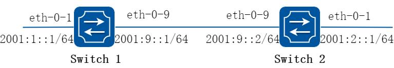
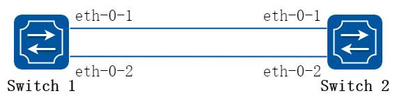
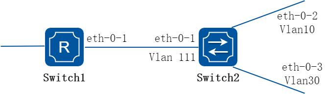

# 14 IPv6 组播配置指导

## 14.1 IPv6 组播路由配置

### 14.1.1 概述

#### 简介

随着Internet 网络的不断发展，网络数据、语音、视频信息等多种交互业务与日俱增。

另外，新兴的电子商务、网上会议、网上拍卖、视频点播、远程教学等对带宽和实时数据交互要求较高的服务逐渐兴起，这些服务对信息安全性、可计费性、网络带宽提出了更高的要求。

当网络中需要某信息的用户量不确定时，单播和广播方式的效率会很低，IPv6 组播技术的出现改变了这一现状。当网络中的某些用户需要特定信息时，组播信息发送者（即组播源）仅发送一次信息，借助组播路由协议为组播数据包建立树型路由，被传递的信息在距离用户端尽可能近的节点才开始复制和分发。

通过组播路由协议，多个接收者能跨越不同网络接收到组播数据。

MLD(Multicast Listener Discovery，组播侦听发现协议)是IPv6 协议族中负责IPv6 组播成员管理的协议。它用来在IPv6 主机和与其直接相邻的组播路由器之间建立、维护组播组成员关系。

PIMv6（Protocol Independent Multicast，协议无关组播），用于IPv6 组播路由器或多层交换机之间。为IPv6 组播提供路由的单播路由协议，可以是静态路由、RIPng、OSPFv3 等，组播路由和单播路由协议无关，只要单播路由协议能产生路由表项即可。借助RPF（Reverse Path Forwarding，逆向路径转发）机制，PIMv6 实现了在网络中传递组播信息。为了描述上的方便，我们把由支持PIMv6 协议的组播路由器所组成的网络称为PIMv6 组播域，PIMv6 有两种模式：密集模式和稀疏模式，我们目前只支持稀疏模式。

### 14.1.2 配置举例

#### 配置组播路由规格

##### 步骤1 进入配置模式

```
Switch# configure terminal
```

##### 步骤2 设置组播路由的最大规格

```
Switch(config)# ipv6 multicast route-limit 1000
```

##### 步骤3 退出配置模式

```
Switch(config)# end
```

##### 步骤4 检查配置

```
Switch# show ipv6 mroute route-limit
IPv6 Max Multicast Route Limit Number: 1000
IPv6 Multicast Route Limit Warning Threshold: 1000
IPv6 Multicast Hardware Route Limit: 255
IPv6 Current Multicast Route Entry Number: 0
```

## 14.2 MLD配置

### 14.2.1 概述

#### 简介

参与IPv6 组播的主机、路由器、多层交换机必须具备MLD 功能。该协议定义了查询器和主机角色：

网络设备的查询器发送查询消息给网络中特定组来发现组播中的成员。

主机发送MLD报告报文(响应查询报文)来通知查询者主机要加入相应的组播组列表中。

一个组播组的成员是动态的，主机可以随时加入和离开。一个多播组成员在位置或数量上没有限制。

一个主机可同时加入多个组播组。在网络中，组播组的存在可以持续很长一段时间，也可以非常短暂。

MLD 报文使用下面的组播地址：

MLD 普通组查询以ff02::1 为目的地址(在一个子网中的所有系统)。

MLD 特定组的查询以特定组IPv6 地址为目的查询。

MLD 组成员发送Report 报文给特定的组播IPv6 地址。

MLD 版本1(MLDv1)离开组播组时，发送离开消息给ff02::2。

#### 原理描述

MLD 模块是基于以下RFC RFC 2710 RFC 3810

### 14.2.2 配置举例

MLD 的使能依赖于PIMv6 的使能，当接口上使能PIMv6，MLD 将会在接口上自动启用。

在MLD 开始工作之前，IPv6 转发和IPv6 组播路由必须在全局模式启用。

系统支持动态学习MLD 组记录，也可以配置静态MLD 组。

##### 步骤1 进入配置模式

```
Switch# configure terminal
```

##### 步骤2 全局使能ipv6 和ipv6 组播

```
Switch(config)# ipv6 enable
Switch(config)# ipv6 multicast-routing
```

##### 步骤3 进入接口配置模式，配置地址和使能pim sparse mode

```
Switch(config)# interface eth-0-1
Switch(config-if)# no switchport
Switch(config-if)# ipv6 address 2001:1::1/64
Switch(config-if)# ipv6 pim sparse-mode
```

##### 步骤4 配置MLD 接口参数（可选）

```
Switch(config-if)# ipv6 mld version 2
Switch(config-if)# ipv6 mld query-interval 120
Switch(config-if)# ipv6 mld query-max-response-time 12
Switch(config-if)# ipv6 mld robustness-variable 3
Switch(config-if)# ipv6 mld last-member-query-count 3
Switch(config-if)# ipv6 mld last-member-query-interval 2000
```

##### 步骤5 配置最大MLD 组数目（可选）

配置接口最大MLD 组数目为1000：

```
Switch(config-if)# ipv6 mld limit 1000
Switch(config-if)# exit
```

配置全局最大MLD 组数目为2000：

```
Switch(config)# ipv6 mld limit 2000
```

##### 步骤6 配置静态MLD 组

```
Switch(config)# interface eth-0-1
Switch(config-if)# ipv6 mld static-group ff0e::1234
Switch(config-if)# exit
```

##### 步骤7 配置MLD 代理（可选）

```
Switch(config)# interface eth-0-1
Switch(config-if)# no switchport
Switch(config-if)# ipv6 pim sparse-mode
Switch(config-if)# ipv6 mld proxy-service
Switch(config-if)# exit
Switch(config)# interface eth-0-2
Switch(config-if)# no switchport
Switch(config-if)# ipv6 pim sparse-mode
Switch(config-if)# ipv6 mld mroute-proxy eth-0-1
Switch(config-if)# exit
```

##### 步骤8 退出配置模式

```
Switch(config)# end
```

##### 步骤9 检查配置

显示MLD 接口信息：

```
Switch# show ipv6 mld interface
Interface eth-0-2 (Index 2)
MLD Inactive, Version 1 (default)
MLD mroute-proxy interface is eth-0-1
MLD global limit is 2000
MLD global limit states count is currently 0
MLD interface limit is 4096
MLD interface has 0 group-record states
MLD activity: 0 joins, 0 leaves
MLD query interval is 125 seconds
MLD querier timeout is 255 seconds
MLD max query response time is 10 seconds
Last member query response interval is 1000 milliseconds
Group Membership interval is 260 seconds
Last memeber query count is 2
Robustness Variable is 2
Interface eth-0-1 (Index 1)
MLD Inactive, Configured for Version 2 proxy-service
MLD host version 2
MLD global limit is 2000
MLD global limit states count is currently 0
MLD interface limit is 1000
MLD interface has 0 group-record states
MLD activity: 0 joins, 0 leaves
MLD query interval is 120 seconds
MLD querier timeout is 366 seconds
MLD max query response time is 12 seconds
Last member query response interval is 2000 milliseconds
Group Membership interval is 372 seconds
Last memeber query count is 3
Robustness Variable is 3
```

显示MLD 组信息：

```
Switch# show ipv6 mld groups
MLD Connected Group Membership
Group Address
Interface
Expires
ff0e::1234
eth-0-1
stopped
```

## 14.3 PIMv6-SM配置

### 14.3.1 概述

#### 简介

协议无关组播稀疏模式(PIMv6-SM)是一个组播路由协议，用来将稀疏分散的组播设备联系起来协同工作。它将有助于分散的网络节点节约带宽和通过发送单一流量到多个接收者来降低网络流量。

PIMv6-SM 使用的IP 组播模型中，接收者需要主动发起请求成为组成员。支持共享和最短路径树，并使用软状态机制，以适应不断变化的网络条件。它依赖于单播路由协议来建立和维护路由器间的组播路由。

#### 原理描述

PIMv6-SM 模块基于以下IETF 标准：RFC 4601相关术语：

汇聚点(RP)：RP（Rendezvous Point）在SM 模式中作为组播的汇聚点，发送者和接收者在RP 处进行汇聚。对于所有的组播路由器，必须知道某个组播组对应哪个RP。所有的组播数据需要在RP 上注册，然后所有需要组播数据的接收者通过向RP发送JOIN 报文来请求数据。源的注册机制就是让RP 知道现在网络内有什么源的数据。

组播路由信息库(MRIB)：反向路径转发是指路由器在接受数据包从源A 通过接口IF1 时，只有IF1 是到达源A 的出接口时才会接受这个包。反向路径转发通过使用单播路由表来决定入端口是否正确。这个数据包将被转发是由于单播路由表表明了接口IF1 是到达源A 的最短路径。单播路由表为组播数据选择最短路径。

组播树状态信息库(TIB)：组播树状态信息库是组播路由器上保存所有组播转发树信息的一个信息库，通过收到PIMv6 加入/剪枝消息，Assert 消息和MLD 消息建立起来。

上游Upstream：朝向树根，树根可能是源或RP。

下游Downstream：远离树根，树根可能是源或RP。

基于源的树：基于源的树的转发路径是到达源的最短转发路径，如果单播路由度量是跳数，基于源的树的转发路径的跳数最小，如果单播路由度量是延迟，基于源的树的转发路径的延迟最小。对于每个组播源，有一个对应的组播转发树直接将源和接收者连接起来。所有发往指定组的流量沿着对应的转发树进行转发。

共享树：共享树依赖于汇聚点(RP)，所有流量从源发往那个汇聚点，然后汇聚点再将流量发送给接收者。对于每一个组播组来说，不管有多少个源，只有一个转发树。

共享树是单向的，流量只会从RP 流向接收者。如果一个源要发送组播数据，首先组播数据要被发到RP，然后在从RP 发送到接收者。

自举路由器(BSR)：当一个组播源开始发送组播数据或者一个接收者开始发送加入信息到RP，组播路由器必须知道汇聚点的信息。自举路由器负责在PIMv6-SM 网络启动后，收集网络内的RP 信息，为每个组选举出RP，然后将RP 集（即组-RP 映射数据库）发布到整个PIMv6-SM 网络。

(数据流从源到接收者)发送Hello 消息：PIMv6 路由器定期的发送Hello 消息来发现PIMv6 路由器邻居。Hello 消息是组播报文，使用ff02::d 这个地址。PIMv6 路由器对Hello 消息进行响应，Hello 消息中的Hold 时间来决定信息的有效时间。

选举指定路由器：在一个多路访问的网络中如果有多个组播路由器，只能有一个组播路由器被选为指定路由器，负责为本地网络的组播接收者往RP 发送加入/剪枝消息。

RP 发现：PIMv6-SM 通过自举路由器来产生自举消息，然后发布RP 信息给所有的组播路由器。组播路由器接收和保存自举消息，当DR 从直连host 收到一个MLD 报文或组播数据，DR 计算出该组播组的RP，然后发送加入/剪枝到RP 或者封装register报文到RP。在小网络环境下可以静态指定RP。

加入共享树：要加入一个多播组，主机发送一个MLD 消息给上游路由器，组播路由器向RP 方向的上游的PIMv6 邻居发送加入报文。当组播路由器接收到下游设备的加入请求后，检查本地的组播组是否存在。如果存在，说明加入消息被送到共享树，收到消息的接口被称为outgoing 的接口。如果不存在，条目将被创建，收到消息接口的被加入到outgoing 中并再次向RP 方向的上游的PIMv6 邻居发送加入报文。

组播源注册：与组播源S 直接相连的路由器接收到该组播报文后，就将该报文封装成Register 注册报文，并单播发送给对应的RP。当RP 接收到来自组播源S 的注册消息后，一方面解封装注册消息并将组播信息沿着RPT 树转发到接收者，另一方面朝组播源S 逐跳发送（S，G）加入消息，从而让RP 和组播源S 之间的所有路由器上都生成了（S，G）表项，这些沿途经过的路由器就形成了SPT 树的一个分支。SPT源树以组播源S 为根，以RP 为目的地组播源S 发出的组播信息沿着已经建立好的SPT 树到达RP，然后由RP 将信息沿着RPT 共享树进行转发。

发送注册停止消息：当RP 从组播源接收到注册报文后也收到未封装的组播报文，将发送注册停止消息给组播源一侧的DR，当DR 收到注册停止消息后将不再发送注册消息给RP 了。

剪枝端口：接收者侧的组播路由器向RP 方向的上游的PIMv6 邻居发送剪枝报文，当上联组播路由器收到剪枝报文后，将收到剪枝报文的端口从转发端口中删除，当本路由器上没有其他接收者后会继续向RP 方向的上游的PIMv6 邻居发送剪枝报文。

转发组播数据：PIMv6-SM 路由器将组播数据发往那些已经明确表示加入组播组的接收者。组播路由器将进行RPF 检查，只有检查通过的组播数据包才将通过出端口发送出去。

### 14.3.2 配置举例

#### 配置通用PIMv6 Sparse-mode (静态RP)

PIMv6-SM 是一个软状态协议。要求所需的接口上启用PIMv6-SM 协议，并通过静态或动态的方法正确配置的RP 信息。所有组播组的状态依据MLD 报告/离开和PIMv6 加入/剪枝消息动态的维护。

##### 1. 组网拓扑



**图14-1 PIMv6 Sparse-mode**

下面的例子中使用的网络拓扑如上图。

##### 2. 配置步骤

例子中Switch1 是RP，所有的路由器都配置静态RP：

每个路由器配置静态RP 地址2001:1::1。

所有接口上必须启用PIMv6-SM 功能。

以下配置如未说明在哪个Switch 配置，则表示所有Switch 配置相同：

##### 步骤1 进入配置模式

```
Switch# configure terminal
```

##### 步骤2 全局使能ipv6 和ipv6 组播

```
Switch(config)# ipv6 enable
Switch(config)# ipv6 multicast-routing
```

##### 步骤3 进入接口配置模式，配置接口属性

Switch1 的接口配置：

```
Switch(config)# interface eth-0-1
Switch(config-if)# no shutdown
Switch(config-if)# no switchport
Switch(config-if)# ipv6 address 2001:1::1/64
Switch(config-if)# ipv6 pim sparse-mode
Switch(config-if)# exit
Switch(config)# interface eth-0-9
Switch(config-if)# no shutdown
Switch(config-if)# no switchport
Switch(config-if)# ipv6 address 2001:9::1/64
Switch(config-if)# ipv6 pim sparse-mode
Switch(config-if)# exit
```

Switch2 的接口配置：

```
Switch(config)# interface eth-0-1
Switch(config-if)# no shutdown
Switch(config-if)# no switchport
Switch(config-if)# ipv6 address 2001:2::1/64
Switch(config-if)# ipv6 pim sparse-mode
Switch(config-if)# exit
Switch(config)# interface eth-0-9
Switch(config-if)# no shutdown
Switch(config-if)# no switchport
Switch(config-if)# ipv6 address 2001:9::2/64
Switch(config-if)# ipv6 pim sparse-mode
Switch(config-if)# exit
```

##### 步骤4 配置静态单播路由

在switch1 配置：

```
Switch(config)# ipv6 route 2001:2::/64 2001:9::2
```

在switch2 配置：

```
Switch(config)# ipv6 route 2001:1::/64 2001:9::1
```

##### 步骤5 配置静态RP 地址

```
Switch(config)# ipv6 pim rp-address 2001:1::1
```

##### 步骤6 退出配置模式

```
Switch(config)# end
```

##### 步骤7 检查配置

所有的路由器配置使用相同的RP 地址2001:1::1，使用以下命令来验证RP 的配置，接口的详细信息和组播路由表。

详细说明在Switch1 上，显示PIMv6 稀疏模式RP 映射的命令表明2001:1::1 是对所有组播组ff00::/8 静态配置的RP。所有其他路由器都会有类似的输出：

```
Switch# show ipv6 pim sparse-mode rp mapping
PIM Group-to-RP Mappings
Group(s): ff00::/8, Static
RP: 2001:1::1
Uptime: 00:00:04
Embedded RP Groups:
```

接口的详细信息显示Switch1 接口的组播信息。

```
Switch# show ipv6 pim sparse-mode interface
Interface
VIFindex Ver/
Nbr
DR
Mode
Count
Prior
eth-0-1
2
v2/S
0
1
Address
: fe80::fc94:efff:fe96:2600
Global Address: 2001:1::1
DR
: this system
eth-0-9
0
v2/S
0
1
Address
: fe80::fc94:efff:fe96:2600
Global Address: 2001:9::1
DR
: this system
```

IPv6 组播路由表显示PIMv6-SM 的组播路由表。

Switch1 显示结果：

```
Switch# show ipv6 pim sparse-mode mroute detail
IPv6 Multicast Routing Table
(*,*,RP) Entries: 0
(*,G) Entries: 1
(S,G) Entries: 0
```

```
(S,G,rpt) Entries: 0
FCR Entries: 0
*, ff0e::1234:5678
Type: (*,G)
Uptime: 00:01:37
RP: 2001:1::1, RPF nbr: None, RPF idx: None
Upstream:
State: JOINED, SPT Switch: Enabled, JT: off
Macro state: Join Desired,
Downstream:
eth-0-1:
State: NO INFO, ET: off, PPT: off
Assert State: NO INFO, AT: off
Winner: ::, Metric: 4294967295, Pref: 4294967295, RPT bit: on
Macro state: Could Assert, Assert Track
Local Olist:
eth-0-1
```

Switch2 显示结果：

```
Switch# show ipv6 pim sparse-mode mroute detail
IPv6 Multicast Routing Table
(*,*,RP) Entries: 0
(*,G) Entries: 1
(S,G) Entries: 0
(S,G,rpt) Entries: 0
FCR Entries: 0
*, ff0e::1234:5678
Type: (*,G)
Uptime: 00:00:06
RP: 2001:1::1, RPF nbr: None, RPF idx: None
Upstream:
State: JOINED, SPT Switch: Enabled, JT: off
Macro state: Join Desired,
Downstream:
eth-0-1:
State: NO INFO, ET: off, PPT: off
Assert State: NO INFO, AT: off
Winner: ::, Metric: 4294967295, Pref: 4294967295, RPT bit: on
Macro state: Could Assert, Assert Track
Local Olist:
eth-0-1
```

#### 配置通用PIMv6 Sparse-mode (动态RP)

在小型并且简单的网络中，组播信息量少，全网络仅依靠一个RP 进行信息转发即可，此时可以在SM 域中各路由器上静态指定RP 位置。但是更多的情况下，PIMv6-SM 网络规模都很大，通过RP 转发的组播信息量巨大，为了缓解RP 的负担同时优化共享树的拓扑结构，不同组播组应该对应不同的RP，此时就需要自举机制来动态选举RP。

以下配置如未说明在哪个Switch 配置，则表示所有Switch 配置相同：

##### 步骤1 进入配置模式

```
Switch# configure terminal
```

##### 步骤2 全局使能ipv6 和ipv6 组播

```
Switch(config)# ipv6 enable
Switch(config)# ipv6 multicast-routing
```

##### 步骤3 进入接口配置模式，配置接口属性

Switch1 的接口配置：

```
Switch(config)# interface eth-0-1
Switch(config-if)# no shutdown
Switch(config-if)# no switchport
Switch(config-if)# ipv6 address 2001:1::1/64
Switch(config-if)# ipv6 pim sparse-mode
Switch(config-if)# exit
Switch(config)# interface eth-0-9
Switch(config-if)# no shutdown
Switch(config-if)# no switchport
Switch(config-if)# ipv6 address 2001:9::1/64
Switch(config-if)# ipv6 pim sparse-mode
Switch(config-if)# exit
```

Switch2 的接口配置：

```
Switch(config)# interface eth-0-1
Switch(config-if)# no shutdown
Switch(config-if)# no switchport
Switch(config-if)# ipv6 address 2001:2::1/64
Switch(config-if)# ipv6 pim sparse-mode
Switch(config-if)# exit
Switch(config)# interface eth-0-9
Switch(config-if)# no shutdown
Switch(config-if)# no switchport
Switch(config-if)# ipv6 address 2001:9::2/64
Switch(config-if)# ipv6 pim sparse-mode
Switch(config-if)# exit
```

##### 步骤4 配置静态单播路由

在switch1 配置：

```
Switch(config)# ipv6 route 2001:2::/64 2001:9::2
```

在switch2 配置：

```
Switch(config)# ipv6 route 2001:1::/64 2001:9::1
```

##### 步骤5 配置候选RP 接口

在switch1 配置：

```
Switch(config)# ipv6 pim rp-candidate eth-0-1
```

在switch2 配置：

```
Switch(config)# ipv6 pim rp-candidate eth-0-9
```

##### 步骤6 配置候选BSR 接口

在switch2 配置：

```
Switch(config)# ipv6 pim bsr-candidate eth-0-9
```

选择最高优先级的路由器为RP。如果有两个或多个路由器的优先级相同，使用BSR 机制的哈希函数来选择RP，确保在PIMv6 域内所有路由器的同一个组都选择相同的RP。可以使用ipv6 pim rp-candidate IFNAME PRIORITY 命令来改变候选RP 的默认的优先级。

##### 步骤7 退出配置模式

```
Switch(config)# end
```

##### 步骤8 检查配置

PIMv6-SM 的组-RP 的Mapping 关系使用show ipv6 pim sparse-mode rp mapping 命令，来显示组-RP 的映射的详细信息，输出内容是候选RP 信息。在这个例子中，组的范围ff00::/8，有两个候选RP。候选RP 2001:1::1 默认的优先级192，候选RP 2001:9::2 的优先级被配置为2。由于候选RP 2001:1::1 由于具有更高的优先权，它被选中作为组播组ff00::/8 的RP。

Switch2 显示结果：

```
Switch# show ipv6 pim sparse-mode rp mapping
PIM Group-to-RP Mappings
This system is the Bootstrap Router (v2)
Group(s): ff00::/8
RP: 2001:9::2
Info source: 2001:9::2, via bootstrap, priority 2
Uptime: 00:00:32, expires: 00:02:02
RP: 2001:1::1
Info source: 2001:1::1, via bootstrap, priority 192
Uptime: 00:00:31, expires: 00:02:03
Embedded RP Groups:
```

RP 详细显示要显示特定组的RP 路由器的信息，使用下面的命令。此输出显示，2001:9::2 已经被选择作为ff02::1234 的组播组的RP。

Switch2 显示结果：

```
Switch# show ipv6 pim sparse-mode rp-hash ff02::1234
Info source: 2001:9::2, via bootstrap
```

RP 信息需要通知域中的所有PIMv6 路由器，通过各种状态机保持所有路由器的组成员的加入/剪枝的结果。要显示接口的详细信息和组播路由表的信息，请参见以上配置RP 的静态部分。

#### 配置自举路由器

每个组播组需要有一个为它服务的RP，这个RP 作为基于组播组的分发树的根。为了组播数据能从发送者到达接收者，在一个组播域内的组播路由器需要使用同样的组播组

-RP 的映射。为了选择指定组播组的RP，组播路由器需要维护一系列的组播组-RP 的映射关系，这被称为RP 集。自举路由器的机制就是用来让在同一个组播域内的组播路由器能够学习到这个RP 集。

BSR 是PIMv6-SM 网络里的管理核心，主要负责：

负责收集网络中Candidate-RP（C-RP）发来的Advertisement 宣告信息。

为每个组播组选择部分C-RP 信息以组成RP-Set 集（即组播组和RP 的映射数据库）。

发布到整个PIMv6-SM 网络，从而使网络内的所有路由器（包括DR）都会知道RP的位置。

在一个PIMv6 域中，需要配置一个或多个候选BSR，候选BSR 之间通过自动选举，产生自举路由器BSR，负责收集并发布RP 信息。下面简单描述一下候选BSR 之间的自动选举：

在将路由器配置为候选BSR 时，必须同时指定一个启动了PIMv6-SM 的接口。

每个候选BSR 开始都认为自己是本PIMv6-SM 的BSR，并使用这个接口的IPv6 地址作为BSR 地址，发送自举报文（Bootstrap message）。

当候选BSR 收到其它路由器发来的自举报文时，它将新收到的自举报文的BSR 地址与自己的BSR 地址进行比较，比较标准包括优先级和IPv6 地址，优先级相同的情况下，较大的IPv6 地址被认为是更好的。如果前者更好，则将这个新的BSR 地址替换自己的BSR 地址，并且不再认为自己是BSR。否则，保留自己的BSR 地址，继续将自己视为BSR。

备选RP 将自己的RP 信息报告给自举路由器，然后自举路由器将汇聚的RP 集通过自举报文发布到整个组播域的所有路由器。

##### 1. 组网拓扑



**图14-2 BSR**

##### 2. 配置步骤

以下配置如未说明在哪个Switch 配置，则表示所有Switch 配置相同：

##### 步骤1 进入配置模式

```
Switch# configure terminal
```

##### 步骤2 全局使能ipv6 和ipv6 组播

```
Switch(config)# ipv6 enable
Switch(config)# ipv6 multicast-routing
```

##### 步骤3 指定BSR 候选接口

在switch1 配置：

```
Switch(config)# ipv6 pim bsr-candidate eth-0-1
```

在switch2 配置：

```
Switch(config)# ipv6 pim bsr-candidate eth-0-1 10 25
```

##### 步骤4 指定RP 候选接口

在switch2 配置：

```
Switch(config)# ipv6 pim rp-candidate eth-0-1 priority 0
```

##### 步骤5 进入接口配置模式，配置接口属性

Switch2 的接口配置：

```
Switch(config)# interface eth-0-1
Switch(config-if)# ipv6 pim dr-priority 10
Switch(config-if)# ipv6 pim unicast-bsm
Switch(config-if)# exit
```

##### 步骤6 退出配置模式

```
Switch(config)# end
```

##### 步骤7 检查配置

检查候选BSR 路由器

```
Switch# show ipv6 pim sparse-mode bsr-router
PIM6v2 Bootstrap information
This system is the Bootstrap Router (BSR)
BSR address: 2001:9::1 (?)
Uptime:
00:01:27, BSR Priority: 64, Hash mask length: 126
Next bootstrap message in 00:00:16
Role: Candidate BSR
State: Elected BSR
```

检查候选BSR 路由器

```
Switch# show ipv6 pim sparse-mode bsr-router
PIM6v2 Bootstrap information
BSR address: 2001:9::1 (?)
Uptime:
00:01:34, BSR Priority: 64, Hash mask length: 126
Expires:
00:01:51
Role: Candidate BSR
State: Candidate BSR
Candidate RP: 2001:9::2(eth-0-9)
Advertisement interval 60 seconds
Next C-RP advertisement in 00:00:35
```

在E-BSR 上检查RP

```
Switch# show ipv6 pim sparse-mode rp mapping
PIM Group-to-RP Mappings
This system is the Bootstrap Router (v2)
Group(s): ff00::/8
RP: 2001:9::2
Info source: 2001:9::2, via bootstrap, priority 0
Uptime: 00:45:37, expires: 00:02:29
Embedded RP Groups:
```

在C-BSR 上检查RP

```
Switch# show ipv6 pim sparse-mode rp mapping
PIM Group-to-RP Mappings
```

```
Group(s): ff00::/8
RP: 2001:9::2
Info source: 2001:9::1, via bootstrap, priority 0
Uptime: 00:03:14, expires: 00:01:51
Embedded RP Groups:
```

#### 配置PIMv6-SSM

PIMv6-SSM 可以跟PIMv6-SM 在组播路由器上一起工作。PIMv6-SSM 默认是disable 的。

##### 步骤1 进入配置模式

```
Switch# configure terminal
```

##### 步骤2 全局使能PIMv6-ssm

```
Switch(config)# ipv6 pim ssm default
Switch(config)# ipv6 pim ssm range ipv6acl
```

##### 步骤3 退出配置模式

```
Switch(config)# end
```

## 14.4 MLD Snooping配置

### 14.4.1 概述

#### 简介

MLD Snooping（Multicast Listener Discovery，MLD 侦听）是运行在二层以太网交换机上的IPv6 组播约束机制，用于管理和控制IPv6 组播组。

二层交换机通过MLD Snooping 来控制IPv6 组播流量的泛洪。当二层以太网交换收到主机和路由器之间传递的MLD 报文时，MLD Snooping 将对MLD 报文所带的信息进行分析，将端口和MAC 组播地址建立起映射关系，并根据这样的映射关系转发IPv6 组播数据。

IPv6 组播路由器定期发送通用组查询来维护IPv6 组播组成员关系。所有接收者将发送MLD 报告报文来响应这个查询，交换机通过这个监听MLD 报告报文来建立转发表项。

二层的组播组可以通过MLD 报文动态建立，也可以静态配置。静态配置的组播组将覆盖动态学习的组播组。

限制和指导：

VRRP，RIPng，OSPFv3 等协议使用了IPv6 组播，因此在使能了MLD Snooping 的网络中，要避免使用这些IPv6 组播地址，以免产生冲突而导致异常：

VRRP 使用了ff02::12，因此组播MAC 3333.0000.0012 映射出的组播IPv6 在MLD Snooping 和VRRP 的网络中避免使用。

RIPv6 使用了ff02::9，因此组播MAC 3333.0000.0009 映射出的组播IPv6 在MLD Snooping 和RIPng 的网络中避免使用。

OSPF 使用了ff02::5，因此组播MAC 3333.0000.0005 映射出的组播IPv6 在MLD Snooping 和OSPFv3 的网络中避免使用。

### 14.4.2 配置举例

#### 配置启用MLD Snooping

##### 步骤1 进入配置模式

```
Switch# configure terminal
```

##### 步骤2 全局使能mld snooping

```
Switch(config)# ipv6 mld snooping
```

##### 步骤3 vlan 使能mld snooping

```
Switch(config)#ipv6 mld snooping vlan 1
```

##### 步骤4 退出配置模式

```
Switch(config)# end
```

##### 步骤5 检查配置

```
Switch # show ipv6 mld snooping vlan 1
Global Mld Snooping Configuration
-------------------------------------------------
Mld Snooping
:Enabled
Mld Snooping Fast-Leave
:Disabled
Mld Snooping Version
:1
Mld Snooping Max-Member-Number
:4096
Mld Snooping Unknown Multicast Behavior
:Flood
Mld Snooping Report-Suppression
:Enabled
Vlan 1
-----------
Mld Snooping
:Enabled
Mld Snooping Fast-Leave
:Disabled
Mld Snooping Report-Suppression
:Enabled
Mld Snooping Version
:1
Mld Snooping Max-Member-Number
:4096
Mld Snooping Unknown Multicast Behavior
:Flood
Mld Snooping Group Access-list
:N/A
Mld Snooping Mrouter Port
:
Mld Snooping Mrouter Port Aging Interval(sec) :255
```

#### 配置MLD Snooping 快速离开

正常情况下，MLD Snooping 在接收到MLD 离开报文后不会直接将端口从组播组中删除，而是发送MLD 特定组查询报文，如果等待一段时间后没有得到响应，才将该端口从组播组中删除。启动快速删除功能后，MLD Snooping 收到MLD 离开报文时，直接将端口从组播组中删除。当端口下只有一个用户时，快速删除可以节省带宽。

##### 步骤1 进入配置模式

```
Switch# configure terminal
```

##### 步骤2 全局使能mld snooping

```
Switch(config)# ipv6 mld snooping
```

##### 步骤3 vlan 使能mld snooping

```
Switch(config)#ipv6 mld snooping vlan 1
```

##### 步骤4 全局使能快速离开

```
Switch(config)# ipv6 mld snooping fast-leave
```

##### 步骤5 vlan 使能快速离开

```
Switch(config)# ipv6 mld snooping vlan 1 fast-leave
```

##### 步骤6 退出配置模式

```
Switch(config)# end
```

##### 步骤7 检查配置

```
Switch# show ipv6 mld snooping vlan 1
Global Mld Snooping Configuration
-------------------------------------------------
Mld Snooping
:Enabled
Mld Snooping Fast-Leave
:Enabled
Mld Snooping Version
:1
Mld Snooping Max-Member-Number
:4096
Mld Snooping Unknown Multicast Behavior
:Flood
Mld Snooping Report-Suppression
:Enabled
Vlan 1
-----------
Mld Snooping
:Enabled
Mld Snooping Fast-Leave
:Enabled
Mld Snooping Report-Suppression
:Enabled
Mld Snooping Version
:1
Mld Snooping Max-Member-Number
:4096
Mld Snooping Unknown Multicast Behavior
:Flood
Mld Snooping Group Access-list
:N/A
Mld Snooping Mrouter Port
:
Mld Snooping Mrouter Port Aging Interval(sec) :255
```

#### 配置MLD Snooping 查询参数（可选）

三层交换机在所连接的网段上周期性的发送MLD 通用查询报文，通过解析返回的MLD 主机报告报文，获知该网段内哪些组播组有成员。组播路由器周期性地发送查询报文，当得到某一组成员的MLD 主机报告报文的时候，刷新该网段相应的组成员关系信息。

##### 步骤1 进入配置模式

```
Switch# configure terminal
```

##### 步骤2 全局使能mld snooping

```
Switch(config)# ipv6 mld snooping
```

##### 步骤3 vlan 使能mld snooping

```
Switch(config)#ipv6 mld snooping vlan 1
```

##### 步骤4 配置mld 查询参数

设置查询时间间隔和最大响应时间：

```
Switch(config)# ipv6 mld snooping query-interval 100
Switch(config)# ipv6 mld snooping query-max-response-time 5
```

仅存最后一个成员时的查询间隔：

```
Switch(config)# ipv6 mld snooping last-member-query-interval 2000
```

设置vlan1 的查询参数：

```
Switch(config)# ipv6 mld snooping vlan 1 querier address fe80::1
Switch(config)# ipv6 mld snooping vlan 1 querier
Switch(config)# ipv6 mld snooping vlan 1 query-interval 200
Switch(config)# ipv6 mld snooping vlan 1 query-max-response-time 5
Switch(config)# ipv6 mld snooping vlan 1 querier-timeout 100
Switch(config)# ipv6 mld snooping vlan 1 last-member-query-interval 2000
Switch(config)# ipv6 mld snooping vlan 1 discard-unknown
```

在全局模式下设置丢弃未知组播报文：

```
Switch(config)# ipv6 mld snooping discard-unknown
```

##### 步骤5 退出配置模式

```
Switch(config)# end
```

##### 步骤6 检查配置

```
Switch # show ipv6 mld snooping querier
Global Mld Snooping Querier Configuration
-------------------------------------------------
Version
:1
Last-Member-Query-Interval (msec) :2000
Max-Query-Response-Time (sec)
:5
Query-Interval (sec)
:100
Global Source-Address
:::
TCN Query Count
:2
TCN Query Interval (sec)
:10
Vlan 1:
MLD snooping querier status
--------------------------------------------
Elected querier is : fe80::1
--------------------------------------------
Admin state
:Enabled
Admin version
:1
Operational state
:Querier
Querier operational address
:fe80::1
Querier configure address
:fe80::1
Last-Member-Query-Interval (msec) :2000
Max-Query-Response-Time (sec)
:5
Query-Interval (sec)
:200
Querier-Timeout (sec)
:100
```

#### 配置MLD Snooping 组播路由端口

组播路由端口是交换机上连接到组播路由器的端口，可以动态学习或者静态配置。当某个VLAN 的端口上收到MLD 通用组查询报文或者是PIMv6 Hello 报文，该端口成为这个VLAN 的组播路由端口。所有从组播路由端口上收到的的MLD 查询报文要在所属VLAN 内广播。所有VLAN 上收到MLD 报告/离开报文也将从组播路由端口转发(报文抑制关闭的情况下)，另外所有从该VLAN 上收到的组播流量将从组播路由端口转发。

##### 步骤1 进入配置模式

```
Switch# configure terminal
```

##### 步骤2 全局使能mld snooping

```
Switch(config)# ipv6 mld snooping
```

##### 步骤3 vlan 使能mld snooping

```
Switch(config)#ipv6 mld snooping vlan 1
```

##### 步骤4 全局启用MLD Snooping 的报告抑制功能

```
Switch(config)# ipv6 mld snooping report-suppression
```

##### 步骤5 配置静态组播路由端口

```
Switch(config)# ipv6 mld snooping vlan 1 mrouter interface eth-0-1
```

##### 步骤6 配置vlan 的mld snooping 属性

启用报告抑制功能和配置端口老化时间

```
Switch(config)# ipv6 mld snooping vlan 1 report-suppression
Switch(config)# ipv6 mld snooping vlan 1 mrouter-aging-interval 200
```

##### 步骤7 退出配置模式

```
Switch(config)# end
```

##### 步骤8 检查配置

```
Switch# show ipv6 mld snooping vlan 1
Global Mld Snooping Configuration
-------------------------------------------------
Mld Snooping
:Enabled
Mld Snooping Fast-Leave
:Enabled
Mld Snooping Version
:1
Mld Snooping Max-Member-Number
:4096
Mld Snooping Unknown Multicast Behavior
:Discard
Mld Snooping Report-Suppression
:Enabled
Vlan 1
-----------
Mld Snooping
:Enabled
Mld Snooping Fast-Leave
:Enabled
Mld Snooping Report-Suppression
:Enabled
Mld Snooping Version
:1
Mld Snooping Max-Member-Number
:4096
Mld Snooping Unknown Multicast Behavior
:Discard
Mld Snooping Group Access-list
:N/A
Mld Snooping Mrouter Port
:eth-0-1(static)
Mld Snooping Mrouter Port Aging Interval(sec) :200
```

#### 配置MLD Snooping 查询TCN

可以通过配置TCN 的时间间隔以及查询次数来适应STP 收敛拓扑后的组播组学习以及更新。

##### 步骤1 进入配置模式

```
Switch# configure terminal
```

##### 步骤2 全局使能mld snooping

```
Switch(config)# ipv6 mld snooping
```

##### 步骤3 vlan 使能mld snooping

```
Switch(config)#ipv6 mld snooping vlan 1
```

##### 步骤4 配置MLD Snooping 查询TCN 参数

设置TCN 的查询次数和查询时间间隔

```
Switch(config)# ipv6 mld snooping querier tcn query-count 5
Switch(config)# ipv6 mld snooping querier tcn query-interval 20
```

##### 步骤5 退出配置模式

```
Switch(config)# end
```

##### 步骤6 检查配置

```
Switch # show ipv6 mld snooping querier
Global Mld Snooping Querier Configuration
-------------------------------------------------
Version
:1
Last-Member-Query-Interval (msec) :2000
Max-Query-Response-Time (sec)
:5
Query-Interval (sec)
:100
Global Source-Address
:::
TCN Query Count
:5
TCN Query Interval (sec)
:20
Vlan 1:
MLD snooping querier status
--------------------------------------------
Elected querier is : fe80::1
--------------------------------------------
Admin state
:Enabled
Admin version
:1
Operational state
:Querier
Querier operational address
:fe80::1
Querier configure address
:fe80::1
Last-Member-Query-Interval (msec) :2000
Max-Query-Response-Time (sec)
:5
Query-Interval (sec)
:200
Querier-Timeout (sec)
:100
```

#### 配置MLD Snooping 报告抑制

交换机使用MLD 报告抑制功能来防止同一个MLD 报文重复发送给组播路由器。当MLD 路由器抑制使能时(默认情况下使能抑制)，交换机将第一个MLD 报告报文发送给组播路由器，其余同样的MLD 报告报文将不再发送给组播路由器。这样就阻止了重复MLD 报告报文发送给组播路由器了。

##### 步骤1 进入配置模式

```
Switch# configure terminal
```

##### 步骤2 全局使能mld snooping

```
Switch(config)# ipv6 mld snooping
```

##### 步骤3 vlan 使能mld snooping

```
Switch(config)#ipv6 mld snooping vlan 1
```

##### 步骤4 全局启用报告抑制

```
Switch(config)# ipv6 mld snooping report-suppression
```

##### 步骤5 vlan 启用报告抑制

```
Switch(config)# ipv6 mld snooping vlan 1 report-suppression
```

##### 步骤6 退出配置模式

```
Switch(config)# end
```

##### 步骤7 检查配置

```
Switch # show ipv6 mld snooping
Global Mld Snooping Configuration
-------------------------------------------------
Mld Snooping
:Enabled
Mld Snooping Fast-Leave
:Disabled
Mld Snooping Version
:2
Mld Snooping Max-Member-Number
:4096
Mld Snooping Unknown Multicast Behavior
:Flood
Mld Snooping Report-Suppression
:Enabled
Vlan 1
-----------
Mld Snooping
:Enabled
Mld Snooping Fast-Leave
:Disabled
Mld Snooping Report-Suppression
:Enabled
Mld Snooping Version
:2
Mld Snooping Max-Member-Number
:4096
Mld Snooping Unknown Multicast Behavior
:Flood
Mld Snooping Group Access-list
:N/A
Mld Snooping Mrouter Port
:
Mld Snooping Mrouter Port Aging Interval(sec) :255
```

#### 配置静态组播组

交换机在二层端口上收到MLD 报文时会建立MLD Snooping 的组记录。目前系统中也支持静态配置MLD Snooping 的组记录，在静态配置时需要指定组地址，二层端口，以及二层端口所属的VLAN。

##### 步骤1 进入配置模式

```
Switch# configure terminal
```

##### 步骤2 全局使能mld snooping

```
Switch(config)# ipv6 mld snooping
```

##### 步骤3 vlan 使能mld snooping

```
Switch(config)#ipv6 mld snooping vlan 1
```

##### 步骤4 配置静态组播组

```
Switch(config)# ipv6 mld snooping vlan 1 static-group ff0e::1234 interface eth-0-2
```

##### 步骤5 退出配置模式

```
Switch(config)# end
```

##### 步骤6 检查配置

```
Switch# show ipv6 mld snooping groups
VLAN
Interface
Group Address
Uptime
Expire-time
1
eth-0-2
ff0e::1234
00:00:02
stopped
```

## 14.5 MVR6配置

### 14.5.1 概述

#### 简介

在传统的IPv6 组播点播方式下，汇聚组播路由器下连一些接入交换机，接入交换机上连接了分布在不同VLAN 中的用户。当这些不同VLAN 的用户点播相同Group 的节目时，汇聚的组播路由器需要为每个VLAN 内的用户复制一份数据，每个VLAN 的组播流量都要占用接入交换机的带宽。这样既增加了汇聚路由器的负担，也浪费接入设备的带宽。

MVR6(IPv6 组播VLAN 注册)功能能够很好的解决这个问题。在靠近用户侧的接入交换机上启用组播VLAN，汇聚路由器只需把组播数据在源VLAN 内发送给接入交换机，而不必在每个用户VLAN 内都复制一份，接入交换机收到组播数据后再根据用户请求进行复制，给每个VLAN 内的用户发送一份组播数据。从而节省了网络带宽，也减轻了三层设备的负担。

MVR6 依赖于MLD Snooping 进行工作，而且只有MVR6 全局配置的Group 才会生效。如果在MVR6 的下游口上接收的MLD 报文中组播组不在MVR6 全局Group 中，该报文将被忽略。

通过在MVR6 的下游口上接收的MLD 报告/离开报文来维护接收者信息，MVR6 上游口收到IPv6 组播数据后根据下游口的IPv6 组播组信息来决定将IPv6 组播数据从哪些VLAN 的端口转发出去。

### 14.5.2 配置举例

##### 1. 组网拓扑



**图14-3 MVR6**

##### 2. 配置步骤

##### 步骤1 进入配置模式

```
Switch# configure terminal
```

##### 步骤2 进入vlan 配置模式，创建vlan

在Switch2 配置：

```
Switch2(config)# vlan database
Switch2(config-vlan)# vlan 111,10,30
Switch2(config-vlan)# quit
```

##### 步骤3 进入接口配置模式，配置接口属性

Switch1 的接口配置：

```
Switch1(config)# interface eth-0-1
Switch1(config-if)# no switchport
Switch1(config-if)# no shutdown
Switch1(config-if)# ipv6 address 2001:1::1/64
Switch1(config-if)# ipv6 pim sparse-mode
Switch1(config-if)# exit
```

Switch2 的接口配置：

```
Switch2(config)# interface vlan 111
Switch2(config-if)# exit
Switch2(config)# interface vlan 10
Switch2(config-if)# exit
Switch2(config)# interface vlan 30
Switch2(config-if)# exit
Switch2(config)# interface eth-0-1
Switch2(config-if)# switchport access vlan 111
Switch2(config-if)# exit
Switch2(config)# interface eth-0-2
Switch2(config-if)# switchport access vlan 10
Switch2(config-if)# exit
Switch2(config)# interface eth-0-3
Switch2(config-if)# switchport access vlan 30
Switch2(config-if)# exit
```

##### 步骤4 启用MVR6

在switch 启用MVR6，这样从Router 到Switch 只会拷贝一份组播流，在Switch 上再将这个组播流从eth-0-2 和eth-0-3 发送出去。

```
Switch2(config)# no ipv6 multicast-routing
Switch2(config)# ipv6 mld snooping
Switch2(config)# mvr6
Switch2(config)# mvr6 vlan 111
Switch2(config)# mvr6 group ff0e::1234 64
Switch2(config)# mvr6 source-address fe80::1111
Switch2(config)# interface eth-0-1
Switch2(config-if)# mvr6 type source
Switch2(config-if)# exit
Switch2(config)# interface eth-0-2
Switch2(config-if)# mvr6 type receiver vlan 10
Switch2(config-if)# exit
Switch2(config)# interface eth-0-3
Switch2(config-if)# mvr6 type receiver vlan 30
Switch2(config-if)# exit
```

##### 步骤5 退出配置模式

```
Switch(config)# end
```

##### 步骤6 检查配置

Switch1 的显示结果：

```
Switch1# show ipv6 mld groups
MLD Connected Group Membership
Group Address
Interface
Expires
ff0e::1234
eth-0-2
00:03:01
ff0e::1235
eth-0-2
00:03:01
ff0e::1236
eth-0-2
00:03:01
ff0e::1237
eth-0-2
00:03:01
ff0e::1238
eth-0-2
00:03:01
…………
ff0e::1273
eth-0-2
00:03:01
```

Switch2 的显示结果：

```
Switch2# show mvr6
MVR6 Running: TRUE
MVR6 Multicast VLAN: 111
MVR6 Source-address: fe80::111
MVR6 Max Multicast Groups: 1024
MVR6 Hw Rt Limit: 224
MVR6 Current Multicast Groups: 64
VLAN
Interface
Group Address
Uptime
Expire-time
10
eth-0-2
ff0e::1234
00:03:23
00:02:03
10
eth-0-2
ff0e::1235
00:03:23
00:02:03
10
eth-0-2
ff0e::1236
00:03:23
00:02:03
10
eth-0-2
ff0e::1237
00:03:23
00:02:03
10
eth-0-2
ff0e::1238
00:03:23
00:02:03
10
eth-0-2
ff0e::1239
00:03:23
00:02:03
……
10
eth-0-2
ff0e::1273
00:03:23
00:02:03
```
