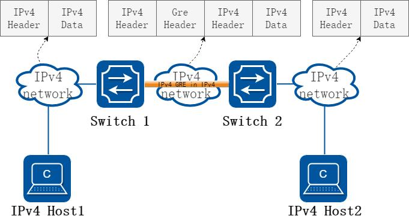
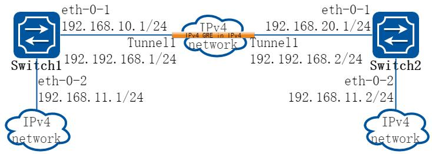
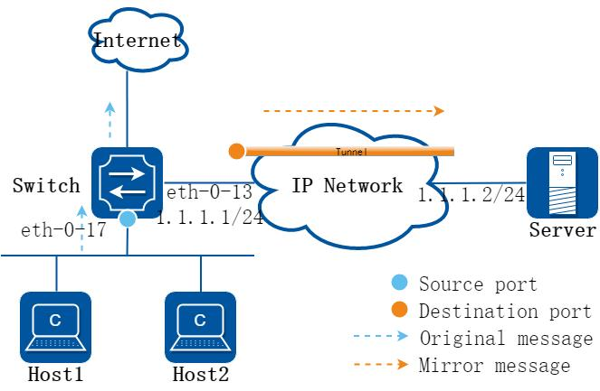
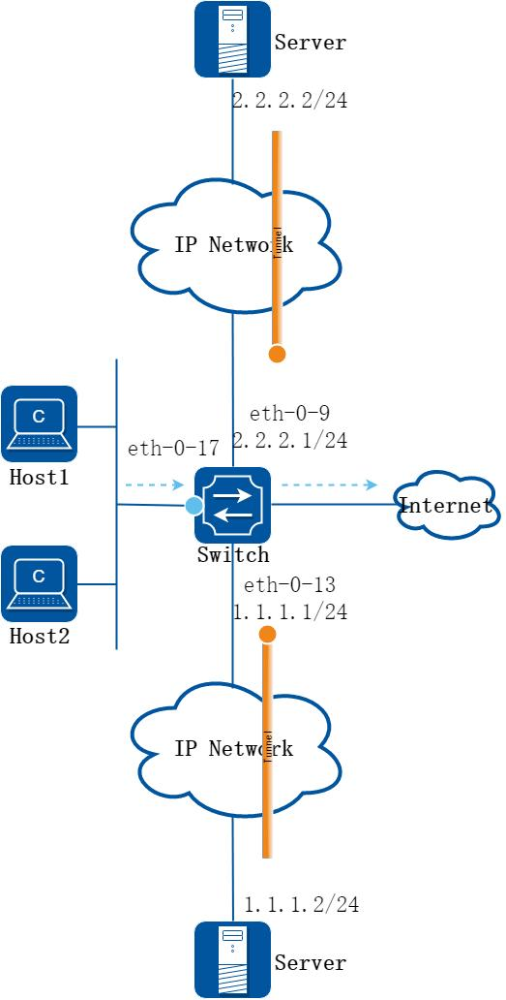

# 15 VPN配置指导

## 15.1 VRF配置

### 15.1.1 概述

#### 简介

VRF 是VPN 路由转发表的简称。可以理解为VPN-instance(VPN 实例)，是PE 为直接相连的站点建立并维护的一个专门实体，每个站点在PE 上都有自己的VPN-instance，每个VPN-instance 包含到一个或多个与该PE 直接相连的CE 的路由和转发表。

VRF 可以把一台路由器在逻辑上划分为多台虚拟的路由器，每台虚拟的路由器就像单独的一台路由器一样工作，有自己独立的路由表和相应的参与数据转发的接口，并且彼此业务隔离。这从根本上解决了多种业务并存于一台物理设备且又需要隔离的问题，能够节省用户在设备及通信资源方面的投资。

### 15.1.2 配置举例

##### 步骤1 进入配置模式

```
Switch# configure terminal
```

##### 步骤2 创建VRF 实例

```
Switch(config)# ip vrf vpn1
Switch(config-vrf)# rd 100:1
Switch(config-vrf)# router-id 1.1.1.1
Switch(config-vrf)# route-target both 100:1
Switch(config-vrf)# import map route-map
```

rd 和route-target 形式上可以是一个AS 号和一个数字的组合(xxx:y)，也可以是一个IP 地址和一个数字的组合(A.B.C.D:y)。

##### 步骤3 进入接口配置模式，配置接口属性

```
Switch(config-vrf)# interface eth-0-1
Switch(config-if)# no shutdown
Switch(config-if)# no switch
Switch(config-if)# ip vrf forwarding vpn1
Switch(config-if)# ip add 1.1.1.1/24
Switch(config-if)# exit
```

##### 步骤4 退出配置模式

```
Switch(config)# end
```

##### 步骤5 检查配置

使用命令show ip vrf 来验证配置会得到类似如下的屏幕回显信息：

```
Switch# show ip vrf
VRF vpn1, FIB ID 1
Router ID: 1.1.1.1 (config)
Interfaces:
eth-0-1
Switch# show ip vrf interfaces vpn1
Interface
IP-Address
VRF
Protocol
eth-0-1
1.1.1.1
vpn1
up
Switch# show ip vrf bgp brief
Name
Default RD
Interfaces
vpn1
100:1
eth-0-1
Switch# show ip vrf bgp detail
VRF vpn1; default RD 100:1
Interfaces:
eth-0-1
VRF Table ID = 1
Export VPN route-target communities
RT:100:1
Import VPN route-target communities
RT:100:1
import-map: route-map
No export route-map
```

## 15.2 IPv4 over IPv4 GRE 隧道配置

### 15.2.1 概述

#### 简介

隧道技术是一种封装技术，它利用一种网络协议来传输另一种网络协议，即一种网络协议将其他网络协议的数据报文封装在自己的报文中，然后在网络中传输。封装后的数据报文在网络中传输的路径，称为隧道。隧道是一条虚拟的点对点连接，隧道的两端需要对数据报文进行封装及解封装。隧道技术就是指包括数据封装、传输和解封装在内的全过程。

#### 原理描述



**图15-1 IPv4 gre over IPv4**

当两个相隔离的IPv4 网络需要相互通信，此时就需要在两个网络之间创建一个隧道机制。在IPv4 网络上用于连接两个相隔离IPv4 孤岛的gre 隧道，称为IPv4 gre 隧道，即IPv4 报文通过gre 协议被封装在IPv4 报文中，实现IPv4 报文的透明传输。Gre隧道协议在封装IPv4 报文时会添加gre 头，gre 头中包含key，sequence，checksum等可选信息。为了实现gre 隧道，需要在IPv4 网络与IPv4 网络交界的边界交换机上启动IPv4 双协议栈。

IPv4 gre over IPv4 隧道对报文的处理过程如下：

IPv4 网络中的设备发送IPv4 报文，该报文到达隧道的源端设备Switch1。

Switch1 根据路由表判定该报文要通过隧道进行转发后，在IPv4 报文前先封装上gre 头然后再封装外层IPv4 的报文头，通过隧道的实际物理接口将报文转发出去。

封装报文通过隧道到达隧道目的端设备Switch2，Switch2 判断该封装报文的目的地是本设备后，将对报文进行解封装。

Switch2 根据解封装后的IPv4 报文的目的地址转发该IPv4 报文。如果目的地就是本设备，则将IPv4 报文转给上层协议处理。在解封装过程中，会校验gre 头中的key 选项，只有当key 相匹配时才会对该IP4 报文作处理，否则丢弃。

这种技术的优点是，当IPv4/IPv4 网络的边缘设备实现隧道功能，便可以将报文从一端透传到另外一端并可以进行报文校验，可以大大利用现有的IPv4 网络投资。

GRE 隧道的源和目的地址是手工指定的，它提供了一个点到点的连接。GRE 隧道可以建立在两个边界路由器之间为被IPv4 网络分离的IPv4 网络提供稳定的连接，或建立在终端系统与边界路由器之间为终端系统访问IPv4 网络提供连接。GRE 隧道要求在设备上手工配置隧道的源地址和目的地址，此外gre key 配置是可选配置。

### 15.2.2 配置举例

##### 1. 组网拓扑



**图15-2 IPv4 gre Tunnel**

如上图所示，两个IPv4 网络分别通过Switch1 和Switch2 与IPv4 网络连接，要求在Switch1 和Switch2 之间建立IPv4 gre 隧道，使两个IPv4 网络可以互通。

必须使IPv4 报文3 层路由可达，否则会造成tunnel 报文转发失败。

tunnel 接口上必须配置IPv4 地址，否则配置在该接口上的路由无效。

##### 2. 配置步骤

以下配置如未说明在哪个Switch 配置，则表示所有Switch 配置相同：

##### 步骤1 进入配置模式

```
Switch# configure terminal
```

##### 步骤2 进入接口配置模式，配置接口属性

Switch1 的接口配置：

```
Switch1(config)# interface eth-0-1
Switch1(config-if)# no switchport
Switch1(config-if)# no shutdown
Switch1(config-if)# ip address 192.168.10.1/24
Switch1(config-if)# tunnel enable
Switch1(config-if)# exit
Switch1(config)# interface eth-0-2
Switch1(config-if)# no switchport
Switch1(config-if)# no shutdown
Switch1(config-if)# ip address 192.168.11.1/24
Switch1(config-if)# exit
```

Switch2 的接口配置：

```
Switch2(config)# interface eth-0-1
Switch2(config-if)# no switchport
Switch2(config-if)# no shutdown
Switch2(config-if)# ip address 192.168.20.1/24
Switch2(config-if)# tunnel enable
```

```
Switch2(config-if)# exit
Switch2(config)# interface eth-0-2
Switch2(config-if)# no switchport
Switch2(config-if)# no shutdown
Switch2(config-if)# ip address 192.168.11.2/24
Switch2(config-if)# exit
```

##### 步骤3 配置tunnel 接口

Switch1 的Tunnel 接口配置：

```
Switch1(config)# interface tunnel1
Switch1(config-if)# tunnel mode gre
Switch1(config-if)# tunnel source eth-0-1
Switch1(config-if)# tunnel destination 192.168.20.1
Switch1(config-if)# tunnel gre key 100
Switch1(config-if)# ip address 192.192.168.1/24
Switch1(config-if)# keepalive 5 3
Switch1(config-if)# exit
```

Switch2 的Tunnel 接口配置：

```
Switch2(config)# interface tunnel1
Switch2(config-if)# tunnel mode gre
Switch2(config-if)# tunnel source eth-0-1
Switch2(config-if)# tunnel destination 192.168.10.1
Switch2(config-if)# tunnel gre key 100
Switch2(config-if)# ip address 192.192.168.2/24
Switch2(config-if)# keepalive 5 3
Switch2(config-if)# exit
```

##### 步骤4 配置静态路由和静态arp

在switch1 配置：

```
Switch1(config)# ip route 192.168.20.0/24 192.168.10.2
Switch1(config)# arp 192.168.10.2 0.0.2222
Switch1(config)# ip route 3.3.3.3/24 tunnel1
```

在switch2 配置：

```
Switch2(config)# ip route 192.168.10.0/24 192.168.20.2
Switch2(config)# arp 192.168.20.2 0.0.1111
Switch2(config)# ip route 4.4.4.4/24 tunnel1
```

##### 步骤5 退出配置模式

```
Switch(config)# end
```

##### 步骤6 检查配置

Switch1 显示结果：

```
Switch1# show interface tunnel1
Interface tunnel1
Interface current state: UP
Hardware is Tunnel
Index 8193 , Metric 1 , Encapsulation TUNNEL
VRF binding: not bound
```

```
Internet primary address:
192.192.168.1/24 pointopoint 192.192.168.255
Tunnel protocol/transport GRE/IP, Status Valid
Tunnel source 192.168.10.1(eth-0-1), destination 192.168.20.1
Tunnel DSCP inherit,
Tunnel TTL 255
Tunnel GRE key enable: 100
Tunnel GRE keepalive enable, Send period: 5, Retry times: 3
0 packets input, 0 bytes
0 packets output, 0 bytes
```

Switch2 显示结果：

```
Switch2# show interface tunnel1
Interface tunnel1
Interface current state: UP
Hardware is Tunnel
Index 8193 , Metric 1 , Encapsulation TUNNEL
VRF binding: not bound
Internet primary address:
192.192.168.2/24 pointopoint 192.192.168.255
Tunnel protocol/transport GRE/IP, Status Valid
Tunnel source 192.168.20.1(eth-0-1), destination 192.168.10.1
Tunnel DSCP inherit,
Tunnel TTL 255
Tunnel GRE key enable: 100
Tunnel GRE keepalive enable, Send period: 5, Retry times: 3
0 packets input, 0 bytes
0 packets output, 0 bytes
```

## 15.3 IPv4 ERSPAN 隧道配置

### 15.3.1 概述

#### 简介

ERSPAN（Encapsulated Remote Switch Port Analyzer，封装远程端口镜像）是一种三层远程端口镜像技术，通过复制指定报文，并通过隧道将复制的报文发送到远程数据监测设备，使用户可以利用数据监测设备分析这些报文（称为镜像报文），以进行网络监控和故障排除。

#### 原理描述


**图15-3 IPv4 ERSPAN**

三层远程端口镜像报文的转发过程如下：

switch 将进入源端口的报文复制一份给其Tunnel 接口（即目的端口）。

报文经由ERSPAN 隧道转发至server 设备。

### 15.3.2 配置举例

#### 配置ERSPAN 单目的地址模式

##### 1. 组网拓扑



**图15-4 ERSPAN 单目的地址模式**

##### 2. 配置步骤

##### 步骤1 进入配置模式

```
Switch# configure terminal
```

##### 步骤2 进入接口配置模式，配置接口属性

```
Switch(config)# interface loopback0
Switch(config-if)# ip address 192.168.1.1/32
Switch(config-if)# exit
Switch(config)# interface eth-0-13
Switch(config-if)# no switchport
Switch(config-if)# no shutdown
Switch(config-if)# ip address 1.1.1.1/24
Switch(config-if)# exit
```

##### 步骤3 配置tunnel 接口

```
Switch(config)# interface tunnel0
Switch(config-if)# tunnel mode erspan
Switch(config-if)# tunnel source 192.168.1.1
Switch(config-if)# tunnel destination 1.1.1.2
Switch(config-if)# exit
```

##### 步骤4 配置本地镜像组的源端口以及目的端口

```
Switch(config)# monitor session 1 source interface eth-0-17 both
Switch(config)# monitor session 1 destination interface tunnel0
```

##### 步骤5 退出配置模式

```
Switch(config)# end
```

##### 步骤6 检查配置

```
Switch# show interface tunnel0
Interface tunnel0
Interface current state: UP
Hardware is Tunnel
Index 9216 , Metric 0 , Encapsulation TUNNEL
VRF binding: not bound
Tunnel protocol/transport gre/erspan, Status Valid
Tunnel source 192.168.1.1(loopback0)
Tunnel destination 1.1.1.2
Tunnel DSCP inherit,
Tunnel TTL 254
Tunnel GRE key disable
Tunnel extend header disable
```

#### 配置ERSPAN 多目的地址模式

##### 1. 组网拓扑



**图15-5 ERSPAN 多目的地址模式**

##### 2. 配置步骤

##### 步骤1 进入配置模式

```
Switch# configure terminal
```

##### 步骤2 进入接口配置模式，配置接口属性

```
Switch(config)# interface loopback0
Switch(config-if)# ip address 192.168.1.1/32
Switch(config-if)# exit
Switch(config)# interface eth-0-13
Switch(config-if)# no switchport
Switch(config-if)# no shutdown
```

```
Switch(config-if)# ip address 1.1.1.1/24
Switch(config-if)# exit
Switch(config)# interface eth-0-9
Switch(config-if)# no switchport
Switch(config-if)# no shutdown
Switch(config-if)# ip address 2.2.2.1/24
Switch(config-if)# exit
```

##### 步骤3 配置tunnel 接口

```
Switch(config)# interface tunnel0
Switch(config-if)# tunnel mode erspan ecmp-dst-gre
Switch(config-if)# tunnel source 192.168.1.1
Switch(config-if)# tunnel ecmp-destination 2.2.2.2
Switch(config-if)# tunnel ecmp-destination 1.1.1.2
Switch(config-if)# exit
```

##### 步骤4 配置本地镜像组的源端口以及目的端口

```
Switch(config)# monitor session 1 source interface eth-0-17 both
Switch(config)# monitor session 1 destination interface tunnel0
```

##### 步骤5 退出配置模式

```
Switch(config)# end
```

##### 步骤6 检查配置

```
Switch# show interface tunnel0
Interface tunnel0
Interface current state: UP
Hardware is Tunnel
Index 9216 , Metric 0 , Encapsulation TUNNEL
VRF binding: not bound
Tunnel protocol/transport gre/ecmp-dst, Status Valid
Tunnel source 192.168.1.1(loopback0)
Tunnel ecmp-destination 2.2.2.2
1.1.1.2
Tunnel DSCP inherit,
Tunnel TTL 254
Tunnel GRE key disable
Tunnel extend header disable
```
