# 16 可靠性配置指导

## 16.1 BHM配置

### 16.1.1 概述

#### 简介

BHM 全称Beat heart Monitor，是用于监控其他协议进程的一个模块，当某个受监控进程长时间（30 秒）无响应时，BHM 模块会采取措施恢复系统，或者提示用户恢复系统。

这些措施包括在终端打印警告信息、关闭所有端口，或者重启系统。系统使用何种措施是可配置的，默认是重启系统。

BHM 监控的协议模块有：RIP，RIPNG，OSPF，OSPF6，BGP，LDP，RSVP，PIM，PIM6，802.1X，LACP，MSTP，DHCP-RELAY，DHCP-RELAY6，RMON，OAM，ONM，SSH，SNMP，PTP，SSM，以及一些系统进程：NSM,，IMI，CHSM，HSRVD。

### 16.1.2 配置举例

##### 步骤1 进入配置模式

```
Switch# configure terminal
```

##### 步骤2 全局使能监控功能，使能BHM 模块功能

```
Switch(config)# sysmon enable
Switch(config)# heart-beat-monitor enable
```

##### 步骤3 配置监控措施为重启设备

```
Switch(config)# heart-beat-monitor reactivate reload system
```

有reload/shutdown/warning 三个选项。

##### 步骤4 退出配置模式

```
Switch(config)# end
```

##### 步骤5 检查配置

```
Switch# show heart-beat-monitor
heart-beat-monitor enable.
heart-beat-monitor reactivation: restart system.
```

## 16.2 EFM OAM配置

### 16.2.1 概述

#### 简介

链路级以太网OAM 技术：多应用于网络的PE 设备—CE 设备—用户设备之间（也叫最后一公里）的以太网物理链路，用于监测用户网络与公共网络之间的链路状态，典型协议为EFM OAM 协议。

#### 原理描述

参考IEEE 802.3ah (2004)

### 16.2.2 配置举例

#### 配置启用EFM

##### 1. 组网拓扑

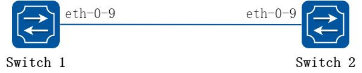

**图16-1 EFM**

##### 2. 配置步骤

以下配置Switch1 和Switch2 相同。

##### 步骤1 进入配置模式

```
Switch# configure terminal
```

##### 步骤2 进入接口配置模式，启用EFM 功能

```
Switch(config)# interface eth-0-9
Switch(config-if)# ethernet oam enable
Switch(config-if)# ethernet oam mode active
Switch(config-if)# ethernet oam link-monitor frame threshold high 10 window 50
```

模式可以选择active 或passive，passive 如下配置：

```
Switch(config-if)# ethernet oam mode passive
Switch(config-if)# exit
```

Switch1 和Switch2 至少有一台要选择active。两台都配置active 也可以正常工作。

##### 步骤3 退出配置模式

```
Switch(config)# end
```

##### 步骤4 检查配置

当两台设备的EFM 发现状态机都进入“send any”状态则表示协商已经成功。EFM 有如下这些状态：

ACTIVE_SEND_LOCAL：如果设备的状态为ACTIVE_SEND_LOCAL 表示该设备在等待对端设备的答复。只有主动模式的设备才会进入该状态。

PASSIVE_WAIT：如果设备的状态为PASSIVE_WAIT 表示该设备在等待对端设备发起请求。只有被动模式的设备才会进入该状态。

SEND_LOCAL_REMOTE：这是个中间状态，设备收到对端的Information OAMPDU 后加入自己的Information OAMPDU 再发给对端时，设备进入该状态。

SEND_LOCAL_REMOTE_OK：这是个中间状态，设备发现本端的配置和对端的配置一致可以协商则进入该状态。

SEND_ANY：这是两端协商成功的最终状态。

FAULT：如果端口的OAM 重置，关闭或者超时则进入该状态。

Switch1 检查结果

```
Switch# show ethernet oam discovery interface eth-0-9
eth-0-9
Local client:
-------------
Administrative configurations:
Mode:
active
Unidirection:
not supported
Link monitor:
supported(on)
Remote Loopback:
not supported
MIB retrieval:
not supported
MTU Size
:
1518
Operational status:
Port status:
send any
Loopback status:
no loopback
PDU revision:
1
Remote client:
--------------
MAC address: e6c2.47f6.7809
PDU revision: 1
Vendor(oui): e6 c2 47
Administrative configurations:
Mode:
active
Unidirection:
not supported
Link monitor:
supported
Remote Loopback:
not supported
MIB retrieval:
not supported
MTU Size
:
1518
```

Switch2 检查结果

```
Switch# show ethernet oam discovery interface eth-0-9
eth-0-9
Local client:
-------------
```

```
Administrative configurations:
Mode:
active
Unidirection:
not supported
Link monitor:
supported(on)
Remote Loopback:
not supported
MIB retrieval:
not supported
MTU Size
:
1518
Operational status:
Port status:
operational
Loopback status:
no loopback
PDU revision:
1
Remote client:
--------------
MAC address: 409c.ba1a.5a09
PDU revision: 1
Vendor(oui): 40 9c ba
Administrative configurations:
Mode:
active
Unidirection:
not supported
Link monitor:
supported
Remote Loopback:
not supported
MIB retrieval:
not supported
MTU Size
:
1518
```

#### 配置远端环回

##### 1. 组网拓扑


**图16-2 EFM**

##### 2. 配置步骤

远端环回功能是指主动模式下的OAM 实体向对端（远端）发送除OAMPDU 以外的所有其它报文时，对端收到该报文后直接将其环回给本端。它可用于定位链路故障和检测链路质量：网络管理员通过观察非OAMPDU 报文的返回情况，可以对链路性能（包括丢包率、时延、抖动等）作出评判。

以下配置如无特殊说明，则Switch1 和Switch2 相同。

##### 步骤1 进入配置模式

```
Switch# configure terminal
```

##### 步骤2 进入接口配置模式，使能远端环回功能

Switch1:

```
Switch1(config)# interface eth-0-9
Switch1(config-if)# no shutdown
```

```
Switch1(config-if)# ethernet oam enable
Switch1(config-if)# ethernet oam mode passive
Switch1(config-if)# ethernet oam remote-loopback supported
Switch1(config-if)# exit
```

Switch2:

```
Switch2(config)# interface eth-0-9
Switch2(config-if)# no shutdown
Switch2(config-if)# ethernet oam enable
Switch2(config-if)# ethernet oam mode active
Switch2(config-if)# ethernet oam remote-loopback supported
Switch2(config-if)# exit
```

##### 步骤3 退出配置模式

```
Switch(config)# end
```

##### 步骤4 在端口上启用环回功能

这项配置在Switch2 进行：

```
Switch2# ethernet oam remote-loopback start interface eth-0-9
```

##### 步骤5 检查配置

在swith2 上查看ethernet oam 状态机：

```
Switch2# show ethernet oam state-machine interface eth-0-9
State Machine Details:
--------------------------------
Local OAM mode:
Active
Local OAM enable:
Enable
Local link status:
OK
Local pdu status:
ANY
Local Satisfied:
True
Local Stable:
True
Remote Satisfied valid:
True
Remote Stable:
True
Local Parser State:
Discard
Local Multiplexer State:
Forward
Remote Parser State:
Loopback
Remote Multiplexer State:
Discard
```

#### 配置链路事件

##### 1. 组网拓扑


**图16-3 EFM**

用户可以为链路事件配置最高、最低阈值。如果超过最高阈值设备可以通过用户的配置自动将端口设为error disable 状态。

##### 2. 配置步骤

以下配置和检查在Switch1 进行：

##### 步骤1 进入配置模式

```
Switch# configure terminal
```

##### 步骤2 进入接口配置模式，配置错误报文的最高和最低阀值

```
Switch(config)# interface eth-0-9
Switch(config)# no shutdown
Switch(config-if)# ethernet oam enable
Switch(config-if)# ethernet oam link-monitor frame threshold high 5000 low 200 window 500
Switch(config-if)# ethernet oam link-monitor frame-seconds threshold high 600 low 200 window 9000
```

上述”ethernet oam link-monitor frame threshold”命令，指定了一段时间内（以配置的”window 500”为准，单位是100 millisecond，这里是50 秒，如果不指定window，则取默认值1 秒），允许出现错误报文的个数，高阈值是5000 个，低阈值是200 个。

上述”ethernet oam link-monitor frame-seconds”命令，指定了一段时间内（以配置的”window 9000”为准，单位是100 millisecond，这里是900 秒，如果不指定window，则取默认值100 秒）有错误报文出现的时间，高阈值为600 秒，低阈值为200 秒。

##### 步骤3 设置错包超过阈值以后的动作

超过步骤2 中锁配置的高阈值后，将端口设为error-disable 状态。

```
Switch(config-if)# ethernet oam link-monitor high-threshold action error-disable-interface
Switch(config-if)# exit
```

##### 步骤4 退出配置模式

```
Switch(config)# end
```

##### 步骤5 检查配置

```
Switch# show ethernet oam status interface eth-0-9
eth-0-9
General:
-------
Mode:
active
PDU max rate:
1 packets per second
PDU min rate:
1 packet per 1 second
Link timeout:
10 seconds
High threshold action:
disable interface
Link fault action:
no action
Dying gasp action:
no action
Critical event action:
no action
Link Monitoring:
----------------
Status:
supported(on)
Frame Error:
Window:
500 x 100 milliseconds
Low threshold:
200 error frame(s)
High threshold:
5000 error frame(s)
```

```
Last Window Frame Errors:
0 Frame(s)
Total Frame Errors:
0 Frame(s)
Total Frame Errors Events:
0 Events(s)
Relative Timestamp of the Event:
0 x 100 milliseconds
Frame Seconds Error:
Window:
9000 x 100 milliseconds
Low threshold:
200 error second(s)
High threshold:
600 error second(s)
Last Window Frame Second Errors:
0 error second(s)
Total Frame Second Errors:
0 error second(s)
Total Frame Second Errors Events: 0 Events(s)
Relative Timestamp of the Event:
0 x 100 milliseconds
```

#### 配置发现对端触发紧急事件应对

##### 1. 组网拓扑


**图16-4 EFM**

##### 2. 配置步骤

当对端发生紧急链路事件时，用户可以通过配置将端口设为error disable 状态。

以下配置和检查在Switch1 进行：

##### 步骤1 进入配置模式

```
Switch# configure terminal
```

##### 步骤2 进入接口配置模式，配置当对端发生紧急链路事件时，将端口状态设为error disable状态

```
Switch(config)# interface eth-0-9
Switch(config)# no shutdown
Switch(config-if)# ethernet oam enable
Switch(config-if)# ethernet oam remote-failure critical-event dying-gasp link-fault action
error-disable-interface
Switch(config-if)# exit
```

##### 步骤3 退出配置模式

```
Switch(config)# end
```

## 16.3 CFM配置

### 16.3.1 概述

#### 简介

##### 1. 缩略语说明

| 缩略语 | 英文全称 | 翻译与解释 |
|---|---|---|
| OAM | Operation, Administration,<br>and Management | 操作，管理，维护 |
| CC | Continuity Check | 连续性检测 |
| CCM | Continuity Check Message | 连续性检测消息 |
| CFM | Connectivity Fault Management | 连通错误管理 |
| LBM | Loopback Message | 环回消息 |
| LBR | Loopback Reply | 环回应答 |
| LMI | Layer Management Interface | 层管理接口 |
| LTM | Linktrace Message | 链路跟踪消息 |
| LTR | Linktrace Reply | 链路跟踪应答 |
| ME | Maintenance Entity | 维护实体 |
| MD | Maintenance Domain | 维护域 |
| MA | Maintenance Association | 维护联盟 |
| MAID | Maintenance Association<br>Identifier | 维护联盟标识符 |
| MEP | Maintenance association End<br>Point | 维护端点 |
| MEPID | Maintenance association End<br>Point Identifier | 维护端点标识符 |
| MIP | Maintenance domain<br>Intermediate Point | 维护中间点 |
| MP | Maintenance Point | 维护点 |
| DoSAP | Domain Service Access Point | 域服务接入点 |
| ISAP | Intermediate Service Access<br>Point | 中间服务接入点 |
| MSAP | MAC Service Access Point | MAC 服务接入点 |
| RDI | Remote Defect Indication | 远端故障指示 |
| AIS | Alarm Indication Signal | 报警指示信号 |
| DM | Delay Measurement | 延时测量 |
| CSF | Client Signal Fail | 客户端信号失败 |

##### 2. 功能说明

CFM 的全称为Connectivity Fault Management。

CFM 能够根据802.1ag 协议去检测，验证，定位和通知以太网中的连接故障。CFM 也能够发现和验证以太网中的路径。CFM 是操作维护管理模块OAM 的一部份。CFM 对用户数据报文是透明的并且能最大限度地发现连接错误。

以太网CFM 针对网络实现端到端的连通性故障检测、故障通知、故障确认和故障定位功能。可用于监测整个网络的连通性，定位网络的连通性故障，并可与保护倒换技术相配合，提高网络的可靠性。

CFM 实现了以太网链路端到端业务管理、故障检测和性能监视，支持管理域的分层管理，高层管理域可以跨越低层管理域，低层管理域无法跨越高层管理域。这样的分层管理能够实现同一业务流的分段维护，也能够实现不同业务流的管理。它主要提供了如下功能：

路径发现（Path discovery故障检测（Fault detection）

故障确认和定位（Fault verification and isolation）

故障通知（Fault notification）

故障恢复（Fault recovery）

#### 背景

以太网技术简单易用、价格低廉、且带宽可扩展性强，在企业网、城域网、广域网范围内都已经得到大规模应用。

但是传统以太网可维护、可运营能力比较弱，没有电信级管理能力，不能检测二层网络故障, 随着以太网推广的范围逐渐扩大，用户对以太网OAM 功能的需求也越来越强烈。

物理层（服务层如SDH）或网络层（客户层如IP）的OAM 功能对于以太网的操作管理和维护是不合适的。为了能确定以太网链路的连通性、有效的检测并定位出源于以太网层网络内部的故障、衡量网络的利用率以及度量网络的性能，以太网层需要提供一个完全不依赖于任何客户层或服务层的OAM 机制。因此以太网OAM（Operations Administration and Maintenance）应运而生。

以太网OAM 主要功能可分为以下两部分：

故障管理通过定时或手动发送检测报文来探测网络的连通性。

提供类似IP 网络中的Ping 和Traceroute 的功能，对以太网进行故障诊断和定位。

与保护倒换协议配合，在以太网OAM 检测到连通性故障后触发设备或者链路的倒换，从而实现网络中断时间小于等于50 毫秒的运营级可靠性目标。

性能管理CFM 作为OAM 的一部份，有如下优势:CFM 协议，是一种二层以太网OAM 协议。

CFM 可以对点对点或多点对多点的EVC 进行主动的故障诊断，是基于端到端业务级的OAM 协议。

CFM 可以有效的节约网络成本，提高网络可用性。

#### 原理描述

##### 1. 基本概念

维护域MD维护域MD（Maintenance Domain）用于标识以太网OAM 生效的网络范围，通过交换机端口上配置的维护端点（MEP）划分其边界。每个维护域拥有它自己的”维护域名”。

为了准确定位故障，在维护域中引入了级别（层次）的概念。目前支持八个级别的维护域，分别对应数字0-7，数字越大表示级别越高，也即维护域的范围越大。注意：不同维护域之间不可以交叉，级别低的域要么在级别高的维护域内部，要么与级别高的维护域不重叠。

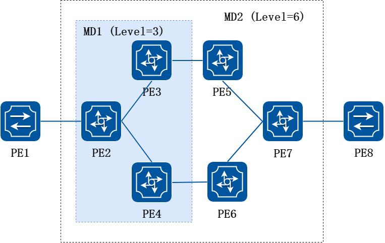

**图16-5 维护域MD 示意图**

维护域MD 的分级便于在发生问题时缩小排查范围，如上图所示，维护域MD2 中包含一个更小的维护与MD1。如果维护域MD2 检测到故障，但是维护域MD1 没有检测到故障，则可以确定PE2-PE4 设备是正常的，问题发生在PE5-PE7 设备或者之间。

在实际应用中，如果大的维护域内包含一个小的维护域，在对大的维护域进行连通性检测时，需要配置大维护域的级别高于小维护域，以实现802.1ag 协议报文穿越小维护域。

例如在上图所示网络中，MD2 包含MD1，MD2 的802.1ag 协议报文可以穿越MD1。因此，将MD2 的级别配置为6，MD1 的级别配置为3，这样MD2 内的802.1ag 协议报文就可以穿越MD1 实现整个MD2 的连通性故障管理。

另外而MD1 的802.1ag 协议报文不会扩散到MD2 中。

802.1ag 协议报文的交互以及CFM 的基本功能都是基于维护域的，通过对MD 的合理规划便可以有效的限定故障的范围，达到快速定位、快速解决的目的。

维护联盟MA

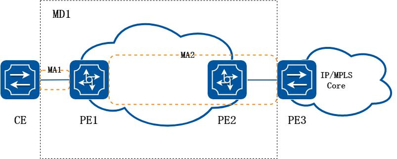

**图16-6 维护联盟MA 示意图**

在维护域内可以配置多个维护联盟MA（Maintenance Association），维护联盟是维护域内一些维护点的集合。维护联盟以“维护域名＋维护联盟名”来标识。维护联盟服务于某个特定的业务(如VLAN)，维护联盟中的维护点所发送的报文都带有该业务的标签，同时维护联盟中的维护点可以接收由本维护联盟中其他维护点发来的报文。

如上图所示，CE 到PE3 之间部署CFM 检测链路的连通性。

维护端点MEP维护端点MEP（Maintenance Association End Point）确定了维护域MD 的范围和边界，是维护联盟MA 的边缘节点。维护端点所属的维护联盟和维护域确定了该维护端点所发出报文的业务和级别。维护端点的级别决定了其所能处理报文的级别，维护端点所发出报文的级别就是该维护端点的级别。当维护端点收到高于自己级别的报文时，不会进行处理，而是将其按原有路径转发；而当维护端点收到小于或者等于自己级别的报文时，才会进行处理。

维护端点配置在设备的接口上，维护端点的级别等于它所在的维护域的级别。对于运行以太网CFM 的网络中的任意一台设备，该设备上的MEP 称为本地MEP，同一MA 内其他设备上的MEP 对本设备而言称为远端维护联盟边缘节点RMEP（Remote Maintenance Association End Point）。

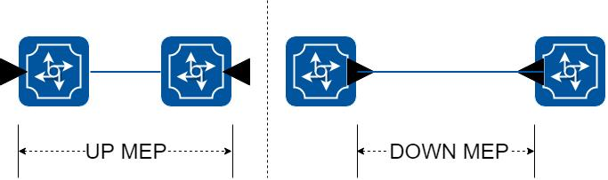

**图16-7 MEP 示意图**

如上图所示，维护端点根据其方向，分为UP MEP 和DOWN MEP 两类。

UP MEP 不向它所在端口发送报文，而是向设备的其他端口发送报文。

DOWN MEP 向它所在端口发送报文。

维护中间点MIP维护中间点MIP（Maintenance Association Intermediate Point）位于维护域内部，配置在设备的接口上，通过MEP 之间部署多个MIP 可以提高对网络的可管理性。MIP 越多，对网络的可控性、可管理性就越强。在能够给用户带来更多利润的重要业务的链路上，部署的MIP 数量可能会远远多于运行普通业务的链路。

MP 的分层维护

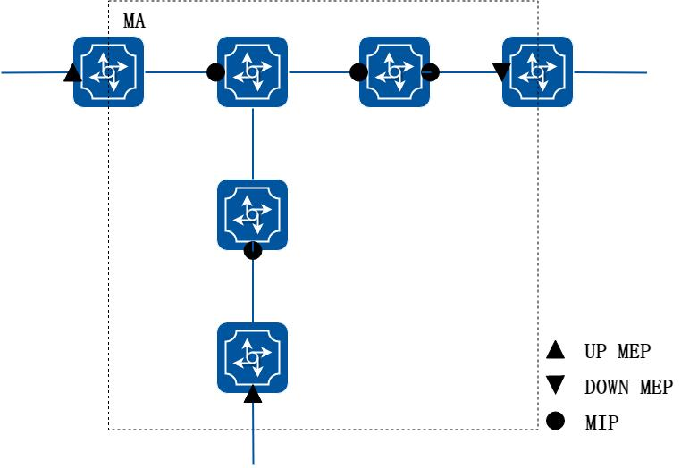

**图16-8 MP 示意图**

维护端点MEP 和维护中间点MIP 统称为维护点MP（Maintenance Association Point）。

维护点MP 配置在端口上，属于某个维护联盟，如上图所示。

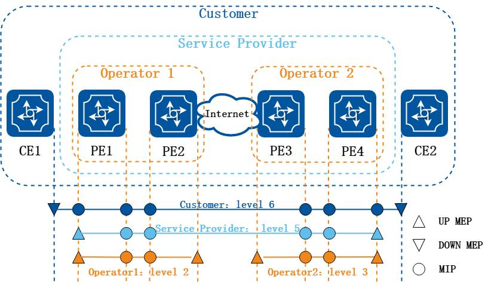

**图16-9 MP 的分层示意图**

上图中标识了维护实体端点MEP 和维护实体中间点MIP 的位置。Operator1、Operator2、Service provider 和Customer 维护域的级别分别为2、3、5 和6。维护域级别越高，控制范围越广。

##### 2. 报文格式

CFM 是通过携带不同标记的CFM 协议报文实现链路的故障检测和定位的，其协议报文格式如图所示。

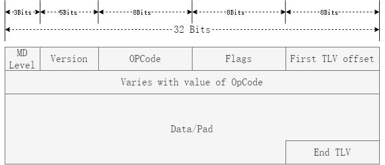

**图16-10 CFM 协议报文通用格式**

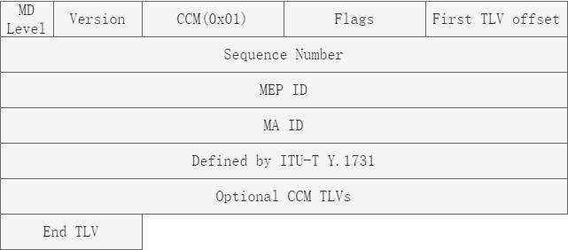

**图16-11 CCM 报文**


**图16-12 LBR 报文**

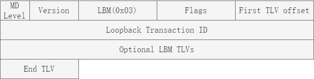

**图16-13 LBM 报文**

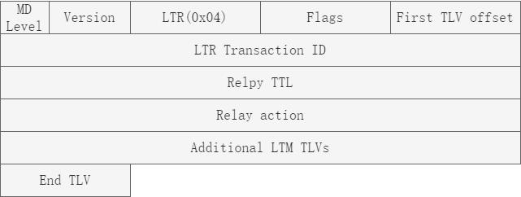

**图16-14 LTR 报文**

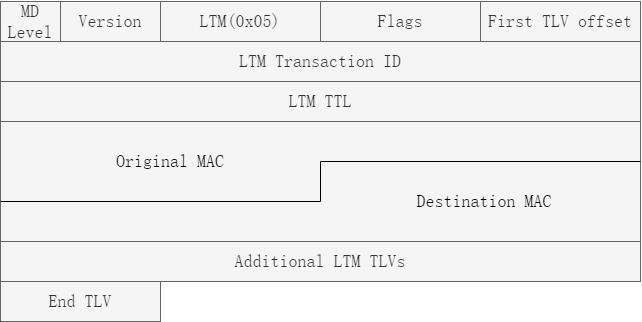

**图16-15 LTM 报文**

CFM 协议主要字段的含义:MD Level: 维护域的级别，取值范围为0～7，取值越大表示级别越高。

Version: 协议版本号，取值为0。

OpCode: 消息编码，不同取值表示不同类型的CFM 协议报文，常见的CFM 协议报文如表4 所示。

不同类型的CFM 协议报文:OpCode 0x01: CCM（Continuity Check Message）, 用于端到端链路的连通性检测。

OpCode 0x02: LBR（Loopback Reply）, 用于环回检测，对端对于本端LBM 的回应。

OpCode 0x03: LBM（Loopback Message）, 用于环回检测，由环回发起端发出。

OpCode 0x04: LTR（Linktrace Reply）, 用于链路跟踪，对端对于本端LTM 的回应。

OpCode 0x05: LTM（Linktrace Message）, 用于链路跟踪，由链路跟踪发起端发出。

CFM 使用标准的以太网报文，仅以太网协议类型不同。支持的CFM 消息如下：

连续性检查(CC)消息: 连续性检查消息周期性发送，使维护域端点MEP 和维护域中间节点MIP 可以发现其它MEP。它用于检测任何一对MEP 间的连续性丢失(LOC)。

以太网环回(LB)消息: MEP 发送一个LB 消息来验证另一个MEP 或MIP 是否可达。

LB 消息和网间控制消息协议ICMP ping 消息类似。

以太网链路追踪(LT)消息: MEP 发送LT 消息以追踪到一个目的MEP/MIP 中间每一跳的MIP。LT 消息类似UDP 链路追踪消息。

以太网帧延时测量(DM)消息: ETH-DM 可用于按需的OAM，测量帧时延和帧时延变化。帧时延和帧时延变化的测量是通过向对等MEP 周期地发送带有ETH-DM 信息的帧，并在诊断间隔内从对等MEP 接收带有ETH-DM 信息的帧来完成的。每一个MEP都可以进行帧时延和帧时延变化的测量。当一个MEP 能产生带有ETH-DM 信息的帧时，它向同一ME 内它对等的MEP 周期地发送带有ETH-DM 信息的帧。当一个MEP 产生带有ETH-DM 信息的帧时，它也预期在同一MEP 中从对等的MEP 接收带有ETH-DM信息的帧。

以太网锁定信号(LCK)消息: 以太网锁定信号功能（ETH-LCK）用于通告服务器层（子层）MEP 的管理性锁定以及随后的数据业务流中断，该业务流是送往期待接收这业务流的MEP 的。它使得接收带有ETH-LCK 信息的帧的MEP 能区分是故障情况，还是服务器层（子层）MEP 的管理性锁定动作。

以太网客户端信号失败功能(CSF): 以太网客户端信号失败功能是由服务器MEP 将客户端检查到的失败或错误通知到对应服务器MEP，再由对端服务器MEP 通知对端的客户端MEP。通常应用于客户端MEP 无法直接通知到对端MEP 的情况，此时CC或AIS 是均无法使用的。CSF 消息是由服务器MEP 发给对端服务器的MEP 的消息。

CSF 仅应用于点对点的以太网传输中。

以太网帧丢失测量(LM)消息: ETH-LM 用于收集计数器的数值，应用于入口和出口处的服务帧，此计数器在一对MEP 之间保持着发送和接收的数据帧的计数。ETH-LM的功能是通过向其对等MEP 发送带有ETH-LM 信息的帧，并类似地从对等MEP 接收带有ETH-LM 信息的帧来实现的。

### 16.3.2 配置举例


CFM 和802.1x 及mirror destination 配在同一端口上时功能冲突，因此CFM不应该与这些功能配在同一端口上。

#### 配置CC/LB/LT/AIS/DM

##### 1. 组网拓扑

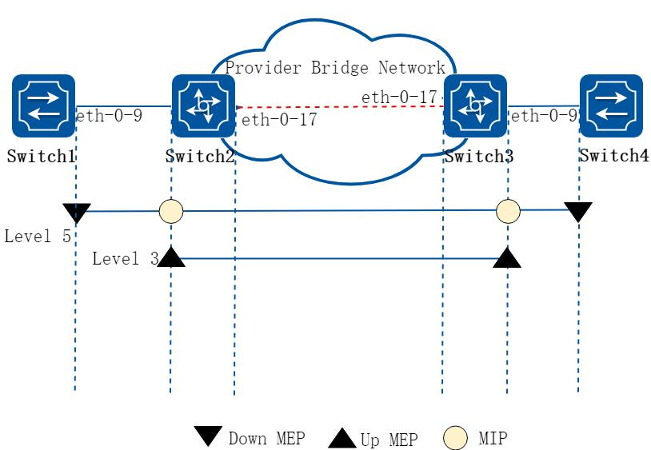

**图16-16 CFM**

##### 2. 配置步骤

以下配置如未说明在哪个Switch 配置，则表示所有Switch 配置相同：

##### 步骤1 进入配置模式

```
Switch# configure terminal
```

##### 步骤2 进入vlan 配置模式，并创建vlan

```
Switch(config)# vlan database
Switch(config vlan)# vlan 30
Switch(config vlan)# exit
```

##### 步骤3 全局使能cfm，设置cfm 模式为y1731

```
Switch(config)# ethernet cfm enable
Switch(config)# ethernet cfm mode y1731
```

##### 步骤4 创建维护域，在维护域中将服务和vlan 绑定

创建一个叫cust 的域，等级是5。

```
Switch(config)# ethernet cfm domain cust level 5
Switch(config-ether-cfm)# service cst vlan 30
Switch(config-ether-cfm)# exit
```

创建一个叫provid 的域，等级是3。

在Switch2 和3 配置：

```
Switch2&3(config)# ethernet cfm domain provid level 3
Switch2&3(config-ether-cfm)# service cst vlan 30
Switch2&3(config-ether-cfm)# exit
```

服务域的等级（level）取值范围是0-7，数字越大优先级越高。在vlan 相同的情况下，优先级高的域，其报文可以穿越那些优先级低的域。

##### 步骤5 进入端口配置模式，配置端口属性

Switch1 的端口配置：

```
Switch1(config)# interface eth-0-9
Switch1(config-if)# switchport mode trunk
Switch1(config-if)# switchport trunk allowed vlan add 30
Switch1(config-if)# ethernet cfm mep down mpid 66 domain cust vlan 30 interval 1
Switch1(config-if)# ethernet cfm mep crosscheck mpid 99 domain cust vlan 30 mac d036.4567.8009
Switch1(config-if)# no shutdown
Switch1(config-if)# exit
```

Switch2 的端口配置：

```
Switch2(config)# interface eth-0-9
Switch2(config-if)# switchport mode trunk
Switch2(config-if)# switchport trunk allowed vlan add 30
Switch2(config-if)# ethernet cfm mip level 5 vlan 30
Switch2(config-if)# ethernet cfm mep up mpid 666 domain provid vlan 30 interval 1
Switch2(config-if)# ethernet cfm mep crosscheck mpid 999 domain provid vlan 30 mac 6a08.051e.bd09
Switch2(config-if)# ethernet cfm ais status enable all domain provid vlan 30 level 5 multicast
Switch2(config-if)# ethernet cfm server-ais status enable level 5 interval 1
Switch2(config-if)# no shutdown
Switch2(config-if)# exit
Switch2(config)# interface eth-0-17
Switch2(config-if)# switchport mode trunk
Switch2(config-if)# switchport trunk allowed vlan add 30
```

```
Switch2(config-if)# no shutdown
Switch2(config-if)# exit
```

Switch3 的端口配置：

```
Switch3(config)# interface eth-0-9
Switch3(config-if)# switchport mode trunk
Switch3(config-if)# switchport trunk allowed vlan add 30
Switch3(config-if)# ethernet cfm mip level 5 vlan 30
Switch3(config-if)# ethernet cfm mep up mpid 999 domain provid vlan 30 interval 1
Switch3(config-if)# ethernet cfm mep crosscheck mpid 666 domain provid vlan 30 mac 0e1d.a7d7.fb09
Switch3(config-if)# no shutdown
Switch3(config-if)# exit
Switch3(config)# interface eth-0-17
Switch3(config-if)# switchport mode trunk
Switch3(config-if)# switchport trunk allowed vlan add 30
Switch3(config-if)# no shutdown
Switch3(config-if)# exit
```

Switch4 的端口配置：

```
Switch4(config)# interface eth-0-9
Switch4(config-if)# switchport mode trunk
Switch4(config-if)# switchport trunk allowed vlan add 30
Switch4(config-if)# ethernet cfm mep down mpid 99 domain cust vlan 30 interval 1
Switch4(config-if)# ethernet cfm mep crosscheck mpid 66 domain cust vlan 30 mac fa02.cdff.6a09
Switch4(config-if)# no shutdown
Switch4(config-if)# exit
```

##### 步骤6 启用维护域的连续性检查功能

在Switch1 和4 配置：

```
Switch1&4(config)# ethernet cfm cc enable domain cust vlan 30
```

在Switch2 和3 配置：

```
Switch2&3(config)# ethernet cfm cc enable domain provid vlan 30
```

##### 步骤7 告警指示信号处理（可选）

配置当收到告警指示信号ais 报文且存在loc 错误时抑制其它loc error。

在Switch1 配置：

```
Switch1(config)# ethernet cfm ais suppress alarm enable domain cust vlan 30
```

##### 步骤8 退出配置模式

```
Switch(config)# end
```

##### 步骤9 检查配置

检查MEP and MIP以下命令可用于查看Switch1 和Switch2 上MEP 和MIP 的相关信息。

Switch1：

```
Switch1# show ethernet cfm maintenance-points
###Local MEP:
```

```
MPID Direction DOMAIN LEVEL TYPE VLAN PORT
CC-Status Mac-address
RDI
Interval
--------------------------------------------------------------------------------------
66
Down MEP
cust
5
MEP
30
eth-0-9
enabled
fa02.cdff.6a09 True 3.33ms
###Local MIP:
Level
VID
TYPE
PORT
MAC
------------------------------------------------------
###Remote MEP:
MPID
LEVEL VLAN ACTIVE Remote Mac
RDI
FLAGS
STATE
---------------------------------------------------------
99
5
30
Yes
d036.4567.8009 True
Learnt
UP
```

Switch2：

```
Switch2# show ethernet cfm maintenance-points
###Local MEP:
MPID Direction DOMAIN LEVEL TYPE VLAN PORT
CC-Status Mac-address
RDI
----------------------------------------------------------------------------
666
Up MEP
provid 3
MEP
30
eth-0-9
enabled
0e1d.a7d7.fb09 False
###Local MIP:
Level
VID
TYPE
PORT
MAC
------------------------------------------------------
5
30
MIP
eth-0-9
0e1d.a7d7.fb09
###Remote MEP:
MPID
LEVEL VLAN ACTIVE Remote Mac
RDI
FLAGS
STATE
---------------------------------------------------------
999
3
30
Yes
6a08.051e.bd09
True
Learnt
UP
```

以太网回环检查以下命令用于在Switch1 上根据远端MEP 的地址回环远端MEP。

```
Switch1# ethernet cfm loopback mac d036.4567.8009 unicast mepid 66 domain cust vlan 30
Sending 1 Ethernet CFM loopback messages, timeout is 5 seconds:
(! Pass . Fail)
!
Loopback completed.
- $$---------------------------------
Success rate is 100 percent(1/1)
```

以下命令用于在Switch1 上根据组播地址回环远端MEP。

```
Switch1# ethernet cfm loopback multicast mepid 66 domain cust vlan 30
Sending 1 Ethernet CFM loopback messages, timeout is 5 seconds:
(! Pass . Fail)
Host MEP: 66
Number of RMEPs that replied to mcast frame = 1
LBR received from the following
9667.bb68.f308
success rate is
100 (1/1)
```

以下命令用于在Switch1 上根据远端MEP 的标识回环远端MEP。

```
Switch1# ethernet cfm loopback unicast rmepid 99 mepid 66 domain cust vlan 30
Sending 1 Ethernet CFM loopback messages, timeout is 5 seconds:
(! Pass . Fail)
!
Loopback completed.
```

```
- $$---------------------------------
Success rate is 100 percent(1/1)
```

以下命令用于在Switch1 上根据远端MIP 的地址回环远端MIP。

```
Switch1# ethernet cfm loopback mac 0e1d.a7d7.fb09 unicast mepid 66 domain cust vlan 30
Sending 1 Ethernet CFM loopback messages, timeout is 5 seconds:
(! Pass . Fail)
!
Loopback completed.
- $$---------------------------------
Success rate is 100 percent(1/1)
```

检查远端故障指示RDI以下命令显示Switch1 上的RDI 的信息。

```
Switch1# show ethernet cfm maintenance-points local mep domain cust
MPID Direction DOMAIN LEVEL TYPE VLAN PORT
CC-Status Mac-address
RDI Interval
-------------------------------------------------------------------------------
66
Down MEP
cust
5
MEP
30
eth-0-9
enabled
fa02.cdff.6a09 True 3.33ms
```

错误检查在清除本地MEP 错误前，Switch1 错误信息显示如下所示。

```
Switch1# show ethernet cfm errors domain cust
Level Vlan MPID RemoteMac
Reason
ServiceId
5
30
66
d036.4567.8009 errorCCMdefect: rmep not found
cst
5
30
66
d036.4567.8009 errorCCMdefect: rmep not found clear cst
Time
2011/05/27 3:19:18
2011/05/27 3:19:32
```

以下命令用于清除Switch1 的错误信息。

```
Switch1# clear ethernet cfm errors domain cust
```

当清除本地MEP 的错误信息后，Switch1 错误信息如下所示。

```
Switch1# clear ethernet cfm errors domain cust
Level Vlan MPID RemoteMac
Reason
ServiceId
```

检查AIS以下命令用于关闭Switch1 上的连续性检查功能。

```
Switch1# configure terminal
Switch1(config)# no ethernet cfm cc enable domain cust vlan 30
Switch1(config)# end
```

以下命令用于关闭Switch3 上的连续性检查功能。

```
Switch3# configure terminal
Switch3(config)# no ethernet cfm cc enable domain cust vlan 30
Switch3(config)# end
```

以下命令用于检查Switch2 上的ais 的状态。

```
Switch2# show ethernet cfm ais mep 666 domain cust vlan 30
AIS-Status: Enabled
```

```
AIS Period: 1
Level to transmit AIS: 7
AIS Condition: No
----------------------------------------------------
Configured defect condition
detected(yes/no)
----------------------------------------------------
unexpected-period
no
unexpected-MEG level
no
unexpected-MEP
no
Mismerge
no
LOC
yes
```

以下命令用于检查Switch1 上ais 状态。

```
Switch1# show ethernet cfm ais mep 66 domain cust vlan 30
AIS-Status: Disabled
AIS Condition: Yes
```

检查LinkTrace以下命令用于在Switch1 上根据远端MEP 的地址追踪远端MEP。

```
Switch1# ethernet cfm linktrace mac d036.4567.8009 mepid 66 domain cust vlan 30
Sending Ethernet CFM linktrace messages,TTL is 64.Per-Hop Timeout is 5 seconds:
Please wait a moment
-------------------------------
Received Hops: 1
-------------------------------
TTL
: 63
Fowarded
: True
Terminal MEP
: False
Relay Action
: Rly FDB
Ingress Action
: IngOk
Ingress MAC address
: 0e1d.a7d7.fb09
Ingress Port ID Type
: ifName
Ingress Port ID
: eth-0-9
-------------------------------
Received Hops: 2
-------------------------------
TTL
: 62
Fowarded
: True
Terminal MEP
: False
Relay Action
: Rly FDB
Egress Action
: EgrOk
Egress MAC address
: 6a08.051e.bd09
Egress Port ID Type
: ifName
Egress Port ID
: eth-0-9
-------------------------------
Received Hops: 3
-------------------------------
TTL
: 61
Fowarded
: False
Terminal MEP
: True
Relay Action
: Rly Hit
Ingress Action
: IngOk
Ingress MAC address
: d036.4567.8009
```

```
Ingress Port ID Type
: ifName
Ingress Port ID
: eth-0-9
```

以下命令用于在Switch1 上根据远端MEP 的标识追踪远端MEP。

```
Switch1# ethernet cfm linktrace rmepid 99 mepid 66 domain cust vlan 30
Sending Ethernet CFM linktrace messages,TTL is 64.Per-Hop Timeout is 5 seconds:
Please wait a moment
-------------------------------
Received Hops: 1
-------------------------------
TTL
: 63
Fowarded
: True
Terminal MEP
: False
Relay Action
: Rly FDB
Ingress Action
: IngOk
Ingress MAC address
: 0e1d.a7d7.fb09
Ingress Port ID Type
: ifName
Ingress Port ID
: eth-0-9
-------------------------------
Received Hops: 2
-------------------------------
TTL
: 62
Fowarded
: True
Terminal MEP
: False
Relay Action
: Rly FDB
Egress Action
: EgrOk
Egress MAC address
: 6a08.051e.bd09
Egress Port ID Type
: ifName
Egress Port ID
: eth-0-9
-------------------------------
Received Hops: 3
-------------------------------
TTL
: 61
Fowarded
: False
Terminal MEP
: True
Relay Action
: Rly Hit
Ingress Action
: IngOk
Ingress MAC address
: d036.4567.8009
Ingress Port ID Type
: ifName
Ingress Port ID
: eth-0-9
```

以下命令用于在Switch1 上根据远端MIP 的地址追踪远端MIP。

```
Switch1# ethernet cfm linktrace mac 6a08.051e.bd09 mepid 66 domain cust vlan 30
Sending Ethernet CFM linktrace messages,TTL is 64.Per-Hop Timeout is 5 seconds:
Please wait a moment
-------------------------------
Received Hops: 1
-------------------------------
TTL
: 63
Fowarded
: True
Terminal MEP
: False
Relay Action
: Rly FDB
Ingress Action
: IngOk
Ingress MAC address
: 0e1d.a7d7.fb09
Ingress Port ID Type
: ifName
```

```
Ingress Port ID
: eth-0-9
-------------------------------
Received Hops: 2
-------------------------------
TTL
: 62
Fowarded
: False
Terminal MEP
: False
Relay Action
: Rly Hit
Egress Action
: EgrOk
Egress MAC address
: 6a08.051e.bd09
Egress Port ID Type
: ifName
Egress Port ID
: eth-0-9
```

帧时延测量检查以下命令用于在Switch1 上测量双向的延时和延时变化：

```
Switch1# ethernet cfm dmm
rmepid 99 mepid 66 count 5 domain cust vlan 30
Delay measurement statistics:
DMM Packets transmitted
: 5
Valid DMR packets received
: 5
Index
Two-way delay
Two-way delay variation
1
4288 usec
0 usec
2
4312 usec
24 usec
3
4296 usec
16 usec
4
4320 usec
24 usec
5
4264 usec
56 usec
Average delay
: 4296 usec
Average delay variation
: 24 usec
Best case delay
: 4264 usec
Worst case delay
: 4320 usec
```

在启用单向时延测量前，时钟应该同步。以下命令显示了在Switch1 上启用了单向时延测量：

```
Switch1#ethernet cfm 1dm rmepid 99 mepid 66 count 5 domain cust vlan 30
```

以下命令在Switch4 上显示了单向时延测量的结果：

```
Switch4# show ethernet cfm delaymeasurement cache
Remote MEP
: 66
Remote MEP vlan
: 30
Remote MEP level : 5
DMM Packets transmitted
: 0
Valid DMR packets received
: 0
Valid 1DM packets received
: 5
Index
One-way delay
One-way delay variation
Received Time
1
16832 usec
0 usec
2011/07/19 17:27:46
2
16176 usec
656 usec
2011/07/19 17:27:47
3
15448 usec
728 usec
2011/07/19 17:27:48
4
14800 usec
648 usec
2011/07/19 17:27:49
5
15406 usec
606 usec
2011/07/19 17:27:50
Average delay
: 15732 usec
Average delay variation
: 527 usec
Best case delay
: 14800 usec
Worst case delay
: 16832 usec
```

#### 配置LCK

##### 1. 组网拓扑


**图16-17 CFM**

##### 2. 配置步骤

##### 步骤1 检查当前配置

与”配置CC/LB/LT/AIS/DM”章节一致。

##### 步骤2 进入配置模式

```
Switch# configure terminal
```

##### 步骤3 配置LCK

在Switch2 上配置：

```
Switch2(config)# interface eth-0-9
Switch2(config-if)# ethernet cfm lck enable mep 666 domain provid vlan 30 tx-level 5 interval 1
Switch2(config-if)# exit
```

##### 步骤4 退出配置模式

```
Switch(config)# end
```

##### 步骤5 检查配置

以下命令用来显示Switch2 上LCK 状态：

```
Switch2# show ethernet cfm lck
En-LCK Enable, Y(Yes)/N(No)
Rx-LC, Receive LCK packets and enter LCK condition, Y(Yes)/N(No)
Rx-I, The period which is gotten from LCK packets
Tx-Domain, frames with ETH-LCK information are sent to this Domain
```

```
Tx-I, Transmit Interval
------------------------------------------------------------------------
MPID Domain
VLAN En Rx-LC Rx-I Tx-Domain
Tx-I
------------------------------------------------------------------------
666
provid
30
Y
N
N/A
cust
1
```

以下命令用来显示Switch1 上LCK 状态：

```
Switch1# show ethernet cfm lck
En-LCK Enable, Y(Yes)/N(No)
Rx-LC, Receive LCK packets and enter LCK condition, Y(Yes)/N(No)
Rx-I, The period which is gotten from LCK packets
Tx-Domain, frames with ETH-LCK information are sent to this Domain
Tx-I, Transmit Interval
------------------------------------------------------------------------
MPID Domain
VLAN En Rx-LC Rx-I Tx-Domain
Tx-I
------------------------------------------------------------------------
66
cust
30
N
Y
1
N/A
N/A
```

#### 配置CSF

##### 1. 组网拓扑

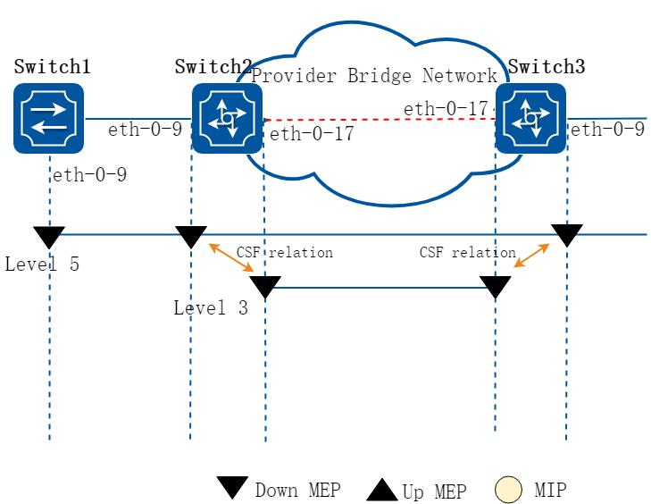

**图16-18 CFM CSF**

##### 2. 配置步骤

以下配置如未说明在哪个Switch 配置，则表示所有Switch 配置相同：

##### 步骤1 进入配置模式

```
Switch# configure terminal
```

##### 步骤2 进入vlan 配置模式，并创建vlan

在Switch1 配置：

```
Switch1(config)# vlan database
Switch1(config vlan)# vlan 30
Switch1(config vlan)# exit
```

在Switch2 和3 配置：

```
Switch2&3(config)# vlan database
Switch2&3(config vlan)# vlan 20,30
Switch2&3(config vlan)# exit
```

##### 步骤3 全局使能cfm，设置cfm 模式为y1731

```
Switch(config)# ethernet cfm enable
Switch(config)# ethernet cfm mode y1731
```

##### 步骤4 创建维护域，在维护域中将服务和vlan 绑定

创建一个叫cust 的域，等级是5。

```
Switch(config)# ethernet cfm domain cust level 5
Switch(config-ether-cfm)# service cst vlan 30
Switch(config-ether-cfm)# exit
```

创建一个叫provid 的域，等级是3。

在Switch2 和3 配置：

```
Switch2&3(config)# ethernet cfm domain provid level 3
Switch2&3(config-ether-cfm)# service cst vlan 20
Switch2&3(config-ether-cfm)# exit
```

##### 步骤5 进入端口配置模式，配置端口属性

Switch1 的端口配置：

```
Switch1(config)# interface eth-0-9
Switch1(config-if)# switchport mode trunk
Switch1(config-if)# switchport trunk allowed vlan add 30
Switch1(config-if)# ethernet cfm mep down mpid 66 domain cust vlan 30 interval 1
Switch1(config-if)# ethernet cfm mep crosscheck mpid 99 domain cust vlan 30 mac d036.4567.8009
Switch1(config-if)# no shutdown
Switch1(config-if)# exit
```

Switch2 的端口配置：

```
Switch2(config)# interface eth-0-9
Switch2(config-if)# switchport mode trunk
Switch2(config-if)# switchport trunk allowed vlan add 30
Switch2(config-if)# ethernet cfm mep down mpid 99 domain cust vlan 30 interval 1
Switch2(config-if)# ethernet cfm mep crosscheck mpid 66 domain cust vlan 30 mac fa02.cdff.6a09
Switch2(config-if)# no shutdown
Switch2(config-if)# exit
Switch2(config)#interface eth-0-17
Switch2(config-if)# switchport mode trunk
Switch2(config-if)# switchport trunk allowed vlan add 20
Switch2(config-if)# ethernet cfm mep down mpid 666 domain provid vlan 20 interval 1
```

```
Switch2(config-if)# no shutdown
Switch2(config-if)# exit
```

Switch3 的端口配置：

```
Switch3(config)# interface eth-0-9
Switch3(config-if)# switchport mode trunk
Switch3(config-if)# switchport trunk allowed vlan add 30
Switch3(config-if)# ethernet cfm mep down mpid 88 domain cust vlan 30 interval 1
Switch3(config-if)# no shutdown
Switch3(config-if)# exit
Switch3(config)#interface eth-0-17
Switch3(config-if)# switchport mode trunk
Switch3(config-if)# switchport trunk allowed vlan add 20
Switch3(config-if)# ethernet cfm mep down mpid 999 domain provid vlan 20 interval 1
Switch3(config-if)# no shutdown
Switch3(config-if)# exit
```

##### 步骤6 启用维护域的连续性检查功能

```
Switch(config)# ethernet cfm cc enable domain cust vlan 30
```

##### 步骤7 配置CSF 连接关系

在Switch2 配置：

```
Switch2(config)# ethernet cfm csf client domain cust vlan 30 mepid 99 server domain provid vlan 20 mepid
666 tx-interval 1
```

在Switch3 配置：

```
Switch3(config)# ethernet cfm csf client domain cust vlan 30 mepid 88 server domain provid vlan 20 mepid
999 tx-interval 1
```

##### 步骤8 退出配置模式

```
Switch(config)# end
```

##### 步骤9 检查配置

以下命令用来关闭Switch1 上的连续性检查，使Switch2 上触发loc 错误：

```
Switch1# configure terminal
Switch1(config)# no ethernet cfm cc enable domain cust vlan 30
Switch1(config)# end
```

Switch2 上的MEP 99 会上报loc,引发MEP 666 发送CSF 报文(原因los)。以下命令用来显示Switch2 上CSF 状态：

```
Switch2# show ethernet cfm csf
CTR-Client Trigger reason, L(los)/F(fdi)/R(rdi)/D(dci) or N/A
ECC-Enter CSF Condition, Y(Yes)/N(No)
SRR-Server Rx Reason, L(los)/F(fdi)/R(rdi)/D(dci) or N/A
Tx-I, Transmit Interval
Rx-I, The period which is gotten from CSF packets
------------------------------------------------------------------------
Client Mep
Server Mep
MPID Cli-Domain
VLAN CTR
ECC MPID Srv-Domain
VLAN SRR
Tx-I Rx-I
```

```
------------------------------------------------------------------------
99
cust
30
L
N
666
provid
20
N/A
1
N/A
```

在Switch3 上，MEP 999 会收到CSF 的报文并通知客户MEP 88，然后客户MEP 会进入CSF 状态。以下命令用来显示Switch3 上CSF 状态：

```
Switch3# show ethernet cfm csf
CTR-Client Trigger reason, L(los)/F(fdi)/R(rdi)/D(dci) or N/A
ECC-Enter CSF Condition, Y(Yes)/N(No)
SRR-Server Rx Reason, L(los)/F(fdi)/R(rdi)/D(dci) or N/A
Tx-I, Transmit Interval
Rx-I, The period which is gotten from CSF packets
------------------------------------------------------------------------
Client Mep
Server Mep
MPID Cli-Domain
VLAN CTR
ECC MPID Srv-Domain
VLAN SRR
Tx-I Rx-I
------------------------------------------------------------------------
88
cust
30
N/A
Y
999
provid
20
L
1
1
```

#### 配置双端LM

##### 1. 组网拓扑


**图16-19 CFM**

##### 2. 配置步骤

##### 步骤1 检查当前配置

与”配置CC/LB/LT/AIS/DM”章节一致。

##### 步骤2 进入配置模式

```
Switch# configure terminal
```

##### 步骤3 配置双端LM

在Switch1 配置：

```
Switch1(config)# ethernet cfm lm enable dual-ended domain cust vlan 30 mepid 66 all-cos cache-size 10
```

在Switch4 配置：

```
Switch4(config)# ethernet cfm lm enable dual-ended domain cust vlan 30 mepid 99 all-cos cache-size 10
```

##### 步骤4 退出配置模式

```
Switch(config)# end
```

##### 步骤5 检查配置

以下命令用来显示Switch1 上lm 的结果：

```
Switch1# show ethernet cfm lm domain cust vlan 30 mepid 66
DOMAIN
: cust
VLAN
: 30
MEPID
: 66
Start Time : 2013/07/16 1:36:56
End Time
: 2013/07/16 1:37:07
Notes
: 1. When the difference of Tx is less than the difference of Rx,
the node is invalid, loss and loss ratio should be "-";
2. When loc is reported for mep, the loss should be "-" and loss
ratio should be 100%;
3. When calculate average loss and loss ratio, invalid or loc nodes
will be excluded;
Latest dual-ended loss statistics:
--------------------------------------------------------------------------------
Index Cos Local-loss Local-loss ratio Remote-loss Remote-loss ratio Time
--------------------------------------------------------------------------------
1
all
0
000.0000%
0
000.0000% 01:36:57
2
all
0
000.0000%
0
000.0000% 01:36:58
3
all
0
000.0000%
0
000.0000% 01:36:59
4
all
0
000.0000%
0
000.0000% 01:37:00
5
all
0
000.0000%
0
000.0000% 01:37:01
6
all
0
000.0000%
0
000.0000% 01:37:02
7
all
0
000.0000%
0
000.0000% 01:37:03
8
all
0
000.0000%
0
000.0000% 01:37:04
9
all
0
000.0000%
0
000.0000% 01:37:05
10
all
0
000.0000%
0
000.0000% 01:37:07
--------------------------------------------------------------------------------
Maximum Local-loss
: 0
Maximum Local-loss Ratio
: 000.0000%
Minimum Local-loss
: 0
Minimum Local-loss Ratio
: 000.0000%
Average Local-loss
: 0
Average Local-loss Ratio
: 000.0000%
Maximum Remote-loss : 0
Maximum Remote-loss Ratio : 000.0000%
Minimum Remote-loss : 0
Minimum Remote-loss Ratio : 000.0000%
Average Remote-loss : 0
Average Remote-loss Ratio : 000.0000%
```

以下命令用来显示Switch4 上lm 的结果：

```
Switch4# show ethernet cfm lm domain cust vlan 30 mepid 99
DOMAIN
: cust
VLAN
: 30
MEPID
: 99
Start Time : 2013/07/16 1:37:11
End Time
: 2013/07/16 1:37:22
```

```
Notes
: 1. When the difference of Tx is less than the difference of Rx,
the node is invalid, loss and loss ratio should be "-";
2. When loc is reported for mep, the loss should be "-" and loss
ratio should be 100%;
3. When calculate average loss and loss ratio, invalid or loc nodes
will be excluded;
Latest dual-ended loss statistics:
--------------------------------------------------------------------------------
Index Cos Local-loss Local-loss ratio Remote-loss Remote-loss ratio Time
--------------------------------------------------------------------------------
1
all
0
000.0000%
0
000.0000% 01:37:12
2
all
0
000.0000%
0
000.0000% 01:37:13
3
all
0
000.0000%
0
000.0000% 01:37:14
4
all
0
000.0000%
0
000.0000% 01:37:16
5
all
0
000.0000%
0
000.0000% 01:37:17
6
all
0
000.0000%
0
000.0000% 01:37:18
7
all
0
000.0000%
0
000.0000% 01:37:19
8
all
0
000.0000%
0
000.0000% 01:37:20
9
all
0
000.0000%
0
000.0000% 01:37:21
10
all
0
000.0000%
0
000.0000% 01:37:22
--------------------------------------------------------------------------------
Maximum Local-loss
: 0
Maximum Local-loss Ratio
: 000.0000%
Minimum Local-loss
: 0
Minimum Local-loss Ratio
: 000.0000%
Average Local-loss
: 0
Average Local-loss Ratio
: 000.0000%
Maximum Remote-loss : 0
Maximum Remote-loss Ratio : 000.0000%
Minimum Remote-loss : 0
Minimum Remote-loss Ratio : 000.0000%
Average Remote-loss : 0
Average Remote-loss Ratio : 000.0000%
```

#### 配置单端LM

##### 1. 组网拓扑


**图16-20 CFM**

##### 2. 配置步骤

##### 步骤1 检查当前配置

与”配置CC/LB/LT/AIS/DM”章节一致。

##### 步骤2 进入配置模式

```
Switch# configure terminal
```

##### 步骤3 配置单端LM

在Switch1 配置：

```
Switch1(config)# ethernet cfm lm enable single-ended domain cust vlan 30 mepid 66 all-cos
```

在Switch4 配置：

```
Switch4(config)# ethernet cfm lm enable single-ended domain cust vlan 30 mepid 99 all-cos
```

##### 步骤4 退出配置模式

```
Switch(config)# end
```

##### 步骤5 检查配置

以下命令用于从Switch1 上发送LMM 消息，并显示LM 的结果:

```
Switch1#
ethernet cfm lm single-ended domain cust vlan 30 rmepid 99 mepid 66 count 10
DOMAIN
: cust
VLAN
: 30
MEPID
: 66
Start Time : 2013/07/16 1:39:38
End Time
: 2013/07/16 1:39:38
Notes
: 1. When the difference of Tx is less than the difference of Rx,
the node is invalid, loss and loss ratio should be "-";
2. When loc is reported for mep, the loss should be "-" and loss
ratio should be 100%;
3. When calculate average loss and loss ratio, invalid or loc nodes
will be excluded;
Latest single-ended loss statistics:
--------------------------------------------------------------------------------
Index Cos Local-loss Local-loss ratio Remote-loss Remote-loss ratio
--------------------------------------------------------------------------------
1
all
0
000.0000%
0
000.0000%
2
all
0
000.0000%
0
000.0000%
3
all
0
000.0000%
0
000.0000%
4
all
0
000.0000%
0
000.0000%
5
all
0
000.0000%
0
000.0000%
6
all
0
000.0000%
0
000.0000%
7
all
0
000.0000%
0
000.0000%
8
all
0
000.0000%
0
000.0000%
9
all
0
000.0000%
0
000.0000%
--------------------------------------------------------------------------------
Maximum Local-loss
: 0
Maximum Local-loss Ratio
: 000.0000%
Minimum Local-loss
: 0
Minimum Local-loss Ratio
: 000.0000%
```

```
Average Local-loss
: 0
Average Local-loss Ratio
: 000.0000%
Maximum Remote-loss : 0
Maximum Remote-loss Ratio : 000.0000%
Minimum Remote-loss : 0
Minimum Remote-loss Ratio : 000.0000%
Average Remote-loss : 0
Average Remote-loss Ratio : 000.0000%
```

#### 配置单端Test

##### 1. 组网拓扑


**图16-21 CFM**

##### 2. 配置步骤

##### 步骤1 检查当前配置

与”配置CC/LB/LT/AIS/DM”章节一致。

##### 步骤2 进入配置模式

```
Switch# configure terminal
```

##### 步骤3 配置Test

在Switch1 配置Test 发送功能：

```
Switch1(config)# ethernet cfm tst transmission enable session 1 domain cust vlan 30 mep 66 tx-mode
continuous pattern-type random packet-size 64
```

在Switch4 配置Test 接收功能：

```
Switch4(config)# ethernet cfm tst reception enable session 1 domain cust vlan 30 mep 99
```

##### 步骤4 退出配置模式

```
Switch(config)# end
```

##### 步骤5 检查配置

以下命令用于从Switch1 上发送Test 消息:

```
Switch1# ethernet cfm tst start session 1 rate 1000 time second 1
```

以下命令用于在Switch1 上显示Test 的信息:

```
Switch1#
show ethernet cfm tst
DOMAIN
: cust
VLAN
: 30
MEPID
: 66
Transmission
: Enabled
Reception
: Disabled
Status
: Non-Running
Start Time
: 06:32:48
Predict End Time : 06:33:18
Actual End Time
: 06:33:18
Packet Type
: TST
Rate
: 1000 mbps
Packet Size
: 64 bytes
Tx Number
: 29
Tx Bytes
: 1856
Rx Number
: 0
Rx Bytes
: 0
```

以下命令用于在Switch4 上显示Test 的信息:

```
Switch4#
show ethernet cfm tst
DOMAIN
: cust
VLAN
: 30
MEPID
: 99
Transmission
: Disabled
Reception
: Enabled
Status
: Non-Running
Start Time
: null
End Time
: null
Packet Type
: null
Rate
: null
Packet Size
: null
Tx Number
: 0
Tx Bytes
: 0
Rx Number
: 29
Rx Bytes
: 1856
```

### 16.3.3 参考文献

参考IEEE 802.1ag/D8.1

## 16.4 CPU Traffic配置

### 16.4.1 概述

#### 简介

本章描述如何配置CPU 流量限制并查看CPU 流量。

CPU 流量限制是一种很有用的保护CPU 的机制，通过对进入CPU 的报文的流量进行限制实现。

CPU 流量限制包含两个级别的CPU 保护措施：

其一，限制各个进入CPU 的reason 的流量。在芯片中，是通过配置这个reason 对应的queue shaping 实现的。

其二，限制所有进入CPU 的报文的流量。芯片中是通过配置CPU 端口上的shaping实现的。

这里提到的reason，意思是各种协议报文的类型，比如bgp、ospf、rip 等分别是不同的reason。

下表列出了各种reason 和对应的描述：

| Reason | 描述 |
|---|---|
| arp | arp 协议报文 |
| bpdu | bpdu 协议报文(包括 STP, RSTP, MSTP) |
| dhcp | dhcp 协议报文 |
| eapol | dot1x 协议报文 |
| erps | erps 协议报文 |
| fwd-to-cpu | 转发到CPU 的报文 |
| icmp-redirect | Icmp 重定向 |
| igmp | IGMP 或者IGMP Snooping 报文 |
| ip-option | 带有可选字段的IP 报文 |
| ipda | ipda 协议报文 |
| ssh | SSH 协议报文 |
| telnet | Telnet 协议报文 |
| mlag | MLAG 协议报文 |
| tcp | TCP 协议报文 |
| ldp | ldp 协议报文 |
| macsa-mismatch | 与一个端口security entry 不匹配时的学习报文 |
| mcast-rpf-fail | 组播报文RPF 检查失败 |
| mpls-ttl-fail | ttl 失效mpls 报文 |
| ip-mtu-fail | 超过mtu 长度的ip 报文 |
| ospf | ospf 协议报文 |
| pim | pim 协议报文 |
| port-security-discard | 端口security entry 学满时的学习报文 |
| rip | rip 协议报文 |
| sflow-egress | 在出口方向sflow 的采样报文 |
| sflow-ingress | 在入口方向sflow 的采样报文 |
| slow-protocol | slow 协议报文.(包括 EFM, LACP，SYNCE),ttl 失<br>效的组播报文 |
| smart-link | Smart link 协议报文 |
| ucast-ttl-fail | ttl 失效的单播IP 报文 |
| udld | udld 协议报文 |
| vlan-security-discard | vlan 内学习的mac 达到限制是的学习报文 |
| vrrp | vrrp 协议报文 |
| bfd-learning | BFD 学习报文 |
| dot1x-mac-bypass | Dot1x 旁路认证报文 |
| bgp | 边界网关协议报文 |
| egress-ttl-fail | 出方向TTL 失效的IP 报文 |
| icmpv6 | ICMPv6 报文 |
| l2protocol-tunnel | 二层隧道协议报文 |
| loopback-detection | 环路检测报文 |
| mirror-to-cpu | 镜像到cpu 的报文 |
| ndp | 邻居发现协议报文 |
| tunnel-gre-keepalive | gre 隧道持续回应报文 |
| linkup-ftp | ftp 协议联动报文 |
| linkup-http | http 协议联动报文 |

默认速率和优先级配置如下：

| reason | rate(pps) | class |
|---|---|---|
| arp | 256 | 1 |
| bpdu | 64 | 3 |
| dhcp | 128 | 0 |
| eapol | 128 | 0 |
| erps | 128 | 3 |
| fwd-to-cpu | 64 | 0 |
| icmp-redirect | 128 | 0 |
| igmp | 128 | 2 |
| ip-option | 512 | 0 |
| ipda | 1000 | 0 |
| ssh | 64 | 3 |
| telnet | 64 | 3 |
| mlag | 1000 | 1 |
| tcp | 64 | 2 |
| ldp | 512 | 1 |
| macsa-mismatch | 128 | 0 |
| mcast-rpf-fail | 128 | 1 |
| mpls-ttl-fail | 64 | 0 |
| ip-mtu-fail | 64 | 0 |
| ospf | 256 | 1 |
| pim | 128 | 1 |
| port-security-discard | 128 | 0 |
| rip | 64 | 1 |
| sflow-egress | 128 | 0 |
| sflow-ingress | 128 | 0 |
| slow-protocol | 256 | 1 |
| smart-link | 128 | 2 |
| ucast-ttl-fail | 64 | 0 |
| udld | 128 | 3 |
| vlan-security-discard | 128 | 0 |
| vrrp | 512 | 1 |
| bfd-learning | 128 | 1 |
| dot1x-mac-bypass | 64 | 2 |
| bgp | 256 | 1 |
| egress-ttl-fail | 64 | 0 |
| icmpv6 | 64 | 2 |
| l2protocol-tunnel | 1000 | 0 |
| loopback-detection | 64 | 3 |
| mirror-to-cpu | 1000 | 0 |
| ndp | 64 | 2 |
| tunnel-gre-keepalive | 64 | 0 |
| linkup-ftp | 1024 | 0 |
| linkup-http | 1024 | 0 |

#### 原理描述

术语PDU：英文全称Protocol Data Unit，协议数据单元

### 16.4.2 配置举例

##### 步骤1 进入配置模式

```
Switch# configure terminal
```

##### 步骤2 配置总限速

总限速默认值2000，单位pps（packet-per-second）

```
Switch(config)# cpu-traffic-limit total rate 3000
```

##### 步骤3 配置单个类型报文限速

以RIP 报文为例：

```
Switch(config)# cpu-traffic-limit reason rip rate 500
```

##### 步骤4 修改优先级类别

```
Switch(config)# cpu-traffic-limit reason rip class 3
```

优先级类别支持0-3，数字越大表示优先级越高。

##### 步骤5 退出配置模式

```
Switch(config)# end
```

##### 步骤6 检查配置

使用命令“show cpu traffic-limit”查看配置结果，详细信息类似如下所示。

```
Switch# show cpu traffic-limit
reason
rate (pps)
class
dot1x-mac-bypass
64
2
bpdu
64
3
slow-protocol
256
1
eapol
128
0
erps
128
3
smart-link
128
2
udld
128
3
loopback-detection
64
3
arp
256
1
dhcp
128
0
rip
500
3
ldp
512
1
ospf
256
1
pim
128
1
bgp
256
1
vrrp
512
1
ndp
64
2
icmpv6
64
2
ssh
64
3
telnet
64
3
mlag
1000
1
tcp
64
2
ipda
1000
0
icmp-redirect
128
0
mcast-rpf-fail
128
1
macsa-mismatch
128
0
port-security-discard
128
0
vlan-security-discard
128
0
egress-ttl-fail
64
0
ip-mtu-fail
64
0
bfd-learning
128
1
ptp
512
2
ip-option
512
0
tunnel-gre-keepalive
64
0
ucast-ttl-fail
64
0
mpls-ttl-fail
64
0
```

```
igmp
128
2
sflow-ingress
128
0
sflow-egress
128
0
fwd-to-cpu
64
0
l2protocol-tunnel
1000
0
mirror-to-cpu
1000
0
linkup-ftp
1024
0
linkup-http
1024
0
Total rate:
3000 (pps)
```

使用命令“show cpu traffic-statistics receive all”查看流量统计，详细信息类似如下所示。

```
Switch# show cpu traffic-statistics receive all
statistics rate time is 5 second(s)
reason
count(packets)
rate(pps)
dot1x-mac-bypass
0
0
bpdu
0
0
slow-protocol
0
0
eapol
0
0
erps
0
0
smart-link
0
0
udld
0
0
loopback-detection
0
0
arp
0
0
dhcp
0
0
rip
0
0
ldp
0
0
ospf
0
0
pim
0
0
bgp
0
0
vrrp
0
0
rsvp
0
0
ndp
0
0
icmpv6
0
0
ssh
0
0
telnet
0
0
mlag
0
0
tcp
0
0
ipda
0
0
icmp-redirect
0
0
mcast-rpf-fail
0
0
macsa-mismatch
0
0
port-security-discard
0
0
vlan-security-discard
0
0
egress-ttl-fail
0
0
ip-mtu-fail
0
0
bfd-learning
0
0
ptp
0
0
ip-option
0
0
tunnel-gre-keepalive
0
0
ucast-ttl-fail
0
0
mpls-ttl-fail
0
0
igmp
0
0
sflow-ingress
0
0
sflow-egress
0
0
```

```
fwd-to-cpu
0
0
l2protocol-tunnel
0
0
mirror-to-cpu
0
0
mpls-tp-pwoam
0
0
linkup-ftp
0
0
linkup-http
0
0
other
0
0
Total
0
0
```

## 16.5 G.8031配置

### 16.5.1 概述

#### 简介

此文档描述了G.8031 以太网线性保护的配置方法。

线性保护机制的目标是实现以太网快速保护切换。线性保护意味着对于一条或多条工作链路，有一个保护链路，可以在工作链路发生故障的时候承载工作链路上的数据流量，实现1:1 或者N:1 的保护。

为了实现流量保护，保护链路必须在故障发生之前准备好。一般来说，数据流量都在工作链路上转发。节点故障、链路故障、管理员命令可以触发切换。

#### 原理描述

参考ITU-T G.8031/Y.1342 (06/2006)

### 16.5.2 配置举例

##### 1. 组网拓扑

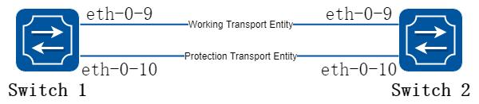

**图16-22 G.8031**

##### 2. 配置步骤

以下配置如未说明在哪个Switch 配置，则表示所有Switch 配置相同：

##### 步骤1 进入配置模式

```
Switch# configure terminal
```

##### 步骤2 进入vlan 配置模式，并创建vlan

```
Switch(config)# vlan database
Switch(config-vlan)# vlan 10-20
Switch(config-vlan)# exit
```

##### 步骤3 设置STP 模式，创建mstp 实例

```
Switch(config)# spanning-tree mode mstp
Switch(config)# spanning-tree mst configuration
Switch(config-mst)# instance 10 vlan 10-20
Switch(config-mst)# exit
```

##### 步骤4 全局使能CFM，创建维护域，并绑定vlan。在维护域和vlan 上使能连通性检查

```
Switch(config)#ethernet cfm enable
Switch(config)# ethernet cfm domain test level 5
Switch(config-ether-cfm)# service test1 vlan 10
Switch(config-ether-cfm)# service test2 vlan 11
Switch(config-ether-cfm)# exit
Switch(config)# ethernet cfm cc enable domain test vlan 10
Switch(config)# ethernet cfm cc enable domain test vlan 11
```

##### 步骤5 进入接口配置模式，配置接口属性

Switch1 的接口配置：

```
Switch1(config)# interface eth-0-9
Switch1(config-if)# switchport mode trunk
Switch1(config-if)# switchport trunk allowed vlan add 10-20
Switch1(config-if)# ethernet cfm mep down mpid 10 domain test vlan 10 interval 1
Switch1(config-if)# ethernet cfm mep crosscheck mpid 12 domain test vlan 10 mac bab3.08a4.c709
Switch1(config-if)# spanning-tree port disable
Switch1(config-if)# no shutdown
Switch1(config-if)# exit
Switch1(config)# interface eth-0-10
Switch1(config-if)# switchport mode trunk
Switch1(config-if)# switchport trunk allowed vlan add 10-20
Switch1(config-if)# ethernet cfm mep down mpid 11 domain test vlan 11 interval 1
Switch1(config-if)# ethernet cfm mep crosscheck mpid 13 domain test vlan 11 mac bab3.08a4.c70a
Switch1(config-if)# spanning-tree port disable
Switch1(config-if)# no shutdown
Switch1(config-if)# exit
```

Switch2 的接口配置：

```
Switch2(config)# interface eth-0-9
Switch2(config-if)# switchport mode trunk
Switch2(config-if)# switchport trunk allowed vlan add 10-20
Switch2(config-if)# ethernet cfm mep down mpid 12 domain test vlan 10 interval 1
Switch2(config-if)# ethernet cfm mep crosscheck mpid 10 domain test vlan 10 mac bab3.08a4.c809
Switch2(config-if)# spanning-tree port disable
Switch2(config-if)# exit
Switch2(config)# interface eth-0-10
Switch2(config-if)# switchport mode trunk
Switch2(config-if)# switchport trunk allowed vlan add 10-20
Switch2(config-if)# ethernet cfm mep down mpid 13 domain test vlan 11 interval 1
Switch2(config-if)# ethernet cfm mep crosscheck mpid 11 domain test vlan 11 mac bab3.08a4.c80a
```

```
Switch2(config-if)# spanning-tree port disable
Switch2(config-if)# exit
```

##### 步骤6 创建G8031 组，并绑定要保护的mstp 实例

```
Switch(config)# g8031 eps-id 10 working-port eth-0-9 protection-port eth-0-10
Switch(g8031-config-switching)# domain test working-service test1 protection-service test2
Switch(g8031-config-switching)# instance 10
Switch(config-if)# exit
```

##### 步骤7 退出配置模式

```
Switch(config)# end
```

##### 步骤8 检查配置

Switch1 显示结果：

```
Switch1# show g8031
Codes: ID - Group id of G.8031
IF-W - Interface of working entity, IF-P - Interface of protection entity
MD - Maintenance domain
MA-W - Maintenance association of working entity
MA-W - Maintenance association of protection entity
CS - Current state, LS - Last state, LE - Last event, FS - Far end state
R/B - Request signal & bridged signal, MODE - Revertive or Non-revertive
WTR - Wait to restore, DFOP - Failure of protocol defects
=============================================================================
ID
IF-W
IF-P
MD
MA-W
MA-P
CS
LS
LE
FS
R/B
MODE
-----------------------------------------------------------------------------
10
eth-0-9
eth-0-10 test
test1
test2
NR
NR
NR
NR
null
REV
APS Vid - 11
Active-Path - Working
DFOP State - Not in defect mode
Protected Instance - 10
=============================================================================
```

Switch2 显示结果：

```
Switch2# show g8031
Codes: ID - Group id of G.8031
IF-W - Interface of working entity, IF-P - Interface of protection entity
MD - Maintenance domain
MA-W - Maintenance association of working entity
MA-W - Maintenance association of protection entity
CS - Current state, LS - Last state, LE - Last event, FS - Far end state
R/B - Request signal & bridged signal, MODE - Revertive or Non-revertive
WTR - Wait to restore, DFOP - Failure of protocol defects
=============================================================================
ID
IF-W
IF-P
MD
MA-W
MA-P
CS
LS
LE
FS
R/B
MODE
-----------------------------------------------------------------------------
10
eth-0-9
eth-0-10 test
test1
test2
NR
NR
NR
NR
null
REV
APS Vid - 11
Active-Path - Working
DFOP State - Not in defect mode
Protected Instance - 10
```

## 16.6 G.8032配置

### 16.6.1 概述

#### 简介

以太环网拓扑与其他拓扑相比，是一种比较经济的网络拓扑，它可以通过更少的链路，实现更大范围的网络互连。环上每个节点都通过两条独立的链路与它的相邻节点互连，加入到同一个环网中。在同一个环上，邻接节点之间互连的链路称为环链路，互连的接口称为环接口。要形成一个环网，至少要有两台设备。

环网保护要解决的两个基本问题是：

阻止成环，防止广播风暴。

数据流量的mac 学习和转发机制。

阻止成环意味着，在任何时候，数据报文在环网上的节点之间流通，但是必须有一处断开。这处断开的链路被称为环保护链路（RPL）。在正常情况下该链路被人为的阻塞，不能转发数据报文，保护链路的一端设备被称为owner，负责在这个链路上阻塞报文。

在环网出现故障的时候，会触发环网保护切换，owner 负责打开环保护链路，保证了网络畅通，业务不会中断。

环网发生故障的消息是通过APS 协议报文在环上转发的。环网上的每个节点都需要做相应的配置。

#### 原理描述

参考:T-REC-G.8032-200806-I!!PDF-E.pdf T-REC-G.8032-201003-I!!PDF-E.pdf T-REC-G.8032-201708-I!Cor1!PDF-E.pdf单环拓扑

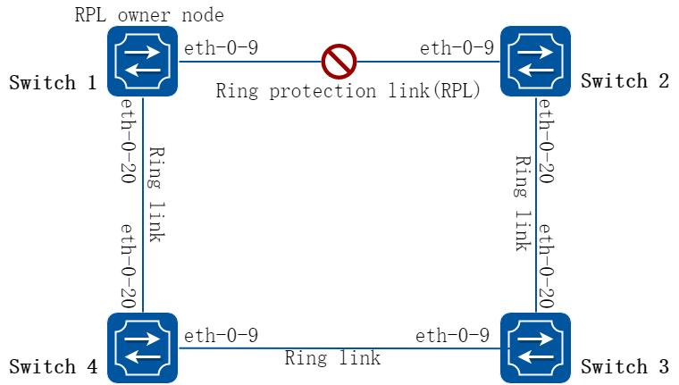

**图16-23 G8032 单环拓扑**

多环拓扑

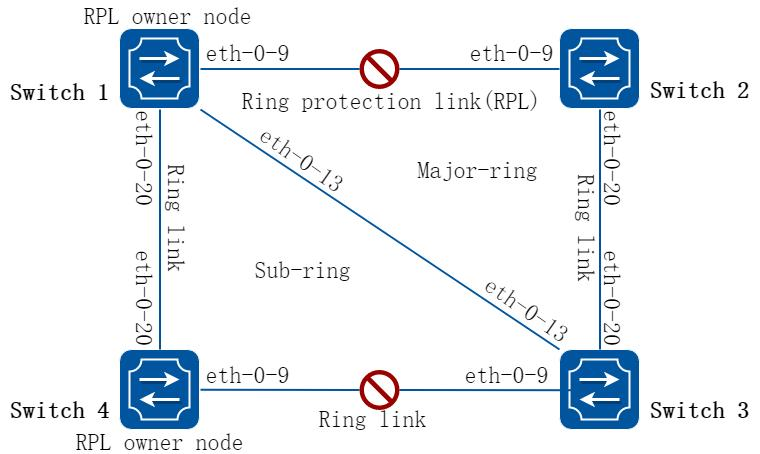

**图16-24 G8032 多环拓扑**

### 16.6.2 配置举例

#### 单环配置

##### 步骤1 Switch1 配置

```
Switch1# configure terminal
Enter configuration commands, one per line. End with CNTL/Z.
Switch1(config)# vlan database
Switch1(config-vlan)# vlan 10-100
Switch1(config-vlan)# exit
Switch1(config)# spanning-tree mode mstp
Switch1(config)# spanning-tree mst configuration
Switch1(config-mst)# instance 1 vlan 10-99
Switch1(config-mst)# exit
Switch1(config)# no ip igmp snooping vlan 100
Switch1(config)# interface eth-0-9
Switch1(config-if)# switchport mode trunk
Switch1(config-if)# switchport trunk allowed vlan add 10-100
Switch1(config-if)# spanning-tree port disable
Switch1(config-if)# no shutdown
Switch1(config-if)# exit
Switch1(config)# interface eth-0-20
Switch1(config-if)# switchport mode trunk
Switch1(config-if)# switchport trunk allowed vlan add 10-100
Switch1(config-if)# spanning-tree port disable
Switch1(config-if)# no shutdown
Switch1(config-if)# exit
Switch1(config)# g8032 ring-id 1 east-interface eth-0-9 west-interface eth-0-20
Switch1(g8032-config-switch)# rpl owner east-interface
Switch1(g8032-config-switch)# instance 1
Switch1(g8032-config-switch)# control-vlan 100
```

```
Switch1(g8032-config-switch)# ring enable
Switch1(g8032-config-switch)# end
```

##### 步骤2 Switch1 检查配置

```
Switch1# show g8032
RingID
MajorRing
State
East
Status
West
Status
-------------------------------------------------------------------------------
1
N/A
Pending
eth-0-9
Blocked
eth-0-20
Forward
Control Vlan
: 100
Is Enabled
: Yes
Mode
: Revertive
Node Role
: Owner
Is Sub_ring
: No
Protect Instance
: 1
RPL
: east-interface
Wait-to-restore
: 04:26 (266492 msecs)
Hold-off Timer
: 0 (msecs)
Guard Timer
: 500 (msecs)
WTB Timer
: 5500 (msecs)
RAPS MEL
: 7
Is Forward-to-cpu
: 1
-------------------------------------------------------------------------------
```

##### 步骤3 Switch2 配置

```
Switch2# configure terminal
Enter configuration commands, one per line. End with CNTL/Z.
Switch2(config)# vlan database
Switch2(config-vlan)# vlan 10-100
Switch2(config-vlan)# exit
Switch2(config)# spanning-tree mode mstp
Switch2(config)# spanning-tree mst configuration
Switch2(config-mst)# instance 1 vlan 10-99
Switch2(config-mst)# exit
Switch2(config)# no ip igmp snooping vlan 100
Switch2(config)# interface eth-0-9
Switch2(config-if)# switchport mode trunk
Switch2(config-if)# switchport trunk allowed vlan add 10-100
Switch2(config-if)# spanning-tree port disable
Switch2(config-if)# no shutdown
Switch2(config-if)# exit
Switch2(config)# interface eth-0-20
Switch2(config-if)# switchport mode trunk
Switch2(config-if)# switchport trunk allowed vlan add 10-100
Switch2(config-if)# spanning-tree port disable
Switch2(config-if)# no shutdown
Switch2(config-if)# exit
Switch2(config)# g8032 ring-id 1 east-interface eth-0-9 west-interface eth-0-20
Switch2(g8032-config-switch)# instance 1
Switch2(g8032-config-switch)# control-vlan 100
Switch2(g8032-config-switch)# ring enable
Switch2(g8032-config-switch)# end
```

##### 步骤4 Switch2 检查配置

```
Switch2# show g8032
RingID
MajorRing
State
East
Status
West
Status
-------------------------------------------------------------------------------
1
N/A
Pending
eth-0-9
Blocked
eth-0-20
Forward
Control Vlan
: 100
Is Enabled
: Yes
Mode
: Revertive
Node Role
: N/A
Is Sub_ring
: No
Protect Instance
: 1
Wait-to-restore
: 05:00
Hold-off Timer
: 0 (msecs)
Guard Timer
: 500 (msecs)
WTB Timer
: 5500 (msecs)
RAPS MEL
: 7
Is Forward-to-cpu
: 1
-------------------------------------------------------------------------------
```

##### 步骤5 Switch3 配置

```
Switch3# configure terminal
Enter configuration commands, one per line. End with CNTL/Z.
Switch3(config)# vlan database
Switch3(config-vlan)# vlan 10-100
Switch3(config-vlan)# exit
Switch3(config)# spanning-tree mode mstp
Switch3(config)# spanning-tree mst configuration
Switch3(config-mst)# instance 1 vlan 10-99
Switch3(config-mst)# exit
Switch3(config)# no ip igmp snooping vlan 100
Switch3(config)# interface eth-0-9
Switch3(config-if)# switchport mode trunk
Switch3(config-if)# switchport trunk allowed vlan add 10-100
Switch3(config-if)# spanning-tree port disable
Switch3(config-if)# no shutdown
Switch3(config-if)# exit
Switch3(config)# interface eth-0-20
Switch3(config-if)# switchport mode trunk
Switch3(config-if)# switchport trunk allowed vlan add 10-100
Switch3(config-if)# spanning-tree port disable
Switch3(config-if)# no shutdown
Switch3(config-if)# exit
Switch3(config)# g8032 ring-id 1 east-interface eth-0-9 west-interface eth-0-20
Switch3(g8032-config-switch)# instance 1
Switch3(g8032-config-switch)# control-vlan 100
Switch3(g8032-config-switch)# ring enable
Switch3(g8032-config-switch)# end
```

##### 步骤6 Switch3 检查配置

```
Switch3# show g8032
RingID
MajorRing
State
East
Status
West
Status
-------------------------------------------------------------------------------
1
N/A
Pending
eth-0-9
Blocked
eth-0-20
Forward
Control Vlan
: 100
```

```
Is Enabled
: Yes
Mode
: Revertive
Node Role
: N/A
Is Sub_ring
: No
Protect Instance
: 1
Wait-to-restore
: 05:00
Hold-off Timer
: 0 (msecs)
Guard Timer
: 500 (msecs)
WTB Timer
: 5500 (msecs)
RAPS MEL
: 7
Is Forward-to-cpu
: 1
-------------------------------------------------------------------------------
```

##### 步骤7 Switch4 配置

```
Switch4# configure terminal
Enter configuration commands, one per line. End with CNTL/Z.
Switch4(config)# vlan database
Switch4(config-vlan)# vlan 10-100
Switch4(config-vlan)# exit
Switch4(config)# spanning-tree mode mstp
Switch4(config)# spanning-tree mst configuration
Switch4(config-mst)# instance 1 vlan 10-99
Switch4(config-mst)# exit
Switch4(config)# no ip igmp snooping vlan 100
Switch4(config)# interface eth-0-9
Switch4(config-if)# switchport mode trunk
Switch4(config-if)# switchport trunk allowed vlan add 10-100
Switch4(config-if)# spanning-tree port disable
Switch4(config-if)# no shutdown
Switch4(config-if)# exit
Switch4(config)# interface eth-0-20
Switch4(config-if)# switchport mode trunk
Switch4(config-if)# switchport trunk allowed vlan add 10-100
Switch4(config-if)# spanning-tree port disable
Switch4(config-if)# no shutdown
Switch4(config-if)# exit
Switch4(config)# g8032 ring-id 1 east-interface eth-0-9 west-interface eth-0-20
Switch4(g8032-config-switch)# instance 1
Switch4(g8032-config-switch)# control-vlan 100
Switch4(g8032-config-switch)# ring enable
Switch4(g8032-config-switch)# end
```

##### 步骤8 Switch4 检查配置

```
Switch4# show g8032
RingID
MajorRing
State
East
Status
West
Status
-------------------------------------------------------------------------------
1
N/A
Pending
eth-0-9
Blocked
eth-0-20
Forward
Control Vlan
: 100
Is Enabled
: Yes
Mode
: Revertive
Node Role
: N/A
Is Sub_ring
: No
Protect Instance
: 1
Wait-to-restore
: 05:00
```

```
Hold-off Timer
: 0 (msecs)
Guard Timer
: 500 (msecs)
WTB Timer
: 5500 (msecs)
RAPS MEL
: 7
Is Forward-to-cpu
: 1
-------------------------------------------------------------------------------
```

#### 多环配置- 非虚拟通道

##### 步骤1 Switch1 配置

```
Switch1# configure terminal
Enter configuration commands, one per line. End with CNTL/Z.
Switch1(config)# vlan database
Switch1(config-vlan)# vlan 10-150
Switch1(config-vlan)# exit
Switch1(config)# spanning-tree mode mstp
Switch1(config)# spanning-tree mst configuration
Switch1(config-mst)# instance 1 vlan 10-99
Switch1(config-mst)# instance 2 vlan 101-150
Switch1(config-mst)# exit
Switch1(config)# no ip igmp snooping vlan 100
Switch1(config)# no ip igmp snooping vlan 20
Switch1(config)# interface eth-0-9
Switch1(config-if)# switchport mode trunk
Switch1(config-if)# switchport trunk allowed vlan add 10-150
Switch1(config-if)# spanning-tree port disable
Switch1(config-if)# no shutdown
Switch1(config-if)# exit
Switch1(config)# interface eth-0-13
Switch1(config-if)# switchport mode trunk
Switch1(config-if)# switchport trunk allowed vlan add 10-150
Switch1(config-if)# spanning-tree port disable
Switch1(config-if)# no shutdown
Switch1(config-if)# exit
Switch1(config)# interface eth-0-20
Switch1(config-if)# switchport mode trunk
Switch1(config-if)# switchport trunk allowed vlan add 101-150
Switch1(config-if)# switchport trunk allowed vlan add 20
Switch1(config-if)# spanning-tree port disable
Switch1(config-if)# no shutdown
Switch1(config-if)# exit
Switch1(config)# g8032 ring-id 1 east-interface eth-0-9 west-interface eth-0-13
Switch1(g8032-config-switch)# rpl owner east-interface
Switch1(g8032-config-switch)# instance 1
Switch1(g8032-config-switch)# instance 2
Switch1(g8032-config-switch)# control-vlan 100
Switch1(g8032-config-switch)# ring enable
Switch1(g8032-config-switch)# exit
Switch1(config)# g8032 ring-id 2 interface eth-0-20 major-ring-id 1
Switch1(g8032-config-switch)# instance 2
Switch1(g8032-config-switch)# control-vlan 20
Switch1(g8032-config-switch)# ring enable
Switch1(g8032-config-switch)# end
```

##### 步骤2 Switch1 检查配置

```
Switch1# show g8032
RingID
MajorRing
State
East
Status
West
Status
-------------------------------------------------------------------------------
1
N/A
Pending
eth-0-9
Blocked
eth-0-13
Forward
Control Vlan
: 100
Is Enabled
: Yes
Mode
: Revertive
Node Role
: Owner
Is Sub_ring
: No
Protect Instance
: 1-2
Sub-ring
: 2
RPL
: east-interface
Wait-to-restore
: 04:26 (266492 msecs)
Hold-off Timer
: 0 (msecs)
Guard Timer
: 500 (msecs)
WTB Timer
: 5500 (msecs)
RAPS MEL
: 7
Is Forward-to-cpu
: 1
-------------------------------------------------------------------------------
RingID
MajorRing
State
East
Status
West
Status
-------------------------------------------------------------------------------
2
1
Pending
eth-0-20
Blocked
N/A
N/A
Control Vlan
: 20
Is Enabled
: No
Mode
: Revertive
Node Role
: N/A
Is Sub_ring
: Yes
Virtual-channel
: Disable
Protect Instance
: 2
Wait-to-restore
: 05:00
Hold-off Timer
: 0 (msecs)
Guard Timer
: 500 (msecs)
WTB Timer
: 5500 (msecs)
RAPS MEL
: 7
Is Forward-to-cpu
: 1
-------------------------------------------------------------------------------
```

##### 步骤3 Switch2 配置

```
Switch2# configure terminal
Enter configuration commands, one per line. End with CNTL/Z.
Switch2(config)# vlan database
Switch2(config-vlan)# vlan 10-150
Switch2(config-vlan)# exit
Switch2(config)# spanning-tree mode mstp
Switch2(config)# spanning-tree mst configuration
Switch2(config-mst)# instance 1 vlan 10-99
Switch2(config-mst)# instance 2 vlan 101-150
Switch2(config-mst)# exit
Switch2(config)# no ip igmp snooping vlan 100
Switch2(config)# interface eth-0-9
Switch2(config-if)# switchport mode trunk
Switch2(config-if)# switchport trunk allowed vlan add 10-150
```

```
Switch2(config-if)# spanning-tree port disable
Switch2(config-if)# no shutdown
Switch2(config-if)# exit
Switch2(config)# interface eth-0-20
Switch2(config-if)# switchport mode trunk
Switch2(config-if)# switchport trunk allowed vlan add 10-150
Switch2(config-if)# spanning-tree port disable
Switch2(config-if)# no shutdown
Switch2(config-if)# exit
Switch2(config)# g8032 ring-id 1 east-interface eth-0-9 west-interface eth-0-20
Switch2(g8032-config-switch)# instance 1
Switch2(g8032-config-switch)# instance 2
Switch2(g8032-config-switch)# control-vlan 100
Switch2(g8032-config-switch)# ring enable
Switch2(g8032-config-switch)# end
```

##### 步骤4 Switch2 检查配置

```
Switch2# show g8032
RingID
MajorRing
State
East
Status
West
Status
-------------------------------------------------------------------------------
1
N/A
Pending
eth-0-9
Blocked
eth-0-20
Forward
Control Vlan
: 100
Is Enabled
: Yes
Mode
: Revertive
Node Role
: N/A
Is Sub_ring
: No
Protect Instance
: 1-2
Wait-to-restore
: 05:00
Hold-off Timer
: 0 (msecs)
Guard Timer
: 500 (msecs)
WTB Timer
: 5500 (msecs)
RAPS MEL
: 7
Is Forward-to-cpu
: 0
-------------------------------------------------------------------------------
```

##### 步骤5 Switch3 配置

```
Switch3# configure terminal
Enter configuration commands, one per line. End with CNTL/Z.
Switch3(config)# vlan database
Switch3(config-vlan)# vlan 10-150
Switch3(config-vlan)# exit
Switch3(config)# spanning-tree mode mstp
Switch3(config)# spanning-tree mst configuration
Switch3(config-mst)# instance 1 vlan 10-99
Switch3(config-mst)# instance 2 vlan 101-150
Switch3(config-mst)# exit
Switch3(config)# no ip igmp snooping vlan 100
Switch3(config)# no ip igmp snooping vlan 20
Switch3(config)# interface eth-0-9
Switch3(config-if)# switchport mode trunk
Switch3(config-if)# switchport trunk allowed vlan add 101-150
Switch3(config-if)# switchport trunk allowed vlan add 20
Switch3(config-if)# spanning-tree port disable
Switch3(config-if)# no shutdown
```

```
Switch3(config-if)# exit
Switch3(config)# interface eth-0-13
Switch3(config-if)# switchport mode trunk
Switch3(config-if)# switchport trunk allowed vlan add 10-150
Switch3(config-if)# spanning-tree port disable
Switch3(config-if)# no shutdown
Switch3(config-if)# exit
Switch3(config)# interface eth-0-20
Switch3(config-if-eth-0-20)# switchport mode trunk
Switch3(config-if-eth-0-20)# switchport trunk allowed vlan add 10-150
Switch3(config-if-eth-0-20)# spanning-tree port disable
Switch3(config-if-eth-0-20)# no shutdown
Switch3(config-if-eth-0-20)# exit
Switch3(config)# g8032 ring-id 1 east-interface eth-0-13 west-interface eth-0-20
Switch3(g8032-config-switch)# instance 1
Switch3(g8032-config-switch)# instance 2
Switch3(g8032-config-switch)# control-vlan 100
Switch3(g8032-config-switch)# ring enable
Switch3(g8032-config-switch)# exit
Switch3(config)# g8032 ring-id 2 interface eth-0-9 major-ring-id 1
Switch3(g8032-config-switch)# instance 2
Switch3(g8032-config-switch)# control-vlan 20
Switch3(g8032-config-switch)# ring enable
Switch3(g8032-config-switch)# end
```

##### 步骤6 Switch3 检查配置

```
Switch3# show g8032
RingID
MajorRing
State
East
Status
West
Status
-------------------------------------------------------------------------------
1
N/A
Pending
eth-0-13
Blocked
eth-0-20
Forward
Control Vlan
: 100
Is Enabled
: Yes
Mode
: Revertive
Node Role
: N/A
Is Sub_ring
: No
Protect Instance
: 1-2
Sub-ring
: 2
Wait-to-restore
: 05:00
Hold-off Timer
: 0 (msecs)
Guard Timer
: 500 (msecs)
WTB Timer
: 5500 (msecs)
RAPS MEL
: 7
Is Forward-to-cpu
: 0
-------------------------------------------------------------------------------
RingID
MajorRing
State
East
Status
West
Status
-------------------------------------------------------------------------------
2
1
Pending
eth-0-9
Blocked
N/A
N/A
Control Vlan
: 20
Is Enabled
: No
Mode
: Revertive
Node Role
: N/A
Is Sub_ring
: Yes
```

```
Virtual-channel
: Disable
Protect Instance
: 2
Wait-to-restore
: 05:00
Hold-off Timer
: 0 (msecs)
Guard Timer
: 500 (msecs)
WTB Timer
: 5500 (msecs)
RAPS MEL
: 7
Is Forward-to-cpu
: 1
-------------------------------------------------------------------------------
```

##### 步骤7 Switch4 配置

```
Switch4# configure terminal
Enter configuration commands, one per line. End with CNTL/Z.
Switch4(config)# vlan database
Switch4(config-vlan)# vlan 20
Switch4(config-vlan)# vlan 101-150
Switch4(config-vlan)# exit
Switch4(config)# spanning-tree mode mstp
Switch4(config)# spanning-tree mst configuration
Switch4(config-mst)# instance 2 vlan 101-150
Switch4(config-mst)# exit
Switch4(config)# no ip igmp snooping vlan 20
Switch4(config)# interface eth-0-9
Switch4(config-if)# switchport mode trunk
Switch4(config-if)# switchport trunk allowed vlan add 20
Switch4(config-if)# switchport trunk allowed vlan add 101-150
Switch4(config-if)# spanning-tree port disable
Switch4(config-if)# no shutdown
Switch4(config-if)# exit
Switch4(config)# interface eth-0-20
Switch4(config-if)# switchport mode trunk
Switch4(config-if)# switchport trunk allowed vlan add 20
Switch4(config-if)# switchport trunk allowed vlan add 101-150
Switch4(config-if)# spanning-tree port disable
Switch4(config-if)# no shutdown
Switch4(config-if)# exit
Switch4(config)# g8032 ring-id 2 east-interface eth-0-9 west-interface eth-0-20 is-sub-ring
Switch4(g8032-config-switch)# instance 2
Switch4(g8032-config-switch)# rpl owner east-interface
Switch4(g8032-config-switch)# control-vlan 20
Switch4(g8032-config-switch)# ring enable
Switch4(g8032-config-switch)# end
```

##### 步骤8 Switch4 检查配置

```
Switch4# show g8032
RingID
MajorRing
State
East
Status
West
Status
-------------------------------------------------------------------------------
2
N/A
Pending
eth-0-9
Blocked
eth-0-20
Forward
Control Vlan
: 20
Is Enabled
: Yes
Mode
: Revertive
Node Role
: Owner
Is Sub_ring
: Yes
Protect Instance
: 1-2
```

```
RPL
: east-interface
Wait-to-restore
: 05:00
Hold-off Timer
: 0 (msecs)
Guard Timer
: 500 (msecs)
WTB Timer
: 5500 (msecs)
RAPS MEL
: 7
Is Forward-to-cpu
: 0
-------------------------------------------------------------------------------
```

#### 多环配置- 虚拟通道

##### 步骤1 Switch1 配置

```
Switch1# configure terminal
Enter configuration commands, one per line. End with CNTL/Z.
Switch1(config)# vlan database
Switch1(config-vlan)# vlan 10-150
Switch1(config-vlan)# exit
Switch1(config)# spanning-tree mode mstp
Switch1(config)# spanning-tree mst configuration
Switch1(config-mst)# instance 1 vlan 10-99
Switch1(config-mst)# instance 2 vlan 101-150
Switch1(config-mst)# exit
Switch1(config)# no ip igmp snooping vlan 100
Switch1(config)# no ip igmp snooping vlan 20
Switch1(config)# interface eth-0-9
Switch1(config-if)# switchport mode trunk
Switch1(config-if)# switchport trunk allowed vlan add 10-150
Switch1(config-if)# spanning-tree port disable
Switch1(config-if)# no shutdown
Switch1(config-if)# exit
Switch1(config)# interface eth-0-13
Switch1(config-if)# switchport mode trunk
Switch1(config-if)# switchport trunk allowed vlan add 10-150
Switch1(config-if)# spanning-tree port disable
Switch1(config-if)# no shutdown
Switch1(config-if)# exit
Switch1(config)# interface eth-0-20
Switch1(config-if)# switchport mode trunk
Switch1(config-if)# switchport trunk allowed vlan add 101-150
Switch1(config-if)# switchport trunk allowed vlan add 20
Switch1(config-if)# spanning-tree port disable
Switch1(config-if)# no shutdown
Switch1(config-if)# exit
Switch1(config)# g8032 ring-id 1 east-interface eth-0-9 west-interface eth-0-13
Switch1(g8032-config-switch)# rpl owner east-interface
Switch1(g8032-config-switch)# instance 1
Switch1(g8032-config-switch)# instance 2
Switch1(g8032-config-switch)# control-vlan 100
Switch1(g8032-config-switch)# ring enable
Switch1(g8032-config-switch)# exit
Switch1(config)# g8032 ring-id 2 interface eth-0-20 major-ring-id 1
Switch1(g8032-config-switch)# instance 2
Switch1(g8032-config-switch)# control-vlan 20
Switch1(g8032-config-switch)# virtual-channel enable
```

```
Switch1(g8032-config-switch)# ring enable
Switch1(g8032-config-switch)# end
```

##### 步骤2 Switch1 检查配置

```
Switch1# show g8032
RingID
MajorRing
State
East
Status
West
Status
-------------------------------------------------------------------------------
1
N/A
Pending
eth-0-9
Blocked
eth-0-13
Forward
Control Vlan
: 100
Is Enabled
: Yes
Mode
: Revertive
Node Role
: Owner
Is Sub_ring
: No
Protect Instance
: 1-2
Sub-ring
: 2
RPL
: east-interface
Wait-to-restore
: 04:26 (266492 msecs)
Hold-off Timer
: 0 (msecs)
Guard Timer
: 500 (msecs)
WTB Timer
: 5500 (msecs)
RAPS MEL
: 7
Is Forward-to-cpu
: 1
-------------------------------------------------------------------------------
RingID
MajorRing
State
East
Status
West
Status
-------------------------------------------------------------------------------
2
1
Pending
eth-0-20
Blocked
N/A
N/A
Control Vlan
: 20
Is Enabled
: No
Mode
: Revertive
Node Role
: N/A
Is Sub_ring
: Yes
Virtual-channel
: Enable
Protect Instance
: 2
Wait-to-restore
: 05:00
Hold-off Timer
: 0 (msecs)
Guard Timer
: 500 (msecs)
WTB Timer
: 5500 (msecs)
RAPS MEL
: 7
Is Forward-to-cpu
: 0
-------------------------------------------------------------------------------
```

##### 步骤3 Switch2 配置

```
Switch2# configure terminal
Enter configuration commands, one per line. End with CNTL/Z.
Switch2(config)# vlan database
Switch2(config-vlan)# vlan 10-150
Switch2(config-vlan)# exit
Switch2(config)# spanning-tree mode mstp
Switch2(config)# spanning-tree mst configuration
Switch2(config-mst)# instance 1 vlan 10-99
Switch2(config-mst)# instance 2 vlan 101-150
Switch2(config-mst)# exit
```

```
Switch2(config)# no ip igmp snooping vlan 100
Switch2(config)# interface eth-0-9
Switch2(config-if)# switchport mode trunk
Switch2(config-if)# switchport trunk allowed vlan add 10-150
Switch2(config-if)# spanning-tree port disable
Switch2(config-if)# no shutdown
Switch2(config-if)# exit
Switch2(config)# interface eth-0-20
Switch2(config-if)# switchport mode trunk
Switch2(config-if)# switchport trunk allowed vlan add 10-150
Switch2(config-if)# spanning-tree port disable
Switch2(config-if)# no shutdown
Switch2(config-if)# exit
Switch2(config)# g8032 ring-id 1 east-interface eth-0-9 west-interface eth-0-20
Switch2(g8032-config-switch)# instance 1
Switch2(g8032-config-switch)# instance 2
Switch2(g8032-config-switch)# control-vlan 100
Switch2(g8032-config-switch)# ring enable
Switch2(g8032-config-switch)# end
```

##### 步骤4 Switch2 检查配置

```
Switch2# show g8032
RingID
MajorRing
State
East
Status
West
Status
-------------------------------------------------------------------------------
1
N/A
Pending
eth-0-9
Blocked
eth-0-20
Forward
Control Vlan
: 100
Is Enabled
: Yes
Mode
: Revertive
Node Role
: N/A
Is Sub_ring
: No
Protect Instance
: 1-2
Wait-to-restore
: 05:00
Hold-off Timer
: 0 (msecs)
Guard Timer
: 500 (msecs)
WTB Timer
: 5500 (msecs)
RAPS MEL
: 7
Is Forward-to-cpu
: 0
-------------------------------------------------------------------------------
```

##### 步骤5 Switch3 配置

```
Switch3# configure terminal
Enter configuration commands, one per line. End with CNTL/Z.
Switch3(config)# vlan database
Switch3(config-vlan)# vlan 10-150
Switch3(config-vlan)# exit
Switch3(config)# spanning-tree mode mstp
Switch3(config)# spanning-tree mst configuration
Switch3(config-mst)# instance 1 vlan 10-99
Switch3(config-mst)# instance 2 vlan 101-150
Switch3(config-mst)# exit
Switch3(config)# no ip igmp snooping vlan 100
Switch3(config)# no ip igmp snooping vlan 20
Switch3(config)# interface eth-0-9
Switch3(config-if)# switchport mode trunk
```

```
Switch3(config-if)# switchport trunk allowed vlan add 101-150
Switch3(config-if)# switchport trunk allowed vlan add 20
Switch3(config-if)# spanning-tree port disable
Switch3(config-if)# no shutdown
Switch3(config-if)# exit
Switch3(config)# interface eth-0-13
Switch3(config-if)# switchport mode trunk
Switch3(config-if)# switchport trunk allowed vlan add 10-150
Switch3(config-if)# spanning-tree port disable
Switch3(config-if)# no shutdown
Switch3(config-if)# exit
Switch3(config)# interface eth-0-20
Switch3(config-if-eth-0-20)# switchport mode trunk
Switch3(config-if-eth-0-20)# switchport trunk allowed vlan add 10-150
Switch3(config-if-eth-0-20)# spanning-tree port disable
Switch3(config-if-eth-0-20)# no shutdown
Switch3(config-if-eth-0-20)# exit
Switch3(config)# g8032 ring-id 1 east-interface eth-0-13 west-interface eth-0-20
Switch3(g8032-config-switch)# rpl owner east-interface
Switch3(g8032-config-switch)# instance 1
Switch3(g8032-config-switch)# instance 2
Switch3(g8032-config-switch)# control-vlan 100
Switch3(g8032-config-switch)# ring enable
Switch3(g8032-config-switch)# exit
Switch3(config)# g8032 ring-id 2 interface eth-0-9 major-ring-id 1
Switch3(g8032-config-switch)# instance 2
Switch3(g8032-config-switch)# control-vlan 20
Switch3(g8032-config-switch)# virtual-channel enable
Switch3(g8032-config-switch)# ring enable
Switch3(g8032-config-switch)# end
```

##### 步骤6 Switch3 检查配置

```
Switch3# show g8032
RingID
MajorRing
State
East
Status
West
Status
-------------------------------------------------------------------------------
1
N/A
Pending
eth-0-13
Blocked
eth-0-20
Forward
Control Vlan
: 100
Is Enabled
: Yes
Mode
: Revertive
Node Role
: N/A
Is Sub_ring
: No
Protect Instance
: 1-2
Sub-ring
: 2
Wait-to-restore
: 05:00
Hold-off Timer
: 0 (msecs)
Guard Timer
: 500 (msecs)
WTB Timer
: 5500 (msecs)
RAPS MEL
: 7
Is Forward-to-cpu
: 0
-------------------------------------------------------------------------------
RingID
MajorRing
State
East
Status
West
Status
-------------------------------------------------------------------------------
2
1
Pending
eth-0-9
Blocked
N/A
N/A
```

```
Control Vlan
: 20
Is Enabled
: No
Mode
: Revertive
Node Role
: N/A
Is Sub_ring
: Yes
Virtual-channel
: Enable
Protect Instance
: 2
Wait-to-restore
: 05:00
Hold-off Timer
: 0 (msecs)
Guard Timer
: 500 (msecs)
WTB Timer
: 5500 (msecs)
RAPS MEL
: 7
Is Forward-to-cpu
: 0
-------------------------------------------------------------------------------
```

##### 步骤7 Switch4 配置

```
Switch4# configure terminal
Enter configuration commands, one per line. End with CNTL/Z.
Switch4(config)# vlan database
Switch4(config-vlan)# vlan 20
Switch4(config-vlan)# vlan 101-150
Switch4(config-vlan)# exit
Switch4(config)# spanning-tree mode mstp
Switch4(config)# spanning-tree mst configuration
Switch4(config-mst)# instance 2 vlan 101-150
Switch4(config-mst)# exit
Switch4(config)# no ip igmp snooping vlan 20
Switch4(config)# interface eth-0-9
Switch4(config-if)# switchport mode trunk
Switch4(config-if)# switchport trunk allowed vlan add 20
Switch4(config-if)# switchport trunk allowed vlan add 101-150
Switch4(config-if)# spanning-tree port disable
Switch4(config-if)# no shutdown
Switch4(config-if)# exit
Switch4(config)# interface eth-0-20
Switch4(config-if)# switchport mode trunk
Switch4(config-if)# switchport trunk allowed vlan add 20
Switch4(config-if)# switchport trunk allowed vlan add 101-150
Switch4(config-if)# spanning-tree port disable
Switch4(config-if)# no shutdown
Switch4(config-if)# exit
Switch4(config)# g8032 ring-id 2 east-interface eth-0-9 west-interface eth-0-20 is-sub-ring
Switch4(g8032-config-switch)# instance 2
Switch4(g8032-config-switch)# rpl owner east-interface
Switch4(g8032-config-switch)# control-vlan 20
Switch4(g8032-config-switch)# virtual-channel enable
Switch4(g8032-config-switch)# ring enable
Switch4(g8032-config-switch)# end
```

##### 步骤8 Switch4 检查配置

```
Switch4# show g8032
RingID
MajorRing
State
East
Status
West
Status
-------------------------------------------------------------------------------
2
N/A
Pending
eth-0-9
Blocked
eth-0-20
Forward
```

```
Control Vlan
: 20
Is Enabled
: Yes
Mode
: Revertive
Node Role
: Owner
Is Sub_ring
: Yes
Virtual-channel
: Enable
Protect Instance
: 1-2
RPL
: east-interface
Wait-to-restore
: 05:00
Hold-off Timer
: 0 (msecs)
Guard Timer
: 500 (msecs)
WTB Timer
: 5500 (msecs)
RAPS MEL
: 7
Is Forward-to-cpu
: 0
-------------------------------------------------------------------------------
```

#### G8032 与CFM 的联动

当前，触发G8032 进行保护倒换的机制有两种：

端口linkdown/shutdown 触发CFM 检测到链路故障触发在上述的单环配置中采用的是端口linkdown/shutdown 触发，这里结合CFM 的配置，来说明CFM 与G8032 的联动关系。

##### 步骤1 Switch1 配置

```
Switch1# configure terminal
Enter configuration commands, one per line. End with CNTL/Z.
Switch1(config)# vlan database
Switch1(config-vlan)# vlan 10-100
Switch1(config-vlan)# vlan 5
Switch1(config-vlan)# exit
Switch1(config)# spanning-tree mode mstp
Switch1(config)# spanning-tree mst configuration
Switch1(config-mst)# instance 1 vlan 10-99
Switch1(config-mst)# exit
Switch1(config)# no ip igmp snooping vlan 100
Switch1(config)# ethernet cfm enable
Switch1(config)# ethernet cfm domain md1 level 5
Switch1(config-ether-cfm)# service ma1 vlan 5
Switch1(config-ether-cfm)# exit
Switch1(config)#
ethernet cfm cc enable domain md1 vlan 5
Switch1(config)# interface eth-0-9
Switch1(config-if)# switchport mode trunk
Switch1(config-if)# switchport trunk allowed vlan add 5
Switch1(config-if)# switchport trunk allowed vlan add 10-100
Switch1(config-if)# spanning-tree port disable
Switch1(config-if)# ethernet cfm mep down mpid 101 domain md1 vlan 5 interval 1
Switch1(config-if)# ethernet cfm mep crosscheck mpid 201 domain md1 vlan 5 mac e03e.b1e1.3309
Switch1(config-if)# no shutdown
Switch1(config-if)# exit
Switch1(config)# interface eth-0-20
```

```
Switch1(config-if)# switchport mode trunk
Switch1(config-if)# switchport trunk allowed vlan add 5
Switch1(config-if)# switchport trunk allowed vlan add 10-100
Switch1(config-if)# spanning-tree port disable
Switch1(config-if)# ethernet cfm mep down mpid 102 domain md1 vlan 5 interval 1
Switch1(config-if)# ethernet cfm mep crosscheck mpid 402 domain md1 vlan 5 mac b2d0.60e4.c314
Switch1(config-if)# no shutdown
Switch1(config-if)# exit
Switch1(config)# g8032 ring-id 1 east-interface eth-0-9 west-interface eth-0-20
Switch1(g8032-config-switch)# rpl owner east-interface
Switch1(g8032-config-switch)# instance 1
Switch1(g8032-config-switch)# control-vlan 100
Switch1(g8032-config-switch)# domain md1 service ma1
Switch1(g8032-config-switch)# ring enable
Switch1(g8032-config-switch)# end
```

##### 步骤2 Switch1 检查配置

```
Switch1# show g8032
RingID
MajorRing
State
East
Status
West
Status
-------------------------------------------------------------------------------
1
N/A
Pending
eth-0-9
Blocked
eth-0-20
Forward
Control Vlan
: 100
MD Name
: md1
Service Id
: ma1
Is Enabled
: Yes
Mode
: Revertive
Node Role
: Owner
Is Sub_ring
: No
Protect Instance
: 1
RPL
: east-interface
Wait-to-restore
: 04:26 (266492 msecs)
Hold-off Timer
: 0 (msecs)
Guard Timer
: 500 (msecs)
WTB Timer
: 5500 (msecs)
RAPS MEL
: 7
Is Forward-to-cpu
: 1
-------------------------------------------------------------------------------
Switch1# show ethernet cfm maintenance-points
######Local MEP:
Dir-Direction;
L-Level;
MPID Dir
DOMAIN
L VLAN PORT
CC-Status MAC-Address
RDI
Interval
--------------------------------------------------------------------------------
101
down md1
5 5
eth-0-9
Enabled
104e.40d1.e309 False 3.3ms
102
down md1
5 5
eth-0-20
Enabled
104e.40d1.e314 False 3.3ms
######Remote MEP:
MPID
LEVEL VLAN Remote Mac
RDI
FLAGS
STATE
---------------------------------------------------------
201
5
5
e03e.b1e1.3309 False Mac_config Up
402
5
5
b2d0.60e4.c314 False Mac_config Up
```

##### 步骤3 Switch2 配置

```
Switch2# configure terminal
Enter configuration commands, one per line. End with CNTL/Z.
Switch2(config)# vlan database
Switch2(config-vlan)# vlan 10-100
Switch2(config-vlan)# vlan 5
Switch2(config-vlan)# exit
Switch2(config)# spanning-tree mode mstp
Switch2(config)# spanning-tree mst configuration
Switch2(config-mst)# instance 1 vlan 10-99
Switch2(config-mst)# exit
Switch2(config)# no ip igmp snooping vlan 100
Switch2(config)# ethernet cfm enable
Switch2(config)# ethernet cfm domain md1 level 5
Switch2(config-ether-cfm)# service ma1 vlan 5
Switch2(config-ether-cfm)# exit
Switch2(config)#
ethernet cfm cc enable domain md1 vlan 5
Switch2(config)# interface eth-0-9
Switch2(config-if)# switchport mode trunk
Switch2(config-if)# switchport trunk allowed vlan add 5
Switch2(config-if)# switchport trunk allowed vlan add 10-100
Switch2(config-if)# spanning-tree port disable
Switch2(config-if)# ethernet cfm mep down mpid 201 domain md1 vlan 5 interval 1
Switch2(config-if)# ethernet cfm mep crosscheck mpid 101 domain md1 vlan 5 mac 104e.40d1.e309
Switch2(config-if)# no shutdown
Switch2(config-if)# exit
Switch2(config)# interface eth-0-20
Switch2(config-if)# switchport mode trunk
Switch2(config-if)# switchport trunk allowed vlan add 5
Switch2(config-if)# switchport trunk allowed vlan add 10-100
Switch2(config-if)# spanning-tree port disable
Switch2(config-if)# ethernet cfm mep down mpid 202 domain md1 vlan 5 interval 1
Switch2(config-if)# ethernet cfm mep crosscheck mpid 302 domain md1 vlan 5 mac a0cd.ce44.5514
Switch2(config-if)# no shutdown
Switch2(config-if)# exit
Switch2(config)# g8032 ring-id 1 east-interface eth-0-9 west-interface eth-0-20
Switch2(g8032-config-switch)# instance 1
Switch2(g8032-config-switch)# control-vlan 100
Switch2(g8032-config-switch)# domain md1 service ma1
Switch2(g8032-config-switch)# ring enable
Switch2(g8032-config-switch)# end
```

##### 步骤4 Switch2 检查配置

```
Switch2# show g8032
RingID
MajorRing
State
East
Status
West
Status
-------------------------------------------------------------------------------
1
N/A
Pending
eth-0-9
Blocked
eth-0-20
Forward
Control Vlan
: 100
MD Name
: md1
Service Id
: ma1
Is Enabled
: Yes
Mode
: Revertive
Node Role
: N/A
Is Sub_ring
: No
Protect Instance
: 1
```

```
Wait-to-restore
: 05:00
Hold-off Timer
: 0 (msecs)
Guard Timer
: 500 (msecs)
WTB Timer
: 5500 (msecs)
RAPS MEL
: 7
Is Forward-to-cpu
: 1
-------------------------------------------------------------------------------
Switch2# show ethernet cfm maintenance-points
######Local MEP:
Dir-Direction;
L-Level;
MPID Dir
DOMAIN
L VLAN PORT
CC-Status MAC-Address
RDI
Interval
--------------------------------------------------------------------------------
201
down md1
5 5
eth-0-9
Enabled
e03e.b1e1.3309 False 3.3ms
202
down md1
5 5
eth-0-20
Enabled
e03e.b1e1.3314 False 3.3ms
######Remote MEP:
MPID
LEVEL VLAN Remote Mac
RDI
FLAGS
STATE
---------------------------------------------------------
101
5
5
104e.40d1.e309 False Mac_config Up
302
5
5
a0cd.ce44.5514 False Mac_config Up
```

##### 步骤5 Switch3 配置

```
Switch3# configure terminal
Enter configuration commands, one per line. End with CNTL/Z.
Switch3(config)# vlan database
Switch3(config-vlan)# vlan 10-100
Switch3(config-vlan)# vlan 5
Switch3(config-vlan)# exit
Switch3(config)# spanning-tree mode mstp
Switch3(config)# spanning-tree mst configuration
Switch3(config-mst)# instance 1 vlan 10-99
Switch3(config-mst)# exit
Switch3(config)# no ip igmp snooping vlan 100
Switch3(config)# ethernet cfm enable
Switch3(config)# ethernet cfm domain md1 level 5
Switch3(config-ether-cfm)# service ma1 vlan 5
Switch3(config-ether-cfm)# exit
Switch3(config)#
ethernet cfm cc enable domain md1 vlan 5
Switch3(config)# interface eth-0-9
Switch3(config-if)# switchport mode trunk
Switch3(config-if)# switchport trunk allowed vlan add 5
Switch3(config-if)# switchport trunk allowed vlan add 10-100
Switch3(config-if)# spanning-tree port disable
Switch3(config-if)# ethernet cfm mep down mpid 301 domain md1 vlan 5 interval 1
Switch3(config-if)# ethernet cfm mep crosscheck mpid 401 domain md1 vlan 5 mac b2d0.60e4.c309
Switch3(config-if)# no shutdown
Switch3(config-if)# exit
Switch3(config)# interface eth-0-20
Switch3(config-if)# switchport mode trunk
Switch3(config-if)# switchport trunk allowed vlan add 5
Switch3(config-if)# switchport trunk allowed vlan add 10-100
Switch3(config-if)# spanning-tree port disable
Switch3(config-if)# ethernet cfm mep down mpid 302 domain md1 vlan 5 interval 1
```

```
Switch3(config-if)# ethernet cfm mep crosscheck mpid 202 domain md1 vlan 5 mac e03e.b1e1.3314
Switch3(config-if)# no shutdown
Switch3(config-if)# exit
Switch3(config)# g8032 ring-id 1 east-interface eth-0-9 west-interface eth-0-20
Switch3(g8032-config-switch)# instance 1
Switch3(g8032-config-switch)# control-vlan 100
Switch3(g8032-config-switch)# domain md1 service ma1
Switch3(g8032-config-switch)# ring enable
Switch3(g8032-config-switch)# end
```

##### 步骤6 Switch3 检查配置

```
Switch3# show g8032
RingID
MajorRing
State
East
Status
West
Status
-------------------------------------------------------------------------------
1
N/A
Pending
eth-0-9
Blocked
eth-0-20
Forward
Control Vlan
: 100
MD Name
: md1
Service Id
: ma1
Is Enabled
: Yes
Mode
: Revertive
Node Role
: N/A
Is Sub_ring
: No
Protect Instance
: 1
Wait-to-restore
: 05:00
Hold-off Timer
: 0 (msecs)
Guard Timer
: 500 (msecs)
WTB Timer
: 5500 (msecs)
RAPS MEL
: 7
Is Forward-to-cpu
: 1
-------------------------------------------------------------------------------
Switch3# show ethernet cfm maintenance-points
######Local MEP:
Dir-Direction;
L-Level;
MPID Dir
DOMAIN
L VLAN PORT
CC-Status MAC-Address
RDI
Interval
--------------------------------------------------------------------------------
301
down md1
5 11
eth-0-9
Enabled
a0cd.ce44.5509 False 3.3ms
302
down md1
5 11
eth-0-20
Enabled
a0cd.ce44.5514 False 3.3ms
######Remote MEP:
MPID
LEVEL VLAN Remote Mac
RDI
FLAGS
STATE
---------------------------------------------------------
401
5
11
b2d0.60e4.c309 False Mac_config Up
202
5
11
e03e.b1e1.3314 False Mac_config Up
```

##### 步骤7 Switch4 配置

```
Switch4# configure terminal
Enter configuration commands, one per line. End with CNTL/Z.
Switch4(config)# vlan database
Switch4(config-vlan)# vlan 10-100
Switch4(config-vlan)# vlan 5
Switch4(config-vlan)# exit
Switch4(config)# spanning-tree mode mstp
```

```
Switch4(config)# spanning-tree mst configuration
Switch4(config-mst)# instance 1 vlan 10-99
Switch4(config-mst)# exit
Switch4(config)# no ip igmp snooping vlan 100
Switch4(config)# ethernet cfm enable
Switch4(config)# ethernet cfm domain md1 level 5
Switch4(config-ether-cfm)# service ma1 vlan 5
Switch4(config-ether-cfm)# exit
Switch4(config)#
ethernet cfm cc enable domain md1 vlan 5
Switch4(config)# interface eth-0-9
Switch4(config-if)# switchport mode trunk
Switch4(config-if)# switchport trunk allowed vlan add 5
Switch4(config-if)# switchport trunk allowed vlan add 10-100
Switch4(config-if)# spanning-tree port disable
Switch4(config-if)# ethernet cfm mep down mpid 401 domain md1 vlan 5 interval 1
Switch4(config-if)# ethernet cfm mep crosscheck mpid 301 domain md1 vlan 5 mac a0cd.ce44.5509
Switch4(config-if)# no shutdown
Switch4(config-if)# exit
Switch4(config)# interface eth-0-20
Switch4(config-if)# switchport mode trunk
Switch4(config-if)# switchport trunk allowed vlan add 5
Switch4(config-if)# switchport trunk allowed vlan add 10-100
Switch4(config-if)# spanning-tree port disable
Switch4(config-if)# ethernet cfm mep down mpid 402 domain md1 vlan 5 interval 1
Switch4(config-if)# ethernet cfm mep crosscheck mpid 102 domain md1 vlan 5 mac 104e.40d1.e314
Switch4(config-if)# no shutdown
Switch4(config-if)# exit
Switch4(config)# g8032 ring-id 1 east-interface eth-0-9 west-interface eth-0-20
Switch4(g8032-config-switch)# instance 1
Switch4(g8032-config-switch)# control-vlan 100
Switch4(g8032-config-switch)# domain md1 service ma1
Switch4(g8032-config-switch)# ring enable
Switch4(g8032-config-switch)# end
```

##### 步骤8 Switch4 检查配置

```
Switch4# show g8032
RingID
MajorRing
State
East
Status
West
Status
-------------------------------------------------------------------------------
1
N/A
Pending
eth-0-9
Blocked
eth-0-20
Forward
Control Vlan
: 100
MD Name
: md1
Service Id
: ma1
Is Enabled
: Yes
Mode
: Revertive
Node Role
: N/A
Is Sub_ring
: No
Protect Instance
: 1
Wait-to-restore
: 05:00
Hold-off Timer
: 0 (msecs)
Guard Timer
: 500 (msecs)
WTB Timer
: 5500 (msecs)
RAPS MEL
: 7
Is Forward-to-cpu
: 1
-------------------------------------------------------------------------------
```

```
Switch4# show ethernet cfm maintenance-points
######Local MEP:
Dir-Direction;
L-Level;
MPID Dir
DOMAIN
L VLAN PORT
CC-Status MAC-Address
RDI
Interval
--------------------------------------------------------------------------------
401
down md1
5 11
eth-0-9
Enabled
b2d0.60e4.c309 False 3.3ms
402
down md1
5 11
eth-0-20
Enabled
b2d0.60e4.c314 False 3.3ms
######Remote MEP:
MPID
LEVEL VLAN Remote Mac
RDI
FLAGS
STATE
---------------------------------------------------------
301
5
11
a0cd.ce44.5509 False Mac_config Up
102
5
11
104e.40d1.e314 False Mac_config Up
```

## 16.7 UDLD配置

### 16.7.1 概述

#### 简介

UDLD (Unidirectional Link Detection，单向链路检测) 是一种可以检测和禁用单向链路的轻量级的协议。通过使用UDLD 可以防止生成树等协议在单向链接时产生的异常情况。

### 16.7.2 配置举例

##### 1. 组网拓扑

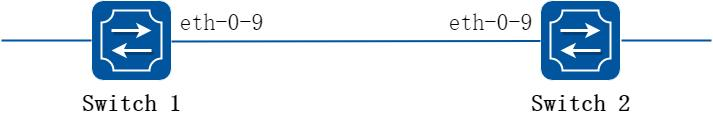

**图16-25 UDLD**

以下配置在Switch1 和Switch2 相同：

##### 2. 配置步骤

##### 步骤1 进入配置模式

```
Switch# configure terminal
```

##### 步骤2 进入接口配置模式，在接口上使能UDLD

```
Switch(config)# interface eth-0-9
Switch(config-if)# no shutdown
```

```
Switch(config-if)# udld port
Switch(config-if)# exit
```

##### 步骤3 全局使能UDLD

```
Switch(config)# udld enable
```

##### 步骤4 配置UDLD 报文时间间隔（可选）

如不显式配置，默认值15，单位秒。

```
Switch(config)# udld message interval 10
```

##### 步骤5 退出配置模式

```
Switch(config)# end
```

##### 步骤6 检查配置

Switch1 显示结果：

```
Switch# show udld eth-0-9
Interface eth-0-9
---
UDLD mode
: normal
Operation state
: Bidirectional
Message interval : 10
Message timeout
: 3
Neighbor 1
- $$-
Device ID
: 4c7b.8510.ab00
Port ID
: eth-0-9
Device Name
: Switch
Message interval: 10
Message timeout : 3
Link Status
: bidirectional
Expiration time : 29
```

Switch2 显示结果：

```
Switch# show udld eth-0-9
Interface eth-0-9
---
UDLD mode
: normal
Operation state : Bidirectional
Message interval: 10
Message timeout : 3
Neighbor 1
- $$-
Device ID
: 28bc.83db.8400
Port ID
: eth-0-9
Device Name
: Switch
Message interval: 10
Message timeout : 3
Link Status
: bidirectional
Expiration time : 23
```

## 16.8 ERPS配置

### 16.8.1 概述

#### 简介

##### 1. 缩略语说明

| 术语 | 说明 |
|---|---|
| Domain | ERPS 域 |
| Control vlan | 控制VLAN |
| Ring | Erps 环 |
| Primary ring | 主环 |
| Sub ring | 子环 |
| Master | 主节点 |
| Transit | 传输节点 |
| Edge | 边缘节点 |
| Assistant | 辅助边缘节点 |
| P | 主端口 |
| S | 副端口 |
| B | 阻塞端口 |
| Edge port | 边缘端口 |
| Common port | 公共端口 |

##### 2. 功能说明

在网络规划和实际组网应用中，大多采用环网来提供高可靠性。环网技术简单来说，就是将一些网络设备通过环的形状连接到一起，实现相互通信的一种技术。为了避免环网中产生广播风暴，最初采用了已被普遍应用的STP 协议环路保护机制。但实际应用中STP协议的收敛时间受网络拓扑的影响，在网络直径较大时收敛时间较长，因而往往不能满足传输质量较高的数据的要求。为了缩短环网的收敛时间并消除网络大小的影响，专门开发了ERPS 技术。ERPS 技术提高了以太网环的可用性和耐用性，在链路发生中断的时候可以在50 毫秒以内完成收敛。

其主要思想描述如下：环域上，一个交换机被指定为主节点，而其他所有节点指定为传输节点。主节点的一个端口被指定为主端口，另一个端口被指定为副端口。在一个预先设定的时间间隔，主节点从主端口发送keep-alive 消息，域内的传输节点转发ERPS 消息，当主节点的副端口收到自己发出来的keep-alive 消息后会阻塞副端口，除了ERPS报文其他报文都不允许通过。当传输节点检测到链路发生故障后，就会发送linkdown消息给相邻节点，邻节点收到后会传递给另一个端口的相邻节点，直到主节点收到。在收到链路故障报文后，主节点将重新打开副端口允许传输数据流量通过。

#### 背景

在二层网络中，为了提高网络可靠性，通常使用冗余链路，而冗余链路可能带来环路，可以采用STP 协议来解决环路问题。STP 协议是由IEEE 开发的一种标准的环网保护协议，并得到广泛应用，但STP 实际应用中受到网络大小的限制，收敛速度受网络拓扑影响。

STP 收敛时间一般为秒级，网络直径较大时收敛时间更长，采用RSTP/MSTP 虽然可以减少收敛时间，但是对于语音、视频这类高服务质量要求的业务仍然不能满足要求。为了缩短收敛时间，消除网络尺寸的影响，ERPS 协议应运而生。ERPS 是一个专门应用于以太环网的链路层协议，它在以太环网中能够防止数据环路引起的广播风暴；当以太环网上一条链路断开时，能迅速启用备份链路以恢复环网上各个节点之间的通信。和STP协议相比，ERPS 协议具有拓扑收敛速度快（低于50ms），收敛时间与环网上节点数无关的特点。

#### 原理描述

##### 1. 基本概念

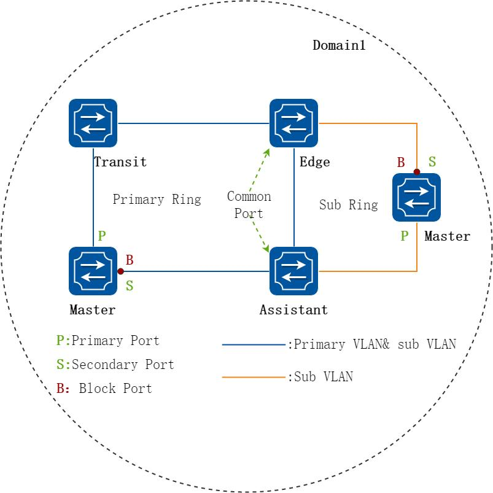

**图16-26 ERPS 示意图**

ERPS 域:ERPS 域用于标识ERPS 协议所计算和控制的拓扑范围。域ID 是ERPS 域的唯一标识，一个ERPS 域由具有相同域ID 和控制VLAN、且相互连通的设备构成。一台设备上可以创建多个ERPS 域。

ERPS 环:一个逻辑上的ERPS 环对应一个环形连接的物理拓扑，由ERPS Ring ID 来标识。一个ERPS域由一个或多个ERPS 环构成，其中有一个为主环，其他的为子环。在单环的情况下，既可以把环配制成主环，也可以配置成子环，在应用上具有相同的效果。

ERPS 环的类型：

单环: 单环上的所有设备要配置在相同的ERPS 域中。

相交环: 相交环上的所有设备也要配置在相同的ERPS 域中。

相切环: 相切的两个环，每个环上的设备要配置在相同的ERPS 域中，即相切环相当于两个单环，需要配置两个ERPS 域，每个ERPS 域中只有一个环。

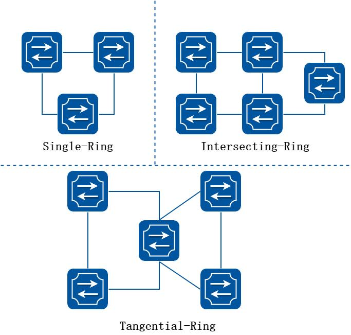

**图16-27 ERPS 环类型**

ERPS 控制VLAN:每个ERPS 域可以具有两个控制VLAN——主控制VLAN 和子控制VLAN。主环的ERPS 协议报文在主控制VLAN 中转发，子环的ERPS 协议报文在子控制VLAN 中转发。控制VLAN 只传递ERPS 协议报文。

保护VLAN:保护VLAN 是用来传递数据报文的VLAN。保护VLAN 中可以包含ERPS 端口，也可以包含非ERPS 端口。保护VLAN 的转发状态由其所对应的ERPS 域控制。同一环网上不同的ERPS 域配置不同的保护VLAN，各ERPS 域分别独立计算自己环上端口的转发状态。

主节点：

环路上每台交换机称为一个节点。主节点是环网状态主动检测机制的发起者，也是检测到ERPS 环故障后执行操作的决策者。每个ERPS 环上必须有一个主节点，而且只能有一个。

传输节点：

环上除主节点之外的其它节点都可以称为传输节点。传输节点负责透传主节点的Hello报文，并监测自己的直连ERPS 链路的状态，把链路DOWN 事件通知主节点。

边缘节点和辅助边缘节点在含有主环和子环的域中，子环和主环相交会产生两个交点，交点一个叫做边缘节点，另一个叫做辅助边缘节点。边缘节点或辅助边缘节点是设备在子环上的角色，其在主环上的角色为主节点或传输节点。

主端口和副端口主节点和传输节点接入以太网环的两个端口中，一个为主端口，另一个为副端口，端口的角色由用户的配置决定。主节点的主端口和副端口在功能上是有区别的。主节点从其主端口发送Hello 报文，如果能够从副端口收到该报文，说明本节点所在ERPS 环网处于健康状态，因此需要阻塞副端口以防止数据环路；相反如果在规定时间内收不到该报文，说明环网故障，此时需要放开副端口以保证环上所有节点的正常通信。传输节点的主端口和副端口在功能上没有区别。端口的角色同样由用户的配置决定。

公共端口和边缘端口边缘节点（辅助边缘节点）接入子环的两个端口中，一个为公共端口，另外一个为边缘端口。公共端口是边缘节点（辅助边缘节点）上主环和子环公共链路两端的端口，而边缘端口是只接入子环的端口。

ERPS 协议报文种类:hello 报文：由主节点主端口发出，对网络进行环路完整性检测。

link-down 报文：当传输节点主端口或副端口状态由up 变为down 时，传输节点发出link-down 报文，通知主节点环路上有链路变为down，主节点收到后立即放开原本阻塞的端口。

ring-up flush fdb 报文：环路恢复刷新报文，由主节点发出，通知传输节点、边缘节点或辅助边缘节点更新各自FDB，并开放阻塞端口。

ring-down flush fdb 报文：环网故障刷新报文，由主节点发出，通知传输节点、边缘节点或辅助边缘节点更新各自FDB。

edge hello 报文：主环上子环协议通道完整性检查报文，由边缘节点发给同子环的辅助边缘节点，子环通过此报文检查其所在域主环上子环协议通道的完整性。

major fault 报文：主环故障通知报文，辅助边缘节点如果在规定时间内收不到边缘节点发送的edge hello 报文，会向边缘节点发送major fault 报文，报告所在域主环链路发生故障。

主环上的ERPS 端口既加入主控制VLAN，又加入子控制VLAN，子环ERPS 协议报文不会被主环处于block 状态的端口转发；子环上的ERPS 端口只加入子控制VLAN。

##### 2. 工作原理


**图16-28 polling 机制流程图**

polling 机制:主节点周期性的从其主端口发送hello 报文，依次经过各传输节点在环上传播。如果主节点副端口能够收到自己发送的hello 报文，说明环网链路完整，主节点处于complete 状态，阻塞副端口；否则如果在规定时间内收不到hello 报文，就认为环网发生链路故障，主节点处于failed 状态，开放副端口。

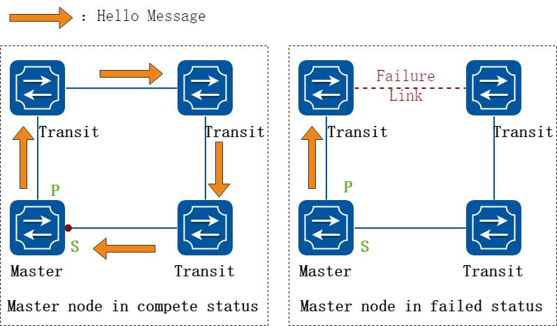

**图16-29 主节点状态示意图**

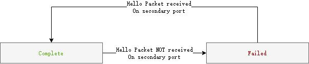

**图16-30 主节点状态迁移图**

主节点由complete 状态迁往failed 状态时，会发送ring-down flush fdb 报文通知其它节点更新fdb；failed 状态迁往complete 状态时，则会发送ring-up flush fdb 报文，通知其它节点更新fdb 以及开放临时阻塞端口。

传输节点-故障上报机制

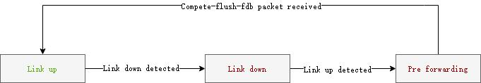

**图16-31 传输节点状态迁移图**

传输节点负责监测自己的直连ERPS 链路的状态，并把链路故障上报给主节点，传输节点有如下3 种状态：- 传输节点的主端口和副端口都处于Up 状态时，传输节点处于link-up 状态。当检测到主端口或者副端口发生链路down 时，就从link-up 迁移到link-down 状态，并发送link-down 报文通知主节点链路故障，主节点收到link-down报文，立刻开放原本阻塞的副端口。- 当处于link-down 状态的传输节点的端口恢复up，传输节点迁移到Preforwarding 状态，并阻塞恢复的端口，该阻塞的端口仅可转发erps 协议报文。传输节点主、副端口都恢复的瞬间，主节点还不能马上知道这一信息，因此其副端口还处于开放状态，如果传输节点立即迁移回link-up 状态，可能造成数据报文在环网上形成广播环路，因此传输节点先迁移到Preforwarding 状态。- 当处于Preforwarding 状态的传输节点收到主节点发送的ring-up flush fdb 报文时，迁移到link-up 状态。如果ring-up flush fdb 报文在传输过程中不幸丢失，那么传输节点在规定的时间内收不到ring-up flush fdb 报文，也会迁移到link-up 状态，开放临时阻塞端口。

主环和子环的公共链路故障时，只会向主环的主节点发送link-down 报文。

因为如果同时给主环子环的主节点发link-down 报文，两个环的主节点收到报文后会立刻放开副端口，这个时候会形成短暂的环路。

边缘节点、辅助边缘节点-子环协议通道检测机制:

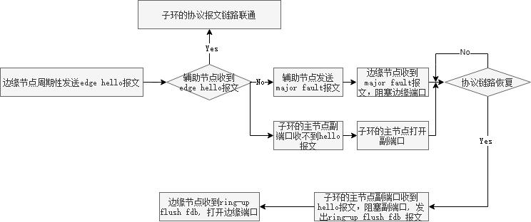

**图16-32 子环协议通道检测机制**

子环协议通道检测机制:边缘节点周期性的向辅助边缘节点发送edge hello 报文，报文带子控制VLAN 在主环中传输，用于检测主环上子环的协议通道是否完整。

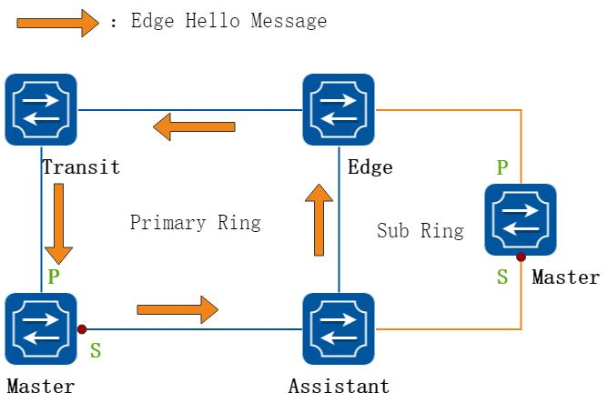

**图16-33 边缘节点发送edge hello 报文**

当主环链路出现故障时，若只有一条链路故障，则子环的协议链路依旧是连通的，如下图所示。


**图16-34 子环协议链路示意图**

若主环和子环公共链路通道故障，且主环上还有另外一条链路中断，会有以下两个响应:辅助边缘节点将收不到edge hello 报文，向边缘节点发送带子控制VLAN 的major fault 报文，边缘节点收到major 报文后阻塞其边缘端口：

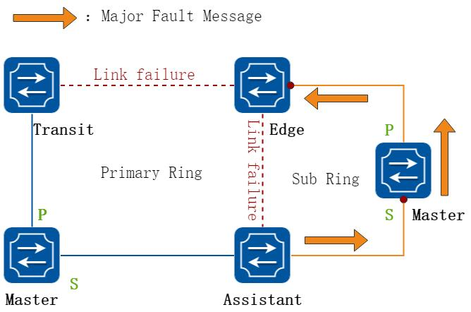

**图16-35 边缘节点响应major fault 阻塞边缘端口**

边缘节点阻塞边缘端口，是为了防止多子环的情况下，多个子环形成环路。

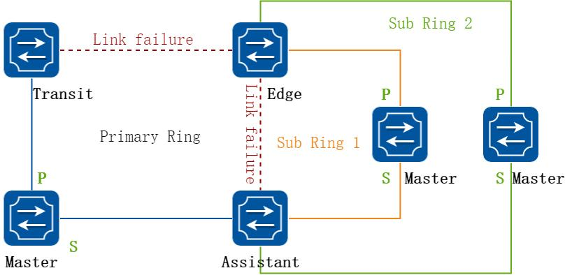

**图16-36 多个子环形成环路示意图**

对于单子环的情况，无需边缘节点阻塞边缘端口，可使用命令erps ring srpt disable，关闭边缘节点和辅助边缘节点的检测机制。

子环主节点副端口在规定时间内收不到hello 报文，子环主节点进入failed 状态，开放副端口。

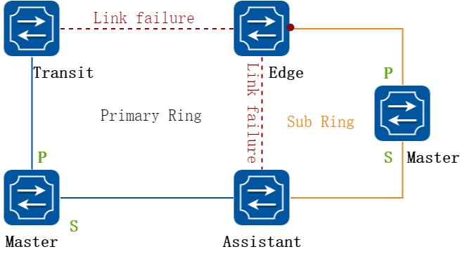

**图16-37 子环主节点进入failed 状态**

若子环协议链路恢复，则子环主节点副端口收到hello 报文，迁移到complete 状态，阻塞副端口，并发出ring-up flush fdb 报文；边缘节点收到ring-up flush fdb 报文后，开放边缘端口，如下图所示。

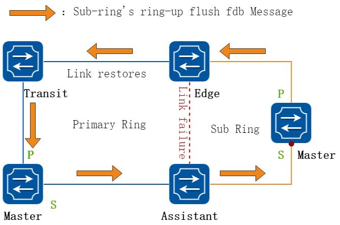

**图16-38 子环边缘节点放开边缘端口**

##### 3. 多实例

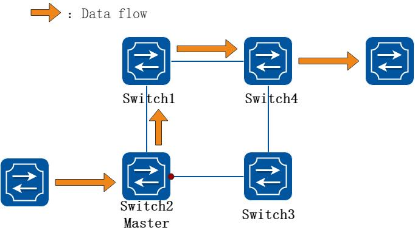

**图16-39 普通的ERPS 组网**

如上图所示，在普通的ERPS 组网中，主节点副端口被阻塞，数据流量只能按图中橙色箭头的方向进行转发，而Switch2-Switch3-Switch4 链路的带宽被浪费。为了提高链路的利用率，可以在一个物理环路上配置两个逻辑ERPS 环路，这两个环对应同一个物理拓扑。每个ERPS 环上的所有设备、端口角色、控制vlan 等均遵循基本的ERPS 原则。

每个环独立检测链路的完整性，并阻塞或开放相应的端口，互不影响。每个环均需配置一个的保护实例（instance），每个instance 代表一个数据VLAN 范围，各阻塞端口只对本ERPS 实例内的VLAN 有效，对非本ERPS 实例的VLAN 没有阻塞效果。这样，属于不同instance 的流量就可以通过不同的路径传输，从而实现负载分担，提高链路的利用率。

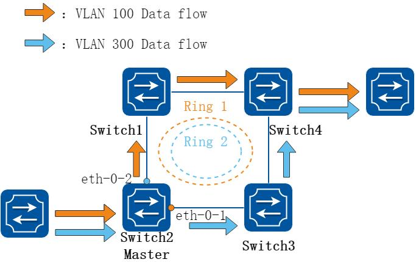

**图16-40 多实例组网转发示意图**

vlan100-200 绑定instance1，vlan300-400 绑定instance2；指定ERPS ring1 在instance1 内，ERPS ring 2 在instance2 内。ring 1 和ring 2 分别阻塞了eth-0-1和eth-0-2，则eth-0-1 只阻塞vlan100-200 的数据报文，eth-0-2 只阻塞vlan300-400的数据报文。这样，vlan100-200 的数据流按橙色箭头转发，vlan300-400 的数据流按蓝色箭头转发，实现负载分担。

### 16.8.2 配置举例

ERPS 是一个软件控制的协议，只要在需要该功能的设备上启用ERPS 并按照网络拓扑来正确配置ERPS。

本节提供了典型网络拓扑下的ERPS 配置实例。

#### 配置ERPS 单环拓扑

##### 1. 组网拓扑

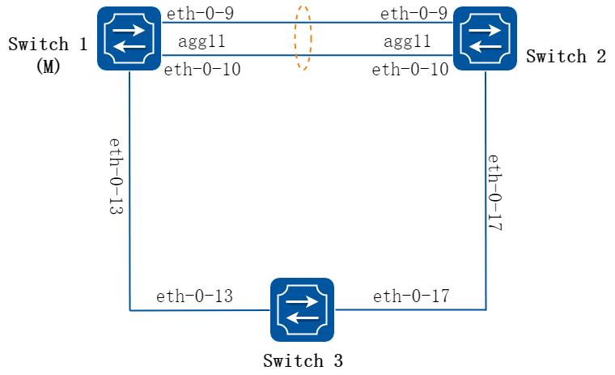

**图16-41 ERPS**

在Switch1，Switch2 和Switch3 上配置相同的ERPS 域和环，交换机1 配置成ERPS 主节点，其他两个交换机配置成ERPS 传输节点，AGG11 接口有两个成员分别是eth-0-9和eth-0-10。AGG11 接口配置成ERPS 域的主端口，eth-0-13 配置成ERPS 域的副端口。

ERPS 环上的接口必须配置成Trunk 模式并且允许控制VLAN 和数据VLAN 的报文通过。如果设备启用了堆叠功能，ERPS 环上的接口不可以是从设备上的端口，否则ERPS 不能正常工作。

ERPS 端口环需要加入控制VLAN，允许ERPS 协议报文发送和接收。

ERPS 环中的端口必须把STP 关闭。

只有一个节点能配置成Master。

控制VLAN 不能配置成三层VLAN 接口。

VLAN MAP 关系不能在ERPS 端口上启用。

本地VLAN 不能设置成第一控制VLAN 和第二控制VLAN。

##### 2. 配置步骤

以下配置如未说明在哪个Switch 配置，则表示所有Switch 配置相同：

##### 步骤1 进入配置模式

```
Switch# configure terminal
```

##### 步骤2 进入vlan 配置模式并创建vlan

```
Switch(config)# vlan database
Switch(config-vlan)# vlan 15
Switch(config-vlan)# exit
Switch(config)# no ip igmp snooping vlan 15
```

##### 步骤3 进入端口配置模式，配置端口属性

按拓扑所示，Switch1 和2 的eth-0-9 和eth-0-10 加入agg11 并直连。Switch1 和3的eth-0-13 直连。Switch2 和3 的eth-0-17 直连。

Switch1 和Switch2 的agg 11 端口配置：

```
Switch1&2(config)# interface eth-0-9
Switch1&2(config-if)# no shutdown
Switch1&2(config-if)# switchport mode trunk
Switch1&2(config-if)# switchport trunk allowed vlan add 15
Switch1&2(config-if)# static-channel-group 11
Switch1&2(config-if)# exit
Switch1&2(config)# interface eth-0-10
Switch1&2(config-if)# no shutdown
Switch1&2(config-if)# switchport mode trunk
Switch1&2(config-if)# switchport trunk allowed vlan add 15
Switch1&2(config-if)# static-channel-group 11
Switch1&2(config-if)# exit
Switch1&2(config)# interface agg11
Switch1&2(config-if)# spanning-tree port disable
```

Switch1 和Switch3 的eth-0-13 端口配置：

```
Switch1&3(config)# interface eth-0-13
Switch1&3(config-if)# no shutdown
Switch1&3(config-if)# switchport mode trunk
Switch1&3(config-if)# switchport trunk allowed vlan add 15
Switch1&3(config-if)# spanning-tree port disable
Switch1&3(config-if)# exit
```

Switch2 和Switch3 的eth-0-17 端口配置：

```
Switch2&3(config)# interface eth-0-17
Switch2&3(config-if)# no shutdown
Switch2&3(config-if)# switchport mode trunk
Switch2&3(config-if)# switchport trunk allowed vlan add 15
Switch2&3(config-if)# spanning-tree port disable
Switch2&3(config-vlan)# exit
```

##### 步骤4 配置和启用ERPS 域

Switch1 的erps 域：

```
Switch1(config)# erps 11
Switch1(config)# erps 11 primary control vlan 15
Switch1(config)# erps 11 mstp instance 0
Switch1(config)# erps 11 ring 1 level primary
Switch1(config)# erps 11 ring 1 mode master
Switch1(config)# erps 11 ring 1 primary interface agg11
```

```
Switch1(config)# erps 11 ring 1 secondary interface eth-0-13
Switch1(config)# erps 11 ring 1 enable
Switch1(config)# erps 11 enable
```

Switch2 的erps 域：

```
Switch2(config)# erps 11
Switch2(config)# erps 11 primary control vlan 15
Switch2(config)# erps 11 mstp instance 0
Switch2(config)# erps 11 ring 1 level primary
Switch2(config)# erps 11 ring 1 mode transit
Switch2(config)# erps 11 ring 1 primary interface agg11
Switch2(config)# erps 11 ring 1 secondary interface eth-0-17
Switch2(config)# erps 11 ring 1 enable
Switch2(config)# erps 11 enable
```

Switch3 的erps 域：

```
Switch3(config)# erps 11
Switch3(config)# erps 11 primary control vlan 15
Switch3(config)# erps 11 mstp instance 0
Switch3(config)# erps 11 ring 1 level primary
Switch3(config)# erps 11 ring 1 mode transit
Switch3(config)# erps 11 ring 1 primary interface eth-0-17
Switch3(config)# erps 11 ring 1 secondary interface eth-0-13
Switch3(config)# erps 11 ring 1 enable
Switch3(config)# erps 11 enable
```

##### 步骤5 退出配置模式

```
Switch(config)# end
```

##### 步骤6 检查配置

Switch1 显示结果：

```
Switch1# show erps 11
ERPS domain ID: 11
ERPS domain name: ERPS0011
ERPS domain mode: normal
ERPS domain primary control VLAN ID: 15
ERPS domain sub control VLAN ID: 0
ERPS domain hello timer interval: 1 second(s)
ERPS domain fail timer interval: 3 second(s)
ERPS domain protected mstp instance: 0
ERPS ring ID: 1
ERPS ring level: primary
ERPS ring 1 node mode: master
ERPS ring 1 node state: complete
ERPS ring 1 primary interface name: agg11
state:unblock
ERPS ring 1 secondary interface name: eth-0-13
state:block
ERPS ring 1 stats:
Sent:
total packets:51
hello packets:47
ring-up-flush-fdb packets:2
ring-down-flush-fdb packets:2
link-down packets:0
edge-hello packets:0
major-fault packets:0
Received:
```

```
total packets:21
hello packets:21
ring-up-flush-fdb packets:0
ring-down-flush-fdb packets:0
link-down packets:0
edge-hello packets:0
major-fault packets:0
```

Switch2 显示结果：

```
Switch2# show erps 11
ERPS domain ID: 11
ERPS domain name: ERPS0011
ERPS domain mode: normal
ERPS domain primary control VLAN ID: 15
ERPS domain sub control VLAN ID: 0
ERPS domain hello timer interval: 1 second(s)
ERPS domain fail timer interval: 3 second(s)
ERPS domain protected mstp instance: 0
ERPS ring ID: 1
ERPS ring level: primary
ERPS ring 1 node mode: transit
ERPS ring 1 node state: link up
ERPS ring 1 primary interface name: agg11
state:unblock
ERPS ring 1 secondary interface name: eth-0-17
state:unblock
ERPS ring 1 stats:
Sent:
total packets:0
hello packets:0
ring-up-flush-fdb packets:0
ring-down-flush-fdb packets:0
link-down packets:0
edge-hello packets:0
major-fault packets:0
Received:
total packets:114
hello packets:113
ring-up-flush-fdb packets:1
ring-down-flush-fdb packets:0
link-down packets:0
edge-hello packets:0
major-fault packets:0
```

Switch3 显示结果：

```
Switch3# show erps 11
ERPS domain ID: 11
ERPS domain name: ERPS0011
ERPS domain mode: normal
ERPS domain primary control VLAN ID: 15
ERPS domain sub control VLAN ID: 0
ERPS domain hello timer interval: 1 second(s)
ERPS domain fail timer interval: 3 second(s)
ERPS domain protected mstp instance: 0
ERPS ring ID: 1
ERPS ring level: primary
ERPS ring 1 node mode: transit
ERPS ring 1 node state: link up
ERPS ring 1 primary interface name: eth-0-17
state:unblock
ERPS ring 1 secondary interface name: eth-0-13
state:unblock
ERPS ring 1 stats:
Sent:
total packets:0
hello packets:0
ring-up-flush-fdb packets:0
ring-down-flush-fdb packets:0
link-down packets:0
edge-hello packets:0
major-fault packets:0
```

```
Received:
total packets:130
hello packets:129
ring-up-flush-fdb packets:1
ring-down-flush-fdb packets:0
link-down packets:0
edge-hello packets:0
major-fault packets:0
```

#### 配置ERPS 交叉环拓扑

##### 1. 组网拓扑

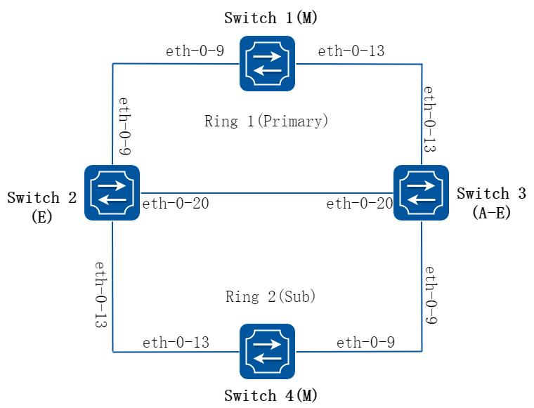

**图16-42 ERPS**

Switch1，Switch2，Switch3 和Switch4 配置成相同的ERPS 域，Switch1，Switch2 和Switch3 组成ERPS 环网的主环ring 1，Switch1 配置成ring 1 的主节点，其他两台设备配置成ring 1 中的传输节点，Switch2，Switch3 和Switch4 配置成ERPS 环网的子环ring 2，Switch4 配置成ring 2 的主节点.此外Switch2 配置成边缘节点，Switch3 配置成辅助边缘节点。

注意事项：

端口接入ERPS 环需要配置控制VLAN 的成员，允许ERPS 数据包发送和接收。

ERPS 环中的端口必须把STP 关闭。

只有一个节点能配置成Master。

边缘节点和辅助边缘节点必须是两个环的交叉点。

子环的边缘节点和辅助边缘节点必须传输节点。

通用的接口必须为两环相交接口。

边缘端口只能属于一个子环。

主环和子环共存必须要有边缘节点或边缘辅助节点。

必须在主环创建后再创建子环。

子环的取消和删除操作必须在主环之前。

一个交换机只能成为一个域的主节点或者域中的子环的传输节点。

##### 2. 配置步骤

以下配置如未说明在哪个Switch 配置，则表示所有Switch 配置相同：

##### 步骤1 进入配置模式

```
Switch# configure terminal
```

##### 步骤2 进入vlan 配置模式并创建vlan

```
Switch(config)# vlan database
Switch(config-vlan)# vlan 11,12
Switch(config-vlan)# exit
Switch(config)# no ip igmp snooping vlan 11
Switch(config)# no ip igmp snooping vlan 12
```

##### 步骤3 进入接口配置模式，配置接口属性

```
Switch(config)# interface eth-0-9
Switch(config-if)# no shutdown
Switch(config-if)# switchport mode trunk
Switch(config-if)# switchport trunk allowed vlan add 11,12
Switch(config-if)# spanning-tree port disable
Switch(config-if)# exit
Switch(config)# interface eth-0-13
Switch(config-if)# no shutdown
Switch(config-if)# switchport mode trunk
Switch(config-if)# switchport trunk allowed vlan add 11,12
Switch(config-if)# spanning-tree port disable
Switch(config-if)# exit
```

Switch2 和Switch3 的eth-0-20 接口配置：

```
Switch2&3(config)# interface eth-0-20
Switch2&3(config-if)# no shutdown
Switch2&3(config-if)# switchport mode trunk
Switch2&3(config-if)# switchport trunk allowed vlan add 11,12
Switch2&3(config-if)# spanning-tree port disable
Switch2&3(config-if)# exit
```

##### 步骤4 配置和启用ERPS 域

Switch1 的erps 域：

```
Switch1(config)# erps 1
Switch1(config)# erps 1 primary control vlan 11
Switch1(config)# erps 1 sub control vlan 12
Switch1(config)# erps 1 mstp instance 0
Switch1(config)# erps 1 ring 1 level primary
Switch1(config)# erps 1 ring 1 mode master
Switch1(config)# erps 1 ring 1 primary interface eth-0-9
Switch1(config)# erps 1 ring 1 secondary interface eth-0-13
Switch1(config)# erps 1 ring 1 enable
Switch1(config)# erps 1 enable
```

Switch2 的erps 域：

```
Switch2(config)# erps 1
Switch2(config)# erps 1 primary control vlan 11
Switch2(config)# erps 1 sub control vlan 12
Switch2(config)# erps 1 mstp instance 0
Switch2(config)# erps 1 ring 1 level primary
Switch2(config)# erps 1 ring 1 mode transit
Switch2(config)# erps 1 ring 1 primary interface eth-0-9
Switch2(config)# erps 1 ring 1 secondary interface eth-0-20
Switch2(config)# erps 1 ring 1 enable
Switch2(config)# erps 1 ring 2 level sub
Switch2(config)# erps 1 ring 2 edge-mode edge
Switch2(config)# erps 1 ring 2 edge interface eth-0-13
Switch2(config)# erps 1 ring 2 common interface eth-0-20
Switch2(config)# erps 1 ring 2 srpt disable
Switch2(config)# erps 1 ring 2 enable
Switch2(config)# erps 1 enable
```

Switch3 的erps 域：

```
Switch3(config)# erps 1
Switch3(config)# erps 1 primary control vlan 11
Switch3(config)# erps 1 sub control vlan 12
Switch3(config)# erps 1 mstp instance 0
Switch3(config)# erps 1 ring 1 level primary
Switch3(config)# erps 1 ring 1 mode transit
Switch3(config)# erps 1 ring 1 primary interface eth-0-13
Switch3(config)# erps 1 ring 1 secondary interface eth-0-20
Switch3(config)# erps 1 ring 1 enable
Switch3(config)# erps 1 ring 2 level sub
Switch3(config)# erps 1 ring 2 mode transit
Switch3(config)# erps 1 ring 2 edge-mode assistant-edge
Switch3(config)# erps 1 ring 2 edge interface eth-0-9
Switch3(config)# erps 1 ring 2 common interface eth-0-20
Switch3(config)# erps 1 ring 2 enable
Switch3(config)# erps 1 enable
```

Switch4 的erps 域：

```
Switch4(config)# erps 1
Switch4(config)# erps 1 sub control vlan 12
Switch4(config)# erps 1 mstp instance 0
Switch4(config)# erps 1 ring 2 level sub
Switch4(config)# erps 1 ring 2 mode master
Switch4(config)# erps 1 ring 2 primary interface eth-0-9
Switch4(config)# erps 1 ring 2 secondary interface eth-0-13
Switch4(config)# erps 1 ring 2 enable
Switch4(config)# erps 1 enable
```

##### 步骤5 退出配置模式

```
Switch(config)# end
```

##### 步骤6 检查配置

Switch1 显示结果：

```
Switch1# show erps 1
ERPS domain ID: 1
ERPS domain name: ERPS001
ERPS domain mode: normal
ERPS domain primary control VLAN ID: 11
ERPS domain sub control VLAN ID: 12
ERPS domain hello timer interval: 1 second(s)
ERPS domain fail timer interval: 3 second(s)
ERPS domain protected mstp instance: 0
ERPS ring ID: 1
ERPS ring level: primary
ERPS ring 1 node mode: master
ERPS ring 1 node state: complete
ERPS ring 1 primary interface name: eth-0-9
state:unblock
ERPS ring 1 secondary interface name: eth-0-13
state:block
ERPS ring 1 stats:
Sent:
total packets:1310
hello packets:1303
ring-up-flush-fdb packets:3
ring-down-flush-fdb packets:4
link-down packets:0
edge-hello packets:0
major-fault packets:0
Received:
total packets:921
hello packets:921
ring-up-flush-fdb packets:0
ring-down-flush-fdb packets:0
link-down packets:0
edge-hello packets:0
major-fault packets:0
```

Switch2 显示结果：

```
Switch2# show erps 1
ERPS domain ID: 1
ERPS domain name: ERPS001
ERPS domain mode: normal
ERPS domain primary control VLAN ID: 11
ERPS domain sub control VLAN ID: 12
ERPS domain hello timer interval: 1 second(s)
ERPS domain fail timer interval: 3 second(s)
ERPS domain protected mstp instance: 0
ERPS ring ID: 1
ERPS ring level: primary
ERPS ring 1 node mode: transit
ERPS ring 1 node state: link up
ERPS ring 1 primary interface name: eth-0-9
state:unblock
ERPS ring 1 secondary interface name: eth-0-20
state:unblock
ERPS ring 1 stats:
Sent:
total packets:0
hello packets:0
ring-up-flush-fdb packets:0
ring-down-flush-fdb packets:0
link-down packets:0
edge-hello packets:0
major-fault packets:0
Received:
total packets:988
hello packets:985
ring-up-flush-fdb packets:2
ring-down-flush-fdb packets:1
link-down packets:0
edge-hello packets:0
major-fault packets:0
ERPS ring ID: 2
```

```
ERPS ring level: sub
ERPS ring 2 node mode: transit
ERPS ring 2 edge node mode: edge
ERPS ring 2 node state: link up
ERPS ring 2 edge interface name: eth-0-13
state: unblock
ERPS ring 2 common interface name: eth-0-20
state: unblock
EPRS ring 2 SRPT is disabled
ERPS ring 2 stats:
Sent:
total packets:0
hello packets:0
ring-up-flush-fdb packets:0
ring-down-flush-fdb packets:0
link-down packets:0
edge-hello packets:0
major-fault packets:0
Received:
total packets:858
hello packets:856
ring-up-flush-fdb packets:1
ring-down-flush-fdb packets:1
link-down packets:0
edge-hello packets:0
major-fault packets:0
```

Switch3 显示结果：

```
Switch3# show erps 1
ERPS domain ID: 1
ERPS domain name: ERPS001
ERPS domain mode: normal
ERPS domain primary control VLAN ID: 11
ERPS domain sub control VLAN ID: 12
ERPS domain hello timer interval: 1 second(s)
ERPS domain fail timer interval: 3 second(s)
ERPS domain protected mstp instance: 0
ERPS ring ID: 1
ERPS ring level: primary
ERPS ring 1 node mode: transit
ERPS ring 1 node state: link up
ERPS ring 1 primary interface name: eth-0-13
state:unblock
ERPS ring 1 secondary interface name: eth-0-20
state:unblock
ERPS ring 1 stats:
Sent:
total packets:0
hello packets:0
ring-up-flush-fdb packets:0
ring-down-flush-fdb packets:0
link-down packets:0
edge-hello packets:0
major-fault packets:0
Received:
total packets:645
hello packets:644
ring-up-flush-fdb packets:1
ring-down-flush-fdb packets:0
link-down packets:0
edge-hello packets:0
major-fault packets:0
ERPS ring ID: 2
ERPS ring level: sub
ERPS ring 2 node mode: transit
ERPS ring 2 edge node mode: assistant edge
ERPS ring 2 node state: link up
ERPS ring 2 edge interface name: eth-0-9
state: unblock
ERPS ring 2 common interface name: eth-0-20
state: unblock
ERPS ring 2 stats:
Sent:
```

```
total packets:0
hello packets:0
ring-up-flush-fdb packets:0
ring-down-flush-fdb packets:0
link-down packets:0
edge-hello packets:0
major-fault packets:0
Received:
total packets:645
hello packets:644
ring-up-flush-fdb packets:1
ring-down-flush-fdb packets:0
link-down packets:0
edge-hello packets:0
major-fault packets:0
```

Switch4 显示结果：

```
Switch4# show erps 1
ERPS domain ID: 1
ERPS domain name: ERPS001
ERPS domain mode: normal
ERPS domain primary control VLAN ID: 0
ERPS domain sub control VLAN ID: 12
ERPS domain hello timer interval: 1 second(s)
ERPS domain fail timer interval: 3 second(s)
ERPS domain protected mstp instance: 0
ERPS ring ID: 2
ERPS ring level: sub
ERPS ring 2 node mode: master
ERPS ring 2 node state: complete
ERPS ring 2 primary interface name: eth-0-9
state:unblock
ERPS ring 2 secondary interface name: eth-0-13
state:block
ERPS ring 2 stats:
Sent:
total packets:814
hello packets:810
ring-up-flush-fdb packets:2
ring-down-flush-fdb packets:2
link-down packets:0
edge-hello packets:0
major-fault packets:0
Received:
total packets:774
hello packets:774
ring-up-flush-fdb packets:0
ring-down-flush-fdb packets:0
link-down packets:0
edge-hello packets:0
major-fault packets:0
Switch#
```

#### 配置ERPS 相切环拓扑

##### 1. 组网拓扑

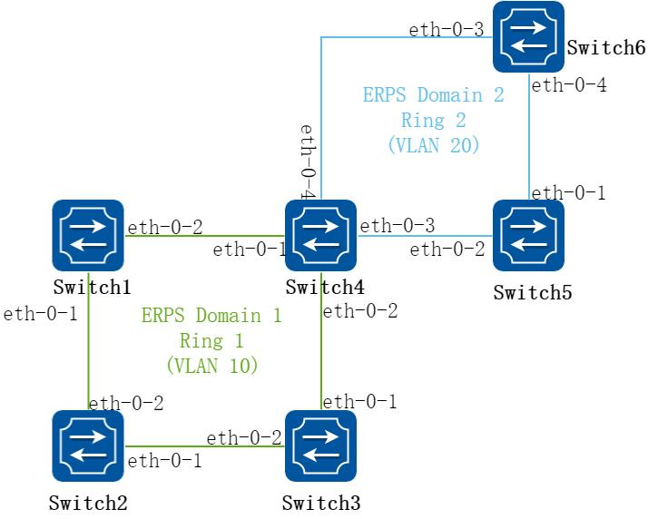

**图16-43 相切环组网图**

##### 2. 配置思路

switch 1、2、3、4、5、6 组成两个环网，运行ERPS 协议，提供两个环网的二层冗余保护功能。

拓扑中的两个环没有公共的物理链路，不适合配置成主环-子环模式，考虑配置成两个erps 域内的两个独立的环配置1、2、3、4 为erps domain1 内的ring1，2 为主节点，eth-0-1 为主端口，erh-0-2为副端口配置4、5、6 为erps domain2 内的ring2，6 为主节点，eth-0-3 为主端口，eth-0-4为副端口

##### 3. 配置步骤

以下配置无明确说明的情况下，Switch 表示在Switch 1/2/3/4/5/6 相同。

##### 步骤1 进入配置模式

```
Switch# configure terminal
```

##### 步骤2 在Ring1 的设备(Switch 1/2/3/4)上配置VLAN 10

```
Switch1&2&3&4(config)# vlan database
Switch1&2&3&4(config-vlan)# vlan 10
Switch1&2&3&4(config-vlan)# exit
Switch1&2&3&4(config)# no ip igmp snooping vlan 10
```

因ERPS 协议报文为组播报文，故需要关闭控制VLAN 的igmp snooping 功能。

##### 步骤3 在Ring2 的设备(Switch 4/5/6)上配置VLAN 20

```
Switch4&5&6(config)# vlan database
Switch4&5&6(config-vlan)# vlan 20
Switch4&5&6(config-vlan)# exit
Switch4&5&6(config)# no ip igmp snooping vlan 20
```

##### 步骤4 配置接口属性

```
Switch(config)# interface range eth-0-1 to eth-0-4
Switch(config-if)# switchport
Switch(config-if)# no shutdown
Switch(config-if)# switchport mode trunk
Switch(config-if)# switchport trunk allowed vlan all
Switch(config-if)# spanning-tree port disable
Switch(config-if)# exit
```

根据拓扑图，eth-0-1、eth-0-2、eth-0-3、eth-0-4 配置相同。

##### 步骤5 配置相交节点4 的接口属性

```
Switch4(config)# interface eth-0-1
Switch4(config-if)# switchport trunk allowed vlan remove 20
Switch4(config-if)# exit
Switch4(config)# interface eth-0-2
Switch4(config-if)# switchport trunk allowed vlan remove 20
Switch4(config-if)# exit
Switch4(config)# interface eth-0-3
Switch4(config-if)# switchport trunk allowed vlan remove 10
Switch4(config-if)# exit
Switch4(config)# interface eth-0-4
Switch4(config-if)# switchport trunk allowed vlan remove 10
Switch4(config-if)# exit
```

根据组网需求，在interface eth-0-1、eth-0-2 移除VLAN 20，在interface eth-0-3、eth-0-4 移除VLAN 10.

##### 步骤6 配置Domain1 的主节点switch 2

```
Switch2(config)# erps 1
Switch2(config)# erps 1 primary control vlan 10
Switch2(config)# erps 1 ring 1 level primary
Switch2(config)# erps 1 ring 1 mode master
Switch2(config)# erps 1 ring 1 primary interface eth-0-1
Switch2(config)# erps 1 ring 1 secondary interface eth-0-2
Switch2(config)# erps 1 mstp instance 0
Switch2(config)# erps 1 ring 1 enable
```

##### 步骤7 配置Domain1 的传输节点switch 1

```
Switch1(config)# erps 1
Switch1(config)# erps 1 primary control vlan 10
Switch1(config)# erps 1 ring 1 level primary
Switch1(config)# erps 1 ring 1 mode transit
Switch1(config)# erps 1 ring 1 primary interface eth-0-1
```

```
Switch1(config)# erps 1 ring 1 secondary interface eth-0-2
Switch1(config)# erps 1 mstp instance 0
Switch1(config)# erps 1 ring 1 enable
```

##### 步骤8 配置Domain1 的传输节点switch 3

```
Switch3(config)# erps 1
Switch3(config)# erps 1 primary control vlan 10
Switch3(config)# erps 1 ring 1 level primary
Switch3(config)# erps 1 ring 1 mode transit
Switch3(config)# erps 1 ring 1 primary interface eth-0-1
Switch3(config)# erps 1 ring 1 secondary interface eth-0-2
Switch3(config)# erps 1 mstp instance 0
Switch3(config)# erps 1 ring 1 enable
```

##### 步骤9 配置Domain2 主节点switch 6

```
Switch6(config)# erps 2
Switch6(config)# erps 2 primary control vlan 20
Switch6(config)# erps 2 ring 2 level primary
Switch6(config)# erps 2 ring 2 mode master
Switch6(config)# erps 2 ring 2 primary interface eth-0-3
Switch6(config)# erps 2 ring 2 secondary interface eth-0-4
Switch6(config)# erps 2 mstp instance 0
Switch6(config)# erps 2 ring 2 enable
```

##### 步骤10 配置Domain2 传输节点switch 5

```
Switch5(config)# erps 2
Switch5(config)# erps 2 primary control vlan 10
Switch5(config)# erps 2 ring 1 level primary
Switch5(config)# erps 2 ring 1 mode transit
Switch5(config)# erps 2 ring 1 primary interface eth-0-1
Switch5(config)# erps 2 ring 1 secondary interface eth-0-2
Switch5(config)# erps 2 mstp instance 0
Switch5(config)# erps 2 ring 1 enable
```

##### 步骤11 配置相交节点switch 4 上ring1 属性

```
Switch4(config)# erps 1
Switch4(config)# erps 1 primary control vlan 10
Switch4(config)# erps 1 ring 1 level primary
Switch4(config)# erps 1 ring 1 mode transit
Switch4(config)# erps 1 ring 1 primary interface eth-0-1
Switch4(config)# erps 1 ring 1 secondary interface eth-0-2
Switch4(config)# erps 1 mstp instance 0
Switch4(config)# erps 1 ring 1 enable
```

##### 步骤12 配置相交节点switch 4 上ring2 属性

```
Switch4(config)# erps 2
Switch4(config)# erps 2 primary control vlan 20
Switch4(config)# erps 2 ring 2 level primary
Switch4(config)# erps 2 ring 2 mode transit
Switch4(config)# erps 2 ring 2 primary interface eth-0-3
Switch4(config)# erps 2 ring 2 secondary interface eth-0-4
Switch4(config)# erps 2 mstp instance 0
Switch4(config)# erps 2 ring 2 enable
```

##### 步骤13 退出配置模式

```
Switch(config)# end
```

#### 配置ERPS 多子环相交环组网

##### 1. 组网拓扑

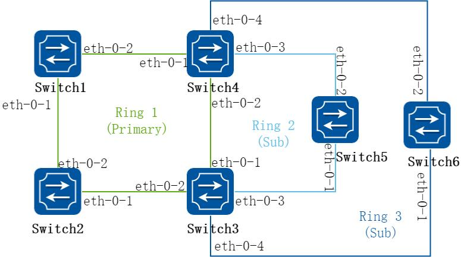

**图16-44 多子环相交组网图**

##### 2. 配置思路

switch 1、2、3、4、5、6 组成相交环网，运行ERPS 协议，提供环网的二层冗余保护功能。

拓扑中有三个相交环，考虑配置为一个主环+两个子环的模式由于是多子环，边缘节点和辅助边缘节点，需要在一个子环上开启srpt，在另一个子环上，关闭srpt，防止两个边缘端口均被阻塞时形成孤岛。

##### 3. 配置步骤

以下配置无明确说明的情况下，Switch 表示在Switch 1/2/3/4/5/6 相同。

##### 步骤1 进入配置模式

```
Switch# configure terminal
```

##### 步骤2 在主环的设备(Switch 1/2/3/4)上配置VLAN 10

```
Switch1&2&3&4(config)# vlan database
Switch1&2&3&4(config-vlan)# vlan 10,20
Switch1&2&3&4(config-vlan)# exit
Switch1&2&3&4(config)# no ip igmp snooping vlan 10
Switch1&2&3&4(config)# no ip igmp snooping vlan 20
```

##### 步骤3 在子环的设备(Switch 5/6)上配置VLAN 20

```
Switch5&6(config)# vlan database
Switch5&6(config-vlan)# vlan 20
Switch5&6(config-vlan)# exit
Switch5&6(config)# no ip igmp snooping vlan 20
```

##### 步骤4 配置接口属性

```
Switch(config)# interface range eth-0-1 to eth-0-4
Switch(config-if)# switchport
Switch(config-if)# no shutdown
Switch(config-if)# switchport mode trunk
Switch(config-if)# switchport trunk allowed vlan all
Switch(config-if)# spanning-tree port disable
Switch(config-if)# exit
```

根据拓扑图，eth-0-1、eth-0-2、eth-0-3、eth-0-4 配置相同。

##### 步骤5 配置边缘辅助节点3/4 的接口属性

```
Switch3&4(config)# interface eth-0-3
Switch3&4(config-if)# switchport trunk allowed vlan remove 10
Switch3&4(config)# interface eth-0-4
Switch3&4(config-if)# switchport trunk allowed vlan remove 10
```

根据拓扑，在边缘辅助节点的子环的接口interface eth-0-3、eth-0-4 移除VLAN 10.

##### 步骤6 配置主环主节点switch 2

```
Switch2(config)# erps 1
Switch2(config)# erps 1 primary control vlan 10
Switch2(config)# erps 1 ring 1 level primary
Switch2(config)# erps 1 ring 1 mode master
Switch2(config)# erps 1 ring 1 primary interface eth-0-1
Switch2(config)# erps 1 ring 1 secondary interface eth-0-2
Switch2(config)# erps 1 sub control vlan 20
Switch2(config)# erps 1 mstp instance 0
Switch2(config)# erps 1 ring 1 enable
```

##### 步骤7 配置传输节点switch 1

```
Switch1(config)# erps 1
Switch1(config)# erps 1 primary control vlan 10
Switch1(config)# erps 1 ring 1 level primary
Switch1(config)# erps 1 ring 1 mode transit
Switch1(config)# erps 1 ring 1 primary interface eth-0-1
Switch1(config)# erps 1 ring 1 secondary interface eth-0-2
Switch1(config)# erps 1 sub control vlan 20
Switch1(config)# erps 1 mstp instance 0
Switch1(config)# erps 1 ring 1 enable
```

##### 步骤8 配置（辅助）边缘节点switch 4 的主环ring1 属性

```
Switch4(config)# erps 1
Switch4(config)# erps 1 primary control vlan 10
Switch4(config)# erps 1 sub control vlan 20
Switch4(config)# erps 1 ring 1 level primary
Switch4(config)# erps 1 ring 1 mode transit
```

```
Switch4(config)# erps 1 ring 1 primary interface eth-0-1
Switch4(config)# erps 1 ring 1 secondary interface eth-0-2
Switch4(config)# erps 1 mstp instance 0
Switch4(config)# erps 1 ring 1 enable
```

##### 步骤9 配置（辅助）边缘节点switch 4 的子环ring2 属性

```
Switch4(config)# erps 1 ring 2 level sub
Switch4(config)# erps 1 ring 2 mode transit
Switch4(config)# erps 1 ring 2 edge-mode edge
Switch4(config)# erps 1 ring 2 edge interface eth-0-3
Switch4(config)# erps 1 ring 2 common interface eth-0-2
Switch4(config)# erps 1 ring 2 srpt disable
Switch4(config)# erps 1 ring 2 enable
```

##### 步骤10 配置（辅助）边缘节点switch 4 的子环ring3 属性

```
Switch4(config)# erps 1 ring 3 level sub
Switch4(config)# erps 1 ring 3 mode transit
Switch4(config)# erps 1 ring 3 edge-mode assistant-edge
Switch4(config)# erps 1 ring 3 edge interface eth-0-4
Switch4(config)# erps 1 ring 3 common interface eth-0-2
Switch4(config)# erps 1 ring 3 enable
```

##### 步骤11 配置（辅助）边缘节点switch 3 的主环ring1 属性

```
Switch3(config)# erps 1
Switch3(config)# erps 1 primary control vlan 10
Switch3(config)# erps 1 sub control vlan 20
Switch3(config)# erps 1 ring 1 level primary
Switch3(config)# erps 1 ring 1 mode transit
Switch3(config)# erps 1 ring 1 primary interface eth-0-1
Switch3(config)# erps 1 ring 1 secondary interface eth-0-2
Switch3(config)# erps 1 mstp instance 0
Switch3(config)# erps 1 ring 1 enable
```

##### 步骤12 配置（辅助）边缘节点switch 3 的子环ring2 属性

```
Switch3(config)# erps 1 ring 2 level sub
Switch3(config)# erps 1 ring 2 mode transit
Switch3(config)# erps 1 ring 2 edge-mode assistant-edge
Switch3(config)# erps 1 ring 2 edge interface eth-0-3
Switch3(config)# erps 1 ring 2 common interface eth-0-1
Switch3(config)# erps 1 ring 2 srpt disable
Switch3(config)# erps 1 ring 2 enable
```

##### 步骤13 配置（辅助）边缘节点switch 3 的子环ring3 属性

```
Switch3(config)# erps 1 ring 3 level sub
Switch3(config)# erps 1 ring 3 mode transit
Switch3(config)# erps 1 ring 3 edge-mode edge
Switch3(config)# erps 1 ring 3 edge interface eth-0-4
Switch3(config)# erps 1 ring 3 common interface eth-0-1
Switch3(config)# erps 1 ring 3 enable
```

##### 步骤14 配置子环主节点switch 5

```
Switch5(config)# erps 1
Switch5(config)# erps 1 sub control vlan 20
```

```
Switch5(config)# erps 1 ring 2 level sub
Switch5(config)# erps 1 ring 2 mode master
Switch5(config)# erps 1 ring 2 primary interface eth-0-1
Switch5(config)# erps 1 ring 2 secondary interface eth-0-2
Switch5(config)# erps 1 mstp instance 0
Switch5(config)# erps 1 ring 2 enable
```

##### 步骤15 配置子环主节点switch 6

```
Switch6(config)# erps 1
Switch6(config)# erps 1 sub control vlan 20
Switch6(config)# erps 1 ring 3 level sub
Switch6(config)# erps 1 ring 3 mode master
Switch6(config)# erps 1 ring 3 primary interface eth-0-2
Switch6(config)# erps 1 ring 3 secondary interface eth-0-1
Switch6(config)# erps 1 mstp instance 0
Switch6(config)# erps 1 ring 3 enable
```

##### 步骤16 退出配置模式

```
Switch(config)# end
```

#### 配置ERPS 多实例组网

##### 1. 组网拓扑


**图16-45 多实例ERPS 组网图**

##### 2. 配置思路

switch 1、2、3、4 组成环网，环内运行ERPS 协议，提供环网的二层冗余保护功能；同时配置多实例，由switch2 转发到switch4 的流量，vlan100-200 的数据流走switch 2-1-4 转发路线，vlan300-400 的数据流走switch 2-3-4 的转发路线，实现负载分担，提高链路利用率。

配置switch2 为domain 1 ring1 和domain 2 ring2 的主节点，ring1 副端口为eth-0-1，ring2 副端口为eth-0-2配置实例instance1 绑定vlan100-200，instance2 绑定vlan300-400指定domain1 在instance1 内，domain2 在instance2 内

##### 3. 配置步骤

以下配置无明确说明的情况下，Switch 表示在Switch1/2/3/4 相同。

##### 步骤1 进入配置模式

```
Switch# configure terminal
```

##### 步骤2 配置控制VLAN 10 和20

```
Switch(config)# vlan database
Switch(config-vlan)# vlan 10,20,100-200,300-400
Switch(config-vlan)# exit
Switch(config)# no ip igmp snooping vlan 10
Switch(config)# no ip igmp snooping vlan 20
```

##### 步骤3 配置数据VLAN 100-200,300-400

```
Switch(config)# vlan database
Switch(config-vlan)# vlan 100-200,300-400
Switch(config-vlan)# exit
```

##### 步骤4 配置接口属性

```
Switch(config)# interface eth-0-1
Switch(config-if)# switchport
Switch(config-if)# no shutdown
Switch(config-if)# switchport mode trunk
Switch(config-if)# switchport trunk allowed vlan all
Switch(config-if)# spanning-tree port disable
Switch(config-if)# exit
Switch(config)# interface eth-0-2
Switch(config-if)# switchport
Switch(config-if)# no shutdown
Switch(config-if)# switchport mode trunk
Switch(config-if)# switchport trunk allowed vlan all
Switch(config-if)# spanning-tree port disable
Switch(config-if)# exit
```

##### 步骤5 配置MSTP 实例

```
Switch(config)# spanning-tree mode mstp
Switch(config)# spanning-tree mst configuration
Switch(config-mst)# instance 1 vlan 10,100-200
Switch(config-mst)# instance 2 vlan 20,300-400
```

建议将ERPS 环的控制VLAN 加入环的保护实例中

##### 步骤6 配置主节点switch 2 的ring1

```
Switch2(config)# erps 1
Switch2(config)# erps 1 primary control vlan 10
Switch2(config)# erps 1 ring 1 level primary
Switch2(config)# erps 1 ring 1 mode master
Switch2(config)# erps 1 ring 1 primary interface eth-0-2
```

```
Switch2(config)# erps 1 ring 1 secondary interface eth-0-1
Switch2(config)# erps 1 mstp instance 1
Switch2(config)# erps 1 ring 1 enable
```

##### 步骤7 配置主节点switch 2 的ring2

```
Switch2(config)# erps 2
Switch2(config)# erps 2 primary control vlan 20
Switch2(config)# erps 2 ring 2 level primary
Switch2(config)# erps 2 ring 2 mode master
Switch2(config)# erps 2 ring 2 primary interface eth-0-1
Switch2(config)# erps 2 ring 2 secondary interface eth-0-2
Switch2(config)# erps 2 mstp instance 2
Switch2(config)# erps 2 ring 2 enable
```

##### 步骤8 配置传输节点switch 1 的ring1

```
Switch1(config)# erps 1
Switch1(config)# erps 1 primary control vlan 10
Switch1(config)# erps 1 ring 1 level primary
Switch1(config)# erps 1 ring 1 mode transit
Switch1(config)# erps 1 ring 1 primary interface eth-0-1
Switch1(config)# erps 1 ring 1 secondary interface eth-0-2
Switch1(config)# erps 1 mstp instance 1
Switch1(config)# erps 1 ring 1 enable
```

##### 步骤9 配置传输节点switch 1 的ring2

```
Switch1(config)# erps 2
Switch1(config)# erps 2 primary control vlan 20
Switch1(config)# erps 2 ring 2 level primary
Switch1(config)# erps 2 ring 2 mode transit
Switch1(config)# erps 2 ring 2 primary interface eth-0-1
Switch1(config)# erps 2 ring 2 secondary interface eth-0-2
Switch1(config)# erps 2 mstp instance 2
Switch1(config)# erps 2 ring 2 enable
```

##### 步骤10 配置传输节点switch 3 的ring1

```
Switch3(config)# erps 1
Switch3(config)# erps 1 primary control vlan 10
Switch3(config)# erps 1 ring 1 level primary
Switch3(config)# erps 1 ring 1 mode transit
Switch3(config)# erps 1 ring 1 primary interface eth-0-1
Switch3(config)# erps 1 ring 1 secondary interface eth-0-2
Switch3(config)# erps 1 mstp instance 1
Switch3(config)# erps 1 ring 1 enable
```

##### 步骤11 配置传输节点switch 3 的ring2

```
Switch3(config)# erps 2
Switch3(config)# erps 2 primary control vlan 20
Switch3(config)# erps 2 ring 2 level primary
Switch3(config)# erps 2 ring 2 mode transit
Switch3(config)# erps 2 ring 2 primary interface eth-0-1
Switch3(config)# erps 2 ring 2 secondary interface eth-0-2
Switch3(config)# erps 2 mstp instance 2
Switch3(config)# erps 2 ring 2 enable
```

##### 步骤12 配置传输节点switch 4 的ring1

```
Switch4(config)# erps 1
Switch4(config)# erps 1 primary control vlan 10
Switch4(config)# erps 1 ring 1 level primary
Switch4(config)# erps 1 ring 1 mode transit
Switch4(config)# erps 1 ring 1 primary interface eth-0-1
Switch4(config)# erps 1 ring 1 secondary interface eth-0-2
Switch4(config)# erps 1 mstp instance 1
Switch4(config)# erps 1 ring 1 enable
```

##### 步骤13 配置传输节点switch 4 的ring2

```
Switch4(config)# erps 2
Switch4(config)# erps 2 primary control vlan 20
Switch4(config)# erps 2 ring 2 level primary
Switch4(config)# erps 2 ring 2 mode transit
Switch4(config)# erps 2 ring 2 primary interface eth-0-1
Switch4(config)# erps 2 ring 2 secondary interface eth-0-2
Switch4(config)# erps 2 mstp instance 2
Switch4(config)# erps 2 ring 2 enable
```

##### 步骤14 退出配置模式

```
Switch(config)# end
```

### 16.8.3 参考文献

RFC 3619 Ethernet Automatic Protection Switching (EAPS)Version 1, Oct, 2003.

## 16.9 Smart-Link配置

### 16.9.1 概述

#### 简介

##### 1. 缩略语说明

| 缩略语 | 英文全称 | 翻译与解释 |
|---|---|---|
| SMLK | Smart Link | 灵活链路 |
| STP | Spanning Tree Protocol | 生成树协议 |
| MSTP | Multiple Spanning Tree<br>Protocol | 多生成树协议 |
| ERPS | Ethernet Ring Protection<br>Switching | 以太网多环保护技术 |

Smart Link，中文译为灵活链路，又称为备份链路，它保证了双上行组网的两条链路在正常情况下，一条链路处于转发状态，而另一条处于阻塞状态，当一条链路发生故障后，流量会迅速切换到另外一条链路上。同时Smart Link 可以实现流量的负载分担，提高链路的利用率，是一种为双上行链路组网提供可靠高效的备份和切换机制的解决方案。

#### 背景

随着网络技术的不断发展，人们对于网络可靠性的要求不断提高，对于终端用户来说，保证他们可以与外部网络实时保持联系是十分重要的，稳定可靠的网络能给用户带来良好的体验。

目前常采用的一种组网形式是双上行组网，虽然双上行组网可以提供链路备份，但是网络中的环路可能会引起广播风暴。一般情况下，可以通过STP（Spanning Tree Protocol，生成树协议）来消除环路。虽然这种方案从功能上可以实现冗余备份，但是在性能上却不能达到很多用户的要求，因为STP 的收敛时间较长，不适用于对收敛时间有很高要求的组网环境。另外一种解决方案ERPS（Ethernet Ring Protection Switching，以太网多环保护技术）虽然可以提高收敛性能，但是配置复杂度较高。

基于上述原因，提出了Smart Link 技术解决方案。针对双上行组网，实现主备链路冗余备份及快速迁移。

Smart Link 是一种为双上行组网量身定做的解决方案，具有如下优点：

能够实现双上行组网的两条链路在正常情况下，只有一条处于转发状态，而另一条处于阻塞状态，从而防止了环路引起广播风暴。

相比STP，Smart Link 技术具有更快速的收敛性能。当主链路发生故障后，流量会迅速切换到从链路上，保证了数据的正常转发。

相比ERPS，Smart Link 技术的配置和使用更为简洁。

#### 原理描述

##### 1. Flush 报文格式

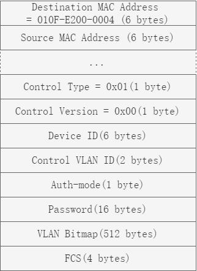

**图16-46 Flush 报文格式**

**表16-1 Flush 报文字段说明**

| 报文字段 | 说明 |
|---|---|
| Destination MAC | 为未知组播地址。可以通过判断该地址是否为<br>0x010F-E200-0004 来区分该报文是否为Flush 报<br>文。 |
| Source MAC | 表示发送Flush 报文的设备的接口MAC 地址。 |
| Control Type | 表示控制类型。目前只有删除MAC 地址表项一种<br>（0x01）。 |
| Control Version | 表示版本号。可以用作以后的扩展。 |
| Device ID | 表示发送Flush 报文的设备的桥MAC 地址。 |
| Control VLAN ID | 表示发送控制VLAN 的ID 号。 |
| Auth-mode | 表示认证模式，和Password 一起使用，便于以后<br>进行安全性扩展。 |
| VLAN Bitmap | 表示VLAN 位图，用于携带需要刷新地址表的VLAN<br>列表。 |
| FCS | 表示帧校验和，用于检查报文的合法性。 |

##### 2. 工作原理描述

技术术语

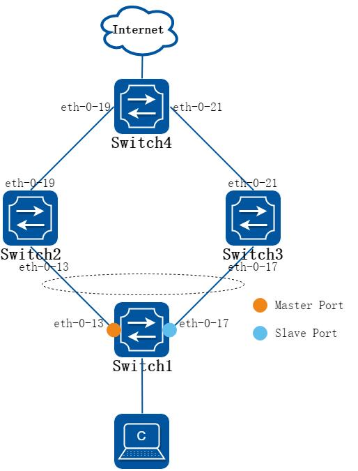

**图16-47 Smart Link 组网示意图**

Smart Link 组：由两个端口组成，其中一个为主端口（Master Port），另外一个为从端口（Slave Port）。正常情况下，主端口或从端口其中一个处于转发（ACTIVE）

状态，另一个则处于阻塞（BLOCK）状态。如上图所示，设备Switch1 上的端口eth-0-13 和eth-0-17 组成了一个Smart Link 组。

主端口：又叫Master 端口，当Smart Link 组中的两个端口都处于Up 状态时，主端口将优先进入转发状态。如上图所示，eth-0-13 被配置为Smart Link 组的主端口。

从端口：又叫Slave 端口，当Smart Link 组中的两个端口都处于Up 状态时，从端口保持阻塞状态。如上图所示，eth-0-17 被配置为Smart Link 组的从端口。

主链路和从链路：Smart Link 组中主端口所在的链路称为主链路，从端口所在的链路称为从链路。

保护VLAN：是Smart Link 组内承载数据流量的用户数据VLAN。Smart Link 引用MSTP 的实例，每个实例用来绑定若干VLAN，不同的实例绑定不同的VLAN。Smart Link功能只对保护实例中绑定的VLAN 数据有效，未绑定到保护实例中的VLAN 数据将不会受Smart Link 影响。

发送控制VLAN：是Smart Link 组用于广播Flush 报文的VLAN。如上图所示，在Switch1 上配置了Flush 报文发送功能以后，如果发生链路切换，设备会从新的链路上在发送控制VLAN 内发送Flush 报文。

接收控制VLAN：是上游设备用于接收并处理Flush 报文的VLAN。如上图所示，在上游设备Switch2、Switch3 和Switch4 上配置了Flush 报文接收处理功能以后，如果发生链路切换，上游设备会处理收到的属于接收控制VLAN 的Flush 报文，对于接收控制VLAN 不一致的报文将不做处理，直接转发。

链路正常工作原理

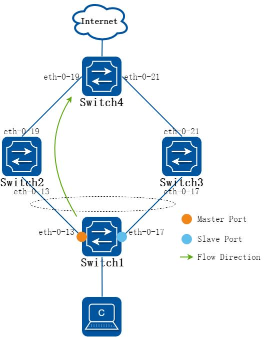

**图16-48 链路正常工作时流量示意图**

如上图所示，Switch1 上的Smart Link 组包含了eth-0-13 和eth-0-17 两个端口，其中eth-0-13 为主端口，eth-0-17 为从端口。双上行链路都正常的情况下，主端口进行流量转发，从端口处于阻塞状态。数据沿着绿色箭头方向进行传输，从而防止了环路引起的广播风暴。

链路故障处理原理

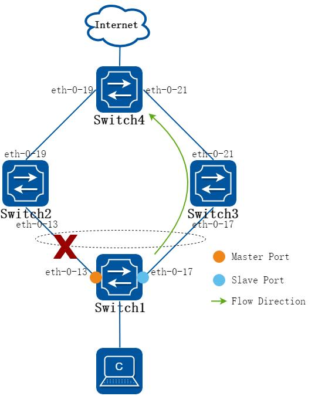

**图16-49 主链路故障时上行流量示意图**

如上图所示，当Switch1 的主链路发生故障时，Smart Link 组将进行链路切换，主端口eth-0-13 被切换为阻塞状态，从端口eth-0-17 被切换为转发状态。原有的转发表项已经不再适用，需要整网进行MAC 地址转发表项的更新。

目前更新机制有以下两种：

自动通过流量更新表项当与不支持Smart Link 功能的设备对接的时候，可以自

```
−
```

动通过流量更新表项。这种方式需要有上行流量触发。

Switch1 的主链路正常转发情况下，Switch4 收到目的设备为Switch1 的数据报

```
−
```

文时，会通过eth-0-19 端口转发出去。如上图所示，当Switch1 的主链路发生故障，如果没有来自Switch1 的上行流量去触发Switch4 的MAC 表项更新，当Switch4 再收到目的设备为Switch1 的数据报文时，Switch4 会继续通过eth-0-19 端口转发出去，此时报文已经无法到达Switch1，造成流量中断，直到其MAC 表项自动老化。

当Switch1 的主链路发生故障，eth-0-13 端口将自动清除该端口相关的MAC 表

```
−
```

项，此时Switch1 的上行流量将通过eth-0-21 端口到达Switch4，Switch4 会更新自己的MAC 表项，那么当Switch4 再收到目的设备为Switch1 的数据报文时，Switch4 会通过端口eth-0-21 转发出去，报文就可以经由Switch3 到达Switch1，Switch1 更新自己的MAC 表项。此后，Switch1 收到目的设备为Switch4的数据报文，会根据更新后的MAC 表项进行转发。

通过Flush 报文通知设备更新表项当与支持Smart Link 功能的设备对接的时候，可以通过Flush 报文通知设备更

```
−
```

新表项。这种方式需要上游设备能够识别Flush 报文。

如上图所示，使用这种方式需要在Switch1 上配置Flush 报文发送功能，在上

```
−
```

游设备Switch2、Switch3 和Switch4 上配置Flush 报文接收处理功能。

当Switch1 的主链路发生故障时，Smart Link 组将进行链路切换，会通过

```
−
```

eth-0-17 端口发送Flush 报文。当上游设备收到Flush 报文时，首先判断该Flush报文的发送控制VLAN 是否在收到报文的端口配置的接收控制VLAN 列表中。如果在接收控制VLAN 列表中，设备会处理收到的属于接收控制VLAN 的Flush 报文，执行MAC 地址转发表项的刷新操作，同时继续往上游设备转发Flush 报文。

如果不在接收控制VLAN 列表中，设备对该Flush 报文不做处理，直接转发。

此后，如果Switch4 收到目的设备为Switch1 的数据报文，会根据更新后的MAC

```
−
```

表项进行转发。

通过Flush 报文通知设备更新表项的方式相比于自动通过流量更新表项的方式无须等到表项老化后再进行更新，极大地减少了表项更新所需的时间，同时链路的迅速切换也极大程度上减少了流量的丢失。

链路恢复处理原理

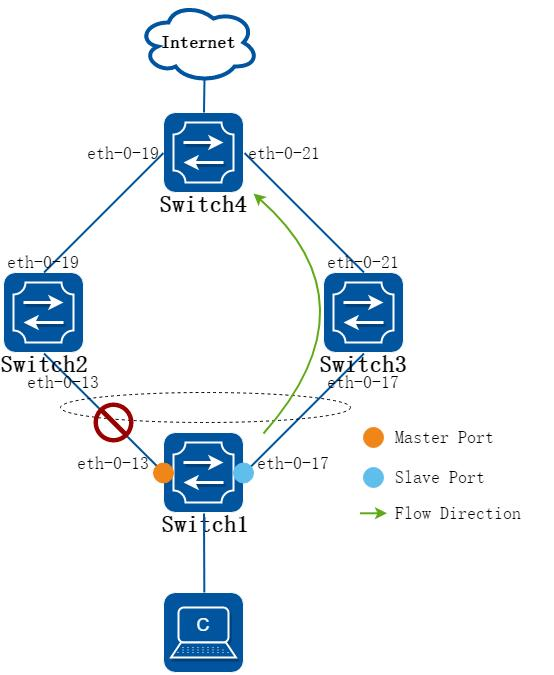

**图16-50 链路恢复处理示意图**

针对链路恢复处理机制Smart Link 组有两种模式：不使能回切模式和使能回切模式。

不使能回切：如上图所示组网示例，当Switch1 的主链路故障恢复后，如果未使能回切功能，eth-0-17 端口将继续处于转发状态，eth-0-13 端口将维持在阻塞状态，从而保持流量稳定。

使能回切：如上图所示组网示例，如果希望流量切换到主链路，可以使用Smart Link组回切功能，需要在Switch1 上使能回切功能。当主链路故障恢复后，经过回切定时器设定的时间，eth-0-13 端口将恢复为转发状态，eth-0-17 端口则进入阻塞状态，Smart Link 会自动将流量切换到主链路上。

负载分担工作原理在同一个双上行链路组网中，可能同时存在多个VLAN 的数据流量，一般情况下只有一条链路承担数据流量的转发，另一条链路则处于空闲状态，不承担数据流量的转发，即链路利用率只有50%。Smart Link 可以实现流量的负载分担，来提高链路的利用率。配置为负载分担实例的VLAN 的流量通过从链路进行转发，未配置为负载分担实例的VLAN的流量则通过主链路进行转发，从而使主链路和从链路承载不同VLAN 数据流量的转发，达到负载分担的目的。

在实现负载分担时，建议使能回切功能。在未使能情况下，当其中一条链路故障时，Smart Link 组会自动将所有的流量切换到另一条链路上传输，链路恢复后流量继续在同一条链路上传输，这样将无法达到负载分担的目的。

### 16.9.2 配置举例

#### Smart-Link 经典配置

##### 1. 组网拓扑

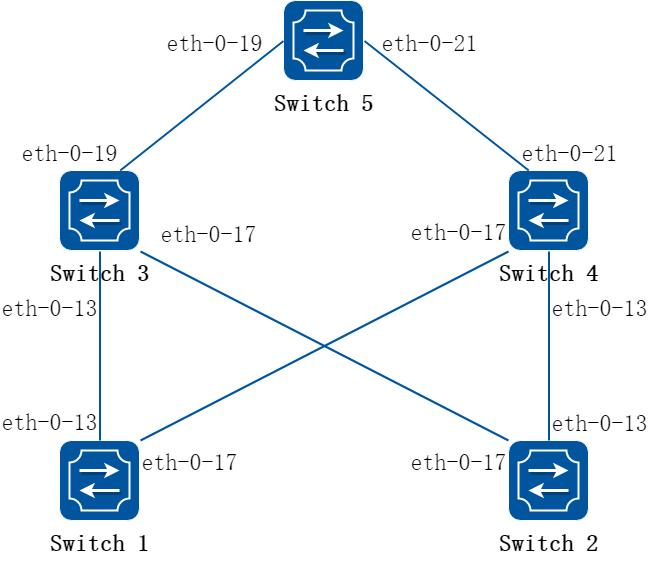

**图16-51 Smart-Link Typical Topology**

上图是一个Smart-link 的典型配置，交换机1 和2 配置Smart-link 组；交换机3、4和5 配置Smart-link 的报文接收。

##### 2. 配置步骤

下面的示例给出了Smart Link 链路双上行保护的配置，拓扑图示。

注意事项：

Smart Link 组的控制vlan 和保护vlan 必须事先在vlan database 创建好。

Smart Link 组的端口必须把STP 关闭。

Smart Link 组的保护实例必须事先在MSTP 模块先创建好。

给每台交换机配置VLAN 1-3，MSTP instance1-3。

以下配置如未说明在哪个Switch 配置，则表示所有Switch 配置相同：

##### 步骤1 进入配置模式

```
Switch# configure terminal
```

##### 步骤2 进入vlan 配置模式，并创建vlan

```
Switch(config)# vlan database
Switch(config-vlan)# vlan 2-20
Switch(config-vlan)# exit
```

##### 步骤3 设置STP 模式，创建mstp 实例

mstp 实例在Switch1 和Switch2 创建:

```
Switch1&2(config)# spanning-tree mode mstp
Switch1&2(config)# spanning-tree mst configuration
Switch1&2(config-mst)# instance 1 vlan 1
Switch1&2(config-mst)# instance 2 vlan 2
Switch1&2(config-mst)# instance 3 vlan 3
Switch1&2(config-mst)# instance 10 vlan 10
Switch1&2(config-mst)# exit
```

##### 步骤4 进入接口配置模式，配置接口属性

Switch1 和Switch2 的接口配置：

```
Switch1&2(config)# interface eth-0-13
Switch1&2(config-if)# switchport mode trunk
Switch1&2(config-if)# switchport trunk allowed vlan all
Switch1&2(config-if)# spanning-tree port disable
Switch1&2(config-if)# no shutdown
Switch1&2(config-if)# exit
Switch1&2(config)# interface eth-0-17
Switch1&2(config-if)# switchport mode trunk
Switch1&2(config-if)# switchport trunk allowed vlan all
Switch1&2(config-if)# spanning-tree port disable
Switch1&2(config-if)# no shutdown
Switch1&2(config-if)# exit
```

Switch3 和Switch4 的接口配置：

```
Switch3&4(config)# interface eth-0-13
Switch3&4(config-if)# switchport mode trunk
Switch3&4(config-if)# no shutdown
Switch3&4(config-if)# switchport trunk allowed vlan all
Switch3&4(config-if)# smart-link flush receive control-vlan 10 password simple test
Switch3&4(config-if)# exit
Switch3&4(config)# interface eth-0-17
Switch3&4(config-if)# no shutdown
Switch3&4(config-if)# switchport mode trunk
Switch3&4(config-if)# switchport trunk allowed vlan all
Switch3&4(config-if)# smart-link flush receive control-vlan 10 password simple test
Switch3&4(config-if)# exit
```

Switch3 的eth-0-19：

```
Switch3(config)# interface eth-0-19
Switch3(config-if)# switchport mode trunk
Switch3(config-if)# no shutdown
Switch3(config-if)# switchport trunk allowed vlan all
Switch3(config-if)# exit
```

Switch4 的eth-0-21：

```
Switch4(config)# interface eth-0-21
Switch4(config-if)# switchport mode trunk
Switch4(config-if)# no shutdown
Switch4(config-if)# switchport trunk allowed vlan all
Switch4(config-if)# exit
```

Switch5 的接口配置：

```
Switch5(config)# interface eth-0-19
Switch5(config-if)# switchport mode trunk
Switch5(config-if)# no shutdown
Switch5(config-if)# switchport trunk allowed vlan all
Switch5(config-if)# smart-link flush receive control-vlan 10 password simple test
Switch5(config-if)# exit
Switch5(config)# interface eth-0-21
Switch5(config-if)# switchport mode trunk
Switch5(config-if)# no shutdown
Switch5(config-if)# switchport trunk allowed vlan all
Switch5(config-if)# smart-link flush receive control-vlan 10 password simple test
Switch5(config-if)# exit
```

##### 步骤5 创建smart link 组并配置其属性

smart link 组在Switch1 和Switch2 创建:

```
Switch1&2(config)# smart-link group 1
Switch1&2(config-smlk-group)# interface eth-0-13 master
Switch1&2(config-smlk-group)# interface eth-0-17 slave
Switch1&2(config-smlk-group)# protected mstp instance 1
Switch1&2(config-smlk-group)# protected mstp instance 2
Switch1&2(config-smlk-group)# protected mstp instance 3
Switch1&2(config-smlk-group)# protected mstp instance 10
Switch1&2(config-smlk-group)# load-balance instance 3
Switch1&2(config-smlk-group)# restore time 40
Switch1&2(config-smlk-group)# restore enable
Switch1&2(config-smlk-group)# flush send control-vlan 10 password simple test
Switch1&2(config-smlk-group)# group enable
Switch1&2(config-smlk-group)# exit
```

##### 步骤6 取消smart link relay 功能

在Switch5 配置：

```
Switch5(config)# no smart-link relay enable
```

##### 步骤7 使能smart-link tcn igmp query 功能(可选)

使能该功能后，当使能TCN 的设备收到smart-link flush 报文后，可以触发本地发出igmp query 查询报文。

下面的例子中，将query 次数设为3 次，每次间隔30 秒。

```
Switch(config)# smart-link tcn enable
Switch(config)# smart-link tcn query-count 3
Switch(config)# smart-link tcn query-interval 30
```

##### 步骤8 退出配置模式

```
Switch(config)# end
```

##### 步骤9 检查配置

Switch1 显示结果：

```
Switch1# show smart-link group 1
Smart-link group 1 information:
The smart-link group was enabled.
============================================================
Auto-restore:
state
time
count
Last-time
enabled
40
0
N/A
============================================================
Protected instance: 1
2
3
Load balance instance: 3
Flush sender , Control-vlan ID: 10
Password:test
============================================================
INTERFACE:
Role
Member
DownCount Last-Down-Time
FlushCount Last-Flush-Time
MASTER eth-0-13
0
N/A
0
N/A
SLAVE
eth-0-17
0
N/A
0
N/A
============================================================
Instance states in the member interfaces:
A - ACTIVE ,
B -BLOCK
, D-The interface is link-down
Map-instance-ID
MASTER(eth-0-13)
SLAVE(eth-0-17)
1
A
B
2
A
B
3
B
A
```

Switch2 显示结果：

```
Switch2# show smart-link group 1
Smart-link group 1 information:
The smart-link group was enabled.
============================================================
Auto-restore:
state
time
count
Last-time
enabled
40
0
N/A
============================================================
Protected instance: 1
2
3
Load balance instance: 3
Flush sender , Control-vlan ID: 10
Password:test
============================================================
INTERFACE:
Role
Member
DownCount Last-Down-Time
FlushCount Last-Flush-Time
MASTER eth-0-13
0
N/A
0
N/A
SLAVE
eth-0-17
0
N/A
0
N/A
============================================================
Instance states in the member interfaces:
```

```
A - ACTIVE ,
B -BLOCK
, D-The interface is link-down
Map-instance-ID
MASTER(eth-0-13)
SLAVE(eth-0-17)
1
A
B
2
A
B
3
B
A
```

Switch3 显示结果：

```
Switch3# show smart-link
Relay smart-link flush packet is enabled
Smart-link flush receiver interface:
eth-0-13
control-vlan:10
password:test
eth-0-17
control-vlan:10
password:test
Smart-link received flush packet number:0
Smart-link processed flush packet number:0
Smart link Group Number is 0.
```

Switch4 显示结果：

```
Switch4# show smart-link
Relay smart-link flush packet is enabled
Smart-link flush receiver interface:
eth-0-13
control-vlan:10
password:test
eth-0-17
control-vlan:10
password:test
Smart-link received flush packet number:0
Smart-link processed flush packet number:0
Smart link Group Number is 0.
```

Switch5 显示结果：

```
Switch5# show smart-link
Relay smart-link flush packet is disabled
Smart-link flush receiver interface:
eth-0-21
control-vlan:10
password: test
eth-0-19
control-vlan:10
password:test
Smart-link received flush packet number:0
Smart-link processed flush packet number:0
Smart link Group Number is 0.
```

#### 主备备份

##### 1. 组网拓扑


**图16-52 Smart-Link Typical Topology**

双上行链路都正常的情况下，其中一个端口进行流量转发的同时，另一个处于阻塞状态。

如上图所示，eth-0-13 转发流量时，eth-0-17 被阻塞。当Switch1 的主链路发生故障时，Smart Link组将进行链路切换，主端口eth-0-13被切换为阻塞状态，从端口eth-0-17被切换为转发状态，开始转发流量。

##### 2. 配置步骤

以下配置如未说明在哪个Switch 配置，则表示所有Switch 配置相同：

##### 步骤1 进入配置模式

```
Switch# configure terminal
```

##### 步骤2 进入vlan 配置模式，并创建vlan

```
Switch(config)# vlan database
Switch(config-vlan)# vlan 10,20
Switch(config-vlan)# exit
```

##### 步骤3 设置STP 模式，创建mstp 实例

```
Switch(config)# spanning-tree mode mstp
Switch(config)# spanning-tree mst configuration
Switch(config-mst)# instance 1000 vlan 10
Switch(config-mst)# instance 2000 vlan 20
Switch(config-mst)# exit
```

##### 步骤4 进入接口配置模式，配置接口属性

在Switch1 和Switch2 配置：

```
Switch1&2(config)# interface eth-0-13
Switch1&2(config-if)# switchport mode trunk
Switch1&2(config-if)# switchport trunk allowed vlan all
Switch1&2(config-if)# spanning-tree port disable
Switch1&2(config-if)# no shutdown
Switch1&2(config-if)# exit
```

在Switch1 和Switch3 配置：

```
Switch1&3(config)# interface eth-0-17
Switch1&3(config-if)# switchport mode trunk
Switch1&3(config-if)# switchport trunk allowed vlan all
Switch1&3(config-if)# spanning-tree port disable
Switch1&3(config-if)# no shutdown
Switch1&3(config-if)# exit
```

在Switch2 和Switch4 配置：

```
Switch2&4(config)# interface eth-0-19
Switch2&4(config-if)# switchport mode trunk
Switch2&4(config-if)# switchport trunk allowed vlan all
Switch2&4(config-if)# spanning-tree port disable
Switch2&4(config-if)# no shutdown
Switch2&4(config-if)# exit
```

在Switch3 和Switch4 配置：

```
Switch3&4(config)# interface eth-0-21
Switch3&4(config-if)# switchport mode trunk
Switch3&4(config-if)# switchport trunk allowed vlan all
Switch3&4(config-if)# spanning-tree port disable
Switch3&4(config-if)# no shutdown
Switch3&4(config-if)# exit
```

##### 步骤5 创建smart link 组并配置其属性

在Switch1 配置：

```
Switch1(config)# smart-link group 1
Switch1(config-smlk-group)# interface eth-0-13 master
Switch1(config-smlk-group)# interface eth-0-17 slave
Switch1(config-smlk-group)# protected mstp instance 1000
Switch1(config-smlk-group)# protected mstp instance 2000
Switch1(config-smlk-group)# flush send control-vlan 20 password simple abc
Switch1(config-smlk-group)# group enable
Switch1(config-smlk-group)# exit
```

##### 步骤6 上游设备使能接收flush 报文的功能

在Switch2 配置：

```
Switch2(config)# interface eth-0-13
Switch2(config-if)# smart-link flush receive control-vlan 20 password simple abc
Switch2(config-if)# exit
```

在Switch3 配置：

```
Switch3(config)# interface eth-0-17
Switch3(config-if)# smart-link flush receive control-vlan 20 password simple abc
Switch3(config-if)# exit
```

在Switch4 配置：

```
Switch4(config)# interface eth-0-19
Switch4(config-if)# smart-link flush receive control-vlan 20 password simple abc
Switch4(config-if)# exit
Switch4(config)# interface eth-0-21
Switch4(config-if)# smart-link flush receive control-vlan 20 password simple abc
Switch4(config-if)# exit
```

##### 步骤7 退出配置模式

```
Switch(config)# end
```

#### 负载分担

##### 1. 组网拓扑

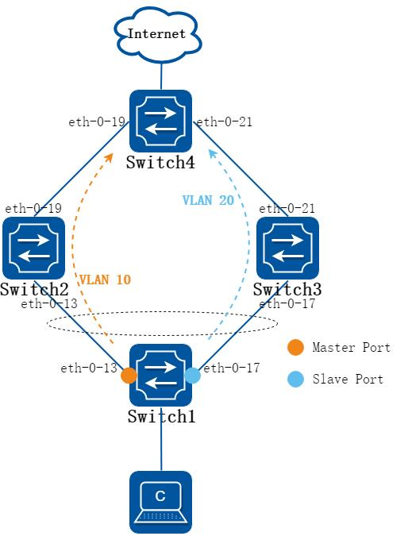

**图16-53 Smart-Link Typical Topology**

在主备备份的方案中，所有数据都通过一条链路进行传输，另一条链路将处于闲置状态。

为了提高链路利用率，可以使用负载分担的配置方案。如上图所示，将VLAN 20 配置为Smart Link 负载分担实例，让VLAN 20 的数据通过Switch1 的eth-0-17 端口进行传输。

而未配置为负载分担实例的VLAN 10 的数据是通过eth-0-13 端口进行传输，从而实现VLAN 流量的负载分担。

##### 2. 配置步骤

以下配置如未说明在哪个Switch 配置，则表示所有Switch 配置相同：

##### 步骤1 进入配置模式

```
Switch# configure terminal
```

##### 步骤2 进入vlan 配置模式，并创建vlan

```
Switch(config)# vlan database
Switch(config-vlan)# vlan 10,20
Switch(config-vlan)# exit
```

##### 步骤3 设置STP 模式，创建mstp 实例

```
Switch(config)# spanning-tree mode mstp
Switch(config)# spanning-tree mst configuration
Switch(config-mst)# instance 1000 vlan 10
Switch(config-mst)# instance 2000 vlan 20
Switch(config-mst)# exit
```

##### 步骤4 进入接口配置模式，配置接口属性

在Switch1 和Switch2 配置：

```
Switch1&2(config)# interface eth-0-13
Switch1&2(config-if)# switchport mode trunk
Switch1&2(config-if)# switchport trunk allowed vlan all
Switch1&2(config-if)# spanning-tree port disable
Switch1&2(config-if)# no shutdown
Switch1&2(config-if)# exit
```

在Switch1 和Switch3 配置：

```
Switch1&3(config)# interface eth-0-17
Switch1&3(config-if)# switchport mode trunk
Switch1&3(config-if)# switchport trunk allowed vlan all
Switch1&3(config-if)# spanning-tree port disable
Switch1&3(config-if)# no shutdown
Switch1&3(config-if)# exit
```

在Switch2 和Switch4 配置：

```
Switch2&4(config)# interface eth-0-19
Switch2&4(config-if)# switchport mode trunk
Switch2&4(config-if)# switchport trunk allowed vlan all
Switch2&4(config-if)# spanning-tree port disable
Switch2&4(config-if)# no shutdown
Switch2&4(config-if)# exit
```

在Switch3 和Switch4 配置：

```
Switch3&4(config)# interface eth-0-21
Switch3&4(config-if)# switchport mode trunk
Switch3&4(config-if)# switchport trunk allowed vlan all
Switch3&4(config-if)# spanning-tree port disable
Switch3&4(config-if)# no shutdown
Switch3&4(config-if)# exit
```

##### 步骤5 创建smart link 组并配置其属性

在Switch1 配置：

```
Switch1(config)# smart-link group 1
Switch1(config-smlk-group)# interface eth-0-13 master
Switch1(config-smlk-group)# interface eth-0-17 slave
Switch1(config-smlk-group)# protected mstp instance 1000
Switch1(config-smlk-group)# protected mstp instance 2000
Switch1(config-smlk-group)# load-balance instance 1000
Switch1(config-smlk-group)# flush send control-vlan 20 password simple abc
Switch1(config-smlk-group)# group enable
Switch1(config-smlk-group)# exit
```

使用”load-balance instance 1000”命令，使instance 1000 的流量从slave 端口转发。

##### 步骤6 上游设备使能接收flush 报文的功能

在Switch2 配置：

```
Switch2(config)# interface eth-0-13
Switch2(config-if)# smart-link flush receive control-vlan 20 password simple abc
Switch2(config-if)# exit
```

在Switch3 配置：

```
Switch3(config)# interface eth-0-17
Switch3(config-if)# smart-link flush receive control-vlan 20 password simple abc
Switch3(config-if)# exit
```

在Switch4 配置：

```
Switch4(config)# interface eth-0-19
Switch4(config-if)# smart-link flush receive control-vlan 20 password simple abc
Switch4(config-if)# exit
Switch4(config)# interface eth-0-21
Switch4(config-if)# smart-link flush receive control-vlan 20 password simple abc
Switch4(config-if)# exit
```

##### 步骤7 退出配置模式

```
Switch(config)# end
```

## 16.10 Multi-Link配置

### 16.10.1 概述

#### 简介

Multi-Link，中文译为多链路，又称为多备份链路，是一种为链路多上行提供可靠高效的备份和切换机制的解决方案。该计划功能和Smart Link 类似，备份的链路从一条扩充为多条，最多可以有4 个成员。

该功能还能提供链路负载均衡的功能。

### 16.10.2 配置举例

#### Multi-Link 基本配置

##### 1. 组网拓扑

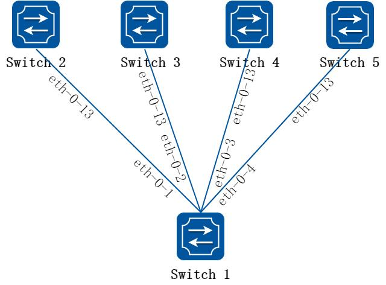

**图16-54 Multi-Link Typical Topology**

上面是一个Mulit-link 的典型配置，交换机1 配置Multi-link 组；交换机2、3、4 和

5 配置Multi-link 的报文接收。

##### 2. 配置步骤

下面的示例给出了Multi-Link 链路多上行保护的配置。

注意事项：

Multi-Link 组的控制vlan 和保护vlan 必须事先在vlan database 创建好。

Multi-Link 组的端口必须把STP 关闭。

Multi-Link 组的保护实例必须事先在MSTP 模块先创建好。

给每台交换机配置VLAN 2-10，MSTP instance1-4。

以下配置如未说明在哪个Switch 配置，则表示所有Switch 配置相同：

##### 步骤1 进入配置模式

```
Switch# configure terminal
```

##### 步骤2 进入vlan 配置模式，并创建vlan

```
Switch(config)# vlan database
Switch(config- vlan)# vlan 2-10
Switch(config- vlan)# exit
```

##### 步骤3 设置STP 模式，创建mstp 实例

```
Switch(config)# spanning-tree mode mstp
Switch(config)# spanning-tree mst configuration
Switch(config-mst)# instance 1 vlan 1
Switch(config-mst)# instance 2 vlan 2
Switch(config-mst)# instance 3 vlan 3
Switch(config-mst)# instance 4 vlan 4-10
Switch(config-mst)# exit
```

##### 步骤4 进入接口配置模式，配置接口属性

Switch1 的接口配置：

```
Switch1(config)# interface range eth-0-1 to eth-0-4
Switch1(config-if)# switchport mode trunk
Switch1(config-if)# switchport trunk allowed vlan all
Switch1(config-if)# spanning-tree port disable
Switch1(config-if)# no shutdown
Switch1(config-if)# exit
```

Switch2 ~ 5 的接口配置：

```
Switch2345(config)# interface eth-0-13
Switch2345(config-if)# switchport mode trunk
Switch2345(config-if)# switchport trunk allowed vlan all
Switch2345(config-if)# multi-link flush receive control-vlan 10 password simple test
Switch2345(config-if)# no shutdown
Switch2345(config-if)# exit
```

##### 步骤5 配置multi link 组并设置组的属性

在Switch1 配置multi link 组：

```
Switch1(config)# multi-link group 1
Switch1(config-multilk-group)# interface eth-0-1 priority 1
Switch1(config-multilk-group)# interface eth-0-2 priority 2
Switch1(config-multilk-group)# interface eth-0-3 priority 3
Switch1(config-multilk-group)# interface eth-0-4 priority 4
Switch1(config-multilk-group)# protected mstp instance 1
Switch1(config-multilk-group)# protected mstp instance 2
Switch1(config-multilk-group)# protected mstp instance 3
Switch1(config-multilk-group)# protected mstp instance 4
Switch1(config-multilk-group)# load-balance instance 2 priority 2
Switch1(config-multilk-group)# load-balance instance 3 priority 3
Switch1(config-multilk-group)# load-balance instance 4 priority 4
Switch1(config-multilk-group)# restore time 40
Switch1(config-multilk-group)# restore enable
Switch1(config-multilk-group)# flush send control-vlan 10 password simple test
Switch1(config-multilk-group)# group enable
Switch1(config-multilk-group)# exit
```

##### 步骤6 退出配置模式

```
Switch(config)# end
```

##### 步骤7 检查配置

Switch1 显示结果：

```
Switch1# show multi-link group 1
Multi-link group 1 information:
The multi-link group was enabled.
============================================================
Auto-restore:
state
time
count
Last-time
enabled
40
0
N/A
============================================================
Protected instance: 1
2
3
4
Load balance instance: 2(to P2)
3(to P3)
4(to P4)
Flush sender , Control-vlan ID: 10
Password:test
============================================================
INTERFACE:
Role
Member
DownCount Last-Down-Time
FlushCount Last-Flush-Time
PRI1
eth-0-1
0
N/A
1
2016/09/05,07:13:24
PRI2
eth-0-2
0
N/A
1
2016/09/05,07:13:24
PRI3
eth-0-3
0
N/A
1
2016/09/05,07:13:24
PRI4
eth-0-4
0
N/A
1
2016/09/05,07:13:24
============================================================
Instance states in the member interfaces:
A - ACTIVE ,
B -BLOCK
, D-The interface is link-down
Map-instance-ID
P1(eth-0-1 )
P2(eth-0-2 )
P3(eth-0-3 )
P4(eth-0-4 )
1
A
B
B
B
2
B
A
B
B
3
B
B
A
B
4
B
B
B
A
```

Switch2~5 显示结果：

```
Switch2345# show multi-link
Relay multi-link flush packet is enabled
Multi-link flush receiver interface:
eth-0-13
control-vlan:10
password:test
Multi-link received flush packet number:0
Multi-link processed flush packet number:0
Multi-link tcn is disabled
Multi-link tcn query count
:2
Multi-link tcn query interval :10
Multi-link Group Number is 0.
```

#### Multi-Link 增强配置

##### 1. 组网拓扑

当分布在不同交换机的两组multi-link 作相互链路备份时，会由于一方的multi-link成员的保护实例被block 住而无法进行链路相互备份。比如如下用户场景：

核心交换机1、核心交换机2、接入交换机1、接入交换机2 形成全网状拓扑。

接入交换机1 配置multi-link 协议，链路a、b、c 优先级分别为1、2、3；

接入交换机2 配置multi-link 协议，链路d、e 优先级分别为1、2；

正常情况下，链路b、c、e 处于block 状态，链路a、d 处于active 状态，如下图所示：

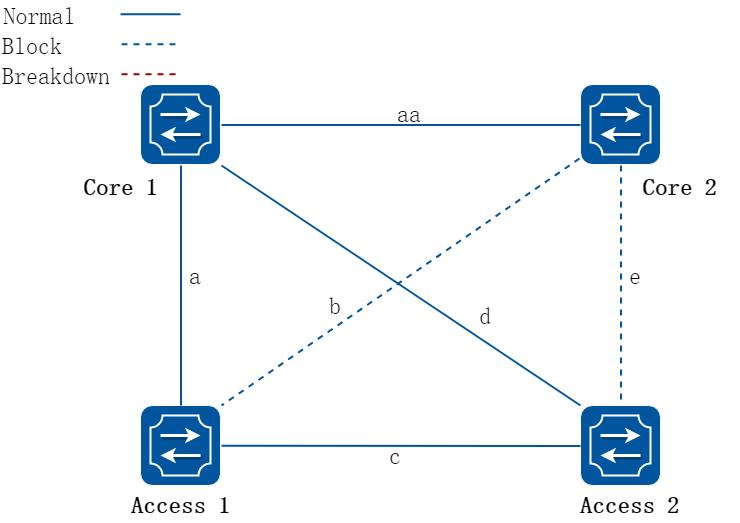

当接入交换机2 链路d、e 全部断掉后，仅余下链路c 与接入交换机1 连接，如下图所示：

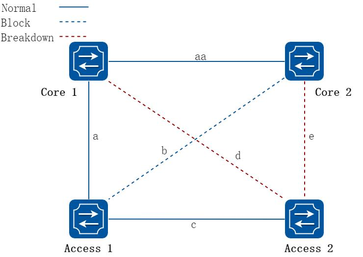

此时，接入交换机1 链路a 处于active 状态，接入交换机对应链路c 的端口处于block状态，接入交换机2 处于孤岛状态。

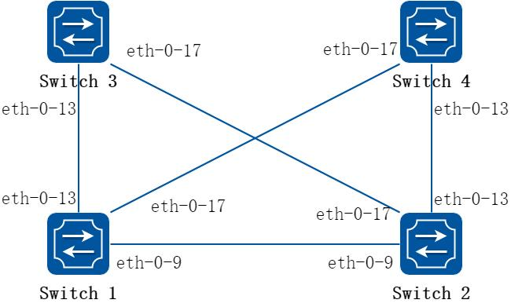

**图16-55 Multilink-enhance Typical Topology**

上图是一个Mulit-link 的典型配置，交换机1, 2 均配置Multi-link 组。Switch1 multi-link 组里面配有三个成员，且优先级最低的成员为multi-link 增强的接受口。

Switch2 multi-link 组里面配有两个成员，此外还配有multi-link 增强的发送口。

下面的示例给出了Multi-Link 链路多上行保护的配置。

注意事项：

Multi-Link 组的控制vlan 和保护vlan 必须事先在vlan database 创建好。

Multi-Link 组的端口必须把STP 关闭。

Multi-Link 组的保护实例必须事先在MSTP 模块先创建好。

Multi-link 组中需要先配flush send 的control vlan 和password，然后才能配置multilink 增强给每台交换机配置VLAN 10, 20, 30, 40，MSTP instance1,2。

##### 2. 配置步骤

以下配置如未说明在哪个Switch 配置，则表示所有Switch 配置相同：

##### 步骤1 进入配置模式

```
Switch# configure terminal
```

##### 步骤2 进入vlan 配置模式，并创建vlan

```
Switch(config)# vlan database
Switch(config-vlan)# vlan 10
Switch(config-vlan)# vlan 20
Switch(config-vlan)# vlan 30
Switch(config-vlan)# vlan 40
Switch(config-vlan)# exit
```

##### 步骤3 设置STP 模式，创建mstp 实例

```
Switch(config)# spanning-tree mode mstp
Switch(config)# spanning-tree mst configuration
Switch(config-mst)# instance 1 vlan 10
Switch(config-mst)# instance 1 vlan 30
Switch(config-mst)# instance 2 vlan 20
Switch(config-mst)# instance 2 vlan 40
Switch(config-mst)# exit
```

##### 步骤4 进入接口配置模式，配置接口属性

Switch1 的接口配置：

```
Switch1(config)# interface range eth-0-9
Switch1(config-if)# switchport mode trunk
Switch1(config-if)# switchport trunk allowed vlan all
Switch1(config-if)# spanning-tree port disable
Switch1(config-if)# no shutdown
Switch1(config-if)# exit
```

```
Switch1(config)# interface range eth-0-13
Switch1(config-if)# switchport mode trunk
Switch1(config-if)# switchport trunk allowed vlan all
Switch1(config-if)# spanning-tree port disable
Switch1(config-if)# no shutdown
Switch1(config-if)# exit
Switch1(config)# interface range eth-0-17
Switch1(config-if)# switchport mode trunk
Switch1(config-if)# switchport trunk allowed vlan all
Switch1(config-if)# spanning-tree port disable
Switch1(config-if)# no shutdown
Switch1(config-if)# exit
```

Switch2 的接口配置：

```
Switch2(config)# interface eth-0-13
Switch2(config-if)# switchport mode trunk
Switch2(config-if)# switchport trunk allowed vlan all
Switch2(config-if)# spanning-tree port disable
Switch2(config-if)# no shutdown
Switch2(config-if)# exit
Switch2(config)# interface eth-0-17
Switch2(config-if)# switchport mode trunk
Switch2(config-if)# switchport trunk allowed vlan all
Switch2(config-if)# spanning-tree port disable
Switch2(config-if)# no shutdown
Switch2(config-if)# exit
Switch2(config)# interface eth-0-9
Switch2(config-if)# multi-link flush receive control-vlan 30 password simple a
Switch2(config-if)# exit
```

Switch3 的接口配置：

```
Switch3(config)# interface eth-0-13
Switch3(config-if)# multi-link flush receive control-vlan 30 password simple a
Switch3(config-if)# exit
Switch3(config)# interface eth-0-17
Switch3(config-if)# multi-link flush receive control-vlan 10 password simple b
Switch3(config-if)# exit
```

Switch4 的接口配置：

```
Switch4(config)# interface eth-0-13
Switch4(config-if)# multi-link flush receive control-vlan 10 password simple b
Switch4(config-if)# exit
Switch4(config)# interface eth-0-17
Switch4(config-if)# multi-link flush receive control-vlan 30 password simple a
Switch4(config-if)# exit
```

##### 步骤5 配置multi link 组并设置组的属性

Switch1 的multi link 组：

```
Switch1(config)# multi-link group 1
Switch1(config-multilk-group)# interface eth-0-13 priority 1
Switch1(config-multilk-group)# interface eth-0-17 priority 2
Switch1(config-multilk-group)# interface eth-0-9 priority 3
Switch1(config-multilk-group)# protected mstp instance 1
```

```
Switch1(config-multilk-group)# protected mstp instance 2
Switch1(config-multilk-group)# flush send control-vlan 30 password simple a
Switch1(config-multilk-group)# multilink-enhance receive control-vlan 10 password b interface eth-0-9
Switch1(config-multilk-group)# group enable
Switch1(config-multilk-group)# exit
```

Switch2 的multi link 组：

```
Switch2(config)# multi-link group 1
Switch2(config-multilk-group)# interface eth-0-13 priority 1
Switch2(config-multilk-group)# interface eth-0-17 priority 2
Switch2(config-multilk-group)# protected mstp instance 1
Switch2(config-multilk-group)# protected mstp instance 2
Switch2(config-multilk-group)# flush send control-vlan 10 password simple b
Switch2(config-multilk-group)# multilink-enhance interface eth-0-9
Switch2(config-multilk-group)# group enable
Switch2(config-multilk-group)# exit
```

##### 步骤6 退出配置模式

```
Switch(config)# end
```

##### 步骤7 检查配置

Switch1 显示结果：

```
Switch1# show multi-link group 1
Multi-link group 1 information:
The multi-link group was enabled.
============================================================
Auto-restore:
state
time
count
Last-time
disabled
60
0
N/A
============================================================
Protected instance: 1
2
Load balance instance:
Flush sender , Control-vlan ID: 30
Password: a
============================================================
INTERFACE:
Role
Member
DownCount Last-Down-Time
FlushCount Last-Flush-Time
PRI1
eth-0-13
0
N/A
5
2017/05/15,07:50:11
PRI2
eth-0-17
0
N/A
0
N/A
PRI3
eth-0-9
1
2017/05/15,07:48:46 5
2017/05/15,07:50:11
PRI4
N/A
0
N/A
0
N/A
============================================================
Instance states in the member interfaces:
A-ACTIVE ,
B-BLOCK ,
A(E)-ENHANCE_ACTIVE
D-The interface is link-down
Map-instance-ID
P1(eth-0-13)
P2(eth-0-17)
P3(eth-0-9)
P4(N/A)
1
A
B
B
D
2
A
B
B
D
Switch1# show multi-link
Relay multi-link flush packet is enabled
Multi-link enhance receiver interface:
eth-0-9
control-vlan:10
password:b
Multi-link received flush packet number : 0
Multi-link processed flush packet number: 0
Multi-link received enhance packet number : 4
```

```
Multi-link processed enhance packet number: 4
Multi-link tcn is disabled
Multi-link tcn query count
: 2
Multi-link tcn query interval : 10
Multi-link Group Number is 1.
Group-ID
State
Pri-1
Pri-2
Pri-3
Pri-4
1
enabled
eth-0-13
eth-0-17
eth-0-9
N/A
```

Switch2 显示结果：

```
Switch2# show multi-link group 1
Multi-link group 1 information:
The multi-link group was enabled.
============================================================
Auto-restore:
state
time
count
Last-time
disabled
60
0
N/A
============================================================
Protected instance: 1
2
Load balance instance:
Flush sender , Control-vlan ID: 10
Password: b
Multilk enhance interface: eth-0-9, Control-vlan ID: 10
Password: b
============================================================
INTERFACE:
Role
Member
DownCount Last-Down-Time
FlushCount Last-Flush-Time
PRI1
eth-0-13
1
2017/05/15,07:49:15 0
N/A
PRI2
eth-0-17
2
2017/05/15,07:50:03 3
2017/05/15,07:50:11
PRI3
N/A
0
N/A
0
N/A
PRI4
N/A
0
N/A
0
N/A
============================================================
ENHANCE INTERFACE:
Role
Member
DownCount Last-Down-Time
EnhanceCount Last-SendEnhance-Ti
me
M-En
eth-0-9
0
N/A
0
N/A
============================================================
Instance states in the member interfaces:
A-ACTIVE ,
B-BLOCK ,
A(E)-ENHANCE_ACTIVE
D-The interface is link-down
Map-instance-ID
P1(eth-0-13)
P2(eth-0-17)
P3(N/A)
P4(N/A)
1
A
B
D
D
2
A
B
D
D
Switch2# show multi-link
Relay multi-link flush packet is enabled
Multi-link received flush packet number : 0
Multi-link processed flush packet number: 0
Multi-link received enhance packet number : 0
Multi-link processed enhance packet number: 0
Multi-link tcn is disabled
Multi-link tcn query count
: 2
Multi-link tcn query interval : 10
Multi-link Group Number is 1.
Group-ID
State
Pri-1
Pri-2
Pri-3
Pri-4
1
enabled
eth-0-13
eth-0-17
N/A
N/A
```

## 16.11 Monitor-Link配置

### 16.11.1 概述

#### 简介

Monitor Link 是对Smart Link 进行补充而引入的端口联动方案，用于扩展Smart Link的链路备份的范围，通过监控上行链路对下行链路进行同步设置，达到上行链路故障迅速传达给下行设备，从而触发Smart Link 的主备链路切换，防止长时间因上行链路故障而出现流量丢失。

### 16.11.2 配置举例

##### 1. 组网拓扑

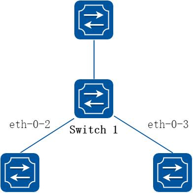

**图16-56 monitor link**

##### 2. 配置步骤

##### 步骤1 进入配置模式

```
Switch# configure terminal
```

##### 步骤2 进入接口配置模式，打开接口

```
Switch(config)# interface range eth-0-1 to eth-0-3
Switch(config-if-range)# no shutdown
Switch(config-if-range)# exit
```

##### 步骤3 配置monitor link 组并设置组的属性

```
Switch(config)# monitor-link group 1
Switch(config-mtlk-group)# monitor-link uplink interface eth-0-1
Switch(config-mtlk-group)# monitor-link downlink interface eth-0-2
Switch(config-mtlk-group)# monitor-link downlink interface eth-0-3
Switch(config-mtlk-group)# exit
```

##### 步骤4 退出配置模式

```
Switch(config)# end
```

##### 步骤5 检查配置

```
Switch# show monitor-link group
Group Id: 1
Monitor link status: UP
Role
Member
Last-up-time
Last-down-time
upcount
downcount
UpLk 1
eth-0-1
2011/07/15,02:07:31
2011/07/15,02:07:31
2
1
DwLk 1
eth-0-2
2011/07/15,02:07:34
2011/07/15,02:07:31
1
1
DwLk 2
eth-0-3
N/A
N/A
0
0
```

## 16.12 VRRP配置

### 16.12.1 概述

#### 简介

##### 1. 缩略语说明

| 缩略语 | 英文全称 | 翻译与解释 |
|---|---|---|
| VRRP | Virtual Router Redundancy<br>Protocol | 虚拟路由器冗余协议 |
| VRID | Virtual Router ID | 虚拟路由器编号 |

VRRP 全称为Virtual Router Redundancy Protocol(虚拟路由器冗余协议)，是一种容错协议，它保证当主机的下一跳路由器出现故障时，另一台路由器可以及时代替出现故障的路由器进行工作，从而保持网络通信的连续性和可靠性。

通常，子网内的所有主机都设置一条相同的到网关的缺省路由。主机发出的所有目的地址不在本网段的报文将通过缺省路由发往网关，从而实现主机与外部网络的通信。当网关发生故障时，本网段内所有以网关为缺省路由的主机将中断与外部网络的通信。

缺省路由为用户的配置操作提供了方便，但是对缺省网关设备提出了很高的稳定性要求。

增加出口网关是提高系统可靠性的常见方法，此时如何在多个出口之间进行选路就成为需要解决的问题。

VRRP（Virtual Router Redundancy Protocol，虚拟路由器冗余协议）可以解决以上问题。在具有多播或广播能力的局域网（如以太网）中，借助VRRP 能在某台设备出现故障时仍然提供高可靠的缺省链路，而无需修改用户的配置信息。

VRRP 将局域网内的一组路由器（包括一个Master 路由器和若干个Backup 路由器）组成一个备份组，功能上相当于一台虚拟路由器。

VRRP 备份组具有以下特点：

局域网内的主机仅需要知道这个虚拟路由器的IP 地址，并将其设置为缺省路由的下一跳地址。

网络内的主机通过这个虚拟路由器与外部网络进行通信。

备份组内的路由器根据一定的选举机制，分别承担网关的功能。当备份组内承担网关功能的路由器发生故障时，其余的路由器将取代它继续履行网关职责。

#### 背景

随着网络技术的不断发展，人们对于网络可靠性的要求不断提高，对于终端用户来说，保证他们可以与外部网络实时保持联系是十分重要的，稳定可靠的网络能给用户带来良好的体验。

当前用户主机都是通过配置默认网关与外部网络取得联系，一旦默认网关出现了运行故障，主机就会失去与外部的联系。一般情况下，由于主机只能配置一个默认网关，想要通过配置多个网关实现网关冗余是难以实现的。

因此，在常规网络配置不变的情况下，实现下一跳网关的备份需要新的技术，VRRP 的出现很好地解决了这个问题。

VRRP 可以将多台设备组建成一个虚拟设备，配置虚拟设备的IP 地址作为缺省网关，实现缺省网关的备份。当网关设备出现故障时，VRRP 能够通过选举新的网关设备承担流量转发的任务，保障网络的可靠通信。VRRP 技术实现了主机单网关配置模式下网关的冗余备份，保障了主机能够通过备份网关继续与外部网络保持通信的能力。

VRRP 工作过程中仅有实际承担流量转发的设备能发送VRRP 报文，协商自己和备份设备之间的工作状态。网络开销较小。

如下图所示，通常情况下，终端主机是通过将在同一个局域网内的路由器作为其第一个下一跳连接到企业网的。终端主机最常见的配置就是静态配置这个默认网关。这可以最大限度地减少配置和处理开销。此配置方法的主要问题是如果这第一跳路由器出问题，它会产生一个单点故障。

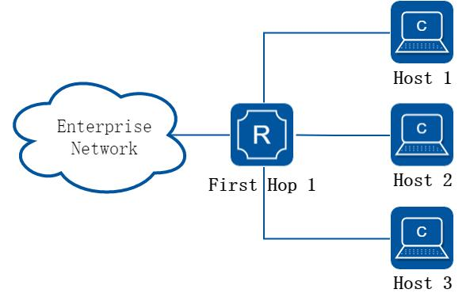

**图16-57 Without VRRP**

虚拟路由器冗余协议试图通过引入一个虚拟路由器的概念来解决这个问题，它通常由在同一子网中的两个或两个以上的VRRP 路由器组成。同时它还引入了一个虚拟IP 地址的概念，终端主机使用这个IP 作为它们的默认网关地址。只有主路由器负责转发数据包，在主路由器出现故障时，其他路由器（备份）中的一个代替主路由器负责转发。

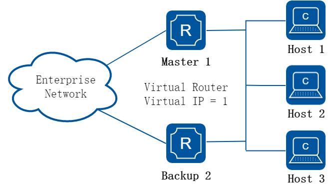

**图16-58 With VRRP**

上述配置概述可能不是非常有用，因为它的成本增加一倍，并且一台路由器在大部分时间都闲置。然而，我们可以创建两个虚拟路由器进行负载分担来避免这个问题。

#### 原理描述

##### 1. 术语

Backup Router：VRRP 备份路由器。当Master 路由器转发失败的时候启用备份路由器。

Critical IP：VRRP 路由器发送/接收一个特定的会话信息的IP 地址。

IP Address Owner：VRRP 路由器将虚拟路由器的IP 地址作为真实的接口地址。当这台设备正常工作时，它会响应目的地址是虚拟IP 地址的报文，如ping、TCP 连接等。

Master Router：拥有虚拟IP 地址的路由器。此时它成为主机的默认网关，负责转发数据流。

Virtual IP：虚拟路由器的IP 地址，一个虚拟路由器可以有一个IP 地址，由用户配置。

Virtual Router：由VRRP 管理的抽象设备，又称为VRRP 备份组，被当作一个共享局域网内主机的缺省网关。它包括了一个虚拟路由器标识符和一个虚拟IP 地址。

VRRP Router：运行VRRP 的设备，它可能属于一个或多个虚拟路由器。

##### 2. 报文格式

VRRP 报文用于将Master 设备的优先级和状态通告给同一VRRP 备份组下的所有Backup设备。

VRRP 协议报文封装到IP 报文中，发送到分配给VRRP 的IP 组播地址。

VRRP 协议包含两个版本：VRRPv2 和VRRPv3，其中VRRPv2 仅支持IPv4 网络，VRRPv3 支持IPv6 网络。

IPv4 报文中源IP 地址为发送报文接口的主IP 地址，目的IP 地址为224.0.0.18，协议号为112，TTL 为255。

IPv6 报文中源IP 地址为发送报文接口的主IP 地址，目的IP 地址为FF02::12，Next Header 为112，Hop Limit 为255。

主IP 地址（Primary IP Address）：从接口的真实IP 地址中选出来的一个主用IP 地址，通常选择为接口配置的第一个IP 地址。

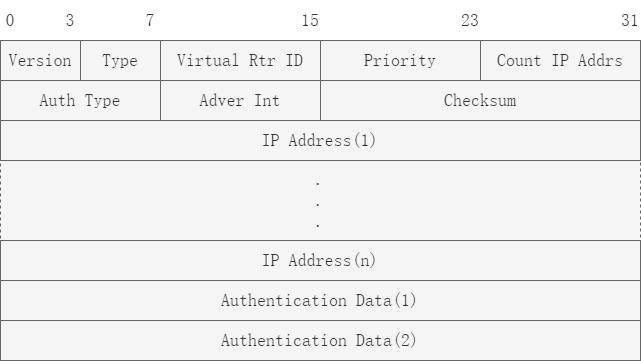

**图16-59 VRRP2 报文格式**

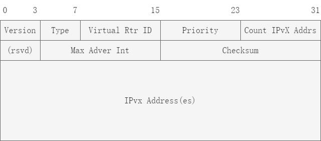

**图16-60 VRRP3 报文格式**

**表16-2 VRRP 报文字段解释**

| 报文字段 | VRRPv2 | VRRPv3 |
|---|---|---|
| Version | VRRP 协议版本号，取值为2 | VRRP 协议版本号，取值为3 |
| Type | VRRP 通告报文的类型，取值为1<br>表示Advertisement。 | ，相同 |
| Virtual Rtr ID（VRID） | 虚拟路由器ID，取值范围是1～<br>255 | 相同 |
| Priority | Master 设备在备份组中的优先<br>级，取值范围是0～255。0 表示<br>设备停止参与VRRP 备份组，用来<br>使备份设备尽快成为Master 设<br>备，而不必等到计时器超时；255<br>则保留给IP 地址拥有者。缺省值<br>是100。 | 相同 |
| Count IP Addrs/Count IPvX Addr | 备份组中虚拟IPv4 地址的个数。 | 备份组中虚拟IPv4 或虚拟IPv6<br>地址的个数 |
| Auth Type | VRRP 报文的认证类型。协议中指<br>定了3 种类型： 0：Non<br>Authentication，表示无认证。<br>1：Simple Text Password，表示 | 不支持 |
|  | 明文认证方式。 2：IP<br>Authentication Header，表示<br>MD5 认证方式。 |  |
| Adver Int/Max Adver Int | VRRP 通告报文的发送时间间隔，<br>单位是秒，缺省值为1 秒。 | VRRP 通告报文的发送时间间隔，<br>单位是厘秒，缺省值为100 厘秒<br>（1 秒）。 |
| IP Address/IPvX Address(es) | VRRP 备份组的虚拟IPv4 地址，<br>所包含的地址数定义在Count IP<br>Addrs 字段。 | VRRP 备份组的虚拟IPv4 地址或<br>者虚拟IPv6 地址，所包含的地址<br>数定义在Count IPvX Addrs 字<br>段。 |
| Authentication Data | VRRP 报文的认证字。目前只有明<br>文认证和MD5 认证才用到该部<br>分，对于其它认证方式，一律填<br>0。 | 不支持 |
| rsvd | 无 | VRRP 报文保留字段，置为0。 |

##### 3. 工作原理

虚拟路由器简介将一组路由器划分到一起，创建一个VRRP 备份组，一个VRRP 备份组在功能上就相当于一个虚拟路由器，使用VRID 进行标识。虚拟路由器拥有自己的IP 地址和MAC 地址，外在表现和一台实际的路由器完全一样。局域网内的主机将虚拟路由器的IP 设置为默认网关，通过虚拟路由器与外部网络进行通信。虚拟路由器由多个真实路由器组成，包括一个Master 路由器和多个Backup 路由器。当Master 路由器正常工作时，承担实际的报文转发工作。当Master 设备出现故障时，Backup 设备中的一台设备将接替成为新的Master 路由器，承担报文转发工作。


**图16-61 虚拟路由器示意图**

VRRP 状态机VRRP 协议中定义了三种状态机：初始状态（Initialize）、活动状态（Master）和备份状态（Backup）。只有处于Master 状态的设备才会承担报文转发任务。

Initialize 状态为VRRP 不可用状态，处于该状态的设备不会对VRRP 报文做任何处理；

VRRP 需要保证Master 和Backup 设备能够协调工作，需要实现两个功能：

Master 设备的选举；

Master 设备的状态通告。

下面将从状态机的转换逻辑出发，描述VRRP 如何实现这两个功能。

状态转化逻辑

(1)Initialize 状态:在设备刚配置VRRP 或者设备出现故障时会处于Initialize 状态，设备收到接口UP 的消息后，如果设备优先级为255，即IP 地址拥有者，会直接切换为Master 状态，否则切换为Backup 状态。转化流程如下图所示。


**图16-62 Initialize 状态机转化示意图**

(2)Master 状态:当一个VRRP 备份组同时出现多个Master 设备时，Master 设备会收到来自其他Master设备的VRRP 报文，通过比较本设备和对端设备的优先级大小，确定本设备是否继续保持Master 状态，如果优先级相同，则IP 地址较大的设备优先级较高。转化流程如下图所示。


**图16-63 Master 状态机转化示意图**

Master 设备会周期性发送VRRP 报文，向Backup 设备通告自身状态。Master 设备主动退出VRRP 备份组时，Master 设备会发送优先级为0 的VRRP 报文，通告其他Backup 设备尽快选举出新的Master 设备。Master 设备退出VRRP 备份组或者出现故障后，进入Initialize 状态，遵循Initialize 状态机转换规则。

(3)Backup 状态:Backup 设备会周期性收到Master 设备的VRRP 报文，若Master_Down_Interval 定时器结束未收到通告报文，则Backup 设备会判定Master 设备出现故障，将自身切换为Master状态。Master_Down_Interval 取值为：3 × Advertisement_Interval + Skew_time，单位为秒。

Backup 设备收到优先级为0 的VRRP 报文时，说明Master 设备主动退出VRRP 备份组，Backup 设备需要尽快切换为Master 状态，该切换时间称为Skew Time，计算方式为：

Backup 设备的优先级/129，单位为秒。

Backup 设备通过VRRP 报文获取Master 设备优先级：

当Backup 设备切换为Master 状态后，需要立刻发送携带虚拟路由器虚拟IP 地址和虚拟MAC 地址的免费ARP 报文，刷新与之连接的设备的MAC 表项，将用户流量引到新的Master 设备上。

Backup 状态机的转化示意图如下图所示。


**图16-64 Backup 状态机转化示意图**

当定时器设置的值较小时，Master 设备的VRRP 报文可能由于网络拥堵无法及时送至Backup 设备，当Backup 设备切换为Master 状态之后，收到VRRP 报文后重新切换为Backup 状态，发生Master 状态反复抢占的现象。

为了缓解该现象，可以在Backup 设备上配置抢占延时，当定时器结束之后再等待抢占延时结束，在抢占模式下切换为Master 状态。

状态机对报文的处理逻辑当VRRP 设备处于Master 状态时：

以虚拟MAC 地址响应对虚拟IP 地址的ARP 请求；

```
−
```

转发目的MAC 地址为虚拟MAC 地址的IP 报文；

```
−
```

如果该设备是虚拟IP 地址拥有者，则接收目的IP 为这个虚拟IP 地址的IP 报

```
−
```

文，否则丢弃这个IP 报文。

当VRRP 设备处于Backup 状态时：

对虚拟IP 地址的ARP 请求，不予响应；

```
−
```

丢弃目的IP 地址为虚拟IP 地址的IP 报文。

```
−
```

### 16.12.2 限制与注意事项

VRRP 不支持MD5 验证。

### 16.12.3 配置举例

#### 配置VRRP (一个虚拟路由器)

##### 1. 组网拓扑


**图16-65 VRRP with one virtual router**

##### 2. 配置步骤

主备备份方式表示业务仅由Master 路由器承担。当Master 路由器出现故障时，才会从其他Backup 路由器选举出一个接替工作。主备备份方式仅需要一个备份组，不同路由器在该备份组中拥有不同优先级，优先级最高的路由器将成为Master 路由器。

下面的例子中，所有的终端主机将虚拟路由器1 作为其默认网关。路由器R1 和R2 都运行了VRRP 协议。R1 配置为虚拟路由器1（VRID = 1）的主路由器，R2 作为虚拟路由器1 的备份路由器。如果R1 出现问题，R2 将接管转发，并为主机提供不间断的服务。

这样的配置只有一个虚拟路由器，R2 被闲置。

以下配置如未说明在哪个设备配置，则表示所有设备配置相同：

##### 步骤1 进入配置模式

```
Switch# configure terminal
```

##### 步骤2 进入接口配置模式，设置接口属性并配置地址

R1 的接口配置：

```
Switch1(config)# interface eth-0-1
Switch1(config-if)# no switchport
Switch1(config-if)# ip address 10.10.10.50/24
Switch1(config-if)# no shutdown
Switch1(config-if)# exit
```

R2 的接口配置：

```
Switch2(config)# interface eth-0-1
Switch2(config-if)# no switchport
Switch2(config-if)# ip address 10.10.10.40/24
Switch2(config-if)# no shutdown
Switch2(config-if)# exit
```

##### 步骤3 创建vrrp 实例

```
Switch(config)# router vrrp 1
Switch(config-router)# virtual-ip 10.10.10.60
Switch(config-router)# interface eth-0-1
Switch(config-router)# preempt-mode true
Switch(config-router)# advertisement-interval 5
```

##### 步骤4 设置优先级（可选）

在R1 配置。R2 不配优先级则选用默认值

```
Switch1(config-router)# priority 200
```

##### 步骤5 启用vrrp 实例然后退出

```
Switch(config-router)# enable
Switch(config-router)# exit
```

##### 步骤6 退出配置模式

```
Switch(config)# end
```

##### 步骤7 检查配置

R1 显示结果：

```
Switch1# show vrrp
vrrp session count: 1
vrrp version
: 2
VRID <1>
State
: Master
Virtual IP
: 10.10.10.60(Not IP owner)
Interface
: eth-0-1
VMAC
: 0000.5e00.0101
VRF
: Default
Uniform-mac
: -
Advt timer
: 5 second(s)
Preempt mode
: TRUE
Conf pri
: 200
Run pri
: 200
Master router ip
: 10.10.10.50
Master priority
: 200
```

```
Master advt timer
: 5 second(s)
Master down timer
: 15 second(s)
Preempt delay
: 0 second(s)
Learn master mode
: FALSE
```

R2 显示结果：

```
Switch2# show vrrp
vrrp session count: 1
vrrp version
: 2
VRID <1>
State
: Backup
Virtual IP
: 10.10.10.60(Not IP owner)
Interface
: eth-0-1
VMAC
: 0000.5e00.0101
VRF
: Default
Uniform-mac
: -
Advt timer
: 5 second(s)
Preempt mode
: TRUE
Conf pri
: 100
Run pri
: 100
Master router ip
: 10.10.10.50
Master priority
: 200
Master advt timer
: 5 second(s)
Master down timer
: 16 second(s)
Preempt delay
: 0 second(s)
Learn master mode
: FALSE
```

#### 配置VRRP (两个虚拟路由器)

##### 1. 组网拓扑


**图16-66 VRRP with two virtual router**

##### 2. 配置步骤

在路由器的一个接口上可以创建多个备份组，使得该路由器可以在一个备份组中作为Master 路由器，在其他的备份组中作为Backup 路由器。

负载分担方式是指多台路由器同时承担业务，因此负载分担方式需要两个或者两个以上的备份组，每个备份组都包括一个Master 路由器和若干个Backup 路由器，各备份组的Master 路由器可以各不相同。

下面的例子讲述如何使用两个虚拟路由器进行负载分担。R1 和R2 各自转发不同的流量，他们之间互为备份，确保流量的负载均衡。

以下配置如未说明在哪个设备配置，则表示所有设备配置相同：

##### 步骤1 进入配置模式

```
Switch# configure terminal
```

##### 步骤2 进入接口配置模式，设置接口属性并配置地址

R1 的接口配置：

```
Switch1(config)# interface eth-0-1
Switch1(config-if)# no switchport
Switch1(config-if)# ip address 10.10.10.81/24
Switch1(config-if)# no shutdown
Switch1(config-if)# exit
```

R2 的接口配置：

```
Switch2(config)# interface eth-0-1
Switch2(config-if)# no switchport
Switch2(config-if)# ip address 10.10.10.82/24
Switch2(config-if)# no shutdown
Switch2(config-if)# exit
```

##### 步骤3 创建vrrp 实例

在R1 配置：

```
Switch1(config)# router vrrp 1
Switch1(config-router)# virtual-ip 10.10.10.81
Switch1(config-router)# interface eth-0-1
Switch1(config-router)# preempt-mode true
Switch1(config-router)# advertisement-interval 5
Switch1(config-router)# enable
Switch1(config-router)# exit
Switch1(config)# router vrrp 2
Switch1(config-router)# virtual-ip 10.10.10.82
Switch1(config-router)# interface eth-0-1
Switch1(config-router)# priority 200
Switch1(config-router)# preempt-mode true
Switch1(config-router)# advertisement-interval 5
Switch1(config-router)# enable
Switch1(config-router)# exit
```

在R2 配置：

```
Switch2(config)# router vrrp 1
Switch2(config-router)# virtual-ip 10.10.10.81
Switch2(config-router)# interface eth-0-1
Switch2(config-router)# priority 200
Switch2(config-router)# preempt-mode true
```

```
Switch2(config-router)# advertisement-interval 5
Switch2(config-router)# enable
Switch2(config-router)# exit
Switch2(config)# router vrrp 2
Switch2(config-router)# virtual-ip 10.10.10.82
Switch2(config-router)# interface eth-0-1
Switch2(config-router)# preempt-mode true
Switch2(config-router)# advertisement-interval 5
Switch2(config-router)# enable
Switch2(config-router)# exit
```

##### 步骤4 退出配置模式

```
Switch(config)# end
```

##### 步骤5 检查配置

R1 显示结果：

```
Switch1# show vrrp
vrrp session count: 2
vrrp version
: 2
VRID <1>
State
: Master
Virtual IP
: 10.10.10.81(IP owner)
Interface
: eth-0-1
VMAC
: 0000.5e00.0101
VRF
: Default
Uniform-mac
: -
Advt timer
: 5 second(s)
Preempt mode
: TRUE
Conf pri
: 100
Run pri
: 255
Master router ip
: 10.10.10.81
Master priority
: 255
Master advt timer
: 5 second(s)
Master down timer
: 15 second(s)
Preempt delay
: 0 second(s)
Learn master mode
: FALSE
VRID <2>
State
: Backup
Virtual IP
: 10.10.10.82(Not IP owner)
Interface
: eth-0-1
VMAC
: 0000.5e00.0102
VRF
: Default
Uniform-mac
: -
Advt timer
: 5 second(s)
Preempt mode
: TRUE
Conf pri
: 200
Run pri
: 200
Master router ip
: 10.10.10.82
Master priority
: 255
Master advt timer
: 5 second(s)
Master down timer
: 15 second(s)
Preempt delay
: 0 second(s)
Learn master mode
: FALSE
```

R2 显示结果：

```
Switch2# show vrrp
vrrp session count: 2
vrrp version
: 2
VRID <1>
State
: Backup
Virtual IP
: 10.10.10.81(Not IP owner)
Interface
: eth-0-1
VMAC
: 0000.5e00.0101
VRF
: Default
Uniform-mac
: -
Advt timer
: 5 second(s)
Preempt mode
: TRUE
Conf pri
: 200
Run pri
: 200
Master router ip
: 10.10.10.81
Master priority
: 255
Master advt timer
: 5 second(s)
Master down timer
: 15 second(s)
Preempt delay
: 0 second(s)
Learn master mode
: FALSE
VRID <2>
State
: Master
Virtual IP
: 10.10.10.82(IP owner)
Interface
: eth-0-1
VMAC
: 0000.5e00.0102
VRF
: Default
Uniform-mac
: -
Advt timer
: 5 second(s)
Preempt mode
: TRUE
Conf pri
: 100
Run pri
: 255
Master router ip
: 10.10.10.82
Master priority
: 255
Master advt timer
: 5 second(s)
Master down timer
: 15 second(s)
Preempt delay
: 0 second(s)
Learn master mode
: FALSE
```

#### 配置VRRP Circuit Failover

##### 1. 组网拓扑


**图16-67 VRRP Circuit Failover**

##### 2. 配置步骤

之所以需要VRRP 链路故障检测功能，是由于VRRPv2 无法跟踪网关上行链路状态。引入对上行链路的监控可以有效的驱动虚拟路由器的切换从而避免“黑洞路由”。当主路由器上行接口链路发生故障时，原来的master 路由器将切换为backup 路由器，而原来的backup 路由器将接替成为master 路由器。

为了实现VRRP 链路故障检测功能，我们需要为监视的接口配置一个priority-delta 值，这个值将被附加到master 路由器上以实现VRRP 路由器从master 从backup 的切换。

在下面的例子中，两个路由器R1 和R2 配置了不同的优先级值，priority-delta 的配置要大于R1 和R2 优先级之间的差值。R1 配置有一个100 的优先级，R2 有一个90 的优先级，由于R1 优先级较高成为master 路由器。priority-delta 值配置为20，当在R1 上的上行接口eth-0-2 发生故障，R1 的优先级将变为80（100－20）。此时由于R2 比R1有更大的优先级，R2 变成Master。当R1 恢复时候，R1 优先级为100，重新成为Master。

以下配置如未说明在哪个设备配置，则表示所有设备配置相同：

##### 步骤1 进入配置模式

```
Switch# configure terminal
```

##### 步骤2 进入接口配置模式，设置接口属性并配置地址

R1 的接口配置：

```
Switch1(config)# interface eth-0-1
Switch1(config-if)# no switchport
Switch1(config-if)# ip address 10.10.10.50/24
Switch1(config-if)# no shutdown
Switch1(config-if)# exit
Switch1(config)# interface eth-0-2
Switch1(config-if)# no switchport
Switch1(config-if)# ip address 10.10.11.50/24
Switch1(config-if)# no shutdown
Switch1(config-if)# exit
```

R2 的接口配置：

```
Switch2(config)# interface eth-0-1
Switch2(config-if)# no switchport
Switch2(config-if)# ip address 10.10.10.40/24
Switch2(config-if)# no shutdown
Switch2(config-if)# exit
```

##### 步骤3 创建一个track 实例，监视端口状态

在R1 配置：

```
Switch1(config)# track 10 interface eth-0-2 linkstate
```

关于track 的更多信息请参考“track 配置”章节。

##### 步骤4 创建vrrp 实例

在R1 配置：

```
Switch1(config)# router vrrp 1
Switch1(config-router)# virtual-ip 10.10.10.1
Switch1(config-router)# interface eth-0-1
Switch1(config-router)# preempt-mode true
Switch1(config-router)# advertisement-interval 5
Switch1(config-router)# priority 100
Switch1(config-router)# track 10 decrement 20
Switch1(config-router)# enable
```

在R2 配置：

```
Switch2(config)# router vrrp 1
Switch2(config-router)# virtual-ip 10.10.10.1
Switch2(config-router)# interface eth-0-1
Switch2(config-router)# preempt-mode true
Switch2(config-router)# advertisement-interval 5
Switch2(config-router)# priority 90
Switch2(config-router)# enable
```

##### 步骤5 退出配置模式

```
Switch(config)# end
```

##### 步骤6 检查配置

R1 显示结果：

```
Switch1# show vrrp
vrrp session count: 1
vrrp version
: 2
VRID <1>
State
: Master
Virtual IP
: 10.10.10.1(Not IP owner)
Interface
: eth-0-1
VMAC
: 0000.5e00.0101
VRF
: Default
Uniform-mac
: -
Advt timer
: 5 second(s)
Preempt mode
: TRUE
Conf pri
: 100
Run pri
: 100
Track Object
: 10
Decre pri : 20
Decre pri
: 20
Master router ip
: 10.10.10.50
Master priority
: 100
Master advt timer
: 5 second(s)
Master down timer
: 16 second(s)
Preempt delay
: 0 second(s)
Learn master mode
: FALSE
```

R2 显示结果：

```
Switch2# show vrrp
vrrp session count: 1
vrrp version
: 2
VRID <1>
State
: Backup
```

```
Virtual IP
: 10.10.10.1(Not IP owner)
Interface
: eth-0-1
VMAC
: 0000.5e00.0101
VRF
: Default
Uniform-mac
: -
Advt timer
: 5 second(s)
Preempt mode
: TRUE
Conf pri
: 90
Run pri
: 90
Master router ip
: 10.10.10.50
Master priority
: 100
Master advt timer
: 5 second(s)
Master down timer
: 16 second(s)
Preempt delay
: 0 second(s)
Learn master mode
: FALSE
```

#### 配置IPv6 VRRP（一个虚拟路由器）

##### 1. 组网拓扑


**图16-68 IPv6 VRRP with one virtual router**

##### 2. 配置步骤

主备备份方式表示业务仅由Master 路由器承担。当Master 路由器出现故障时，才会从其他Backup 路由器选举出一个接替工作。主备备份方式仅需要一个备份组，不同路由器在该备份组中拥有不同优先级，优先级最高的路由器将成为Master 路由器。

下面的例子中，所有的终端主机将虚拟路由器1 作为其默认网关。路由器R1 和R2 都运行了VRRP 协议。R1 配置为虚拟路由器1（VRID = 1）的主路由器，R2 作为虚拟路由器1 的备份路由器。如果R1 出现问题，R2 将接管转发，并为主机提供不间断的服务。

这样的配置只有一个虚拟路由器，R2 被闲置。

以下配置如未说明在哪个设备配置，则表示所有设备配置相同：

##### 步骤1 进入配置模式，使能IPv6

```
Switch# configure terminal
Switch(config)# ipv6 enable
```

##### 步骤2 进入接口配置模式，设置接口属性并配置地址

R1 的接口配置：

```
Switch1(config)# interface eth-0-9
Switch1(config-if)# no switchport
Switch1(config-if)# ipv6 address fe80::1 link-local
Switch1(config-if)# no shutdown
Switch1(config-if)# exit
```

R2 的接口配置：

```
Switch2(config)# interface eth-0-9
Switch2(config-if)# no switchport
Switch2(config-if)# ipv6 address fe80::2 link-local
Switch2(config-if)# no shutdown
Switch2(config-if)# exit
```

##### 步骤3 创建IPv6 VRRP 实例

```
Switch(config)# router ipv6 vrrp 1
Switch(config-router)# virtual-ipv6 fe80::1 link-local
Switch(config-router)# interface eth-0-9
```

##### 步骤4 设置优先级（可选）

在R1 配置。R2 不配优先级则选用默认值100

```
Switch1(config-router)# priority 200
```

##### 步骤5 启用IPv6 VRRP 实例，然后退出路由配置视图

```
Switch(config-router)# enable
Switch(config-router)# exit
```

##### 步骤6 退出配置模式

```
Switch(config)# end
```

##### 步骤7 检查配置

R1 显示结果：

```
Switch1# show ipv6 vrrp 1
VRID <1>
State
: Master
Virtual IP
: fe80::1(IP owner)
Interface
: eth-0-9
VMAC
: 0000.5e00.0201
VRF
: Default
Advt timer
: 1 second(s)
Preempt mode
: TRUE
Conf pri
: 200
Run pri
: 255
Master router ip
: fe80::1
Master priority
: 255
Master advt timer
: 100 centi-second(s)
Master down timer
: 3 second(s)
Preempt delay
: 0 second(s)
```

R2 显示结果：

```
Switch2# show ipv6 vrrp 1
VRID <1>
State
: Backup
Virtual IP
: fe80::1(Not IP owner)
Interface
: eth-0-9
VMAC
: 0000.5e00.0201
VRF
: Default
Advt timer
: 1 second(s)
Preempt mode
: TRUE
Conf pri
: 100
Run pri
: 100
Master router ip
: fe80::1
Master priority
: 255
Master advt timer
: 100 centi-second(s)
Master down timer
: 4 second(s)
Preempt delay
: 0 second(s)
```

#### 配置IPv6 VRRP (两个虚拟路由器)

##### 1. 组网拓扑


**图16-69 IPv6 VRRP with two virtual router**

##### 2. 配置步骤

在路由器的一个接口上可以创建多个备份组，使得该路由器可以在一个备份组中作为Master 路由器，在其他的备份组中作为Backup 路由器。

负载分担方式是指多台路由器同时承担业务，因此负载分担方式需要两个或者两个以上的备份组，每个备份组都包括一个Master 路由器和若干个Backup 路由器，各备份组的Master 路由器可以各不相同。

下面的例子讲述如何使用两个虚拟路由器进行负载分担。R1 和R2 各自转发不同的流量，他们之间互为备份，确保流量的负载均衡。

以下配置如未说明在哪个设备配置，则表示所有设备配置相同：

##### 步骤1 进入配置模式，使能IPv6

```
Switch# configure terminal
Switch(config)# ipv6 enable
```

##### 步骤2 进入接口配置模式，设置接口属性并配置地址

R1 的接口配置：

```
Switch1(config)# interface eth-0-9
Switch1(config-if)# no switchport
Switch1(config-if)# ipv6 address 2000::1/64
Switch1(config-if)# no shutdown
Switch1(config-if)# exit
```

R2 的接口配置：

```
Switch2(config)# interface eth-0-9
Switch2(config-if)# no switchport
Switch2(config-if)# ipv6 address 2000::2/64
Switch2(config-if)# no shutdown
Switch2(config-if)# exit
```

##### 步骤3 创建IPv6 VRRP 实例

在R1 配置：

```
Switch1(config)# router ipv6 vrrp 1
Switch1(config-router)# interface eth-0-9
Switch1(config-router)# priority 200
Switch1(config-router)# virtual-ipv6 fe80::1 link-local
Switch1(config-router)# virtual-ipv6 2000::1
Switch1(config-router)# enable
Switch1(config-router)# exit
Switch1(config)# router ipv6 vrrp 2
Switch1(config-router)# interface eth-0-9
Switch1(config-router)# virtual-ipv6 fe80::3 link-local
Switch1(config-router)# virtual-ipv6 2000::2
Switch1(config-router)# enable
Switch1(config-router)# exit
```

在R2 配置：

```
Switch2(config)# router ipv6 vrrp 1
Switch2(config-router)# interface eth-0-9
Switch2(config-router)# virtual-ipv6 fe80::1 link-local
Switch2(config-router)# virtual-ipv6 2000::1
Switch2(config-router)# enable
Switch2(config-router)# exit
Switch2(config)# router ipv6 vrrp 2
Switch2(config-router)# interface eth-0-9
Switch2(config-router)# priority 200
Switch2(config-router)# virtual-ipv6 fe80::3 link-local
Switch2(config-router)# virtual-ipv6 2000::2
Switch2(config-router)# enable
Switch2(config-router)# exit
```

##### 步骤4 退出配置模式

```
Switch(config)# end
```

##### 步骤5 检查配置

R1 显示结果：

```
Switch1# show ipv6 vrrp
IPv6 vrrp session count: 2
VRID <1>
State
: Master
Virtual IP
: fe80::1(Not IP owner)
2000::1(IP owner)
Interface
: eth-0-9
VMAC
: 0000.5e00.0201
VRF
: Default
Advt timer
: 1 second(s)
Preempt mode
: TRUE
Conf pri
: 200
Run pri
: 255
Master router ip
: fe80::48cc:69ff:fec8:5b00
Master priority
: 255
Master advt timer
: 100 centi-second(s)
Master down timer
: 3 second(s)
Preempt delay
: 0 second(s)
VRID <2>
State
: Backup
Virtual IP
: fe80::3(Not IP owner)
2000::2(Not IP owner)
Interface
: eth-0-9
VMAC
: 0000.5e00.0202
VRF
: Default
Advt timer
: 1 second(s)
Preempt mode
: TRUE
Conf pri
: 100
Run pri
: 100
Master router ip
: fe80::b002:86ff:febc:3700
Master priority
: 255
Master advt timer
: 100 centi-second(s)
Master down timer
: 4 second(s)
Preempt delay
: 0 second(s)
```

R2 显示结果：

```
Switch2# show ipv6 vrrp
IPv6 vrrp session count: 2
VRID <1>
State
: Backup
Virtual IP
: fe80::1(Not IP owner)
2000::1(Not IP owner)
Interface
: eth-0-9
VMAC
: 0000.5e00.0201
VRF
: Default
Advt timer
: 1 second(s)
Preempt mode
: TRUE
Conf pri
: 100
Run pri
: 100
Master router ip
: fe80::48cc:69ff:fec8:5b00
Master priority
: 255
Master advt timer
: 100 centi-second(s)
Master down timer
: 4 second(s)
Preempt delay
: 0 second(s)
VRID <2>
State
: Master
```

```
Virtual IP
: fe80::3(Not IP owner)
2000::2(IP owner)
Interface
: eth-0-9
VMAC
: 0000.5e00.0202
VRF
: Default
Advt timer
: 1 second(s)
Preempt mode
: TRUE
Conf pri
: 200
Run pri
: 255
Master router ip
: fe80::b002:86ff:febc:3700
Master priority
: 255
Master advt timer
: 100 centi-second(s)
Master down timer
: 3 second(s)
Preempt delay
: 0 second(s)
```

#### 配置IPv6 VRRP Circuit Failover

##### 1. 组网拓扑


**图16-70 IPv6 VRRP Circuit Failover**

##### 2. 配置步骤

之所以需要VRRP 链路故障检测功能，是由于VRRPv2 无法跟踪网关上行链路状态。引入对上行链路的监控可以有效的驱动虚拟路由器的切换从而避免“黑洞路由”。当主路由器上行接口链路发生故障时，原来的master 路由器将切换为backup 路由器，而原来的backup 路由器将接替成为master 路由器。

为了实现VRRP 链路故障检测功能，我们需要为监视的接口配置一个priority-delta 值，这个值将被附加到master 路由器上以实现VRRP 路由器从master 从backup 的切换。

在下面的例子中，两个路由器R1 和R2 配置了不同的优先级值，priority-delta 的配置要大于R1 和R2 优先级之间的差值。R1 配置有一个100 的优先级，R2 有一个90 的优先级，由于R1 优先级较高成为master 路由器。priority-delta 值配置为20，当在R1 上的上行接口eth2 发生故障，R1 的优先级将变为80（100－20）。此时由于R2 比R1 有更大的优先级，R2 变成Master。当R1 恢复时候，R1 优先级为100，重新成为Master。

以下配置如未说明在哪个设备配置，则表示所有设备配置相同：

##### 步骤1 进入配置模式，使能IPv6

```
Switch# configure terminal
Switch(config)# ipv6 enable
```

##### 步骤2 进入接口配置模式，设置接口属性并配置地址

R1 的接口配置：

```
Switch1(config)# interface eth-0-9
Switch1(config-if)# no switchport
Switch1(config-if)# ipv6 address 2000::1/64
Switch1(config-if)# no shutdown
Switch1(config-if)# exit
Switch1(config)# interface eth-0-1
Switch1(config-if)# no shutdown
Switch1(config-if)# exit
```

R2 的接口配置：

```
Switch2(config)# interface eth-0-9
Switch2(config-if)# no switchport
Switch2(config-if)# ipv6 address 2000::2/64
Switch2(config-if)# no shutdown
Switch2(config-if)# exit
```

##### 步骤3 创建一个track 实例，监视端口状态

在R1 配置：

```
Switch1(config)# track 10 interface eth-0-1 linkstate
```

关于track 的更多信息请参考“track 配置”章节。

##### 步骤4 创建IPv6 VRRP 实例

在R1 配置：

```
Switch1(config)# router ipv6 vrrp 1
Switch1(config-router)# interface eth-0-9
Switch1(config-router)# virtual-ipv6 fe80::1 link-local
Switch1(config-router)# virtual-ipv6 2000::3
Switch1(config-router)# track 10 decrement 20
Switch1(config-router)# enable
```

在R2 配置：

```
Switch2(config)# router ipv6 vrrp 1
Switch2(config-router)# interface eth-0-9
Switch2(config-router)# priority 90
Switch2(config-router)# virtual-ipv6 fe80::1 link-local
Switch2(config-router)# virtual-ipv6 2000::3
Switch2(config-router)# enable
```

##### 步骤5 退出配置模式

```
Switch(config)# end
```

##### 步骤6 检查配置

R1 显示结果：

```
Switch1# show ipv6 vrrp
IPv6 vrrp session count: 1
VRID <1>
State
: Master
Virtual IP
: fe80::1(Not IP owner)
2000::3(Not IP owner)
Interface
: eth-0-9
VMAC
: 0000.5e00.0201
VRF
: Default
Advt timer
: 1 second(s)
Preempt mode
: TRUE
Conf pri
: 100
Run pri
: 100
Track Object
: 10
Decre pri : 20
Master router ip
: fe80::48cc:69ff:fec8:5b00
Master priority
: 100
Master advt timer
: 100 centi-second(s)
Master down timer
: 4 second(s)
Preempt delay
: 0 second(s)
```

R2 显示结果：

```
Switch2# show ipv6 vrrp
IPv6 vrrp session count: 1
VRID <1>
State
: Backup
Virtual IP
: fe80::1(Not IP owner)
2000::3(Not IP owner)
Interface
: eth-0-9
VMAC
: 0000.5e00.0201
VRF
: Default
Advt timer
: 1 second(s)
Preempt mode
: TRUE
Conf pri
: 90
Run pri
: 90
Master router ip
: fe80::48cc:69ff:fec8:5b00
Master priority
: 100
Master advt timer
: 100 centi-second(s)
Master down timer
: 4 second(s)
Preempt delay
: 0 second(s)
```

##### 步骤7 关闭R1 端口eth-0-1，退出配置模式

```
Switch1# configure terminal
Switch1(config)# interface eth-0-1
Switch1(config-if)# shutdown
Switch1(config-if)# end
```

##### 步骤8 检查配置，R1 变为备份路由器，R2 变为主路由器

R1 显示结果：

```
Switch1# show ipv6 vrrp
IPv6 vrrp session count: 1
VRID <1>
State
: Backup
Virtual IP
: fe80::1(Not IP owner)
2000::3(Not IP owner)
```

```
Interface
: eth-0-9
VMAC
: 0000.5e00.0201
VRF
: Default
Advt timer
: 1 second(s)
Preempt mode
: TRUE
Conf pri
: 100
Run pri
: 80
Track Object
: 10
Decre pri : 20
Master router ip
: fe80::b002:86ff:febc:3700
Master priority
: 90
Master advt timer
: 100 centi-second(s)
Master down timer
: 4 second(s)
Preempt delay
: 0 second(s)
```

R2 显示结果：

```
Switch2# show ipv6 vrrp
IPv6 vrrp session count: 1
VRID <1>
State
: Master
Virtual IP
: fe80::1(Not IP owner)
2000::3(Not IP owner)
Interface
: eth-0-9
VMAC
: 0000.5e00.0201
VRF
: Default
Advt timer
: 1 second(s)
Preempt mode
: TRUE
Conf pri
: 90
Run pri
: 90
Master router ip
: fe80::b002:86ff:febc:3700
Master priority
: 90
Master advt timer
: 100 centi-second(s)
Master down timer
: 4 second(s)
Preempt delay
: 0 second(s)
```

### 16.12.4 参考文献

RFC 3768 Virtual Router Redundancy Protocol (VRRP)RFC 5798 Virtual Router Redundancy Protocol (VRRP) Version 3 for IPv4 and IPv6

## 16.13 IP-SLA配置

### 16.13.1 概述

#### 简介

IP SLA (Service Level Agreement) 是一种通过”动态监测”来实施网络性能的测量和诊断工具。”动态监测”是指在交换机中，用ping 的方式，来衡量网络是否连通和网络的性能。每一个IP SLA 操作均维护其各自操作时生成的一个返回值。这个返回值将会被tracking 进程所中断。返回值可以是OK，超过阈值，还有其他返回代码。不同的操作可以有不同的返回值。因此在系统中，只使用那些对于所有操作类型来说共同的返回值。在IPSLA 中，我们可以通过使用ICMP echo 来检查状态或路由的可达性。

### 16.13.2 配置举例

#### 配置VRF 接口的IP SLA

##### 1. 组网拓扑


**图16-71 VRF 接口的IP SLA**

##### 2. 配置步骤

以下配置如未说明在哪个Switch 配置，则表示所有Switch 配置相同：

##### 步骤1 进入配置模式

```
Switch# configure terminal
```

##### 步骤2 创建vrf 条目

```
Switch(config)# ip vrf vpn1
Switch(config-vrf)# exit
```

##### 步骤3 进入接口配置模式，配置接口属性

Switch1 的接口配置：

```
Switch1(config)# interface eth-0-1
Switch1(config-if)# no switchport
Switch1(config-if)# no shutdown
Switch1(config-if)# ip vrf forwarding vpn1
Switch1(config-if)# ip address 192.168.0.2/24
Switch1(config-if)# exit
```

Switch2 的接口配置：

```
Switch2(config)# interface eth-0-1
Switch2(config-if)# no switchport
Switch2(config-if)# no shutdown
Switch2(config-if)# ip vrf forwarding vpn1
Switch2(config-if)# ip address 192.168.0.1/24
Switch2(config-if)# exit
```

##### 步骤4 创建ip sla 条目并配置其属性

在Switch1 配置：

```
Switch1(config)# ip sla monitor 1
Switch1(config-ipsla)# type icmp-echo 192.168.0.1
Switch1(config-ipsla)# frequency 35
```

```
Switch1(config-ipsla)# timeout 5
Switch1(config-ipsla)# threshold 3000
Switch1(config-ipsla)# ttl 65
Switch1(config-ipsla)# tos 1
Switch1(config-ipsla)# data-size 29
Switch1(config-ipsla)# data-pattern abababab
Switch1(config-ipsla)# fail-percent 90
Switch1(config-ipsla)# packets-per-test 4
Switch1(config-ipsla)# interval 9
Switch1(config-ipsla)# statistics packet 10
Switch1(config-ipsla)# statistics test 3
Switch1(config-ipsla)# vrf vpn1
Switch1(config-ipsla)# exit
```

ip sla 的部分属性：

frequency：两次探测之间的时间间隔，范围1-4800，默认值60，单位为秒。

timeout：icmp 报文超时时间，范围1-4800，默认值5，单位为秒。

threshold: icmp 报文等待阈值，范围1-4800000，默认值5000，单位为毫秒。

packets-per-test：每次探测发送的报文个数，范围1-10，默认值3。

interval：一次探测中每个报文的间隔时间，范围1-4800，默认值6，单位为秒。

statistics packet：参与计算统计数据的报文数，范围0-1000，默认50。

statistics test 3：参与计算统计数据的探测次数，范围1-10，默认5。

##### 步骤5 启用ip sla 功能

在Switch1 配置：

```
Switch1(config)# ip sla monitor schedule 1
```

##### 步骤6 退出配置模式

```
Switch(config)# end
```

##### 步骤7 检查配置

Switch1 显示结果：

```
Switch1# show ip sla monitor 1
Entry 1
Type
: Echo
Admin state
: Disable
Destination address
: 192.168.0.1
Frequency
: 35s
Timeout
: 6s
Threshold
: 3000ms
Interval
: 9s
Packet per test
: 4
TTL
: 65
TOS
: 1
Data Size
: 29 bytes
Fail Percent
: 90%
Packet Item Cnt
: 10
Test Item Cnt
: 3
```

```
Vrf
: vpn1
Return code
: Unknown
```

#### 配置三层接口的IP SLA

##### 1. 组网拓扑


**图16-72 三层接口的IP SLA**

##### 2. 配置步骤

以下配置如未说明在哪个Switch 配置，则表示所有Switch 配置相同：

##### 步骤1 进入配置模式

```
Switch# configure terminal
```

##### 步骤2 进入接口配置模式，配置接口属性

Switch1 的接口配置：

```
Switch1(config)# interface eth-0-1
Switch1(config-if)# no switchport
Switch1(config-if)# no shutdown
Switch1(config-if)# ip address 192.168.0.2/24
Switch1(config-if)# exit
```

Switch2 的接口配置：

```
Switch2(config)# interface eth-0-1
Switch2(config-if)# no switchport
Switch2(config-if)# no shutdown
Switch2(config-if)# ip address 192.168.0.1/24
Switch2(config-if)# exit
```

##### 步骤3 创建ip sla 条目并配置其属性

在Switch1 配置：

```
Switch1(config)# ip sla monitor 1
Switch1(config-ipsla)# type icmp-echo
192.168.0.1
Switch1(config-ipsla)# frequency 70
Switch1(config-ipsla)# timeout 5
Switch1(config-ipsla)# exit
```

##### 步骤4 启用ip sla 功能

在Switch1 配置：

```
Switch1(config)# ip sla monitor schedule 1
```

##### 步骤5 退出配置模式

```
Switch(config)# end
```

##### 步骤6 检查配置

Switch1 显示结果：

```
Switch1# show ip sla monitor
Entry 1
Type
: Echo
Admin state
: Enable
Destination address
: 192.168.0.1
Frequency
: 10 seconds
Timeout
: 5 seconds
Threshold
: 5 seconds
Running Frequency
: 8 seconds
Return code
: OK
Switch1# ping 192.168.0.1
PING 192.168.0.1 (192.168.0.1) 56(84) bytes of data.
64 bytes from 192.168.0.1: icmp_seq=1 ttl=64 time=0.846 ms
64 bytes from 192.168.0.1: icmp_seq=2 ttl=64 time=0.643 ms
64 bytes from 192.168.0.1: icmp_seq=3 ttl=64 time=0.978 ms
64 bytes from 192.168.0.1: icmp_seq=4 ttl=64 time=0.640 ms
64 bytes from 192.168.0.1: icmp_seq=5 ttl=64 time=0.704 ms
```

将Switch2 的eth-0-1 关掉：

```
Switch2# configure terminal
Switch2(config)# interface eth-0-1
Switch2(config-if)# shutdown
Switch2(config-if)# end
```

再次查看Switch1 显示结果：

```
Switch1# show ip sla monitor
Entry 1
Type
: Echo
Admin state
: Enable
Destination address
: 192.168.0.1
Frequency
: 10 seconds
Timeout
: 5 seconds
Threshold
: 5 seconds
Running Frequency
: 9 seconds
Running Timeout
: 4 seconds
Running Threshold
: 4 seconds
Return code
: Timeout
```

#### 配置静态路由出端口上的IP SLA

##### 1. 组网拓扑


**图16-73 静态路由出端口上的IP SLA**

##### 2. 配置步骤

以下配置如未说明在哪个Switch 配置，则表示所有Switch 配置相同：

##### 步骤1 进入配置模式

```
Switch# configure terminal
```

##### 步骤2 进入接口配置模式，配置接口属性

Switch1 的接口配置：

```
Switch(config)# interface eth-0-1
Switch(config-if)# no switchport
Switch(config-if)# no shutdown
Switch(config-if)# ip address 192.168.0.2/24
Switch(config-if)# exit
```

Switch2 的接口配置：

```
Switch(config)# interface eth-0-1
Switch(config-if)# no switchport
Switch(config-if)# no shutdown
Switch(config-if)# ip address 192.168.0.1/24
Switch(config-if)# exit
Switch(config)# interface loopback 1
Switch(config-if)# ip address 1.1.1.1/32
Switch(config-if)# exit
```

##### 步骤3 创建ip sla 条目并配置其属性

在Switch1 配置：

```
Switch(config)# ip sla monitor 2
Switch(config-ipsla)# type icmp-echo 1.1.1.1
Switch(config-ipsla)# frequency 70
Switch(config-ipsla)# timeout 5
Switch(config-ipsla)# exit
```

##### 步骤4 启用ip sla 功能

在Switch1 配置：

```
Switch(config)# ip sla monitor schedule 2
```

##### 步骤5 退出配置模式

```
Switch(config)# end
```

##### 步骤6 检查配置

Switch1 显示结果：

```
Switch# show ip sla monitor 2
Entry 2
Type
: Echo
Admin state
: Enable
Destination address
: 1.1.1.1
Frequency
: 10 seconds
Timeout
: 5 seconds
Threshold
: 5 seconds
Running Frequency
: 1 seconds
Return code
: Unreachable
Switch# ping 1.1.1.1
connect: Network is unreachable
```

在Switch1 创建一条路由：

```
Switch#configure terminal
Switch(config)# ip route 1.1.1.1/32 192.168.0.1
Switch(config)# end
```

再次查看状态：

```
Switch# ping 1.1.1.1
PING 1.1.1.1 (1.1.1.1) 56(84) bytes of data.
64 bytes from 1.1.1.1: icmp_seq=1 ttl=64 time=1.03 ms
64 bytes from 1.1.1.1: icmp_seq=2 ttl=64 time=1.63 ms
64 bytes from 1.1.1.1: icmp_seq=3 ttl=64 time=0.661 ms
64 bytes from 1.1.1.1: icmp_seq=4 ttl=64 time=0.762 ms
64 bytes from 1.1.1.1: icmp_seq=5 ttl=64 time=0.942 ms
Entry 2
Type
: Echo
Admin state
: Enable
Destination address
: 1.1.1.1
Frequency
: 10 seconds
Timeout
: 5 seconds
Threshold
: 5 seconds
Running Frequency
: 8 seconds
Return code
: OK
```

## 16.14 IP BFD配置

### 16.14.1 概述

#### 简介

BFD 全称Bidirectional Forwarding Detection(双向转发检测），是一种检测链路状态的协议。

BFD 可以理解为一个简单的“Hello”协议，在链路的两端设备之间，建立起会话，周期性的发送检测报文。任意一端设备在规定的时期内没有收到对端的报文时，则认为这段链路发生了故障。

BFD 是一个通用的、标准化的、介质无关、协议无关的快速故障检测机制，可以为各上层协议如路由协议、MPLS 等统一地快速检测两台路由器间双向转发路径的故障。

#### 背景

随着对网络的可靠性要求越来越高，快速寻找、切换到备份链路保证网络通畅也显得越来越重要。但是对于很多硬件或者软件无法提供这个功能，比如以太网。还有一些无法实现路径检测，比如转发引擎或者接口等，无法实现端到端的检测。

目前的网络一般采用慢Hello 机制，尤其在路由协议中，在没有硬件帮助下，检测时间会很长。当数据速率越来越大，故障感应时间长代表着大量数据的丢失，并且对于不允许路由协议的节点没有办法检测链路的状态。同时，在现有的IP 网络中并不具备秒以下的间歇性故障修复功能，而传统路由架构在对实时应用（如语音）进行准确故障检测方面能力有限。

BFD（双向链路检测），提出了一种轻载的、快速的链路状态检测的解决方案。BFD 能够在系统之间的任何类型通道上进行故障检测，这些通道包括直接的物理链路、虚电路、隧道、MPLS LSP、多跳路由通道，以及非直接的通道。

#### 原理描述

##### 1. 报文格式说明


**图16-74 BFD 报文格式**

Version (Vers): 3Bit 协议号，当前为1 Diagnostic (Diag): 诊断字，标明本地BFD 系统最后一次会话Down 的原因。诊断字定义如下：

0 – No Diagnostic

```
−
```

1 – Control Detection Time Expired

```
−
```

2 – Echo Function Failed

```
−
```

3 – Neighbor Signaled Session Down

```
−
```

4 – Forwarding Plane Reset

```
−
```

5 – Path Down

```
−
```

6 – Concatenated Path Down

```
−
```

7 – Administratively Down

```
−
```

8 – Reverse Concatenated Path Down

```
−
```

9-31 – Reserved for future use

```
−
```

State (Sta): BFD 本地状态, 状态定义如下：

0 – AdminDown

```
−
```

1 – Down

```
−
```

2 – Init

```
−
```

3 – Up

```
−
```

Poll (P): 如果标记该标志，表示参数发生改变或发送系统进行连接时，请求对方立即进行确认和响应。否则，不请求对方进行确认和响应Final (F): 响应P 标志置位的回应报文中必须将F 标志置位Control Plane Independent (C): 转发/控制分离标志，一旦置位，控制平面的变化不影响BFD 检测Authentication Present (A): 认证标识，置位代表会话需要进行验证Demand (D): 查询请求，置位代表发送方期望采用查询模式对链路进行监测Multipoint (M): 目前预留，必须为0 Detect Mult: 检测超时倍数，用于检测方计算检测超时时间Length: 报文长度(以byte 为单位)My Discriminator: BFD 会话连接本地标识符Your Discriminator: BFD 会话连接远端标识符Desired Min TX Interval: 本地支持的最小BFD 报文发送间隔Required Min RX Interval: 本地支持的最小BFD 接收间隔Required Min Echo RX Interval: 本地支持的最小Echo 报文接收间隔（如果本地不支持Echo 功能，则设置0）

Auth Type: 认证类型。仅当A bit 置1 时有效, 当前认证类型定义如下：

0 - Reserved

```
−
```

1 - Simple Password

```
−
```

2 - Keyed MD5

```
−
```

3 - Meticulous Keyed MD5

```
−
```

4 - Keyed SHA1

```
−
```

5 - Meticulous Keyed SHA1

```
−
```

6-255 - Reserved for future use

```
−
```

Auth Len: 认证数据长度。包含了Auth Type 和Auth Len 字段

##### 2. BFD 会话建立

BFD 在检测前，需要在通道两端建立对等会话，会话建立以后以协商后的速率各自向对端发送BFD 的控制报文来实现故障检测。其会话检测的路径可以是标记交换路径，也可以是其它类型的隧道或是可交换以太网。

对于BFD 会话建立过程中的初始化阶段，两端是主动角色还是被动角色是由应用来决定的，但是至少有一端为主动角色，所以对于初始化阶段可以分为两种方式：

当两端都为主动角色时，两端的系统都要向对端发送Your Discriminator 为0 的BFD控制报文，直到两端学到对端的Discriminator，然后开始建立会话（例如：由OSPF或者ISIS 建立的BFD 会话可以是两端都为主动角色）。当两端都为主动方时，由于Your Discriminator 字段为0，依据BFD 协议无法分离到相应的会话上，所以对于初始化报文需要其它的方法：

对于1hop：第一个报文的分离依据接收报文的接口（无论是物理链路还是逻辑链路），同时收到报文TTL 必须为255。

对于multihop：

方法1：限制配置在单一BFD 会话上的（源地址，目的地址）对唯一。在OSPF

```
−
```

的虚链路上建立BFD 会话时可以使用这种方法。

方法2：在会话建立之前先用带外的方式得到对端的Discriminator。在MPLS

```
−
```

的LSP 上建立会话时可以使用这种方法。

方法3：使用两条单向链路，初始化报文的分离类似1hop，对其中的一条单向

```
−
```

链路来说，会话在建立前一个为主动方、一个被动方，被动方根据接收报文的接口来分离Your Discriminator 为0 的BFD 控制报文。

一端为主动角色、一端为被动角色时，是由应用来决定谁是主动角色、谁是被动角色的，主动方首先发送报文，然后由应用把对端的Discriminator 携带回来给主动方，被动方在收到主动方的报文后也开始发送报文，以后主动方和被动方发送的报文中Your Discriminator 都不为零，每端都依据相应的Discriminator 把控制报文分离到本端相应的会话上（例如：由LSP-Ping 建立的BFD 会话）。

会话建立过程是一个三次握手的过程，经过此过程后两端的会话变为Up 状态，在此过程中同时协商好相应的参数，以后的状态变化就是根据缺陷的检测结果来进行，并做相应的处理。其状态机迁移如下：


**图16-75 BFD 状态机**

以BFD 会话连接建立过程为例，简要介绍状态机迁移过程：


**图16-76 BFD 会话建立过程**

Switch1、Switch2 启动BFD，各自初始状态为“down”，发送BFD 报文携带状态为“down”

Switch2 收到状态为“down”的BFD 报文，本地状态切换至“init”，发送BFD 报文携状态为“init”

Switch2 本地BFD 状态为“init”后，再接收到状态为“down”的报文不做处理Switch1 BFD 状态变化过程同上Switch2 收到状态为“init”的BFD 报文，本地状态切换至“up”

Switch1 BFD 状态变化过程同上Switch1、Switch2 在发生“down => init”变化后，会启动一个超时定时器，该定时器的作是防止本地状态阻塞在“init”（有可能连接此时断连，会话不能正常建立），如果在规定的时间内仍未收到状态为“init/up”的BFD 报文，则状态自动切换回“down”

两端本地状态UP 标志会话建立成功

### 16.14.2 限制与注意事项

当物理口上配置了CFM 的mep 并且使能了LM，同时，IP BFD 配置在vlan interface 上且该物理口是vlan interface 的member, 则IP BFD 无法正常工作。当LM 关闭后，IP BFD 应可以正常工作。

在堆叠环境下使用bfd 功能时，当bfd 配置的检测时间小于堆叠环境的切换时间时，在堆叠进行主备倒换期间，bfd 会发生震荡。推荐将bfd 超时时间配置大于2s。

### 16.14.3 配置举例

#### 配置BFD 单跳

##### 1. 组网拓扑


**图16-77 BFD 单跳**

这个拓扑包含3 条BFD 会话，其中一条基于静态配置且绑定静态路由，一条基于OSPF，一条是bfd 与vrrp 联动的。

##### 2. 配置步骤

以下配置如未说明在哪个Switch 配置，则表示所有Switch 配置相同：

##### 步骤1 进入配置模式

```
Switch# configure terminal
```

##### 步骤2 进入接口配置模式，配置接口属性

Switch1 的接口配置：

```
Switch1(config)# interface eth-0-9
Switch1(config-if)# no switchport
Switch1(config-if)# no shutdown
Switch1(config-if)# ip address 9.9.9.1/24
Switch1(config-if)# bfd interval mintx 3 minrx 3 multiplier 3
Switch1(config-if)# exit
Switch1(config)# interface eth-0-10
Switch1(config-if)# no switchport
Switch1(config-if)# no shutdown
Switch1(config-if)# ip address 10.10.10.1/24
Switch1(config-if)# bfd interval mintx 3 minrx 3 multiplier 3
Switch1(config)# interface eth-0-11
Switch1(config-if)# no switchport
Switch1(config-if)# no shutdown
Switch1(config-if)# ip address 11.11.11.1/24
Switch1(config-if)# exit
```

Switch2 的接口配置：

```
Switch2(config)# interface eth-0-9
Switch2(config-if)# no switchport
Switch2(config-if)# no shutdown
Switch2(config-if)# ip address 9.9.9.2/24
Switch2(config-if)# bfd interval mintx 3 minrx 3 multiplier 3
Switch2(config-if)# exit
Switch2(config)# interface eth-0-10
Switch2(config-if)# no switchport
Switch2(config-if)# no shutdown
Switch2(config-if)# ip address 10.10.10.2/24
Switch2(config-if)# bfd interval mintx 3 minrx 3 multiplier 3
Switch2(config-if)# ip ospf bfd
Switch2(config-if)# exit
Switch2(config)# interface eth-0-11
Switch2(config-if)# no switchport
Switch2(config-if)# no shutdown
Switch2(config-if)# ip address 11.11.11.2/24
Switch2(config-if)# exit
```

Switch3 的接口配置：

```
Switch3(config)# interface eth-0-11
Switch3(config-if)# no shutdown
Switch3(config-if)# exit
Switch3(config)# interface eth-0-12
Switch3(config-if)# no shutdown
Switch3(config-if)# exit
```

##### 步骤3 配置ospf

在Switch1 配置：

```
Switch1(config)# router ospf
Switch1(config-router)# network 10.10.10.0/24 area 0
Switch1(config-router)# exit
```

在Switch2 配置：

```
Switch2(config)# router ospf
Switch2(config-router)# network 10.10.10.0/24 area 0
Switch2(config-router)# exit
```

##### 步骤4 配置VRRP

在Switch1 配置：

```
Switch1(config)#router vrrp 1
Switch1(config-router)#virtual-ip 11.11.11.100
Switch1(config-router)# priority 120
Switch1(config-router)#interface eth-0-11
Switch1(config-router)# enable
Switch1(config-router)# exit
```

在Switch2 配置：

```
switch2(config)#bfd testvrrp peer-ip 11.11.11.1 interface eth-0-11 auto
switch2(config)#track 1 bfd session testvrrp
Switch2(config)#router vrrp 1
Switch2(config-router)#virtual-ip 11.11.11.100
Switch2(config-router)# priority 100
Switch2(config-router)#interface eth-0-11
Switch2(config-router)# track 1 increment 50
Switch2(config-router)# enable
Switch2(config-router)# exit
```

##### 步骤5 配置静态路由

在Switch1 配置：

```
Switch1(config)# bfd test peer-ip 9.9.9.2 interface eth-0-9 auto
Switch1(config)# ip route 1.1.1.0/24 9.9.9.2 bind bfd test
```

在Switch2 配置：

```
Switch2(config)# bfd test peer-ip 9.9.9.1 interface eth-0-9 auto
Switch2(config)# ip route 2.2.2.0/24 9.9.9.1 bind bfd test
```

##### 步骤6 退出配置模式

```
Switch(config)# end
```

##### 步骤7 检查配置

Switch1 显示结果：

```
Switch1# show bfd session
abbreviation:
LD: local Discriminator.
RD: Discriminator
S: single hop session.
M: multi hop session.
SD: Static Discriminator.
DD: Dynamic Discriminator
A: Admin down.
D:down.
I:init.
U:up.
======================================================
LD
RD
TYPE ST
UP-Time
Remote-Addr
vrf
1
1
S-DD U
00:01:05
9.9.9.2
default
2
2
S-DD U
00:00:25
10.10.10.2
default
Number of Sessions:
2
```

Switch2 显示结果：

```
Switch2# show bfd session
abbreviation:
LD: local Discriminator.
RD: Discriminator
S: single hop session.
M: multi hop session.
SD: Static Discriminator.
DD: Dynamic Discriminator
A: Admin down.
D:down.
I:init.
U:up.
======================================================
LD
RD
TYPE ST
UP-Time
Remote-Addr
vrf
1
1
S-DD
U
00:01:27
9.9.9.1
default
2
2
S-DD
U
00:00:46
10.10.10.1
default
3
3
S-DD
U
00:00:25
11.11.11.1
default
Number of Sessions:
3
```

#### 配置BFD 多跳

##### 1. 组网拓扑


**图16-78 BFD 多跳**

这个拓扑包含静态配置的多跳bfd 会话且绑定静态路由。

##### 2. 配置步骤

以下配置如未说明在哪个Switch 配置，则表示所有Switch 配置相同：

##### 步骤1 进入配置模式

```
Switch# configure terminal
```

##### 步骤2 进入接口配置模式，配置接口属性

Switch1 的接口配置：

```
Switch1(config)# interface eth-0-11
Switch1(config-if)# no switchport
Switch1(config-if)# no shutdown
Switch1(config-if)# ip address 11.11.11.1/24
Switch1(config-if)# exit
```

Switch2 的接口配置：

```
Switch2(config)# interface eth-0-11
Switch2(config-if)# no switchport
Switch2(config-if)# no shutdown
Switch2(config-if)# ip address 11.11.11.2/24
Switch2(config-if)# exit
Switch2(config)#interface eth-0-12
Switch2(config-if)#no switchport
Switch2(config-if)#no shutdown
Switch2(config-if)#ip address 12.12.12.1/24
Switch2(config-if)#exit
```

Switch3 的接口配置：

```
Switch3(config)# interface eth-0-12
Switch3(config-if)#no switchport
```

```
Switch3(config-if)#no shutdown
Switch3(config-if)#ip address 12.12.12.2/24
Switch3(config-if)#exit
```

##### 步骤3 配置静态路由

在Switch1 配置：

```
Switch1(config)#ip route 12.12.12.2/24 11.11.11.2
Switch1(config)# bfd test peer-ip 12.12.12.2 source-ip 11.11.11.1 local 10 remote 20
Switch1(config)# ip route 192.168.1.1/24 12.12.12.2 bind bfd test
```

在switch3 配置：

```
Switch3(config)#ip route 11.11.11.1/24 12.12.12.1
Switch3(config)#bfd test peer-ip 11.11.11.1 source-ip 12.12.12.2 local 20 remote 10
Switch3(config)#ip route 2.2.2.2/24 11.11.11.1 bind bfd test
```

##### 步骤4 退出配置模式

```
Switch(config)# end
```

##### 步骤5 检查配置

Switch1 显示结果：

```
Switch1# show bfd session
abbreviation:
LD: local Discriminator.
RD: Discriminator
S: single hop session.
M: multi hop session.
SD: Static Discriminator.
DD: Dynamic Discriminator
A: Admin down.
D:down.
I:init.
U:up.
======================================================
LD
RD
TYPE ST
UP-Time
Remote-Addr
vrf
10
20
S-SD U
00:01:27
12.12.12.2
default
```

Switch3 显示结果：

```
Switch3# show bfd session
abbreviation:
LD: local Discriminator.
RD: Discriminator
S: single hop session.
M: multi hop session.
SD: Static Discriminator.
DD: Dynamic Discriminator
A: Admin down.
D:down.
I:init.
U:up.
======================================================
LD
RD
TYPE ST
UP-Time
Remote-Addr
vrf
20
10
S-SD U
00:01:27
11.11.11.1
default
```

#### 配置BFD 延迟上报时间

##### 1. 组网拓扑


**图16-79 BFD WTR**

这个拓扑包含静态配置的多跳bfd 会话。

##### 2. 配置步骤

以下配置如未说明在哪个Switch 配置，则表示所有Switch 配置相同：

##### 步骤1 进入配置模式

```
Switch# configure terminal
```

##### 步骤2 进入接口配置模式，配置接口属性

Switch1 的接口配置：

```
Switch1(config)# interface eth-0-11
Switch1(config-if)# no switchport
Switch1(config-if)# no shutdown
Switch1(config-if)# ip address 11.11.11.1/24
Switch1(config-if)# exit
```

Switch2 的接口配置：

```
Switch2(config)# interface eth-0-11
Switch2(config-if)# no switchport
Switch2(config-if)# no shutdown
Switch2(config-if)# ip address 11.11.11.2/24
Switch2(config-if)# exit
Switch2(config)#interface eth-0-12
Switch2(config-if)#no switchport
Switch2(config-if)#no shutdown
Switch2(config-if)#ip address 12.12.12.1/24
Switch2(config-if)#exit
```

Switch3 的接口配置：

```
Switch3(config)# interface eth-0-12
Switch3(config-if)# no switchport
Switch3(config-if)# no shutdown
```

```
Switch3(config-if)# ip address 12.12.12.2/24
Switch3(config-if)# exit
```

##### 步骤3 配置静态路由

在Switch1 配置：

```
Switch1(config)# ip route 12.12.12.2/32 11.11.11.2
Switch1(config)# bfd test peer-ip 12.12.12.2 source-ip 11.11.11.1 auto
Switch1(config-ip-bfd)# wtr 120
```

在switc3 配置：

```
Switch3(config)# ip route 11.11.11.1/32 12.12.12.1
Switch3(config)# bfd test peer-ip 11.11.11.1 source-ip 12.12.12.2 auto
```

##### 步骤4 退出配置模式

```
Switch(config)# end
```

##### 步骤5 检查配置

Switch1 显示结果：

```
Switch1# show bfd session
abbreviation:
LD: local Discriminator.
RD: Discriminator
S: single hop session.
M: multi hop session.
SD: Static Discriminator.
DD: Dynamic Discriminator
A: Admin down.
D:down.
I:init.
U:up.
======================================================
LD
RD
Remote-Addr
TYPE ST
UP-Time
vrf
8192 8193
12.12.12.2
M-SD U
00:01:27 default
Switch1# show bfd session detail
======================================================
Session Interface : eth-0-11
Session Name : test
Lower Layer : IPv4
Version : 1
Session Type : Multi Hop IP BFD
Session State : UP
Discriminator Type : Dynamic
vrf : default
Local Discriminator : 8192
Local Address : 11.11.11.1
Remote Discriminator: 0
Remote Address : 12.12.12.2
Local Port : 49152
Remote Port : 4784
DSCP : 56
TTL : 255
Sbfd Type : None
Mbfd Type : None
Bind FEC : -
Diagnostics : None
WTR Interval in seconds : 120
Timers in Milliseconds :
Min Tx: 20
Min Rx: 20
Multiplier: 3
Neg Tx: 20
Neg Rx: 20
Neg detect mult: 3
```

```
Sess up time : 00:01:27
Sess down time : 00:00:00
Bind Application : -
----------------------------------------------------------
Number of Sessions:
1
```

Switch3 显示结果：

```
Switch# show bfd session
abbreviation:
LD: local Discriminator.
RD: Discriminator
S: single hop session.
M: multi hop session.
SD: Static Discriminator.
DD: Dynamic Discriminator
A: Admin down.
D:down.
I:init.
U:up.
======================================================
LD
RD
Remote-Addr
TYPE ST
UP-Time
vrf
8193 8192
11.11.11.1
M-SD U
00:01:27 default
```

### 16.14.4 参考文献

参考RFC 5880 Bidirectional Forwarding Detection (BFD)

## 16.15 Track配置

### 16.15.1 概述

#### 简介

Track 的用以实现应用模块和监测功能模块之间的联动。构建一个“应用模块–Track–监测功能”的层次结构。Track 可以屏蔽不同监测功能的差异，为应用模块提供统一的接口。

目前支持的监测功能有：

IP SLA监测interface 状态监测bfd 状态支持的应用模块有：

静态路由VRRP Track 联结了监测功能和应用模块，当监测模块感知到链路状态、网络性能等发生变化以后，Track 的状态发生变化，同时通知应用模块采取相应的处理，避免网络中断。

### 16.15.2 配置举例

#### 配置track，监测interface 状态

##### 1. 组网拓扑


**图16-80 Track interface**

VRRP 的监视接口功能更好地扩充了备份功能：不仅能在备份组中某路由器的接口出现故障时提供备份功能，还能在路由器的其它接口（如连接上行链路的接口）不可用时提供备份功能。路由器连接上行链路的接口出现故障时，备份组无法感知上行链路的故障，如果该路由器此时处于Master 状态，将会导致局域网内的主机无法访问外部网络。通过监视指定接口的功能，可以解决该问题。当连接上行链路的接口处于down 状态时，路由器主动降低自己的优先级，使得备份组内其它路由器的优先级高于这个路由器，以便优先级最高的路由器成为Master，承担转发任务。

##### 2. 配置步骤

以下配置在Master 进行：

##### 步骤1 进入配置模式

```
Switch1# configure terminal
```

##### 步骤2 创建track 并设置其属性

```
Switch1(config)# track 1 interface eth-0-1 linkstate
Switch1(config-track)# delay up 30
```

```
Switch1(config-track)# delay down 30
Switch1(config-track)# exit
```

Track 的部分参数:delay up:当监测到端口状态恢复了，track 延迟一段时间再将自己的状态恢复到up。范围1-180，单位是秒。默认不设delay up，即track 状态立即更新。

delay down：当监测到端口不通，track 延迟一段时间再将自己的状态设为down。

范围1-180，单位是秒。默认不设delay down，即track 状态立即更新。

当监测是通过bfd 或ip sla 的时候，delay up 和delay down 的意义与上述监测interface 的情况也是相同的。

##### 步骤3 退出配置模式

```
Switch1(config)# end
```

##### 步骤4 检查配置

```
Switch1#show track
Track 2
Type
: Interface Link state
Interface
: eth-0-1
State
: down
Delay up
: 30 seconds
Delay down
: 30 seconds
```

#### 配置track，监测ip sla 连通性

##### 1. 组网拓扑


**图16-81 Track ip sla**

##### 2. 配置步骤

以下配置如未说明在哪个Switch 配置，则表示所有Switch 配置相同：

##### 步骤1 进入配置模式

```
Switch# configure terminal
```

##### 步骤2 进入接口配置模式，配置接口属性

Switch1 的接口配置：

```
Switch1(config)# interface eth-0-1
Switch1(config-if)# no switchport
Switch1(config-if)# no shutdown
Switch1(config-if)# ip address 192.168.0.2/24
```

Switch2 的接口配置：

```
Switch2(config)# interface eth-0-1
Switch2(config-if)# no switchport
Switch2(config-if)# no shutdown
Switch2(config-if)# ip address 192.168.0.1/24
```

##### 步骤3 创建ip sla 并使能

在Switch1 配置：

```
Switch1(config)# ip sla monitor 1
Switch1(config-ipsla)# type icmp-echo 192.168.0.1
Switch1(config-ipsla)# frequency 70
Switch1(config-ipsla)# timeout 5
Switch1(config-ipsla)# threshold 1
Switch1(config-ipsla)# exit
Switch1(config)# ip sla monitor schedule 1
```

##### 步骤4 创建track 并设置其属性

在Switch1 配置：

```
Switch1(config)# track 1 rtr 1 reachability
Switch1(config-track)# delay up 30
Switch1(config-track)# delay down 30
Switch1(config-track)#exit
```

##### 步骤5 退出配置模式

```
Switch(config)# end
```

##### 步骤6 检查配置

```
Switch#show track
Track 1
Type
: Response Time Reporter(RTR) Reachability
RTR entry number
: 1
State
: up
Delay up
: 30 seconds
Delay down
: 30 seconds
```

#### 配置track，监测ip sla 状态

##### 1. 组网拓扑


**图16-82 Track ip sla**

##### 2. 配置步骤

以下配置如未说明在哪个Switch 配置，则表示所有Switch 配置相同：

##### 步骤1 进入配置模式

```
Switch# configure terminal
```

##### 步骤2 进入接口配置模式，配置接口属性

Switch1 的接口配置：

```
Switch1(config)# interface eth-0-1
Switch1(config-if)# no switchport
Switch1(config-if)# no shutdown
Switch1(config-if)# ip address 192.168.0.2/24
```

Switch2 的接口配置：

```
Switch2(config)# interface eth-0-1
Switch2(config-if)# no switchport
Switch2(config-if)# no shutdown
Switch2(config-if)# ip address 192.168.0.1/24
```

##### 步骤3 创建ip sla 并使能

在Switch1 配置：

```
Switch1(config)# ip sla monitor 1
Switch1(config-ipsla)# type icmp-echo 192.168.0.1
Switch1(config-ipsla)# frequency 70
Switch1(config-ipsla)# timeout 5
Switch1(config-ipsla)# threshold 1
Switch1(config-ipsla)# exit
Switch1(config)# ip sla monitor schedule 1
```

##### 步骤4 创建track 并设置其属性

在Switch1 配置：

```
Switch1(config)# track 1 rtr 1 state
Switch1(config-track)# delay up 30
```

```
Switch1(config-track)# delay down 30
Switch1(config-track)#exit
```

##### 步骤5 退出配置模式

```
Switch(config)# end
```

##### 步骤6 检查配置

```
Switch# show track
Track 1
Type
: Response Time Reporter(RTR) State
RTR entry number
: 1
State
: up
Delay up
: 30 seconds
Delay down
: 30 seconds
```

#### 配置track, 监测bfd 状态bfd

##### 1. 组网拓扑


**图16-83 Track bfd**

##### 2. 配置步骤

以下配置如未说明在哪个Switch 配置，则表示所有Switch 配置相同：

##### 步骤1 进入配置模式

```
Switch# configure terminal
```

##### 步骤2 进入接口配置模式，配置接口属性

Switch1 的接口配置：

```
Switch1(config)# interface eth-0-1
Switch1(config-if)# no switchport
Switch1(config-if)# no shutdown
Switch1(config-if)# ip address 9.9.9.1/24
Switch1(config-if)# quit
```

Switch2 的接口配置：

```
Switch2(config)# interface eth-0-1
Switch2(config-if)# no switchport
Switch2(config-if)# no shutdown
Switch2(config-if)# ip address 9.9.9.2/24
Switch2(config-if)# quit
```

##### 步骤3 创建track 并设置其属性

在Switch1 配置：

```
Switch1(config)# track 1 bfd source interface eth-0-1 destination 9.9.9.2
Switch1(config-track)# delay up 30
Switch1(config-track)# delay down 30
Switch1(config-track)# exit
```

在Switch2 配置：

```
Switch2(config)# track 1 bfd source interface eth-0-1 destination 9.9.9.1
Switch2(config-track)# delay up 30
Switch2(config-track)# delay down 30
Switch2(config-track)# exit
```

##### 步骤4 退出配置模式

```
Switch(config)# end
```

##### 步骤5 检查配置

Switch1 显示结果：

```
Switch1 #show track
Track 1
Type
: BFD state
Source interface
: eth-0-1
Destination IP
: 9.9.9.2
BFD Local discr
: 1
State
: up
```

Switch2 显示结果：

```
Switch2 # show track
Track 1
Type
: BFD state
Source interface
: eth-0-1
Destination IP
: 9.9.9.1
BFD Local discr
: 1
State
: up
```

### 16.15.3 部署建议

#### 配置VRRP 应用track

##### 1. 组网拓扑


**图16-84 VRRP Track**

##### 2. 配置步骤

##### 步骤1 检查当前配置

参考VRRP 章节“配置VRRP (一个虚拟路由器)”段落。

R1 配置显示如下：

```
interface eth-0-1
no switchport
ip address 10.10.10.50/24
!
router vrrp 1
interface eth-0-1
virtual-ip 10.10.10.60
advertisement-interval 5
enable
```

R2 配置显示如下：

```
interface eth-0-1
no switchport
ip address 10.10.10.40/24
!
router vrrp 1
interface eth-0-1
priority 200
virtual-ip 10.10.10.60
advertisement-interval 5
enable
```

##### 步骤2 创建track 并设置其属性

在R1 配置track：

绑定端口状态

```
Switch(config)# track 1 interface eth-0-1 linkstate
Switch(config-track)# exit
```

或者绑定cfm 状态（cfm 配置参考“配置cfm”章节）

```
Switch(config)# track 1 cfm domain cust service cst
Switch(config-track)# exit
```

注：如果希望关注CCM 报文中RDI 的状态，可以使用以下指令

```
Switch(config)# track 1 cfm domain cust service cst rdi-trigger
```

##### 步骤3 在vrrp 中应用track

在R1 应用track：

```
Switch(config)# router vrrp 1
Switch(config-router)# disable
Switch(config-router)# track 1 decrement 30
Switch(config-router)# enable
```

##### 步骤4 检查配置

Switch1 显示结果：

```
Switch# show vrrp
vrrp session count: 1
VRID <1>
State
: Backup
Virtual IP
: 10.10.10.60(Not IP owner)
Interface
: eth-0-9
VMAC
: 0000.5e00.0101
VRF
: Default
Advt timer
: 5 second(s)
Preempt mode
: TRUE
Conf pri
: Unset
Run pri
: 100
Increased pri
: 0
Track Object
: 1
Decre pri
: 30
Master router ip
: 10.10.10.40
Master priority
: 200
Master advt timer
: 5 second(s)
Master down timer
: 16 second(s)
Preempt delay
: 0 second(s)
Learn master mode
: FALSE
BFD session state
: UNSET
```

#### 配置静态路由应用TRACK

##### 1. 组网拓扑


**图16-85 Static Route Track**

##### 2. 配置步骤

以下配置如未说明在哪个Switch 配置，则表示所有Switch 配置相同：

##### 步骤1 进入配置模式

```
Switch# configure terminal
```

##### 步骤2 进入接口配置模式，配置接口属性

Switch1 的接口配置：

```
Switch(config)#interface eth-0-1
Switch(config-if)# no switchport
Switch(config-if)# no shutdown
Switch(config-if)# ip address 192.168.1.10/24
Switch(config-if)# exit
```

Switch2 的接口配置：

```
Switch(config)#interface eth-0-1
Switch(config-if)# no switchport
Switch(config-if)# no shutdown
Switch(config-if)# ip address 192.168.1.11/24
Switch(config-if)# exit
```

##### 步骤3 创建ip sla 并使能

在Switch1 配置：

```
Switch(config)# ip sla monitor 1
Switch(config-ipsla)# type icmp-echo 192.168.1.11
Switch(config-ipsla)# exit
Switch(config)# ip sla monitor schedule 1
```

##### 步骤4 创建track 并设置其属性

在Switch1 配置：

```
Switch(config)# track 1 rtr 1 reachability
Switch(config-track)# exit
```

##### 步骤5 创建静态路由并绑定track

```
Switch(config)#ip route 10.10.10.0/24 192.168.1.11 track 1
```

##### 步骤6 退出配置模式

```
Switch(config)# end
```

##### 步骤7 检查配置

Switch1 显示结果：

```
Switch# show ip sla monitor 1
Entry 1
Type
: Echo
Admin state
: Enable
Destination address
: 192.168.1.11
Frequency
: 60 seconds
Timeout
: 5 seconds
Threshold
: 5 seconds
Running Frequency
: 49 seconds
Return code
: OK
Switch# show track 1
Track 1
Type
: Response Time Reporter(RTR) Reachability
RTR entry number
: 1
State
: up
Switch# show ip route static
S
10.10.10.0/24 [1/0] via 192.168.1.11, eth-0-1
```

将Switch2 的eth-0-1 关掉：

```
Switch(config)# interface eth-0-1
Switch(config-if)# shutdown
```

再次查看Switch1 显示结果：

```
Switch# show ip sla monitor 1
Entry 1
Type
: Echo
Admin state
: Enable
Destination address
: 192.168.1.11
Frequency
: 60 seconds
Timeout
: 5 seconds
Threshold
: 5 seconds
Running Frequency
: 8 seconds
Return code
: Timeout
Switch# show track 1
Track 1
Type
: Response Time Reporter(RTR) Reachability
RTR entry number
: 1
State
: down
Switch# show ip route static
Switch#
```

## 16.16 VARP配置

### 16.16.1 概述

#### 简介

虚拟ARP 允许多台交换机根据相同的目的MAC 地址同时路由报文。每台交换机都会配置相同的虚拟MAC 地址，该虚拟MAC 地址作为三层接口上虚拟ip 地址的对应MAC 地址。

因为虚拟ARP 工作在双活模式，并且没有额外的开销，所以在MLAG 的应用环境中优于VRRP.对于虚拟IP 地址的ARP 和GARP 请求, 虚拟ARP 将会使用虚拟MAC 地址回复对应请求。

交换机主动发出报文时，不会使用虚拟MAC 地址作为报文的源MAC 地址。

### 16.16.2 配置举例

##### 1. 组网拓扑


**图16-86 VARP with MALG**

##### 2. 配置步骤

以下配置如未说明在哪个Switch 配置，则表示所有Switch 配置相同：

##### 步骤1 进入配置模式

```
Switch# configure terminal
```

##### 步骤2 配置虚拟MAC 地址

```
Switch(config)# ip virtual-router mac a.a.a
```

##### 步骤3 进入vlan 配置模式，并创建vlan

```
Switch(config)# vlan database
Switch(config-vlan)# vlan 2
Switch(config-vlan)# exit
```

##### 步骤4 进入接口配置模式，设置接口属性

```
Switch(config)# interface eth-0-11
Switch(config-if)# switchport access vlan 2
Switch(config-if)# no shutdown
Switch(config-if)# exit
```

##### 步骤5 配置三层接口属性，指定virtual router 的地址

Switch1 配置：

```
Switch1(config)# interface vlan 2
Switch1(config-if)# ip address 10.10.10.1/24
Switch1(config-if)# ip virtual-router address 10.10.10.254
Switch1(config-if)# exit
```

Switch2 配置：

```
Switch2(config-if)# interface vlan 2
Switch2(config-if)# ip address 10.10.10.2/24
Switch2(config-if)# ip virtual-router address 10.10.10.254
Switch2(config-if)# exit
```

##### 步骤6 退出配置模式

```
Switch(config)# end
```

##### 步骤7 检查配置

Switch1 显示结果：

```
Switch1# show ip arp
Protocol
Address
Age (min)
Hardware Addr
Interface
Internet
10.10.10.1
-
cef0.12da.8100
vlan2
Internet
10.10.10.254
-
000a.000a.000a
vlan2
```

Switch2 显示结果：

```
Switch2#
show ip arp
Protocol
Address
Age (min)
Hardware Addr
Interface
Internet
10.10.10.2
-
66d1.4c26.e100
vlan2
Internet
10.10.10.254
-
000a.000a.000a
vlan2
```

## 16.17 UDP Helper配置

### 16.17.1 概述

#### 简介

本章描述如何配置UDP Helper。

UDP Helper 的主要功能是实现对IP 广播报文中指定的UDP 报文进行中继转发，即它能将IP 广播报文中指定的UDP 报文转换成单播报文发送给指定的服务器，起到一个中继的作用。

设备将接收到的所有广播UDP 报文上送UDP 模块处理。在使能UDP Helper 功能后，设备会对接收到广播UDP 报文的目的端口号作一个判断，对于目的端口号与UDP Helper配置的端口号相匹配的报文，将复制一份交由UDP Helper 进行中继转发处理，修改其报文头的目的IP 地址，发给指定的目的服务器。


**图16-87 UDP-Helper 配置**

系统默认支持的的6 种UDP 端口号：

| 协议 | UDP 目的端口号 |
|---|---|
| DNS (Domain Name System) | 53 |
| NetBIOS-DS (NetBIOS Datagram Service) | 138 |
| NetBIOS-NS (NetBIOS Name Service) | 137 |
| TACACS (Terminal Access Controller Access<br>Control System) | 49 |
| TFTP (Trivial File Transfer Protocol) | 69 |
| Time Service | 37 |

### 16.17.2 配置举例

##### 步骤1 进入配置模式

```
Switch# configure terminal
```

##### 步骤2 使能UDP Helper

```
Switch(config)# ip udp-helper enable
```

##### 步骤3 端口上配置IP 地址以及UDP Helper Server 地址

```
Switch(config)# vlan database
Switch(config-vlan)# vlan 10,20
Switch(config-vlan)# exit
Switch(config)# interface eth-0-1
Switch(config-if)# switchport mode access
Switch(config-if)# switchport access vlan 20
Switch(config-if)# exit
Switch(config)# interface eth-0-2
Switch(config-if)# switchport mode access
Switch(config-if)# switchport access vlan 10
```

```
Switch(config-if)# exit
Switch(config)# interface vlan 20
Switch(config-if)# ip address 10.110.1.1/24
Switch(config-if)# ip udp-helper server 10.10.1.1
Switch(config-if)# exit
Switch(config)# interface vlan 10
Switch(config-if)# ip address 10.10.1.2/24
```

##### 步骤4 配置ARP 信息

```
Switch(config)# arp 10.10.1.1 0.0.1
```

##### 步骤5 退出配置模式

```
Switch(config)# end
```

##### 步骤6 检查配置

使用命令“show ip udp-helper server”查看配置结果，详细信息类似如下所示。

```
Switch# show
ip udp-helper server
Interface
Server IP
Packet Received Packet Dropped
--------------+----------------+---------------+---------------
vlan20
10.10.1.1
0
0
```
