# 17 网络虚拟化配置指导

## 17.1 VXLAN配置

### 17.1.1 概述

#### 简介

虚拟扩展局域网(VXLAN)是一种隧道网络技术，其将基于mac 的2 层以太网数据报文封装在3 层UDP 的数据报文中，通过3 层路由网络实现承载在3 层网络上的2 层网络通信。

VXLAN 技术把逻辑网络的数量扩大到1600 万个，并且支持异地跨ip 的2 层互联。

#### 背景

服务器虚拟化拥有大幅降低IT 成本、提高业务部署灵活性、降低运维成本等优势，已经得到越来越多的认可和部署，一台服务器可虚拟成多台虚拟机，而一台虚拟机就相当于一台主机，主机数量发生了数量级的变化。

同时虚拟机启动后，可能由于服务器资源等问题（如CPU 过高，内存不够等），需要将虚拟机迁移到新的服务器上。为了保证虚拟机迁移过程中业务不中断，则需要保证虚拟机的IP 地址、MAC 地址等参数保持不变，这就要求业务网络是一个二层网络，且要求网络本身具备多路径的冗余备份和可靠性。

以上这些新需求使得传统的二层域变的越来越大，传统网络在应对这种大二层的需求时渐渐显得有点力不从心，主要体现在如下方面：

在大二层网络环境下，数据报文是通过查询MAC 地址表进行二层转发，而交换机MAC地址表的容量限制了虚拟机的数量。

网络隔离能力限制，当前主流的网络隔离技术是VLAN 或VPN（Virtual Private Network），在大规模的虚拟化网络中部署存在如下限制：由于IEEE 802.1Q 中定义的VLAN Tag 域只有12 比特，仅能表示4096 个VLAN，无法满足大二层网络中标识大量用户群的需求。

传统二层网络中的VLAN/VPN 无法满足网络动态调整的需求，虚拟机迁移范围受网络架构限制。

针对大二层网络存在的以上问题，VXLAN(Virtual eXtensible Local Area Network 虚拟可扩展局域网)的提出很好地解决了上述问题：

针对虚拟机规模受网络规格限制，VXLAN 将虚拟机发出的数据包封装在UDP 中，并使用物理网络的IP 和MAC 地址作为外层头进行封装，对网络只表现为封装后的参数。因此，极大降低了大二层网络对MAC 地址规格的需求。

针对网络隔离能力限制，VXLAN 引入了类似VLAN ID 的用户标识，由24 比特组成，支持多达16M 的用户，从而满足了大量的用户标识。

针对虚拟机迁移范围受网络架构限制，通过VXLAN 构建大二层网络，保证了在虚拟迁移时虚拟机的IP 地址、MAC 地址等参数保持不变。

#### 原理描述

##### 1. 基本原理

##### 缩略语与名词解释

| 术语 | 解释 |
|---|---|
| VTEP(VXLAN Tunnel Endpoint) | VTEP 是VXLAN 隧道终结点，是用于封装和解封装<br>VXLAN 报文的设备 |

##### 基本概念

VXLAN 是一种网络虚拟化技术，如图2-1 所示为VXLAN 报文结构，其报文是在原始报文的外层又添加了VXLAN 头和UDP/IP 头部，通过将VM 或物理服务器发出的原始报文加上外层封装，在途经的网络设备上使用外层的MAC/IP 进行转发，到达目的地后由隧道终结点还原成原始报文再发送给VM 或物理服务器。

##### 报文封装

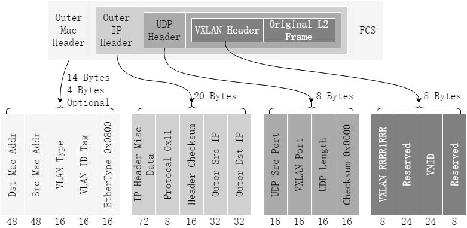

**图17-1 VXLAN 报文格式**

VXLAN 头封装：

Flag：8 比特，目前协议取值为00001000，第五比特表示是否为有效VXLAN 报文。

VNID：VXLAN Network Identifier，VXLAN 网络标识，24 比特，用于区分VXLAN 段。

Reserved：24 比特和8 比特，目前协议规定需为全0。

UDP 头封装：

目的端口号为4789，源端口号根据原始报文MAC、IP 等信息通过哈希计算得到。

外层IP 头：

源IP 为发送报文的服务器或虚拟机所属VTEP 的IP，目的IP 为目的服务器或虚拟机所属VTEP 的IP。

外层Ethernet 头：

Src MAC：发送报文VTEP 的物理网络接口MAC。

Dst MAC：目的VTEP IP 在路由表中直连下一跳的MAC。

VLAN：如底层物理网络使用了VLAN 接口，则可选的带上相应的VLAN TAG。

转发原理- 二层广播

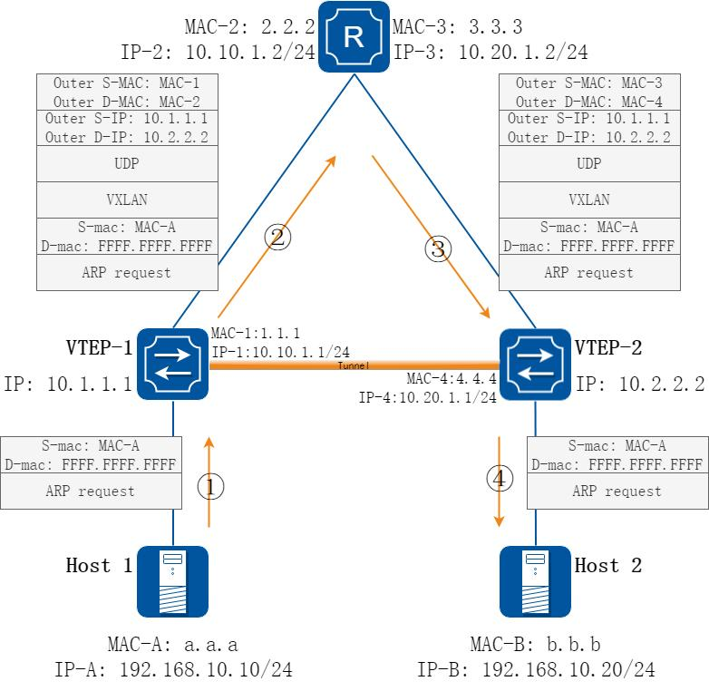

**图17-2 广播报文转发过程**

如上图所示，HOST A 与HOST B 在同一网段，分布在不同的VTEP 下面，HOST A 与HOST B的通信过程详细如下：

HOST A 与HOST B 处于同一网段，HOST A 发送ARP 请求HOST B 的MAC 地址。

ARP 请求报文到达VTEP-1 后，交换机发现是广播报文需要在VLAN 内广播，其中会有一份报文被送上VXLAN 隧道（广播采用头端复制，如果有多条隧道，那么就会每条隧道发送一份报文），VLAN 一一对应映射到VNI 加上VXLAN 封装，同时加上外层UDP、IP 封装，根据外层IP 查找路由表确定报文的下一跳。同时交换机在相应的VLAN 内，学习地址Mac-A 到eth-0-1 接口。

报文在网络上根据外层IP 进行转发，最终到达VTEP-2。

VTEP-2 收到报文后发现外层Outer D-mac 是本地地址，同时根据报文的Outer S-IP，Outer D-IP，VNI 检查本地是否配置有相应的隧道，如有则进行解封装操作，去掉外层头后将VNI 映射到相应VLAN，发现是广播报文时在VLAN 内广播。同时在VLAN学习Mac-A 到到相应的隧道接口。

转发原理- 二层单播

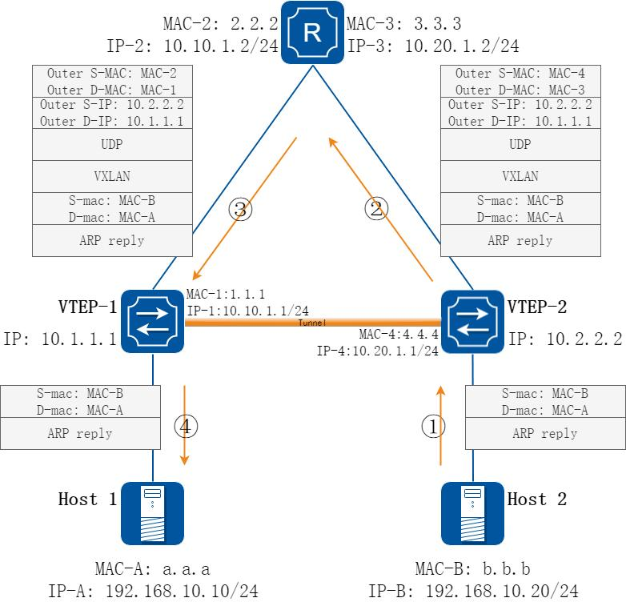

**图17-3 单播报文转发**

如上图所示，HOST B 回应HOST A 发送的ARP 请求，该报文为单播报文，以此为例说明单播报文转发流程：

HOST B 发送ARP 应答，通过eth-0-1 到达交换机VTEP-2在VTEP-2 上，根据Dst-mac 查mac 地址表，发现该VLAN 内Mac-B 的出接口为VXLAN隧道，远端VTEP 为10.1.1.1，则将原始报文所在VLAN 映射到VNI 并加上VXLAN头部，同时加上外层MAC/IP 头，Outer S-IP 为本地VTEP IP，Outer D-IP 为远端VTEP IP，Outer S-mac 为本地出接口的mac，Outer D-mac 为Outer D-IP 对应的下一跳接口mac。

报文在网络上根据外层IP 进行转发，最终到达VTEP-1。

VTEP-1 收到报文后发现外层Outer D-mac 是本地地址，同时根据报文的Outer S-IP，Outer D-IP，VNI 检查本地是否配置有相应的隧道，如有则进行解封装操作，去掉外层头后将VNI 映射到相应VLAN，并根据原始报文的Dst-mac（Mac-A）查mac 地址表，发现Mac-A 的出接口为eth-0-1，则将解封装后的报文从eth-0-1 口发送出去。同时在VLAN 内学习Mac-B 到相应的隧道接口。

默认VTEP 两两间都建有隧道，如解封装后发现Dst-mac 的出口为隧道，则报文会被丢弃。

转发原理- 集中式VXLAN 网关

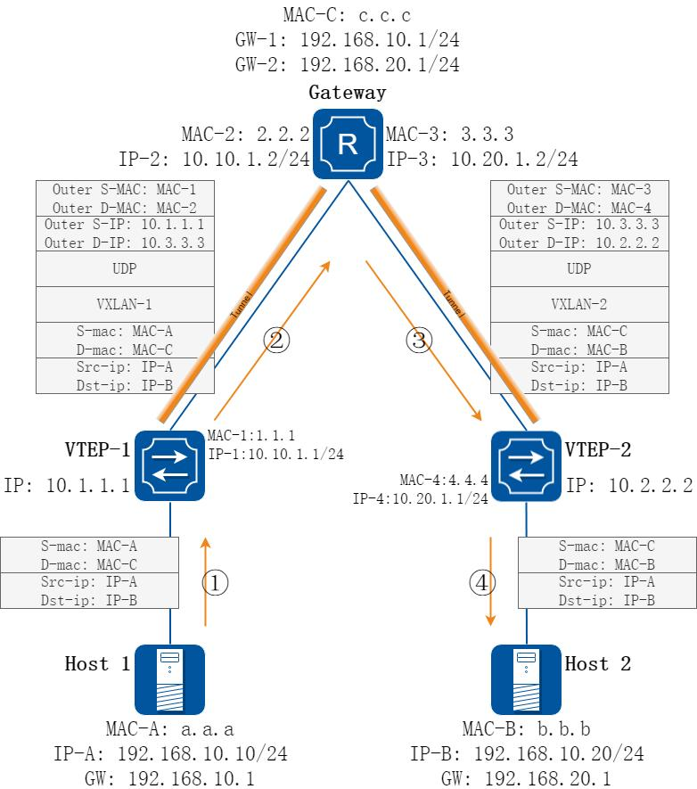

**图17-4 集中式网关示意**

如上图所示，HOST A 与B 在不同网段，其间通信需要借助网关完成，此时可以将网关集中配置在VTEP-3 上，VTEP-1 和VTEP-2 分别于VTEP-3 建立VXLAN 隧道，便于管理员进行集中管理HOST A 发送arp-request 来请求网关的mac 地址，VTEP-1 收到该请求后按未知单播流量将arp-request 加vxlan 封装后，转发给VTEP-3 VTEP-3 收到arp-request 后判断自己是被请求的网关地址，于是给HOST A 回应arp-reply 并加上vxlan 封装，同时学习HOST A 的arp 表项，其出口为vxlan 隧道VTEP-1 收到该arp-reply 后，剥掉vxlan 头，将原始的arp-reply 转发给HOST A,同时学习gateway 的mac 地址，其出口为vxlan 隧道HOST A 收到该arp-reply 后，学习到网关的mac 地址，并开始发送数据报文，数据报文格式如图2-4 所示Gateway 收到收到该报文后，判断需要做路由转发，但是此时还没有HOST B 的arp表项，因此发送arp-request 来请求HOST B 的arp，此arp-request 会加到到VTEP-2的vxlan 报文头VTEP-2 收到该arp-request 后，解封装转发给HOST B，同时学习gateway 的mac地址，其出口为vxlan 隧道1.HOST B 回应arp reply，其目的mac 为gateway 的mac，在VTEP-2 上查找转发表，发现其出口为vxlan 隧道，所以VTEP-2 将该报文加vxlan 封装发送给gateway Gateway 收到该报文后，学习HOST B 的arp，并将数据报文通过vxlan 隧道转发给HOST B转发原理- 分布式VXLAN 网关

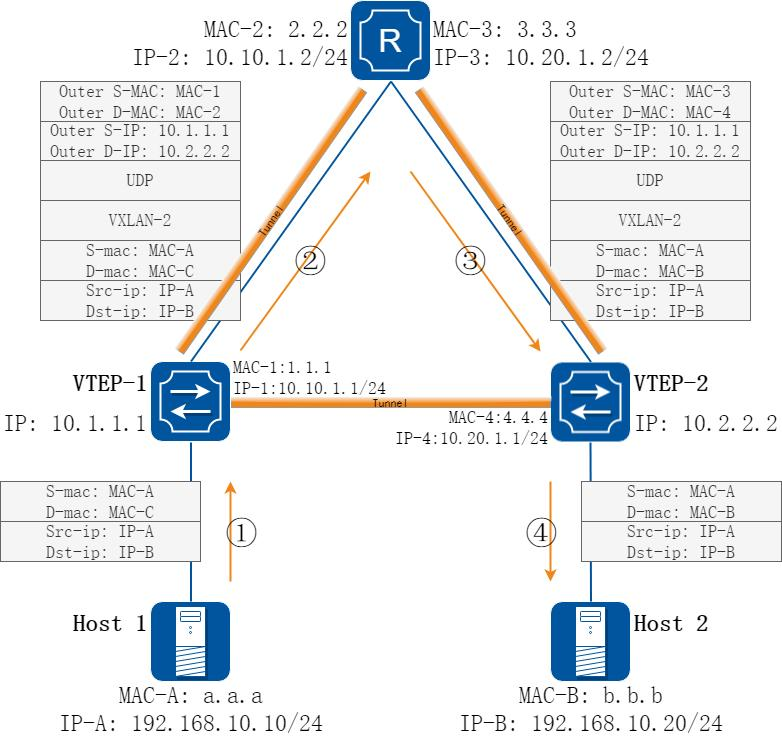

**图17-5 分布式网关示意**

区别于集中式网关的路由功能集中在某一台设备上完成，分布式网关可以将路由功能分散到各接入的VTEP 上，用以减轻集中式网关的压力。

如上图所示，根据组网可知IP-B 为下联在VTEP-2 下的主机，其所在VXLAN ID 为VXLAN-2，根据上述信息，我们可以在报文入口VTEP（及图5 中的VTEP-1）上配置路由表，将到IP-B 的报文直接加上相应封装后发出，减轻网关压力的同时减小转发延时，具体转发流程如下：

HOST A 发出报文Dst-ip 为IP-B，由于IP-B 与本机ip（IP-A）不在同一网段，因此Dst-mac 为网关mac（Mac-C）。

报文到达VTEP-1 后，VTEP-1 发现该报文的Dst-mac 为VLAN 网络内的网关mac，则去查找路由表是否有IP-B 的路由信息。如有:则按路由表信息转发，该路由信息包含了IP-B 所在的VTEP 及VXLAN ID 信息以及IP-B 对应的mac（Mac-B）信息，在VTEP-1 上将原始报文的Dst-mac 修改为Mac-B 后，加上相应的封装根据外层报文信息进行转发；如无：则丢弃该报文。

报文在网络上根据外层信息进行转发。

报文到达VTEP-2 后进行解封装，解封装流程和二层转发相同。

分布式网关需要借助BGP EVPN 来同步分布式网关上的arp 表项，或者静态配置DVR 路由。

##### 2. 周边特性

keep-vlan-tag默认情况下，在加封装时会将原始报文中携带的VLAN 标签剥掉，映射到外层的VXLAN-VNI，从而封装后报文的内层不再带有VLAN 标签。在进入VXLAN 网络的报文含有多层vlan tag 情况下需要保留原始报文的VLAN 标签，则需要配置隧道的keep-vlan-tag属性，具体配置方式请参见CLI 手册。

tunnel-aware报文经过VXLAN 加封装后，传统网络设备只能识别报文外层头信息，并根据外层头信息进行转发。如网络发生拥塞等突发情况，由于无法识别报文内层信息将无法精确定位是由哪个虚机或服务器引起的拥塞。使能tunnel-aware 功能后，将允许交换机分析报文内层原始报文信息，并将这些信息用于ACL，Flow tracing 等，更利于精确的分析网络流量。

Distributed-Gateway在分布式网关的应用场景中，服务器或虚拟机的网关配置在与自己相连的VTEP 上，则在同一VTEP 下的不同网段虚拟机之间通信不再需要通过集中式网关。如配合DVR 路由使用可以不再部署集中式网关，具体配置方法可参看本文档配置举例章节相关案例。

split-horizon默认情况下，从一条隧道来的流量不会再二层转发到另外一条隧道，如有隧道间流量相互转发的需求，需要配置将隧道上的split-horizon 关闭。

##### 隧道源地址

有些特殊场景，不同的隧道需要使用不同的源IP 地址，可在创建隧道时指定不同的src-ip 地址，交换机支持最多四个不同源地址。

DSCP 策略在隧道加封装时，可以配置加完封装后报文的DSCP 生成策略，包括固定值/从原始报文中复制/根据报文的priority 映射，默认从原始报文中复制。

### 17.1.2 配置举例

#### 配置vxlan

##### 1. 组网拓扑


**图17-6 Vxlan**

##### 2. 配置步骤

在下面的配置举例中，switch1 和switch2 间三层路由联通，通过VXLAN 技术，将两台设备上vlan 20 的流量封装在vni 20000 中，从而实现跨越三层网络的互联互通。

以下配置如未说明在哪个Switch 配置，则表示所有Switch 配置相同：

##### 步骤1 进入配置模式

```
Switch# configure terminal
```

##### 步骤2 进入vlan 配置模式并创建vlan，在vlan 上使能overlay

```
Switch(config)# vlan database
Switch(config-vlan)# vlan 20
Switch(config-vlan)# vlan 20 overlay enable
Switch(config-vlan)# exit
```

##### 步骤3 进入接口配置模式，配置接口属性

Switch1 的接口配置：

```
Switch1(config)# interface eth-0-1
Switch1(config-if)# switchport access vlan 20
Switch1(config-if)# no shutdown
Switch1(config-if)# exit
Switch1(config)# interface eth-0-2
Switch1(config-if)# switchport mode trunk
Switch1(config-if)# switchport trunk allowed vlan add 20
Switch1(config-if)# no shutdown
Switch1(config-if)# exit
Switch1(config)# interface eth-0-9
Switch1(config-if)# no switchport
Switch1(config-if)# ip address 9.9.9.1/24
```

```
Switch1(config-if)# overlay uplink enable
Switch1(config-if)# no shutdown
Switch1(config-if)# exit
Switch1(config)# interface loopback0
Switch1(config-if)# ip address 1.0.1.1/32
Switch1(config-if)# exit
```

Switch2 的接口配置：

```
Switch2(config)# interface eth-0-1
Switch2(config-if)# switchport access vlan 20
Switch2(config-if)# no shutdown
Switch2(config-if)# exit
Switch2(config)# interface eth-0-2
Switch2(config-if)# switchport mode trunk
Switch2(config-if)# switchport trunk allowed vlan add 20
Switch2(config-if)# no shutdown
Switch2(config-if)# exit
Switch2(config)# interface eth-0-9
Switch2(config-if)# no switchport
Switch2(config-if)# ip address 9.9.9.2/24
Switch2(config-if)# overlay uplink enable
Switch2(config-if)# no shutdown
Switch2(config-if)# exit
Switch2(config)# interface loopback0
Switch2(config-if)# ip address 1.0.1.2/32
Switch2(config-if)# exit
```

##### 步骤4 配置静态路由

在switch1 配置：

```
Switch1(config)# ip route 1.0.1.2/32 9.9.9.2
```

在switch2 配置：

```
Switch2(config)# ip route 1.0.1.1/32 9.9.9.1
```

##### 步骤5 配置overlay

在switch1 配置：

```
Switch1(config)# overlay
Switch1(config-overlay)# source 1.0.1.1
Switch1(config-overlay)# remote-vtep 1 ip-address 1.0.1.2 type vxlan
Switch1(config-overlay)# vlan 20 vni 20000
Switch1(config-overlay)# vlan 20 remote-vtep 1
Switch1(config-overlay)# exit
```

在switch2 配置：

```
Switch2(config)# overlay
Switch2(config-overlay)# source 1.0.1.2
Switch2(config-overlay)# remote-vtep 1 ip-address 1.0.1.1 type vxlan
Switch2(config-overlay)# vlan 20 vni 20000
```

```
Switch2(config-overlay)# vlan 20 remote-vtep 1
Switch2(config-overlay)# exit
```

##### 步骤6 退出配置模式

```
Switch(config)# end
```

##### 步骤7 检查配置

Switch1 显示结果：

```
Switch1# show overlay vlan 20
-------------------------------------------------------------------------------
ECMP Mode
: Normal
Source VTEP
: 1.0.1.1
-------------------------------------------------------------------------------
VLAN ID
: 20
VNI
: 20000
EVPN Tunnel Data-fdb Learning : Enable
Remote VTEP NUM
: 1
Index: 1, Ip address: 1.0.1.2, Source ip: 1.0.1.1, Type: VxLAN, Protocol: Static
DVR Gateway NUM: 0
-------------------------------------------------------------------------
```

Switch2 显示结果：

```
Switch2# show overlay vlan 20
-------------------------------------------------------------------------------
ECMP Mode
: Normal
Source VTEP
: 1.0.1.2
-------------------------------------------------------------------------------
VLAN ID
: 20
VNI
: 20000
EVPN Tunnel Data-fdb Learning : Eanble
Remote VTEP NUM
: 1
Index: 1, Ip address: 1.0.1.1, Source ip: 1.0.1.2, Type: VxLAN, Protocol: Static
DVR Gateway NUM: 0
-------------------------------------------------------------------------------
```

#### 配置vxlan 分布式路由

##### 1. 组网拓扑

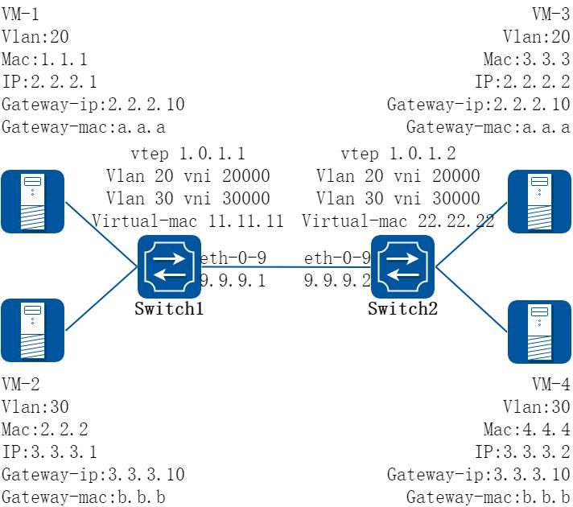

**图17-7 Vxlan**

##### 2. 配置步骤

在下面的配置举例中，按上图所示，VM-1 和VM-3 在同一个VNI 中，通过VXLAN 互联建立分布式路由；VM-2 和VM-4 在同一个VNI 中，通过VXLAN 互联建立分布式路由。

以下配置如未说明在哪个Switch 配置，则表示所有Switch 配置相同：

##### 步骤1 进入配置模式

```
Switch# configure terminal
```

##### 步骤2 进入vlan 配置模式并创建vlan，在vlan 上使能overlay

```
Switch(config)# vlan database
Switch(config-vlan)# vlan 20,30
Switch(config-vlan)# vlan 20 overlay enable
Switch(config-vlan)# vlan 30 overlay enable
Switch(config-vlan)# exit
```

##### 步骤3 创建vrf 实例

```
Switch(config)# ip vrf tenant
Switch(config-vrf)# exit
```

##### 步骤4 创建三层接口，加入vrf 并配置地址

在switch1 配置：

```
Switch1(config)# interface vlan 20
Switch1(config-if)# ip vrf forwarding tenant
Switch1(config-if)# ip address 2.2.2.111/24
Switch1(config-if)# exit
Switch1(config)# interface vlan 30
Switch1(config-if)# ip vrf forwarding tenant
Switch1(config-if)# ip address 3.3.3.111/24
Switch1(config-if)# exit
```

在switch2 配置：

```
Switch2(config)# interface
vlan 20
Switch2(config-if)# ip vrf forwarding tenant
Switch2(config-if)# ip address 2.2.2.222/24
Switch2(config-if)# exit
Switch2(config)# interface
vlan 30
Switch2(config-if)# ip vrf forwarding tenant
Switch2(config-if)# ip address 3.3.3.222/24
Switch2(config-if)# exit
```

##### 步骤5 进入接口配置模式，配置接口属性

```
Switch(config)# interface eth-0-1
Switch(config-if)# switchport mode trunk
Switch(config-if)# switchport trunk allowed vlan add 20
Switch(config-if)# no shutdown
Switch(config-if)# exit
Switch(config)# interface eth-0-2
Switch(config-if)# switchport mode trunk
Switch(config-if)# switchport trunk allowed vlan add
30
Switch(config-if)# no shutdown
Switch(config-if)# exit
```

在switch1 配置：

```
Switch1(config)# interface eth-0-9
Switch1(config-if)# no switchport
Switch1(config-if)# ip address 9.9.9.1/24
Switch1(config-if)# overlay uplink enable
Switch1(config-if)# no shutdown
Switch1(config-if)# exit
Switch1(config)# interface loopback0
Switch1(config-if)# ip address 1.0.1.1/32
Switch1(config-if)# exit
```

在switch2 配置：

```
Switch2(config)# interface eth-0-9
Switch2(config-if)# no switchport
Switch2(config-if)# ip address 9.9.9.2/24
Switch2(config-if)# overlay uplink enable
Switch2(config-if)# no shutdown
Switch2(config-if)# exit
```

```
Switch2(config)# interface loopback0
Switch2(config-if)# ip address 1.0.1.2/32
Switch2(config-if)# exit
```

##### 步骤6 配置overlay

在switch1 配置：

```
Switch1(config)# overlay
Switch1(config-overlay)# source 1.0.1.1
Switch1(config-overlay)# remote-vtep 1 ip-address 1.0.1.2 type vxlan
Switch1(config-overlay)# remote-vtep 1 virtual-mac 22.22.22
Switch1(config-overlay)# vlan 20 vni 20000
Switch1(config-overlay)# vlan 30 vni 30000
Switch1(config-overlay)# vlan 20 remote-vtep 1
Switch1(config-overlay)# vlan 30 remote-vtep 1
Switch1(config-overlay)# vlan 20 gateway-mac a.a.a
Switch1(config-overlay)# vlan 30 gateway-mac b.b.b
Switch1(config-overlay)# exit
```

在switch2 配置：

```
Switch2(config)# overlay
Switch2(config-overlay)# source 1.0.1.2
Switch2(config-overlay)# remote-vtep 1 ip-address 1.0.1.1 type vxlan
Switch2(config-overlay)# remote-vtep 1 virtual-mac 11.11.11
Switch2(config-overlay)# vlan 20 vni 20000
Switch2(config-overlay)# vlan 30 vni 30000
Switch2(config-overlay)# vlan 20 remote-vtep 1
Switch2(config-overlay)# vlan 30 remote-vtep 1
Switch2(config-overlay)# vlan 20 gateway-mac a.a.a
Switch2(config-overlay)# vlan 30 gateway-mac b.b.b
Switch2(config-overlay)# exit
```

##### 步骤7 配置静态路由和vxlan 分布式路由

在switch1 配置：

```
Switch1(config)# ip route 1.0.1.2/32 9.9.9.2
Switch1(config)# ip route vrf tenant 2.2.2.2/32 remote-vtep 1 vni 20000 inner-macda 3.3.3
Switch1(config)# ip route vrf tenant 3.3.3.2/32 remote-vtep 1 vni 30000 inner-macda 4.4.4
```

在switch2 配置：

```
Switch2(config)# ip route 1.0.1.1/32 9.9.9.1
Switch2(config)# ip route vrf tenant 2.2.2.1/32 remote-vtep 1 vni 20000 inner-macda 1.1.1
Switch2(config)# ip route vrf tenant 3.3.3.1/32 remote-vtep 1 vni 30000 inner-macda 2.2.2
```

##### 步骤8 退出配置模式

```
Switch(config)# end
```

##### 步骤9 检查配置

Switch1 显示结果：

```
Switch1# show ip route vrf tenant
Codes: K - kernel, C - connected, S - static, R - RIP, B - BGP
O - OSPF, IA - OSPF inter area
N1 - OSPF NSSA external type 1, N2 - OSPF NSSA external type 2
```

```
E1 - OSPF external type 1, E2 - OSPF external type 2
i - IS-IS, L1 - IS-IS level-1, L2 - IS-IS level-2, ia - IS-IS inter area
Dc - DHCP Client
[*] - [AD/Metric]
* - candidate default
S
2.2.2.2/32 is in overlay remote vxlan vtep:1.0.1.1->1.0.1.2, vni:20000
S
3.3.3.2/32 is in overlay remote vxlan vtep:1.0.1.1->1.0.1.2, vni:30000
```

Switch2 显示结果：

```
Switch2# show ip route vrf tenant
Codes: K - kernel, C - connected, S - static, R - RIP, B - BGP
O - OSPF, IA - OSPF inter area
N1 - OSPF NSSA external type 1, N2 - OSPF NSSA external type 2
E1 - OSPF external type 1, E2 - OSPF external type 2
i - IS-IS, L1 - IS-IS level-1, L2 - IS-IS level-2, ia - IS-IS inter area
Dc - DHCP Client
[*] - [AD/Metric]
* - candidate default
S
2.2.2.1/32 is in overlay remote vxlan vtep:1.0.1.2->1.0.1.1, vni:20000
S
3.3.3.1/32 is in overlay remote vxlan vtep:1.0.1.2->1.0.1.1, vni:30000
```

#### 配置vxlan 分布式路由的EBGP EVPN 方式

##### 1. 组网拓扑

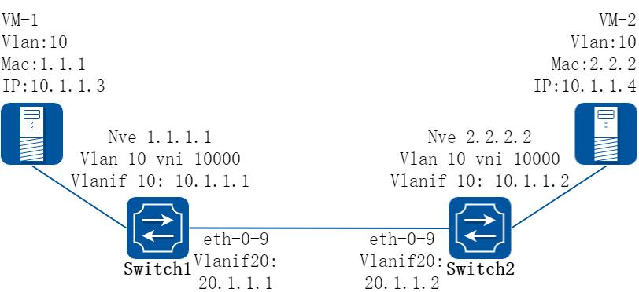

**图17-8 EBGP_EVPN**

##### 2. 配置步骤

在下面的配置举例中，按上图所示，VM-1 和VM-2 在同一个VNI 中，通过EBGP EVPN 进行VXLAN 隧道信息发布和主机信息发布，经过VXLAN 互联建立分布式路由；

以下配置如未说明在哪个Switch 配置，则表示所有Switch 配置相同：

##### 步骤1 进入配置模式

```
Switch# configure terminal
```

##### 步骤2 进入vlan 配置模式并创建vlan，在vlan 上使能overlay

```
Switch(config)# vlan database
Switch(config-vlan)# vlan 10,20
Switch(config-vlan)# vlan 10 overlay enable
Switch(config-vlan)# exit
```

可选配置：使能vlan 上的arp 广播抑制功能

```
Switch(config)# vlan database
Switch(config-vlan)# vlan 10 arp-broadcast-suppress enable
Switch(config-vlan)# exit
```

##### 步骤3 配置overlay 的vlan vni

```
Switch(config)# overlay
Switch(config-overlay)# vlan 10 vni 10000
```

可选配置：去使能overlay 上的inner fdb 学习

```
Switch(config-overlay)# vlan 10 mac-address-tunnel learning-disable
```

退出overlay 配置模式

```
Switch(config-overlay)# exit
```

##### 步骤4 配置evpn 实例

```
Switch(config)# evpn
Switch(config-evpn)# vni 10000
Switch(config-evi)# rd auto
Switch(config-evi)# route-target both 1:10000
Switch(config-evi)# exit
```

##### 步骤5 创建vrf 实例并使能EVPN

在switch1 配置：

```
Switch1(config)# ip vrf tenant
Switch1(config-vrf)# rd 1:20000
Switch1(config-vrf)# route-target both 1:10000 evpn
Switch1(config-vrf)# vxlan vni 20000
Switch1(config-vrf)# exit
```

在switch2 配置：

```
Switch2(config)# ip vrf tenant
Switch2(config-vrf)# rd 2:20000
Switch2(config-vrf)# route-target both 1:10000 evpn
Switch2(config-vrf)# vxlan vni 20000
Switch2(config-vrf)# exit
```

##### 步骤6 创建三层接口，加入vrf 并配置地址, 使能分布式网关

在switch1 配置：

```
Switch1(config)# interface
vlan 10
Switch1(config-if)# ip vrf forwarding tenant
Switch1(config-if)# overlay distributed-gateway enable
Switch1(config-if)# overlay host-collect enable
Switch1(config-if)# ip address 10.1.1.1/24
Switch1(config-if)# exit
```

```
Switch1(config)# interface
vlan 20
Switch1(config-if)# ip address 20.1.1.1/24
Switch1(config-if)# exit
```

在switch2 配置：

```
Switch2(config)# interface
vlan 10
Switch2(config-if)# ip vrf forwarding tenant
Switch2(config-if)# overlay distributed-gateway enable
Switch2(config-if)# overlay host-collect enable
Switch2(config-if)# ip address 10.1.1.2/24
Switch2(config-if)# exit
Switch2(config)# interface
vlan 20
Switch2(config-if)# ip address 20.1.1.2/24
Switch2(config-if)# exit
```

##### 步骤7 进入接口配置模式，配置接口属性

```
Switch(config)# interface eth-0-1
Switch(config-if)# switchport access vlan 10
Switch(config-if)# no shutdown
Switch(config-if)# exit
Switch(config)# interface eth-0-9
Switch(config-if)# switchport mode trunk
Switch(config-if)# switchport trunk allowed vlan add
20
Switch(config-if)# vxlan uplink enable
Switch(config-if)# no shutdown
Switch(config-if)# exit
```

##### 步骤8 配置overlay 的NVE 接口

在switch1 配置：

```
Switch1(config)# interface loopback 1
Switch1(config-if)# ip address 1.1.1.1/32
Switch1(config-if)# exit
Switch1(config)# interface nve 1
Switch1(config-if)# source loopback 1
Switch1(config-if)# member vni 10000
Switch1(config-if)# member vni 20000 associate-vrf
Switch1(config-if)# exit
```

在switch2 配置：

```
Switch2(config)# interface loopback 1
Switch2(config-if)# ip address 2.2.2.2/32
Switch2(config-if)# exit
Switch2(config)# interface nve 1
Switch2(config-if)# source loopback 1
Switch2(config-if)# member vni 10000
Switch2(config-if)# member vni 20000 associate-vrf
```

可选配置：配置EVPN VXLAN 的tunnel 属性

```
Switch2(config-if)# keep-vlan-tag enable
Switch2(config-if)# split-horizon disable
Switch2(config-if)# encapsulation-dscp-strategy custom-assign 63
Switch2(config-if)# virtual-mac a.a.a
Switch2(config-if)# exit
```

##### 步骤9 配置BGP EVPN

在switch1 配置：

```
Switch1(config)# router bgp 100
Switch1(config-router)# neighbor 20.1.1.2 remote-as 200
Switch1(config-router)# address-family l2vpn evpn
Switch1(config-router-af)# neighbor 20.1.1.2 activate
Switch1(config-router-af)# neighbor 20.1.1.2 send-community extended
Switch1(config-router-af)# neighbor 20.1.1.2 attribute-unchanged next-hop
Switch1(config-router-af)# exit
Switch1(config-router)# exit
```

在switch2 配置：

```
Switch2(config)# router bgp 200
Switch2(config-router)# neighbor 20.1.1.1 remote-as 100
Switch2(config-router)# address-family l2vpn evpn
Switch2(config-router-af)# neighbor 20.1.1.1 activate
Switch2(config-router-af)# neighbor 20.1.1.1 send-community extended
Switch2(config-router-af)# neighbor 20.1.1.1 attribute-unchanged next-hop
Switch2(config-router-af)# exit
Switch2(config-router)# exit
```

##### 步骤10 配置静态路由

在switch1 配置：

```
Switch1(config)# ip route 2.2.2.2/32 20.1.1.2
```

在switch2 配置：

```
Switch(config2)# ip route 1.1.1.1/32 20.1.1.1
```

##### 步骤11 退出配置模式

```
Switch(config)# end
```

##### 步骤12 检查配置

Switch1 显示结果：

```
Switch1# show bgp evpn all
Status codes: s suppressed, d damped, h history, * valid, > best, i - internal,
S Stale
Origin codes: i - IGP, e - EGP, ? - incomplete
Network
Next Hop
Metric LocPrf Weight Path
Route Distinguisher: 1:10000 (L2VNI 10000)
*> [2]:[0]:[48]:[4623.28ef.da00]:[32]:[0.0.0.0]/136
1.1.1.1
32768 i
*> [2]:[0]:[48]:[4623.28ef.da00]:[32]:[10.1.1.3]/136
1.1.1.1
32768 i
*> [2]:[0]:[48]:[ac7f.1cc5.fe00]:[32]:[0.0.0.0]/136
2.2.2.2
0 200 i
*> [2]:[0]:[48]:[ac7f.1cc5.fe00]:[32]:[10.1.1.4]/136
2.2.2.2
0 200 i
*> [3]:[0]:[32]:[1.1.1.1]/80
1.1.1.1
32768 i
```

```
*> [3]:[0]:[32]:[10.20.30.40]/80
2.2.2.2
0 200 i
Route Distinguisher: 1:10000
*> [2]:[0]:[48]:[ac7f.1cc5.fe00]:[32]:[0.0.0.0]/136
2.2.2.2
0 200 i
*> [2]:[0]:[48]:[ac7f.1cc5.fe00]:[32]:[10.1.1.4]/136
2.2.2.2
0 200 i
*> [3]:[0]:[32]:[2.2.2.2]/80
2.2.2.2
0 200 i
Route Distinguisher: 1:20000 (L3VNI 20000)
*> [2]:[0]:[48]:[ac7f.1cc5.fe00]:[32]:[10.1.1.4]/136
2.2.2.2
Switch1# show overlay tunnel
-------------------------------------------------------------------------------
Vlan Vni
Type
Remote-vtep IP-Address
Src-Address
Head-end-flooding Protocol
10
10000
VxLAN
0
2.2.2.2
1.1.1.1
Enable
Evpn
```

Switch2 显示结果：

```
Head-end-floodingSwitch2# show bgp evpn all
Status codes: s suppressed, d damped, h history, * valid, > best, i - internal,
S Stale
Origin codes: i - IGP, e - EGP, ? - incomplete
Network
Next Hop
Metric LocPrf Weight Path
Route Distinguisher: 1:10000 (L2VNI 10000)
*> [2]:[0]:[48]:[4623.28ef.da00]:[32]:[0.0.0.0]/136
1.1.1.1
0 100 i
*> [2]:[0]:[48]:[4623.28ef.da00]:[32]:[10.1.1.3]/136
1.1.1.1
0 100 i
*> [2]:[0]:[48]:[ac7f.1cc5.fe00]:[32]:[0.0.0.0]/136
2.2.2.2
32768 i
*> [2]:[0]:[48]:[ac7f.1cc5.fe00]:[32]:[10.1.1.4]/136
2.2.2.2
32768 i
*> [3]:[0]:[32]:[1.1.1.1]/80
1.1.1.1
0 100 i
*> [3]:[0]:[32]:[2.2.2.2]/80
2.2.2.2
32768 i
Route Distinguisher: 1:10000
*> [2]:[0]:[48]:[4623.28ef.da00]:[32]:[0.0.0.0]/136
1.1.1.1
0 100 i
*> [2]:[0]:[48]:[4623.28ef.da00]:[32]:[10.1.1.3]/136
1.1.1.1
0 100 i
*> [3]:[0]:[32]:[1.1.1.1]/80
1.1.1.1
0 100 i
Route Distinguisher: 2:20000 (L3VNI 20000)
*> [2]:[0]:[48]:[4623.28ef.da00]:[32]:[10.1.1.3]/136
1.1.1.1
0 100 i
Switch2# show overlay tunnel
-------------------------------------------------------------------------------
```

```
Vlan Vni
Type
Remote-vtep IP-Address
Src-Address
Head-end-flooding Protocol
10
10000
VxLAN
0
1.1.1.1
2.2.2.2
Enable
Evpn
```

#### 配置vxlan 分布式路由的IBGP EVPN 方式

##### 1. 组网拓扑

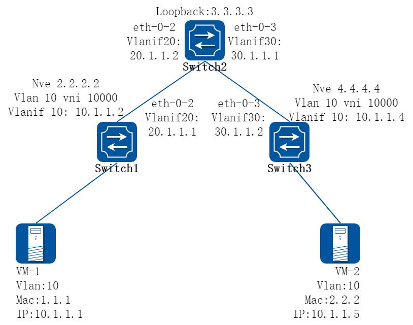

**图17-9 IBGP_EVPN**

##### 2. 配置步骤

在下面的配置举例中，按上图所示，VM-1 和VM-2 在同一个VNI 中，通过IBGP EVPN 进行VXLAN 隧道信息发布和主机信息发布，经过VXLAN 互联建立分布式路由；中间通过路由反射器进行EVPN 路由交换。

以下配置如未说明在哪个Switch 配置，则表示所有Switch 配置相同：

##### 步骤1 进入配置模式

```
Switch# configure terminal
```

##### 步骤2 进入vlan 配置模式并创建vlan，在vlan 上使能overlay

在switch1 配置：

```
Switch1(config)# vlan database
Switch1(config-vlan)# vlan 10,20
Switch1(config-vlan)# vlan 10 overlay enable
Switch1(config-vlan)# exit
```

在switch2 配置：

```
Switch2(config)# vlan database
Switch2(config-vlan)# vlan 20,30
Switch2(config-vlan)# exit
```

在switch3 配置：

```
Switch3(config)# vlan database
Switch3(config-vlan)# vlan 10,30
Switch3(config-vlan)# vlan 10 overlay enable
Switch3(config-vlan)# exit
```

可选配置：使能vlan 上的arp 广播抑制功能

```
Switch3(config)# vlan database
Switch3(config-vlan)# vlan 10 arp-broadcast-suppress enable
Switch3(config-vlan)# exit
```

##### 步骤3 配置overlay 的vlan vni

在switch1 配置：

```
Switch1(config)# overlay
Switch1(config-overlay)# vlan 10 vni 10000
```

可选配置：去使能overlay 上的inner fdb 学习

```
Switch1(config-overlay)# vlan 10 mac-address-tunnel learning-disable
```

退出overlay 配置模式

```
Switch1(config-overlay)# exit
```

在switch3 配置：

```
Switch3(config)# overlay
Switch3(config-overlay)# vlan 10 vni 10000
```

可选配置：去使能overlay 上的inner fdb 学习

```
Switch3(config-overlay)# vlan 10 mac-address-tunnel learning-disable
```

退出overlay 配置模式

```
Switch3(config-overlay)# exit
```

##### 步骤4 配置evpn 实例

在switch1 配置：

```
Switch1(config)# evpn
Switch1(config-evpn)# vni 10000
Switch1(config-evi)# rd 2:2
Switch1(config-evi)# route-target both 20:20
Switch1(config-evi)# exit
```

在switch2 配置：

```
Switch2(config)# evpn
```

在switch3 配置：

```
Switch3(config)# evpn
Switch3(config-evpn)# vni 10000
Switch3(config-evi)# rd 4:4
Switch3(config-evi)# route-target both 20:20
Switch3(config-evi)# exit
```

##### 步骤5 创建vrf 实例并使能EVPN

在switch1 配置：

```
Switch1(config)# ip vrf tenant
Switch1(config-vrf)# rd 22:22
Switch1(config-vrf)# route-target both 20:20 evpn
Switch1(config-vrf)# vxlan vni 20000
Switch1(config-vrf)# exit
```

在switch3 配置：

```
Switch3(config)# ip vrf tenant
Switch3(config-vrf)# rd 44:44
Switch3(config-vrf)# route-target both 20:20 evpn
Switch3(config-vrf)# vxlan vni 20000
Switch3(config-vrf)# exit
```

##### 步骤6 创建三层接口，加入vrf 并配置地址, 使能分布式网关

在switch1 配置：

```
Switch1(config)# interface
vlan 10
Switch1(config-if)# ip vrf forwarding tenant
Switch1(config-if)# overlay distributed-gateway enable
Switch1(config-if)# overlay host-collect enable
Switch1(config-if)# ip address 10.1.1.2/24
Switch1(config-if)# exit
Switch1(config)# interface
vlan 20
Switch1(config-if)# ip address 20.1.1.1/24
Switch1(config-if)# exit
```

在switch2 配置：

```
Switch2(config)# interface
vlan 20
Switch2(config-if)# ip address 20.1.1.2/24
Switch2(config-if)# exit
Switch2(config)# interface
vlan 30
Switch2(config-if)# ip address 30.1.1.1/24
Switch2(config-if)# exit
```

在switch3 配置：

```
Switch3(config)# interface
vlan 10
Switch3(config-if)# ip vrf forwarding tenant
Switch3(config-if)# overlay distributed-gateway enable
Switch3(config-if)# overlay host-collect enable
Switch3(config-if)# ip address 10.1.1.3/24
Switch3(config-if)# exit
Switch3(config)# interface
vlan 30
Switch3(config-if)# ip address 30.1.1.2/24
Switch3(config-if)# exit
```

##### 步骤7 进入接口配置模式，配置接口属性

在switch1 配置：

```
Switch1(config)# interface eth-0-10
Switch1(config-if)# switchport access vlan 10
Switch1(config-if)# no shutdown
Switch1(config-if)# exit
Switch1(config)# interface eth-0-2
Switch1(config-if)# switchport mode trunk
Switch1(config-if)# switchport trunk allowed vlan add
20
Switch1(config-if)# vxlan uplink enable
Switch1(config-if)# no shutdown
Switch1(config-if)# exit
```

在switch2 配置：

```
Switch2(config)# interface eth-0-2
Switch2(config-if)# switchport mode trunk
Switch2(config-if)# switchport trunk allowed vlan add
20
Switch2(config-if)# vxlan uplink enable
Switch2(config-if)# no shutdown
Switch2(config-if)# exit
Switch2(config)# interface eth-0-3
Switch2(config-if)# switchport mode trunk
Switch2(config-if)# switchport trunk allowed vlan add
30
Switch2(config-if)# vxlan uplink enable
Switch2(config-if)# no shutdown
Switch2(config-if)# exit
```

在switch3 配置：

```
Switch3(config)# interface eth-0-10
Switch3(config-if)# switchport access vlan 10
Switch3(config-if)# no shutdown
Switch3(config-if)# exit
Switch3(config)# interface eth-0-3
Switch3(config-if)# switchport mode trunk
Switch3(config-if)# switchport trunk allowed vlan add
30
Switch3(config-if)# vxlan uplink enable
Switch3(config-if)# no shutdown
Switch3(config-if)# exit
```

##### 步骤8 配置overlay 的NVE 接口

在switch1 配置：

```
Switch1(config)# interface loopback 2
Switch1(config-if)# ip address 2.2.2.2/32
Switch1(config-if)# exit
Switch1(config)# interface nve 1
Switch1(config-if)# source 2.2.2.2
Switch1(config-if)# member vni 10000
Switch1(config-if)# member vni 20000 associate-vrf
Switch1(config-if)# exit
```

在switch2 配置：

```
Switch2(config)# interface loopback 3
Switch2(config-if)# ip address 3.3.3.3/32
Switch2(config-if)# exit
```

在switch3 配置：

```
Switch3(config)# interface loopback 4
Switch3(config-if)# ip address 4.4.4.4/32
Switch3(config-if)# exit
Switch3(config)# interface nve 1
Switch3(config-if)# source 4.4.4.4
Switch3(config-if)# member vni 10000
Switch3(config-if)# member vni 20000 associate-vrf
```

可选配置：配置EVPN VXLAN 的tunnel 属性

```
Switch3(config-if)# keep-vlan-tag enable
Switch3(config-if)# split-horizon disable
Switch3(config-if)# encapsulation-dscp-strategy custom-assign 63
Switch3(config-if)# virtual-mac a.a.a
Switch3(config-if)# exit
```

##### 步骤9 配置BGP EVPN

在switch1 配置：

```
Switch1(config)# router bgp 100
Switch1(config-router)# neighbor 3.3.3.3 remote-as 100
Switch1(config-router)# neighbor 3.3.3.3 update-source loopback2
Switch1(config-router)# neighbor 20.1.1.2 remote-as 100
Switch1(config-router)# address-family ipv4
Switch1(config-router-af)# network 2.2.2.2 mask 255.255.255.255
Switch1(config-router-af)# neighbor 20.1.1.2 weight 32768
Switch1(config-router-af)# exit
Switch1(config-router)# address-family l2vpn evpn
Switch1(config-router-af)# neighbor 3.3.3.3 activate
Switch1(config-router-af)# neighbor 3.3.3.3 send-community extended
Switch1(config-router-af)# exit
Switch1(config-router)# exit
```

在switch2 配置：

```
Switch2(config)# router bgp 100
Switch2(config-router)# neighbor 2.2.2.2 remote-as 100
Switch2(config-router)# neighbor 2.2.2.2 update-source loopback3
Switch2(config-router)# neighbor 4.4.4.4 remote-as 100
Switch2(config-router)# neighbor 4.4.4.4 update-source loopback3
Switch2(config-router)# neighbor 20.1.1.1 remote-as 100
Switch2(config-router)# neighbor 30.1.1.2 remote-as 100
Switch2(config-router)# address-family ipv4
Switch2(config-router-af)# network 3.3.3.3 mask 255.255.255.255
Switch2(config-router-af)# network 20.1.1.0 mask 255.255.255.0
Switch2(config-router-af)# network 30.1.1.0 mask 255.255.255.0
Switch2(config-router-af)# neighbor 20.1.1.1 weight 32768
Switch2(config-router-af)# neighbor 20.1.1.1 route-reflector-client
Switch2(config-router-af)# neighbor 20.1.1.1 next-hop-self
Switch2(config-router-af)# neighbor 30.1.1.2 weight 32768
Switch2(config-router-af)# neighbor 30.1.1.2 route-reflector-client
```

```
Switch2(config-router-af)# neighbor 30.1.1.2 next-hop-self
Switch2(config-router-af)# exit
Switch2(config-router)# address-family l2vpn evpn
Switch2(config-router-af)# neighbor 2.2.2.2 activate
Switch2(config-router-af)# neighbor 2.2.2.2 route-reflector-client
Switch2(config-router-af)# neighbor 2.2.2.2 send-community extended
Switch2(config-router-af)# neighbor 4.4.4.4 activate
Switch2(config-router-af)# neighbor 4.4.4.4 route-reflector-client
Switch2(config-router-af)# neighbor 4.4.4.4 send-community extended
Switch2(config-router-af)# exit
Switch2(config-router)# exit
```

在switch3 配置：

```
Switch3(config)# router bgp 100
Switch3(config-router)# neighbor 3.3.3.3 remote-as 100
Switch3(config-router)# neighbor 3.3.3.3 update-source loopback4
Switch3(config-router)# neighbor 30.1.1.1 remote-as 100
Switch3(config-router)# address-family ipv4
Switch3(config-router-af)# network 4.4.4.4 mask 255.255.255.255
Switch3(config-router-af)# neighbor 30.1.1.1 weight 32768
Switch3(config-router-af)# exit
Switch3(config-router)# address-family l2vpn evpn
Switch3(config-router-af)# neighbor 3.3.3.3 activate
Switch3(config-router-af)# neighbor 3.3.3.3 send-community extended
Switch3(config-router-af)# exit
Switch3(config-router)# exit
```

##### 步骤10 退出配置模式

```
Switch(config)# end
```

##### 步骤11 检查配置

Switch1 显示结果：

```
Switch1# show bgp evpn all
Status codes: s suppressed, d damped, h history, * valid, > best, i - internal,
S Stale
Origin codes: i - IGP, e - EGP, ? - incomplete
Network
Next Hop
Metric LocPrf Weight Path
Route Distinguisher: 2:2 (L2VNI 10000)
*> [2]:[0]:[48]:[988b.123a.4000]:[32]:[0.0.0.0]/136
2.2.2.2
32768 i
*> [2]:[0]:[48]:[988b.123a.4000]:[32]:[10.1.1.1]/136
2.2.2.2
32768 i
*> [3]:[0]:[32]:[2.2.2.2]/80
2.2.2.2
32768 i
*>i[3]:[0]:[32]:[4.4.4.4]/80
4.4.4.4
100
0 i
Route Distinguisher: 4:4
*>i[3]:[0]:[32]:[4.4.4.4]/80
4.4.4.4
100
0 i
Switch1# show overlay tunnel
-------------------------------------------------------------------------------
```

```
Vlan Vni
Type
Remote-vtep IP-Address
Src-Address
Head-end-flooding Protocol
10
10000
VxLAN
0
4.4.4.4
2.2.2.2
Enable
Evpn
```

Switch2 显示结果：

```
Switch2# show bgp evpn all
Status codes: s suppressed, d damped, h history, * valid, > best, i - internal,
S Stale
Origin codes: i - IGP, e - EGP, ? - incomplete
Network
Next Hop
Metric LocPrf Weight Path
Route Distinguisher: 2:2
*>i[2]:[0]:[48]:[988b.123a.4000]:[32]:[0.0.0.0]/136
2.2.2.2
100
0 i
*>i[2]:[0]:[48]:[988b.123a.4000]:[32]:[10.1.1.1]/136
2.2.2.2
100
0 i
*>i[3]:[0]:[32]:[2.2.2.2]/80
2.2.2.2
100
0 i
Route Distinguisher: 4:4
*>i[3]:[0]:[32]:[4.4.4.4]/80
4.4.4.4
100
0 i
```

Switch3 显示结果：

```
Switch3# show bgp evpn all
Status codes: s suppressed, d damped, h history, * valid, > best, i - internal,
S Stale
Origin codes: i - IGP, e - EGP, ? - incomplete
Network
Next Hop
Metric LocPrf Weight Path
Route Distinguisher: 2:2
*>i[2]:[0]:[48]:[988b.123a.4000]:[32]:[0.0.0.0]/136
2.2.2.2
100
0 i
*>i[2]:[0]:[48]:[988b.123a.4000]:[32]:[10.1.1.1]/136
2.2.2.2
100
0 i
*>i[3]:[0]:[32]:[2.2.2.2]/80
2.2.2.2
100
0 i
Route Distinguisher: 4:4 (L2VNI 10000)
*>i[2]:[0]:[48]:[988b.123a.4000]:[32]:[0.0.0.0]/136
2.2.2.2
100
0 i
*>i[2]:[0]:[48]:[988b.123a.4000]:[32]:[10.1.1.1]/136
2.2.2.2
100
0 i
*>i[3]:[0]:[32]:[2.2.2.2]/80
2.2.2.2
100
0 i
*> [3]:[0]:[32]:[4.4.4.4]/80
4.4.4.4
32768 i
Route Distinguisher: 44:44 (L3VNI 20000)
*>i[2]:[0]:[48]:[988b.123a.4000]:[32]:[10.1.1.1]/136
2.2.2.2
100
0 i
Switch3# show overlay tunnel
-------------------------------------------------------------------------------
Vlan Vni
Type
Remote-vtep IP-Address
Src-Address
Head-end-flooding Protocol
10
10000
VxLAN
0
2.2.2.2
4.4.4.4
Enable
Evpn
```

```
Switch3# show mac address-table
Mac Address Table
-------------------------------------------
(*)
- Security Entry
(M)
- MLAG Entry
(MO) - MLAG Output Entry
(MI) - MLAG Input Entry
Vlan
Mac Address
Type
Ports
----
-----------
--------
-----
30
fcc0.9318.0a00
dynamic
eth-0-9
10
988b.123a.4000
dynamic
VxLAN: 4.4.4.4->2.2.2.2(EI)
Switch3# show ip route vrf tenant
Codes: K - kernel, C - connected, S - static, R - RIP, B - BGP
O - OSPF, IA - OSPF inter area
N1 - OSPF NSSA external type 1, N2 - OSPF NSSA external type 2
E1 - OSPF external type 1, E2 - OSPF external type 2
i - IS-IS, L1 - IS-IS level-1, L2 - IS-IS level-2, ia - IS-IS inter area
Dc - DHCP Client
[*] - [AD/Metric]
* - candidate default
C
10.1.1.0/24 is directly connected, vlan10
C
10.1.1.3/32 is in local loopback, vlan10
B
10.1.1.1/32 is in overlay remote vxlan vtep:4.4.4.4->2.2.2.2, vni:20000
```

#### 基于IPv6 网络配置vxlan

##### 1. 组网拓扑

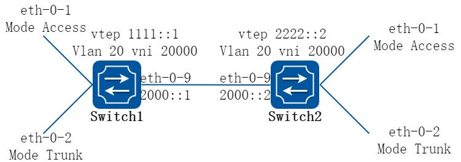

**图17-10 Vxlan**

##### 2. 配置步骤

在下面的配置举例中，switch1 和switch2 间三层路由联通，通过VXLAN 技术，将两台设备上vlan 20 的流量封装在vni 20000 中，从而实现跨越三层网络的互联互通。

以下配置如未说明在哪个Switch 配置，则表示所有Switch 配置相同：

##### 步骤1 进入配置模式

```
Switch# configure terminal
```

##### 步骤2 进入vlan 配置模式并创建vlan，在vlan 上使能overlay

```
Switch(config)# vlan database
Switch(config-vlan)# vlan 20
Switch(config-vlan)# vlan 20 overlay enable
Switch(config-vlan)# exit
```

##### 步骤3 进入接口配置模式，配置接口属性

Switch1 的接口配置：

```
Switch1(config)# ipv6 enable
Switch1(config)# interface eth-0-1
Switch1(config-if)# switchport access vlan 20
Switch1(config-if)# no shutdown
Switch1(config-if)# exit
Switch1(config)# interface eth-0-2
Switch1(config-if)# switchport mode trunk
Switch1(config-if)# switchport trunk allowed vlan add 20
Switch1(config-if)# no shutdown
Switch1(config-if)# exit
Switch1(config)# interface eth-0-9
Switch1(config-if)# no switchport
Switch1(config-if)# ipv6 address 2000::1/64
Switch1(config-if)# vxlan uplink enable
Switch1(config-if)# no shutdown
Switch1(config-if)# exit
Switch1(config)# interface loopback0
Switch1(config-if)# ipv6 address 1111::1/128
Switch1(config-if)# exit
```

Switch2 的接口配置：

```
Switch2(config)# interface eth-0-1
Switch2(config-if)# switchport access vlan 20
Switch2(config-if)# no shutdown
Switch2(config-if)# exit
Switch2(config)# interface eth-0-2
Switch2(config-if)# switchport mode trunk
Switch2(config-if)# switchport trunk allowed vlan add 20
Switch2(config-if)# no shutdown
Switch2(config-if)# exit
Switch2(config)# interface eth-0-9
Switch2(config-if)# no switchport
Switch2(config-if)# ipv6 address 2000::2/64
Switch2(config-if)# vxlan uplink enable
Switch2(config-if)# no shutdown
Switch2(config-if)# exit
Switch2(config)# interface loopback0
Switch2(config-if)# ipv6 address 2222::2/128
Switch2(config-if)# exit
```

##### 步骤4 配置静态路由

在switch1 配置：

```
Switch1(config)# ipv6 route 2222::2/128 2000::2
```

在switch2 配置：

```
Switch2(config)# ipv6 route 1111::1/128 2000::1
```

##### 步骤5 配置overlay

在switch1 配置：

```
Switch1(config)# overlay
Switch1(config-overlay)# source 1111::1
Switch1(config-overlay)# remote-vtep 1 ipv6-address 2222::2 type vxlan
Switch1(config-overlay)# vlan 20 vni 20000
Switch1(config-overlay)# vlan 20 remote-vtep 1
Switch1(config-overlay)# exit
```

在switch2 配置：

```
Switch2(config)# overlay
Switch2(config-overlay)# source 2222::2
Switch2(config-overlay)# remote-vtep 1 ipv6-address 2222::2 type vxlan
Switch2(config-overlay)# vlan 20 vni 20000
Switch2(config-overlay)# vlan 20 remote-vtep 1
Switch2(config-overlay)# exit
```

##### 步骤6 退出配置模式

```
Switch(config)# end
```

##### 步骤7 检查配置

Switch1 显示结果：

```
Switch1# show overlay vlan 20
-------------------------------------------------------------------------------
ECMP Mode
: Normal
Source VTEP
: 1111::1
-------------------------------------------------------------------------------
VLAN ID
: 20
VNI
: 20000
EVPN Tunnel Data-fdb Learning : Enable
Remote VTEP NUM
: 1
Index: 1, Type: VxLAN, Protocol: Static
IP address: 2222::2
Source ip : 1111::1
DVR Gateway NUM: 0
-------------------------------------------------------------------------
```

Switch2 显示结果：

```
Switch2# show overlay vlan 20
-------------------------------------------------------------------------------
ECMP Mode
: Normal
Source VTEP
: 2222::2
-------------------------------------------------------------------------------
VLAN ID
: 20
VNI
: 20000
```

```
EVPN Tunnel Data-fdb Learning : Enable
Remote VTEP NUM
: 1
Index: 1, Type: VxLAN, Protocol: Static
IP address: 1111::1
Source ip : 2222::2
DVR Gateway NUM: 0
-------------------------------------------------------------------------
```

#### 基于IPv6 配置vxlan 分布式路由

##### 1. 组网拓扑

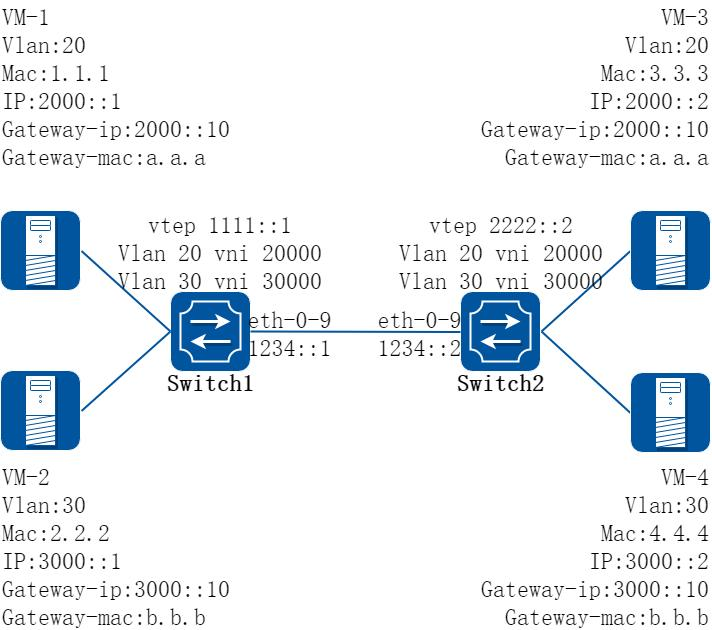

**图17-11 Vxlan**

##### 2. 配置步骤

在下面的配置举例中，按上图所示，VM-1 和VM-3 在同一个VNI 中，通过VXLAN 互联建立分布式路由；VM-2 和VM-4 在同一个VNI 中，通过VXLAN 互联建立分布式路由。

以下配置如未说明在哪个Switch 配置，则表示所有Switch 配置相同：

##### 步骤1 进入配置模式

```
Switch# configure terminal
```

##### 步骤2 进入vlan 配置模式并创建vlan，在vlan 上使能overlay

```
Switch(config)# vlan database
Switch(config-vlan)# vlan 20,30
Switch(config-vlan)# vlan 20 overlay enable
Switch(config-vlan)# vlan 30 overlay enable
Switch(config-vlan)# exit
```

##### 步骤3 创建vrf 实例

```
Switch(config)# ip vrf tenant
Switch(config-vrf)# exit
```

##### 步骤4 创建三层接口，加入vrf 并配置地址

在switch1 配置：

```
Switch1(config)# ipv6 enable
Switch1(config)# interface vlan 20
Switch1(config-if)# ip vrf forwarding tenant
Switch1(config-if)# ipv6 address 2000::111/64
Switch1(config-if)# exit
Switch1(config)# interface vlan 30
Switch1(config-if)# ip vrf forwarding tenant
Switch1(config-if)# ipv6 address 3000::111/64
Switch1(config-if)# exit
```

在switch2 配置：

```
Switch2(config)# interface
vlan 20
Switch2(config-if)# ip vrf forwarding tenant
Switch2(config-if)# ipv6 address 2000::222/24
Switch2(config-if)# exit
Switch2(config)# interface
vlan 30
Switch2(config-if)# ip vrf forwarding tenant
Switch2(config-if)# ipv6 address 3000::222/24
Switch2(config-if)# exit
```

##### 步骤5 进入接口配置模式，配置接口属性

```
Switch(config)# interface eth-0-1
Switch(config-if)# switchport mode trunk
Switch(config-if)# switchport trunk allowed vlan add 20
Switch(config-if)# no shutdown
Switch(config-if)# exit
Switch(config)# interface eth-0-2
Switch(config-if)# switchport mode trunk
Switch(config-if)# switchport trunk allowed vlan add
30
Switch(config-if)# no shutdown
Switch(config-if)# exit
```

在switch1 配置：

```
Switch1(config)# interface eth-0-9
Switch1(config-if)# no switchport
Switch1(config-if)# ipv6 address 1234::1/64
Switch1(config-if)# vxlan uplink enable
Switch1(config-if)# no shutdown
Switch1(config-if)# exit
Switch1(config)# interface loopback0
```

```
Switch1(config-if)# ipv6 address 1111::1/128
Switch1(config-if)# exit
```

在switch2 配置：

```
Switch2(config)# interface eth-0-9
Switch2(config-if)# no switchport
Switch2(config-if)# ipv6 address 1234::2/64
Switch2(config-if)# vxlan uplink enable
Switch2(config-if)# no shutdown
Switch2(config-if)# exit
Switch2(config)# interface loopback0
Switch2(config-if)# ipv6 address 2222::2/128
Switch2(config-if)# exit
```

##### 步骤6 配置overlay

在switch1 配置：

```
Switch1(config)# overlay
Switch1(config-overlay)# source 1111::1
Switch1(config-overlay)# remote-vtep 1 ipv6-address 2222::2 type vxlan
Switch1(config-overlay)# vlan 20 vni 20000
Switch1(config-overlay)# vlan 30 vni 30000
Switch1(config-overlay)# vlan 20 remote-vtep 1
Switch1(config-overlay)# vlan 30 remote-vtep 1
Switch1(config-overlay)# vlan 20 gateway-mac a.a.a
Switch1(config-overlay)# vlan 30 gateway-mac b.b.b
Switch1(config-overlay)# exit
```

在switch2 配置：

```
Switch2(config)# overlay
Switch2(config-overlay)# source 2222::2
Switch2(config-overlay)# remote-vtep 1 ipv6-address 1111::1 type vxlan
Switch2(config-overlay)# vlan 20 vni 20000
Switch2(config-overlay)# vlan 30 vni 30000
Switch2(config-overlay)# vlan 20 remote-vtep 1
Switch2(config-overlay)# vlan 30 remote-vtep 1
Switch2(config-overlay)# vlan 20 gateway-mac a.a.a
Switch2(config-overlay)# vlan 30 gateway-mac b.b.b
Switch2(config-overlay)# exit
```

##### 步骤7 配置静态路由和vxlan 分布式路由

在switch1 配置：

```
Switch1(config)# ipv6 route 2222::2/128 1234::2
Switch1(config)# ipv6 route vrf tenant 2000::2/128 remote-vtep 1 vni 20000 inner-macda 3.3.3
Switch1(config)# ipv6 route vrf tenant 3000::2/128 remote-vtep 1 vni 30000 inner-macda 4.4.4
```

在switch2 配置：

```
Switch2(config)# ipv6 route 1111::1/128 1234::1
Switch2(config)# ipv6 route vrf tenant 2000::1/32 remote-vtep 1 vni 20000 inner-macda 1.1.1
Switch2(config)# ipv6 route vrf tenant 3000::1/32 remote-vtep 1 vni 30000 inner-macda 2.2.2
```

##### 步骤8 退出配置模式

```
Switch(config)# end
```

##### 步骤9 检查配置

Switch1 显示结果：

```
Switch1# show ipv6 route vrf tenant
Codes: C - connected, S - static, R - RIP, I - IS-IS, B - BGP
O - OSPF, IA - OSPF inter area
N1 - OSPF NSSA external type 1, N2 - OSPF NSSA external type 2
E1 - OSPF external type 1, E2 - OSPF external type 2
Dr - DHCPV6 Relay
[*] - [AD/Metric]
S
2000::2/128 is in overlay remote vxlan vtep:1111::1->2222::2, vni:20000
S
3000::2/128 is in overlay remote vxlan vtep:1111::1->2222::2, vni:30000
```

Switch2 显示结果：

```
Switch2# show ipv6 route vrf tenant
Codes: C - connected, S - static, R - RIP, I - IS-IS, B - BGP
O - OSPF, IA - OSPF inter area
N1 - OSPF NSSA external type 1, N2 - OSPF NSSA external type 2
E1 - OSPF external type 1, E2 - OSPF external type 2
Dr - DHCPV6 Relay
[*] - [AD/Metric]
S
2000::1/128 is in overlay remote vxlan vtep:2222::2->1111::1, vni:20000
S
3000::1/128 is in overlay remote vxlan vtep:2222::2->1111::1, vni:30000
```

#### 用户同网段通过VXLAN 网络互通

##### 1. 组网拓扑

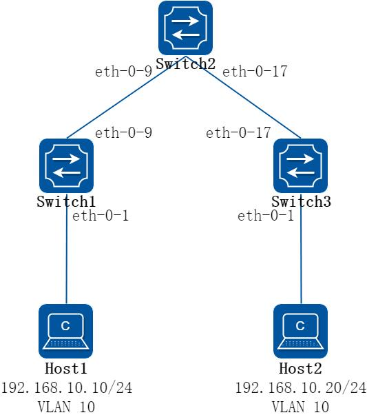

**图17-12 VXLAN 网络互通组网图**

##### 2. 组网需求

Host 1 和Host 2 处于同一网段，需要通过VXLAN 隧道来实现互通。

##### 3. 配置步骤

步骤1 分别在SWITCH 1、SWITCH 2、SWITCH 3 上配置路由，保证交换机之间三层网络可通配置SWITCH 1

```
SWITCH_1# configure terminal
Enter configuration commands, one per line.
End with CNTL/Z.
SWITCH_1(config)# interface loopback 0
SWITCH_1(config-if)# ip address 10.1.1.1/32
SWITCH_1(config-if)# exit
SWITCH_1(config)# interface eth-0-9
SWITCH_1(config-if)# no switchport
SWITCH_1(config-if)# ip address 192.168.1.1/24
SWITCH_1(config-if)# vxlan uplink enable
SWITCH_1(config-if)# no shutdown
SWITCH_1(config-if)# exit
SWITCH_1(config)# ip route 10.3.3.3/32 192.168.1.2
SWITCH_1(config)# end
```

配置SWITCH 2

```
SWITCH_2# configure terminal
Enter configuration commands, one per line.
End with CNTL/Z.
SWITCH_2(config)# interface eth-0-9
SWITCH_2(config-if)# no switchport
SWITCH_2(config-if)# ip address 192.168.1.2/24
SWITCH_2(config-if)# no shutdown
SWITCH_2(config-if)# exit
SWITCH_2(config)# interface eth-0-17
SWITCH_2(config-if)# no switchport
SWITCH_2(config-if)# ip address 192.168.2.1/24
SWITCH_2(config-if)# no shutdown
SWITCH_2(config-if)# exit
SWITCH_2(config)# ip route 10.1.1.1/32 192.168.1.1
SWITCH_2(config)# ip route 10.3.3.3/32 192.168.2.2
SWITCH_2(config)# end
```

配置SWITCH 3

```
SWITCH_3# configure terminal
Enter configuration commands, one per line.
End with CNTL/Z.
SWITCH_3(config)# interface loopback 0
SWITCH_3(config-if)# ip address 10.3.3.3/32
SWITCH_3(config-if)# exit
SWITCH_3(config)# interface eth-0-17
SWITCH_3(config-if)# no switchport
SWITCH_3(config-if)# ip address 192.168.2.2/24
SWITCH_3(config-if)# vxlan uplink enable
```

```
SWITCH_3(config-if)# no shutdown
SWITCH_3(config-if)# exit
SWITCH_3(config)# ip route 10.1.1.1/32 192.168.2.1
SWITCH_3(config)# end
```

##### 步骤2 分别在SWITCH 1、SWITCH 3 上配置VLAN

配置SWITCH 1

```
SWITCH_1# configure terminal
Enter configuration commands, one per line.
End with CNTL/Z.
SWITCH_1(config)# vlan database
SWITCH_1(config-vlan)# vlan 10
SWITCH_1(config-vlan)# vlan 10 overlay enable
SWITCH_1(config-vlan)# exit
SWITCH_1(config)# interface eth-0-1
SWITCH_1(config-if)# switchport mode access
SWITCH_1(config-if)# switchport access vlan 10
SWITCH_1(config-if)# no shutdown
SWITCH_1(config-if)# end
```

配置SWITCH 3

```
SWITCH_3# configure terminal
Enter configuration commands, one per line.
End with CNTL/Z.
SWITCH_3(config)# vlan database
SWITCH_3(config-vlan)# vlan 10
SWITCH_3(config-vlan)# vlan 10 overlay enable
SWITCH_3(config-vlan)# exit
SWITCH_3(config)# interface eth-0-1
SWITCH_3(config-if)# switchport mode access
SWITCH_3(config-if)# switchport access vlan 10
SWITCH_3(config-if)# no shutdown
SWITCH_3(config-if)# end
```

##### 步骤3 分别在SWITCH 1、SWITCH 3 配置VXLAN 隧道

配置SWITCH 1

```
SWITCH_1# configure terminal
Enter configuration commands, one per line.
End with CNTL/Z.
SWITCH_1(config)# overlay
SWITCH_1(config-overlay)# source 10.1.1.1
SWITCH_1(config-overlay)# remote-vtep 1 ip-address 10.3.3.3 type vxlan
SWITCH_1(config-overlay)# vlan 10 vni 10000
SWITCH_1(config-overlay)# vlan 10 remote-vtep 1
SWITCH_1(config-overlay)# end
```

配置SWITCH 3

```
SWITCH_3# configure terminal
Enter configuration commands, one per line.
End with CNTL/Z.
SWITCH_3(config)# overlay
SWITCH_3(config-overlay)# source 10.3.3.3
SWITCH_3(config-overlay)# remote-vtep 1 ip-address 10.1.1.1 type vxlan
SWITCH_3(config-overlay)# vlan 10 vni 10000
SWITCH_3(config-overlay)# vlan 10 remote-vtep 1
SWITCH_3(config-overlay)# end
```

##### 步骤4 验证配置结果

检查底层网络是否互通

```
SWITCH_1# ping
Protocol [ip]:
Target IP address: 10.3.3.3
Repeat count [5]:
Datagram size [100]:
Timeout in seconds [2]:
Extended commands [n]: y
Source address or interface: 10.1.1.1
Type of service [0]:
Set DF bit in IP header? [no]:
Data pattern [0xABCD]:
PATTERN: 0xabcd
PING 10.3.3.3 (10.3.3.3) from 10.1.1.1 : 100(128) bytes of data.
108 bytes from 10.3.3.3: icmp_seq=0 ttl=63 time=775 ms
108 bytes from 10.3.3.3: icmp_seq=1 ttl=63 time=904 ms
108 bytes from 10.3.3.3: icmp_seq=2 ttl=63 time=768 ms
108 bytes from 10.3.3.3: icmp_seq=3 ttl=63 time=668 ms
108 bytes from 10.3.3.3: icmp_seq=4 ttl=63 time=723 ms
--- 10.3.3.3 ping statistics ---
5 packets transmitted, 5 received, 0% packet loss, time 4009ms
rtt min/avg/max/mdev = 668.636/768.201/904.300/78.078 ms, pipe 2
```

检查隧道配置是否正确

```
SWITCH_1# show overlay vlan 10
---------------------------------------------------------------
ECMP Mode
: Normal
Source VTEP
: 10.1.1.1
---------------------------------------------------------------
VLAN ID
: 10
VNI
: 10000
Remote VTEP NUM: 1
Index: 1, Ip address: 10.3.3.3,
Type: VxLAN
DVR Gateway NUM: 0
---------------------------------------------------------------
SWITCH_1#
SWITCH_1# show overlay uplink
---------------------------------------------------------------
Uplink port:
eth-0-9
---------------------------------------------------------------
```

#### 集中式VXLAN 网关配置示例

##### 1. 组网拓扑

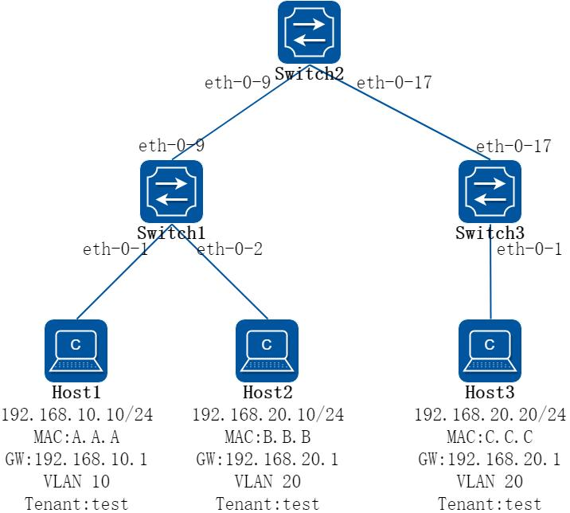

**图17-13 集中式VXLAN 网关组网图**

##### 2. 组网需求

如图所示，HOST1、2、3 都属于租户test，其间既有相同网段又有不同网段，且都需要相互通信。Switch 1、2、3 之间为三层网络，因此需要通过配置VXLAN 在HOST 之间建立隧道，并通过集中式网关来实现HOST 之间的通信。

可以将SWITCH 2 作为集中式网关。

##### 3. 配置步骤

步骤1 分别在SWITCH 1、SWITCH 2、SWITCH 3 上配置路由，保证交换机之间三层网络可通配置SWITCH 1

```
SWITCH_1# configure terminal
Enter configuration commands, one per line.
End with CNTL/Z.
SWITCH_1(config)# interface loopback 0
SWITCH_1(config-if)# ip address 10.1.1.1/32
SWITCH_1(config-if)# exit
SWITCH_1(config)# interface eth-0-9
SWITCH_1(config-if)# no switchport
SWITCH_1(config-if)# ip address 192.168.9.1/24
SWITCH_1(config-if)# no shutdown
SWITCH_1(config-if)# exit
SWITCH_1(config)# ip route 10.2.2.2/32 192.168.9.2
```

```
SWITCH_1(config)# ip route 10.3.3.3/32 192.168.9.2
SWITCH_1(config)# end
```

配置SWITCH 2

```
SWITCH_2# configure terminal
Enter configuration commands, one per line.
End with CNTL/Z.
SWITCH_2(config)# interface loopback 0
SWITCH_2(config-if)# ip address 10.2.2.2/32
SWITCH_2(config-if)# exit
SWITCH_2(config)# interface eth-0-9
SWITCH_2(config-if)# no switchport
SWITCH_2(config-if)# ip address 192.168.9.2/24
SWITCH_2(config-if)# no shutdown
SWITCH_2(config-if)# exit
SWITCH_2(config)# interface eth-0-17
SWITCH_2(config-if)# no switchport
SWITCH_2(config-if)# ip address 192.168.17.2/24
SWITCH_2(config-if)# no shutdown
SWITCH_2(config-if)# exit
SWITCH_2(config)# ip route 10.3.3.3/32 192.168.17.1
SWITCH_2(config)# ip route 10.1.1.1/32 192.168.9.1
SWITCH_2(config)# end
```

配置SWITCH 3

```
SWITCH_3# configure terminal
Enter configuration commands, one per line.
End with CNTL/Z.
SWITCH_3(config)# interface loopback 0
SWITCH_3(config-if)# ip address 10.3.3.3/32
SWITCH_3(config-if)# exit
SWITCH_3(config)# interface eth-0-17
SWITCH_3(config-if)# no switchport
SWITCH_3(config-if)# ip address 192.168.17.1/24
SWITCH_3(config-if)# no shutdown
SWITCH_3(config-if)# exit
SWITCH_3(config)# ip route 10.1.1.1/32 192.168.17.2
SWITCH_3(config)# ip route 10.2.2.2/32 192.168.17.2
SWITCH_3(config)# end
```

##### 步骤2 分别在SWITCH 1、SWITCH 2、SWITCH 3 上配置VLAN

配置SWITCH 1

```
SWITCH_1# configure terminal
Enter configuration commands, one per line.
End with CNTL/Z.
SWITCH_1(config)# vlan database
SWITCH_1(config-vlan)# vlan 10,20
SWITCH_1(config-vlan)# vlan 10 overlay enable
SWITCH_1(config-vlan)# vlan 20 overlay enable
SWITCH_1(config-vlan)# exit
SWITCH_1(config)# interface eth-0-1
SWITCH_1(config-if)# switchport mode access
SWITCH_1(config-if)# switchport access vlan 10
SWITCH_1(config-if)# no shutdown
SWITCH_1(config-if)# exit
SWITCH_1(config)# interface eth-0-2
```

```
SWITCH_1(config-if)# switchport mode access
SWITCH_1(config-if)# switchport access vlan 20
SWITCH_1(config-if)# no shutdown
SWITCH_1(config-if)# end
```

配置SWITCH 2

```
SWITCH_2# configure terminal
Enter configuration commands, one per line.
End with CNTL/Z.
SWITCH_2(config)# vlan database
SWITCH_2(config-vlan)# vlan 10,20
SWITCH_2(config-vlan)# vlan 10 overlay enable
SWITCH_2(config-vlan)# vlan 20 overlay enable
SWITCH_2(config-vlan)# end
```

配置SWITCH 3

```
SWITCH_3# configure terminal
Enter configuration commands, one per line.
End with CNTL/Z.
SWITCH_3(config)# vlan database
SWITCH_3(config-vlan)# vlan 20
SWITCH_3(config-vlan)# vlan 20 overlay enable
SWITCH_3(config-vlan)# exit
SWITCH_3(config)# interface eth-0-1
SWITCH_3(config-if)# switchport mode access
SWITCH_3(config-if)# switchport access vlan 20
SWITCH_3(config-if)# no shutdown
SWITCH_3(config-if)# end
```

##### 步骤3 在SWITCH 1、SWITCH 2、SWITCH 3 间建立VXLAN 隧道

配置SWITCH 1

```
SWITCH_1# configure terminal
Enter configuration commands, one per line.
End with CNTL/Z.
SWITCH_1(config)# interface eth-0-9
SWITCH_1(config-if)# vxlan uplink enable
SWITCH_1(config-if)# exit
SWITCH_1(config)# overlay
SWITCH_1(config-overlay)# source 10.1.1.1
SWITCH_1(config-overlay)# remote-vtep 1 ip-address 10.2.2.2 type vxlan
SWITCH_1(config-overlay)# remote-vtep 2 ip-address 10.3.3.3 type vxlan
SWITCH_1(config-overlay)# vlan 10 vni 10000
SWITCH_1(config-overlay)# vlan 10 remote-vtep 1
SWITCH_1(config-overlay)# vlan 20 vni 20000
SWITCH_1(config-overlay)# vlan 20 remote-vtep 1
SWITCH_1(config-overlay)# vlan 20 remote-vtep 2
SWITCH_1(config-overlay)# end
```

配置SWITCH 2

```
SWITCH_2# configure terminal
Enter configuration commands, one per line.
End with CNTL/Z.
SWITCH_2(config)# interface eth-0-9
SWITCH_2(config-if)# vxlan uplink enable
SWITCH_2(config-if)# exit
SWITCH_2(config)# interface eth-0-17
SWITCH_2(config-if)# vxlan uplink enable
```

```
SWITCH_2(config-if)# exit
SWITCH_2(config)# overlay
SWITCH_2(config-overlay)# source 10.2.2.2
SWITCH_2(config-overlay)# remote-vtep 1 ip-address 10.1.1.1 type vxlan
SWITCH_2(config-overlay)# remote-vtep 2 ip-address 10.3.3.3 type vxlan
SWITCH_2(config-overlay)# vlan 10 vni 10000
SWITCH_2(config-overlay)# vlan 10 remote-vtep 1
SWITCH_2(config-overlay)# vlan 20 vni 20000
SWITCH_2(config-overlay)# vlan 20 remote-vtep 1
SWITCH_2(config-overlay)# vlan 20 remote-vtep 2
SWITCH_2(config-overlay)# end
```

配置SWITCH 3

```
SWITCH_3# configure terminal
Enter configuration commands, one per line.
End with CNTL/Z.
SWITCH_3(config)# interface eth-0-17
SWITCH_3(config-if)# vxlan uplink enable
SWITCH_3(config-if)# exit
SWITCH_3(config)# overlay
SWITCH_3(config-overlay)# source 10.3.3.3
SWITCH_3(config-overlay)# remote-vtep 1 ip-address 10.1.1.1 type vxlan
SWITCH_3(config-overlay)# remote-vtep 2 ip-address 10.2.2.2 type vxlan
SWITCH_3(config-overlay)# vlan 20 vni 20000
SWITCH_3(config-overlay)# vlan 20 remote-vtep 1
SWITCH_3(config-overlay)# vlan 20 remote-vtep 2
SWITCH_3(config-overlay)# end
```

步骤4 分别在SWITCH 2 上配置相应HOST 的网关，绑定到相应VRF 下。

配置SWITCH 2

```
SWITCH_2# configure terminal
Enter configuration commands, one per line.
End with CNTL/Z.
SWITCH_2(config)# ip vrf test
SWITCH_2(config-vrf)# exit
SWITCH_2(config)# interface vlan 10
SWITCH_2(config-if)# ip vrf forwarding test
SWITCH_2(config-if)# ip address 192.168.10.1/24
SWITCH_2(config-if)# exit
SWITCH_2(config)# interface vlan 20
SWITCH_2(config-if)# ip vrf forwarding test
SWITCH_2(config-if)# ip address 192.168.20.2/24
SWITCH_2(config-if)# end
```

至此配置已经完成，HOST 1/2/4 之间应可以相互ping 通。

此处举例中的VRF 是为了隔离不同租户，如无需要可以不配置VRF。

##### 步骤5 检查配置

检查底层网络是否互通

```
SWITCH_1# ping -a 10.1.1.1 10.2.2.2
PING 10.2.2.2 (10.2.2.2) from 10.1.1.1 : 56(84) bytes of data.
64 bytes from 10.2.2.2: icmp_seq=1 ttl=64 time=2.57 ms
64 bytes from 10.2.2.2: icmp_seq=2 ttl=64 time=2.05 ms
64 bytes from 10.2.2.2: icmp_seq=3 ttl=64 time=2.29 ms
```

```
64 bytes from 10.2.2.2: icmp_seq=4 ttl=64 time=2.07 ms
64 bytes from 10.2.2.2: icmp_seq=5 ttl=64 time=2.44 ms
--- 10.2.2.2 ping statistics ---
5 packets transmitted, 5 received, 0% packet loss, time 4004ms
rtt min/avg/max/mdev = 2.059/2.287/2.573/0.210 ms
SWITCH_1# ping -a 10.1.1.1 10.3.3.3
PING 10.3.3.3 (10.3.3.3) from 10.1.1.1 : 56(84) bytes of data.
64 bytes from 10.3.3.3: icmp_seq=1 ttl=63 time=3.32 ms
64 bytes from 10.3.3.3: icmp_seq=2 ttl=63 time=2.45 ms
64 bytes from 10.3.3.3: icmp_seq=3 ttl=63 time=2.50 ms
64 bytes from 10.3.3.3: icmp_seq=4 ttl=63 time=2.42 ms
64 bytes from 10.3.3.3: icmp_seq=5 ttl=63 time=3.49 ms
--- 10.3.3.3 ping statistics ---
5 packets transmitted, 5 received, 0% packet loss, time 4004ms
rtt min/avg/max/mdev = 2.421/2.839/3.491/0.467 ms
```

检查隧道配置是否正确

```
SWITCH_2# show overlay
-------------------------------------------------------------------------------
ECMP Mode
: Normal
Source VTEP
: 10.1.1.1
Vlan Vni
Type
Remote-vtep IP-Address
Src-Address
Head-end-flooding Protocol
-------------------------------------------------------------------------------
10
10000
VxLAN
1
10.2.2.2
10.1.1.1
Enable
Static
20
20000
VxLAN
1
10.2.2.2
10.1.1.1
Enable
Static
20
20000
VxLAN
2
10.3.3.3
10.1.1.1
Enable
Static
SWITCH_1# show overlay uplink
-------------------------------------------------------------------------------
Uplink port:
eth-0-9
-------------------------------------------------------------------------------S
```

检查SWITCH 2（gateway）上ARP

```
SWITCH_2 # show ip arp
Protocol
Address
Age (min)
Hardware Addr
Interface
Internet
192.168.9.2
-
001e.081b.bce0
eth-0-9
Internet
192.168.9.1
0
001e.080a.a7fb
eth-0-9
Internet
192.168.17.2
-
001e.081b.bce0
eth-0-17
Internet
192.168.17.1
0
001e.081f.13bc
eth-0-17
Internet
192.168.10.10
0
001e.080c.46ce
vlan10(tunnel)
Internet
192.168.20.10
0
001e.0811.05f9
vlan20(tunnel)
Internet
192.168.10.1
-
001e.081b.bce0
vlan10
Internet
192.168.20.1
-
001e.081b.bce0
vlan20
Internet
192.168.20.20
0
001e.080c.755e
vlan20(tunnel)
```

### 17.1.3 部署建议

#### 双活接入VXLAN 网络及分布式网关综合示例

##### 1. 组网拓扑

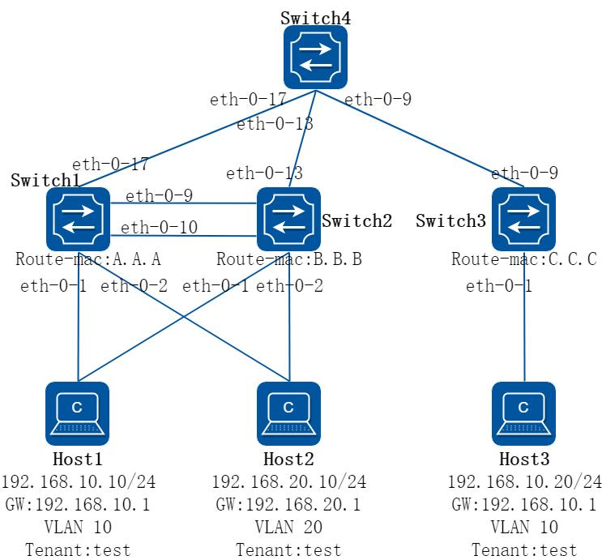

**图17-14 双活接入VXLAN 网络及分布式网关组网图**

##### 2. 组网需求

如图所示，Switch 1、2、3 作为TOR 交换机，其间网络为三层网络，下联的HOST 都属于租户test，需求与其他租户隔离。为了保证可靠性，其中部分服务器需要双活接入，因此需要在SWITCH 1、2 上配置MLAG 并配置virtual ip 作为服务器网关。同时为了保证虚拟机迁移后网关地址不变，在SWITCH 1、2、3 上部署分布式网关。

##### 3. 配置步骤

步骤1 分别在SWITCH 1、2 配置MLAG，用于服务器双活接入，SWITCH 3 使用单接口下联配置peer-link配置SWITCH 1

```
SWITCH_1# configure terminal
Enter configuration commands, one per line.
End with CNTL/Z.
SWITCH_1 (config)# interface range eth-0-9 to eth-0-10
SWITCH_1(config-if-range)# no shutdown
SWITCH_1 (config-if-range)# channel-group 55 mode active
```

```
SWITCH_1 (config-if-range)# exit
SWITCH_1 (config)# interface agg 55
SWITCH_1 (config-if)# switchport mode trunk
SWITCH_1 (config-if)# switchport trunk allowed vlan all
SWITCH_1 (config-if)# spanning-tree port disable
SWITCH_1 (config-if)# exit
SWITCH_1 (config)# no ip igmp snooping
SWITCH_1 (config)# mlag configuration
SWITCH_1 (config-mlag)# peer-link agg 55
SWITCH_1 (config-mlag)# end
```

配置SWITCH 2

```
SWITCH_2# configure terminal
Enter configuration commands, one per line.
End with CNTL/Z.
SWITCH_2(config)# interface range eth-0-9 to eth-0-10
SWITCH_2(config-if-range)# no shutdown
SWITCH_2(config-if-range)# channel-group 55 mode active
SWITCH_2(config-if-range)# exit
SWITCH_2(config)# interface agg 55
SWITCH_2(config-if)# switchport mode trunk
SWITCH_2(config-if)# switchport trunk allowed vlan all
SWITCH_2(config-if)# spanning-tree port disable
SWITCH_2(config-if)# exit
SWITCH_2(config)# mlag configuration
SWITCH_2(config-mlag)# peer-link agg 55
SWITCH_2(config-mlag)# end
```

配置peer-address配置SWITCH 1

```
SWITCH_1# configure terminal
Enter configuration commands, one per line.
End with CNTL/Z.
SWITCH_1(config)# vlan database
SWITCH_1(config-vlan)# vlan 4094
SWITCH_1(config-vlan)# exit
SWITCH_1(config)# interface vlan 4094
SWITCH_1(config-if)# ip address 40.94.0.1/24
SWITCH_1(config-if)# exit
SWITCH_1(config)# mlag configuration
SWITCH_1(config-mlag)# peer-address 40.94.0.2
SWITCH_1(config-mlag)# end
```

配置SWITCH 2

```
SWITCH_2# configure terminal
Enter configuration commands, one per line.
End with CNTL/Z.
SWITCH_2(config)# vlan database
vSWITCH_2(config-vlan)# vlan 4094
SWITCH_2(config-vlan)# exit
SWITCH_2(config)# interface vlan 4094
SWITCH_2(config-if)# ip address 40.94.0.2/24
SWITCH_2(config-if)# exit
SWITCH_2(config)# no ip igmp snooping
SWITCH_2(config)# mlag configuration
```

```
SWITCH_2(config-mlag)# peer-address 40.94.0.1
SWITCH_2(config-mlag)# end
```

配置下联接口，SWITCH 1、2 使用MLAG 双下联，SWITCH 3 普通单下联配置SWITCH 1

```
SWITCH_1# configure terminal
Enter configuration commands, one per line.
End with CNTL/Z.
SWITCH_1(config)# vlan database
SWITCH_1(config-vlan)# vlan 10,20,100
SWITCH_1(config-vlan)# exit
SWITCH_1(config)# interface eth-0-1
SWITCH_1(config-if)# switchport mode trunk
SWITCH_1(config-if)# switchport trunk allowed vlan add 10
SWITCH_1(config-if)# no shutdown
SWITCH_1(config-if)# static-channel-group 1
SWITCH_1(config-if)# exit
SWITCH_1(config)# interface eth-0-2
SWITCH_1(config-if)# switchport mode trunk
SWITCH_1(config-if)# switchport trunk allowed vlan add 20
SWITCH_1(config-if)# no shutdown
SWITCH_1(config-if)# static-channel-group 2
SWITCH_1(config-if)# exit
SWITCH_1(config)# interface agg 1
SWITCH_1(config-if)# mlag 1
SWITCH_1(config-if)# exit
SWITCH_1(config)# interface agg 2
SWITCH_1(config-if)# mlag 2
SWITCH_1(config-if)# end
```

配置SWITCH 2

```
SWITCH_2# configure terminal
Enter configuration commands, one per line.
End with CNTL/Z.
SWITCH_2(config)# vlan database
SWITCH_2(config-vlan)# vlan 10,20,100
SWITCH_2(config-vlan)# exit
SWITCH_2(config)# interface eth-0-1
SWITCH_2(config-if)# switchport mode trunk
SWITCH_2(config-if)# switchport trunk allowed vlan add 10
SWITCH_2(config-if)# static-channel-group 1
SWITCH_2(config-if)# no shutdown
SWITCH_2(config-if)# exit
SWITCH_2(config)# interface eth-0-2
SWITCH_2(config-if)# switchport mode trunk
SWITCH_2(config-if)# switchport trunk allowed vlan add 20
SWITCH_2(config-if)# static-channel-group 2
SWITCH_2(config-if)# no shutdown
SWITCH_2(config-if)# exit
SWITCH_2(config)# interface agg 1
SWITCH_2(config-if)# mlag 1
SWITCH_2(config-if)# exit
SWITCH_2(config)# interface agg 2
SWITCH_2(config-if)# mlag 2
SWITCH_2(config-if)# end
```

配置SWITCH 3

```
SWITCH_3# configure terminal
Enter configuration commands, one per line.
End with CNTL/Z.
SWITCH_3(config)# vlan database
SWITCH_3(config-vlan)# vlan 10
SWITCH_3(config-vlan)# exit
SWITCH_3(config)# interface eth-0-1
SWITCH_3(config-if)# switchport mode trunk
SWITCH_3(config-if)# switchport trunk allowed vlan add 10
SWITCH_3(config-if)# no shutdown
SWITCH_3(config-if)# end
```

##### 步骤2 配置网关地址并使能分布式网关，在MLAG 设备上使用virtual ip

配置SWITCH 1

```
SWITCH_1# configure terminal
Enter configuration commands, one per line.
End with CNTL/Z.
SWITCH_1(config)# ip vrf test
SWITCH_1(config-vrf)# exit
SWITCH_1(config)# interface vlan 10
SWITCH_1(config-if)# ip vrf forwarding test
SWITCH_1(config-if)# ip address 192.168.10.253/24
SWITCH_1(config-if)# ip virtual-router address 192.168.10.1
SWITCH_1(config-if)# overlay distributed-gateway enable
SWITCH_1(config-if)# exit
SWITCH_1(config)# interface vlan 20
SWITCH_1(config-if)# ip vrf forwarding test
SWITCH_1(config-if)# ip address 192.168.20.253/24
SWITCH_1(config-if)# ip virtual-router address 192.168.20.1
SWITCH_1(config-if)# overlay distributed-gateway enable
SWITCH_1(config-if)# exit
SWITCH_1(config)# ip virtual-router mac 0.0.1
SWITCH_1(config)# interface vlan 100
SWITCH_1(config-if)# end
```

配置SWITCH 2

```
SWITCH_2# configure terminal
Enter configuration commands, one per line.
End with CNTL/Z.
SWITCH_2(config)# ip vrf test
SWITCH_2(config-vrf)# exit
SWITCH_2(config)# interface vlan 10
SWITCH_2(config-if)# ip vrf forwarding test
SWITCH_2(config-if)# ip address 192.168.10.254/24
SWITCH_2(config-if)# ip virtual-router address 192.168.10.1
SWITCH_2(config-if)# overlay distributed-gateway enable
SWITCH_2(config-if)# exit
SWITCH_2(config)# interface vlan 20
SWITCH_2(config-if)# ip vrf forwarding test
SWITCH_2(config-if)# ip address 192.168.20.254/24
SWITCH_2(config-if)# ip virtual-router address 192.168.20.1
SWITCH_2(config-if)# overlay distributed-gateway enable
SWITCH_2(config-if)# exit
SWITCH_2(config)# ip virtual-router mac 0.0.1
```

```
SWITCH_2(config)# interface vlan 100
SWITCH_2(config)# end
```

配置SWITCH 3

```
SWITCH_3# configure terminal
Enter configuration commands, one per line.
End with CNTL/Z.
SWITCH_3(config)# ip vrf test
SWITCH_3(config-vrf)# exit
SWITCH_3(config)# interface vlan 10
SWITCH_3(config-if)# ip vrf forwarding test
SWITCH_3(config-if)# ip address 192.168.10.1/24
SWITCH_3(config-if)# overlay distributed-gateway enable
SWITCH_3(config-if)# end
```

##### 步骤3 配置SWITCH 之间的三层网络

配置SWITCH 1

```
SWITCH_1# configure terminal
Enter configuration commands, one per line.
End with CNTL/Z.
SWITCH_1(config)# interface loopback 0
SWITCH_1(config-if)# ip address 10.1.1.1/32
SWITCH_1(config-if)# exit
SWITCH_1(config)# interface eth-0-17
SWITCH_1(config-if)# no switchport
SWITCH_1(config-if)# no shutdown
SWITCH_1(config-if)# ip address 192.168.17.1/24
SWITCH_1(config-if)# exit
SWITCH_1(config)# ip route 10.3.3.3/32 192.168.17.2
SWITCH_1(config)# ip route 10.3.3.3/32 40.94.0.2 100
SWITCH_1(config)#end
```

配置SWITCH 2

```
SWITCH_2# configure terminal
Enter configuration commands, one per line.
End with CNTL/Z.
SWITCH_2(config)# interface loopback 0
SWITCH_2(config-if)# ip address 10.1.1.1/32
SWITCH_2(config-if)# exit
SWITCH_2(config)# interface eth-0-13
SWITCH_2(config-if)# no switchport
SWITCH_2(config-if)# no shutdown
SWITCH_2(config-if)# ip address 192.168.13.1/24
SWITCH_2(config-if)# exit
SWITCH_2(config)# ip route 10.3.3.3/32 192.168.13.2
SWITCH_2(config)# ip route 10.3.3.3/32 40.94.0.1 100
SWITCH_2(config)# end
```

配置SWITCH 3

```
SWITCH_3# configure terminal
Enter configuration commands, one per line.
End with CNTL/Z.
SWITCH_3(config)# interface loopback 0
SWITCH_3(config-if)# ip address 10.3.3.3/32
SWITCH_3(config-if)# exit
SWITCH_3(config)# interface eth-0-9
SWITCH_3(config-if)# no shutdown
```

```
SWITCH_3(config-if)# no switchport
SWITCH_3(config-if)# ip address 192.168.9.1/24
SWITCH_3(config-if)# exit
SWITCH_3(config)# ip route 10.1.1.1/32 192.168.9.2
SWITCH_3(config)# end
```

配置SWITCH 4

```
SWITCH_4# configure terminal
Enter configuration commands, one per line.
End with CNTL/Z.
SWITCH_4(config)# interface eth-0-17
SWITCH_4(config-if)# no shutdown
SWITCH_4(config-if)# no switchport
SWITCH_4(config-if)# ip address 192.168.17.2/24
SWITCH_4(config-if)# exit
SWITCH_4(config)# interface eth-0-13
SWITCH_4(config-if)# no shutdown
SWITCH_4(config-if)# no switchport
SWITCH_4(config-if)# ip address 192.168.13.2/24
SWITCH_4(config-if)# exit
SWITCH_4(config)# interface eth-0-9
SWITCH_4(config-if)# no shutdown
SWITCH_4(config-if)# no switchport
SWITCH_4(config-if)# ip address 192.168.9.2/24
SWITCH_4(config-if)# exit
SWITCH_4(config)# ip route 10.1.1.1/32 192.168.17.1
SWITCH_4(config)# ip route 10.1.1.1/32 192.168.13.1
SWITCH_4(config)# ip route 10.3.3.3/32 192.168.9.1
SWITCH_4(config)# end
```

##### 步骤4 配置VXLAN 隧道

配置SWITCH 1

```
SWITCH_1# configure terminal
Enter configuration commands, one per line.
End with CNTL/Z.
SWITCH_1(config)# vlan database
SWITCH_1(config-vlan)# vlan 10 overlay enable
SWITCH_1(config-vlan)# vlan 100 overlay enable
SWITCH_1(config-vlan)# exit
SWITCH_1(config)# overlay
SWITCH_1(config-overlay)# source 10.1.1.1
SWITCH_1(config-overlay)# remote-vtep 1 ip-address 10.3.3.3 type vxlan
SWITCH_1(config-overlay)# vlan 10 vni 10000
SWITCH_1(config-overlay)# vlan 10 remote-vtep 1
SWITCH_1(config-overlay)# vlan 100 vni 100
SWITCH_1(config-overlay)# vlan 100 remote-vtep 1
SWITCH_1(config-overlay)# exit
SWITCH_1(config)# interface eth-0-17
SWITCH_1(config-if)# vxlan uplink enable
SWITCH_1(config-if)# end
```

配置SWITCH 2

```
SWITCH_2# configure terminal
Enter configuration commands, one per line.
End with CNTL/Z.
SWITCH_2(config)# vlan database SWITCH_B(config-vlan)# vlan 10 overlay enable
```

```
SWITCH_2(config-vlan)# vlan 100 overlay enable
SWITCH_2(config-vlan)# exit
SWITCH_2(config)# overlay
SWITCH_2(config-overlay)# source 10.1.1.1
SWITCH_2(config-overlay)# remote-vtep 1 ip-address 10.3.3.3 type vxlan
SWITCH_2(config-overlay)# vlan 10 vni 10000
SWITCH_2(config-overlay)# vlan 10 remote-vtep 1
SWITCH_2(config-overlay)# vlan 100 vni 100
SWITCH_2(config-overlay)# vlan 100 remote-vtep 1
SWITCH_2(config-overlay)# exit
SWITCH_2(config)# interface eth-0-13
SWITCH_2(config-if)# vxlan uplink enable
SWITCH_2(config-if)# end
```

配置SWITCH 3

```
SWITCH_3# configure terminal
Enter configuration commands, one per line.
End with CNTL/Z.
SWITCH_3(config)# vlan database
SWITCH_3(config-vlan)# vlan 10,100
SWITCH_3(config-vlan)# vlan 10 overlay enable
SWITCH_3(config-vlan)# vlan 100 overlay enable
SWITCH_3(config-vlan)# exit
SWITCH_3(config)# overlay
SWITCH_3(config-overlay)# source 10.3.3.3
SWITCH_3(config-overlay)# remote-vtep 1 ip-address 10.1.1.1 type vxlan
SWITCH_3(config-overlay)# vlan 10 vni 10000
SWITCH_3(config-overlay)# vlan 10 remote-vtep 1
SWITCH_3(config-overlay)# vlan 100 vni 100
SWITCH_3(config-overlay)# vlan 100 remote-vtep 1
SWITCH_3(config-overlay)# exit
SWITCH_3(config)# interface eth-0-9
SWITCH_3(config-if)# vxlan uplink enable
SWITCH_3(config-if)# end
```

##### 步骤5 配置DVR 路由，使分布在不同SWITCH 下的不同网段主机可以互通

配置SWITCH 1

```
SWITCH_1# configure terminal
Enter configuration commands, one per line.
End with CNTL/Z.
SWITCH_1(config)# ip route vrf test 192.168.10.20/32 remote-vtep 1 vni 100 inner-macda c.c.c
SWITCH_1(config)# end
```

配置SWITCH 2

```
SWITCH_2# configure terminal
Enter configuration commands, one per line.
End with CNTL/Z.
SWITCH_2(config)# ip route vrf test 192.168.10.20/32 remote-vtep 1 vni 100 inner-macda c.c.c
SWITCH_2(config)# end
```

配置SWITCH 3

```
SWITCH_3# configure terminal
Enter configuration commands, one per line.
End with CNTL/Z.
SWITCH_3(config)# ip route vrf test 192.168.20.10/32 remote-vtep 1 vni 100 inner-macda 0.0.1
SWITCH_3(config)# end
```

##### 步骤6 检查配置

查看MLAG 状态

```
SWITCH_1# show mlag peer
MLAG neighbor is 40.94.0.2, MLAG version 1
MLAG state = Established, up for 23:41:26
Last read 00:00:42, hold time is 240, keepalive interval is 60 seconds
Received 1652 messages,Sent 1654 messages
Open
: received 1, sent 2
KAlive
: received 1646, sent 1646
Fdb sync : received 0, sent 0
Failover : received 0, sent 0
Conf
: received 2, sent 2
Syspri
: received 1, sent 1
Peer fdb : received 15, sent 15
STP Total: received 2, sent 3
Global
: received 2, sent 3
Packet
: received 0, sent 0
Instance: received 0, sent 0
State
: received 0, sent 0
Connections established 1; dropped 0
Local host: 40.94.0.1, Local port: 61000
Foreign host: 40.94.0.2, Foreign port: 42371
remote_sysid: 06a8.c402.0300
```

查看MLAG 下联接口状态

```
SWITCH_1# show mlag interface
mlagid
local-if
local-state
remote-state
1
agg1
up
up
2
agg2
up
up
```

查看VXLAN 状态

```
SWITCH_1# show overlay
---------------------------------------------------------------
ECMP Mode
: Normal
Source VTEP
: 10.1.1.1
Vlan Vni
Type
Remote-vtep IP-Address
---------------------------------------------------------------
10
10000
VxLAN
1
10.3.3.3
100
100
VxLAN
1
10.3.3.3
```

查看DVR 路由是否生效

```
SWITCH_1# show ip route vrf test
Codes: K - kernel, C - connected, S - static, R - RIP, B - BGP
O - OSPF, IA - OSPF inter area
N1 - OSPF NSSA external type 1, N2 - OSPF NSSA external type 2
E1 - OSPF external type 1, E2 - OSPF external type 2
i - IS-IS, L1 - IS-IS level-1, L2 - IS-IS level-2, ia - IS-IS inter area
Dc - DHCP Client
[*] - [AD/Metric]
* - candidate default
```

```
C
192.168.10.0/24 is directly connected, vlan10
C
192.168.10.253/32 is in local loopback, vlan10
C
192.168.10.1/32 is directly connected, vlan10
S
192.168.10.20/32 is in overlay remote vxlan vtep:10.3.3.3, vni:100
C
192.168.20.0/24 is directly connected, vlan20
C
192.168.20.253/32 is in local loopback, vlan20
C
192.168.20.1/32 is directly connected, vlan20
```

## 17.2 NVGRE配置

### 17.2.1 概述

#### 简介

NVGRE 是一种利用通用路由封装的网络虚拟化技术，能够将虚拟网络承载在物理网络之上。NVGRE 使用GRE 的封装形式，利用GRE 头的低24bit 来代表虚拟网络ID（VNI），类似VXLAN 一样24bit 的ID 可以允许1600 百万个虚拟网络。

### 17.2.2 配置举例

#### 配置NVGRE

##### 1. 组网拓扑


**图17-15 NVGRE**

##### 2. 配置步骤

在下面的配置举例中，通过NVGRE 技术，将两台设备上vlan 20 的流量封装在vni 20000中实现互联互通。

以下配置如未说明在哪个Switch 配置，则表示所有Switch 配置相同：

##### 步骤1 进入配置模式

```
Switch# configure terminal
```

##### 步骤2 进入vlan 配置模式并创建vlan，在vlan 上使能overlay

```
Switch(config)# vlan database
Switch(config-vlan)# vlan 20
Switch(config-vlan)# vlan 20 overlay enable
Switch(config-vlan)# exit
```

##### 步骤3 进入接口配置模式，配置接口属性

Switch1 的接口配置：

```
Switch1(config)# interface eth-0-1
Switch1(config-if)# switchport access vlan 20
Switch1(config-if)# no shutdown
Switch1(config-if)# exit
Switch1(config)# interface eth-0-2
Switch1(config-if)# switchport mode trunk
Switch1(config-if)# switchport trunk allowed vlan add 20
Switch1(config-if)# no shutdown
Switch1(config-if)# exit
Switch1(config)# interface eth-0-9
Switch1(config-if)# no switchport
Switch1(config-if)# ip address 9.9.9.1/24
Switch1(config-if)# overlay uplink enable
Switch1(config-if)# no shutdown
Switch1(config-if)# exit
Switch1(config)# interface loopback0
Switch1(config-if)# ip address 1.0.1.1/32
Switch1(config-if)# exit
```

Switch2 的接口配置：

```
Switch2(config)# interface eth-0-1
Switch2(config-if)# switchport access vlan 20
Switch2(config-if)# no shutdown
Switch2(config-if)# exit
Switch2(config)# interface eth-0-2
Switch2(config-if)# switchport mode trunk
Switch2(config-if)# switchport trunk allowed vlan add 20
Switch2(config-if)# no shutdown
Switch2(config-if)# exit
Switch2(config)# interface eth-0-9
Switch2(config-if)# no switchport
Switch2(config-if)# ip address 9.9.9.2/24
Switch2(config-if)# overlay uplink enable
Switch2(config-if)# no shutdown
Switch2(config-if)# exit
Switch2(config)# interface loopback0
Switch2(config-if)# ip address 1.0.1.2/32
Switch2(config-if)# exit
```

##### 步骤4 配置静态路由

在switch1 配置：

```
Switch1(config)# ip route 1.0.1.2/32 9.9.9.2
```

在switch2 配置：

```
Switch2(config)# ip route 1.0.1.1/32 9.9.9.1
```

##### 步骤5 配置overlay

在switch1 配置：

```
Switch1(config)# overlay
Switch1(config-overlay)# source 1.0.1.1
Switch1(config-overlay)# remote-vtep 1 ip-address 1.0.1.2 type nvgre
Switch1(config-overlay)# vlan 20 vni 20000
Switch1(config-overlay)# vlan 20 remote-vtep 1
Switch1(config-overlay)# exit
```

在switch2 配置：

```
Switch2(config)# overlay
Switch2(config-overlay)# source 1.0.1.2
Switch2(config-overlay)# remote-vtep 1 ip-address 1.0.1.1 type nvgre
Switch2(config-overlay)# vlan 20 vni 20000
Switch2(config-overlay)# vlan 20 remote-vtep 1
Switch2(config-overlay)# exit
```

##### 步骤6 退出配置模式

```
Switch(config)# end
```

##### 步骤7 检查配置

Switch1 显示结果:

```
Switch1# show overlay vlan 20
-------------------------------------------------------------------------------
ECMP Mode
: Normal
Source VTEP
: 1.0.1.1
-------------------------------------------------------------------------------
VLAN ID
: 20
VNI
: 20000
EVPN Tunnel Data-fdb Learning : Enable
Remote VTEP NUM
: 1
Index: 1, Ip address: 1.0.1.2, Source ip: 1.0.1.1, Type: NvGRE, Protocol: Static
DVR Gateway NUM: 0
-------------------------------------------------------------------------
```

Switch2 显示结果:

```
Switch2# show overlay vlan 20
-------------------------------------------------------------------------------
ECMP Mode
: Normal
Source VTEP
: 1.0.1.2
-------------------------------------------------------------------------------
VLAN ID
: 20
VNI
: 20000
EVPN Tunnel Data-fdb Learning : Eanble
Remote VTEP NUM
: 1
```

```
Index: 1, Ip address: 1.0.1.1, Source ip: 1.0.1.2, Type: NvGRE, Protocol: Static
DVR Gateway NUM: 0
-------------------------------------------------------------------------------
```

#### NVGRE 分布式路由配置

##### 1. 组网拓扑


**图17-16 NVGRE 分布式路由**

##### 2. 配置步骤

在下面的配置举例中，按上图所示，VM-1 和VM-3 在同一个VNI 中，通过NVGRE 互联建立分布式路由；VM-2 和VM-4 在同一个VNI 中，通过NVGRE 互联建立分布式路由。

以下配置如未说明在哪个Switch 配置，则表示所有Switch 配置相同：

##### 步骤1 进入配置模式

```
Switch# configure terminal
```

##### 步骤2 进入vlan 配置模式并创建vlan，在vlan 上使能overlay

```
Switch(config)# vlan database
Switch(config-vlan)# vlan 20,30
Switch(config-vlan)# vlan 20 overlay enable
Switch(config-vlan)# vlan 30 overlay enable
Switch(config-vlan)# exit
```

##### 步骤3 创建vrf 实例

```
Switch(config)# ip vrf tenant
Switch(config-vrf)# exit
```

##### 步骤4 创建三层接口，加入vrf 并配置地址

在switch1 配置：

```
Switch1(config)# interface
vlan 20
Switch1(config-if)# ip vrf forwarding tenant
Switch1(config-if)# ip address 2.2.2.111/24
Switch1(config-if)# exit
Switch1(config)# interface
vlan 30
Switch1(config-if)# ip vrf forwarding tenant
Switch1(config-if)# ip address 3.3.3.111/24
Switch1(config-if)# exit
```

在switch2 配置：

```
Switch2(config)# interface
vlan 20
Switch2(config-if)# ip vrf forwarding tenant
Switch2(config-if)# ip address 2.2.2.222/24
Switch2(config-if)# exit
Switch2(config)# interface
vlan 30
Switch2(config-if)# ip vrf forwarding tenant
Switch2(config-if)# ip address 3.3.3.222/24
Switch2(config-if)# exit
```

##### 步骤5 进入接口配置模式，配置接口属性

```
Switch(config)# interface eth-0-1
Switch(config-if)# switchport mode trunk
Switch(config-if)# switchport trunk allowed vlan add 20
Switch(config-if)# no shutdown
Switch(config-if)# exit
Switch(config)# interface eth-0-2
Switch(config-if)# switchport mode trunk
Switch(config-if)# switchport trunk allowed vlan add
30
Switch(config-if)# no shutdown
Switch(config-if)# exit
```

在switch1 配置：

```
Switch1(config)# interface eth-0-9
Switch1(config-if)# no switchport
Switch1(config-if)# ip address 9.9.9.1/24
Switch1(config-if)# overlay uplink enable
Switch1(config-if)# no shutdown
Switch1(config-if)# exit
Switch1(config)# interface loopback0
Switch1(config-if)# ip address 1.0.1.1/32
Switch1(config-if)# exit
```

在switch2 配置：

```
Switch2(config)# interface eth-0-9
Switch2(config-if)# no switchport
Switch2(config-if)# ip address 9.9.9.2/24
```

```
Switch2(config-if)# overlay uplink enable
Switch2(config-if)# no shutdown
Switch2(config-if)# exit
Switch2(config)# interface loopback0
Switch2(config-if)# ip address 1.0.1.2/32
Switch2(config-if)# exit
```

##### 步骤6 配置overlay

在switch1 配置：

```
Switch1(config)# overlay
Switch1(config-overlay)# source 1.0.1.1
Switch1(config-overlay)# remote-vtep 1 ip-address 1.0.1.2 type nvgre
Switch1(config-overlay)# remote-vtep 1 virtual-mac 22.22.22
Switch1(config-overlay)# vlan 20 vni 20000
Switch1(config-overlay)# vlan 30 vni 30000
Switch1(config-overlay)# vlan 20 remote-vtep 1
Switch1(config-overlay)# vlan 30 remote-vtep 1
Switch1(config-overlay)# vlan 20 gateway-mac a.a.a
Switch1(config-overlay)# vlan 30 gateway-mac b.b.b
Switch1(config-overlay)# exit
```

在switch2 配置：

```
Switch2(config)# overlay
Switch2(config-overlay)# source 1.0.1.2
Switch2(config-overlay)# remote-vtep 1 ip-address 1.0.1.1 type nvgre
Switch2(config-overlay)# remote-vtep 1 virtual-mac 11.11.11
Switch2(config-overlay)# vlan 20 vni 20000
Switch2(config-overlay)# vlan 30 vni 30000
Switch2(config-overlay)# vlan 20 remote-vtep 1
Switch2(config-overlay)# vlan 30 remote-vtep 1
Switch2(config-overlay)# vlan 20 gateway-mac a.a.a
Switch2(config-overlay)# vlan 30 gateway-mac b.b.b
Switch2(config-overlay)# exit
```

##### 步骤7 配置静态路由和nvgre 分布式路由

在switch1 配置：

```
Switch1(config)# ip route 1.0.1.2/32 9.9.9.2
Switch1(config)# ip route vrf tenant 2.2.2.2/32 remote-vtep 1 vni 20000 inner-macda 3.3.3
Switch1(config)# ip route vrf tenant 3.3.3.2/32 remote-vtep 1 vni 30000 inner-macda 4.4.4
```

在switch2 配置：

```
Switch2(config)# ip route 1.0.1.1/32 9.9.9.1
Switch2(config)# ip route vrf tenant 2.2.2.1/32 remote-vtep 1 vni 20000 inner-macda 1.1.1
Switch2(config)# ip route vrf tenant 3.3.3.1/32 remote-vtep 1 vni 30000 inner-macda 2.2.2
```

##### 步骤8 退出配置模式

```
Switch(config)# end
```

##### 步骤9 检查配置

Switch1 显示结果：

```
Switch1# show ip route vrf tenant
Codes: K - kernel, C - connected, S - static, R - RIP, B - BGP
O - OSPF, IA - OSPF inter area
N1 - OSPF NSSA external type 1, N2 - OSPF NSSA external type 2
E1 - OSPF external type 1, E2 - OSPF external type 2
i - IS-IS, L1 - IS-IS level-1, L2 - IS-IS level-2, ia - IS-IS inter area
Dc - DHCP Client
[*] - [AD/Metric]
* - candidate default
S
2.2.2.2/32 is in overlay remote nvgre vtep:1.0.1.1->1.0.1.2, vni:20000
S
3.3.3.2/32 is in overlay remote nvgre vtep:1.0.1.1->1.0.1.2, vni:30000
```

Switch2 显示结果：

```
Switch2# show ip route vrf tenant
Codes: K - kernel, C - connected, S - static, R - RIP, B - BGP
O - OSPF, IA - OSPF inter area
N1 - OSPF NSSA external type 1, N2 - OSPF NSSA external type 2
E1 - OSPF external type 1, E2 - OSPF external type 2
i - IS-IS, L1 - IS-IS level-1, L2 - IS-IS level-2, ia - IS-IS inter area
Dc - DHCP Client
[*] - [AD/Metric]
* - candidate default
S
2.2.2.1/32 is in overlay remote nvgre vtep:1.0.1.2->1.0.1.1, vni:20000
S
3.3.3.1/32 is in overlay remote nvgre vtep:1.0.1.2->1.0.1.1, vni:30000
```

#### 基于IPv6 网络配置NvGRE

##### 1. 组网拓扑


**图17-17 IPv6 NVGRE**

##### 2. 配置步骤

在下面的配置举例中，通过NVGRE 技术，将两台设备上vlan 20 的流量封装在vni 20000中实现互联互通。

以下配置如未说明在哪个Switch 配置，则表示所有Switch 配置相同：

##### 步骤1 进入配置模式

```
Switch# configure terminal
```

##### 步骤2 进入vlan 配置模式并创建vlan，在vlan 上使能overlay

```
Switch(config)# vlan database
Switch(config-vlan)# vlan 20
Switch(config-vlan)# vlan 20 overlay enable
Switch(config-vlan)# exit
```

##### 步骤3 进入接口配置模式，配置接口属性

Switch1 的接口配置：

```
Switch1(config)# ipv6 enable
Switch1(config)# interface eth-0-1
Switch1(config-if)# switchport access vlan 20
Switch1(config-if)# no shutdown
Switch1(config-if)# exit
Switch1(config)# interface eth-0-2
Switch1(config-if)# switchport mode trunk
Switch1(config-if)# switchport trunk allowed vlan add 20
Switch1(config-if)# no shutdown
Switch1(config-if)# exit
Switch1(config)# interface eth-0-9
Switch1(config-if)# no switchport
Switch1(config-if)# ipv6 address 2000::1/64
Switch1(config-if)# nvgre uplink enable
Switch1(config-if)# no shutdown
Switch1(config-if)# exit
Switch1(config)# interface loopback0
Switch1(config-if)# ipv6 address 1111::1/128
Switch1(config-if)# exit
```

Switch2 的接口配置：

```
Switch2(config)# interface eth-0-1
Switch2(config-if)# switchport access vlan 20
Switch2(config-if)# no shutdown
Switch2(config-if)# exit
Switch2(config)# interface eth-0-2
Switch2(config-if)# switchport mode trunk
Switch2(config-if)# switchport trunk allowed vlan add 20
Switch2(config-if)# no shutdown
Switch2(config-if)# exit
Switch2(config)# interface eth-0-9
Switch2(config-if)# no switchport
Switch2(config-if)# ipv6 address 2000::2/64
Switch2(config-if)# nvgre uplink enable
Switch2(config-if)# no shutdown
Switch2(config-if)# exit
Switch2(config)# interface loopback0
Switch2(config-if)# ipv6 address 2222::2/128
Switch2(config-if)# exit
```

##### 步骤4 配置静态路由

在switch1 配置：

```
Switch1(config)# ipv6 route 2222::2/128 2000::2
```

在switch2 配置：

```
Switch2(config)# ipv6 route 1111::1/128 2000::1
```

##### 步骤5 配置overlay

在switch1 配置：

```
Switch1(config)# overlay
Switch1(config-overlay)# source 1111::1
Switch1(config-overlay)# remote-vtep 1 ipv6-address 2222::2 type nvgre
Switch1(config-overlay)# vlan 20 vni 20000
Switch1(config-overlay)# vlan 20 remote-vtep 1
Switch1(config-overlay)# exit
```

在switch2 配置：

```
Switch2(config)# overlay
Switch2(config-overlay)# source 2222::2
Switch2(config-overlay)# remote-vtep 1 ipv6-address 2222::2 type nvgre
Switch2(config-overlay)# vlan 20 vni 20000
Switch2(config-overlay)# vlan 20 remote-vtep 1
Switch2(config-overlay)# exit
```

##### 步骤6 退出配置模式

```
Switch(config)# end
```

##### 步骤7 检查配置

Switch1 显示结果：

```
Switch1# show overlay vlan 20
-------------------------------------------------------------------------------
ECMP Mode
: Normal
Source VTEP
: 1111::1
-------------------------------------------------------------------------------
VLAN ID
: 20
VNI
: 20000
EVPN Tunnel Data-fdb Learning : Enable
Remote VTEP NUM
: 1
Index: 1, Type: NvGRE, Protocol: Static
IP address: 2222::2
Source ip : 1111::1
DVR Gateway NUM: 0
-------------------------------------------------------------------------
```

Switch2 显示结果：

```
Switch2# show overlay vlan 20
-------------------------------------------------------------------------------
ECMP Mode
: Normal
Source VTEP
: 2222::2
-------------------------------------------------------------------------------
```

```
VLAN ID
: 20
VNI
: 20000
EVPN Tunnel Data-fdb Learning : Enable
Remote VTEP NUM
: 1
Index: 1, Type: NvGRE, Protocol: Static
IP address: 1111::1
Source ip : 2222::2
DVR Gateway NUM: 0
-------------------------------------------------------------------------
```

#### 基于IPv6 配置NvGRE 分布式路由

##### 1. 组网拓扑


**图17-18 IPv6 NVGRE 分布式路由**

##### 2. 配置步骤

在下面的配置举例中，按上图所示，VM-1 和VM-3 在同一个VNI 中，通过NVGRE 互联建立分布式路由；VM-2 和VM-4 在同一个VNI 中，通过NVGRE 互联建立分布式路由。

以下配置如未说明在哪个Switch 配置，则表示所有Switch 配置相同：

##### 步骤1 进入配置模式

```
Switch# configure terminal
```

##### 步骤2 进入vlan 配置模式并创建vlan，在vlan 上使能overlay

```
Switch(config)# vlan database
Switch(config-vlan)# vlan 20,30
Switch(config-vlan)# vlan 20 overlay enable
```

```
Switch(config-vlan)# vlan 30 overlay enable
Switch(config-vlan)# exit
```

##### 步骤3 创建vrf 实例

```
Switch(config)# ip vrf tenant
Switch(config-vrf)# exit
```

##### 步骤4 创建三层接口，加入vrf 并配置地址

在switch1 配置：

```
Switch1(config)# ipv6 enable
Switch1(config)# interface vlan 20
Switch1(config-if)# ip vrf forwarding tenant
Switch1(config-if)# ipv6 address 2000::111/64
Switch1(config-if)# exit
Switch1(config)# interface vlan 30
Switch1(config-if)# ip vrf forwarding tenant
Switch1(config-if)# ipv6 address 3000::111/64
Switch1(config-if)# exit
```

在switch2 配置：

```
Switch2(config)# interface
vlan 20
Switch2(config-if)# ip vrf forwarding tenant
Switch2(config-if)# ipv6 address 2000::222/24
Switch2(config-if)# exit
Switch2(config)# interface
vlan 30
Switch2(config-if)# ip vrf forwarding tenant
Switch2(config-if)# ipv6 address 3000::222/24
Switch2(config-if)# exit
```

##### 步骤5 进入接口配置模式，配置接口属性

```
Switch(config)# interface eth-0-1
Switch(config-if)# switchport mode trunk
Switch(config-if)# switchport trunk allowed vlan add 20
Switch(config-if)# no shutdown
Switch(config-if)# exit
Switch(config)# interface eth-0-2
Switch(config-if)# switchport mode trunk
Switch(config-if)# switchport trunk allowed vlan add
30
Switch(config-if)# no shutdown
Switch(config-if)# exit
```

在switch1 配置：

```
Switch1(config)# interface eth-0-9
Switch1(config-if)# no switchport
Switch1(config-if)# ipv6 address 1234::1/64
Switch1(config-if)# nvgre uplink enable
Switch1(config-if)# no shutdown
Switch1(config-if)# exit
```

```
Switch1(config)# interface loopback0
Switch1(config-if)# ipv6 address 1111::1/128
Switch1(config-if)# exit
```

在switch2 配置：

```
Switch2(config)# interface eth-0-9
Switch2(config-if)# no switchport
Switch2(config-if)# ipv6 address 1234::2/64
Switch2(config-if)# nvgre uplink enable
Switch2(config-if)# no shutdown
Switch2(config-if)# exit
Switch2(config)# interface loopback0
Switch2(config-if)# ipv6 address 2222::2/128
Switch2(config-if)# exit
```

##### 步骤6 配置overlay

在switch1 配置：

```
Switch1(config)# overlay
Switch1(config-overlay)# source 1111::1
Switch1(config-overlay)# remote-vtep 1 ipv6-address 2222::2 type nvgre
Switch1(config-overlay)# vlan 20 vni 20000
Switch1(config-overlay)# vlan 30 vni 30000
Switch1(config-overlay)# vlan 20 remote-vtep 1
Switch1(config-overlay)# vlan 30 remote-vtep 1
Switch1(config-overlay)# vlan 20 gateway-mac a.a.a
Switch1(config-overlay)# vlan 30 gateway-mac b.b.b
Switch1(config-overlay)# exit
```

在switch2 配置：

```
Switch2(config)# overlay
Switch2(config-overlay)# source 2222::2
Switch2(config-overlay)# remote-vtep 1 ipv6-address 1111::1 type nvgre
Switch2(config-overlay)# vlan 20 vni 20000
Switch2(config-overlay)# vlan 30 vni 30000
Switch2(config-overlay)# vlan 20 remote-vtep 1
Switch2(config-overlay)# vlan 30 remote-vtep 1
Switch2(config-overlay)# vlan 20 gateway-mac a.a.a
Switch2(config-overlay)# vlan 30 gateway-mac b.b.b
Switch2(config-overlay)# exit
```

##### 步骤7 配置静态路由和NVGRE 分布式路由

在switch1 配置：

```
Switch1(config)# ipv6 route 2222::2/128 1234::2
Switch1(config)# ipv6 route vrf tenant 2000::2/128 remote-vtep 1 vni 20000 inner-macda 3.3.3
Switch1(config)# ipv6 route vrf tenant 3000::2/128 remote-vtep 1 vni 30000 inner-macda 4.4.4
```

在switch2 配置：

```
Switch2(config)# ipv6 route 1111::1/128 1234::1
Switch2(config)# ipv6 route vrf tenant 2000::1/32 remote-vtep 1 vni 20000 inner-macda 1.1.1
Switch2(config)# ipv6 route vrf tenant 3000::1/32 remote-vtep 1 vni 30000 inner-macda 2.2.2
```

##### 步骤8 退出配置模式

```
Switch(config)# end
```

##### 步骤9 检查配置

Switch1 显示结果：

```
Switch1# show ipv6 route vrf tenant
Codes: C - connected, S - static, R - RIP, I - IS-IS, B - BGP
O - OSPF, IA - OSPF inter area
N1 - OSPF NSSA external type 1, N2 - OSPF NSSA external type 2
E1 - OSPF external type 1, E2 - OSPF external type 2
Dr - DHCPV6 Relay
[*] - [AD/Metric]
S
2000::2/128 is in overlay remote nvgre vtep:1111::1->2222::2, vni:20000
S
3000::2/128 is in overlay remote nvgre vtep:1111::1->2222::2, vni:30000
```

Switch2 显示结果：

```
Switch2# show ipv6 route vrf tenant
Codes: C - connected, S - static, R - RIP, I - IS-IS, B - BGP
O - OSPF, IA - OSPF inter area
N1 - OSPF NSSA external type 1, N2 - OSPF NSSA external type 2
E1 - OSPF external type 1, E2 - OSPF external type 2
Dr - DHCPV6 Relay
[*] - [AD/Metric]
S
2000::1/128 is in overlay remote nvgre vtep:2222::2->1111::1, vni:20000
S
3000::1/128 is in overlay remote nvgre vtep:2222::2->1111::1, vni:30000
```

## 17.3 GENEVE配置

### 17.3.1 概述

#### 简介

通用网络虚拟化封装(GENEVE)是一种隧道网络技术，其将基于mac 的2 层以太网数据报文封装在3 层UDP 的数据报文中，通过3 层路由网络实现承载在3 层网络上的2 层网络通信。GENEVE 技术把逻辑网络的数量扩大到1600 万个，并且支持异地跨ip 的2 层互联以及可扩展的option。

### 17.3.2 配置举例

#### 配置GENEVE

##### 1. 组网拓扑

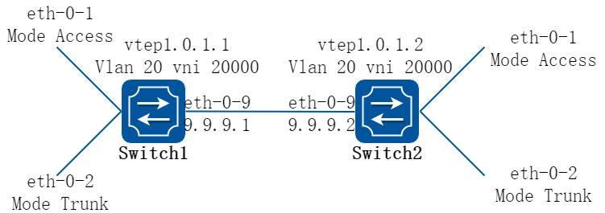

**图17-19 GENEVE**

##### 2. 配置步骤

在下面的配置举例中，switch1 和switch2 间有三层路由联通，通过GENEVE 技术，将两台设备上vlan 20 的流量封装在vni 20000 中，从而实现互联互通。

以下配置如未说明在哪个Switch 配置，则表示所有Switch 配置相同：

##### 步骤1 进入配置模式

```
Switch# configure terminal
```

##### 步骤2 进入vlan 配置模式并创建vlan，在vlan 上使能overlay

```
Switch(config)# vlan database
Switch(config-vlan)# vlan 20
Switch(config-vlan)# vlan 20 overlay enable
Switch(config-vlan)# exit
```

##### 步骤3 进入接口配置模式，配置接口属性

Switch1 的接口配置：

```
Switch1(config)# interface eth-0-1
Switch1(config-if)# switchport access vlan 20
Switch1(config-if)# no shutdown
Switch1(config-if)# exit
Switch1(config)# interface eth-0-2
Switch1(config-if)# switchport mode trunk
Switch1(config-if)# switchport trunk allowed vlan add 20
Switch1(config-if)# no shutdown
Switch1(config-if)# exit
Switch1(config)# interface eth-0-9
Switch1(config-if)# no switchport
Switch1(config-if)# ip address 9.9.9.1/24
```

```
Switch1(config-if)# vxlan uplink enable
Switch1(config-if)# no shutdown
Switch1(config-if)# exit
Switch1(config)# interface loopback0
Switch1(config-if)# ip address 1.0.1.1/32
Switch1(config-if)# exit
```

Switch2 的接口配置：

```
Switch2(config)# interface eth-0-1
Switch2(config-if)# switchport access vlan 20
Switch2(config-if)# no shutdown
Switch2(config-if)# exit
Switch2(config)# interface eth-0-2
Switch2(config-if)# switchport mode trunk
Switch2(config-if)# switchport trunk allowed vlan add 20
Switch2(config-if)# no shutdown
Switch2(config-if)# exit
Switch2(config)# interface eth-0-9
Switch2(config-if)# no switchport
Switch2(config-if)# ip address 9.9.9.2/24
Switch2(config-if)# vxlan uplink enable
Switch2(config-if)# no shutdown
Switch2(config-if)# exit
Switch2(config)# interface loopback0
Switch2(config-if)# ip address 1.0.1.2/32
Switch2(config-if)# exit
```

##### 步骤4 配置静态路由

在switch1 配置：

```
Switch1(config)# ip route 1.0.1.2/32 9.9.9.2
```

在switch2 配置：

```
Switch2(config)# ip route 1.0.1.1/32 9.9.9.1
```

##### 步骤5 配置overlay

在switch1 配置：

```
Switch1(config)# overlay
Switch1(config-overlay)# source 1.0.1.1
Switch1(config-overlay)# remote-vtep 1 ip-address 1.0.1.2 type geneve
Switch1(config-overlay)# vlan 20 vni 20000
Switch1(config-overlay)# vlan 20 remote-vtep 1
Switch1(config-overlay)# exit
```

在switch2 配置：

```
Switch2(config)# overlay
Switch2(config-overlay)# source 1.0.1.2
Switch2(config-overlay)# remote-vtep 1 ip-address 1.0.1.1 type geneve
Switch2(config-overlay)# vlan 20 vni 20000
```

```
Switch2(config-overlay)# vlan 20 remote-vtep 1
Switch2(config-overlay)# exit
```

##### 步骤6 退出配置模式

```
Switch(config)# end
```

##### 步骤7 检查配置

Switch1 显示结果：

```
Switch1# show overlay vlan 20
-------------------------------------------------------------------------------
ECMP Mode
: Normal
Source VTEP
: 1.0.1.1
-------------------------------------------------------------------------------
VLAN ID
: 20
VNI
: 20000
EVPN Tunnel Data-fdb Learning : Enable
Remote VTEP NUM
: 1
Index: 1, Ip address: 1.0.1.2, Source ip: 1.0.1.1, Type: GENEVE, Protocol: Static
DVR Gateway NUM: 0
-------------------------------------------------------------------------
```

Switch2 显示结果：

```
Switch2# show overlay vlan 20
-------------------------------------------------------------------------------
ECMP Mode
: Normal
Source VTEP
: 1.0.1.2
-------------------------------------------------------------------------------
VLAN ID
: 20
VNI
: 20000
EVPN Tunnel Data-fdb Learning : Eanble
Remote VTEP NUM
: 1
Index: 1, Ip address: 1.0.1.1, Source ip: 1.0.1.2, Type: GENEVE, Protocol: Static
DVR Gateway NUM: 0
-------------------------------------------------------------------------------
```

#### 配置GENEVE 分布式路由

##### 1. 组网拓扑


**图17-20 GENEVE 分布式路由**

##### 2. 配置步骤

在下面的配置举例中，按上图所示，VM-1 和VM-3 在同一个VNI 中，通过GENEVE 互联建立分布式路由；VM-2 和VM-4 在同一个VNI 中，通过GENEVE 互联建立分布式路由。

以下配置如未说明在哪个Switch 配置，则表示所有Switch 配置相同：

##### 步骤1 进入配置模式

```
Switch# configure terminal
```

##### 步骤2 进入vlan 配置模式并创建vlan，在vlan 上使能overlay

```
Switch(config)# vlan database
Switch(config-vlan)# vlan 20,30
Switch(config-vlan)# vlan 20 overlay enable
Switch(config-vlan)# vlan 30 overlay enable
Switch(config-vlan)# exit
```

##### 步骤3 创建vrf 实例

```
Switch(config)# ip vrf tenant
Switch(config-vrf)# exit
```

##### 步骤4 创建三层接口，加入vrf 并配置地址

在switch1 配置：

```
Switch1(config)# interface
vlan 20
Switch1(config-if)# ip vrf forwarding tenant
Switch1(config-if)# ip address 2.2.2.111/24
Switch1(config-if)# exit
Switch1(config)# interface
vlan 30
Switch1(config-if)# ip vrf forwarding tenant
Switch1(config-if)# ip address 3.3.3.111/24
Switch1(config-if)# exit
```

在switch2 配置：

```
Switch2(config)# interface
vlan 20
Switch2(config-if)# ip vrf forwarding tenant
Switch2(config-if)# ip address 2.2.2.222/24
Switch2(config-if)# exit
Switch2(config)# interface
vlan 30
Switch2(config-if)# ip vrf forwarding tenant
Switch2(config-if)# ip address 3.3.3.222/24
Switch2(config-if)# exit
```

##### 步骤5 进入接口配置模式，配置接口属性

```
Switch(config)# interface eth-0-1
Switch(config-if)# switchport mode trunk
Switch(config-if)# switchport trunk allowed vlan add 20
Switch(config-if)# no shutdown
Switch(config-if)# exit
Switch(config)# interface eth-0-2
Switch(config-if)# switchport mode trunk
Switch(config-if)# switchport trunk allowed vlan add 30
Switch(config-if)# no shutdown
Switch(config-if)# exit
```

在switch1 配置：

```
Switch1(config)# interface eth-0-9
Switch1(config-if)# no switchport
Switch1(config-if)# ip address 9.9.9.1/24
Switch1(config-if)# overlay uplink enable
Switch1(config-if)# no shutdown
Switch1(config-if)# exit
Switch1(config)# interface loopback0
Switch1(config-if)# ip address 1.0.1.1/32
Switch1(config-if)# exit
```

在switch2 配置：

```
Switch2(config)# interface eth-0-9
Switch2(config-if)# no switchport
Switch2(config-if)# ip address 9.9.9.2/24
Switch2(config-if)# overlay uplink enable
Switch2(config-if)# no shutdown
Switch2(config-if)# exit
```

```
Switch2(config)# interface loopback0
Switch2(config-if)# ip address 1.0.1.2/32
Switch2(config-if)# exit
```

##### 步骤6 配置overlay

在switch1 配置：

```
Switch1(config)# overlay
Switch1(config-overlay)# source 1.0.1.1
Switch1(config-overlay)# remote-vtep 1 ip-address 1.0.1.2 type geneve
Switch1(config-overlay)# remote-vtep 1 virtual-mac 22.22.22
Switch1(config-overlay)# vlan 20 vni 20000
Switch1(config-overlay)# vlan 30 vni 30000
Switch1(config-overlay)# vlan 20 remote-vtep 1
Switch1(config-overlay)# vlan 30 remote-vtep 1
Switch1(config-overlay)# vlan 20 gateway-mac a.a.a
Switch1(config-overlay)# vlan 30 gateway-mac b.b.b
Switch1(config-overlay)# exit
```

在switch2 配置：

```
Switch2(config)# overlay
Switch2(config-overlay)# source 1.0.1.2
Switch2(config-overlay)# remote-vtep 1 ip-address 1.0.1.1 type geneve
Switch2(config-overlay)# remote-vtep 1 virtual-mac 11.11.11
Switch2(config-overlay)# vlan 20 vni 20000
Switch2(config-overlay)# vlan 30 vni 30000
Switch2(config-overlay)# vlan 20 remote-vtep 1
Switch2(config-overlay)# vlan 30 remote-vtep 1
Switch2(config-overlay)# vlan 20 gateway-mac a.a.a
Switch2(config-overlay)# vlan 30 gateway-mac b.b.b
Switch2(config-overlay)# exit
```

##### 步骤7 配置静态路由和GENEVE 分布式路由

在switch1 配置：

```
Switch1(config)# ip route 1.0.1.2/32 9.9.9.2
Switch1(config)# ip route vrf tenant 2.2.2.2/32 remote-vtep 1 vni 20000 inner-macda 3.3.3
Switch1(config)# ip route vrf tenant 3.3.3.2/32 remote-vtep 1 vni 30000 inner-macda 4.4.4
```

在switch2 配置：

```
Switch2(config)# ip route 1.0.1.1/32 9.9.9.1
Switch2(config)# ip route vrf tenant 2.2.2.1/32 remote-vtep 1 vni 20000 inner-macda 1.1.1
Switch2(config)# ip route vrf tenant 3.3.3.1/32 remote-vtep 1 vni 30000 inner-macda 2.2.2
```

##### 步骤8 退出配置模式

```
Switch(config)# end
```

##### 步骤9 检查配置

Switch1 显示结果：

```
switch1# show ip route vrf tenant
Codes: K - kernel, C - connected, S - static, R - RIP, B - BGP
O - OSPF, IA - OSPF inter area
N1 - OSPF NSSA external type 1, N2 - OSPF NSSA external type 2
```

```
E1 - OSPF external type 1, E2 - OSPF external type 2
i - IS-IS, L1 - IS-IS level-1, L2 - IS-IS level-2, ia - IS-IS inter area
Dc - DHCP Client
[*] - [AD/Metric]
* - candidate default
S
2.2.2.2/32 is in overlay remote geneve vtep:1.0.1.1->1.0.1.2, vni:20000
S
3.3.3.2/32 is in overlay remote geneve vtep:1.0.1.1->1.0.1.2, vni:30000
```

Switch2 显示结果：

```
switch2# show ip route vrf tenant
Codes: K - kernel, C - connected, S - static, R - RIP, B - BGP
O - OSPF, IA - OSPF inter area
N1 - OSPF NSSA external type 1, N2 - OSPF NSSA external type 2
E1 - OSPF external type 1, E2 - OSPF external type 2
i - IS-IS, L1 - IS-IS level-1, L2 - IS-IS level-2, ia - IS-IS inter area
Dc - DHCP Client
[*] - [AD/Metric]
* - candidate default
S
2.2.2.1/32 is in overlay remote geneve vtep:1.0.1.2->1.0.1.1, vni:20000
S
3.3.3.1/32 is in overlay remote geneve vtep:1.0.1.2->1.0.1.1, vni:30000
```

#### 基于IPv6 网络配置GENEVE

##### 1. 组网拓扑


**图17-21 IPv6 GENEVE**

##### 2. 配置步骤

在下面的配置举例中，switch1 和switch2 间三层路由联通，通过GENEVE 技术，将两台设备上vlan 20 的流量封装在vni 20000 中，从而实现跨越三层网络的互联互通。

以下配置如未说明在哪个Switch 配置，则表示所有Switch 配置相同：

##### 步骤1 进入配置模式

```
Switch# configure terminal
```

##### 步骤2 进入vlan 配置模式并创建vlan，在vlan 上使能overlay

```
Switch(config)# vlan database
Switch(config-vlan)# vlan 20
Switch(config-vlan)# vlan 20 overlay enable
Switch(config-vlan)# exit
```

##### 步骤3 进入接口配置模式，配置接口属性

Switch1 的接口配置：

```
Switch1(config)# ipv6 enable
Switch1(config)# interface eth-0-1
Switch1(config-if)# switchport access vlan 20
Switch1(config-if)# no shutdown
Switch1(config-if)# exit
Switch1(config)# interface eth-0-2
Switch1(config-if)# switchport mode trunk
Switch1(config-if)# switchport trunk allowed vlan add 20
Switch1(config-if)# no shutdown
Switch1(config-if)# exit
Switch1(config)# interface eth-0-9
Switch1(config-if)# no switchport
Switch1(config-if)# ipv6 address 2000::1/64
Switch1(config-if)# vxlan uplink enable
Switch1(config-if)# no shutdown
Switch1(config-if)# exit
Switch1(config)# interface loopback0
Switch1(config-if)# ipv6 address 1111::1/128
Switch1(config-if)# exit
```

Switch2 的接口配置：

```
Switch2(config)# interface eth-0-1
Switch2(config-if)# switchport access vlan 20
Switch2(config-if)# no shutdown
Switch2(config-if)# exit
Switch2(config)# interface eth-0-2
Switch2(config-if)# switchport mode trunk
Switch2(config-if)# switchport trunk allowed vlan add 20
Switch2(config-if)# no shutdown
Switch2(config-if)# exit
Switch2(config)# interface eth-0-9
Switch2(config-if)# no switchport
Switch2(config-if)# ipv6 address 2000::2/64
Switch2(config-if)# vxlan uplink enable
Switch2(config-if)# no shutdown
Switch2(config-if)# exit
Switch2(config)# interface loopback0
Switch2(config-if)# ipv6 address 2222::2/128
Switch2(config-if)# exit
```

##### 步骤4 配置静态路由

在switch1 配置：

```
Switch1(config)# ipv6 route 2222::2/128 2000::2
```

在switch2 配置：

```
Switch2(config)# ipv6 route 1111::1/128 2000::1
```

##### 步骤5 配置overlay

在switch1 配置：

```
Switch1(config)# overlay
Switch1(config-overlay)# source 1111::1
Switch1(config-overlay)# remote-vtep 1 ipv6-address 2222::2 type geneve
Switch1(config-overlay)# vlan 20 vni 20000
Switch1(config-overlay)# vlan 20 remote-vtep 1
Switch1(config-overlay)# exit
```

在switch2 配置：

```
Switch2(config)# overlay
Switch2(config-overlay)# source 2222::2
Switch2(config-overlay)# remote-vtep 1 ipv6-address 2222::2 type geneve
Switch2(config-overlay)# vlan 20 vni 20000
Switch2(config-overlay)# vlan 20 remote-vtep 1
Switch2(config-overlay)# exit
```

##### 步骤6 退出配置模式

```
Switch(config)# end
```

##### 步骤7 检查配置

Switch1 显示结果：

```
Switch1# show overlay vlan 20
-------------------------------------------------------------------------------
ECMP Mode
: Normal
Source VTEP
: 1111::1
-------------------------------------------------------------------------------
VLAN ID
: 20
VNI
: 20000
EVPN Tunnel Data-fdb Learning : Enable
Remote VTEP NUM
: 1
Index: 1, Type: GENEVE, Protocol: Static
IP address: 2222::2
Source ip : 1111::1
DVR Gateway NUM: 0
-------------------------------------------------------------------------
```

Switch2 显示结果：

```
Switch2# show overlay vlan 20
-------------------------------------------------------------------------------
ECMP Mode
: Normal
Source VTEP
: 2222::2
-------------------------------------------------------------------------------
VLAN ID
: 20
VNI
: 20000
EVPN Tunnel Data-fdb Learning : Enable
Remote VTEP NUM
: 1
Index: 1, Type: GENEVE, Protocol: Static
```

```
IP address: 1111::1
Source ip : 2222::2
DVR Gateway NUM: 0
-------------------------------------------------------------------------
```

#### 基于IPv6 配置GENEVE 分布式路由

##### 1. 组网拓扑


**图17-22 IPv6 GENEVE 分布式路由**

##### 2. 配置步骤

在下面的配置举例中，按上图所示，VM-1 和VM-3 在同一个VNI 中，通过GENEVE 互联建立分布式路由；VM-2 和VM-4 在同一个VNI 中，通过GENEVE 互联建立分布式路由。

以下配置如未说明在哪个Switch 配置，则表示所有Switch 配置相同：

##### 步骤1 进入配置模式

```
Switch# configure terminal
```

##### 步骤2 进入vlan 配置模式并创建vlan，在vlan 上使能overlay

```
Switch(config)# vlan database
Switch(config-vlan)# vlan 20,30
Switch(config-vlan)# vlan 20 overlay enable
Switch(config-vlan)# vlan 30 overlay enable
Switch(config-vlan)# exit
```

##### 步骤3 创建vrf 实例

```
Switch(config)# ip vrf tenant
Switch(config-vrf)# exit
```

##### 步骤4 创建三层接口，加入vrf 并配置地址

在switch1 配置：

```
Switch1(config)# ipv6 enable
Switch1(config)# interface vlan 20
Switch1(config-if)# ip vrf forwarding tenant
Switch1(config-if)# ipv6 address 2000::111/64
Switch1(config-if)# exit
Switch1(config)# interface vlan 30
Switch1(config-if)# ip vrf forwarding tenant
Switch1(config-if)# ipv6 address 3000::111/64
Switch1(config-if)# exit
```

在switch2 配置：

```
Switch2(config)# interface
vlan 20
Switch2(config-if)# ip vrf forwarding tenant
Switch2(config-if)# ipv6 address 2000::222/24
Switch2(config-if)# exit
Switch2(config)# interface
vlan 30
Switch2(config-if)# ip vrf forwarding tenant
Switch2(config-if)# ipv6 address 3000::222/24
Switch2(config-if)# exit
```

##### 步骤5 进入接口配置模式，配置接口属性

```
Switch(config)# interface eth-0-1
Switch(config-if)# switchport mode trunk
Switch(config-if)# switchport trunk allowed vlan add 20
Switch(config-if)# no shutdown
Switch(config-if)# exit
Switch(config)# interface eth-0-2
Switch(config-if)# switchport mode trunk
Switch(config-if)# switchport trunk allowed vlan add
30
Switch(config-if)# no shutdown
Switch(config-if)# exit
```

在switch1 配置：

```
Switch1(config)# interface eth-0-9
Switch1(config-if)# no switchport
Switch1(config-if)# ipv6 address 1234::1/64
Switch1(config-if)# vxlan uplink enable
Switch1(config-if)# no shutdown
Switch1(config-if)# exit
Switch1(config)# interface loopback0
Switch1(config-if)# ipv6 address 1111::1/128
Switch1(config-if)# exit
```

在switch2 配置：

```
Switch2(config)# interface eth-0-9
Switch2(config-if)# no switchport
Switch2(config-if)# ipv6 address 1234::2/64
Switch2(config-if)# vxlan uplink enable
Switch2(config-if)# no shutdown
Switch2(config-if)# exit
Switch2(config)# interface loopback0
Switch2(config-if)# ipv6 address 2222::2/128
Switch2(config-if)# exit
```

##### 步骤6 配置overlay

在switch1 配置：

```
Switch1(config)# overlay
Switch1(config-overlay)# source 1111::1
Switch1(config-overlay)# remote-vtep 1 ipv6-address 2222::2 type geneve
Switch1(config-overlay)# vlan 20 vni 20000
Switch1(config-overlay)# vlan 30 vni 30000
Switch1(config-overlay)# vlan 20 remote-vtep 1
Switch1(config-overlay)# vlan 30 remote-vtep 1
Switch1(config-overlay)# vlan 20 gateway-mac a.a.a
Switch1(config-overlay)# vlan 30 gateway-mac b.b.b
Switch1(config-overlay)# exit
```

在switch2 配置：

```
Switch2(config)# overlay
Switch2(config-overlay)# source 2222::2
Switch2(config-overlay)# remote-vtep 1 ipv6-address 1111::1 type geneve
Switch2(config-overlay)# vlan 20 vni 20000
Switch2(config-overlay)# vlan 30 vni 30000
Switch2(config-overlay)# vlan 20 remote-vtep 1
Switch2(config-overlay)# vlan 30 remote-vtep 1
Switch2(config-overlay)# vlan 20 gateway-mac a.a.a
Switch2(config-overlay)# vlan 30 gateway-mac b.b.b
Switch2(config-overlay)# exit
```

##### 步骤7 配置静态路由和geneve 分布式路由

在switch1 配置：

```
Switch1(config)# ipv6 route 2222::2/128 1234::2
Switch1(config)# ipv6 route vrf tenant 2000::2/128 remote-vtep 1 vni 20000 inner-macda 3.3.3
Switch1(config)# ipv6 route vrf tenant 3000::2/128 remote-vtep 1 vni 30000 inner-macda 4.4.4
```

在switch2 配置：

```
Switch2(config)# ipv6 route 1111::1/128 1234::1
Switch2(config)# ipv6 route vrf tenant 2000::1/32 remote-vtep 1 vni 20000 inner-macda 1.1.1
Switch2(config)# ipv6 route vrf tenant 3000::1/32 remote-vtep 1 vni 30000 inner-macda 2.2.2
```

##### 步骤8 退出配置模式

```
Switch(config)# end
```

##### 步骤9 检查配置

Switch1 显示结果：

```
Switch1# show ipv6 route vrf tenant
Codes: C - connected, S - static, R - RIP, I - IS-IS, B - BGP
O - OSPF, IA - OSPF inter area
N1 - OSPF NSSA external type 1, N2 - OSPF NSSA external type 2
E1 - OSPF external type 1, E2 - OSPF external type 2
Dr - DHCPV6 Relay
[*] - [AD/Metric]
S
2000::2/128 is in overlay remote geneve vtep:1111::1->2222::2, vni:20000
S
3000::2/128 is in overlay remote geneve vtep:1111::1->2222::2, vni:30000
```

Switch2 显示结果：

```
Switch2# show ipv6 route vrf tenant
Codes: C - connected, S - static, R - RIP, I - IS-IS, B - BGP
O - OSPF, IA - OSPF inter area
N1 - OSPF NSSA external type 1, N2 - OSPF NSSA external type 2
E1 - OSPF external type 1, E2 - OSPF external type 2
Dr - DHCPV6 Relay
[*] - [AD/Metric]
S
2000::1/128 is in overlay remote geneve vtep:2222::2->1111::1, vni:20000
S
3000::1/128 is in overlay remote geneve vtep:2222::2->1111::1, vni:30000
```

## 17.4 Overlay配置

### 17.4.1 概述

#### 简介

Overlay 支持多上联，是为了满足用户针对不同的公网而设定不同的source ip 地址，提高overlay 的可靠性。

Overlay 也支持tunnel 上关闭水平分割，即允许报文进入uplink 口解封装后，再次进入另外的tunnel 进行加封装发送报文。

### 17.4.2 配置举例

#### Overlay 支持多上联配置

##### 1. 组网拓扑

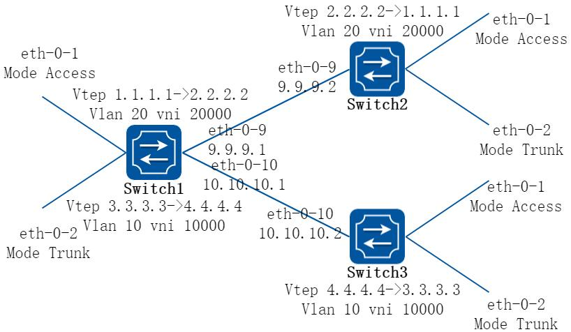

**图17-23 Overlay multiple source ip**

##### 2. 配置步骤

在下面的配置举例中，以VXLAN 为例。NVGRE 和GENEVE 的配置类似。

以下配置如未说明在哪个Switch 配置，则表示所有Switch 配置相同：

##### 步骤1 进入配置模式

```
Switch# configure terminal
```

##### 步骤2 进入vlan 配置模式并创建vlan，在vlan 上使能overlay

在switch1 配置：

```
Switch1(config)# vlan database
Switch1(config-vlan)# vlan 20,10
Switch1(config-vlan)# vlan 20 overlay enable
Switch1(config-vlan)# vlan 10 overlay enable
Switch1(config-vlan)# exit
```

在switch2 配置：

```
Switch2(config)# vlan database
Switch2(config-vlan)# vlan 20
Switch2(config-vlan)# vlan 20 overlay enable
Switch2(config-vlan)# exit
```

在switch3 配置：

```
Switch3(config)# vlan database
Switch3(config-vlan)# vlan 10
Switch3(config-vlan)# vlan 10 overlay enable
Switch3(config-vlan)# exit
```

##### 步骤3 进入接口配置模式，配置接口属性

Switch1 的接口配置：

```
Switch1(config)# interface eth-0-1
Switch1(config-if)# switchport access vlan 20
Switch1(config-if)# no shutdown
Switch1(config-if)# exit
Switch1(config)# interface eth-0-2
Switch1(config-if)# switchport mode trunk
Switch1(config-if)# switchport trunk allowed vlan add 10
Switch1(config-if)# no shutdown
Switch1(config-if)# exit
Switch1(config)# interface eth-0-9
Switch1(config-if)# no switchport
Switch1(config-if)# ip address 9.9.9.1/24
Switch1(config-if)# overlay uplink enable
Switch1(config-if)# no shutdown
Switch1(config-if)# exit
Switch1(config)# interface eth-0-10
Switch1(config-if)# no switchport
Switch1(config-if)# ip address 10.10.10.1/24
Switch1(config-if)# overlay uplink enable
Switch1(config-if)# no shutdown
Switch1(config-if)# exit
Switch1(config)# interface loopback0
Switch1(config-if)# ip address 1.1.1.1/32
Switch1(config)# interface loopback1
Switch1(config-if)# ip address 3.3.3.3/32
Switch1(config-if)# exit
```

Switch2 的接口配置：

```
Switch2(config)# interface eth-0-1
Switch2(config-if)# switchport access vlan 20
Switch2(config-if)# no shutdown
Switch2(config-if)# exit
Switch2(config)# interface eth-0-2
Switch2(config-if)# switchport mode trunk
Switch2(config-if)# switchport trunk allowed vlan add 20
Switch2(config-if)# no shutdown
Switch2(config-if)# exit
Switch2(config)# interface eth-0-9
Switch2(config-if)# no switchport
Switch2(config-if)# ip address 9.9.9.2/24
Switch2(config-if)# overlay uplink enable
```

```
Switch2(config-if)# no shutdown
Switch2(config-if)# exit
Switch2(config)# interface loopback0
Switch2(config-if)# ip address 2.2.2.2/32
Switch2(config-if)# exit
```

Switch3 的接口配置：

```
Switch3(config)# interface eth-0-1
Switch3(config-if)# switchport access vlan 10
Switch3(config-if)# no shutdown
Switch3(config-if)# exit
Switch3(config)# interface eth-0-2
Switch3(config-if)# switchport mode trunk
Switch3(config-if)# switchport trunk allowed vlan add 10
Switch3(config-if)# no shutdown
Switch3(config-if)# exit
Switch3(config)# interface eth-0-10
Switch3(config-if)# no switchport
Switch3(config-if)# ip address 10.10.10.2/24
Switch3(config-if)# overlay uplink enable
Switch3(config-if)# no shutdown
Switch3(config-if)# exit
Switch3(config)# interface loopback0
Switch3(config-if)# ip address 4.4.4.4/32
Switch3(config-if)# exit
```

##### 步骤4 配置静态路由

在switch1 配置：

```
Switch1(config)# ip route 2.2.2.0/24 9.9.9.2
Switch1(config)# ip route 4.4.4.0/24 10.10.10.2
```

在switch2 配置：

```
Switch2(config)# ip route 1.1.1.0/24 9.9.9.1
```

在switch3 配置：

```
Switch3(config)# ip route 3.3.3.0/24 10.10.10.1
```

##### 步骤5 配置overlay

在switch1 配置：

```
Switch1(config)# overlay
Switch1(config-overlay)# source 1.1.1.1
Switch1(config-overlay)# remote-vtep 1 ip-address 2.2.2.2 type vxlan
Switch1(config-overlay)# remote-vtep 2 ip-address 4.4.4.4 type vxlan src-ip 3.3.3.3
Switch1(config-overlay)# vlan 20 vni 20000
Switch1(config-overlay)# vlan 10 vni 10000
Switch1(config-overlay)# vlan 20 remote-vtep 1
Switch1(config-overlay)# vlan 10 remote-vtep 2
Switch1(config-overlay)# exit
```

在switch2 配置：

```
Switch2(config)# overlay
Switch2(config-overlay)# source 2.2.2.2
Switch2(config-overlay)# remote-vtep 1 ip-address 1.1.1.1 type vxlan
Switch2(config-overlay)# vlan 20 vni 20000
Switch2(config-overlay)# vlan 20 remote-vtep 1
Switch2(config-overlay)# exit
```

在switch3 配置：

```
Switch3(config)# overlay
Switch3(config-overlay)# source 4.4.4.4
Switch3(config-overlay)# remote-vtep 1 ip-address 3.3.3.3 type vxlan
Switch3(config-overlay)# vlan 10 vni 10000
Switch3(config-overlay)# vlan 10 remote-vtep 1
Switch3(config-overlay)# exit
```

##### 步骤6 退出配置模式

```
Switch(config)# end
```

##### 步骤7 检查配置

Switch1 显示结果：

```
switch1# show overlay vlan 20
---------------------------------------------------------------
ECMP Mode
: Normal
Source VTEP
: 1.1.1.1
---------------------------------------------------------------
VLAN ID
: 2
VNI
: 20000
EVPN Tunnel Data-fdb Learning : Eanble
Remote VTEP NUM: 1
Index: 1, Ip address: 2.2.2.2, Source ip: 1.1.1.1, Type: VxLAN, Protocol: Static
Index: 2, Ip address: 2.2.2.2, Source ip: 3.3.3.3, Type: VxLAN, Protocol: Static
DVR Gateway NUM: 0
---------------------------------------------------------------
```

#### OVERLAY 关闭水平分割配置

##### 1. 组网拓扑

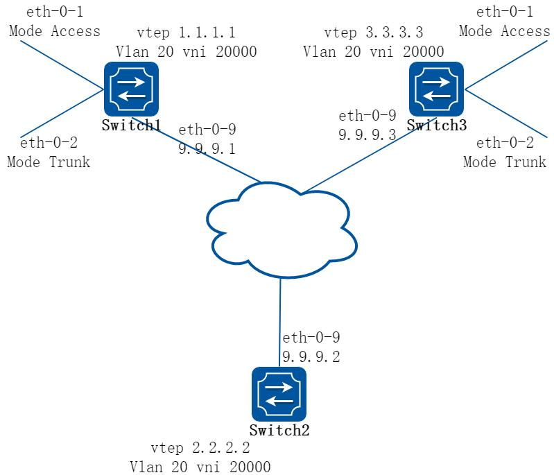

**图17-24 OVERLAY without Horizon Split**

##### 2. 配置步骤

在下面的配置举例中，拓扑如上图，switch1 和switch2 之间建立tunnel，switch2 和switch3 之间建立tunnel。在switch2 上关闭overlay 水平分割，使一侧tunnel 过来的流量从另一侧tunnel 出去。

配置以VXLAN 为例，NVGRE 和GENEVE 配置是类似的。

以下配置如未说明在哪个Switch 配置，则表示所有Switch 配置相同：

##### 步骤1 进入配置模式

```
Switch# configure terminal
```

##### 步骤2 进入vlan 配置模式并创建vlan，在vlan 上使能overlay

```
Switch(config)# vlan database
Switch(config-vlan)# vlan 20
Switch(config-vlan)# vlan 20 overlay enable
Switch(config-vlan)# exit
```

##### 步骤3 进入接口配置模式，配置接口属性

Switch1 的接口配置：

```
Switch1(config)# interface eth-0-1
Switch1(config-if)# switchport access vlan 20
Switch1(config-if)# no shutdown
Switch1(config-if)# exit
Switch1(config)# interface eth-0-2
Switch1(config-if)# switchport mode trunk
Switch1(config-if)# switchport trunk allowed vlan add 20
Switch1(config-if)# no shutdown
Switch1(config-if)# exit
Switch1(config)# interface eth-0-9
Switch1(config-if)# no switchport
Switch1(config-if)# ip address 9.9.9.1/24
Switch1(config-if)# overlay uplink enable
Switch1(config-if)# no shutdown
Switch1(config-if)# exit
Switch1(config)# interface loopback0
Switch1(config-if)# ip address 1.1.1.1/32
Switch1(config-if)# exit
```

Switch2 的接口配置：

```
Switch2(config-if)# interface eth-0-9
Switch2(config-if)# no switchport
Switch2(config-if)# ip address 9.9.9.2/24
Switch2(config-if)# overlay uplink enable
Switch2(config-if)# no shutdown
Switch2(config-if)# exit
Switch2(config)# interface loopback0
Switch2(config-if)# ip address 2.2.2.2/32
Switch2(config-if)# exit
```

Switch3 的接口配置：

```
Switch3(config)# interface eth-0-1
Switch3(config-if)# switchport access vlan 20
Switch3(config-if)# no shutdown
Switch3(config-if)# exit
Switch3(config)# interface eth-0-2
Switch3(config-if)# switchport mode trunk
Switch3(config-if)# switchport trunk allowed vlan add 20
Switch3(config-if)# no shutdown
Switch3(config-if)# exit
Switch3(config)# interface eth-0-9
Switch3(config-if)# no switchport
Switch3(config-if)# ip address 9.9.9.3/24
Switch3(config-if)# overlay uplink enable
Switch3(config-if)# no shutdown
Switch3(config-if)# exit
Switch3(config)# interface loopback0
```

```
Switch3(config-if)# ip address 3.3.3.3/32
Switch3(config-if)# exit
```

##### 步骤4 配置静态路由

在switch1 配置：

```
Switch1(config)# ip route 2.2.2.0/24 9.9.9.2
```

在switch2 配置：

```
Switch2(config)# ip route 1.1.1.0/24 9.9.9.1
Switch2(config)# ip route 3.3.3.3/24 9.9.9.3
```

在switch3 配置：

```
Switch3(config)# ip route 2.2.2.0/24 9.9.9.2
```

##### 步骤5 配置overlay

在switch1 配置：

```
Switch1(config)# overlay
Switch1(config-overlay)# source 1.1.1.1
Switch1(config-overlay)# remote-vtep 1 ip-address 2.2.2.2 type vxlan
Switch1(config-overlay)# vlan 20 vni 20000
Switch1(config-overlay)# vlan 20 remote-vtep 1
Switch1(config-overlay)# exit
```

在switch2 配置：

```
Switch2(config)# overlay
Switch2(config-overlay)# source 2.2.2.2
Switch2(config-overlay)# remote-vtep 1 ip-address 1.1.1.1 type vxlan split-horizon-disable
Switch2(config-overlay)# remote-vtep 2 ip-address 3.3.3.3 type vxlan split-horizon-disable
Switch2(config-overlay)# vlan 20 vni 20000
Switch2(config-overlay)# vlan 20 remote-vtep 1
Switch2(config-overlay)# vlan 20 remote-vtep 2
Switch2(config-overlay)# exit
```

在switch3 配置：

```
Switch3(config)# overlay
Switch3(config-overlay)# source 3.3.3.3
Switch3(config-overlay)# remote-vtep 1 ip-address 2.2.2.2 type vxlan
Switch3(config-overlay)# vlan 20 vni 20000
Switch3(config-overlay)# vlan 20 remote-vtep 1
Switch3(config-overlay)# exit
```

##### 步骤6 退出配置模式

```
Switch(config)# end
```

##### 步骤7 检查配置

Switch2 显示结果：

```
switch2# show overlay remote-vtep
Index Type
Virtual-Mac
IP-Address
Source-Ip
Split-Horizon Keep-vtag
Dscp-strategy
-------------------------------------------------------------------------------------------
1
VxLAN
-
1.1.1.1
2.2.2.2
Disable
Disable
Dscp-copy
```

```
2
VxLAN
-
3.3.3.3
2.2.2.2
Disable
Disable
Dscp-copy
```

## 17.5 OVSDB配置

### 17.5.1 概述

#### 简介

OVSDB（Open vSwitch Database, 开放虚拟交换机数据库）是交换机中保存配置信息的数据库。OVSDB 数据库主要由两个部分构成，即OVSDB 服务器和OVSDB 客户端。控制器作为OVSDB 客户端，通过OVSDB 管理协议，可以对交换机上的OVSDB 数据库进行配置和查询，从而实现对网络中的VTEP 设备的管理和部署。

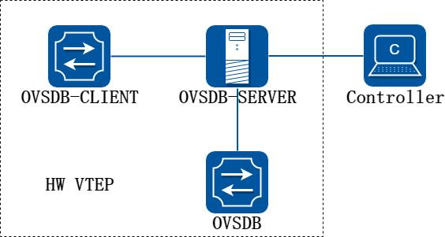

**图17-25 OVSDB**

作为VTEP 的交换机设备，在使能OVSDB 功能后，会创建并维护OVSDB 数据库。当控制器和VTEP 设备上的OVSDB 服务器连接后，会通过OVSDB 管理协议，操作OVSDB 数据库中的数据。VTEP 设备会将OVSDB 数据库中的数据转化为VXLAN 的相关配置进行下发。

当前支持的表项如下：

| 表名 | 描述 | 信息来源 | 命令 | 备注 |
|---|---|---|---|---|
| Global table | 顶层配置，包含当<br>前数据库中管理的<br>物理交换机 | 交换机 |  |  |
| Manager table | 控制器和OVSDB 服<br>务器之间的连接配<br>置 | 交换机或控制器 | ovsdb controller |  |
| Physical switch<br>table | 实现硬件VTEP 的<br>物理交换机信息 | 交换机 |  |  |
| Physical port<br>table | OVSDB 管理的接口<br>信息 | 交换机 | ovsdb port enable |  |
| Logical switch<br>table | 包含逻辑交换机信<br>息，VXLAN 配置可<br>以由这些信息转换<br>而来 | 控制器 |  |  |
| Physical locator<br>table | 包含网络中的硬件<br>VTEP 信息. | 控制器 |  |  |
| Physical locator<br>set table | 包含硬件VTEP 的<br>集合信息 | 控制器 |  |  |
| Unicast MACs<br>remote table | 包含网络中的单播<br>MAC 表项，由控制<br>器下发 | 控制器 |  |  |
| Multicast MACs<br>remote table | 包含网络中的组播<br>和洪泛表项，由控<br>制器下发 | 控制器 |  | 仅支持unknown<br>dst |

### 17.5.2 配置举例

##### 1. 组网拓扑

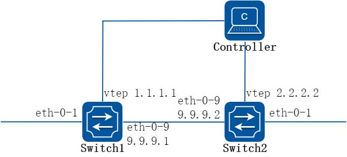

**图17-26 OVSDB**

##### 2. 配置步骤

以下配置如未说明在哪个Switch 配置，则表示所有Switch 配置相同：

##### 步骤1 进入配置模式

```
Switch# configure terminal
```

##### 步骤2 进入接口配置模式，配置接口属性

Switch1 的接口配置：

```
Switch1(config)# interface eth-0-1
Switch1(config-if)# ovsdb port enable
Switch1(config-if)# no shutdown
Switch1(config-if)# exit
Switch1(config)# interface eth-0-9
Switch1(config-if)# no switchport
Switch1(config-if)# ip address 9.9.9.1/24
Switch1(config-if)# overlay uplink enable
Switch1(config-if)# no shutdown
Switch1(config-if)# exit
Switch1(config)# interface loopback0
Switch1(config-if)# ip address 1.1.1.1/32
Switch1(config-if)# exit
```

Switch2 的接口配置：

```
Switch2(config)# interface eth-0-1
Switch2(config-if)# ovsdb port enable
Switch2(config-if)# no shutdown
Switch2(config-if)# exit
Switch2(config)# interface eth-0-9
Switch2(config-if)# no switchport
Switch2(config-if)# ip address 9.9.9.2/24
Switch2(config-if)# overlay uplink enable
Switch2(config-if)# no shutdown
Switch2(config-if)# exit
Switch2(config)# interface loopback0
Switch2(config-if)# ip address 2.2.2.2/32
Switch2(config-if)# exit
```

##### 步骤3 配置静态路由

在switch1 配置：

```
Switch1(config)# ip route 2.2.2.0/24 9.9.9.2
```

在switch2 配置：

```
Switch2(config)# ip route 1.1.1.0/24 9.9.9.1
```

##### 步骤4 配置overlay

在switch1 配置：

```
Switch1(config)# overlay
Switch1(config-overlay)# source 1.1.1.1
Switch1(config-overlay)# exit
```

在switch2 配置：

```
Switch2(config)# overlay
Switch2(config-overlay)# source 2.2.2.2
Switch2(config-overlay)# exit
```

##### 步骤5 全局使能ovsdb

```
Switch(config)# ovsdb enable
```

##### 步骤6 退出配置模式

```
Switch(config)# end
```

##### 步骤7 检查配置

Switch1 显示结果：

```
Switch1#
show running
overlay
source 1.1.1.1
!
interface eth-0-1
ovsdb port enable
interface eth-0-9
no switchport
```

```
overlay uplink enable
ip address 9.9.9.1/24
interface loopback0
ip address 1.1.1.1/32
!
ovsdb enable
Switch# show ovsdb physical-switch
Physical Switch Name
: switch
Management IP address :
Tunnel IP address
: 1.1.1.1
```

## 17.6 EVPN配置

### 17.6.1 概述

#### 简介

##### 1. 缩略语说明

| 缩略语 | 英文全称 | 翻译与解释 |
|---|---|---|
| EVPN | Ethernet Virtual Private<br>Network | 以太网虚拟专用网络 |
| VXLAN | Virtual eXtensible Local Area<br>Network | 虚拟扩展局域网 |
| IRB | Integrated Routing and<br>Bridging | 集成式桥接和路由 |
| RR | Route Reflector | 路由反射器 |
| VTEP | VXLAN Tunnel End Point | 虚拟隧道端点 |
| VM | Virtual Machine | 虚拟机 |
| BUM | Broadcast, Unknown unicast,<br>or Multicast | 广播，未知单播和组播 |
| L2 VNI | Layer 2 Virtual Network<br>Identifier | 二层虚拟网络标识符 |
| L3 VNI | Layer 3 Virtual Network<br>Identifier | 三层虚拟网络标识符 |
| PMSI | Provider Multicast Service<br>Interface | 运营商组播业务接口 |
| NLRI | Network Layer Reachability<br>Information | 网络层可达信息 |
| BGP | Border Gateway Protocol | 边界网关协议 |
| ARP | Address Resolution Protocol | 地址解析协议 |
| MLAG | Multi-Chassis Link<br>Aggregation Group | 跨设备链路聚合 |

##### 2. 功能说明

EVPN（Ethernet Virtual Private Network）是一种用于网络互联的VPN 技术。EVPN技术采用类似于BGP/MPLS IP VPN 的机制，在BGP 协议的基础上定义了一种新的NLRI

（Network Layer Reachability Information，网络层可达信息）即EVPN NLRI，EVPN NLRI定义了几种新的BGP EVPN 路由类型，用于处在二层网络的不同站点之间的MAC 地址学习和发布。同时为同一租户的不同子网提供三层互联，并为其提供与外部网络的三层互联。

原有的VXLAN 实现方案没有控制平面，是通过数据平面的流量泛洪进行VTEP 发现和主机信息（包括IP 地址、MAC 地址、VNI、网关VTEP IP 地址）学习的，这种方式导致网络存在很多泛洪流量。为了解决这一问题，VXLAN 引入了EVPN 作为控制平面，通过在VTEP 之间交换BGP EVPN 路由实现VTEP 的自动发现、主机信息相互通告等特性，从而避免了不必要的数据流量泛洪。

综上所述，EVPN 通过扩展BGP 协议新定义了几种BGP EVPN 路由，这些BGP EVPN 路由可以用于传递VTEP 地址和主机信息，因此EVPN 应用于VXLAN 网络中，可以使VTEP 发现和主机信息学习从数据平面转移到控制平面。

在EVPN 网络中，有一些常用的基本概念如下：

对称路由：当属于同一租户位于不同VTEP 的不同子网设备进行三层通信时，在本地VTEP 上查询路由加封装转发，到达远端VTEP 解封装后再次查询路由转发，此时称为对称路由，在对称路由模式下往返通常使用相同的VNI。

非对称路由：当属于同一租户位于不同VTEP 的不同子网设备进行三层通信时，在本地VTEP 上查询路由加封装转发，到达远端VTEP 解封装后查询二层转发表项转发，此时称为非对称路由，在非对称式路由模式下往返通常使用不同的VNI。

L2VNI：二层VNI，以1:1 的方式和VLAN 进行映射，处于同一个大二层内的设备有相同的L2VNI，互相通信经过使用该VNI。在非对称路由模式下属于同一租户但不同子网的设备进行通信，那将使用目的设备所属L2VNI 进行加封装。

L3VNI：三层VNI，以1:1 的方式和VRF 进行映射，对称路由模式下属于同一租户但不同子网的设备进行通信时统一使用该VNI。

EVPN 实例：一个二层VNI 对应一个EVPN 实例，每个EVPN 实例有独立的RD，Route-Target 属性

#### 背景

VXLAN 是应用于数据中心虚拟化的一种NVO3(Network Virtualization over Layer 3 )技术，主要解决多租户接入扩展和VM 迁移等场景应用。现有VXLAN 没有控制面，都是通过基于多播的洪泛方式，通过数据平面进行VTEP 发现和远端主机地址学习，导致数据中心网络中存在很多泛洪流量。

为了克服通过洪泛方式进行学习，IETF 标准草案

（draft-ietf-bess-evpn-overlay-02.txt）定义了MP-BGP EVPN 作为VXLAN 控制平面。

EVPN 作为控制面，能提供VXLAN 隧道自动发现、主机信息（主机IP、主机MAC、主机ARP）

控制面通告等特性。正因为主机信息通过EVPN 控制面的通告，避免了流量泛洪。

#### 原理描述

##### 1. 报文格式

VXLAN 报文格式说明参考《VXLAN》相关章节。

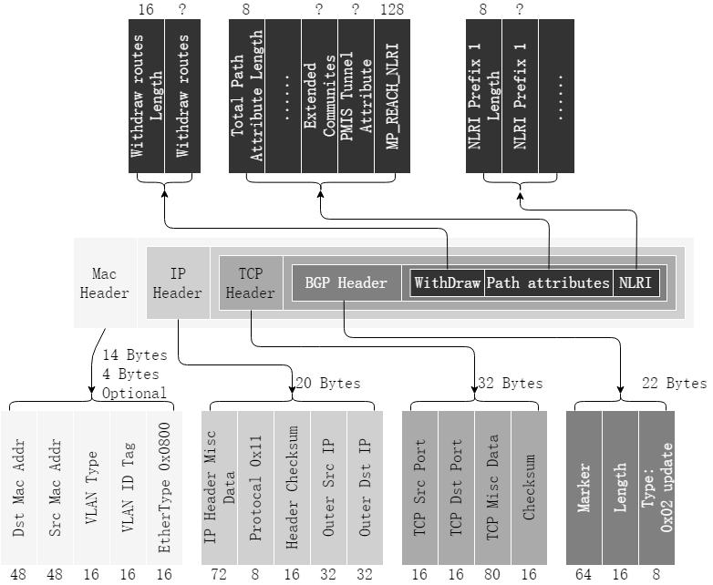

**图17-27 BGP Update 报文格式**

EVPN 的协议报文封装在BGP 报文的Path attribute 中，以NLRI 的形式来携带。下面会详细介绍EVPN NLRI 中定义的路由类型及其报文格式以及作用。

Withdraw 路由

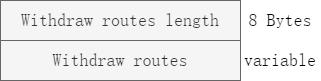

**图17-28 Withdraw 路由报文格式**

Withdraw 路由包含要撤销的路由列表，列表中的每个单元包含8 Bytes 的Length 域和可变长度的Prefix 域。

**表17-1 Withdraw 路由报文字段解释**

| 字段 | 解释说明 |
|---|---|
| Withdraw routes length | 待撤销路由的长度。其值为零时，表示没有撤销<br>的路由 |
| Withdraw routes | 需要撤销的路由prefix |

BGP EXTEMDED_COMMUNITIES BGP 的EXTEMDED_COMMUNITIES 是BGP 报文中Path Attribute 的一类，用于携带BGP 的扩展团体属性。其中，EVPN 的Route target 信息会通过这个属性来携带。

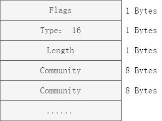

**图17-29 EXTEMDED_COMMUNITIES 报文格式**

通过Community Transitive Two-Octet AS Route target 类型团体属性携带AS 和AN

（即Route Target）。

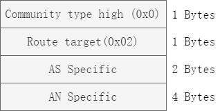

**图17-30 Community Transitive Two-Octet AS Route target 报文格式**

Community Transitive Opaque Encapsulation 属性指定了封装类型。

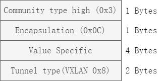

**图17-31 Community Transitive Opaque Encapsulation 报文格式**

为了在VTEP 间相互通告VTEP IP，VNI，下联主机地址等信息，在EVPN NLRI 中定义了如下几种应用于VXLAN 控制平面的BGP EVPN 路由类型：

Type2 路由（MAC/IP 路由）

Type3 路由（Inclusive Multicast 路由）

Type5 路由（IP 前缀路由）

下面分别介绍这三种类型的路由：

Type2 路由（MAC/IP 路由）

Type2 路由用于将本VTEP 下挂的主机MAC/IP 通告给远端VTEP，该类型路由报文格式如下图所示。

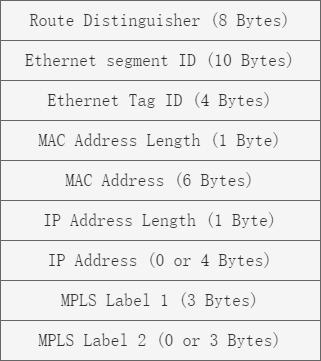

**图17-32 Type2 路由报文格式**

**表17-2 Type2 路由报文字段解释**

| 字段 | 解释说明 |
|---|---|
| Route Distinguisher | 该字段为EVPN 实例下设置的RD（Route<br>Distinguisher）值。 |
| Ethernet Segment Identifier | 该字段为当前设备与对端连接定义的唯一标识。<br>(目前为全0) |
| Ethernet Tag ID | 该字段为当前设备上实际配置的VLAN ID。(目前<br>为全0) |
| MAC Address Length | 该字段为此路由携带的主机MAC 地址的长度。 |
| MAC Address | 该字段为此路由携带的主机MAC 地址。 |
| IP Address Length | 该字段为此路由携带的主机IP 地址的掩码长度。 |
| IP Address | 该字段为此路由携带的主机IP 地址。 |
| MPLS Label1 | 该字段为此路由携带的二层VNI。 |
| MPLS Label2 | 该字段为此路由携带的三层VNI。 |

该类型主要作用包括，以对称式路由为例：

主机MAC 通告: 要实现同子网主机的二层互访，两端VTEP 需要相互学习主机MAC。

作为BGP EVPN 邻居的VTEP 之间通过交换Type2 路由，可以相互通告已经获取到的主机MAC。其中，MAC Address Length 和MAC Address 字段为主机MAC 地址。当仅需通告MAC 时，Type2 路由中不需要携带三层VNI 和IP Address，同时IP Address Length 填为0。

主机IP 通告: 在分布式网关场景中，要实现跨子网主机的三层互访，两端VTEP（作为三层网关）需要互相学习主机IP 路由。作为BGP EVPN 邻居的VTEP 之间通过交换Type2 路由，可以相互通告已经获取到的主机IP 路由。其中，IP Address Length和IP Address 字段为主机IP 路由的目的地址，同时MPLS Label2 字段必须携带三层VNI。此时的MAC/IP 路由也称为IRB（Integrated Routing and Bridge）类型路由。

Type3 路由（Inclusive Multicast 路由）

Type3 路由由前缀和PMSI 属性组成，VTEP IP 地址存放在前缀的Originating Router’s IP Address 字段中，VNI 存放在PMSI 属性的MPLS Label 字段中。该类型路由在VXLAN控制平面中主要用于VTEP 的自动发现和VXLAN 隧道的动态建立。作为BGP EVPN 邻居的VTEP，通过Inclusive Multicast 路由互相传递二层VNI 和VTEP IP 地址信息。当收到的报文中携带了与本地配置相同的VNI 就会创建一个头端复制表，用于后续BUM 报文转发。该类型路由报文格式如下图所示。

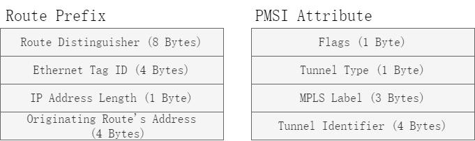

**图17-33 Type3 路由前缀和PMSI 属性**

**表17-3 Type3 路由前缀和PMSI 属性字段解释**

| 字段 | 解释说明 |
|---|---|
| Route Distinguisher | 该字段为EVPN 实例下设置的RD（Route<br>Distinguisher）值。 |
| Ethernet Tag ID | 该字段为当前设备上实际配置的VLAN ID。(目前<br>为全0) |
| IP Address Length | 该字段为此路由携带的本端VTEP IP 地址的掩码<br>长度。 |
| Originating Router’s IP Address | 该字段为此路由携带的本端VTEP IP 地址。 |
| Flags | 该字段为标志位，标识当前隧道是否需要叶子节<br>点信息。在VXLAN 场景中，该字段没有实际意义。 |
| Tunnel Type | 该字段为此路由携带的隧道类型。目前，在VXLAN<br>场景中，支持的类型只有“6：Ingress<br>Replication”，即头端复制，用于BUM 报文转发。 |
| MPLS Label | 该字段为此路由携带的二层VNI。 |
| Tunnel Identifier | 该字段为此路由携带的隧道信息。目前，在VXLAN<br>场景中，该字段也是本端VTEP IP 地址。 |

Type5 路由（IP 前缀路由）

该类型路由用来通告网段地址实现VXLAN 网络中的主机访问外部网络。该类型路由报文格式如下图所示。

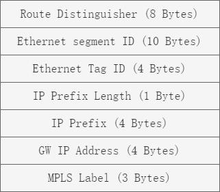

**图17-34 Type5 路由报文格式**

**表17-4 Type5 路由报文字段解释**

| 字段 | 解释说明 |
|---|---|
| Route Distinguisher | 该字段为EVPN 实例下设置的RD（Route<br>Distinguisher）值。 |
| Ethernet Segment Identifier | 该字段为当前设备与对端连接定义的唯一标识。<br>(目前为全0) |
| Ethernet Tag ID | 该字段为当前设备上实际配置的VLAN ID。(目前<br>为全0) |
| IP Prefix Length | 该字段为此路由携带的IP 前缀掩码长度,一般不<br>为32。 |
| IP Prefix | 该字段为此路由携带的IP 前缀。 |
| GW IP Address | 该字段为默认网关地址。该字段在VXLAN 场景中<br>没有实际意义。 |
| MPLS Label | 该字段为此路由携带的三层VNI。 |

##### 2. 二层VXLAN 隧道建立

不使用EVPN 的情况下，VXLAN 网络中隧道是通过手动配置VNI 到VNI 对应的peer 列表创建VXLAN 隧道，这种方案配置量大，非常不方便。

引入EVPN 作为控制平面后，可利用EVPN 中的inclusive 路由（Type3）来传递L2 VNI和VTEP 地址信息，从而实现动态创建L2 VXLAN 隧道，减少大量的配置，提高部署效率。

EVPN 使用Type3 路由，即Inclusive multicast 路由，通过该路由传递本地L2 VNI + L2 VTEP 信息，实现VXLAN 隧道自动发现。

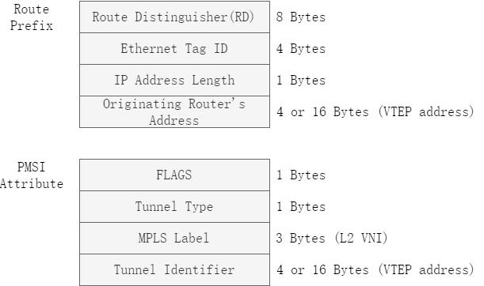

**图17-35 Type 3 路由在VXLAN 隧道自动发现时的应用**

VXLAN 隧道由一对VTEP IP 地址确定，创建VXLAN 隧道实际上是两端VTEP 获取对端VTEP IP 地址的过程，只要对端VTEP IP 地址是三层路由可达的，VXLAN 隧道就可以建立成功。

通过BGP EVPN 方式动态建立VXLAN 隧道，就是在两端VTEP 之间建立BGP EVPN 邻居，然后邻居之间利用BGP EVPN Type3 路由来互相传递VNI 和VTEP IP 地址信息，从而实现动态建立VXLAN 隧道。

如下图所示，Vtep-1，Vtep-2 上分别部署了一个Host，其属于同一网段只需要在Vtep-1和Vtep-2 之间创建一条的VXLAN 隧道用于二层转发；

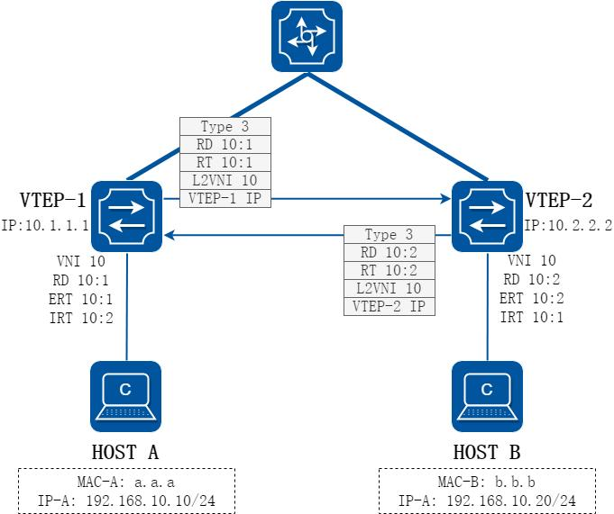

**图17-36 VXLAN 隧道示意**

首先在Vtep-1 和Vtep-2 之间建立BGP EVPN 邻居。然后创建EVPN 实例，配置本端EVPN实例的RD、出方向Route-Target（ERT）、入方向Route-Target（IRT）。在配置完本端VTEP IP 地址后，Vtep-1 和Vtep-2 会生成BGP EVPN Type3 路由并发送给对端，该路由携带本端EVPN 实例的出方向Route-Target，Leaf1 和Leaf2 在收到对端发来的BGP EVPN Type3 路由后，首先检查该路由中携带的Route-Target 如果与本端EVPN 实例的入方向Route-Target 相等，则接收该路由，否则丢弃该路由。在接收该路由后，Leaf1 和Leaf2将获取其中携带的对端VTEP IP 地址和VNI，如果对端VNI 与本端相同，则创建一个到对端VTEP IP 的VXLAN 隧道，用于后续BUM 报文转发。

##### 3. MAC 表项同步

同网段主机互访时，互相学习到对方主机MAC 后，可以通过二层已知单播转发。在没有引入EVPN 控制面时，VXLAN 网络的主机是依赖数据流量泛洪来学习主机MAC 的。通过EVPN 的Type2 路由传递主机MAC，可以减少VXLAN 网络的流量泛洪。

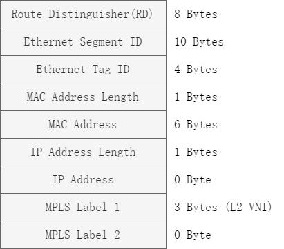

**图17-37 Type 2 路由在主机MAC 通告时的应用**

同上一小节图示，HOST A 与HOST B 属于同一网段，完成隧道建立后由于没有具体的MAC转发表项，相互之间的流量会通过广播的方式进行转发，造成不必要的带宽浪费，当MAC完成同步后则会大大减小带宽浪费。

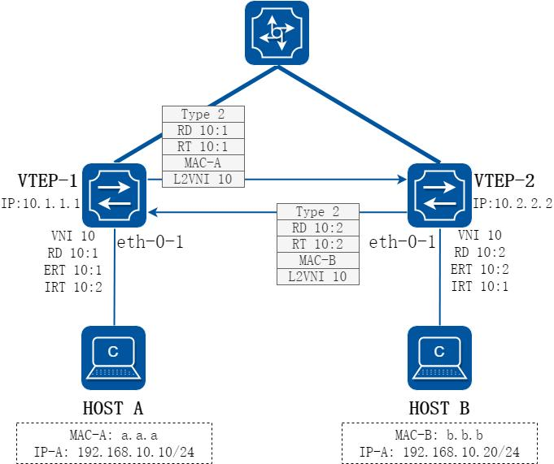

**图17-38 MAC 表项同步示意**

HostA 首次与VTEP-1 通信时，VTEP-1 学习到HostA 的MAC 地址、所属VLAN 和报文入接口(eth-0-1)的对应关系，并在本地MAC 表中生成HostA 的MAC 表项，其出接口为eth-0-1。同时VTEP-1 根据HostA 的MAC 表项生成BGP EVPN 路由并发送给VTEP-2，该路由携带本端EVPN 实例的出方向Route-Target、路由下一跳属性以及BGP EVPN 协议定义的Type2 路由即MAC/IP 路由。其中，路由下一跳属性携带的是本端VTEP IP 地址；

HostA 的MAC 地址存放在MAC Address Length 和MAC Address 字段中，二层VNI（将学习到的MAC 对应的vlan 映射到的相应VNI）存放在MPLS Label1 字段中。由于此时只是二层通信只需同步MAC 即可，所以Type2 路由中不需要携带主机IP 及三层VNI 的信息。

VTEP-2 收到VTEP-1 发来的BGP EVPN 路由后，首先检查该路由携带的Route-Target，如果与本端EVPN 实例的入方向Route-Target 相等，则继续比较L2VNI 是否与该EVPN实例配置的L2VNI 相同，如相同则接收该路由，否则丢弃该路由。在接收该路由后，VTEP-2获得HostA 的MAC 地址、L2VNI 和VTEP-1 上VTEP IP 地址（下一跳属性）的对应关系，并在本地的MAC 表中生成HOSTA 的MAC 表项，其出接口为指向VTEP-1 的VXLAN 隧道，对应VNI 为相应二层VNI。

##### 4. 主机路由同步

Type2 路由可以同时携带主机MAC+主机IP，因而可以用来传递主机ARP。当学到主机的ARP 后，就可以通过上面路由去向邻居发送主机ARP；远端邻居收到ARP 后，将ARP表项保存到本地的ARP 缓存列表中。

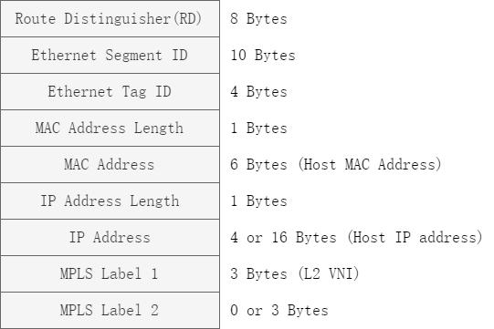

**图17-39 Type 2 路由在主机ARP 通告时的应用**

当VTEP 下联的主机属于不同网段时但是需要互相通信时需要借助三层转发来完成，那么此时仅进行MAC 同步则无法完成通信，需要通过Type2 消息将主机的IP 地址和下一跳的相应信息也通告给对端才能保证相互之间能通过路由互通。

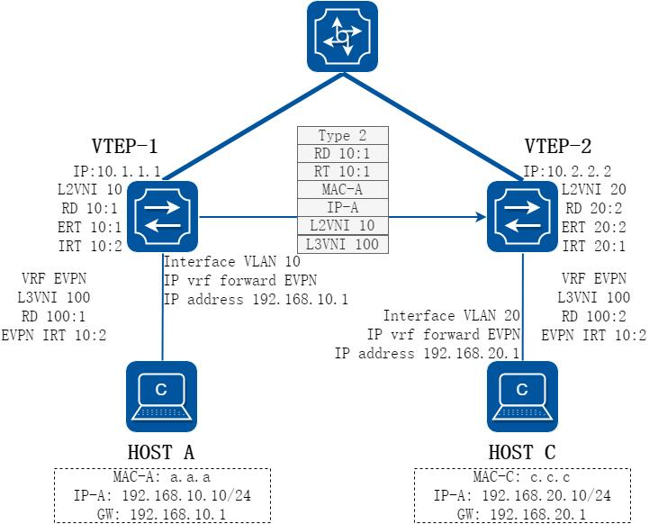

**图17-40 主机路由同步示意**

如上图所示，HostA 和HostC 属于不同的网段，需要相互通告路由才能完成通信，通过请求网关物理地址的ARP 报文，VTEP-1 可以学习到HostA 的ARP 表项，获得HostA 的MAC 和IP 信息。VTEP-1 由HostA 的MAC 所在vlan 得到相应的L2VNI，同时学到该ARP的三层接口（inteface vlan 10）绑定了vrf 实例（vrf EVPN）,vrf 实例又关联了三层VNI，VTEP-1 可以得到HostA 所属的三层VNI，有了MAC/IP/二层VNI/三层VNI 信息后，VTEP-1 上的EVPN 实例就可以根据上述信息生成Type2（IRB）路由，其中主机MAC 信息和二层VNI 信息同2.3 节所示，主机IP 地址存放在IP Address Length 和IP Address字段中，三层VNI 存放在MPLS Label2 字段中，RD 和Route-Target 为EVPN 实例的RD和出方向Route-Target。

VTEP-2 收到VTEP-1 发来的Type2 路由后，检查该路由携带的Route-Target 是否与本端VRF 实例（本例VRF 名字为EVPN，并非强制，VRF 名字可以为其他字符串）的入方向EVPN Route-Target 相等，若相等，则接收该路由，否则丢弃该路由。在接收该路由后，VTEP-2获得HostA 的MAC 地址、IP 地址、L2VNI、L3VNI 和VTEP-1 上VTEP IP 地址（下一跳属性）的对应关系，并在本地的vrf 路由表中生成到HostA 的32 位路由，其出接口为指向VTEP-1 的VXLAN 隧道，VNI 为相应的三层VNI。

##### 5. 网段路由同步

EVPN 网络构建的是一个私有网络，它也可以通过接入外网，实现跟外网通信的目的。BGP通过Type5 IP 前缀路由来完成外部路由的导入。通常在EVPN 的Spine-Leaf 架构中，会有1 台或多台专门接入外网的设备，我们把它叫做Border Leaf。Border Leaf 通过普通接口从外网学习路由，并将这些路由引入EVPN 地址族，形成EVPN 5 类路由，进而通告到EVPN 网络中，使其他VTEP 也能学到这些外部路由。

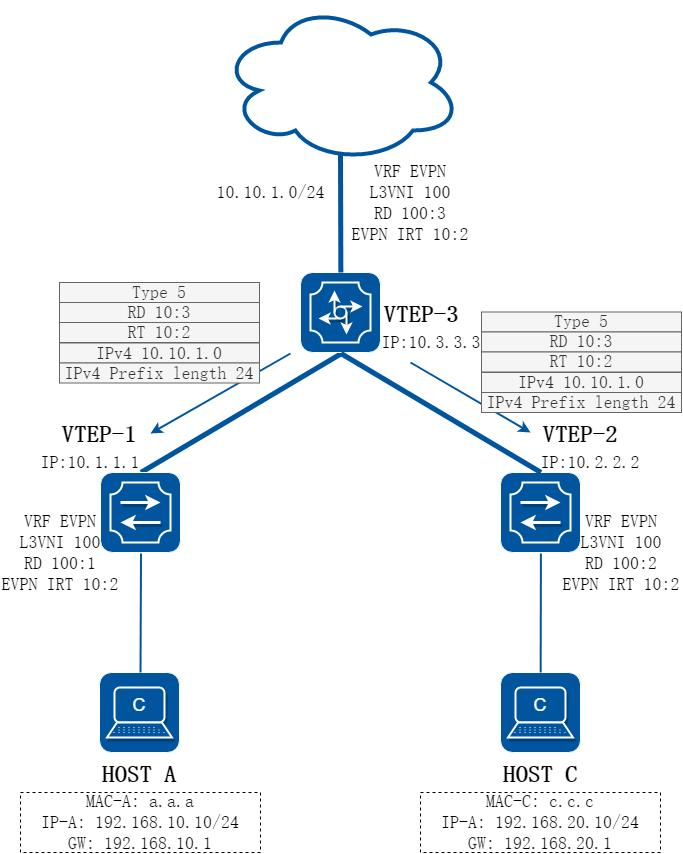

**图17-41 Type 5 路由在主机IP 通告时的应用**

在上一节中，通过Type2 路由解决了32 位的主机路由的同步问题，但是当需要与外部网络通信时，仅能同步32 位的主机路由显然无法满足通信要求，因此EVPN 通过Type5路由来解决网段路由同步。


**图17-42 网段路由同步示意**

如上图所示，VTEP-3 上的vrf EVPN 内有一条外部路由，需要将其通告给VTEP-1/VTEP-2后HostA/HostC 才能访问该网段内地址。VTEP-3 将该路由所在vrf 的三层VNI，VTEP-3的IP 地址，RD，以及EVPN Export Route-Target 信息封装在type5 路由中发送给远端VTEP，在EVPN 邻居收到该消息后，首先判断报文中携带的Route-Target 是否与本地vrf配置Import Route-Target 相同，相同则接收该路由，取出IPv4 地址及掩码长度来组成路由前缀，其出接口为指向VTEP-3 的VXLAN 隧道，VNI 为相应的三层VNI。

### 17.6.2 应用场景

#### 路由反射器在BGP EVPN 组网中的应用

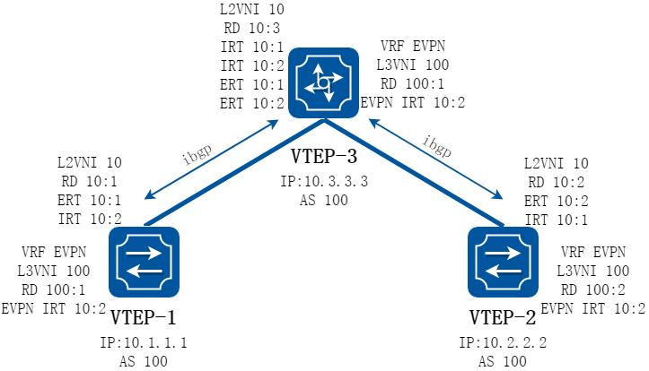

**图17-43 路由反射器示意**

如上图所示实例中，VTEP-1/VTEP-2 都与VTEP-3 建立ibgp 的evpn 邻居，默认情况下从ibgp 收到的路由不会再向其他ibgp 邻居发送，此时VTEP-1 和VTEP-2 之间就无法收到对面的路由。为了在此种情况下VTEP-1 和VTEP-2 之间也能互相学习到路由，可以在VTEP-3 的bgp evpn 地址族下配置neighbor 10.1.1.1 route-reflector-client、neighbor 10.2.2.2 route-reflector-client，使能路由反射器功能，配置完成后，VTEP-3 就会将从ibgp 发布过来的路由反射到另外的ibgp，此时VTEP-1 和VTEP-2 就能互相学习到路由了。

#### Retain route target

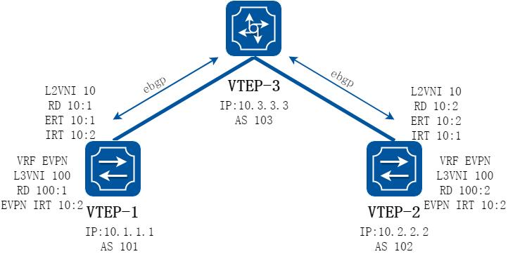

**图17-44 Retain route target 示意**

如上图所示实例中，VTEP-1/VTEP-2都与VTEP-3 建立ebgp的evpn邻居，VTEP-1和VTEP-2上都存在EVPN 实例，而VTEP-3 上目前暂未部署EVPN 实例，此时VTEP-3 收到VTEP-1和VTEP-2 发布给自己的路由后，由于没有EVPN 实例会将这些路由丢弃，导致VTEP-1和VTEP-2 也不能相互学习对面的EVPN 路由。为了在此种情况下VTEP-1 和VTEP-2 之间也能互相学习到路由，可以在VTEP-3 的bgp evpn 地址族下配置retain route-target all，配置完成后，VTEP-3 会暂存收到的所有bgp evpn 路由并发布给自己的邻居，这样VTEP-1 和VTEP-2 之间就能互相学习到路由了。

#### allowas-in

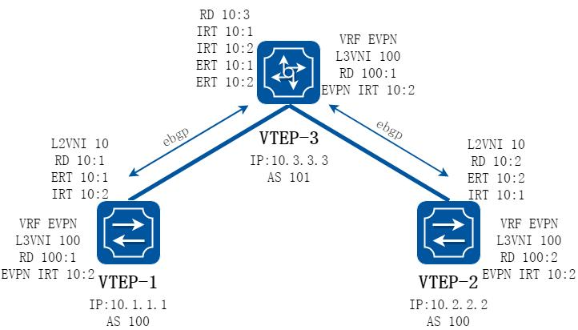

**图17-45 allowas-in 示意**

如上图所示实例中，VTEP-1/VTEP-2 都与VTEP-3 建立ebgp 的evpn 邻居，VTEP-1 要将路由发布给VTEP-2 时需要经过VTEP-3，此时VTEP-2 收到的BGP EVPN 路由中，AS PATH将包含VTEP-1 本地的AS 号（100），由于VTEP-1 和VTEP-2 的AS 相同，默认情况下BGP不接收AS PATH 中包含本地AS 的路由通告为了在此种情况下VTEP-1 和VTEP-2 之间也能互相学习到路由，可以在VTEP-2 上的evpn 地址族下配置neighbor 10.3.3.3 allowas-in，配置完成后BGP 就会接收AS PATH 中包含本地AS 的路由通告。

#### attribute-unchanged

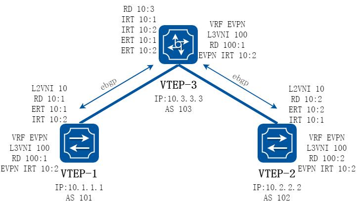

**图17-46 attribute-unchanged 示意**

如上图所示实例中，VTEP-1/VTEP-2 都与VTEP-3 建立ebgp 的evpn 邻居，VTEP-1 要将路由发布给VTEP-2 需要经过VTEP-3，默认情况下在VTEP-3 将从VTEP-1 过来的路由发送给VTEP-2 时，会将路由中的nexthop 等信息替换为VTEP-3 本地的地址，此时VTEP-2上建立的隧道将是到VTEP-3 的。如果想在VTEP-1 和VTEP-2 之间之间建立隧道，可以在VTEP-3 的bgp evpn 地址族下配置neighbor 10.1.1.1 attribute-unchanged、neighbor 10.2.2.2 attribute-unchanged，此时从VTEP-3 发布出去的路由将不会更改nexthop 等信息。

#### evpn virtual-mac enable

当需要双活接入VXLAN 网络时，我们推荐采用MLAG 的方式进行接入，此时MLAG 的两台设备需要对外表现为同一个VTEP，即对外采用相同的VTEP IP/MAC，VTEP IP 在NVE 接口上配置，配置evpn virtual-mac enable 后，VTEP MAC 借用VARP 配置虚拟MAC，MLAG两侧设备的虚拟MAC 需要配置相同。

### 17.6.3 配置举例

#### BGP EVPN 方式部署集中式网关

##### 1. 组网拓扑

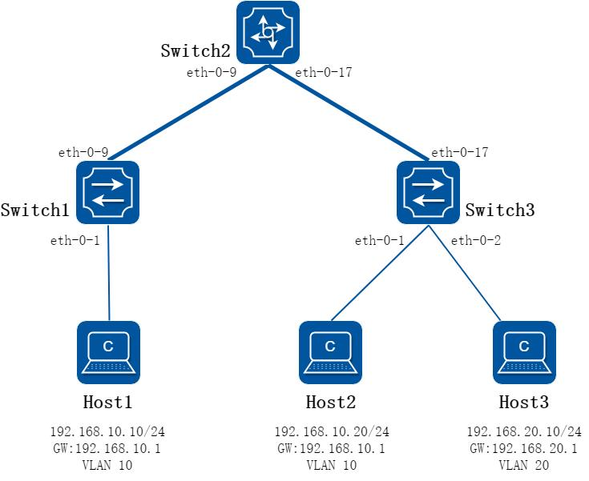

**图17-47 BGP EVPN 方式部署集中式网关**

##### 2. 组网需求

Host 1 和Host 2 处于同一网段，Host3 处于另一个网段，其底层网络为三层网络，需要通过VXLAN 隧道来实现互通

##### 3. 配置思路

Switch 1 和Switch 3 分别与Switch 2 建立IBGP 邻居，同时Switch 2 上使能路由反射器，使得Switch 1 和Switch 3 能互相学习到BGP EVPN 路由，Host 1 能与Host 2 互通。

同时在Switch 2 上部署集中式网关，需要跨子网互通的流量经Switch 2 路由转发

##### 4. 配置步骤

##### 步骤1 配置路由，保证交换机之间三层网络可通

配置Switch 1

```
Switch1# configure terminal
Enter configuration commands, one per line.
End with CNTL/Z.
Switch1(config)# interface loopback 0
Switch1(config-if)# ip address 10.1.1.1/32
Switch1(config-if)# exit
```

```
Switch1(config)# interface eth-0-9
Switch1(config-if)# no switchport
Switch1(config-if)# ip address 192.168.1.1/24
Switch1(config-if)# vxlan uplink enable
Switch1(config-if)# no shutdown
Switch1(config-if)# exit
Switch1(config)# ip route 10.2.2.2/32 192.168.1.2
Switch1(config)# ip route 10.3.3.3/32 192.168.1.2
Switch1(config)# end
```

配置Switch 2

```
Switch2# configure terminal
Enter configuration commands, one per line.
End with CNTL/Z.
Switch2(config)# interface loopback 0
Switch2(config-if)# ip address 10.2.2.2/32
Switch2(config-if)# exit
Switch2(config)# interface eth-0-9
Switch2(config-if)# no switchport
Switch2(config-if)# ip address 192.168.1.2/24
Switch2(config-if)# vxlan uplink enable
Switch2(config-if)# no shutdown
Switch2(config-if)# exit
Switch2(config)# interface eth-0-17
Switch2(config-if)# no switchport
Switch2(config-if)# ip address 192.168.2.1/24
Switch2(config-if)# vxlan uplink enable
Switch2(config-if)# no shutdown
Switch2(config-if)# exit
Switch2(config)# ip route 10.1.1.1/32 192.168.1.1
Switch2(config)# ip route 10.3.3.3/32 192.168.2.2
Switch2(config)# end
```

配置Switch 3

```
Switch3# configure terminal
Enter configuration commands, one per line.
End with CNTL/Z.
Switch3(config)# interface loopback 0
Switch3(config-if)# ip address 10.3.3.3/32
Switch3(config-if)# exit
Switch3(config)# interface eth-0-17
Switch3(config-if)# no switchport
Switch3(config-if)# ip address 192.168.2.2/24
Switch3(config-if)# vxlan uplink enable
Switch3(config-if)# no shutdown
Switch3(config-if)# exit
Switch3(config)# ip route 10.1.1.1/32 192.168.2.1
Switch3(config)# ip route 10.2.2.2/32 192.168.2.1
Switch3(config)# end
```

##### 步骤2 配置VLAN

配置Switch 1

```
Switch1# configure terminal
Enter configuration commands, one per line.
End with CNTL/Z.
Switch1(config)# vlan database
```

```
Switch1(config-vlan)# vlan 10
Switch1(config-vlan)# vlan 10 overlay enable
Switch1(config-vlan)# exit
Switch1(config)# interface eth-0-1
Switch1(config-if)# switchport mode trunk
Switch1(config-if)# switchport trunk allowed vlan add 10
Switch1(config-if)# no shutdown
Switch1(config-if)# end
```

配置Switch 2

```
Switch2# configure terminal
Enter configuration commands, one per line.
End with CNTL/Z.
Switch2(config)# vlan database
Switch2(config-vlan)# vlan 10
Switch2(config-vlan)# vlan 10 overlay enable
Switch2(config-vlan)# vlan 20
Switch2(config-vlan)# vlan 20 overlay enable
Switch2(config-vlan)# exit
Switch2(config)# ip vrf evpn
Switch2(config-vrf)# quit
Switch2(config)# interface vlan 10
Switch2(config-if)# ip address 192.168.10.1/24
Switch2(config-if)# interface vlan 20
Switch2(config-if)# ip address 192.168.20.1/24
Switch2(config-if)# end
```

配置Switch 3

```
Switch3# configure terminal
Enter configuration commands, one per line.
End with CNTL/Z.
Switch3(config)# vlan database
Switch3(config-vlan)# vlan 10
Switch3(config-vlan)# vlan 10 overlay enable
Switch3(config-vlan)# vlan 20
Switch3(config-vlan)# vlan 20 overlay enable
Switch3(config-vlan)# exit
Switch3(config)# interface eth-0-1
Switch3(config-if)# switchport mode trunk
Switch3(config-if)# switchport trunk allowed vlan add 10
Switch3(config-if)# no shutdown
Switch3(config)# interface eth-0-2
Switch3(config-if)# switchport mode trunk
Switch3(config-if)# switchport trunk allowed vlan add 20
Switch3(config-if)# no shutdown
Switch3(config-if)# end
```

##### 步骤3 配置EVPN 实例

配置Switch 1

```
Switch1# configure terminal
Enter configuration commands, one per line.
End with CNTL/Z.
Switch1(config)# overlay
Switch1(config-overlay)# vlan 10 vni 10
Switch1(config-overlay)# quit
Switch1(config)# interface nve 0
```

```
Switch1(config-if)# source loopback 0
Switch1(config-if)# member vni 10
Switch1(config-if)# quit
Switch1(config)# evpn
Switch1(config-evpn)# vni 10
Switch1(config-evi)# rd 10:1
Switch1(config-evi)# route-target both 10:10
Switch1(config-evpn)# end
```

配置Switch 2

```
Switch2# configure terminal
Enter configuration commands, one per line.
End with CNTL/Z.
Switch2(config)# overlay
Switch2(config-overlay)# vlan 10 vni 10
Switch2(config-overlay)# vlan 20 vni 20
Switch2(config-overlay)# quit
Switch2(config)# interface nve 0
Switch2(config-if)# member vni 10
Switch2(config-if)# member vni 20
Switch2(config-if)# source loopback 0
Switch2(config-if)# quit
Switch2(config)# evpn
Switch2(config-evpn)# vni 10
Switch2(config-evi)# rd 10:2
Switch2(config-evi)# route-target both 10:10
Switch2(config-evi)# vni 20
Switch2(config-evi)# rd 20:2
Switch2(config-evi)# route-target both 20:20
Switch2(config-evi)# end
```

配置Switch 3

```
Switch3# configure terminal
Enter configuration commands, one per line.
End with CNTL/Z.
Switch3(config)# overlay
Switch3(config-overlay)# vlan 10 vni 10
Switch3(config-overlay)# vlan 20 vni 20
Switch3(config-overlay)# exit
Switch3(config)# interface nve 0
Switch3(config-if)# source loopback 0
Switch3(config-if)# member vni 10
Switch3(config-if)# member vni 20
Switch3(config-if)# quit
Switch3(config)# evpn
Switch3(config-evpn)# vni 10
Switch3(config-evi)# rd 10:3
Switch3(config-evi)# route-target both 10:10
Switch3(config-evi)# vni 20
Switch3(config-evi)# rd 20:3
Switch3(config-evi)# route-target both 20:20
Switch3(config-evi)# end
```

##### 步骤4 配置BGP

配置Switch 1

```
Switch1# configure terminal
Enter configuration commands, one per line.
End with CNTL/Z.
Switch1(config)# router bgp 100
Switch1(config-router)# bgp router-id 10.1.1.1
Switch1(config-router)# neighbor 10.2.2.2 remote-as 100
Switch1(config-router)# neighbor 10.2.2.2 update-source loopback 0
Switch1(config-router)# address-family l2vpn evpn
Switch1(config-router-af)# neighbor 10.2.2.2 activate
Switch1(config-router-af)# neighbor 10.2.2.2 send-community both
Switch1(config-router-af)# end
```

配置Switch 2

```
Switch2# configure terminal
Enter configuration commands, one per line.
End with CNTL/Z.
Switch2(config)# router bgp 100
Switch2(config-router)# bgp router-id 10.2.2.2
Switch2(config-router)# neighbor 10.1.1.1 remote-as 100
Switch2(config-router)# neighbor 10.1.1.1 update-source loopback 0
Switch2(config-router)# neighbor 10.3.3.3 remote-as 100
Switch2(config-router)# neighbor 10.3.3.3 update-source loopback 0
Switch2(config-router)# address-family l2vpn evpn
Switch2(config-router-af)# neighbor 10.1.1.1 activate
Switch2(config-router-af)# neighbor 10.1.1.1 send-community both
Switch2(config-router-af)# neighbor 10.1.1.1 route-reflector-client
Switch2(config-router-af)# neighbor 10.3.3.3 activate
Switch2(config-router-af)# neighbor 10.3.3.3 send-community both
Switch2(config-router-af)# neighbor 10.3.3.3 route-reflector-client
Switch2(config-router-af)# end
```

配置Switch 3

```
Switch3# configure terminal
Enter configuration commands, one per line.
End with CNTL/Z.
Switch3(config)# router bgp 100
Switch3(config-router)# bgp router-id 10.3.3.3
Switch3(config-router)# neighbor 10.2.2.2 remote-as 100
Switch3(config-router)# neighbor 10.2.2.2 update-source loopback 0
Switch3(config-router)# address-family l2vpn evpn
Switch3(config-router-af)# neighbor 10.2.2.2 activate
Switch3(config-router-af)# neighbor 10.2.2.2 send-community both
Switch3(config-router-af)# end
```

##### 步骤5 验证配置结果

检查底层网络是否互通

```
Switch1# ping -a 10.1.1.1 10.2.2.2
PING 10.2.2.2 (10.2.2.2) from 10.1.1.1 : 56(84) bytes of data.
64 bytes from 10.2.2.2: icmp_seq=1 ttl=64 time=1.98 ms
64 bytes from 10.2.2.2: icmp_seq=2 ttl=64 time=1.91 ms
64 bytes from 10.2.2.2: icmp_seq=3 ttl=64 time=2.02 ms
64 bytes from 10.2.2.2: icmp_seq=4 ttl=64 time=1.93 ms
64 bytes from 10.2.2.2: icmp_seq=5 ttl=64 time=1.94 ms
--- 10.2.2.2 ping statistics ---
5 packets transmitted, 5 received, 0% packet loss, time 4005ms
```

```
rtt min/avg/max/mdev = 1.911/1.958/2.022/0.062 ms
Switch1# ping -a 10.1.1.1 10.3.3.3
PING 10.3.3.3 (10.3.3.3) from 10.1.1.1 : 56(84) bytes of data.
64 bytes from 10.3.3.3: icmp_seq=1 ttl=63 time=2.14 ms
64 bytes from 10.3.3.3: icmp_seq=2 ttl=63 time=1.90 ms
64 bytes from 10.3.3.3: icmp_seq=3 ttl=63 time=1.82 ms
64 bytes from 10.3.3.3: icmp_seq=4 ttl=63 time=1.92 ms
64 bytes from 10.3.3.3: icmp_seq=5 ttl=63 time=1.93 ms
--- 10.3.3.3 ping statistics ---
5 packets transmitted, 5 received, 0% packet loss, time 4005ms
rtt min/avg/max/mdev = 1.827/1.946/2.140/0.104 ms
```

检查隧道建立是否成功

```
Switch1# show overlay tunnel
-------------------------------------------------------------------------------
Vlan Vni
Type
Remote-vtep IP-Address
Src-Address
Head-end-flooding Protocol
10
10
VxLAN
-
10.2.2.2
10.1.1.1
Enable
Evpn
10
10
VxLAN
-
10.3.3.3
10.1.1.1
Enable
Evpn
Switch2# show overlay tunnel
-------------------------------------------------------------------------------
Vlan Vni
Type
Remote-vtep IP-Address
Src-Address
Head-end-flooding Protocol
10
10
VxLAN
-
10.1.1.1
10.2.2.2
Enable
Evpn
10
10
VxLAN
-
10.3.3.3
10.2.2.2
Enable
Evpn
20
20
VxLAN
-
10.3.3.3
10.2.2.2
Enable
Evpn
Switch3# show overlay tunnel
-------------------------------------------------------------------------------
Vlan Vni
Type
Remote-vtep IP-Address
Src-Address
Head-end-flooding Protocol
10
10
VxLAN
-
10.1.1.1
10.3.3.3
Enable
Evpn
10
10
VxLAN
-
10.2.2.2
10.3.3.3
Enable
Evpn
20
20
VxLAN
-
10.2.2.2
10.3.3.3
Enable
Evpn
```

检查Host 间两两是否可以ping 通Host1 ping Host2:

```
PING 192.168.10.20 from 192.168.10.10: 56 data bytes
64 bytes from 192.168.10.20: icmp_seq=1 ttl=64 time=0.947 ms
--- ping statistics ---
1 packets transmitted, 1 packets received, 0.0% packet loss
rtt min/avg/max/stddev = 0.947/0.947/0.947/0.000 ms
```

Host1 ping Host3:

```
PING 192.168.20.10 from 192.168.10.10: 56 data bytes
64 bytes from 192.168.20.10: icmp_seq=1 ttl=63 time=0.613 ms
--- ping statistics ---
1 packets transmitted, 1 packets received, 0.0% packet loss
rtt min/avg/max/stddev = 0.613/0.613/0.613/0.000 ms
```

Host2 ping Host3:

```
PING 192.168.20.10 from 192.168.10.20: 56 data bytes
64 bytes from 192.168.20.10: icmp_seq=1 ttl=63 time=1.131 ms
--- ping statistics ---
```

```
1 packets transmitted, 1 packets received, 0.0% packet loss
rtt min/avg/max/stddev = 1.131/1.131/1.131/0.000 ms
```

#### BGP EVPN 方式部署分布式网关

##### 1. 组网拓扑

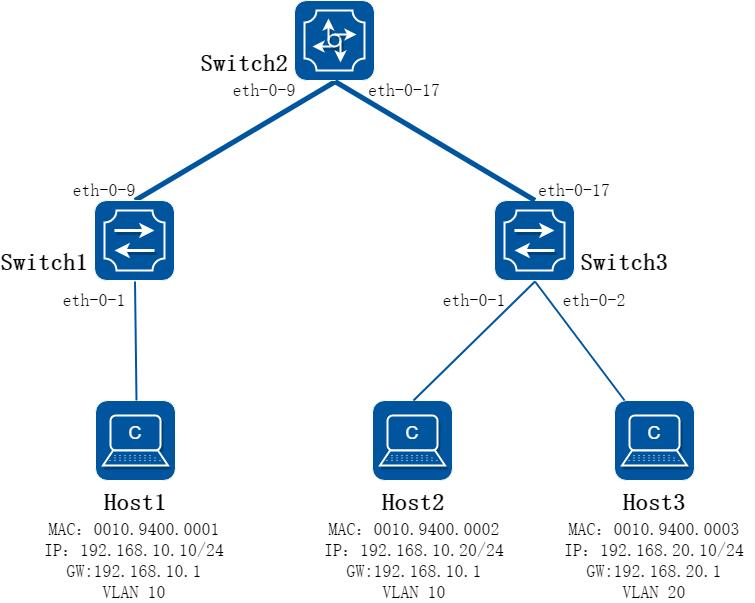

**图17-48 BGP EVPN 方式部署集中式网关**

##### 2. 组网需求

如上图所示，HOST1、2、3 都属于租户test，其间既有相同网段又有不同网段，且都需要相互通信。Switch 1/3 之间为三层网络，为了减轻网关压力Switch 1 和Switch 3作为下联host 的分布式网关，需要通过配置VXLAN 在HOST 之间建立隧道

##### 3. 配置思路

Switch 1 和Switch 3 分别与Switch 2 建立IBGP 邻居，同时Switch 2 上使能路由反射器，使得Switch 1 和Switch 3 能互相学习到BGP EVPN 路由，配置分布式网关，将host的网关都部署在TOR 上，配置使能分布式网关后，vxlan 加解封装都在TOR 上完成，因此在Switch 2 上无需配置evpn 实例。

##### 4. 配置步骤

##### 步骤1 配置路由，保证交换机之间三层网络可通

配置Switch 1

```
Switch1# configure terminal
Enter configuration commands, one per line.
End with CNTL/Z.
```

```
Switch1(config)# interface loopback 0
Switch1(config-if)# ip address 10.1.1.1/32
Switch1(config-if)# exit
Switch1(config)# interface eth-0-9
Switch1(config-if)# no switchport
Switch1(config-if)# ip address 192.168.1.1/24
Switch1(config-if)# vxlan uplink enable
Switch1(config-if)# no shutdown
Switch1(config-if)# exit
Switch1(config)# ip route 10.2.2.2/32 192.168.1.2
Switch1(config)# ip route 10.3.3.3/32 192.168.1.2
Switch1(config)# end
```

配置Switch 2

```
Switch2# configure terminal
Enter configuration commands, one per line.
End with CNTL/Z.
Switch2(config)# interface loopback 0
Switch2(config-if)# ip address 10.2.2.2/32
Switch2(config-if)# exit
Switch2(config)# interface eth-0-9
Switch2(config-if)# no switchport
Switch2(config-if)# ip address 192.168.1.2/24
Switch2(config-if)# vxlan uplink enable
Switch2(config-if)# no shutdown
Switch2(config-if)# exit
Switch2(config)# interface eth-0-17
Switch2(config-if)# no switchport
Switch2(config-if)# ip address 192.168.2.1/24
Switch2(config-if)# vxlan uplink enable
Switch2(config-if)# no shutdown
Switch2(config-if)# exit
Switch2(config)# ip route 10.1.1.1/32 192.168.1.1
Switch2(config)# ip route 10.3.3.3/32 192.168.2.2
Switch2(config)# end
```

配置Switch 3

```
Switch3# configure terminal
Enter configuration commands, one per line.
End with CNTL/Z.
Switch3(config)# interface loopback 0
Switch3(config-if)# ip address 10.3.3.3/32
Switch3(config-if)# exit
Switch3(config)# interface eth-0-17
Switch3(config-if)# no switchport
Switch3(config-if)# ip address 192.168.2.2/24
Switch3(config-if)# vxlan uplink enable
Switch3(config-if)# no shutdown
Switch3(config-if)# exit
Switch3(config)# ip route 10.1.1.1/32 192.168.2.1
Switch3(config)# ip route 10.2.2.2/32 192.168.2.1
Switch3(config)# end
```

##### 步骤2 配置VLAN

配置Switch 1

```
Switch1# configure terminal
Enter configuration commands, one per line.
End with CNTL/Z.
Switch1(config)# vlan database
Switch1(config-vlan)# vlan 10
Switch1(config-vlan)# vlan 10 overlay enable
Switch1(config-vlan)# exit
Switch1(config)# interface eth-0-1
Switch1(config-if)# switchport mode trunk
Switch1(config-if)# switchport trunk allowed vlan add 10
Switch1(config-if)# no shutdown
Switch1(config-if)# end
```

配置Switch 3

```
Switch3# configure terminal
Enter configuration commands, one per line.
End with CNTL/Z.
Switch3(config)# vlan database
Switch3(config-vlan)# vlan 10,20
Switch3(config-vlan)# vlan 10 overlay enable
Switch3(config-vlan)# vlan 20 overlay enable
Switch3(config-vlan)# exit
Switch3(config)# interface eth-0-1
Switch3(config-if)# switchport mode trunk
Switch3(config-if)# switchport trunk allowed vlan add 10
Switch3(config-if)# no shutdown
Switch3(config-if)# exit
Switch3(config)# interface eth-0-2
Switch3(config-if)# switchport mode trunk
Switch3(config-if)# switchport trunk allowed vlan add 20
Switch3(config-if)# no shutdown
Switch3(config-if)# end
```

##### 步骤3 配置分布式网关

配置Switch 1

```
Switch1# configure terminal
Enter configuration commands, one per line.
End with CNTL/Z.
Switch1(config)# ip vrf evpn
Switch1(config-vrf)# rd 1000:1
Switch1(config-vrf)# route-target import 1000:1000 evpn
Switch1(config-vrf)# vxlan vni 1000
Switch1(config-vrf)# exit
Switch1(config)# interface vlan 10
Switch1(config-if)# ip vrf forwarding evpn
Switch1(config-if)# overlay distributed-gateway enable
Switch1(config-if)# ip address 192.168.10.1/24
Switch1(config-if)# end
```

配置Switch 3

```
Switch3# configure terminal
Enter configuration commands, one per line.
End with CNTL/Z.
Switch3(config)# ip vrf evpn
Switch3(config-vrf)# rd 1000:3
Switch3(config-vrf)# route-target import 1000:1000 evpn
Switch3(config-vrf)# vxlan vni 1000
```

```
Switch3(config-vrf)# exit
Switch3(config)# interface vlan 10
Switch3(config-if)# ip vrf forwarding evpn
Switch3(config-if)# overlay distributed-gateway enable
Switch3(config-if)# ip address 192.168.10.1/24
Switch3(config-if)# exit
Switch3(config)# interface vlan 20
Switch3(config-if)# ip vrf forwarding evpn
Switch3(config-if)# overlay distributed-gateway enable
Switch3(config-if)# ip address 192.168.20.1/24
Switch3(config-if)# end
```

##### 步骤4 配置EVPN 实例，并使能发布irb 路由

配置Switch 1

```
Switch1# configure terminal
Enter configuration commands, one per line.
End with CNTL/Z.
Switch1(config)# overlay
Switch1(config-overlay)# vlan 10 vni 10
Switch1(config-overlay)# quit
Switch1(config)# interface nve 0
Switch1(config-if)# source loopback 0
Switch1(config-if)# member vni 10
Switch1(config-if)# member vni 1000 associate-vrf
Switch1(config-if)# quit
Switch1(config)# evpn
Switch1(config-evpn)# vni 10
Switch1(config-evi)# rd 10:1
Switch1(config-evi)# route-target both 10:10
Switch1(config-evi)# route-target export 1000:1000
Switch1(config-evi)# quit
Switch1(config-evpn)# quit
Switch1(config)# interface vlan 10
Switch1(config-if)# overlay host-collect enable
Switch1(config-evpn)# end
```

配置Switch 3

```
Switch3# configure terminal
Enter configuration commands, one per line.
End with CNTL/Z.
Switch3(config)# overlay
Switch3(config-overlay)# vlan 10 vni 10
Switch3(config-overlay)# vlan 20 vni 20
Switch3(config-overlay)# exit
Switch3(config)# interface nve 0
Switch3(config-if)# source loopback 0
Switch3(config-if)# member vni 10
Switch3(config-if)# member vni 20
Switch3(config-if)# member vni 1000 associate-vrf
Switch3(config-if)# quit
Switch3(config)# evpn
Switch3(config-evpn)# vni 10
Switch3(config-evi)# rd 10:3
Switch3(config-evi)# route-target both 10:10
Switch3(config-evi)# route-target export 1000:1000
Switch3(config-evi)# vni 20
```

```
Switch3(config-evi)# rd 20:3
Switch3(config-evi)# route-target both 20:20
Switch3(config-evi)# route-target export 1000:1000
Switch3(config-evi)# end
Switch3# configure terminal
Enter configuration commands, one per line.
End with CNTL/Z.
Switch3(config)# interface vlan 10
Switch3(config-if)# overlay host-collect enable
Switch3(config-if)# interface vlan 20
Switch3(config-if)# overlay host-collect enable
Switch3(config-if)# end
```

##### 步骤5 配置BGP

配置Switch 1

```
Switch1# configure terminal
Enter configuration commands, one per line.
End with CNTL/Z.
Switch1(config)# router bgp 100
Switch1(config-router)# bgp router-id 10.1.1.1
Switch1(config-router)# neighbor 10.2.2.2 remote-as 100
Switch1(config-router)# neighbor 10.2.2.2 update-source loopback 0
Switch1(config-router)# address-family l2vpn evpn
Switch1(config-router-af)# neighbor 10.2.2.2 activate
Switch1(config-router-af)# neighbor 10.2.2.2 send-community both
Switch1(config-router-af)# end
```

配置Switch 2

```
Switch2# configure terminal
Enter configuration commands, one per line.
End with CNTL/Z.
Switch2(config)# evpn
Switch2(config-evpn)# exit
Switch2(config)# router bgp 100
Switch2(config-router)# bgp router-id 10.2.2.2
Switch2(config-router)# neighbor 10.1.1.1 remote-as 100
Switch2(config-router)# neighbor 10.1.1.1 update-source loopback 0
Switch2(config-router)# neighbor 10.3.3.3 remote-as 100
Switch2(config-router)# neighbor 10.3.3.3 update-source loopback 0
Switch2(config-router)# address-family l2vpn evpn
Switch2(config-router-af)# neighbor 10.1.1.1 activate
Switch2(config-router-af)# neighbor 10.1.1.1 send-community both
Switch2(config-router-af)# neighbor 10.1.1.1 route-reflector-client
Switch2(config-router-af)# retain route-target all
Switch2(config-router-af)# neighbor 10.3.3.3 activate
Switch2(config-router-af)# neighbor 10.3.3.3 send-community both
Switch2(config-router-af)# neighbor 10.3.3.3 route-reflector-client
Switch2(config-router-af)# retain route-target all
Switch2(config-router-af)# end
```

配置Switch 3

```
Switch3# configure terminal
Enter configuration commands, one per line.
End with CNTL/Z.
Switch3(config)# router bgp 100
Switch3(config-router)# bgp router-id 10.3.3.3
Switch3(config-router)# neighbor 10.2.2.2 remote-as 100
```

```
Switch3(config-router)# neighbor 10.2.2.2 update-source loopback 0
Switch3(config-router)# address-family l2vpn evpn
Switch3(config-router-af)# neighbor 10.2.2.2 activate
Switch3(config-router-af)# neighbor 10.2.2.2 send-community both
Switch3(config-router-af)# end
```

##### 步骤6 验证配置结果

检查底层网络是否互通

```
Switch1# ping -a 10.1.1.1 10.2.2.2
PING 10.2.2.2 (10.2.2.2) from 10.1.1.1 : 56(84) bytes of data.
64 bytes from 10.2.2.2: icmp_seq=1 ttl=64 time=1.97 ms
64 bytes from 10.2.2.2: icmp_seq=2 ttl=64 time=1.90 ms
64 bytes from 10.2.2.2: icmp_seq=3 ttl=64 time=1.90 ms
64 bytes from 10.2.2.2: icmp_seq=4 ttl=64 time=4.70 ms
64 bytes from 10.2.2.2: icmp_seq=5 ttl=64 time=1.92 ms
--- 10.2.2.2 ping statistics ---
5 packets transmitted, 5 received, 0% packet loss, time 4005ms
rtt min/avg/max/mdev = 1.901/2.482/4.702/1.110 ms
Switch1# ping -a 10.1.1.1 10.3.3.3
PING 10.3.3.3 (10.3.3.3) from 10.1.1.1 : 56(84) bytes of data.
64 bytes from 10.3.3.3: icmp_seq=1 ttl=63 time=2.05 ms
64 bytes from 10.3.3.3: icmp_seq=2 ttl=63 time=1.91 ms
64 bytes from 10.3.3.3: icmp_seq=3 ttl=63 time=1.93 ms
64 bytes from 10.3.3.3: icmp_seq=4 ttl=63 time=1.89 ms
64 bytes from 10.3.3.3: icmp_seq=5 ttl=63 time=1.93 ms
--- 10.3.3.3 ping statistics ---
5 packets transmitted, 5 received, 0% packet loss, time 4005ms
rtt min/avg/max/mdev = 1.897/1.947/2.051/0.072 ms
```

检查MAC/路由学习情况Switch1:

```
Switch1# show mac address-table
MAC Address Table
-------------------------------------------
(*)
- Security Entry
(M)
- MLAG Entry
(MO) - MLAG Output Entry
(MI) - MLAG Input Entry
(E)
- EVPN Entry
(EO) - EVPN Output Entry
(EI) - EVPN Input Entry
Vlan
MAC Address
Type
Ports
----
-----------
--------
-----
10
0010.9400.0002
dynamic
VxLAN: 10.1.1.1->10.3.3.3(EI)
10
0010.9400.0001
dynamic
eth-0-1(EO)
Switch1# show ip route vrf evpn
Codes: K - kernel, C - connected, S - static, R - RIP, B - BGP
O - OSPF, IA - OSPF inter area
N1 - OSPF NSSA external type 1, N2 - OSPF NSSA external type 2
E1 - OSPF external type 1, E2 - OSPF external type 2
i - IS-IS, L1 - IS-IS level-1, L2 - IS-IS level-2, ia - IS-IS inter area
Dc - DHCP Client
```

```
[*] - [AD/Metric]
* - candidate default
C
192.168.10.0/24 is directly connected, vlan10
C
192.168.10.1/32 is in local loopback, vlan10
B
192.168.10.20/32 [200/0] is in overlay remote vxlan vtep:10.1.1.1->10.3.3.3, vni:1000
B
192.168.20.10/32 [200/0] is in overlay remote vxlan vtep:10.1.1.1->10.3.3.3, vni:1000
```

Switch3:

```
Switch3# show mac address-table
MAC Address Table
-------------------------------------------
(*)
- Security Entry
(M)
- MLAG Entry
(MO) - MLAG Output Entry
(MI) - MLAG Input Entry
(E)
- EVPN Entry
(EO) - EVPN Output Entry
(EI) - EVPN Input Entry
Vlan
MAC Address
Type
Ports
----
-----------
--------
-----
20
0010.9400.0003
dynamic
eth-0-2(EO)
10
0010.9400.0001
dynamic
VxLAN: 10.3.3.3->10.1.1.1(EI)
10
0010.9400.0002
dynamic
eth-0-1(EO)
Switch3# show ip route vrf evpn
Codes: K - kernel, C - connected, S - static, R - RIP, B - BGP
O - OSPF, IA - OSPF inter area
N1 - OSPF NSSA external type 1, N2 - OSPF NSSA external type 2
E1 - OSPF external type 1, E2 - OSPF external type 2
i - IS-IS, L1 - IS-IS level-1, L2 - IS-IS level-2, ia - IS-IS inter area
Dc - DHCP Client
[*] - [AD/Metric]
* - candidate default
C
192.168.10.0/24 is directly connected, vlan10
C
192.168.10.1/32 is in local loopback, vlan10
B
192.168.10.10/32 [200/0] is in overlay remote vxlan vtep:10.3.3.3->10.1.1.1, vni:1000
C
192.168.20.0/24 is directly connected, vlan20
C
192.168.20.1/32 is in local loopback, vlan20
```

检查Host 间两两是否可以ping 通Host1 ping Host2:

```
PING 192.168.10.20 from 192.168.10.10: 56 data bytes
64 bytes from 192.168.10.20: icmp_seq=1 ttl=64 time=0.489 ms
--- ping statistics ---
1 packets transmitted, 1 packets received, 0.0% packet loss
rtt min/avg/max/stddev = 0.489/0.489/0.489/0.000 ms
```

Host1 ping Host3:

```
PING 192.168.20.10 from 192.168.10.10: 56 data bytes
64 bytes from 192.168.20.10: icmp_seq=1 ttl=62 time=0.530 ms
--- ping statistics ---
1 packets transmitted, 1 packets received, 0.0% packet loss
rtt min/avg/max/stddev = 0.530/0.530/0.530/0.000 ms
```

Host2 ping Host3:

```
PING 192.168.20.10 from 192.168.10.20: 56 data bytes
64 bytes from 192.168.20.10: icmp_seq=1 ttl=63 time=0.484 ms
--- ping statistics ---
1 packets transmitted, 1 packets received, 0.0% packet loss
rtt min/avg/max/stddev = 0.484/0.484/0.484/0.000 ms
```

#### BGP EVPN 引入外部路由

##### 1. 组网拓扑

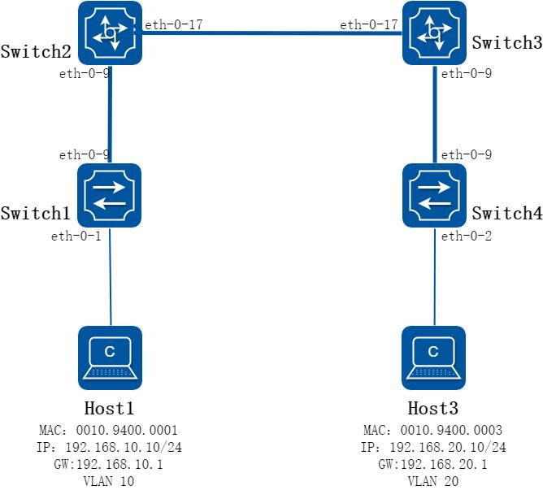

**图17-49 BGP EVPN 引入外部路由**

##### 2. 组网需求

如上图所示，Switch 2 与Switch 3 属于公网，Switch 1 与Switch 4 属于用户私网，分别下联两个网段的主机，并作为该网段主机的网关，两个网段都属于同一用户需要路由互通，因此考虑在Switch 2 与Switch 3 之间建立VXLAN 隧道，将私网路由通过vxlan隧道来进行传输

##### 3. 配置思路

Switch 1 与Switch 2，Switch 3 与Switch 4 分别使用IBGP 在vrf 下建立邻居，发布私网路由，Switch 2 与Switch 3 之间建立EBGP 邻居，用于建立VXLAN 隧道，同时将学习到的IBGP 私网路由引入BGP EVPN 中通告出去，使得Switch 1 和Switch 4 能相互学习到对端的网段路由。

##### 4. 配置步骤

##### 步骤1 配置私网，建立私网路由

配置Switch 1

```
Switch1# configure terminal
Enter configuration commands, one per line.
End with CNTL/Z.
Switch1(config)# ip vrf evpn
Switch1(config-vrf)# rd 1000:1
Switch1(config-vrf)# exit
Switch1(config)# interface eth-0-9
Switch1(config-if)# no switchport
Switch1(config-if)# ip vrf forwarding evpn
Switch1(config-if)# ip address 192.168.1.1/24
Switch1(config-if)# no shutdown
Switch1(config-if)# quit
Switch1(config)# vlan database
Switch1(config-vlan)# vlan 10
Switch1(config-vlan)# quit
Switch1(config)# interface vlan 10
Switch1(config-if)# ip vrf forwarding evpn
Switch1(config-if)# ip address 192.168.10.1/24
Switch1(config-if)# quit
Switch1(config)# interface eth-0-1
Switch1(config-if)# switchport mode trunk
Switch1(config-if)# switchport trunk allowed vlan add 10
Switch1(config-if)# no shutdown
Switch1(config-if)# quit
Switch1(config)# router bgp 100
Switch1(config-router)# address-family ipv4 vrf evpn
Switch1(config-router-af)# network 192.168.10.0 mask 255.255.255.0
Switch1(config-router-af)# neighbor 192.168.1.2 remote-as 100
Switch1(config-router-af)# neighbor 192.168.1.2 activate
Switch1(config-router)# end
```

配置Switch 2

```
Switch2# configure terminal
Enter configuration commands, one per line.
End with CNTL/Z.
Switch2(config)# ip vrf evpn
Switch2(config-vrf)# rd 1000:2
Switch2(config-vrf)# vxlan vni 1000
Switch2(config-vrf)# qui
Switch2(config)# interface eth-0-9
Switch2(config-if)# no switchport
Switch2(config-if)# ip vrf forwarding evpn
Switch2(config-if)# ip address 192.168.1.2/24
Switch2(config-if)# no shutdown
Switch2(config-if)# quit
Switch2(config)# router bgp 100
Switch2(config-router)# address-family IPv4 vrf evpn
Switch2(config-router-af)# advertise l2vpn evpn
Switch2(config-router-af)# neighbor 192.168.1.1 remote-as 100
Switch2(config-router-af)# neighbor 192.168.1.1 activate
Switch2(config-router)# end
```

配置Switch 3

```
Switch3# configure terminal
Enter configuration commands, one per line.
End with CNTL/Z.
```

```
Switch3(config)# ip vrf evpn
Switch3(config-vrf)# rd 1000:3
Switch3(config-vrf)# vxlan vni 1000
Switch3(config-vrf)# quit
Switch3(config)# interface eth-0-9
Switch3(config-if)# no switchport
Switch3(config-if)# ip vrf forwarding evpn
Switch3(config-if)# ip address 192.168.2.2/24
Switch3(config-if)# no shutdown
Switch3(config-if)# quit
Switch3(config)# router bgp 200
Switch3(config-router)# address-family ipv4 vrf evpn
Switch3(config-router-af)# advertise l2vpn evpn
Switch3(config-router-af)# neighbor 192.168.2.1 remote-as 200
Switch3(config-router-af)# neighbor 192.168.2.1 activate
Switch3(config-router)# end
```

配置Switch 4

```
Switch4# configure terminal
Enter configuration commands, one per line.
End with CNTL/Z.
Switch4(config)# ip vrf evpn
Switch4(config-vrf)# rd 1000:4
Switch4(config-vrf)# qui
Switch4(config)# interface eth-0-9
Switch4(config-if)# no switchport
Switch4(config-if)# ip vrf forwarding evpn
Switch4(config-if)# ip address 192.168.2.1/24
Switch4(config-if)# no shutdown
Switch4(config-if)# exit
Switch4(config)# vlan database
Switch4(config-vlan)# vlan 20
Switch4(config-vlan)# quit
Switch4(config)# interface vlan 20
Switch4(config-if)# ip vrf forwarding evpn
Switch4(config-if)# ip address 192.168.20.1/24
Switch4(config-if)# quit
Switch4(config)# interface eth-0-1
Switch4(config-if)# switchport mode trunk
Switch4(config-if)# switchport trunk allowed vlan add 20
Switch4(config-if)# no shutdown
Switch4(config-if)# quit
Switch4(config)# router bgp 200
Switch4(config-router)# address-family ipv4 vrf evpn
Switch4(config-router-af)# network 192.168.20.0 mask 255.255.255.0
Switch4(config-router-af)# neighbor 192.168.2.2 remote-as 200
Switch4(config-router-af)# neighbor 192.168.2.2 activate
Switch4(config-router)# end
```

##### 步骤2 配置BGP，建立BGP evpn 邻居

配置Switch 2

```
Switch2# configure terminal
Enter configuration commands, one per line.
End with CNTL/Z.
Switch2(config)# ip vrf evpn
Switch2(config-vrf)# route-target both 1000:1000 evpn
```

```
Switch2(config-vrf)# quit
Switch2(config)# interface eth-0-17
Switch2(config-if)# no switchport
Switch2(config-if)# ip address 192.168.17.1/24
Switch2(config-if)# no shutdown
Switch2(config-if)# vxlan uplink enable
Switch2(config-if)# quit
Switch2(config)# interface loopback 0
Switch2(config-if)# ip address 10.2.2.2/32
Switch2(config-if)# quit
Switch2(config)# ip route 10.3.3.3/32 192.168.17.2
Switch2(config)# evpn
Switch2(config-evpn)# exit
Switch2(config)# interface nve 0
Switch2(config-if)# source loopback 0
Switch2(config-if)# member vni 1000 associate-vrf
Switch2(config-if)# quit
Switch2(config)# router bgp 100
Switch2(config-router)# bgp router-id 10.2.2.2
Switch2(config-router)# neighbor 10.3.3.3 remote-as 200
Switch2(config-router)# neighbor 10.3.3.3 update-source loopback 0
Switch2(config-router)# neighbor 10.3.3.3 ebgp-multihop 255
Switch2(config-router)# address-family l2vpn evpn
Switch2(config-router-af)# neighbor 10.3.3.3 activate
Switch2(config-router-af)# neighbor 10.3.3.3 send-community both
Switch2(config-router-af)# end
```

配置Switch 3

```
Switch3# configure terminal
Enter configuration commands, one per line.
End with CNTL/Z.
Switch3(config)# ip vrf evpn
Switch3(config-vrf)# route-target both 1000:1000 evpn
Switch3(config-vrf)# quit
Switch3(config)# interface eth-0-17
Switch3(config-if)# no switchport
Switch3(config-if)# ip address 192.168.17.2/24
Switch3(config-if)# no shutdown
Switch3(config-if)# vxlan uplink enable
Switch3(config-if)# quit
Switch3(config)# interface loopback 0
Switch3(config-if)# ip address 10.3.3.3/32
Switch3(config-if)# qui
Switch3(config)# ip route 10.2.2.2/32 192.168.17.1
Switch3(config)# evpn
Switch3(config-evpn)# exit
Switch3(config)# interface nve 0
Switch3(config-if)# source loopback 0
Switch3(config-if)# member vni 1000 associate-vrf
Switch3(config-if)# quit
Switch3(config)# router bgp 200
Switch3(config-router)# bgp router-id 10.3.3.3
Switch3(config-router)# neighbor 10.2.2.2 remote-as 100
Switch3(config-router)# neighbor 10.2.2.2 update-source loopback 0
Switch3(config-router)# neighbor 10.2.2.2 ebgp-multihop 255
Switch3(config-router)# address-family l2vpn evpn
```

```
Switch3(config-router-af)# neighbor 10.2.2.2 activate
Switch3(config-router-af)# neighbor 10.2.2.2 send-community both
Switch3(config-router-af)# end
```

##### 步骤3 验证配置结果

Switch1 上能学到远端的路由

```
Switch1# show ip bgp vpnv4 vrf evpn
BGP table version is 1, local router ID is 192.168.10.1
Status codes: s suppressed, d damped, h history, * valid, > best, i - inter
nal,
S Stale
Origin codes: i - IGP, e - EGP, ? - incomplete
Network
Next Hop
Metric LocPrf Weight Path
Route Distinguisher: 1000:1 (Default for VRF evpn)
*> 192.168.10.0/24
0.0.0.0
100
32768 i
*>i192.168.20.0/24
192.168.1.2
0
100
0 200 i
Switch1#
Switch1# show ip route vrf evpn
Codes: K - kernel, C - connected, S - static, R - RIP, B - BGP
O - OSPF, IA - OSPF inter area
N1 - OSPF NSSA external type 1, N2 - OSPF NSSA external type 2
E1 - OSPF external type 1, E2 - OSPF external type 2
i - IS-IS, L1 - IS-IS level-1, L2 - IS-IS level-2, ia - IS-IS inter
area
Dc - DHCP Client
[*] - [AD/Metric]
* - candidate default
C
192.168.1.0/24 is directly connected, eth-0-9
C
192.168.1.1/32 is in local loopback, eth-0-9
C
192.168.10.0/24 is directly connected, vlan10
C
192.168.10.1/32 is in local loopback, vlan10
B
192.168.20.0/24 [200/0] via 192.168.1.2, eth-0-9, 00:04:55
```

Switch4 上能学到远端的路由

```
Switch4# show ip bgp vpnv4 vrf evpn
BGP table version is 1, local router ID is 192.168.20.1
Status codes: s suppressed, d damped, h history, * valid, > best, i - internal,
S Stale
Origin codes: i - IGP, e - EGP, ? - incomplete
Network
Next Hop
Metric LocPrf Weight Path
Route Distinguisher: 1000:4 (Default for VRF evpn)
*>i192.168.10.0/24
192.168.2.2
0
100
0 100 i
*> 192.168.20.0/24
0.0.0.0
100
32768 i
Switch4#
Switch4# show ip route vrf evpn
Codes: K - kernel, C - connected, S - static, R - RIP, B - BGP
O - OSPF, IA - OSPF inter area
N1 - OSPF NSSA external type 1, N2 - OSPF NSSA external type 2
E1 - OSPF external type 1, E2 - OSPF external type 2
i - IS-IS, L1 - IS-IS level-1, L2 - IS-IS level-2, ia - IS-IS inter area
Dc - DHCP Client
```

```
[*] - [AD/Metric]
* - candidate default
C
192.168.2.0/24 is directly connected, eth-0-9
C
192.168.2.1/32 is in local loopback, eth-0-9
B
192.168.10.0/24 [200/0] via 192.168.2.2, eth-0-9, 00:07:34
C
192.168.20.0/24 is directly connected, vlan20
C
192.168.20.1/32 is in local loopback, vlan20
```

Host 1 与Host 3 互通

```
PING 192.168.20.10 from 192.168.10.10: 56 data bytes
64 bytes from 192.168.20.10: icmp_seq=1 ttl=60 time=0.730 ms
--- ping statistics ---
1 packets transmitted, 1 packets received, 0.0% packet loss
rtt min/avg/max/stddev = 0.730/0.730/0.730/0.000 ms
```

#### BGP EVPN 方式部署分段式VXLAN 隧道

##### 1. 组网拓扑

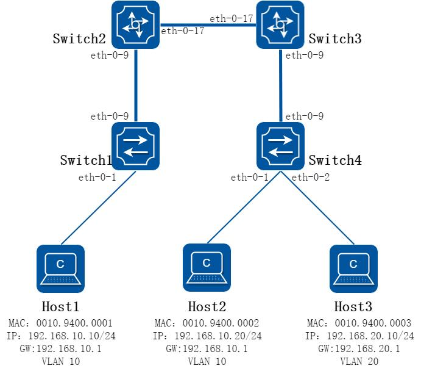

**图17-50 BGP EVPN 方式部署分段式VXLAN 隧道**

##### 2. 组网需求

如上图所示，HOST1、2、3 都属于租户test，其间既有相同网段又有不同网段，且都需要相互通信。Switch 2/3 作为边界设备，隧道需要分段的建立，即Switch 1 与Switch 2，Switch 2 与Switch 3，Switch 3 与Switch 4 之间的VXLAN 隧道，最终完成Host之间的互通

##### 3. 配置思路

SWITCH 之间互相建立EBGP 邻居，将发布路由的下一跳信息修改为自己的本地地址，以达成分段建立VXLAN 隧道的目的，同时由于默认情况下隧道间由于水平分割的存在不会相互转发二层流量，因此需要在Switch 2 和Switch 3 上关闭水平分割。

##### 4. 配置步骤

##### 步骤1 配置路由，保证交换机之间三层网络可通

配置Switch 1

```
Switch1# configure terminal
Enter configuration commands, one per line.
End with CNTL/Z.
Switch1(config)# interface loopback 0
Switch1(config-if)# ip address 10.1.1.1/32
Switch1(config-if)# exit
Switch1(config)# interface eth-0-9
Switch1(config-if)# no switchport
Switch1(config-if)# ip address 192.168.1.1/24
Switch1(config-if)# vxlan uplink enable
Switch1(config-if)# no shutdown
Switch1(config-if)# exit
Switch1(config)# ip route 10.2.2.2/32 192.168.1.2
Switch1(config)# ip route 10.3.3.3/32 192.168.1.2
Switch1(config)# ip route 10.4.4.4/32 192.168.1.2
Switch1(config)# end
```

配置Switch 2

```
Switch2# configure terminal
Enter configuration commands, one per line.
End with CNTL/Z.
Switch2(config)# interface loopback 0
Switch2(config-if)# ip address 10.2.2.2/32
Switch2(config-if)# exit
Switch2(config)# interface eth-0-9
Switch2(config-if)# no switchport
Switch2(config-if)# ip address 192.168.1.2/24
Switch2(config-if)# vxlan uplink enable
Switch2(config-if)# no shutdown
Switch2(config-if)# exit
Switch2(config)# interface eth-0-17
Switch2(config-if)# no switchport
Switch2(config-if)# ip address 192.168.2.1/24
Switch2(config-if)# vxlan uplink enable
Switch2(config-if)# no shutdown
Switch2(config-if)# exit
Switch2(config)# ip route 10.1.1.1/32 192.168.1.1
Switch2(config)# ip route 10.3.3.3/32 192.168.2.2
Switch2(config)# ip route 10.4.4.4/32 192.168.2.2
Switch2(config)# end
```

配置Switch 3

```
Switch3# configure terminal
Enter configuration commands, one per line.
End with CNTL/Z.
Switch3(config)# interface loopback 0
Switch3(config-if)# ip address 10.3.3.3/32
Switch3(config-if)# exit
Switch3(config)# interface eth-0-9
Switch3(config-if)# no switchport
Switch3(config-if)# ip address 192.168.3.1/24
Switch3(config-if)# vxlan uplink enable
Switch3(config-if)# no shutdown
Switch3(config-if)# exit
Switch3(config)# interface eth-0-17
Switch3(config-if)# no switchport
Switch3(config-if)# ip address 192.168.2.2/24
Switch3(config-if)# vxlan uplink enable
Switch3(config-if)# no shutdown
Switch3(config-if)# exit
Switch3(config)# ip route 10.1.1.1/32 192.168.2.1
Switch3(config)# ip route 10.2.2.2/32 192.168.2.1
Switch3(config)# ip route 10.4.4.4/32 192.168.3.2
Switch3(config)# end
```

配置Switch 4

```
Switch4# configure terminal
Enter configuration commands, one per line.
End with CNTL/Z.
Switch4(config)# interface loopback 0
Switch4(config-if)# ip address 10.4.4.4/32
Switch4(config-if)# exit
Switch4(config)# interface eth-0-9
Switch4(config-if)# no switchport
Switch4(config-if)# ip address 192.168.3.2/24
Switch4(config-if)# vxlan uplink enable
Switch4(config-if)# no shutdown
Switch4(config-if)# exit
Switch4(config)# ip route 10.1.1.1/32 192.168.3.1
Switch4(config)# ip route 10.2.2.2/32 192.168.3.1
Switch4(config)# ip route 10.3.3.3/32 192.168.3.1
Switch4(config)# end
```

##### 步骤2 配置VLAN

配置Switch 1

```
Switch1# configure terminal
Enter configuration commands, one per line.
End with CNTL/Z.
Switch1(config)# vlan database
Switch1(config-vlan)# vlan 10
Switch1(config-vlan)# vlan 10 overlay enable
Switch1(config-vlan)# exit
Switch1(config)# interface eth-0-1
Switch1(config-if)# switchport mode trunk
Switch1(config-if)# switchport trunk allowed vlan add 10
Switch1(config-if)# no shutdown
Switch1(config-if)# end
```

配置Switch 4

```
Switch4# configure terminal
Enter configuration commands, one per line.
End with CNTL/Z.
Switch4(config)# vlan database
Switch4(config-vlan)# vlan 10,20
Switch4(config-vlan)# vlan 10 overlay enable
Switch4(config-vlan)# vlan 20 overlay enable
Switch4(config-vlan)# exit
Switch4(config)# interface eth-0-1
Switch4(config-if)# switchport mode trunk
Switch4(config-if)# switchport trunk allowed vlan add 10
Switch4(config-if)# no shutdown
Switch4(config-if)# exit
Switch4(config)# interface eth-0-2
Switch4(config-if)# switchport mode trunk
Switch4(config-if)# switchport trunk allowed vlan add 20
Switch4(config-if)# no shutdown
Switch4(config-if)# end
```

##### 步骤3 配置分布式网关

配置Switch 1

```
Switch1# configure terminal
Enter configuration commands, one per line.
End with CNTL/Z.
Switch1(config)# ip vrf evpn
Switch1(config-vrf)# rd 1000:1
Switch1(config-vrf)# route-target import 1000:1000 evpn
Switch1(config-vrf)# vxlan vni 1000
Switch1(config-vrf)# exit
Switch1(config)# interface vlan 10
Switch1(config-if)# ip vrf forwarding evpn
Switch1(config-if)# overlay distributed-gateway enable
Switch1(config-if)# ip address 192.168.10.1/24
Switch1(config-if)# end
```

配置Switch 2

```
Switch2# configure terminal
Enter configuration commands, one per line.
End with CNTL/Z.
Switch2(config)# ip vrf evpn
Switch2(config-vrf)# rd 1000:2
Switch2(config-vrf)# route-target import 1000:1000 evpn
Switch2(config-vrf)# vxlan vni 1000
Switch2(config-vrf)# end
```

配置Switch 3

```
Switch3# configure terminal
Enter configuration commands, one per line.
End with CNTL/Z.
Switch3(config)# ip vrf evpn
Switch3(config-vrf)# rd 1000:3
Switch3(config-vrf)# route-target import 1000:1000 evpn
Switch3(config-vrf)# vxlan vni 1000
Switch3(config-vrf)# end
Switch3#
```

配置Switch 4

```
Switch4# configure terminal
Enter configuration commands, one per line.
End with CNTL/Z.
Switch4(config)# ip vrf evpn
Switch4(config-vrf)# rd 1000:4
Switch4(config-vrf)# route-target import 1000:1000 evpn
Switch4(config-vrf)# vxlan vni 1000
Switch4(config-vrf)# exit
Switch4(config)# interface vlan 10
Switch4(config-if)# ip vrf forwarding evpn
Switch4(config-if)# overlay distributed-gateway enable
Switch4(config-if)# ip address 192.168.10.1/24
Switch4(config-if)# exit
Switch4(config)# interface vlan 20
Switch4(config-if)# ip vrf forwarding evpn
Switch4(config-if)# overlay distributed-gateway enable
Switch4(config-if)# ip address 192.168.20.1/24
Switch4(config-if)# end
```

##### 步骤4 配置BGP

配置Switch 1

```
Switch1# configure terminal
Enter configuration commands, one per line.
End with CNTL/Z.
Switch1(config)# evpn
Switch1(config-evpn)# exit
Switch1(config)# router bgp 100
Switch1(config-router)# bgp router-id 10.1.1.1
Switch1(config-router)# neighbor 10.2.2.2 remote-as 101
Switch1(config-router)# neighbor 10.2.2.2 ebgp-multihop 255
Switch1(config-router)# neighbor 10.2.2.2 update-source loopback 0
Switch1(config-router)# address-family l2vpn evpn
Switch1(config-router-af)# neighbor 10.2.2.2 activate
Switch1(config-router-af)# neighbor 10.2.2.2 send-community both
Switch1(config-router-af)# end
```

配置Switch 2

```
Switch2# configure terminal
Enter configuration commands, one per line.
End with CNTL/Z.
Switch2(config)# evpn
Switch2(config-evpn)# exit
Switch2(config)# router bgp 101
Switch2(config-router)# bgp router-id 10.2.2.2
Switch2(config-router)# neighbor 10.1.1.1 remote-as 100
Switch2(config-router)# neighbor 10.1.1.1 ebgp-multihop 255
Switch2(config-router)# neighbor 10.1.1.1 update-source loopback 0
Switch2(config-router)# neighbor 10.3.3.3 remote-as 201
Switch2(config-router)# neighbor 10.3.3.3 ebgp-multihop 255
Switch2(config-router)# neighbor 10.3.3.3 update-source loopback 0
Switch2(config-router)# address-family l2vpn evpn
Switch2(config-router-af)# neighbor 10.1.1.1 activate
Switch2(config-router-af)# neighbor 10.1.1.1 send-community both
Switch2(config-router-af)# neighbor 10.3.3.3 activate
Switch2(config-router-af)# neighbor 10.3.3.3 send-community both
Switch2(config-router-af)# end
```

配置Switch 3

```
Switch3# configure terminal
Enter configuration commands, one per line.
End with CNTL/Z.
Switch3(config)# evpn
Switch3(config-evpn)# exit
Switch3(config)# router bgp 201
Switch3(config-router)# bgp router-id 10.3.3.3
Switch3(config-router)# neighbor 10.2.2.2 remote-as 101
Switch3(config-router)# neighbor 10.2.2.2 ebgp-multihop 255
Switch3(config-router)# neighbor 10.2.2.2 update-source loopback 0
Switch3(config-router)# neighbor 10.4.4.4 remote-as 200
Switch3(config-router)# neighbor 10.4.4.4 ebgp-multihop 255
Switch3(config-router)# neighbor 10.4.4.4 update-source loopback0
Switch3(config-router)# address-family l2vpn evpn
Switch3(config-router-af)# neighbor 10.2.2.2 activate
Switch3(config-router-af)# neighbor 10.2.2.2 send-community both
Switch3(config-router-af)# neighbor 10.4.4.4 activate
Switch3(config-router-af)# neighbor 10.4.4.4 send-community both
Switch3(config-router-af)# end
```

配置Switch 4

```
Switch4# configure terminal
Enter configuration commands, one per line.
End with CNTL/Z.
Switch4(config)# evpn
Switch4(config-evpn)# exit
Switch4(config)# router bgp 200
Switch4(config-router)# bgp router-id 10.4.4.4
Switch4(config-router)# neighbor 10.3.3.3 remote-as 201
Switch4(config-router)# neighbor 10.3.3.3 ebgp-multihop 255
Switch4(config-router)# neighbor 10.3.3.3 update-source loopback 0
Switch4(config-router)# address-family l2vpn evpn
Switch4(config-router-af)# neighbor 10.3.3.3 activate
Switch4(config-router-af)# neighbor 10.3.3.3 send-community both
Switch4(config-router-af)# end
```

##### 步骤5 配置EVPN 实例，并使能发布irb 路由

配置Switch 1

```
Switch1# configure terminal
Enter configuration commands, one per line.
End with CNTL/Z.
Switch1(config)# overlay
Switch1(config-overlay)# vlan 10 vni 10
Switch1(config-overlay)# quit
Switch1(config)# interface nve 0
Switch1(config-if)# source loopback 0
Switch1(config-if)# member vni 10
Switch1(config-if)# member vni 1000 associate-vrf
Switch1(config-if)# quit
Switch1(config)# evpn
Switch1(config-evpn)# vni 10
Switch1(config-evi)# rd 10:1
Switch1(config-evi)# route-target both 10:10
Switch1(config-evi)# route-target export 1000:1000
Switch1(config-evi)# quit
```

```
Switch1(config-evpn)# quit
Switch1(config)# interface vlan 10
Switch1(config-if)# overlay host-collect enable
Switch1(config-evpn)# end
```

配置Switch 2

```
Switch2# configure terminal
Enter configuration commands, one per line.
End with CNTL/Z.
Switch2(config)# interface nve 0
Switch2(config-if)# source loopback 0
Switch2(config-if)# member vni 1000 associate-vrf
Switch2(config-if)# end
```

配置Switch 3

```
Switch3# configure terminal
Enter configuration commands, one per line.
End with CNTL/Z.
Switch3(config)# interface nve 0
Switch3(config-if)# source loopback 0
Switch3(config-if)# member vni 1000 associate-vrf
Switch3(config-if)# end
```

配置Switch 4

```
Switch4# configure terminal
Enter configuration commands, one per line.
End with CNTL/Z.
Switch4(config)# overlay
Switch4(config-overlay)# vlan 10 vni 10
Switch4(config-overlay)# vlan 20 vni 20
Switch4(config-overlay)# exit
Switch4(config)# interface nve 0
Switch4(config-if)# source loopback 0
Switch4(config-if)# member vni 10
Switch4(config-if)# member vni 20
Switch4(config-if)# member vni 1000 associate-vrf
Switch4(config-if)# quit
Switch4(config)# evpn
Switch4(config-evpn)# vni 10
Switch4(config-evi)# rd 10:4
Switch4(config-evi)# route-target both 10:10
Switch4(config-evi)# route-target export 1000:1000
Switch4(config-evi)# vni 20
Switch4(config-evi)# rd 20:4
Switch4(config-evi)# route-target both 20:20
Switch4(config-evi)# route-target export 1000:1000
Switch4(config-evi)# end
Switch4# configure terminal
Enter configuration commands, one per line.
End with CNTL/Z.
Switch4(config)# interface vlan 10
Switch4(config-if)# overlay host-collect enable
Switch4(config-if)# interface vlan 20
Switch4(config-if)# overlay host-collect enable
Switch4(config-if)# end
```

##### 步骤6 配置EVPN 实例，关闭水平分割

配置Switch 2

```
Switch2# configure terminal
Enter configuration commands, one per line.
End with CNTL/Z.
Switch2(config)# vlan database
Switch2(config-vlan)# vlan 10
Switch2(config-vlan)# vlan 10 overlay enable
Switch2(config-vlan)# exit
Switch2(config)# overlay
Switch2(config-overlay)# vlan 10 vni 10
Switch2(config-overlay)# exit
Switch2(config)# evpn
Switch2(config-evpn)# vni 10
Switch2(config-evi)# rd 10:2
Switch2(config-evi)# route-target import 1000:1000
Switch2(config-evi)# exit
Switch2(config-evpn)# exit
Switch2(config)# interface nve 0
Switch2(config-if)# member vni 10
Switch2(config-if)# split-horizon disable
Switch2(config-if)# end
Switch2# clear bgp evpn *
```

配置Switch 3

```
Switch3# configure terminal
Enter configuration commands, one per line.
End with CNTL/Z.
Switch3(config)# vlan database
Switch3(config-vlan)# vlan 10
Switch3(config-vlan)# vlan 10 overlay enable
Switch3(config-vlan)# exit
Switch3(config)# overlay
Switch3(config-overlay)# vlan 10 vni 10
Switch3(config-overlay)# exit
Switch3(config)# evpn
Switch3(config-evpn)# vni 10
Switch3(config-evi)# rd 10:3
Switch3(config-evi)# route-target import 1000:1000
Switch3(config-evi)# exit
Switch3(config-evpn)# exit
Switch3(config)# interface nve 0
Switch3(config-if)# member vni 10
Switch3(config-if)# split-horizon disable
Switch3(config-if)# end
Switch3# clear bgp evpn *
```

##### 步骤7 验证配置结果

Switch1:

```
Switch1# show mac address-table
MAC Address Table
-------------------------------------------
(*)
- Security Entry
(M)
- MLAG Entry
(MO) - MLAG Output Entry
(MI) - MLAG Input Entry
(E)
- EVPN Entry
(EO) - EVPN Output Entry
(EI) - EVPN Input Entry
```

```
Vlan
MAC Address
Type
Ports
----
-----------
--------
-----
10
0010.9400.0002
dynamic
VxLAN: 10.1.1.1->10.2.2.2(EI)
10
0010.9400.0001
dynamic
eth-0-1(EO)
Switch1# show ip route vrf evpn
Codes: K - kernel, C - connected, S - static, R - RIP, B - BGP
O - OSPF, IA - OSPF inter area
N1 - OSPF NSSA external type 1, N2 - OSPF NSSA external type 2
E1 - OSPF external type 1, E2 - OSPF external type 2
i - IS-IS, L1 - IS-IS level-1, L2 - IS-IS level-2, ia - IS-IS inter area
Dc - DHCP Client
[*] - [AD/Metric]
* - candidate default
C
192.168.10.0/24 is directly connected, vlan10
C
192.168.10.1/32 is in local loopback, vlan10
B
192.168.10.20/32 [20/0] is in overlay remote vxlan vtep:10.1.1.1->10.2.2.2, vni:1000
B
192.168.20.10/32 [20/0] is in overlay remote vxlan vtep:10.1.1.1->10.2.2.2, vni:1000
Switch1# show ip arp vrf evpn
Protocol
Address
Age (min)
Hardware Addr
Interface
Internet
192.168.10.1
-
001e.080a.73d6
vlan10
Internet
192.168.10.10
1
0010.9400.0001
vlan10
```

Switch2:

```
Switch2# show mac address-table
MAC Address Table
-------------------------------------------
(*)
- Security Entry
(M)
- MLAG Entry
(MO) - MLAG Output Entry
(MI) - MLAG Input Entry
(E)
- EVPN Entry
(EO) - EVPN Output Entry
(EI) - EVPN Input Entry
Vlan
MAC Address
Type
Ports
----
-----------
--------
-----
10
0010.9400.0002
dynamic
VxLAN: 10.2.2.2->10.3.3.3(EI)
10
0010.9400.0001
dynamic
VxLAN: 10.2.2.2->10.1.1.1(EI)
Switch2# show ip route vrf evpn
Codes: K - kernel, C - connected, S - static, R - RIP, B - BGP
O - OSPF, IA - OSPF inter area
N1 - OSPF NSSA external type 1, N2 - OSPF NSSA external type 2
E1 - OSPF external type 1, E2 - OSPF external type 2
i - IS-IS, L1 - IS-IS level-1, L2 - IS-IS level-2, ia - IS-IS inter area
Dc - DHCP Client
[*] - [AD/Metric]
* - candidate default
B
192.168.10.10/32 [20/0] is in overlay remote vxlan vtep:10.2.2.2->10.1.1.1, vni:1000
B
192.168.10.20/32 [20/0] is in overlay remote vxlan vtep:10.2.2.2->10.3.3.3, vni:1000
B
192.168.20.10/32 [20/0] is in overlay remote vxlan vtep:10.2.2.2->10.3.3.3, vni:1000
```

Switch3:

```
Switch3# show mac address-table
MAC Address Table
-------------------------------------------
(*)
- Security Entry
(M)
- MLAG Entry
(MO) - MLAG Output Entry
(MI) - MLAG Input Entry
```

```
(E)
- EVPN Entry
(EO) - EVPN Output Entry
(EI) - EVPN Input Entry
Vlan
MAC Address
Type
Ports
----
-----------
--------
-----
10
0010.9400.0001
dynamic
VxLAN: 10.3.3.3->10.2.2.2(EI)
10
0010.9400.0002
dynamic
VxLAN: 10.3.3.3->10.4.4.4(EI)
Switch3# show ip route vrf evpn
Codes: K - kernel, C - connected, S - static, R - RIP, B - BGP
O - OSPF, IA - OSPF inter area
N1 - OSPF NSSA external type 1, N2 - OSPF NSSA external type 2
E1 - OSPF external type 1, E2 - OSPF external type 2
i - IS-IS, L1 - IS-IS level-1, L2 - IS-IS level-2, ia - IS-IS inter area
Dc - DHCP Client
[*] - [AD/Metric]
* - candidate default
B
192.168.10.10/32 [20/0] is in overlay remote vxlan vtep:10.3.3.3->10.2.2.2, vni:1000
B
192.168.10.20/32 [20/0] is in overlay remote vxlan vtep:10.3.3.3->10.4.4.4, vni:1000
B
192.168.20.10/32 [20/0] is in overlay remote vxlan vtep:10.3.3.3->10.4.4.4, vni:1000
```

Switch4:

```
Switch4# show mac address-table
MAC Address Table
-------------------------------------------
(*)
- Security Entry
(M)
- MLAG Entry
(MO) - MLAG Output Entry
(MI) - MLAG Input Entry
(E)
- EVPN Entry
(EO) - EVPN Output Entry
(EI) - EVPN Input Entry
Vlan
MAC Address
Type
Ports
----
-----------
--------
-----
20
0010.9400.0003
dynamic
eth-0-2(EO)
10
0010.9400.0001
dynamic
VxLAN: 10.4.4.4->10.3.3.3(EI)
10
0010.9400.0002
dynamic
eth-0-1(EO)
Switch4# show ip arp vrf evpn
Protocol
Address
Age (min)
Hardware Addr
Interface
Internet
192.168.10.1
-
001e.080a.72ae
vlan10
Internet
192.168.10.20
4
0010.9400.0002
vlan10
Internet
192.168.20.1
-
001e.080a.72ae
vlan20
Internet
192.168.20.10
4
0010.9400.0003
vlan20
Switch4# show ip route vrf evpn
Codes: K - kernel, C - connected, S - static, R - RIP, B - BGP
O - OSPF, IA - OSPF inter area
N1 - OSPF NSSA external type 1, N2 - OSPF NSSA external type 2
E1 - OSPF external type 1, E2 - OSPF external type 2
i - IS-IS, L1 - IS-IS level-1, L2 - IS-IS level-2, ia - IS-IS inter area
Dc - DHCP Client
[*] - [AD/Metric]
* - candidate default
C
192.168.10.0/24 is directly connected, vlan10
C
192.168.10.1/32 is in local loopback, vlan10
B
192.168.10.10/32 [20/0] is in overlay remote vxlan vtep:10.4.4.4->10.3.3.3, vni:1000
C
192.168.20.0/24 is directly connected, vlan20
C
192.168.20.1/32 is in local loopback, vlan20
```

#### MLAG 设备作为TOR 接入EVPN 网络

##### 1. 组网拓扑

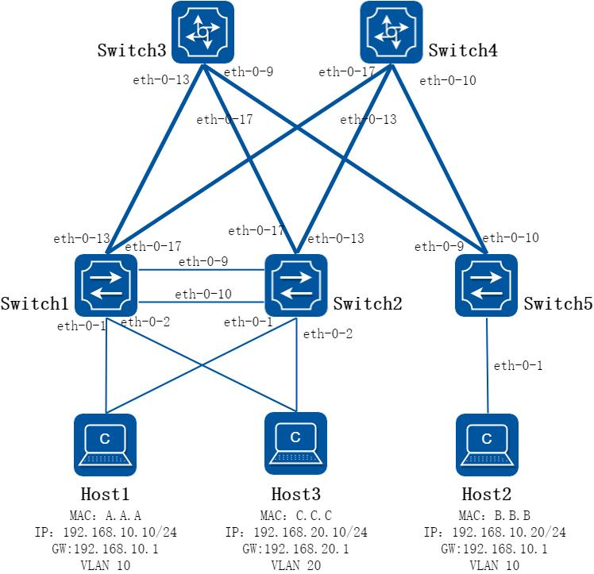

**图17-51 MLAG 设备作为TOR 接入EVPN 网络**

##### 2. 组网需求

##### 3. 组网需求

如上图所示，Switch 1/2/5 作为TOR 交换机，SWITCH 3/4 作为Spine 其间网络为三层网络，下联的HOST 都属于同一用户，需求与其他用户隔离的同时保证相同网段/不同网段间的主机都能互通。为了保证可靠性，其中部分服务器需要双活接入。

##### 4. 配置思路

SWITCH 1/2 上配置MLAG 并配置virtual ip 作为服务器网关保证双活接入，同时为了保证虚拟机迁移后网关地址不变，在SWITH 1/2/5 上部署分布式网关并使用相同的ip。

使用IBGP 构建EVPN 网络，Switch 1 和Switch 2 使用相同的VTEP 地址，对外表现为同一个VTEP，在Switch 3 和Switch 4 上使能路由反射器减少BGP 邻居数量的同时，让SWITCH 1/2/5 都能学到EVPN 路由。

##### 5. 配置步骤

##### 步骤1 配置MLAG

分别在Switch 1/2 配置MLAG，用于服务器双活接入，Switch 5 使用单接口下联。

配置peer-link Switch1:

```
Switch1# configure terminal
Enter configuration commands, one per line.
End with CNTL/Z.
Switch1(config)# interface range eth-0-9 to eth-0-10
Switch1(config-if-range)# no shutdown
Switch1(config-if-range)# static-channel-group 55
Switch1(config-if-range)# exit
Switch1(config)# interface agg 55
Switch1(config-if)# switchport mode trunk
Switch1(config-if)# switchport trunk allowed vlan all
Switch1(config-if)# spanning-tree port disable
Switch1(config-if)# exit
Switch1(config)# mlag configuration
Switch1(config-mlag)# peer-link agg 55
Switch1(config-mlag)# end
```

Switch2:

```
Switch2# configure terminal
Enter configuration commands, one per line.
End with CNTL/Z.
Switch2(config)# interface range eth-0-9 to eth-0-10
Switch2(config-if-range)# no shutdown
Switch2(config-if-range)# static-channel-group 55
Switch2(config-if-range)# exit
Switch2(config)# interface agg 55
Switch2(config-if)# switchport mode trunk
Switch2(config-if)# switchport trunk allowed vlan all
Switch2(config-if)# spanning-tree port disable
Switch2(config-if)# exit
Switch2(config)# mlag configuration
Switch2(config-mlag)# peer-link agg 55
Switch2(config-mlag)# end
```

配置peer-address Switch1:

```
Switch1# configure terminal
Enter configuration commands, one per line.
End with CNTL/Z.
Switch1(config)# vlan database
Switch1(config-vlan)# vlan 4094
Switch1(config-vlan)# exit
Switch1(config)# interface vlan 4094
Switch1(config-if)# ip address 40.94.0.1/24
Switch1(config-if)# exit
Switch1(config)# mlag configuration
Switch1(config-mlag)# peer-address 40.94.0.2
Switch1(config-mlag)# end
```

Switch2:

```
Switch2# configure terminal
Enter configuration commands, one per line.
End with CNTL/Z.
```

```
Switch2(config)# vlan database
Switch2(config-vlan)# vlan 4094
Switch2(config-vlan)# exit
Switch2(config)# interface vlan 4094
Switch2(config-if)# ip address 40.94.0.2/24
Switch2(config-if)# exit
Switch2(config)# mlag configuration
Switch2(config-mlag)# peer-address 40.94.0.1
Switch2(config-mlag)# end
```

配置下联接口配置下联接口，SWITC 1/2 使用MLAG 双下联，Switch 5 普通单下联。

Switch1:

```
Switch1# configure terminal
Enter configuration commands, one per line.
End with CNTL/Z.
Switch1(config)# vlan database
Switch1(config-vlan)# vlan 10,20
Switch1(config-vlan)# exit
Switch1(config)# interface eth-0-1
Switch1(config-if)# switchport mode trunk
Switch1(config-if)# switchport trunk allowed vlan add 10
Switch1(config-if)# no shutdown
Switch1(config-if)# static-channel-group 1
Switch1(config-if)# exit
Switch1(config)# interface eth-0-2
Switch1(config-if)# switchport mode trunk
Switch1(config-if)# switchport trunk allowed vlan add 20
Switch1(config-if)# no shutdown
Switch1(config-if)# static-channel-group 2
Switch1(config-if)# exit
Switch1(config)# interface agg 1
Switch1(config-if)# mlag 1
Switch1(config-if)# exit
Switch1(config)# interface agg 2
Switch1(config-if)# mlag 2
Switch1(config-if)# end
```

Switch2:

```
Switch2# configure terminal
Enter configuration commands, one per line.
End with CNTL/Z.
Switch2(config)# vlan database
Switch2(config-vlan)# vlan 10,20
Switch2(config-vlan)# exit
Switch2(config)# interface eth-0-1
Switch2(config-if)# switchport mode trunk
Switch2(config-if)# switchport trunk allowed vlan add 10
Switch2(config-if)# static-channel-group 1
Switch2(config-if)# no shutdown
Switch2(config-if)# exit
Switch2(config)# interface eth-0-2
Switch2(config-if)# switchport mode trunk
Switch2(config-if)# switchport trunk allowed vlan add 20
Switch2(config-if)# static-channel-group 2
```

```
Switch2(config-if)# no shutdown
Switch2(config-if)# exit
Switch2(config)# interface agg 1
Switch2(config-if)# mlag 1
Switch2(config-if)# exit
Switch2(config)# interface agg 2
Switch2(config-if)# mlag 2
Switch2(config-if)# end
```

Switch5:

```
Switch5# configure terminal
Enter configuration commands, one per line.
End with CNTL/Z.
Switch5(config)# vlan database
Switch5(config-vlan)# vlan 10
Switch5(config-vlan)# exit
Switch5(config)# interface eth-0-1
Switch5(config-if)# switchport mode trunk
Switch5(config-if)# switchport trunk allowed vlan add 10
Switch5(config-if)# no shutdown
Switch5(config-if)# end
```

##### 步骤2 配置网关地址并使能分布式网关，在MLAG 设备上使用virtual ip

Switch1:

```
Switch1# configure terminal
Enter configuration commands, one per line.
End with CNTL/Z.
Switch1(config)# ip vrf evpn
Switch1(config-vrf)# rd 1000:1
Switch1(config-vrf)# vxlan vni 1000
Switch1(config-vrf)# exit
Switch1(config)# interface vlan 10
Switch1(config-if)# ip vrf forwarding evpn
Switch1(config-if)# ip address 192.168.10.253/24
Switch1(config-if)# ip virtual-router address 192.168.10.1
Switch1(config-if)# overlay distributed-gateway enable
Switch1(config-if)# exit
Switch1(config)# interface vlan 20
Switch1(config-if)# ip vrf forwarding evpn
Switch1(config-if)# ip address 192.168.20.253/24
Switch1(config-if)# ip virtual-router address 192.168.20.1
Switch1(config-if)# overlay distributed-gateway enable
Switch1(config-if)# exit
Switch1(config)# ip virtual-router mac 0.0.1
Switch1(config)# end
```

Switch2:

```
Switch2# configure terminal
Enter configuration commands, one per line.
End with CNTL/Z.
Switch2(config)# ip vrf evpn
Switch2(config-vrf)# rd 1000:2
Switch2(config-vrf)# vxlan vni 1000
Switch2(config-vrf)# exit
Switch2(config)# interface vlan 10
Switch2(config-if)# ip vrf forwarding evpn
```

```
Switch2(config-if)# ip address 192.168.10.254/24
Switch2(config-if)# ip virtual-router address 192.168.10.1
Switch2(config-if)# overlay distributed-gateway enable
Switch2(config-if)# exit
Switch2(config)# interface vlan 20
Switch2(config-if)# ip vrf forwarding evpn
Switch2(config-if)# ip address 192.168.20.254/24
Switch2(config-if)# ip virtual-router address 192.168.20.1
Switch2(config-if)# overlay distributed-gateway enable
Switch2(config-if)# exit
Switch2(config)# ip virtual-router mac 0.0.1
Switch2(config)# end
```

Switch5:

```
Switch5# configure terminal
Enter configuration commands, one per line.
End with CNTL/Z.
Switch5(config)# ip vrf evpn
Switch5(config-vrf)# rd 1000:5
Switch5(config-vrf)# vxlan vni 1000
Switch5(config-vrf)# qui
Switch5(config)# interface vlan 10
Switch5(config-if)# ip vrf forwarding evpn
Switch5(config-if)# ip address 192.168.10.254/24
Switch5(config-if)# ip virtual-router address 192.168.10.1
Switch5(config-if)# overlay distributed-gateway enable
Switch5(config-if)# exit
Switch5(config)# ip virtual-router mac 0.0.2
Switch5(config)# end
```

##### 步骤3 配置路由，保证交换机之间三层网络可通

Switch1:

```
Switch1# configure terminal
Enter configuration commands, one per line.
End with CNTL/Z.
Switch1(config)# interface loopback 0
Switch1(config-if)# ip address 10.1.1.1/32
Switch1(config-if)# exit
Switch1(config)# interface loopback 1
Switch1(config-if)# ip address 10.11.11.11/32
Switch1(config-if)# exit
Switch1(config)# interface eth-0-13
Switch1(config-if)# no switchport
Switch1(config-if)# no shutdown
Switch1(config-if)# vxlan uplink enable
Switch1(config-if)# ip address 13.1.1.1/24
Switch1(config-if)# exit
Switch1(config)# interface eth-0-17
Switch1(config-if)# no switchport
Switch1(config-if)# no shutdown
Switch1(config-if)# vxlan uplink enable
Switch1(config-if)# ip address 17.1.1.1/24
Switch1(config-if)# exit
Switch1(config)# router ospf
Switch1(config-router)# router-id 10.1.1.1
Switch1(config-router)# network 10.1.1.1 0.0.0.0 area 0
```

```
Switch1(config-router)# network 10.11.11.11 0.0.0.0 area 0
Switch1(config-router)# network 13.1.1.0 0.0.0.255 area 0
Switch1(config-router)# network 17.1.1.0 0.0.0.255 area 0
Switch1(config)#end
```

Switch2:

```
Switch2# configure terminal
Enter configuration commands, one per line.
End with CNTL/Z.
Switch2(config)# interface loopback 0
Switch2(config-if)# ip address 10.2.2.2/32
Switch2(config-if)# exit
Switch2(config)# interface loopback 1
Switch2(config-if)# ip address 10.11.11.11/32
Switch2(config-if)# exit
Switch2(config)# interface eth-0-13
Switch2(config-if)# no switchport
Switch2(config-if)# no shutdown
Switch2(config-if)# vxlan uplink enable
Switch2(config-if)# ip address 13.2.2.1/24
Switch2(config-if)# exit
Switch2(config)# interface eth-0-17
Switch2(config-if)# no switchport
Switch2(config-if)# no shutdown
Switch2(config-if)# vxlan uplink enable
Switch2(config-if)# ip address 17.2.2.1/24
Switch2(config-if)# exit
Switch2(config)# router ospf
Switch2(config-router)# router-id 10.2.2.2
Switch2(config-router)# network 10.2.2.2 0.0.0.0 area 0
Switch2(config-router)# network 10.11.11.11 0.0.0.0 area 0
Switch2(config-router)# network 13.2.2.0 0.0.0.255 area 0
Switch2(config-router)# network 17.2.2.0 0.0.0.255 area 0
Switch2(config)# end
```

Switch3:

```
Switch3# configure terminal
Enter configuration commands, one per line.
End with CNTL/Z.
Switch3(config)# interface loopback 0
Switch3(config-if)# ip address 10.3.3.3/32
Switch3(config-if)# exit
Switch3(config)# interface eth-0-9
Switch3(config-if)# no shutdown
Switch3(config-if)# no switchport
Switch3(config-if)# ip address 9.1.1.2/24
Switch3(config-if)# exit
Switch3(config)# interface eth-0-13
Switch3(config-if)# no shutdown
Switch3(config-if)# no switchport
Switch3(config-if)# ip address 13.1.1.2/24
Switch3(config-if)# exit
Switch3(config)# interface eth-0-17
Switch3(config-if)# no shutdown
Switch3(config-if)# no switchport
Switch3(config-if)# ip address 17.2.2.2/24
Switch3(config-if)# exit
```

```
Switch3(config)# router ospf
Switch3(config-router)# router-id 10.3.3.3
Switch3(config-router)# network 9.1.1.0 0.0.0.255 area 0
Switch3(config-router)# network 13.1.1.0 0.0.0.255 area 0
Switch3(config-router)# network 17.2.2.0 0.0.0.255 area 0
Switch3(config-router)# network 10.3.3.3 0.0.0.0 area 0
Switch3(config)# end
```

Switch4:

```
Switch4# configure terminal
Enter configuration commands, one per line.
End with CNTL/Z.
Switch4(config)# interface loopback 0
Switch4(config-if)# ip address 10.4.4.4/32
Switch4(config-if)# exit
Switch4(config)# interface eth-0-10
Switch4(config-if)# no shutdown
Switch4(config-if)# no switchport
Switch4(config-if)# ip address 10.10.10.2/24
Switch4(config-if)# exit
Switch4(config)# interface eth-0-13
Switch4(config-if)# no shutdown
Switch4(config-if)# no switchport
Switch4(config-if)# ip address 13.2.2.2/24
Switch4(config-if)# exit
Switch4(config)# interface eth-0-17
Switch4(config-if)# no shutdown
Switch4(config-if)# no switchport
Switch4(config-if)# ip address 17.1.1.2/24
Switch4(config-if)# exit
Switch4(config)# router ospf
Switch4(config-router)# router-id 10.4.4.4
Switch4(config-router)# network 10.10.10.0 0.0.0.255 area 0
Switch4(config-router)# network 13.2.2.0 0.0.0.255 area 0
Switch4(config-router)# network 17.1.1.0 0.0.0.255 area 0
Switch4(config-router)# network 10.4.4.4 0.0.0.0 area 0
Switch4(config)# end
```

Switch5:

```
Switch5# configure terminal
Enter configuration commands, one per line.
End with CNTL/Z.
Switch5(config)# interface loopback 0
Switch5(config-if)# ip address 10.5.5.5/32
Switch5(config-if)# exit
Switch5(config)# interface eth-0-9
Switch5(config-if)# no switchport
Switch5(config-if)# no shutdown
Switch5(config-if)# vxlan uplink enable
Switch5(config-if)# ip address 9.1.1.1/24
Switch5(config-if)# exit
Switch5(config)# interface eth-0-10
Switch5(config-if)# no switchport
Switch5(config-if)# no shutdown
Switch5(config-if)# vxlan uplink enable
Switch5(config-if)# ip address 10.10.10.1/24
Switch5(config-if)# exit
```

```
Switch5(config)# router ospf
Switch5(config-router)# router-id 10.5.5.5
Switch5(config-router)# network 9.1.1.0 0.0.0.255 area 0
Switch5(config-router)# network 10.10.10.0 0.0.0.255 area 0
Switch5(config-router)# network 10.5.5.5 0.0.0.0 area 0
Switch5(config)#end
```

##### 步骤4 配置BGP EVPN 邻居

Switch1:

```
Switch1# configure terminal
Enter configuration commands, one per line.
End with CNTL/Z.
Switch1(config)# evpn
Switch1(config-evpn)# exit
Switch1(config)# router bgp 100
Switch1(config-router)# bgp router-id 10.1.1.1
Switch1(config-router)# neighbor 10.3.3.3 remote-as 100
Switch1(config-router)# neighbor 10.3.3.3 update-source loopback 0
Switch1(config-router)# neighbor 10.4.4.4 remote-as 100
Switch1(config-router)# neighbor 10.4.4.4 update-source loopback 0
Switch1(config-router)# address-family l2vpn evpn
Switch1(config-router-af)# neighbor 10.3.3.3 activate
Switch1(config-router-af)# neighbor 10.3.3.3 send-community both
Switch1(config-router-af)# neighbor 10.4.4.4 activate
Switch1(config-router-af)# neighbor 10.4.4.4 send-community both
Switch1(config-router-af)# end
```

Switch2:

```
Switch2# configure terminal
Enter configuration commands, one per line.
End with CNTL/Z.
Switch2(config)# evpn
Switch2(config-evpn)# exit
Switch2(config)# router bgp 100
Switch2(config-router)# bgp router-id 10.2.2.2
Switch2(config-router)#
neighbor 10.3.3.3 remote-as 100
Switch2(config-router)#
neighbor 10.3.3.3 update-source loopback0
Switch2(config-router)#
neighbor 10.4.4.4 remote-as 100
Switch2(config-router)#
neighbor 10.4.4.4 update-source loopback0
Switch2(config-router)#
address-family l2vpn evpn
Switch2(config-router-af)# neighbor 10.3.3.3 activate
Switch2(config-router-af)# neighbor 10.3.3.3 send-community both
Switch2(config-router-af)# neighbor 10.4.4.4 activate
Switch2(config-router-af)# neighbor 10.4.4.4 send-community both
Switch2(config-router-af)# end
```

Switch3:

```
Switch3# configure terminal
Enter configuration commands, one per line.
End with CNTL/Z.
Switch3(config)# evpn
Switch3(config-evpn)# exit
Switch3(config)# router bgp 100
Switch3(config-router)# bgp router-id 10.3.3.3
Switch3(config-router)# neighbor 10.1.1.1 remote-as 100
Switch3(config-router)# neighbor 10.1.1.1 update-source loopback 0
```

```
Switch3(config-router)# neighbor 10.2.2.2 remote-as 100
Switch3(config-router)# neighbor 10.2.2.2 update-source loopback 0
Switch3(config-router)# neighbor 10.5.5.5 remote-as 100
Switch3(config-router)# neighbor 10.5.5.5 update-source loopback 0
Switch3(config-router)# address-family l2vpn evpn
Switch3(config-router-af)# neighbor 10.1.1.1 activate
Switch3(config-router-af)# neighbor 10.1.1.1 send-community both
Switch3(config-router-af)# neighbor 10.1.1.1 route-reflector-client
Switch3(config-router-af)# neighbor 10.2.2.2 activate
Switch3(config-router-af)# neighbor 10.2.2.2 send-community both
Switch3(config-router-af)# neighbor 10.2.2.2 route-reflector-client
Switch3(config-router-af)# neighbor 10.5.5.5 activate
Switch3(config-router-af)# neighbor 10.5.5.5 send-community both
Switch3(config-router-af)# neighbor 10.5.5.5 route-reflector-client
Switch3(config-router-af)# end
```

Switch4:

```
Switch4# configure terminal
Enter configuration commands, one per line.
End with CNTL/Z.
Switch4(config)# evpn
Switch4(config-evpn)# exit
Switch4(config)# router bgp 100
Switch4(config-router)# bgp router-id 10.4.4.4
Switch4(config-router)# neighbor 10.1.1.1 remote-as 100
Switch4(config-router)# neighbor 10.1.1.1 update-source loopback0
Switch4(config-router)# neighbor 10.2.2.2 remote-as 100
Switch4(config-router)# neighbor 10.2.2.2 update-source loopback0
Switch4(config-router)# neighbor 10.5.5.5 remote-as 100
Switch4(config-router)# neighbor 10.5.5.5 update-source loopback0
Switch4(config-router)#
address-family l2vpn evpn
Switch4(config-router-af)# neighbor 10.1.1.1 activate
Switch4(config-router-af)# neighbor 10.1.1.1 route-reflector-client
Switch4(config-router-af)# neighbor 10.1.1.1 send-community both
Switch4(config-router-af)# neighbor 10.2.2.2 activate
Switch4(config-router-af)# neighbor 10.2.2.2 route-reflector-client
Switch4(config-router-af)# neighbor 10.2.2.2 send-community both
Switch4(config-router-af)# neighbor 10.5.5.5 activate
Switch4(config-router-af)# neighbor 10.5.5.5 route-reflector-client
Switch4(config-router-af)# neighbor 10.5.5.5 send-community both
Switch4(config-router-af)# end
```

Switch5:

```
Switch5# configure terminal
Enter configuration commands, one per line.
End with CNTL/Z.
Switch5(config)# evpn
Switch5(config-evpn)# exit
Switch5(config)# router bgp 100
Switch5(config-router)# bgp router-id 10.5.5.5
Switch5(config-router)# neighbor 10.3.3.3 remote-as 100
Switch5(config-router)# neighbor 10.3.3.3 update-source loopback0
Switch5(config-router)# neighbor 10.4.4.4 remote-as 100
Switch5(config-router)# neighbor 10.4.4.4 update-source loopback0
Switch5(config-router)# address-family l2vpn evpn
Switch5(config-router-af)# neighbor 10.3.3.3 activate
Switch5(config-router-af)# neighbor 10.3.3.3 send-community both
```

```
Switch5(config-router-af)# neighbor 10.4.4.4 activate
Switch5(config-router-af)# neighbor 10.4.4.4 send-community both
Switch5(config-router-af)# end
```

##### 步骤5 配置EVPN 实例

Switch1:

```
Switch1# configure terminal
Enter configuration commands, one per line.
End with CNTL/Z.
Switch1(config)# evpn virtual-mac enable
Switch1(config)# vlan database
Switch1(config-vlan)# vlan 10 overlay enable
Switch1(config-vlan)# vlan 20 overlay enable
Switch1(config-vlan)# qui
Switch1(config)# overlay
Switch1(config-overlay)# vlan 10 vni 10
Switch1(config-overlay)# vlan 20 vni 20
Switch1(config-overlay)# quit
Switch1(config)# interface vlan 10
Switch1(config-if)# overlay host-collect enable
Switch1(config-if)# interface vlan 20
Switch1(config-if)# overlay host-collect enable
Switch1(config-if)# exit
Switch1(config)# evpn
Switch1(config-evpn)# vni 10
Switch1(config-evi)# rd 10:1
Switch1(config-evi)# route-target both 10:10
Switch1(config-evi)# route-target export 1000:1000
Switch1(config-evi)# vni 20
Switch1(config-evi)# rd 20:1
Switch1(config-evi)# route-target both 20:20
Switch1(config-evi)# route-target export 1000:1000
Switch1(config-evi)# exit
Switch1(config-evpn)# exit
Switch1(config)# ip vrf evpn
Switch1(config-vrf)# route-target import 1000:1000 evpn
Switch1(config-vrf)# exit
Switch1(config)# interface nve 0
Switch1(config-if)# source loopback 1
Switch1(config-if)# member vni 10
Switch1(config-if)# member vni 20
Switch1(config-if)# member vni 1000 associate-vrf
Switch1(config-if)# end
```

Switch2:

```
Switch2# configure terminal
Enter configuration commands, one per line.
End with CNTL/Z.
Switch2(config)# evpn virtual-mac enable
Switch2(config)# vlan database
Switch2(config-vlan)# vlan 10 overlay enable
Switch2(config-vlan)# vlan 20 overlay enable
Switch2(config-vlan)# quit
Switch2(config)# overlay
Switch2(config-overlay)# vlan 10 vni 10
Switch2(config-overlay)# vlan 20 vni 20
```

```
Switch2(config-overlay)# qui
Switch2(config)# interface vlan 10
Switch2(config-if)# overlay host-collect enable
Switch2(config-if)# interface vlan 20
Switch2(config-if)# overlay host-collect enable
Switch2(config-if)# exit
Switch2(config)# evpn
Switch2(config-evpn)# vni 10
Switch2(config-evi)# rd 10:2
Switch2(config-evi)# route-target both 10:10
Switch2(config-evi)# route-target export 1000:1000
Switch2(config-evi)# vni 20
Switch2(config-evi)# rd 20:2
Switch2(config-evi)# route-target both 20:20
Switch2(config-evi)# route-target export 1000:1000
Switch2(config-evi)# exit
Switch2(config-evpn)# exit
Switch2(config)# ip vrf evpn
Switch2(config-vrf)# route-target import 1000:1000 evpn
Switch2(config-vrf)# exit
Switch2(config)# interface nve 0
Switch2(config-if)# source loopback 1
Switch2(config-if)# member vni 10
Switch2(config-if)# member vni 20
Switch2(config-if)# member vni 1000 associate-vrf
Switch2(config-if)# exit
Switch2(config)# end
```

Switch5:

```
Switch5# configure terminal
Enter configuration commands, one per line.
End with CNTL/Z.
Switch5(config)# vlan database
Switch5(config-vlan)# vlan 10 overlay enable
Switch5(config-vlan)# qui
Switch5(config)# overlay
Switch5(config-overlay)# vlan 10 vni 10
Switch5(config-overlay)# quit
Switch5(config)# interface vlan 10
Switch5(config-if)# overlay host-collect enable
Switch5(config-if)# exit
Switch5(config)# evpn
Switch5(config-evpn)# vni 10
Switch5(config-evi)# rd 10:5
Switch5(config-evi)# route-target both 10:10
Switch5(config-evi)# route-target export 1000:1000
Switch5(config-evi)# exit
Switch5(config-evpn)# exit
Switch5(config)# ip vrf evpn
Switch5(config-vrf)# route-target import 1000:1000 evpn
Switch5(config-vrf)# exit
Switch5(config)# interface nve 0
sSwitch5(config-if)# source loopback 0
Switch5(config-if)# member vni 10
Switch5(config-if)# member vni 1000 associate-vrf
Switch5(config-if)# end
```

##### 步骤6 验证配置结果

检查路由Switch1:

```
Switch1# show ip route vrf evpn
Codes: K - kernel, C - connected, S - static, R - RIP, B - BGP
O - OSPF, IA - OSPF inter area
N1 - OSPF NSSA external type 1, N2 - OSPF NSSA external type 2
E1 - OSPF external type 1, E2 - OSPF external type 2
i - IS-IS, L1 - IS-IS level-1, L2 - IS-IS level-2, ia - IS-IS inter area
Dc - DHCP Client
[*] - [AD/Metric]
* - candidate default
C
192.168.10.0/24 is directly connected, vlan10
C
192.168.10.253/32 is in local loopback, vlan10
C
192.168.10.1/32 is directly connected, vlan10
B
192.168.10.20/32 [200/0] is in overlay remote vxlan vtep:10.11.11.11->10.5.5.5, vni:1000
C
192.168.20.0/24 is directly connected, vlan20
C
192.168.20.253/32 is in local loopback, vlan20
C
192.168.20.1/32 is directly connected, vlan20
```

Switch2:

```
Switch2# show ip route vrf evpn
Codes: K - kernel, C - connected, S - static, R - RIP, B - BGP
O - OSPF, IA - OSPF inter area
N1 - OSPF NSSA external type 1, N2 - OSPF NSSA external type 2
E1 - OSPF external type 1, E2 - OSPF external type 2
i - IS-IS, L1 - IS-IS level-1, L2 - IS-IS level-2, ia - IS-IS inter area
Dc - DHCP Client
[*] - [AD/Metric]
* - candidate default
C
192.168.10.0/24 is directly connected, vlan10
C
192.168.10.254/32 is in local loopback, vlan10
C
192.168.10.1/32 is directly connected, vlan10
B
192.168.10.20/32 [200/0] is in overlay remote vxlan vtep:10.11.11.11->10.5.5.5, vni:1000
C
192.168.20.0/24 is directly connected, vlan20
C
192.168.20.254/32 is in local loopback, vlan20
C
192.168.20.1/32 is directly connected, vlan20
```

Switch2:

```
Switch5# show ip route vrf evpn
Codes: K - kernel, C - connected, S - static, R - RIP, B - BGP
O - OSPF, IA - OSPF inter area
N1 - OSPF NSSA external type 1, N2 - OSPF NSSA external type 2
E1 - OSPF external type 1, E2 - OSPF external type 2
i - IS-IS, L1 - IS-IS level-1, L2 - IS-IS level-2, ia - IS-IS inter area
Dc - DHCP Client
[*] - [AD/Metric]
* - candidate default
C
192.168.10.0/24 is directly connected, vlan10
```

```
C
192.168.10.254/32 is in local loopback, vlan10
C
192.168.10.1/32 is directly connected, vlan10
B
192.168.10.10/32 [200/0] is in overlay remote vxlan vtep:10.5.5.5->10.11.11.11, vni:1000
B
192.168.20.10/32 [200/0] is in overlay remote vxlan vtep:10.5.5.5->10.11.11.11, vni:1000
```

检查Host 间两两是否可以ping 通

```
PING 192.168.10.10 from 192.168.10.20: 56 data bytes
64 bytes from 192.168.10.10: icmp_seq=1 ttl=64 time=0.445 ms
--- ping statistics ---
1 packets transmitted, 1 packets received, 0.0% packet loss
rtt min/avg/max/stddev = 0.445/0.445/0.445/0.000 ms
PING 192.168.20.10 from 192.168.10.20: 56 data bytes
64 bytes from 192.168.20.10: icmp_seq=1 ttl=62 time=3.744 ms
--- ping statistics ---
1 packets transmitted, 1 packets received, 0.0% packet loss
rtt min/avg/max/stddev = 3.744/3.744/3.744/0.000 ms
```

### 17.6.4 部署建议

#### 集中式网关解决方案

##### 1. 集中式网关概述

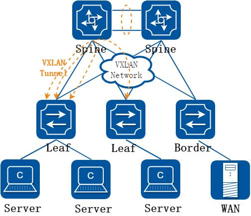

**图17-52 集中式网关示意图**

集中式网关特点：

网关部署在Spine VTEP 部署在Leaf设备之间通过EVPN 完成隧道建立和主机路由同步有1 台或多台专门接入外网的设备，我们把它叫做Border Leaf，Spine 和Border通过默认路由互通同一Leaf 下的三层流量需绕行到Spine Spine 需要保存整网的MAC 和ARP适合中小规模组网优点：

接入设备（Leaf）不需要支持大容量的ARP 表项接入设备（Leaf）不需要支持基于VXLAN 网络的三层转发表项查找功能，可以降低接入设备的成本。

缺点：

核心设备（spine）需要保留整网的ARP 表项，组网规模受限同一Leaf 下的三层流量需绕行到Spine 再转发，不是最优路径

##### 2. 集中式网关二层互访方案

VXLAN 网络中的二层报文转发，存在以下两种方式：

单播：对于VXLAN 网络中存在MAC 表的报文，可以单播转发。

BUM：非单播的报文通过头端复制表进行BUM（Broadcast, Unknown unicast, or Multicast）转发。

实现单播和BUM 都需要先由控制面建立表项，下面将详细描述。

控制面建立二层BUM 需要的表项：VXLAN 网络中，BUM 报文需要通过VXLAN 隧道的头端复制列表进行转发。通过EVPN Type 3 路由传递L2 VNI 和L2 VTEP，同时会创建头端复制列表，流程如下。

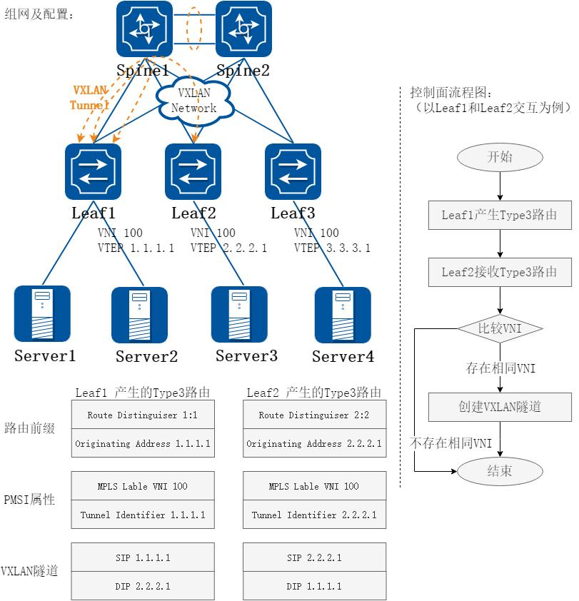

**图17-53 二层报文控制面创建隧道和头端复制表示意图**

说明：

Leaf1 产生Type 3 路由并发给远端Leaf2 收到远端VTEP 邻居Type 3 路由后，发现与本地有相同的L2 VNI，建立一条到远端的VXLAN 隧道，同时创建到远端的VXLAN 隧道头端复制列表。

Leaf1 和Leaf3 之间、Leaf2 和Leaf3 之间也重复以上过程，建立隧道和头端复制列表。

控制面建立二层单播需要的表项：单个Leaf 学习到Server 的MAC 地址后，通过EVPN将MAC 表同步至所有Leaf，以实现二层已知单播转发。同步MAC 地址依靠Type2 路由。

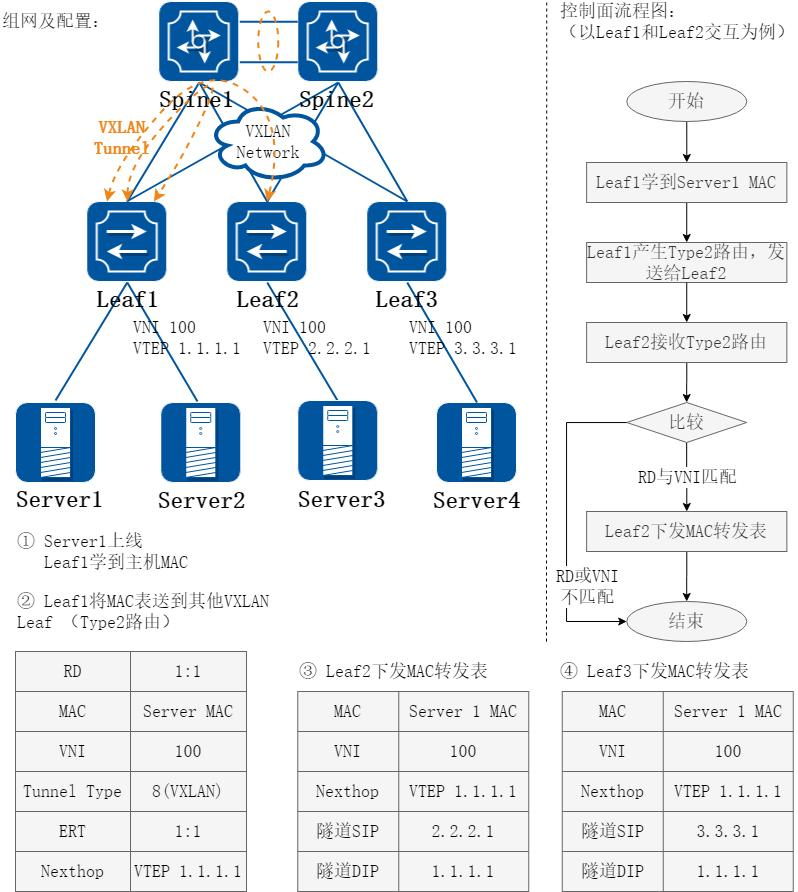

**图17-54 二层报文控制面MAC 学习示意图**

说明：

Leaf1 收集到本地主机Server1 的MAC 信息，封装一条EVPN 的Type2 路由，发送给邻居Leaf2；

Leaf2 接收到Type2 路由后，对比本地的Route-target 和EVPN 实例对应的L2 VNI，如果相同，就将收到的MAC 加到本地的MAC 转发表中。

Server1 的MAC 同样也会被Leaf3 学习。

Server2、Server3 和Server4 的MAC 地址也重复以上步骤来学习，并同步到所有Leaf。

转发面二层互访流程

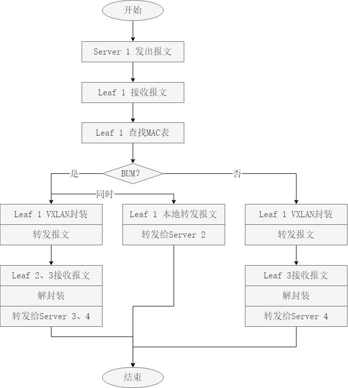

**图17-55 转发面流程图**

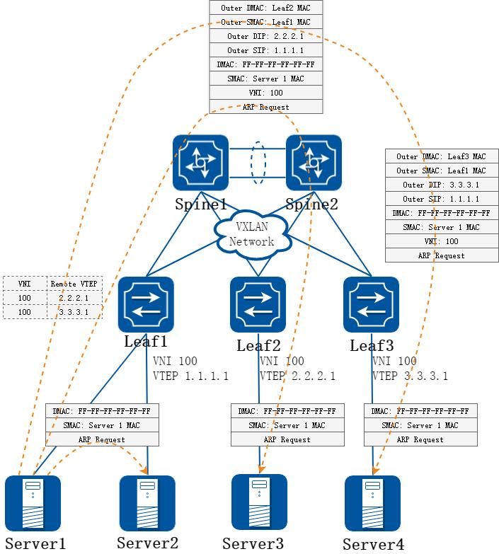

**图17-56 BUM**

BUM 说明：

Leaf1 收到来自主机Server1 的报文，根据报文中接入的端口和VLAN 信息获取对应的二层广播域，并判断报文的目的MAC 是BUM MAC。

Leaf1 上VTEP 根据对应的二层广播域获取对应VNI 的头端复制隧道列表，依据获取的隧道列表进行报文复制，并进行VXLAN 封装，并从出端口转发。

Leaf2/Leaf3 上VTEP 收到VXLAN 报文后，根据UDP 目的端口号、源/目的IP 地址、VNI判断VXLAN报文的合法有效性。依据VNI获取对应的二层广播域，然后进行VXLAN解封装，获取内层二层报文。

Leaf2/Leaf3 根据获取的内层二层报文进行转发，如果二层报文的目的mac 能够命中mac 表,则根据mac 表中查找到的端口进行报文封装和转发，否则将报文广播到Leaf 的用户侧端口。

上述组网情况下，Server1 和Server2 之间的二层报文直接转发，不需要VXLAN 封装。

注：VXLAN 侧的BUM 报文只能向用户侧广播，不能广播到VXLAN 侧，否则会导致环路。

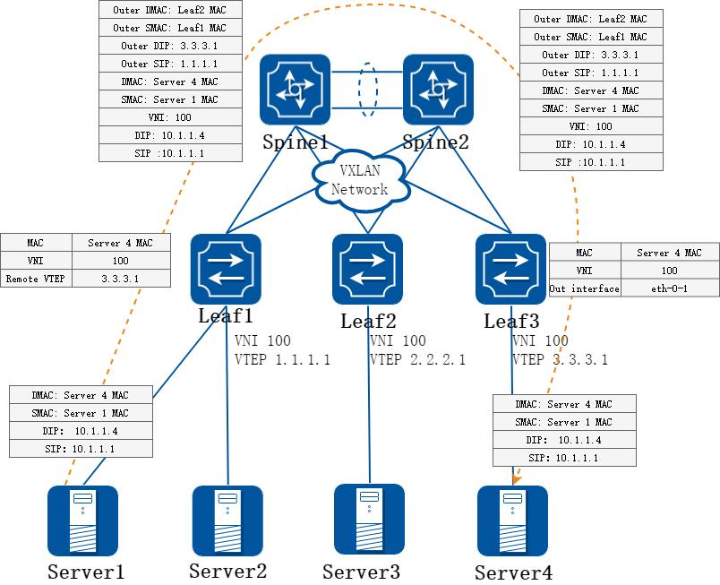

**图17-57 单播**

单播说明：

Leaf1 收到来自主机Server 的报文，根据报文中接入的端口和VLAN 信息获取对应的二层广播域，并判断报文的目的MAC 是已知单播MAC。

Leaf1 上VTEP 根据查找到的VNI 和远端VTEP 地址进行VXLAN 封装和报文转发。封装后的VXLAN 报文通过Leaf1 和Leaf3 之间的IP 网络进行转发。

Leaf3 上VTEP 收到VXLAN 报文后，根据UDP 目的端口号、源/目的IP 地址、VNI判断VXLAN 报文的合法有效性。依据VNI 获取对应的二层广播域，然后进行VXLAN解封装，获取内层二层报文。

Leaf3 根据内层二层报文的目的MAC，查MAC 表找到的出接口和封装信息，为报文添加VLAN Tag，转发给对应的终端Server 4。

##### 3. 集中式网关三层互访方案

在集中式网关环境中，三层转发查路由处理是在集中式网关节点上做的，Spine 设备需要保存全部的三层表项，包括ARP 表项和网段路由。在下面拓扑中，Spine1 和Spine2组成MLAG 以保证可靠性。

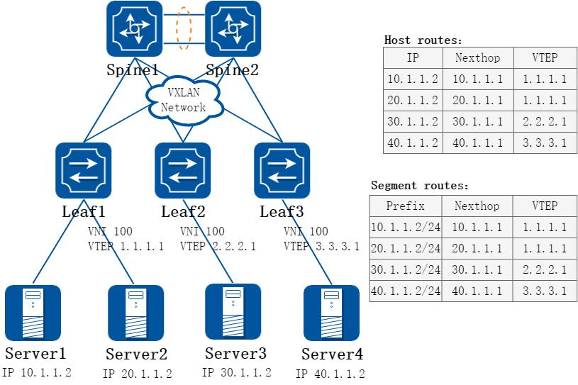

**图17-58 集中式网关三层组网**

要实现三层转发，控制面需要学习主机路由（ARP）表项和网段路由表项。学习的过程如下文描述。

控制面学习ARP 表项：

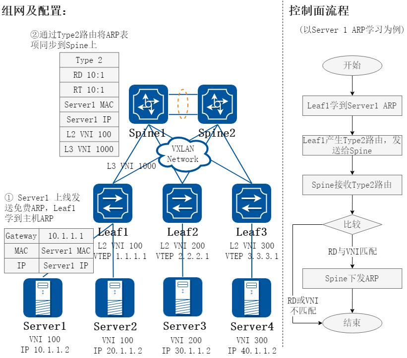

**图17-59 集中式网关ARP 学习**

控制面学习网段路由：


**图17-60 集中式网关网段路由学习**

说明：

通过Type2 路由将ARP 同步到Spine 上。

通过Type5 路由将网段路由同步到Spine 上。

在这个组网前提下，需要重复上图的步骤同步全部Server ARP 和所有Leaf 上的网段路由。

转发面三层互访流程


**图17-61 集中式网关三层报文转发组网**


**图17-62 集中式网关三层报文转发流程图**

说明：- 网关设备收到VXLAN 报文后解封装，获取内层二层报文，判断二层报文目的mac 为本机mac，进入三层转发流程。根据内层报文的目的IP 地址查路由表，进行三层转发。- 根据路由表获取下一跳IP 地址，根据IP 地址查ARP 表，如果ARP 表出接口为VXLAN 隧道，则按照ARP 表中的VXLAN 隧道封装信息进行VXLAN 封装，然后将报文发送出去。

#### 分布式网关解决方案

##### 1. 分布式网关概述


**图17-63 分布式网关示意图**

分布式网关特点：

网关部署在Leaf，所有相同VXLAN 的网关IP 和MAC 相同Leaf 和Spine 通过IP 的ECMP 互通Leaf 节点同时承担VXLAN L2/3 转发Leaf 之间通过EVPN 完成隧道建立和主机路由同步同一Leaf 下的三层流量无需绕行到Spine，所有流量的路径最优本Leaf 包含二层域所有端点的MAC 和需要互通的三层域内所有端点的ARP（包括本地和远端）

适合中大规模组网优点：

组网简单，广播域被限制在接入层以下Leaf 和Spine 之间通过运行路由协议，构建ECMP 的三层可达的IP 网络，可靠性高同一Leaf 下的三层流量无需绕行到Spine，所有流量的路径最优缺点：

对接入设备（Leaf）性能规格要求更高。

Characteristic of distributed gateway:The gateway is deployed in Leaf, and the gateway IP address and MAC address of the same VXLAN are the same Leaf and Spine communicate with each other through IP ECMP The Leaf node also supports VXLAN L2/L3 forwarding EVPN is used to establish tunnels between leafs and synchronize routes between hosts The Layer 3 traffic in the same Leaf does not need to be routed to the spine.The path of all traffic is optimal.The Leaf contains the MAC of all endpoints in the Layer 2 domain and the ARP of all endpoints in the Layer 3 domain (including local and remote endpoints) that need to communicate with each other Suitable for medium and large scale networking Advantage:The network is simple, and the broadcast domain is restricted below the access layer By running routing protocols between Leaf and spine, a layer 3 reachable IP network of ECMP is constructed and the reliability is high The Layer-3 traffic in Leaf does not need to sned to spine, and all traffic paths are optimal Shortcoming:Higher performance specifications for access devices (Leaf).

##### 2. 分布式网关二层互访方案

分布式网关下二层互访与集中式网关的处理相同。

##### 3. 分布式网关三层互访方案

分布式网关通过EVPN 在各个Leaf 之间同步三层路由信息。Spine 扮演路由反射器（RR）

的角色。要实现三层转发，各Leaf 需要学习主机路由（ARP）表项和网段路由表项。

学习的过程如下文描述。

控制面学习ARP 表项：


**图17-64 分布式网关ARP 学习**

控制面学习网段路由:


**图17-65 分布式网关网段路由学习**

控制面流程说明：

主机上线后，Leaf 学习到主机IP 路由，把该主机IP 路由通过EVPN 发送给其他邻居，需要携带对应租户的L3 VNI，下一跳修改为本地VTEP 地址；

远端Leaf 学习到主机IP 路由后，下发到对应的VPN 实例，接着根据下一跳去触发创建动态的L3 VXLAN 隧道，并把路由关联上该隧道，下发IP 路由转发表。

上述示意图中每个Server 的ARP 都需要学习，并同步到整个VXLAN 网络的每个Leaf上。


**图17-66 分布式网关三层报文转发**

转发面流程说明：

Leaf1 收到Server1 发过来的报文，检测报文的目的MAC 是网关MAC，即是自己Leaf的MAC，则要走三层查路由转发，通过报文入接口找到对应的VPN 实例。

在找到的VPN 实例中，根据报文的目的IP 查找路由表，封装VXLAN报文：带上L3 VNI、RouterMac 等，送给Leaf3。

Leaf3 上收到VXLAN 报文后，判断DMAC 是否为自己的，发现该Mac 是自己的系统Mac，所以要走三层转发，通过VNI 找到对应的VPN 实例，在该VPN 实例中查找路由表，发现该路由下一跳是网关接口，封装报文送给Server4。

#### 虚拟机迁移解决方案

虚拟机迁移，是指虚拟机从一个Leaf 节点迁移到另一个Leaf 节点下。这种情况下一般需要保持虚拟机原有的MAC 和IP 不变，因而VXLAN 网络中的MAC 和ARP、路由等表项都需要及时更新。

虚拟机迁移后，一般都会发送免费ARP 报文，依靠免费ARP 报文，可以使主机路由、ARP等信息得到刷新。

迁移过程需要依赖EVPN 控制面通告通告主机ARP，并且ARP 中需要携带迁移属性，这里通过BGP update 消息中的Mac mobility 扩展团体属性来通告。每次迁移都需要将携带的Mac mobility 的SeqNum 加1。

Mac mobility 扩展团体报文格式如下。


**图17-67 虚拟机迁移示意图**


**图17-68 Mac mobility 扩展团体属性**

说明：

虚拟机10.1.1.2 原先在Server1 位置，虚拟机的ARP、主机路由均已学到，并已同步到所有Leaf 上。

因为业务部属需要，虚拟机10.1.1.2 从Server1 位置迁移到Server4 位置。

迁移后的虚拟机开机上线，Leaf3 会收到来自虚拟机的免费ARP。

Leaf3 发现这个ARP 原来是Leaf1 发给自己的，刷新本地表项的同时，封装ARP 更新信息，发给其他邻居。

Leaf1 收到来自Leaf3 的报文，发现这个ARP 原来是自己这里的虚拟机，需要对比Mac mobility 的SeqNum。如果SeqNum 大于本地最后一次消息中的SeqNum 值，才认为这个更新是有效的，否则不处理。

当收到的SeqNum 大于之前最后一次SeqNum 值时，Leaf1 需要迅速老化之前的ARP，Leaf1 使用ARP request 报文去探测迁移前的虚拟机，一旦ARP request 超时未回，Leaf1 会发送withdraw 路由，通告之前的ARP、主机路由都作废。

Leaf2 和Leaf3 收到Leaf1 发来的撤销消息，删除旧有表项；Leaf1 和Leaf2 收到Leaf3 发来的更新消息，新增本地表项。

#### 主机双活可靠性解决方案


**图17-69 主机双活可靠性示意图**

主机接入可靠性，可以通过MLAG 接入Leaf；Leaf 上通过跨设备的LAG 与主机对接，通过配置相同的IP 作为VTEP，与其他设备建立隧道，MLAG 的设备间部署互联链路，用作故障情况下路径保护。

正常情况下，设备从某个双归接口接收到流量，本设备直接转发给其他服务器或封装隧道发给其他设备；设备接收到隧道封装的流量，剥离封装本地转发给主机；

在双归接口故障后，从主机或隧道接收的流量经过双归设备间的互联链路转发到与主机互联的另一链路。

运行BGP EVPN 后对外通告本地主机路由时，发布相同的VTEP IP、RouterMAC。
