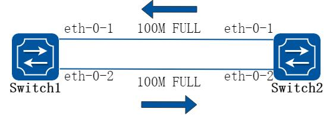
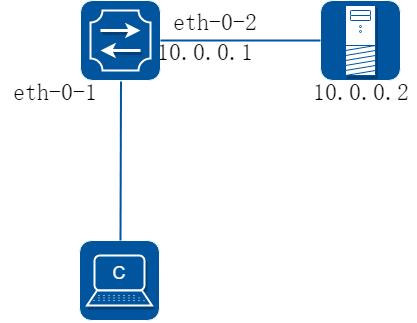
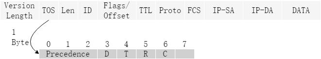
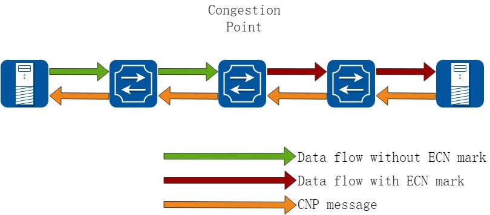

# 18 智能无损网络配置指导

## 18.1 基于优先级的流量控制配置配置

### 18.1.1 概述

#### 简介

##### 1. PFC 优先级流量控制

在复杂的网络环境中，从源到目的的路径往往会经过很多个节点。这种情况下，发送端和接收端之间没有一个很好的反馈机制，很大程度上会造成网络的不可靠。如果发送端输出的流量大于接收端的处理能力，且接收端也没有足够的缓存来存储这些流量，那么它只能默默的丢弃这些报文。如果二层网络无法处理这些丢包，只能依赖于上层协议的检测和重传机制。

但是有些上层协议也无法保证可靠性，这就需要二层网络的流量控制功能可以提供解决方案。Flow control 提供了一种接收端到发送端的反馈机制。它的第一个版本(IEEE

802.3 Ethernet)支持了IEEE 802.3x PAUSE 帧。(IEEE 802.3x PAUSE 在IEEE 802.3的Annex 31B 进行了描述)。简单来说，接收端在收到超过其处理能力的超大流量时，发送PAUSE 帧给发送端设备。发送端收到PAUSE 帧就会暂停发送流量，直到接收端恢复处理能力。

IEEE 802.3x PAUSE 帧存在一个天生的设计上的限制，就是当链路处于PAUSE 状态时，它无法发送任何报文。整条链路都被暂停了，这种一刀切的处理方式，与QoS(Quality of Service)思想背道而驰。

基于优先级的流量控制（PFC）是对flow control 机制的一种增强。PFC 允许在一条以太网链路上创建8 个虚拟通道，并为每条虚拟通道指定一个IEEE 802.1P 优先等级，允许单独暂停和重启其中任意一条虚拟通道，同时允许其它虚拟通道的流量无中断通过。

这一方法使网络能够为单个虚拟链路创建无丢包类别的服务，使其能够与同一接口上的其它流量类型共存。

##### 2. PFC 死锁检测

PFC 死锁（PFC DeadLock），是指当多个交换机之间因为环路等原因同时出现拥塞，各自端口缓存消耗超过阈值，而又相互等待对方释放资源，从而导致所有交换机上的数据流都永久阻塞的一种网络状态。

死锁检测功能通过对死锁状态的监控，当设备在死锁状态下收到PAUSE 帧，不进行处理。

以一段时间的丢包来换取网络恢复正常。

如果系统反复出现死锁，说明网络确实存在问题，系统支持自动关闭PFC 功能，等待管理员介入处理。

### 18.1.2 配置举例

#### PFC 优先级流量控制配置

##### 1. 组网拓扑



**图18-1 Priority-based Flow Control**

##### 2. 配置步骤

在下面的配置举例中，Switch1 和switch2 的端口1 和端口2 分别直连，都启用PFC，在priority 2 3 4 上使能。

以下配置在Switch1 和Switch2 相同。

##### 步骤1 进入配置模式

```
Switch# configure terminal
```

##### 步骤2 全局使能lldp

```
Switch(config)# lldp enable
```

##### 步骤3 进入接口配置模式，配置接口属性

```
Switch(config)# interface eth-0-1
Switch(config-if)# priority-flow-control mode
on
Switch(config-if)# priority-flow-control enable priority 2 3 4
Switch(config-if)# exit
Switch(config)# interface eth-0-2
Switch(config-if)# priority-flow-control mode auto
Switch(config-if)# priority-flow-control enable priority 2 3 4
Switch (config-if)# exit
```

##### 步骤4 退出配置模式

```
Switch(config)# end
```

##### 步骤5 检查配置

Switch1 显示结果：

```
switch1# show priority-flow-control
Port
PFC-enable
PFC-enable on priority
admin
oper
admin
oper
---------------------------------------------------------------
eth-0-1
on
on
234
234
eth-0-2
auto
off
234
off
eth-0-3
off
off
off
off
eth-0-4
off
off
off
off
eth-0-5
off
off
off
off
eth-0-6
off
off
off
off
eth-0-7
off
off
off
off
eth-0-8
off
off
off
off
eth-0-9
off
off
off
off
eth-0-10
off
off
off
off
eth-0-11
off
off
off
off
eth-0-12
off
off
off
off
eth-0-13
off
off
off
off
eth-0-14
off
off
off
off
eth-0-15
off
off
off
off
eth-0-16
off
off
off
off
eth-0-17
off
off
off
off
eth-0-18
off
off
off
off
eth-0-19
off
off
off
off
eth-0-20
off
off
off
off
eth-0-21
off
off
off
off
eth-0-22
off
off
off
off
eth-0-23
off
off
off
off
eth-0-24
off
off
off
off
```

Switch2 显示结果：

```
switch2# show priority-flow-control
Port
PFC-enable
PFC-enable on priority
admin
oper
admin
oper
---------------------------------------------------------------
eth-0-1
on
on
234
234
eth-0-2
auto
on
234
off
eth-0-3
off
off
off
off
eth-0-4
off
off
off
off
eth-0-5
off
off
off
off
eth-0-6
off
off
off
off
eth-0-7
off
off
off
off
eth-0-8
off
off
off
off
eth-0-9
off
off
off
off
eth-0-10
off
off
off
off
eth-0-11
off
off
off
off
eth-0-12
off
off
off
off
eth-0-13
off
off
off
off
eth-0-14
off
off
off
off
eth-0-15
off
off
off
off
eth-0-16
off
off
off
off
eth-0-17
off
off
off
off
eth-0-18
off
off
off
off
eth-0-19
off
off
off
off
```

```
eth-0-20
off
off
off
off
eth-0-21
off
off
off
off
eth-0-22
off
off
off
off
eth-0-23
off
off
off
off
eth-0-24
off
off
off
off
```

#### PFC 死锁检测配置

##### 步骤1 进入配置模式

```
Switch# configure terminal
```

##### 步骤2 配置PFC 死锁的时间精度(可选)

如果不进行配置，则使用默认的精度，10 毫秒。

```
Switch(config)# priority-flow-control deadlock precision 20
```

##### 步骤3 使能PFC 死锁检测

在端口上使能PFC 死锁检测，可以针对1-2 个优先级来使能。

可以在使能的同时，指定检测的时间片个数，范围为1-30，该时间片个数乘以上面的时间精度，得到一个时长，将这个时长作为用来判定死锁的条件：在此时长内，如果端口上这个优先级持续收到PAUSE OFF 帧，则认为这个端口的这个优先级发生了PFC 死锁。

时间片个数默认为15。

支持配置死锁自动恢复的时间，范围为0-3000 毫秒。系统会在这个时间段之后，认为这个端口的这个优先级已经解除了死锁，重新开始新一轮的检测。如果不指定，默认为

150 毫秒。

下面的例子中，在eth-0-1 的优先级5 和6 上使能死锁检测，检测时间片为20 个，结合之前配置的精度20 毫秒，就是说eth-0-1 的优先级5 或者6 队列上，连续400 毫秒内一直收到PAUSE OFF 帧，则认为发生死锁。死锁之后300 毫秒自动解除。(假设解除之后的400 毫秒还是连续收到PAUSE OFF，则会再次死锁。)死锁状态下，系统不响应PAUSE OFF 信号。

```
Switch(config)# interface eth-0-1
Switch(config)# priority-flow-control mode on
Switch(config)# priority-flow-control enable priority 5 6
Switch(config-if)# priority-flow-control deadlock priority 5 6 detect 20 recover 300
Switch(config-if)# exit
```

##### 步骤4 使能PFC 死锁检测的抑制功能(可选)

在端口上使能抑制死锁检测，可以针对1-2 个优先级来使能。

通过设置指定时间段内发生死锁的次数，超过这个次数时，关闭PFC 功能，需要等待管理员来处理网络异常。

默认的死锁次数为10 次，时长为1 分钟。

下面的例子中，针对eth-0-1 的优先级5 和6，如果5 分钟内死锁了100 次，则自动关闭PFC 功能。

```
Switch(config)# interface eth-0-1
Switch(config-if)# priority-flow-control deadlock limit priority 5 6 frequency 100 period 5
Switch(config-if)# exit
```

## 18.2 EFD配置

### 18.2.1 概述

#### 简介

EFD 是一个用来检测大象流的机制。

在网络中，大象流通常是指一个总字节数非常大的连续TCP 流。与之相对的流叫老鼠流。

根据学术机构对网络实际业务的研究发现，在网络中80%以上的带宽是被大象流占掉的，这些流占用的带宽和传输缓存较大，但是对时延不敏感，这对时延敏感的流量造成较大的冲击。

EFD 功能识别出大象流，并对之施加一些转发策略(比如适当降低大象流的转发优先级，让老鼠流优先转发)，可以很好的提高网络的传输效率。EFD 机制也可以用作检查网络中的一些异常流量(比如带宽较大的流)，检测到了以后可以将这类流量的特征字段封装在协议报文中，送到指定服务器进行进一步的分析。

#### 原理描述

以下是EFD 的术语和概念的简要描述：

EFD：Elephant Flow Detect, 大象流检查

### 18.2.2 配置举例

##### 1. 组网拓扑



**图18-2 EFD**

##### 2. 配置步骤

在下面的配置举例中，首先配置用于识别流量的报文特征字段，然后配置流量的阈值，根据流量特征识当指定特征的流量大于配置的流量阈值时，流的特征字段封装到自定义的UDP 报文中发送给指定的服务器。

##### 步骤1 进入配置模式

```
Switch# configure terminal
```

##### 步骤2 设置EFD 参数

设置IPDA 为报文的特征字段，相同IPDA 的流认为是相同的流。

```
Switch(config)# hash-value global
Switch(config-hash-value-global)# efd select ipda
```

配置EFD 识别流的速率阈值，这里配置为1000Mbps，标识速率超过1000Mbps 的流会被识别为Elephant Flow。默认为50Mbps

```
Switch(config)# efd detect speed 1000
```

使能EFD 通知机制，并配置通知报文的目的IP 地址10.0.0.2 和目的UDP 端口。

```
Switch(config)# efd notify enable 10.0.0.2 20007
```

##### 步骤3 进入接口配置模式，配置接口属性

```
Switch(config)# interface eth-0-1
Switch(config-if)# efd enable
Switch(config-if)# exit
Switch(config)# int eth-0-2
Switch(config-if)# no switchport
Switch(config-if)# ip address 10.0.0.1/24
Switch(config-if)# exit
```

##### 步骤4 配置静态ARP (可选)

```
Switch(config)# arp 10.0.0.2 0.1.2
```

##### 步骤5 退出配置模式

```
Switch(config)# end
```

##### 步骤6 检查配置

```
Switch# show efd configuration
Elephant flow detection configuration information:
--------------------------------------------------
Detect rate
: 1000 Mbps
Detect granularity
: 16B
Detect time interval
: 1000 ms
EFD aging time
: 120 ms ~ 150 ms
EFD detect packet type : All IP packets
EFD IPG
: disable
```

```
EFD redirect interface : N/A
EFD flow hash fields
: destination-ip
EFD enabled interface :
------------------------- -------------------------
eth-0-1
```

在当eth-0-1 口上收到有流的超过1G 后，可以通过下面的命令看到这条流已经被学为EFD 流:

```
Switch# show efd flow information decap
EFD flow issued at:07:29:40 UTC Mon Aug 01 2016
From:eth-0-1, FlowId: 1701
--------------------------------------------------------
MACDA:0000.00aa.bbbb, MACSA:0000.00bb.bbbb
IPv4 Packet, IP Protocol is TCP(6)
IPDA:22.22.22.101, IPSA: 11.11.11.11
L4SourcePort:43690, L4DestinationPort:43741
--------------------------------------------------------
00 00 00 aa bb bb 00 00 00 bb bb bb 08 00 45 00
00 32 00 00 40 00 c8 06 70 35 0b 0b 0b 0b 16 16
16 65 aa aa aa dd aa aa aa dd aa aa aa dd aa aa
aa dd aa aa aa dd aa aa aa dd aa aa aa dd aa aa
```

Server 10.0.0.2 显示报文：

```
12:41:28.286993 92:fd:58:d7:8f:00 > 00:00:00:01:00:02, ethertype IPv4 (0x0800), length 60: IP (tos 0x0,
ttl
64, id 0, offset 0, flags [DF], proto 17, length: 44) 10.0.0.1.49071 > 10.0.0.2.20007: [udp sum ok]
UDP, length 16
0x0000:
0000 0001 0002 92fd 58d7 8f00 0800 4500
........X.....E.
0x0010:
002c 0000 4000 4011 26bf 0a00 0001 0a00
.,..@.@.&.......
0x0020:
0002 bfaf 4e27 0018 b05b 0000 0101 0000
....N'...[......
0x0030:
0008 0001 0004 1616 1665 0000
.........e..
```

EFD 报文头部说明。上面红色部分为EFD 报文信息部分，具体为解析如下:0000: 预留字段，暂时没具体含义。该字段属于EFD 报头字段之一。

01: EFD 报文版本号, 目前都是0x01。该字段属于EFD 报头字段之一。

01: EFD 流操作码，0x01 标识这是一条新识别出来的Elephant Flow; 0x02 标识被老化的流, 也就是之前被识别为elephant flow, 现在流量降低后变成了mice flow 或者流已经停掉了; 该字段属于EFD 报头字段之一。

0000 0008 , EFD 报文数据部分长度, 这里表示后续数据总共长度为8 字节。该字段属于EFD 报头字段之一。

0001，EFD 数据类型字段，0x0001 表示该数据字段为IPDA, 目前版本尚未定义其它类型，后续版本可以定义IPSA, IPDA+IPSA 等其它字段;0004, EFD 数据字段的长度，0x0004 表示数据部分有4 字节

1616 1665，数据内容，表示IPDA 是22.22.22.101

## 18.3 ECN配置

### 18.3.1 概述

#### 简介

##### 1. ECN 拥塞控制

当在网络中出现转发设备的下游链路带宽不足以承载上游链路的流量时，就会出现拥塞。

随着拥塞的持续，转发设备的队列缓存将会被逐渐压缩直至耗尽，此时就会出现丢包的现象。为了解决这个问题，RFC3168 定义了ECN（Explicit Congestion Notification），来通知流量发送端，使其降低发送速度，在拥塞丢包发生前将问题控制住。



**图18-3 ToS 字段**

在IP 报文头ToS（Type of Service）字段中分配了8 个bit.第0-2bit 代表了IP 报文的8 个优先级（从高到低为7-0）），优先级7 和6 一般用于承载协议报文，用户级应用使用第5-0 优先级。

第0-5bit 为IP 报文的DSCP（Differentiate Services Code Point），定义了更多的服务类型。

第6-7bit 为ECN 字段。ECN 的取值与含义如下：

ECN 字段为00（非ECT），代表该报文不支持ECN。

ECN 字段为01 或10（ECT），代表该报文支持ECN。

ECN 字段为11（CE），代表路径上发生了拥塞。

因此，ECN 的机制为：当中间交换机发生了拥塞，就将ECN 标记置为11，并随着报文继续向下游传递。当报文到达接收端时，接收端发现ECN 字段为11，认为路径中出现了拥塞，就会向发送端发送CNP(Congestion Notification Packet)报文，请求发送端降低发送速率，避免网络中拥塞的加剧。



**图18-4 ECN 机制**

### 18.3.2 配置举例

#### 优先级队列ECN 配置

##### 1. 配置步骤

在下面的配置举例中，在Switch1 上的1、4、6 优先级队列上配置ECN，其中队列4 的ECN 上下门限分别为2100 和5000，其余队列门限以默认值配置。

##### 步骤1 进入配置模式

```
Switch# configure terminal
```

##### 步骤2 配置优先级映射

```
Switch(config)# class-map type qos pri-4
Switch(config-cmap-qos)# match dscp ef
Switch(config-cmap-qos)# exit
Switch(config)# class-map type qos pri-6
Switch(config-cmap-qos)# match dscp cs6
Switch(config-cmap-qos)# exit
Switch(config)# class-map type qos pri-1
Switch(config-cmap-qos)# match dscp cs1
Switch(config-cmap-qos)# exit
Switch(config)# policy-map type qos pri-pmap
Switch(config-pmap-qos)# class type qos pri-4
Switch(config-pmap-qos-c)# set traffic-class 4
Switch(config-pmap-qos-c)# exit
Switch(config-pmap-qos)# class type qos pri-6
Switch(config-pmap-qos-c)# set traffic-class 6
Switch(config-pmap-qos-c)# exit
Switch(config-pmap-qos)# class type qos pri-1
Switch(config-pmap-qos-c)# set traffic-class 1
Switch(config-pmap-qos-c)# interface eth-0-1
Switch(config-if)# service-policy type qos input pri-pmap
Switch(config-if)# end
```

##### 步骤3 对各优先级配置队列调度和ECN 门限

```
Switch# configure terminal
Switch(config)# class-map type traffic-class traffic-pri-4
Switch(config-cmap-tc)# match traffic-class 4
Switch(config-cmap-tc)# class-map type traffic-class traffic-pri-6
Switch(config-cmap-tc)# match traffic-class 6
Switch(config-cmap-tc)# class-map type traffic-class traffic-pri-1
Switch(config-cmap-tc)# match traffic-class 1
Switch(config-cmap-tc)# exit
Switch(config)# policy-map type traffic-class traffic-pmap
Switch(config-pmap-tc)# class type traffic-class traffic-pri-4
Switch(config-pmap-tc-c)# random-detect maximum-threshold 5000 minimum-threshold 2100
Switch(config-pmap-tc-c)# class type traffic-class traffic-pri-6
Switch(config-pmap-tc-c)# random-detect maximum-threshold 8192 minimum-threshold 64
Switch(config-pmap-tc-c)# class type traffic-class traffic-pri-1
```

```
Switch(config-pmap-tc-c)# random-detect maximum-threshold 8192 minimum-threshold 64
Switch(config-pmap-tc)# class type traffic-class class-default
Switch(config-pmap-tc-c)# queue-limit dynamic 5
Switch(config-pmap-tc-c)# exit
Switch(config-pmap-tc)# exit
```

##### 步骤4 在接口上应用该ECN 策略

```
Switch(config)# interface eth-0-1
Switch(config-if)# service-policy type traffic-class traffic-pmap
Switch(config-if)# exit
```

##### 步骤5 退出配置模式

```
Switch(config)# end
```
