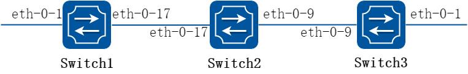
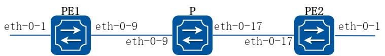
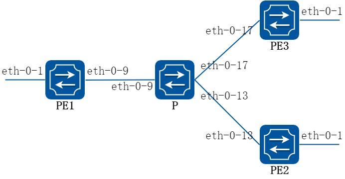
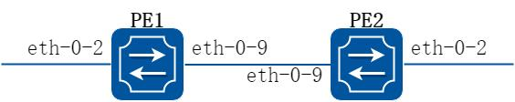
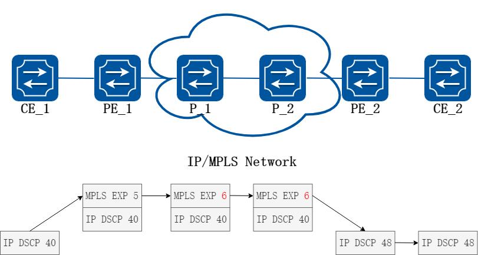
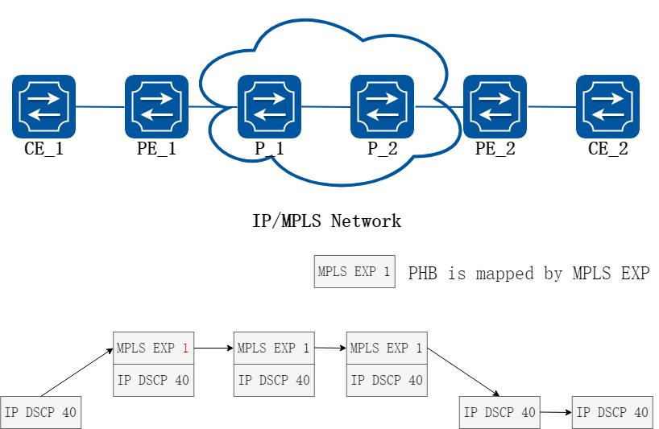
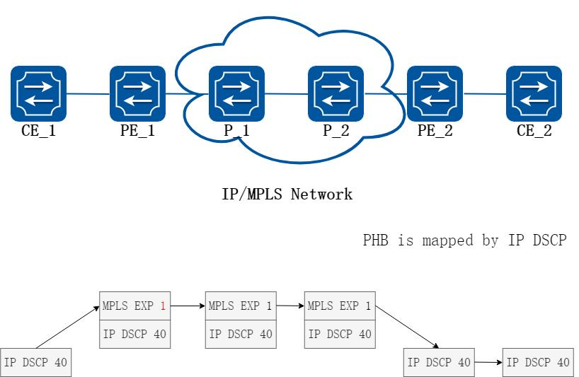
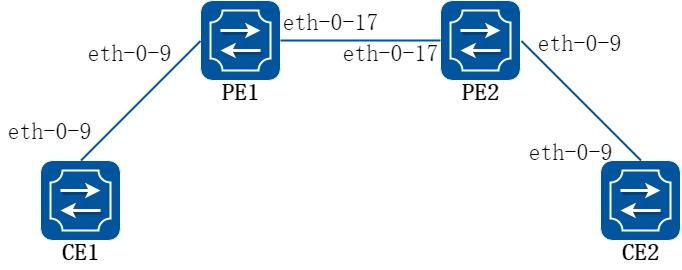
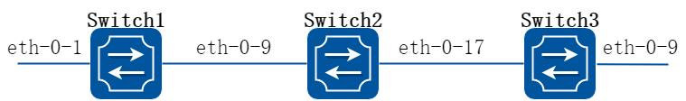

# 19 MPLS配置指导

## 19.1 LDP配置

### 19.1.1 概述

#### 简介

本章节介绍如何配置LDP。

LDP 的功能是为两个支持标签交换的路由器分发标签，目前软件系统支持的特性如下：

支持下游主动分发方式和自由保留模式。

支持配置标签控制方式。

支持lsr-id 和传输地址的配置。

支持Target LDP。

支持分发标签过滤。

支持PHP 模式和非PHP 模式。

本篇手册将描述最基本的LDP 配置，如果想更加深入的了解技术细节，建议阅读RFC3031，RFC3036。

### 19.1.2 配置举例

#### 配置LDP

##### 1. 组网拓扑



**图19-1 LSP map**

##### 2. 配置步骤

下面的例子描述了如何使用LDP 在Switch1 到Switch3 之间建立起一条LSP。

以下配置如未说明在哪个Switch 配置，则表示所有Switch 配置相同：

##### 步骤1 进入配置模式

```
Switch# configure terminal
```

##### 步骤2 进入接口配置模式，配置接口属性

Switch1 的接口配置，接口需要使能ldp 并且开启标签交换功能：

```
Switch1(config)# interface eth-0-17
Switch1(config-if)# no switchport
Switch1(config-if)# ip address 11.11.17.1/24
Switch1(config-if)# enable-ldp
Switch1(config-if)# label-switching
Switch1(config-if)# exit
Switch1(config)# interface loopback0
Switch1(config-if)# ip address 1.1.1.1/32
Switch1(config-if)# exit
```

Switch2 的接口配置，接口需要使能ldp 并且开启标签交换功能：

```
Switch2(config)# interface eth-0-17
Switch2(config-if)# no switchport
Switch2(config-if)# ip address 11.11.17.2/24
Switch2(config-if)# enable-ldp
Switch2(config-if)# label-switching
Switch2(config-if)# exit
Switch2(config)# interface eth-0-9
Switch2(config-if)# no switchport
Switch2(config-if)# ip address 11.11.9.1/24
Switch2(config-if)# enable-ldp
Switch2(config-if)# label-switching
Switch2(config-if)# exit
Switch2(config)# interface loopback0
Switch2(config-if)# ip address 2.2.2.2/32
Switch2(config-if)# exit
```

Switch3 的接口配置，接口需要使能ldp 并且开启标签交换功能：

```
Switch3(config)# interface eth-0-9
Switch3(config-if)# no switchport
Switch3(config-if)# ip address 11.11.9.2/24
Switch3(config-if)# enable-ldp
Switch3(config-if)# label-switching
Switch3(config-if)# exit
Switch3(config)# interface loopback0
Switch3(config-if)# ip address 3.3.3.3/32
Switch3(config-if)# exit
```

##### 步骤3 使能ldp 路由

Switch1 的配置：

```
Switch1(config)# router ldp
Switch1(config-router)# router-id 1.1.1.1
Switch1(config-router)# exit
```

Switch2 的配置：

```
Switch2(config)# router ldp
Switch2(config-router)# router-id 2.2.2.2
Switch2(config-router)# exit
```

Switch3 的配置：

```
Switch3(config)# router ldp
Switch3(config-router)# router-id 3.3.3.3
Switch3(config-router)# exit
```

##### 步骤4 使能rip 路由

```
Switch(config)# router rip
Switch(config-router)# network 0.0.0.0/0
Switch(config-router)# exit
```

##### 步骤5 退出配置模式

```
Switch(config)# end
```

##### 步骤6 命令验证

查看Switch1 中ldp session 建立的状态：

```
Switch1# show ldp session
Peer IP Address
IF Name
My Role
State
KeepAlive
2.2.2.2
eth-0-17
Passive
OPERATIONAL
30
```

查看Switch2 中ldp session 建立的状态：

```
Switch2# show ldp session
Peer IP Address
IF Name
My Role
State
KeepAlive
3.3.3.3
eth-0-9
Active
OPERATIONAL
30
1.1.1.1
eth-0-17
Active
OPERATIONAL
30
```

查看Switch3 中ldp session 建立的状态：

```
Switch3# show ldp session
Peer IP Address
IF Name
My Role
State
KeepAlive
2.2.2.2
eth-0-9
Passive
OPERATIONAL
30
```

## 19.2 MPLS配置

### 19.2.1 概述

#### 简介

MPLS 即多协议标签交换，能够适用于任何网络层，但在这篇文档里，我们只关注MPLS在IP 网络中的应用。

在通常的IP 网络中，报文头部中包含了很多信息来决定如何选择下一跳，如何选择分为如下两个步骤：首先将条目分成不同的转发等价类，接着将指定的转发等价类映射到某条下一跳上。该过程是不可逆的，对于选定了下一跳的报文，我们不关心他为何被映射到这条转发等价类中。在某个特定的节点，所有同一转发等价类的报文都将通过同一条路径进行转发（如果存在ECMP 的情况，他们会从该组路径中选择一条进行转发）。根据最长匹配的原则，路由器可能会将两个不同的报文映射到同一条转发等价类中。在一个报文遍历整个网络时，每一跳都会重新解析报文，并将报文映射到一个指定的转发等价类中。

在MPLS 网络中，只需要进行一次报文到转发等价类的映射，因为当报文进入网络后，对于指定的FEC 会映射到一个标签上，报文会携带该标签转发到下一跳，在接下来的转发过程中，就不需要重新解析报文头部来报文映射到转发等价类中，只需使用标签作为索引进行查找转发，使用新的标签替换旧的标签，将报文继续进行转发。

在下面的例子中可以发现，一旦报文指定了转发等价类，接下来的转发都是依靠标签的了。

### 19.2.2 配置举例

#### 配置MPLS LSP

##### 1. 组网拓扑



**图19-2 MPLS LSP 模型**

##### 2. 配置步骤

下面的例子描述了如何配置MPLS LSP。

以下配置如未说明在哪个Switch 配置，则表示所有Switch 配置相同：

##### 步骤1 进入配置模式

```
Switch# configure terminal
```

##### 步骤2 进入接口配置模式，配置接口属性

PE1 的接口配置，接口需要开启标签交换功能：

```
PE1(config)# interface eth-0-9
PE1(config-if)# no switchport
PE1(config-if)# ip address 11.11.9.1/24
PE1(config-if)# label-switching
PE1(config-if)# exit
PE1(config)# interface eth-0-1
PE1(config-if)# no switchport
PE1(config-if)# ip address 10.10.10.1/24
PE1(config-if)# label-switching
PE1(config-if)# exit
```

P 的接口配置，接口需要开启标签交换功能：

```
P(config)# interface eth-0-9
P(config-if)# no switchport
P(config-if)# ip address 11.11.9.2/24
P(config-if)# label-switching
P(config-if)# exit
P(config)# interface eth-0-17
P(config-if)# no switchport
P(config-if)# ip address 11.11.17.2/24
P(config-if)# label-switching
P(config-if)# exit
```

PE2 的接口配置，接口需要开启标签交换功能：

```
PE2(config)# interface eth-0-17
PE2(config-if)# no switchport
PE2(config-if)# ip address 11.11.17.3/24
PE2(config-if)# label-switching
PE2(config-if)# exit
PE2(config)# interface eth-0-1
PE2(config-if)# no switchport
PE2(config-if)# ip address 20.20.20.1/24
PE2(config-if)# label-switching
PE2(config-if)# exit
```

##### 步骤3 配置静态ftn/ilm

PE1 的静态ftn:

```
PE1(config)# mpls ftn-entry 172.22.4.1/24 100 11.11.9.2
```

P 的静态ilm:

```
P(config)# mpls ilm-entry swap 100 11.11.17.3 200
```

PE2 的静态ilm:

```
PE2(config)# mpls ilm-entry php 200 20.20.20.2
```

##### 步骤4 退出配置模式

```
Switch(config)# end
```

##### 步骤5 命令验证

显示PE1 上的ftn 表项：

```
PE1# show mpls ftn-database
Codes: > - selected FTN, p - stale FTN, B - BGP FTN, K - CLI FTN,
L - LDP FTN, R - RSVP-TE FTN, S - SNMP FTN, I - IGP-Shortcut,
U - unknown FTN
Code
FEC
Out-Label
Nexthop
Out-Intf
K>
172.22.4.0/24
100
11.11.9.2
eth-0-9
```

显示P 上的ilm 表项：

```
P# show mpls ilm-database
Codes: > - selected ILM, p - stale ILM, B - BGP ILM, K - CLI ILM,
L - LDP ILM, R - RSVP-TE ILM, S - SNMP ILM, I - IGP-Shortcut,
U - unknown ILM
Code
FEC
I/O Label
Nexthop
Out-Intf
K>
0.0.0.0/0
100/200
11.11.17.3
eth-0-17
```

显示PE2 上的ilm 表项：

```
PE2# show mpls ilm-database
Codes: > - selected ILM, p - stale ILM, B - BGP ILM, K - CLI ILM,
L - LDP ILM, R - RSVP-TE ILM, S - SNMP ILM, I - IGP-Shortcut,
U - unknown ILM
Code
FEC
I/O Label
Nexthop
Out-Intf
K>
0.0.0.0/0
200/3
20.20.20.2
eth-0-1
```

## 19.3 VPLS配置

### 19.3.1 概述

#### 简介

本章节描述了如何配置VPLS。虚拟专用局域网（VPLS），其核心思想是利用信令协议在VPLS 实例中的PE（运营商边缘路由器）节点之间建立及维护PW（伪线），将二层协议帧封装后在PW 上传输、交换，使广域范围内多个局域网在数据链路层面被整合为一张网络，向用户提供虚拟的以太网服务。

### 19.3.2 配置举例



**图19-3 VPLS 模型**

#### 使用LDP 配置VPLS

下面的例子描述了如何使用LDP 配置VPLS。

以下配置如未说明在哪个Switch 配置，则表示所有Switch 配置相同：

##### 步骤1 进入配置模式

```
Switch# configure terminal
```

##### 步骤2 进入接口配置模式，配置接口属性

PE1 的接口配置，eth-0-9 需要使能ldp 并且开启标签交换功能：

```
PE1(config)# interface eth-0-9
PE1(config-if)# no switchport
PE1(config-if)# ip address 11.11.9.1/24
PE1(config-if)# enable-ldp
PE1(config-if)# label-switching
PE1(config-if)# exit
PE1(config)# interface loopback 0
PE1(config-if)# ip address 11.11.1.1/32
PE1(config-if)# exit
```

PE2 的接口配置，eth-0-13 需要使能ldp 并且开启标签交换功能：

```
PE2(config)# interface eth-0-13
PE2(config-if)# no switchport
PE2(config-if)# ip address 11.11.13.4/24
PE2(config-if)# enable-ldp
PE2(config-if)# label-switching
PE2(config-if)# exit
PE2(config)# interface loopback 0
PE2(config-if)# ip address 11.11.4.4/32
PE2(config-if)# exit
```

PE3 的接口配置，eth-0-17 需要使能ldp 并且开启标签交换功能：

```
PE3(config)# interface eth-0-17
PE3(config-if)# no switchport
PE3(config-if)# ip address 11.11.17.3/24
PE3(config-if)# enable-ldp
PE3(config-if)# label-switching
PE3(config-if)# exit
PE3(config)# interface loopback 0
PE3(config-if)# ip address 11.11.3.3/32
PE3(config-if)# exit
```

P 的接口配置，接口需要使能ldp 并且开启标签交换功能：

```
P(config)# interface eth-0-9
P(config-if)# no switchport
P(config-if)# ip address 11.11.9.2/24
P(config-if)# enable-ldp
P(config-if)# label-switching
P(config-if)# exit
```

```
P(config)# interface eth-0-13
P(config-if)# no switchport
P(config-if)# ip address 11.11.13.2/24
P(config-if)# enable-ldp
P(config-if)# label-switching
P(config-if)# exit
P(config)# interface eth-0-17
P(config-if)# no switchport
P(config-if)# ip address 11.11.17.2/24
P(config-if)# enable-ldp
P(config-if)# label-switching
P(config-if)# exit
P(config)# interface loopback 0
P(config-if)# ip address 11.11.2.2/32
P(config-if)# exit
```

##### 步骤3 使能ldp 路由

PE1 的LDP 配置:

```
PE1(config)# router ldp
PE1(config-router)# router-id 11.11.1.1
PE1(config-router)# targeted-peer 11.11.3.3
PE1(config-router)# targeted-peer 11.11.4.4
PE1(config-router)# transport-address 11.11.1.1
PE1(config-router)# exit
```

PE2 的LDP 配置:

```
PE2(config)# router ldp
PE2(config-router)# router-id 11.11.4.4
PE2(config-router)# transport-address 11.11.4.4
PE2(config-router)# targeted-peer 11.11.1.1
PE2(config-router)# targeted-peer 11.11.3.3
PE2(config-router)# exit
```

PE3 的LDP 配置:

```
PE3(config)# router ldp
PE3(config-router)# router-id 11.11.3.3
PE3(config-router)# transport-address 11.11.3.3
PE3(config-router)# targeted-peer 11.11.1.1
PE3(config-router)# targeted-peer 11.11.4.4
PE3(config-router)# exit
```

P 的LDP 配置:

```
P(config)# router ldp
P(config-router)# router-id 11.11.2.2
P(config-router)# exit
```

##### 步骤4 使能rip 路由

```
Switch(config)# router rip
Switch(config-router)# network 11.11.1.1/16
Switch(config-router)# exit
```

##### 步骤5 配置mpls vpls 实例

PE1, PE2, PE3 均配置PW 侧为raw 模式，并指定vpls peer。

PE1 的VPLS 实例配置:

```
PE1(config)# mpls vpls v1 100
PE1(config-vpls)# vpls-peer 11.11.3.3 raw
PE1(config-vpls)# vpls-peer 11.11.4.4 raw
PE1(config-vpls)# exit
```

PE2 的VPLS 实例配置:

```
PE2(config)# mpls vpls v4 100
PE2(config-vpls)# vpls-peer 11.11.1.1 raw
PE2(config-vpls)# vpls-peer 11.11.3.3 raw
PE2(config-vpls)# exit
```

PE3 的VPLS 实例配置:

```
PE3(config)# mpls vpls v3 100
PE3(config-vpls)# vpls-peer 11.11.1.1 raw
PE3(config-vpls)# vpls-peer 11.11.4.4 raw
PE3(config-vpls)# exit
```

##### 步骤6 在端口上绑定mpls vpls 实例

PE1, PE2, PE3 的AC 侧均配置为VLAN 接入。

PE1 的接口配置：

```
PE1(config)# interface eth-0-1
PE1(config-if)# switchport mode trunk
PE1(config-if)# mpls-vpls v1 vlan 2
PE1(config-if)# exit
```

PE2 的接口配置：

```
PE2(config)# interface eth-0-1
PE2(config-if)# switchport mode trunk
PE2(config-if)# mpls-vpls v4 vlan 2
PE2(config-if)# exit
```

PE3 的接口配置：

```
PE3(config)# interface eth-0-1
PE3(config-if)# switchport mode trunk
PE3(config-if)# mpls-vpls v3 vlan 2
PE3(config-if)# exit
```

##### 步骤7 退出配置模式

```
Switch(config)# end
```

##### 步骤8 命令验证

使用show ldp session 和show mpls vpls mesh 命令来查看VPLS 的完整信息。show ldp session 可以得到当前LDP session 运行的状态，show mpls vpls mesh 可以看到vpls peer 的状态以及vpls 所使用的内层label，pw 的模式。

PE1 显示结果：

```
PE1# show ldp session
Peer IP Address
IF Name
My Role
State
KeepAlive
11.11.3.3
eth-0-9
Passive
OPERATIONAL
30
11.11.4.4
eth-0-9
Passive
OPERATIONAL
30
11.11.2.2
eth-0-9
Passive
OPERATIONAL
30
PE1# show mpls vpls mesh
VPLS-ID
Peer Addr/name
In-Label
Out-Intf
Out-Label
Type
St
100
11.11.3.3/-
32768
eth-0-9
32768
RAW
Up
100
11.11.4.4/-
32773
eth-0-9
32768
RAW
Up
```

PE2 显示结果：

```
PE2# show ldp session
Peer IP Address
IF Name
My Role
State
KeepAlive
11.11.1.1
eth-0-13
Active
OPERATIONAL
30
11.11.3.3
eth-0-13
Active
OPERATIONAL
30
11.11.2.2
eth-0-13
Passive
OPERATIONAL
30
PE2# show mpls vpls mesh
VPLS-ID
Peer Addr/name
In-Label
Out-Intf
Out-Label
Type
St
100
11.11.1.1/-
32768
eth-0-13
32773
RAW
Up
100
11.11.3.3/-
32769
eth-0-13
32770
RAW
Up
```

PE3 显示结果：

```
PE3# show ldp session
Peer IP Address
IF Name
My Role
State
KeepAlive
11.11.1.1
eth-0-17
Active
OPERATIONAL
30
11.11.4.4
eth-0-17
Passive
OPERATIONAL
30
11.11.2.2
eth-0-17
Passive
OPERATIONAL
30
PE3# show mpls vpls mesh
VPLS-ID
Peer Addr/name
In-Label
Out-Intf
Out-Label
Type
St
100
11.11.1.1/-
32768
eth-0-17
32768
RAW
Up
100
11.11.4.4/-
32770
eth-0-17
32769
RAW
Up
```

P 显示结果：

```
P# show ldp session
Peer IP Address
IF Name
My Role
State
KeepAlive
11.11.1.1
eth-0-9
Active
OPERATIONAL
30
11.11.3.3
eth-0-17
Active
OPERATIONAL
30
11.11.4.4
eth-0-13
Active
OPERATIONAL
30
```

#### 配置静态VPLS

下面的例子描述了如何配置静态VPLS。

以下配置如未说明在哪个Switch 配置，则表示所有Switch 配置相同：

##### 步骤1 进入配置模式

```
Switch# configure terminal
```

##### 步骤2 进入接口配置模式，配置接口属性

PE1 的接口配置，eth-0-9 需要开启标签交换功能：

```
PE1(config)# interface eth-0-9
PE1(config-if)# no switchport
```

```
PE1(config-if)# ip address 11.11.9.1/24
PE1(config-if)# label-switching
PE1(config-if)# exit
```

PE2 的接口配置，eth-0-13 需要开启标签交换功能：

```
PE2(config)# interface eth-0-13
PE2(config-if)# no switchport
PE2(config-if)# ip address 11.11.13.1/24
PE2(config-if)# label-switching
PE2(config-if)# exit
```

PE3 的接口配置，eth-0-17 需要开启标签交换功能：

```
PE3(config)# interface eth-0-17
PE3(config-if)# no switchport
PE3(config-if)# ip address 11.11.17.1/24
PE3(config-if)# label-switching
PE3(config-if)# exit
```

P 的接口配置，eth-0-9, eth-0-13 和eth-0-17 均需要开启标签交换功能：

```
P(config)# interface eth-0-9
P(config-if)# no switchport
P(config-if)# ip address 11.11.9.2/24
P(config-if)# label-switching
P(config-if)# exit
P(config)# interface eth-0-17
P(config-if)# no switchport
P(config-if)# ip address 11.11.17.2/24
P(config-if)# label-switching
P(config-if)# exit
P(config)# interface eth-0-13
P(config-if)# no switchport
P(config-if)# ip address 11.11.13.2/24
P(config-if)# label-switching
P(config-if)# exit
```

##### 步骤3 配置ftn 条目

PE1 的接口配置：

```
PE1(config)# mpls ftn-entry 11.11.17.1/24 97 11.11.9.2
PE1(config)# mpls ftn-entry 11.11.13.1/24 93 11.11.9.2
```

PE2 的接口配置：

```
PE2(config)# mpls ftn-entry
11.11.9.1/32 44 11.11.13.2
```

PE3 的接口配置：

```
PE3(config)#mpls ftn-entry 11.11.9.1/32 33 11.11.17.2
```

##### 步骤4 配置mpls vpls 实例

PE1, PE2, PE3 均配置PW 侧为raw 模式，并指定vpls peer。

PE1 的VPLS 实例配置:

```
PE1(config)# mpls vpls vpls1 1
PE1(config-vpls)# vpls-peer 11.11.17.1 raw manual
PE1(config-vpls)# vpls-peer 11.11.13.1 raw manual
```

PE2 的VPLS 实例配置:

```
PE2(config)# mpls vpls vpls1 1
PE2(config-vpls)# vpls-peer 11.11.9.1 raw manual
```

PE3 的VPLS 实例配置:

```
PE3(config)# mpls vpls vpls1 1
PE3(config-vpls)# vpls-peer 11.11.9.1 raw manual
```

##### 步骤5 在端口上绑定mpls vpls 实例

PE1, PE2, PE3 的AC 侧均配置为VLAN 接入。

PE1 的接口配置：

```
PE1(config)# interface eth-0-1
PE1(config-if)# switchport mode trunk
PE1(config-if)# mpls-vpls vpls1 vlan 100
PE1(config-if)# exit
```

PE2 的接口配置：

```
PE2(config)# interface eth-0-1
PE2(config-if)# switchport mode trunk
PE2(config-if)# mpls-vpls vpls1 vlan 100
PE2(config-if)# exit
```

PE3 的接口配置：

```
PE3(config)#interface eth-0-1
PE3(config-if)# switchport mode trunk
PE3(config-if)# mpls-vpls vpls1 vlan 100
PE3(config-if)# exit
```

##### 步骤6 配置VPLS FIB

PE1 的VPLS FIB:

```
PE1(config)# vpls-fib-add vpls1 peer 11.11.17.1 103 31
PE1(config)# vpls-fib-add vpls1 peer 11.11.13.1 102 201
```

PE2 的VPLS FIB:

```
PE2(config)# vpls-fib-add vpls1 peer 11.11.9.1 201 102
```

PE3 的VPLS FIB:

```
PE3(config)# vpls-fib-add vpls1 peer 11.11.9.1 31 103
```

##### 步骤7 配置静态ilm

P 的静态ilm:

```
P(config)# mpls ilm-entry php 97 11.11.17.1
P(config)# mpls ilm-entry php 93 11.11.13.1
P(config)# mpls ilm-entry php 33 11.11.9.1
P(config)# mpls ilm-entry php 44 11.11.9.1
```

##### 步骤8 退出配置模式

```
Switch(config)# end
```

##### 步骤9 命令验证

使用show mpls vpls mesh 可以看到vpls peer 的状态以及vpls 所使用的内层label，pw 的模式。

PE1 显示结果：

```
PE1# show mpls vpls mesh
VPLS-ID
Peer Addr/name
In-Label
Out-Intf
Out-Label
Type
St
1
11.11.13.1/-
102
eth-0-9
201
RAW
Up
1
11.11.17.1/-
103
eth-0-9
31
RAW
Up
```

PE2 显示结果：

```
PE2# show mpls vpls mesh
VPLS-ID
Peer Addr/name
In-Label
Out-Intf
Out-Label
Type
St
1
11.11.9.1/-
201
eth-0-13
102
RAW
Up
```

PE3 显示结果：

```
PE3# show mpls vpls mesh
VPLS-ID
Peer Addr/name
In-Label
Out-Intf
Out-Label
Type
St
1
11.11.9.1/-
31
eth-0-17
103
RAW
Up
```

P 显示结果：

```
P# show mpls ilm-database
Codes: > - selected ILM, p - stale ILM, B - BGP ILM, K - CLI ILM,
L - LDP ILM, R - RSVP-TE ILM, S - SNMP ILM, I - IGP-Shortcut,
U - unknown ILM
Code
FEC
I/O Label
Nexthop
Out-Intf
K>
0.0.0.0/0
33/3
11.11.9.1
eth-0-9
K>
0.0.0.0/0
44/3
11.11.9.1
eth-0-9
K>
0.0.0.0/0
93/3
11.11.13.1
eth-0-13
K>
0.0.0.0/0
97/3
11.11.17.1
eth-0-17
```

#### 使用VPLS 透传二层协议报文

通过网络服务提供商连接的处于不同地域的用户，本地和远端之间需要运行STP 等二层协议，就需要网络服务提供商能够透传STP 等二层协议。如下例子展示了如何使用VPLS来透传二层报文，以下配置基于VPLS 模型拓扑图。

以下配置如未说明在哪个Switch 配置，则表示所有Switch 配置相同：

##### 步骤1 进入配置模式

```
Switch# configure terminal
```

##### 步骤2 全局使能L2 protocol

```
Switch(config)# l2protocol enable
```

##### 步骤3 进入接口配置模式，配置接口属性

PE1 的接口配置，eth-0-9 需要使能ldp 并且开启标签交换功能：

```
PE1(config)# interface eth-0-9
PE1(config-if)# no switchport
PE1(config-if)# ip address 11.11.9.1/24
PE1(config-if)# enable-ldp
PE1(config-if)# label-switching
PE1(config-if)# exit
PE1(config)# interface loopback 0
PE1(config-if)# ip address 11.11.1.1/32
PE1(config-if)# exit
```

PE2 的接口配置，eth-0-13 需要使能ldp 并且开启标签交换功能：

```
PE2(config)# interface eth-0-13
PE2(config-if)# no switchport
PE2(config-if)# ip add 11.11.13.4/24
PE2(config-if)# enable-ldp
PE2(config-if)# label-switching
PE2(config-if)# exit
PE2(config)# interface loopback 0
PE2(config-if)# ip address 11.11.4.4/32
PE2(config-if)# exit
```

PE3 的接口配置，eth-0-17 需要使能ldp 并且开启标签交换功能：

```
PE3(config)# interface eth-0-17
PE3(config-if)# no switchport
PE3(config-if)# ip address 11.11.17.3/24
PE3(config-if)# enable-ldp
PE3(config-if)# label-switching
PE3(config-if)# exit
PE3(config)# interface loopback 0
PE3(config-if)# ip address 11.11.3.3/32
PE3(config-if)# exit
```

P 的接口配置，接口需要使能ldp 并且开启标签交换功能：

```
P(config)# interface eth-0-9
P(config-if)# no switchport
P(config-if)# ip address 11.11.9.2/24
P(config-if)# enable-ldp
P(config-if)# label-switching
P(config-if)# exit
P(config)# interface eth-0-13
P(config-if)# no switchport
P(config-if)# ip address 11.11.13.2/24
P(config-if)# enable-ldp
P(config-if)# label-switching
P(config-if)# exit
P(config)# interface eth-0-17
P(config-if)# no switchport
P(config-if)# ip address 11.11.17.2/24
P(config-if)# enable-ldp
P(config-if)# label-switching
P(config-if)# exit
P(config)# interface loopback 0
P(config-if)# ip address 11.11.2.2/32
P(config-if)# exit
```

##### 步骤4 使能ldp 路由

PE1 的LDP 配置：

```
PE1(config)# router ldp
PE1(config-router)# router-id 11.11.1.1
PE1(config-router)# targeted-peer 11.11.3.3
PE1(config-router)# targeted-peer 11.11.4.4
PE1(config-router)# transport-address 11.11.1.1
PE1(config-router)# exit
```

PE2 的LDP 配置：

```
PE2(config)# router ldp
PE2(config-router)# router-id 11.11.4.4
PE2(config-router)# transport-address 11.11.4.4
PE2(config-router)# targeted-peer 11.11.1.1
PE2(config-router)# targeted-peer 11.11.3.3
PE2(config-router)# exit
```

PE3 的LDP 配置：

```
PE3(config)# router ldp
PE3(config-router)# router-id 11.11.3.3
PE3(config-router)# transport-address 11.11.3.3
PE3(config-router)# targeted-peer 11.11.1.1
PE3(config-router)# targeted-peer 11.11.4.4
PE3(config-router)# exit
```

P 的LDP 配置:

```
P(config)# router ldp
P(config-router)# router-id 11.11.2.2
P(config-router)# exit
```

##### 步骤5 使能rip 路由

PE1、PE2、PE3 的RIP 配置：

```
Switch(config)# router rip
Switch(config-router)# network 11.11.1.1/16
Switch(config-router)# exit
```

##### 步骤6 配置mpls vpls 实例

PE1, PE2, PE3 均配置PW 侧为raw 模式，并指定vpls peer。

PE1 的VPLS 实例配置:

```
PE1(config)# mpls vpls v1 100
PE1(config-vpls)# vpls-peer 11.11.3.3 raw
PE1(config-vpls)# vpls-peer 11.11.4.4 raw
PE1(config-vpls)# exit
```

PE2 的VPLS 实例配置:

```
PE2(config)# mpls vpls v4 100
PE2(config-vpls)# vpls-peer 11.11.1.1 raw
PE2(config-vpls)# vpls-peer 11.11.3.3 raw
PE2(config-vpls)# exit
```

PE3 的VPLS 实例配置:

```
PE3(config)# mpls vpls v3 100
PE3(config-vpls)# vpls-peer 11.11.1.1 raw
PE3(config-vpls)# vpls-peer 11.11.4.4 raw
PE3(config-vpls)# exit
```

##### 步骤7 在端口上绑定mpls vpls 实例

PE1, PE2, PE3 的AC 侧均配置为ethernet 接入。

PE1 的接口配置：

```
PE1(config)# interface eth-0-1
PE1(config-if)# mpls-vpls v1 ethernet
PE1(config-if)# l2protocol stp tunnel
PE1(config-if)# exit
```

PE2 的接口配置：

```
PE2(config)# interface eth-0-1
PE2(config-if)# mpls-vpls v4 ethernet
PE2(config-if)# l2protocol stp tunnel
PE2(config-if)# exit
```

PE3 的接口配置：

```
PE3(config)# interface eth-0-1
PE3(config-if)# mpls-vpls v3 ethernet
PE3(config-if)# l2protocol stp tunnel
PE3(config-if)# exit
```

##### 步骤8 退出配置模式

```
Switch(config)# end
```

#### 配置VPLS 静态MAC 地址

在一个VSI 内，如果PE 节点收到了一个未知目的MAC 的报文，则PE 将会flood 该报文。

用户可以配置静态MAC 表项来将带有指定目的MAC 的报文发往指定的目的端口，指定PW或者丢弃。以下举例了如何配置静态MAC，配置拓扑配置基于VPLS 模型拓扑。

以下配置如未说明在哪个Switch 配置，则表示所有Switch 配置相同：

##### 步骤1 进入配置模式

```
Switch# configure terminal
```

##### 步骤2 进入接口配置模式，配置接口属性

PE1 的接口配置，eth-0-9 需要使能ldp 并且开启标签交换功能：

```
PE1(config)# interface eth-0-9
PE1(config-if)# no switchport
PE1(config-if)# ip address 11.11.9.1/24
PE1(config-if)# enable-ldp
PE1(config-if)# label-switching
PE1(config-if)# exit
PE1(config)# interface loopback 0
```

```
PE1(config-if)# ip address 11.11.1.1/32
PE1(config-if)# exit
```

PE2 的接口配置，eth-0-13 需要使能ldp 并且开启标签交换功能：

```
PE2(config)# interface eth-0-13
PE2(config-if)# no switchport
PE2(config-if)# ip add 11.11.13.4/24
PE2(config-if)# enable-ldp
PE2(config-if)# label-switching
PE2(config-if)# exit
PE2(config)# interface loopback 0
PE2(config-if)# ip address 11.11.4.4/32
PE2(config-if)# exit
```

PE3 的接口配置，eth-0-17 需要使能ldp 并且开启标签交换功能：

```
PE3(config)# interface eth-0-17
PE3(config-if)# no switchport
PE3(config-if)# ip address 11.11.17.3/24
PE3(config-if)# enable-ldp
PE3(config-if)# label-switching
PE3(config-if)# exit
PE3(config)# interface loopback 0
PE3(config-if)# ip address 11.11.3.3/32
PE3(config-if)# exit
```

P 的接口配置，接口需要使能ldp 并且开启标签交换功能：

```
P(config)# interface eth-0-9
P(config-if)# no switchport
P(config-if)# ip address 11.11.9.2/24
P(config-if)# enable-ldp
P(config-if)# label-switching
P(config-if)# exit
P(config)# interface eth-0-13
P(config-if)# no switchport
P(config-if)# ip address 11.11.13.2/24
P(config-if)# enable-ldp
P(config-if)# label-switching
P(config-if)# exit
P(config)# interface eth-0-17
P(config-if)# no switchport
P(config-if)# ip address 11.11.17.2/24
P(config-if)# enable-ldp
P(config-if)# label-switching
P(config-if)# exit
P(config)# interface loopback 0
P(config-if)# ip address 11.11.2.2/32
P(config-if)# exit
```

##### 步骤3 使能ldp 路由

PE1 的LDP 配置:

```
PE1(config)# router ldp
PE1(config-router)# router-id 11.11.1.1
PE1(config-router)# targeted-peer 11.11.3.3
```

```
PE1(config-router)# targeted-peer 11.11.4.4
PE1(config-router)# transport-address 11.11.1.1
PE1(config-router)# exit
```

PE2 的LDP 配置:

```
PE2(config)# router ldp
PE2(config-router)# router-id 11.11.4.4
PE2(config-router)# transport-address 11.11.4.4
PE2(config-router)# targeted-peer 11.11.1.1
PE2(config-router)# targeted-peer 11.11.3.3
PE2(config-router)# exit
```

PE3 的LDP 配置:

```
PE3(config)# router ldp
PE3(config-router)# router-id 11.11.3.3
PE3(config-router)# transport-address 11.11.3.3
PE3(config-router)# targeted-peer 11.11.1.1
PE3(config-router)# targeted-peer 11.11.4.4
PE3(config-router)# exit
```

P 的LDP 配置:

```
P(config)# router ldp
P(config-router)# router-id 11.11.2.2
P(config-router)# exit
```

##### 步骤4 使能rip 路由

```
Switch(config)# router rip
Switch(config-router)# network 11.11.1.1/16
Switch(config-router)# exit
```

##### 步骤5 配置mpls vpls 实例

PE1, PE2, PE3 均配置PW 侧为raw 模式，并指定vpls peer。

PE1 的VPLS 实例配置:

```
PE1(config)# mpls vpls v1 100
PE1(config-vpls)# vpls-peer 11.11.3.3 raw
PE1(config-vpls)# vpls-peer 11.11.4.4 raw
PE1(config-vpls)# mac-address-table 0000.0000.0001 forward eth-0-1
PE1(config-vpls)# mac-address-table 0000.0000.0003 forward peer 11.11.3.3
PE1(config-vpls)# mac-address-table 0000.0000.0004 forward peer 11.11.4.4
PE1(config-vpls)# exit
```

PE2 的VPLS 实例配置:

```
PE2(config)# mpls vpls v4 100
PE2(config-vpls)# vpls-peer 11.11.1.1 raw
PE2(config-vpls)# vpls-peer 11.11.3.3 raw
PE2(config-vpls)# mac-address-table 0000.0000.0004 forward eth-0-1
PE2(config-vpls)# mac-address-table 0000.0000.0001 forward peer 11.11.1.1
PE2(config-vpls)# mac-address-table 0000.0000.0003 forward peer 11.11.3.3
PE2(config-vpls)# exit
```

PE3 的VPLS 实例配置:

```
PE3(config)# mpls vpls v3 100
PE3(config-vpls)# vpls-peer 11.11.1.1 raw
PE3(config-vpls)# vpls-peer 11.11.4.4 raw
PE3(config-vpls)# mac-address-table 0000.0000.0003 forward eth-0-1
PE3(config-vpls)# mac-address-table 0000.0000.0001 forward peer 11.11.1.1
PE3(config-vpls)# mac-address-table 0000.0000.0004 forward peer 11.11.4.4
PE3(config-vpls)# exit
```

##### 步骤6 在端口上绑定mpls vpls 实例

PE1, PE2, PE3 的AC 侧均配置为ethernet 接入。

PE1 的接口配置：

```
PE1(config)# interface eth-0-1
PE1(config-if)# mpls-vpls v1 ethernet
PE1(config-if)# exit
```

PE2 的接口配置：

```
PE2(config)# interface eth-0-1
PE2(config-if)# mpls-vpls v4 ethernet
PE2(config-if)# exit
```

PE3 的接口配置：

```
PE3(config)# interface eth-0-1
PE3(config-if)# mpls-vpls v3 ethernet
PE3(config-if)# exit
```

##### 步骤7 退出配置模式

```
Switch(config)# end
```

##### 步骤8 命令验证

使用命令show mac address-table vpls 来显示VPLS 静态MAC 的相关信息。

PE1 显示结果：

```
PE1# show mac address-table vpls
vpls
peer
mac
static
v1
eth-0-1
0000.0000.0001 1
v1
11.11.3.3
0000.0000.0003 1
v1
11.11.4.4
0000.0000.0004 1
```

PE2 显示结果：

```
PE2# show mac address-table vpls
vpls
peer
mac
static
v1
eth-0-1
0000.0000.0004 1
v1
11.11.1.1
0000.0000.0001 1
v1
11.11.3.3
0000.0000.0003 1
```

PE3 显示结果：

```
PE3# show mac address-table vpls
vpls
peer
mac
static
v1
eth-0-1
0000.0000.0003 1
```

```
v1
11.11.1.1
0000.0000.0001 1
v1
11.11.4.4
0000.0000.0004 1
```

## 19.4 VPWS配置

### 19.4.1 概述

#### 简介

VPWS 是一种通过MPLS 封装的点对点的服务模型，二层报文将通过LSP 在两个PE 之间透传。

### 19.4.2 配置举例



**图19-4 配置VPWS 拓扑**

#### 使用LDP 配置VPWS

本章VPWS 基于LDP，标准为IETF 的[L2TRANS]。

以下配置如未说明在哪个Switch 配置，则表示所有Switch 配置相同：

##### 步骤1 进入配置模式

```
Switch# configure terminal
```

##### 步骤2 进入接口配置模式，配置接口属性

PE1 的接口配置：

```
PE1(config)# interface eth-0-2
PE1(config-if)# mpls-l2-circuit t1 ethernet
PE1(config-if)# exit
PE1(config)# interface loopback 0
PE1(config-if)# ip address 192.168.10.10/32
PE1(config-if)# exit
PE1(config)# interface eth-0-9
PE1(config-if)# no switchport
PE1(config-if)# ip address 8.8.8.1/24
PE1(config-if)# enable-ldp
PE1(config-if)# label-switching
PE1(config-if)# exit
```

PE2 的接口配置：

```
PE2(config)# interface eth-0-2
PE2(config-if)# mpls-l2-circuit t1 ethernet
PE2(config-if)# exit
```

```
PE2(config)# interface loopback 0
PE2(config-if)# ip address 192.168.11.10/32
PE2(config-if)# exit
PE2(config)# interface eth-0-9
PE2(config-if)# no switchport
PE2(config-if)# ip address 8.8.8.2/24
PE2(config-if)# enable-ldp
PE2(config-if)# label-switching
PE2(config-if)# exit
```

##### 步骤3 使能ldp 路由

PE1 的LDP 配置:

```
PE1(config)# router ldp
PE1(config-router)# router-id 192.168.10.10
PE1(config-router)# targeted-peer 192.168.11.10
PE1(config-router)# exit
```

PE2 的LDP 配置:

```
PE2(config)# router ldp
PE2(config-router)# router-id 192.168.11.10
PE2(config-router)# targeted-peer 192.168.10.10
PE2(config-router)# exit
```

##### 步骤4 配置VPWS VC ID

PE1 的VC ID 配置:

```
PE1(config)# mpls l2-circuit t1 200 192.168.11.10 raw
```

PE2 的VC ID 配置:

```
PE2(config)# mpls l2-circuit t1 200 192.168.10.10 raw
```

##### 步骤5 使能rip 路由

```
Switch(config)# router rip
Switch(config-router)# network 0.0.0.0/0
Switch(config-router)# exit
```

##### 步骤6 退出配置模式

```
Switch(config)# end
```

##### 步骤7 命令验证

使用show mpls l2-circuit 和show mpls vc-table 来显示VPWS 的相关信息。

PE1 显示结果：

```
PE1# show mpls l2-circuit
VC-Name
VC-ID
Interface
AC-type
VLAN
PW-mode
Manual
t1
200
eth-0-2
Ethernet N/A
Raw
No
PE1# show mpls vc-table
VC-ID
PW Intf
AC Intf
L/R Label
EndPoint
Status
Manual
200
eth-0-9
eth-0-2
32768/32768
192.168.11.10
Active
No
```

PE2 显示结果：

```
PE2# show mpls l2-circuit
VC-Name
VC-ID
Interface
AC-type
VLAN
PW-mode
Manual
t1
200
eth-0-2
Ethernet N/A
Raw
No
PE2# show mpls vc-table
VC-ID
PW Intf
AC Intf
L/R Label
EndPoint
Status
Manual
200
eth-0-9
eth-0-2
32768/32768
192.168.10.10
Active
No
```

#### 配置静态VPWS

下面的例子描述了如何配置静态VPWS。

以下配置如未说明在哪个Switch 配置，则表示所有Switch 配置相同：

##### 步骤1 进入配置模式

```
Switch# configure terminal
```

##### 步骤2 进入接口配置模式，配置接口属性

PE1 的接口配置：

```
PE1(config)# interface eth-0-2
PE1(config-if)# mpls-l2-circuit t2 ethernet
PE1(config-if)# exit
PE1(config)# interface loopback 0
PE1(config-if)# ip address 192.168.10.10/32
PE1(config-if)# exit
PE1(config)# interface eth-0-9
PE1(config-if)# no switchport
PE1(config-if)# ip address 8.8.8.1/24
PE1(config-if)# label-switching
PE1(config-if)# exit
```

PE2 的接口配置：

```
PE2(config)# interface eth-0-2
PE2(config-if)# mpls-l2-circuit t2 ethernet
PE2(config-if)# exit
PE2(config)# interface loopback 0
PE2(config-if)# ip address 192.168.11.10/32
PE2(config-if)# exit
PE2(config)# interface eth-0-9
PE2(config-if)# no switchport
PE2(config-if)# ip address 8.8.8.2/24
PE2(config-if)# label-switching
PE2(config-if)# exit
```

##### 步骤3 配置ftn 条目

PE1 的FTN 条目：

```
PE1(config)# mpls ftn-entry 192.168.11.1/24 111 8.8.8.2
```

PE2 的FTN 条目：

```
PE2(config)# mpls ftn-entry 192.168.10.1/24 222 8.8.8.1
```

##### 步骤4 配置静态ilm

PE1 的静态ilm:

```
PE1(config)# mpls ilm-entry pop 212
```

PE2 的静态ilm:

```
PE2(config)# mpls ilm-entry pop 111
```

##### 步骤5 配置VPWS VC ID

PE1 的VC ID 配置:

```
PE1(config)# mpls l2-circuit t2 201 192.168.11.10 raw manual
PE1(config)# mpls l2-circuit-fib-entry t2 44 33
```

PE2 的VC ID 配置:

```
PE2(config)# mpls l2-circuit t2 201 192.168.10.10 raw manual
PE2(config)# mpls l2-circuit-fib-entry t2 33 44
```

##### 步骤6 退出配置模式

```
Switch(config)# end
```

##### 步骤7 命令验证

使用show mpls l2-circuit 和show mpls vc-table 来显示VPWS 的相关信息。

PE1 显示结果：

```
PE1# show mpls l2-circuit
VC-Name
VC-ID
Interface
AC-type
VLAN
PW-mode
Manual
t2
201
eth-0-2
Ethernet
N/A
Raw
Yes
PE1# show mpls vc-table
VC-ID
PW Intf
AC Intf
L/R Label
EndPoint
Status
Manual
201
eth-0-9
eth-0-2
44/33
192.168.11.10
Active
Yes
```

PE2 显示结果：

```
PE2# show mpls l2-circuit
VC-Name
VC-ID
Interface
AC-type
VLAN
PW-mode
Manual
t2
201
eth-0-2
Ethernet
N/A
Raw
Yes
PE2# show mpls vc-table
VC-ID
PW Intf
AC Intf
L/R Label
EndPoint
Status
Manual
201
eth-0-9
eth-0-2
33/44
192.168.10.10
Active
Yes
```

#### 配置VPWS 透传二层协议报文

下面的例子描述了如何配置VPWS 透传二层协议报文。

以下配置如未说明在哪个Switch 配置，则表示所有Switch 配置相同：

##### 步骤1 进入配置模式

```
Switch# configure terminal
```

##### 步骤2 全局使能L2 protocol

```
Switch(config)# l2protocol enable
```

##### 步骤3 进入接口配置模式，配置接口属性

PE1 的接口配置：

```
PE1(config)# interface eth-0-2
PE1(config-if)# mpls-l2-circuit t1 ethernet
PE1(config-if)# l2protocol stp tunnel
PE1(config-if)# exit
PE1(config)# interface loopback 0
PE1(config-if)# ip address 192.168.10.10/32
PE1(config-if)# exit
PE1(config)# interface eth-0-9
PE1(config-if)# no switchport
PE1(config-if)# ip address 8.8.8.1/24
PE1(config-if)# enable-ldp
PE1(config-if)# label-switching
PE1(config-if)# exit
```

PE2 的接口配置：

```
PE2(config)# l2protocol enable
PE2(config)# interface eth-0-2
PE2(config-if)# mpls-l2-circuit t1 ethernet
PE2(config-if)# l2protocol stp tunnel
PE2(config-if)# exit
PE2(config)# interface loopback 0
PE2(config-if)# ip address 192.168.11.10/32
PE2(config-if)# exit
PE2(config)# interface eth-0-9
PE2(config-if)# no switchport
PE2(config-if)# ip address 8.8.8.2/24
PE2(config-if)# enable-ldp
PE2(config-if)# label-switching
PE2(config-if)# exit
```

##### 步骤4 使能ldp 路由

PE1 的LDP 配置:

```
PE1(config)# router ldp
PE1(config-router)# router-id 192.168.10.10
PE1(config-router)# targeted-peer 192.168.11.10
PE1(config-router)# exit
```

PE2 的LDP 配置:

```
PE2(config)# router ldp
PE2(config-router)# router-id 192.168.11.10
PE2(config-router)# targeted-peer 192.168.10.10
PE2(config-router)# exit
```

##### 步骤5 配置VPWS VC ID

PE1 的VC ID 配置:

```
PE1(config)# mpls l2-circuit t1 200 192.168.11.10 raw
```

PE2 的VC ID 配置:

```
PE2(config)# mpls l2-circuit t1 200 192.168.10.10 raw
```

##### 步骤6 使能rip 路由

```
switch(config)# router rip
switch(config-router)# network 0.0.0.0/0
switch(config-router)# exit
```

##### 步骤7 退出配置模式

```
Switch(config)# end
```

## 19.5 MPLS QoS配置

### 19.5.1 概述

#### 简介

MPLS QoS 是部署QoS（Quality of Service）业务的重要组成部分，在实际的MPLS 组网方案中往往通过差分服务（DiffServ）模型来实施QoS。它可以为每个通过MPLS 网络的业务提供指定的服务，并提供差异化的服务类型来满足各种需求。

MPLS 使用标签转发替代了传统的路由转发，功能强大、灵活，可以满足各种新应用对网络的要求，而且MPLS 支持多种网络协议（如IPv4、IPv6 等）。目前MPLS 被广泛地应用于大规模网络的组建，而在MPLS 网络中，无法通过IP QoS 来实现服务质量（QoS），所以在MPLS 网络中实现服务质量也就应运而生，即MPLS QoS。

与传统IP QoS 根据IP 报文的优先级来区分业务的服务等级类似，MPLS QoS 根据报文的EXP 来区分不同的数据流，实现差分服务，保证语音、视频数据流的低延时、低丢包率，保证网络的高利用率。

#### 原理描述

MPLS 隧道模式包含三种模式：Uniform、Pipe、Short Pipe。

Uniform 模式：报文在IP 网和MPLS 网中的优先级标识是统一定义的，即两种网络对报文的优先级标识都是全局有效的。在Ingress 上，报文被加上标签，DSCP 映射到EXP。

如果报文在MPLS 网络中改变了EXP 字段的值，会影响报文离开MPLS 网络后采用的PHB(Per-Hop Behavior)。即在出节点会将EXP 映射到DSCP。



**图19-5 Uniform 模式**

Pipe 模式：在Ingress 上报文压入MPLS 标签的EXP 值可以由用户指定。如果报文在MPLS网络中改变了EXP 字段的值，只在MPLS 网络中有效。在Egress 上，报文会根据EXP 字段的值选择PHB。当报文离开MPLS 网络后，报文之前携带的DSCP 继续有效。



**图19-6 Pipe 模式**

Short pipe 模式：在Ingress 上报文压入MPLS 标签的EXP 值可以由用户指定。如果报文在MPLS 网络中改变了EXP 字段的值，只在MPLS 网络中有效。在Egress 上，报文会根据DSCP 选择PHB。当报文离开MPLS 网络后，报文之前携带的DSCP 继续有效。



**图19-7 Short pipe 模式**

### 19.5.2 配置举例


**图19-8 MPLS QoS LSP 模型**

#### 配置MPLS QoS Uniform

下面的例子描述了如何配置MPLS QoS Uniform 模式。

以下配置如未说明在哪个Switch 配置，则表示所有Switch 配置相同：

##### 步骤1 进入配置模式

```
Switch# configure terminal
```

##### 步骤2 配置全局MPLS 隧道模式

```
Switch(config)# mpls lsp-model uniform
```

##### 步骤3 进入接口配置模式，配置接口属性

PE1 的接口配置：

```
PE1(config)# interface eth-0-9
PE1(config-if)# no switchport
PE1(config-if)# ip address 10.0.9.1/24
PE1(config-if)# label-switching
PE1(config-if)# exit
PE1(config)# interface eth-0-1
PE1(config-if)# no switchport
PE1(config-if)# qos domain type dscp 1
PE1(config-if)# trust dscp
PE1(config-if)# replace dscp
PE1(config-if)# ip address 1.1.1.1/24
PE1(config-if)# label-switching
PE1(config-if)# exit
```

P 的接口配置：

```
P(config)# interface eth-0-9
P(config-if)# no switchport
P(config-if)# ip address 10.0.9.2/24
P(config-if)# label-switching
P(config-if)# exit
P(config)# interface eth-0-17
P(config-if)# no switchport
P(config-if)# ip address 10.0.17.2/24
P(config-if)# label-switching
P(config-if)# exit
```

PE2 的接口配置：

```
PE2(config)# interface eth-0-17
PE2(config-if)# no switchport
PE2(config-if)# ip address 10.0.17.1/24
PE2(config-if)# label-switching
PE2(config-if)# exit
PE2(config)# interface eth-0-1
PE2(config-if)# no switchport
PE2(config-if)# qos domain type dscp 1
PE2(config-if)# trust dscp
```

```
PE2(config-if)# replace dscp
PE2(config-if)# ip address 2.2.2.2/24
PE2(config-if)# label-switching
PE2(config-if)# exit
```

##### 步骤4 配置静态arp

PE1 的接口配置：

```
PE1(config)# arp 1.1.1.2 0001.0001.0002
```

PE2 的接口配置：

```
PE2(config)# arp 2.2.2.1 0002.0002.0001
```

##### 步骤5 配置静态ftn/ilm

PE1 的静态ftn:

```
PE1(config)# mpls ftn-entry 2.2.2.0/24 102 10.0.9.2
PE1(config)# mpls ilm-entry pop 201
```

P 的静态ilm:

```
P(config)# mpls ilm-entry swap 102 10.0.17.1 203
P(config)# mpls ilm-entry swap 302 10.0.9.1 201
```

PE2 的静态ilm:

```
PE2(config)# mpls ftn-entry 1.1.1.0/24 302 10.0.17.2
PE2(config)# mpls ilm-entry pop 203
```

##### 步骤6 命令验证

PE1 显示结果：

```
PE1# show mpls ftn-database
Codes: > - selected FTN, p - stale FTN, B - BGP FTN, K - CLI FTN,
L - LDP FTN, R - RSVP-TE FTN, S - SNMP FTN, I - IGP-Shortcut,
* -bypass FTN, U - unknown FTN
Code
FEC
Out-Label
Nexthop
Out-Intf
K>
2.2.2.0/24
102
10.0.9.2
eth-0-9
PE1# show mpls ilm-database
Codes: > - selected ILM, * - LSP ILM, p - stale ILM, B - BGP ILM, K - CLI ILM,
L - LDP ILM, R - RSVP-TE ILM, S - SNMP ILM, I - IGP-Shortcut
U - unknown ILM
Code
FEC
I/O Label
Nexthop
Out-Intf
K>
0.0.0.0/0
201/-
0.0.0.0
N/A
```

P 显示结果：

```
P# show mpls ilm-database
Codes: > - selected ILM, * - LSP ILM, p - stale ILM, B - BGP ILM, K - CLI ILM,
L - LDP ILM, R - RSVP-TE ILM, S - SNMP ILM, I - IGP-Shortcut
U - unknown ILM
Code
FEC
I/O Label
Nexthop
Out-Intf
```

```
K>
0.0.0.0/0
102/203
10.0.17.1
eth-0-17
K>
0.0.0.0/0
302/201
10.0.9.1
eth-0-9
```

PE2 显示结果：

```
PE2# show mpls ftn-database
Codes: > - selected FTN, p - stale FTN, B - BGP FTN, K - CLI FTN,
L - LDP FTN, R - RSVP-TE FTN, S - SNMP FTN, I - IGP-Shortcut,
* -bypass FTN, U - unknown FTN
Code
FEC
Out-Label
Nexthop
Out-Intf
K>
1.1.1.0/24
302
10.0.17.2
eth-0-17
PE2# show mpls ilm-database
Codes: > - selected ILM, * - LSP ILM, p - stale ILM, B - BGP ILM, K - CLI ILM,
L - LDP ILM, R - RSVP-TE ILM, S - SNMP ILM, I - IGP-Shortcut
U - unknown ILM
Code
FEC
I/O Label
Nexthop
Out-Intf
K>
0.0.0.0/0
203/-
0.0.0.0
N/A
```

#### 配置MPLS QoS Pipe

下面的例子描述了如何配置MPLS QoS Pipe 模式。

以下配置如未说明在哪个Switch 配置，则表示所有Switch 配置相同：

##### 步骤1 进入配置模式

```
Switch# configure terminal
```

##### 步骤2 配置全局MPLS 隧道模式

PE1 的接口配置：

```
PE1(config)# mpls lsp-model pipe exp 7
```

P 的接口配置：

```
P(config)# mpls lsp-model pipe
```

PE2 的接口配置：

```
PE2(config)# mpls lsp-model pipe exp 7
```

##### 步骤3 进入接口配置模式，配置接口属性

PE1 的接口配置：

```
PE1(config)# interface eth-0-9
PE1(config-if)# no switchport
PE1(config-if)# ip address 10.0.9.1/24
PE1(config-if)# label-switching
PE1(config-if)# exit
PE1(config)# interface eth-0-1
PE1(config-if)# no switchport
PE1(config-if)# qos domain type dscp 1
PE1(config-if)# trust dscp
PE1(config-if)# ip address 1.1.1.1/24
```

```
PE1(config-if)# label-switching
PE1(config-if)# exit
```

P 的接口配置：

```
P(config)# interface eth-0-9
P(config-if)# no switchport
P(config-if)# ip address 10.0.9.2/24
P(config-if)# label-switching
P(config-if)# exit
P(config)# interface eth-0-17
P(config-if)# no switchport
P(config-if)# ip address 10.0.17.2/24
P(config-if)# label-switching
P(config-if)# exit
```

PE2 的接口配置：

```
PE2(config)# interface eth-0-17
PE2(config-if)# no switchport
PE2(config-if)# ip address 10.0.17.1/24
PE2(config-if)# label-switching
PE2(config-if)# exit
PE2(config)# interface eth-0-1
PE2(config-if)# no switchport
PE2(config-if)# qos domain type dscp 1
PE2(config-if)# trust dscp
PE2(config-if)# ip address 2.2.2.2/24
PE2(config-if)# label-switching
PE2(config-if)# exit
```

##### 步骤4 配置静态arp

PE1 的接口配置：

```
PE1(config)# arp 1.1.1.2 0001.0001.0002
```

PE2 的接口配置：

```
PE2(config)# arp 2.2.2.1 0002.0002.0001
```

##### 步骤5 配置静态ftn/ilm

PE1 的静态ftn:

```
PE1(config)# mpls ftn-entry 2.2.2.0/24 102 10.0.9.2
PE1(config)# mpls ilm-entry pop 201
```

P 的静态ilm:

```
P(config)# mpls ilm-entry swap 102 10.0.17.1 203
P(config)# mpls ilm-entry swap 302 10.0.9.1 201
```

PE2 的静态ilm:

```
PE2(config)# mpls ftn-entry 1.1.1.0/24 302 10.0.17.2
PE2(config)# mpls ilm-entry pop 203
```

##### 步骤6 命令验证

PE1 显示结果：

```
PE1# show mpls ftn-database
Codes: > - selected FTN, p - stale FTN, B - BGP FTN, K - CLI FTN,
L - LDP FTN, R - RSVP-TE FTN, S - SNMP FTN, I - IGP-Shortcut,
* -bypass FTN, U - unknown FTN
Code
FEC
Out-Label
Nexthop
Out-Intf
K>
2.2.2.0/24
102
10.0.9.2
eth-0-9
PE1# show mpls ilm-database
Codes: > - selected ILM, * - LSP ILM, p - stale ILM, B - BGP ILM, K - CLI ILM,
L - LDP ILM, R - RSVP-TE ILM, S - SNMP ILM, I - IGP-Shortcut
U - unknown ILM
Code
FEC
I/O Label
Nexthop
Out-Intf
K>
0.0.0.0/0
201/-
0.0.0.0
N/A
```

P 显示结果：

```
P# show mpls ilm-database
Codes: > - selected ILM, * - LSP ILM, p - stale ILM, B - BGP ILM, K - CLI ILM,
L - LDP ILM, R - RSVP-TE ILM, S - SNMP ILM, I - IGP-Shortcut
U - unknown ILM
Code
FEC
I/O Label
Nexthop
Out-Intf
K>
0.0.0.0/0
102/203
10.0.17.1
eth-0-17
K>
0.0.0.0/0
302/201
10.0.9.1
eth-0-9
```

PE2 显示结果：

```
PE2# show mpls ftn-database
Codes: > - selected FTN, p - stale FTN, B - BGP FTN, K - CLI FTN,
L - LDP FTN, R - RSVP-TE FTN, S - SNMP FTN, I - IGP-Shortcut,
* -bypass FTN, U - unknown FTN
Code
FEC
Out-Label
Nexthop
Out-Intf
K>
1.1.1.0/24
302
10.0.17.2
eth-0-17
PE2# show mpls ilm-database
Codes: > - selected ILM, * - LSP ILM, p - stale ILM, B - BGP ILM, K - CLI ILM,
L - LDP ILM, R - RSVP-TE ILM, S - SNMP ILM, I - IGP-Shortcut
U - unknown ILM
Code
FEC
I/O Label
Nexthop
Out-Intf
K>
0.0.0.0/0
203/-
0.0.0.0
N/A
```

#### 配置MPLS QoS Short Pipe

下面的例子描述了如何配置MPLS QoS Short Pipe 模式。

以下配置如未说明在哪个Switch 配置，则表示所有Switch 配置相同：

##### 步骤1 进入配置模式

```
Switch# configure terminal
```

##### 步骤2 配置全局MPLS 隧道模式

PE1 的接口配置：

```
PE1(config)# mpls lsp-model short-pipe exp 7
```

P 的接口配置：

```
P(config)# mpls lsp-model short-pipe
```

PE2 的接口配置：

```
PE2(config)# mpls lsp-model short-pipe exp 7
```

##### 步骤3 进入接口配置模式，配置接口属性

PE1 的接口配置：

```
PE1(config)# interface eth-0-9
PE1(config-if)# no switchport
PE1(config-if)# ip address 10.0.9.1/24
PE1(config-if)# label-switching
PE1(config-if)# exit
PE1(config)# interface eth-0-1
PE1(config-if)# no switchport
PE1(config-if)# qos domain type dscp 1
PE1(config-if)# trust dscp
PE1(config-if)# ip address 1.1.1.1/24
PE1(config-if)# label-switching
PE1(config-if)# exit
```

P 的接口配置：

```
P(config)# interface eth-0-9
P(config-if)# no switchport
P(config-if)# ip address 10.0.9.2/24
P(config-if)# label-switching
P(config-if)# exit
P(config)# interface eth-0-17
P(config-if)# no switchport
P(config-if)# ip address 10.0.17.2/24
P(config-if)# label-switching
P(config-if)# exit
```

PE2 的接口配置：

```
PE2(config)# interface eth-0-17
PE2(config-if)# no switchport
PE2(config-if)# ip address 10.0.17.1/24
PE2(config-if)# label-switching
PE2(config-if)# exit
PE2(config)# interface eth-0-1
PE2(config-if)# no switchport
PE2(config-if)# qos domain type dscp 1
PE2(config-if)# trust dscp
PE2(config-if)# ip address 2.2.2.2/24
PE2(config-if)# label-switching
PE2(config-if)# exit
```

##### 步骤4 配置静态arp

PE1 的接口配置：

```
PE1(config)# arp 1.1.1.2 0001.0001.0002
```

PE2 的接口配置：

```
PE2(config)# arp 2.2.2.1 0002.0002.0001
```

##### 步骤5 配置静态ftn/ilm

PE1 的静态ftn:

```
PE1(config)# mpls ftn-entry 2.2.2.0/24 102 10.0.9.2
PE1(config)# mpls ilm-entry pop 201
```

P 的静态ilm:

```
P(config)# mpls ilm-entry swap 102 10.0.17.1 203
P(config)# mpls ilm-entry swap 302 10.0.9.1 201
```

PE2 的静态ilm:

```
PE2(config)# mpls ftn-entry 1.1.1.0/24 302 10.0.17.2
PE2(config)# mpls ilm-entry pop 203
```

##### 步骤6 命令验证

PE1 显示结果：

```
PE1# show mpls ftn-database
Codes: > - selected FTN, p - stale FTN, B - BGP FTN, K - CLI FTN,
L - LDP FTN, R - RSVP-TE FTN, S - SNMP FTN, I - IGP-Shortcut,
* -bypass FTN, U - unknown FTN
Code
FEC
Out-Label
Nexthop
Out-Intf
K>
2.2.2.0/24
102
10.0.9.2
eth-0-9
PE1# show mpls ilm-database
Codes: > - selected ILM, * - LSP ILM, p - stale ILM, B - BGP ILM, K - CLI ILM,
L - LDP ILM, R - RSVP-TE ILM, S - SNMP ILM, I - IGP-Shortcut
U - unknown ILM
Code
FEC
I/O Label
Nexthop
Out-Intf
K>
0.0.0.0/0
201/-
0.0.0.0
N/A
```

P 显示结果：

```
P# show mpls ilm-database
Codes: > - selected ILM, * - LSP ILM, p - stale ILM, B - BGP ILM, K - CLI ILM,
L - LDP ILM, R - RSVP-TE ILM, S - SNMP ILM, I - IGP-Shortcut
U - unknown ILM
Code
FEC
I/O Label
Nexthop
Out-Intf
K>
0.0.0.0/0
102/203
10.0.17.1
eth-0-17
K>
0.0.0.0/0
302/201
10.0.9.1
eth-0-9
```

PE2 显示结果：

```
PE2# show mpls ftn-database
Codes: > - selected FTN, p - stale FTN, B - BGP FTN, K - CLI FTN,
L - LDP FTN, R - RSVP-TE FTN, S - SNMP FTN, I - IGP-Shortcut,
* -bypass FTN, U - unknown FTN
Code
FEC
Out-Label
Nexthop
Out-Intf
K>
1.1.1.0/24
302
10.0.17.2
eth-0-17
PE2# show mpls ilm-database
Codes: > - selected ILM, * - LSP ILM, p - stale ILM, B - BGP ILM, K - CLI ILM,
L - LDP ILM, R - RSVP-TE ILM, S - SNMP ILM, I - IGP-Shortcut
U - unknown ILM
Code
FEC
I/O Label
Nexthop
Out-Intf
K>
0.0.0.0/0
203/-
0.0.0.0
N/A
```

## 19.6 L3VPN配置

### 19.6.1 概述

#### 简介

本章节描述了如何配置L3VPN。其核心思想是通过Route Target 的export 和import属性控制路由在VRF 间的收发，通过RD 去区分来自不同VPN 的路由，通过内层label去映射出不同的vrf 来指导数据的三层转发。

### 19.6.2 配置举例

##### 1. 组网拓扑



**图19-9 L3VPN 模型**

##### 2. 配置步骤

下面的例子描述了如何使用配置L3VPN.以下配置如未说明在哪个Switch 配置，则表示所有Switch 配置相同：

##### 步骤1 进入配置模式

```
Switch# configure terminal
```

##### 步骤2 vrf 配置

PE1 的vrf 配置：

```
PE1(config)# ip vrf vpn1
PE1(config-vrf)# rd 1:1
PE1(config-vrf)# route-target both 1:1
PE1(config-vrf)# exit
```

PE2 的vrf 配置：

```
PE2(config)# ip vrf vpn1
PE2(config-vrf)# rd 1:1
PE2(config-vrf)# route-target both 1:1
PE2(config-vrf)# exit
```

##### 步骤3 进入接口配置模式，配置接口属性

CE1 的接口配置：

```
CE1(config)# interface eth-0-9
CE1(config-if)# no switchport
CE1(config-if)# ip address 2.2.2.1/24
CE1(config-if)# exit
CE1(config)# interface loopback 0
CE1(config-if)# ip address 4.4.4.4/32
CE1(config-if)# exit
```

PE1 的接口配置，eth-0-9 需要使能ldp 并且加入vrf：

```
PE1(config)# interface eth-0-9
PE1(config-if)# no switchport
PE1(config-if)# ip vrf forwarding vpn1
PE1(config-if)# ip address 2.2.2.2/24
PE1(config-if)# exit
PE1(config)# interface eth-0-17
PE1(config-if)# no switchport
PE1(config-if)# label-switching
PE1(config-if)# ip address 1.1.1.1/24
PE1(config-if)# enable-ldp
PE1(config-if)# exit
PE1(config)# interface loopback 0
PE1(config-if)# ip address 5.5.5.5/32
PE1(config-if)# exit
```

PE2 的接口配置，eth-0-9 需要使能ldp 并且加入vrf：

```
PE2(config)# interface eth-0-9
PE2(config-if)# no switchport
PE2(config-if)# ip vrf forwarding vpn1
PE2(config-if)# ip address 3.3.3.3/24
PE2(config-if)# exit
PE2(config)# interface eth-0-17
PE2(config-if)# no switchport
PE2(config-if)# label-switching
PE2(config-if)# ip address 1.1.1.2/24
PE2(config-if)# enable-ldp
```

```
PE2(config-if)# exit
PE2(config)# interface loopback 0
PE2(config-if)# ip address 6.6.6.6/32
PE2(config-if)# exit
```

CE2 的接口配置：

```
CE2(config)# interface eth-0-9
CE2(config-if)# no switchport
CE2(config-if)# ip address 3.3.3.4/24
CE2(config-if)# exit
CE2(config)# interface loopback0
CE2(config-if)# ip address 7.7.7.7/32
CE2(config-if)# exit
```

##### 步骤4 使能ldp 路由

PE1 的LDP 配置:

```
PE1(config)# router ldp
PE1(config-router)# router-id 5.5.5.5
PE1(config-router)# exit
```

PE2 的LDP 配置:

```
PE2(config)# router ldp
PE2(config-router)# router-id 6.6.6.6
PE2(config-router)# exit
```

##### 步骤5 使能rip 路由

CE1 的RIP 配置:

```
CE1(config)# router rip
CE1(config-router)# network 2.2.2.2/24
CE1(config-router)# redistribute connected
CE1(config-router)# exit
```

PE1 的RIP 配置:

```
PE1(config)# router rip
PE1(config-router)# address-family ipv4 vrf vpn1
PE1(config-router-af)# network 2.2.2.0/24
PE1(config-router-af)# redistribute bgp
PE1(config-router-af)# exit-address-family
PE1(config-router)# exit
```

PE2 的RIP 配置:

```
PE2(config)# router rip
PE2(config-router)# address-family ipv4 vrf vpn1
PE2(config-router-af)# network 3.3.3.3/24
PE2(config-router-af)# redistribute bgp
PE2(config-router-af)# exit-address-family
PE2(config-router)# exit
```

CE2 的RIP 配置:

```
CE2(config)# router rip
CE2(config-router)# network 3.3.3.0/24
```

```
CE2(config-router)# redistribute connected
CE2(config-router)# exit
```

##### 步骤6 使能ospf 路由f

PE1 的OSPF 配置:

```
PE1(config)#router ospf
PE1(config-router)# redistribute connected
PE1(config-router)# network 1.1.1.0/24 area 0
PE1(config-router)# exit
```

PE2 的OSPF 配置:

```
PE2(config)# router ospf
PE2(config-router)# redistribute connected
PE2(config-router)# network 1.1.1.0/24 area 0
PE2(config-router)# exit
```

##### 步骤7 使能bgp 路由

PE1 的BGP 配置:

```
PE1(config)# router bgp 1
PE1(config-router)# neighbor 6.6.6.6 remote-as 1
PE1(config-router)# neighbor 6.6.6.6 update-source loopback0
PE1(config-router)# address-family ipv4
PE1(config-router-af)# no synchronization
PE1(config-router-af)# neighbor 6.6.6.6 activate
PE1(config-router-af)# exit-address-family
PE1(config-router)# address-family vpnv4 unicast
PE1(config-router-af)# no synchronization
PE1(config-router-af)# neighbor 6.6.6.6 activate
PE1(config-router-af)# neighbor 6.6.6.6 send-community both
PE1(config-router-af)# exit-address-family
PE1(config-router)# address-family ipv4 vrf vpn1
PE1(config-router-af)# redistribute connected
PE1(config-router-af)# redistribute rip
PE1(config-router-af)# no synchronization
PE1(config-router-af)# exit-address-family
PE1(config-router)# exit
```

PE2 的BGP 配置:

```
PE2(config)# router bgp 1
PE2(config-router)# neighbor 5.5.5.5 remote-as 1
PE2(config-router)# neighbor 5.5.5.5 update-source loopback0
PE2(config-router)# address-family ipv4
PE2(config-router-af)# no synchronization
PE2(config-router-af)# neighbor 5.5.5.5 activate
PE2(config-router-af)# exit-address-family
PE2(config-router)# address-family vpnv4 unicast
PE2(config-router-af)# no synchronization
PE2(config-router-af)# neighbor 5.5.5.5 activate
PE2(config-router-af)# neighbor 5.5.5.5 send-community both
PE2(config-router-af)# exit-address-family
PE2(config-router)# address-family ipv4 vrf vpn1
PE2(config-router-af)# redistribute connected
```

```
PE2(config-router-af)# redistribute rip
PE2(config-router-af)# no synchronization
PE2(config-router-af)# exit-address-family
PE2(config-router)# exit
```

##### 步骤8 命令验证

通过在CE1 上show ip route 和ping CE2 loopback 地址来验证L3VPN 的可达性。

PE1 显示结果：

```
PE1# show ip route
s: K - kernel, C - connected, S - static, R - RIP, B - BGP
O - OSPF, IA - OSPF inter area
N1 - OSPF NSSA external type 1, N2 - OSPF NSSA external type 2
E1 - OSPF external type 1, E2 - OSPF external type 2
i - IS-IS, L1 - IS-IS level-1, L2 - IS-IS level-2, ia - IS-IS inter area
Dc - DHCP Client
[*] - [AD/Metric]
* - candidate default
C
2.2.2.0/24 is directly connected, eth-0-9
C
2.2.2.1/32 is in local loopback, eth-0-9
R
3.3.3.0/24 [120/2] via 2.2.2.2, eth-0-9, 00:00:04
C
4.4.4.4/32 is directly connected, loopback0
R
7.7.7.7/32 [120/2] via 2.2.2.2, eth-0-9, 00:00:02
PE1# ping 7.7.7.7
PING 7.7.7.7 (7.7.7.7) 56(84) bytes of data.
64 bytes from 7.7.7.7: icmp_seq=0 ttl=62 time=1828 ms
64 bytes from 7.7.7.7: icmp_seq=1 ttl=62 time=1801 ms
64 bytes from 7.7.7.7: icmp_seq=2 ttl=62 time=1775 ms
64 bytes from 7.7.7.7: icmp_seq=3 ttl=62 time=1775 ms
64 bytes from 7.7.7.7: icmp_seq=4 ttl=62 time=1705 ms
--- 7.7.7.7 ping statistics ---
5 packets transmitted, 5 received, 0% packet loss, time 4018ms
rtt min/avg/max/mdev = 1705.600/1777.267/1828.148/40.840 ms, pipe 3
```

## 19.7 MPLS SR配置

### 19.7.1 概述

#### 简介

SR（Segment Routing，分段路由）采用源路径选择机制，预先在源节点封装好路径所要经过节点分配的SID（Segment Identifier，段标识），当报文经过SR 节点时，该节点根据报文的SID 对报文进行转发。除源节点外，其它节点无需维护路径状态。MPLS SR

（Segment Routing with MPLS，MPLS 段路由）是指在MPLS 网络中使用SR、将标签作为SID 对报文进行转发。

#### 原理描述

要想通过SR LSP 转发报文，需要完成以下工作：

进行标签分配，为报文转发路径中的每个节点和链路规划标签信息，可以使用静态配置Segment 或者动态分配SID 两种方式。

建立标签转发表项，运行MPLS SR 的设备组成的分段路由域内的设备根据分配的标签信息形成本地的标签转发表项。

建立SR LSP，SR LSP 可以手工配置，也可以通过控制器动态创建。

将SR 隧道和SR LSP 关联，以便SR 隧道采用SR LSP 进行报文转发。

完成上述步骤后，当源节点接收到用户网络的报文后，会为报文封装所经过路径上的标签信息，并通过SR LSP 将报文转发给尾节点；尾节点从SR LSP 接收到报文后，会剥离报文中的标签，根据原始报文的目的地址查找路由表进行报文转发。

### 19.7.2 配置举例

#### 配置静态MPLS SR

##### 1. 组网拓扑



**图19-10 MPLS SR 拓扑**

##### 2. 配置步骤

下面的例子描述了如何配置静态MPLS SR。

##### 步骤1 进入配置模式

```
Switch# configure terminal
```

##### 步骤2 进入接口配置模式，配置接口属性

Switch1 上的接口配置：

```
Switch1(config)# interface eth-0-1
Switch1(config-if)# no switchport
Switch1(config-if)# no shutdown
Switch1(config-if)# ip address 1.1.1.1/24
Switch1(config-if)# exit
Switch1(config)# interface eth-0-9
Switch1(config-if)# no switchport
Switch1(config-if)# no shutdown
Switch1(config-if)# ip address 12.1.1.1/24
Switch1(config-if)# label-switching
Switch1(config-if)# exit
```

Switch2 上的接口配置：

```
Switch2(config)# interface eth-0-9
Switch2(config-if)# no switchport
Switch2(config-if)# no shutdown
Switch2(config-if)# ip address 12.1.1.2/24
Switch2(config-if)# label-switching
Switch2(config-if)# exit
Switch2(config)# interface eth-0-17
Switch2(config-if)# no switchport
Switch2(config-if)# no shutdown
Switch2(config-if)# ip address 23.1.1.2/24
Switch2(config-if)# label-switching
Switch2(config-if)# exit
```

Switch3 上的接口配置：

```
Switch3(config)# interface eth-0-17
Switch3(config-if)# no switchport
Switch3(config-if)# no shutdown
Switch3(config-if)# ip address 23.1.1.3/24
Switch3(config-if)# label-switching
Switch3(config-if)# exit
Switch3(config)# interface eth-0-9
Switch3(config-if)# no switchport
Switch3(config-if)# no shutdown
Switch3(config-if)# ip address 34.1.1.3/24
Switch3(config-if)# label-switching
Switch3(config-if)# exit
Switch3(config)# interface loopback0
Switch3(config-if)# ip address 5.5.5.5/32
Switch3(config-if)# exit
```

##### 步骤3 配置静态路由

Switch2 上静态路由的配置：

```
Switch2(config)# ip route 5.5.5.5/32 23.1.1.3
```

Switch3 上静态路由和静态arp 的配置：

```
Switch3(config)# arp 34.1.1.4 0000.0000.000a
Switch3(config)# ip route 10.10.10.10/32 34.1.1.4
```

##### 步骤4 静态配置Segment

Switch1 上adj segment 的配置：

```
Switch1(config)# static-sr-mpls adjacency adj1 in-label 20 nexthop 12.1.1.2
```

Switch2 上prefix segment 的配置：

```
Switch2(config)# static-sr-mpls prefix prefix1 destination 5.5.5.5/32 in-label 30 nexthop 23.1.1.3
out-label 30
```

Switch3 上prefix segment 的配置：

```
Switch3(config)# static-sr-mpls prefix prefix1 destination 5.5.5.5/32 in-label 30
```

##### 步骤5 配置SR LSP

Switch1 上sr lsp 的配置：

```
Switch1(config)# static-sr-mpls lsp lsp1 out-label 20 30
```

##### 步骤6 配置SR 隧道，绑定SR LSP，再将路由引入该TUNNEL

Switch1 上sr tunnel 的配置：

```
Switch1(config)# static-sr-mpls tunnel tun1 non-aps
Switch1(config-sr-tunnel)# primary lsp1
Switch1(config-sr-tunnel)# map-route 10.10.10.10/32
Switch1(config-sr-tunnel)# exit
```

##### 步骤7 命令验证

显示Switch1 上的adj segment 表项：

```
Switch1# show mpls sr-adj
sr-adj
id
inlabel
nexthop
lsp_list
adj1
0
20
12.1.1.2
lsp1
```

显示Switch2 上的prefix segment 表项：

```
Switch2# show mpls sr-prefix
sr-prefix
id
inlabel
outlabel
nexthop
lsp_list
prefix1
0
30
30
23.1.1.3
```

显示Switch3 上的prefix segment 表项：

```
Switch3# show mpls sr-prefix
sr-prefix
id
inlabel
outlabel
nexthop
lsp_list
prefix1
0
30
1048576
0.0.0.0
```

显示Switch1 上的sr lsp 表项：

```
Switch1# show mpls sr-lsp
sr-lsp
id
tunid instl nexthop
tunnel
adj
prefix
outlabel
lsp1
2
2
1
12.1.1.2
tun1
adj1
-
20 30
```

显示Switch1 上的sr tunnel 表项：

```
Switch1# show mpls sr-tunnel
sr-tunnel
id
type
wlsp
plsp
slsp
map-route
tun1
3
non
lsp1
-
-
10.10.10.10/32
```

显示Switch1 上的map-route 表项：

```
Switch1# show mpls sr-mapped-routes
Mapped-route
SR Tunnel name
10.10.10.10/32
tun1
```

向Switch1 的eth-0-1 口发送目的ip 地址是10.10.10.10 的报文：

在Switch1 的eth-0-1 口抓收到的报文：

```
07:45:48.915852 00:00:00:00:00:02 (oui Ethernet) > 22:92:11:2e:47:00 (oui Unknown), ethertype IPv4
(0x0800), length 64: (tos 0x0, ttl 10, id 0, offset 0, flags [none], proto UDP (17), length 50)
1.1.1.3.43690 > 10.10.10.10.43741: [bad udp cksum 0xaadd -> 0x9331!] UDP, length 43682
0x0000:
2292 112e 4700 0000 0000 0002 0800 4500
0x0010:
0032 0000 0000 0a11 9aa4 0101 0103 0a0a
```

```
0x0020:
0a0a aaaa aadd aaaa aadd aaaa aadd aaaa
0x0030:
aadd aaaa aadd aaaa aadd aaaa aadd aaaa
```

在Switch1 的eth-0-9 口抓发出的报文：

```
07:49:41.883130 22:92:11:2e:47:00 (oui Unknown) > 2c:ad:5e:70:52:00 (oui Unknown), ethertype MPLS unicast
(0x8847), length 68: MPLS (label 30, exp 0, [S], ttl 8)
(tos 0x0, ttl 9, id 0, offset 0, flags [none], proto UDP (17), length 50)
1.1.1.3.43690 > 10.10.10.10.43741: [bad udp cksum 0xaadd -> 0x9331!] UDP, length 43682
0x0000:
2cad 5e70 5200 2292 112e 4700 8847 0001
0x0010:
e108 4500 0032 0000 0000 0911 9ba4 0101
0x0020:
0103 0a0a 0a0a aaaa aadd aaaa aadd aaaa
0x0030:
aadd aaaa aadd aaaa aadd aaaa aadd aaaa
0x0040:
aadd aaaa
```

在Switch2 的eth-0-17 口抓发出的报文：

```
07:51:36.664252 2c:ad:5e:70:52:00 (oui Unknown) > 4e:1d:de:29:f9:00 (oui Unknown), ethertype MPLS unicast
(0x8847), length 68: MPLS (label 30, exp 0, [S], ttl 7)
(tos 0x0, ttl 9, id 0, offset 0, flags [none], proto UDP (17), length 50)
1.1.1.3.43690 > 10.10.10.10.43741: [bad udp cksum 0xaadd -> 0x9331!] UDP, length 43682
0x0000:
4e1d de29 f900 2cad 5e70 5200 8847 0001
0x0010:
e107 4500 0032 0000 0000 0911 9ba4 0101
0x0020:
0103 0a0a 0a0a aaaa aadd aaaa aadd aaaa
0x0030:
aadd aaaa aadd aaaa aadd aaaa aadd aaaa
0x0040:
aadd aaaa
```

在Switch3 的eth-0-9 口抓发出的报文：

```
07:55:33.886746 4e:1d:de:29:f9:00 (oui Unknown) > 00:00:00:00:00:0a (oui Ethernet), ethertype IPv4
(0x0800), length 64: (tos 0x0, ttl 6, id 0, offset 0, flags [none], proto UDP (17), length 50)
1.1.1.3.43690 > 10.10.10.10.43741: [bad udp cksum 0xaadd -> 0x9331!] UDP, length 43682
0x0000:
0000 0000 000a 4e1d de29 f900 0800 4500
0x0010:
0032 0000 0000 0611 9ea4 0101 0103 0a0a
0x0020:
0a0a aaaa aadd aaaa aadd aaaa aadd aaaa
0x0030:
aadd aaaa aadd aaaa aadd aaaa aadd aaaa
```

#### 配置动态ISIS SR

##### 1. 组网拓扑


**图19-11 MPLS SR 拓扑**

##### 2. 配置步骤

下面的例子描述了如何配置动态ISIS SR。

##### 步骤1 进入配置模式

```
Switch# configure terminal
```

##### 步骤2 进入接口配置模式，配置接口属性，并且在各接口上使能isis

Switch1 上的接口配置：

```
Switch1(config)# interface eth-0-1
Switch1(config-if)# no switchport
Switch1(config-if)# no shutdown
Switch1(config-if)# ip address 10.1.1.1/24
Switch1(config-if)# exit
Switch1(config)# interface eth-0-9
Switch1(config-if)# no switchport
Switch1(config-if)# no shutdown
Switch1(config-if)# ip address 12.1.1.1/24
Switch1(config-if)# label-switching
Switch1(config-if)# ip router isis
Switch1(config-if)# exit
Switch1(config)# interface loopback0
Switch1(config-if)# ip address 1.1.1.1/32
Switch1(config-if)# ip router isis
Switch1(config-if)# exit
```

Switch2 上的接口配置：

```
Switch2(config)# interface eth-0-9
Switch2(config-if)# no switchport
Switch2(config-if)# no shutdown
Switch2(config-if)# ip address 12.1.1.2/24
Switch2(config-if)# label-switching
Switch2(config-if)# ip router isis
Switch2(config-if)# exit
Switch2(config)# interface eth-0-17
Switch2(config-if)# no switchport
Switch2(config-if)# no shutdown
Switch2(config-if)# ip address 23.1.1.2/24
Switch2(config-if)# label-switching
Switch2(config-if)# ip router isis
Switch2(config-if)# exit
Switch2(config)# interface loopback0
Switch2(config-if)# ip address 2.2.2.2/32
Switch2(config-if)# ip router isis
Switch2(config-if)# exit
```

Switch3 上的接口配置：

```
Switch3(config)# interface eth-0-17
Switch3(config-if)# no switchport
Switch3(config-if)# no shutdown
Switch3(config-if)# ip address 23.1.1.3/24
Switch3(config-if)# label-switching
Switch3(config-if)# ip router isis
Switch3(config-if)# exit
Switch3(config)# interface eth-0-9
Switch3(config-if)# no switchport
Switch3(config-if)# no shutdown
Switch3(config-if)# ip address 34.1.1.3/24
Switch3(config-if)# label-switching
Switch3(config-if)# ip router isis
```

```
Switch3(config-if)# exit
Switch3(config)# interface loopback0
Switch3(config-if)# ip address 3.3.3.3/32
Switch3(config-if)# ip router isis
Switch3(config-if)# exit
Switch3(config)# arp 34.1.1.4 0000.0000.000a
Switch3(config)# ip route 5.5.5.5/32 34.1.1.4
```

##### 步骤3 使能isis 路由协议并使能SR

Switch1 上的配置：

```
Switch1(config)# router isis
Switch1(config)# metric-style wide
Switch1(config)# segment-routing mpls
Switch1(config)# segment-routing global-block 16000 16999
Switch1(config)# net 49.0000.0000.0001.00
Switch1(config)# exit
```

Switch2 上的配置：

```
Switch2(config)# router isis
Switch2(config)# metric-style wide
Switch2(config)# segment-routing mpls
Switch2(config)# segment-routing global-block 17000 17999
Switch2(config)# net 49.0000.0000.0002.00
Switch2(config)# exit
```

Switch3 上的配置：

```
Switch3(config)# router isis
Switch3(config)# metric-style wide
Switch3(config)# segment-routing mpls
Switch3(config)# segment-routing global-block 18000 18999
Switch3(config)# net 49.0000.0000.0003.00
Switch3(config)# exit
```

##### 步骤4 配置各设备的前缀SID

Switch1 上的配置：

```
Switch1(config)# interface loopback0
Switch1(config-if)# isis prefix-sid index 10
Switch1(config-if)# exit
```

Switch2 上的配置：

```
Switch2(config)# interface loopback0
Switch2(config-if)# isis prefix-sid index 20
Switch2(config-if)# exit
```

Switch3 上的配置：

```
Switch3(config)# interface loopback0
Switch3(config-if)# isis prefix-sid index 30
Switch3(config-if)# exit
```

##### 步骤5 配置SR LSP

Switch1 上sr lsp 的配置：

```
Switch1(config)# static-sr-mpls lsp lsp1 out-label 16030
```

##### 步骤6 配置SR 隧道，绑定SR LSP，再将路由引入该TUNNEL

Switch1 上sr tunnel 的配置：

```
Switch1(config)# static-sr-mpls tunnel tun1 non-aps
Switch1(config-sr-tunnel)# primary lsp1
Switch1(config-sr-tunnel)# map-route 5.5.5.5/32
Switch1(config-sr-tunnel)# exit
```

##### 步骤7 命令验证

显示Switch1 上的isis 路由表项：

```
Switch1# show ip isis route
Codes: C - connected, E - external, L1 - IS-IS level-1, L2 - IS-IS level-2
ia - IS-IS inter area, D - discard, e - external metric
Area (null):
Destination
Metric
Next-Hop
Interface
Tag
Sid
Nflag Eflag
Chg
C
1.1.1.1/32
10
--
loopback0
0
10
Y
N
N
L1
2.2.2.2/32
20
12.1.1.2
eth-0-9
0
20
Y
N
N
L1
3.3.3.3/32
30
12.1.1.2
eth-0-9
0
30
Y
N
N
C
12.1.1.0/24
10
--
eth-0-9
0
--
--
--
--
L1
23.1.1.0/24
20
12.1.1.2
eth-0-9
0
--
--
--
--
```

显示Switch1 上的prefix segment 表项：

```
Switch1# show mpls sr-prefix
sr-prefix
destination
inlabel
outlabel
nexthop
lsp_list
-
2.2.2.2/32
16020
17020
12.1.1.2
-
-
3.3.3.3/32
16030
17030
12.1.1.2
lsp1
```

显示Switch1 上的mpls ilm 转发表项：

```
Switch1# show mpls ilm-database
Codes: > - selected ILM, * - LSP ILM, p - stale ILM, B - BGP ILM, K - CLI ILM,
L - LDP ILM, R - RSVP-TE ILM, S - SNMP ILM, G - IGP-Shortcut, I - ISIS SR
U - unknown ILM
Code
FEC
I/O Label
Nexthop
Out-Intf
I>
0.0.0.0/0
16010/-
0.0.0.0
N/A
I>
0.0.0.0/0
16020/17020
12.1.1.2
eth-0-9
I>
0.0.0.0/0
16030/17030
12.1.1.2
eth-0-9
```

显示Switch2 上的isis 路由表项：

```
Switch2# show ip isis route
Codes: C - connected, E - external, L1 - IS-IS level-1, L2 - IS-IS level-2
ia - IS-IS inter area, D - discard, e - external metric
```

```
Area (null):
Destination
Metric
Next-Hop
Interface
Tag
Sid
Nflag Eflag
Chg
L1
1.1.1.1/32
20
12.1.1.1
eth-0-9
0
10
Y
N
N
C
2.2.2.2/32
10
--
loopback0
0
20
Y
N
N
L1
3.3.3.3/32
20
23.1.1.3
eth-0-17
0
30
Y
N
N
C
12.1.1.0/24
10
--
eth-0-9
0
--
--
--
--
C
23.1.1.0/24
10
--
eth-0-17
0
--
--
--
--
```

显示Switch2 上的prefix segment 表项：

```
Switch2# show mpls sr-prefix
sr-prefix
destination
inlabel
outlabel
nexthop
lsp_list
-
1.1.1.1/32
17010
16010
12.1.1.1
-
-
3.3.3.3/32
17030
18030
23.1.1.3
-
```

显示Switch2 上的mpls ilm 转发表项：

```
Switch2# show mpls ilm-database
Codes: > - selected ILM, * - LSP ILM, p - stale ILM, B - BGP ILM, K - CLI ILM,
L - LDP ILM, R - RSVP-TE ILM, S - SNMP ILM, G - IGP-Shortcut, I - ISIS SR
U - unknown ILM
Code
FEC
I/O Label
Nexthop
Out-Intf
I>
0.0.0.0/0
17010/16010
12.1.1.1
eth-0-9
I>
0.0.0.0/0
17020/-
0.0.0.0
N/A
I>
0.0.0.0/0
17030/18030
23.1.1.3
eth-0-17
```

显示Switch3 上的isis 路由表项：

```
Switch3# show ip isis route
Codes: C - connected, E - external, L1 - IS-IS level-1, L2 - IS-IS level-2
ia - IS-IS inter area, D - discard, e - external metric
Area (null):
Destination
Metric
Next-Hop
Interface
Tag
Sid
Nflag Eflag
Chg
L1
1.1.1.1/32
30
23.1.1.2
eth-0-17
0
10
Y
N
N
L1
2.2.2.2/32
20
23.1.1.2
eth-0-17
0
20
Y
N
N
C
3.3.3.3/32
10
--
loopback0
0
30
Y
N
Y
L1
12.1.1.0/24
20
23.1.1.2
eth-0-17
0
--
--
--
--
C
23.1.1.0/24
10
--
eth-0-17
0
--
--
--
--
```

显示Switch3 上的prefix segment 表项：

```
Switch3# show mpls sr-prefix
sr-prefix
destination
inlabel
outlabel
nexthop
lsp_list
-
1.1.1.1/32
18010
17010
23.1.1.2
-
-
2.2.2.2/32
18020
17020
23.1.1.2
-
```

显示Switch3 上的mpls ilm 转发表项：

```
Switch3# show mpls ilm-database
Codes: > - selected ILM, * - LSP ILM, p - stale ILM, B - BGP ILM, K - CLI ILM,
L - LDP ILM, R - RSVP-TE ILM, S - SNMP ILM, G - IGP-Shortcut, I - ISIS SR
U - unknown ILM
Code
FEC
I/O Label
Nexthop
Out-Intf
I>
0.0.0.0/0
18010/17010
23.1.1.2
eth-0-17
I>
0.0.0.0/0
18020/17020
23.1.1.2
eth-0-17
I>
0.0.0.0/0
18030/-
0.0.0.0
N/A
```

显示Switch1 上的sr lsp 表项：

```
Switch1# show mpls sr-lsp
b - segment bind, i - install
sr-lsp
id
tunid b i nexthop
tunnel
adj
prefix
isis-prefix
outlabel
lsp1
1
1
1 1 12.1.1.2
tun1
-
-
3.3.3.3/32
16030
```

显示Switch1 上的sr tunnel 表项：

```
Switch1# show mpls sr-tunnel
wlsp - working lsp, plsp - protection lsp, slsp - select lsp
sr-tunnel
id
type
wlsp
plsp
slsp
map-route
tun1
2
non
lsp1
-
-
5.5.5.5/32
```

显示Switch1 上的map-route 表项：

```
Switch1# show mpls sr-mapped-routes
Mapped-route
is_install
SR-Tunnel-name
5.5.5.5/32
yes
tun1
```

向Switch1 的eth-0-1 口发送目的ip 地址是5.5.5.5 的报文：

在Switch1 的eth-0-1 口抓收到的报文：

```
07:09:42.985391 00:00:00:00:00:02 (oui Ethernet) > 22:92:11:2e:47:00 (oui Unknown), ethertype IPv4
(0x0800), length 64: (tos 0x0, ttl 10, id 0, offset 0, flags [none], proto UDP (17), length 50)
1.1.1.3.43690 > 5.5.5.5.43741: [bad udp cksum 0xaadd -> 0x9d3b!] UDP, length 43682
0x0000:
2292 112e 4700 0000 0000 0002 0800 4500
0x0010:
0032 0000 0000 0a11 a4ae 0101 0103 0505
0x0020:
0505 aaaa aadd aaaa aadd aaaa aadd aaaa
0x0030:
aadd aaaa aadd aaaa aadd aaaa aadd aaaa
```

在Switch1 的eth-0-9 口抓发出的报文：

```
07:10:39.037569 22:92:11:2e:47:00 (oui Unknown) > 2c:ad:5e:70:52:00 (oui Unknown), ethertype MPLS unicast
(0x8847), length 68: MPLS (label 17030, exp 0, [S], ttl 9)
(tos 0x0, ttl 9, id 0, offset 0, flags [none], proto UDP (17), length 50)
1.1.1.3.43690 > 5.5.5.5.43741: [bad udp cksum 0xaadd -> 0x9d3b!] UDP, length 43682
0x0000:
2cad 5e70 5200 2292 112e 4700 8847 0428
0x0010:
6109 4500 0032 0000 0000 0911 a5ae 0101
```

```
0x0020:
0103 0505 0505 aaaa aadd aaaa aadd aaaa
0x0030:
aadd aaaa aadd aaaa aadd aaaa aadd aaaa
0x0040:
aadd aaaa
```

在Switch2 的eth-0-17 口抓发出的报文：

```
07:11:31.922016 2c:ad:5e:70:52:00 (oui Unknown) > 4e:1d:de:29:f9:00 (oui Unknown), ethertype MPLS unicast
(0x8847), length 68: MPLS (label 18030, exp 0, [S], ttl 8)
(tos 0x0, ttl 9, id 0, offset 0, flags [none], proto UDP (17), length 50)
1.1.1.3.43690 > 5.5.5.5.43741: [bad udp cksum 0xaadd -> 0x9d3b!] UDP, length 43682
0x0000:
4e1d de29 f900 2cad 5e70 5200 8847 0466
0x0010:
e108 4500 0032 0000 0000 0911 a5ae 0101
0x0020:
0103 0505 0505 aaaa aadd aaaa aadd aaaa
0x0030:
aadd aaaa aadd aaaa aadd aaaa aadd aaaa
0x0040:
aadd aaaa
```

在Switch3 的eth-0-9 口抓发出的报文：

```
07:23:09.891084 4e:1d:de:29:f9:00 (oui Unknown) > 00:00:00:00:00:0a (oui Ethernet), ethertype IPv4
(0x0800), length 64: (tos 0x0, ttl 7, id 0, offset 0, flags [none], proto UDP (17), length 50)
1.1.1.3.43690 > 5.5.5.5.43741: [bad udp cksum 0xaadd -> 0x9d3b!] UDP, length 43682
0x0000:
0000 0000 000a 4e1d de29 f900 0800 4500
0x0010:
0032 0000 0000 0711 a7ae 0101 0103 0505
0x0020:
0505 aaaa aadd aaaa aadd aaaa aadd aaaa
0x0030:
aadd aaaa aadd aaaa aadd aaaa aadd aaaa
```
