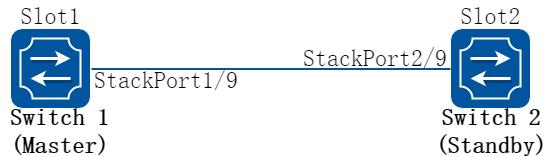
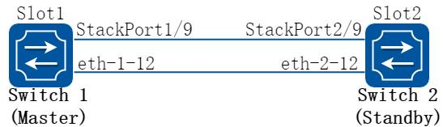
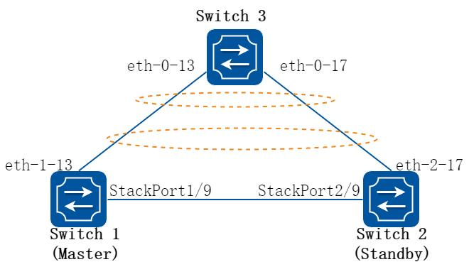

# 20 堆叠配置指导

## 20.1 Stacking 启动配置

### 20.1.1 概述

#### 简介

Stacking 即堆叠是指将多台交换机设备组合在一起，虚拟化成一台交换设备，从而实现网络高可靠性和网络大数据量转发，同时简化网络管理。在堆叠中，有以下一些基本概念。

角色堆叠中的单台交换机称为成员交换机，按照功能不同可以分为以下角色：

主交换机：负责管理整个堆叠，堆叠中只有一台主交换机。

备交换机：是主交换机的备份交换机。当主交换机故障时，备交换机会接替原主交换机的所有业务。堆叠中只有一台备交换机。

堆叠成员用来标识和管理成员交换机。堆叠中所有交换机的堆叠成员ID 都是唯一的。

堆叠优先级堆叠优先级是成员交换机的一个属性，主要用于角色选举过程中确定成员交换机的角色，优先级越大表示优先级越高，当选为主交换机的可能性越大。

堆叠物理成员端口堆叠物理成员端口，即被配置为堆叠模式的物理端口，用于堆叠成员交换机之间的连接。

堆叠端口堆叠端口是一种专用于堆叠的逻辑端口，需要和堆叠物理成员端口绑定。一个堆叠端口可以与一个或多个堆叠物理成员端口绑定，以提高链路的宽带和可靠性。每台设备支持两个堆叠端口。

### 20.1.2 配置举例

##### 1. 组网拓扑



**图20-1 Stacking map**

##### 2. 配置步骤

下面的例子描述了堆叠启动配置的过程，以两个交换机Switch1 和Switch2 组成堆叠系统为例。

以下配置如未说明在哪个Switch 配置，则表示所有Switch 配置相同：

##### 步骤1 进入配置模式

```
Switch# configure terminal
```

##### 步骤2 配置stacking 成员的slotid，重启生效

在Switch1 配置

```
Switch(config)# stack slot 1
% Configuration will not take effect until save configuration and system reload
```

在Switch2 配置

```
Switch(config)# stack slot 2
% Configuration will not take effect until save configuration and system reload
```

##### 步骤3 使能stacking，重启生效

```
Switch(config)# stack enable
% Configuration will not take effect until save configuration and system reload.
```

使能stack 或者去使能stack 后并重启，端口相关的配置将被清空。

##### 步骤4 配置本板的stacking 口

在Switch1 配置

```
Switch(config)# interface stack-0-1
Switch(config-if)# member-port eth-0-9
```

在Switch2 配置

```
Switch(config)# interface stack-0-1
Switch(config-if)# member-port eth-0-9
```

##### 步骤5 退出配置模式

```
Switch(config)# end
```

##### 步骤6 保存配置

```
Switch# write
```

##### 步骤7 重启

```
Switch# reload
```

配置好后如果此时需要指定Switch1 成为主交换机，在Switch1 和Switch2间的堆叠线缆已经连接好的情况下，用户可以先启动Switch1 ，待Switch1 启动完成后，再完成Switch2 的重启。此时，Switch2 以成员加入的流程加入堆叠系统，成为备交换机，而Switch1 则成为主交换机。

##### 步骤8 命令验证

```
Switch# show stack
SlotID Role
Board
SwVersion
MAC
State
Description
=========================================================================================
*+1
MASTER
VPX6896M16_V2 7.0.3.55
001E.0822.FC83
RUNNING
--
2
STANDBY VPX6896M16_V2 7.0.3.55
001E.0800.4574
RUNNING
--
-----------------------------------------------------------------------------------------
* indicates the device is the master.
+ indicates the device through which the user logs in.
The System MAC of the Stacking is: 001E.0822.FC83
Mac persistent
: yes
Domain ID
: --
```

主设备和备设备均处于RUNNING 状态，说明stacking 已经建立成功。

## 20.2 删除线卡配置

### 20.2.1 概述

#### 简介

Stacking 支持删除线卡功能。

删除指定slotid 线卡需要注意以下几点：

如果stacking 已经使能，则只能在master 上配置，如果stacking 未使能则不允许配置。

Slotid 必须存在且不能是自己的slotid 否则会返回错误。

删除线卡的同时会删除线卡对应已经创建的所有端口，如果线卡在线则会向该线卡发送消息使其重启。

### 20.2.2 配置举例

##### 步骤1 进入配置模式

```
Switch# configure terminal
```

##### 步骤2 删除线卡配置

```
Switch(config)# stack release slot 3
```

使用stack release slot 3 命令删除线卡后，如果堆叠口连线没有断开，slot 3 重启后仍会加入堆叠。如果堆叠系统需要恢复为单机环境，可以进行拆分堆叠操作。拆分堆叠首先需要去使能设备的堆叠功能，然后配置好每台设备的管理IP 并保存配置。拆除线缆后，手动重启即可拆分堆叠。启动之后的设备将保存stacking 系统下的非端口业务配置，端口相关的配置将被清空。

##### 步骤3 退出配置模式

```
Switch(config)# end
```

## 20.3 Stacking 双主检测配置

### 20.3.1 概述

#### 简介

双主检测DAD（Dual-Active Detect）是一种检测和处理堆叠分裂的协议，可以实现堆叠分裂的检测、冲突处理和故障恢复，降低堆叠分裂对业务的影响。当堆叠线缆或者设备发生故障时，可能导致交换机之间失去通信，堆叠系统分裂成多个堆叠系统。但堆叠分裂后，其全局配置完全相同，会以相同的IP 地址和MAC 地址（堆叠系统MAC）与网络中的其他设备交互，这样就导致IP 地址和MAC 地址冲突，引起整个网络故障，此时可以依靠堆叠的双主检测来避免堆叠分裂后出现双主。

### 20.3.2 配置举例

#### 配置直连方式双主检测

##### 1. 组网拓扑



**图20-2 Stacking map**

##### 2. 配置步骤

下面的例子描述了直连方式双主检测配置的过程，以两个交换机Switch1 和Switch2组成堆叠系统为例。

##### 步骤1 进入配置模式

```
Switch# configure terminal
```

##### 步骤2 配置堆叠域ID

```
Switch(config)# stack slot 1 domain 4
Switch(config)# stack slot 2 domain 4
```

##### 步骤3 配置端口为直连方式的双主检测

```
Switch(config)# interface eth-1-12
Switch(config-if)# no shutdown
Switch(config-if)# stack dual-active detect mode direct
Warning: The interface will block common data packets, except BPDU packets. Continue? [no]y
Switch(config)# interface eth-2-12
Switch(config-if)# no shutdown
Switch(config-if)# stack dual-active detect mode direct
Warning: The interface will block common data packets, except BPDU packets. Continue? [no]y
```

##### 步骤4 配置备板管理IP 地址

```
Switch(config)# stack dual-active backup ip address 12.1.1.2/24 slot 1
Switch(config)# stack dual-active backup ip address 12.1.1.2/24 slot 2
```

##### 步骤5 退出配置模式

```
Switch(config)# end
```

##### 步骤6 命令验证

```
Switch# show stack dual-active
Stack domainID: 4
Dual-active conflict state: No
Excluded Ports(configurable):
- $$
Excluded Ports(can not be configured):
eth-1-9
eth-2-9
Dual-active direct detect mode: Enable
Dual-active direct detect interfaces configured:
eth-1-12
up
(Physical) up
(Protocol) 4
(PeerDoamain)
eth-2-12
up
(Physical) up
(Protocol) 4
(PeerDoamain)
Dual-active lacp detect mode: Disable
```

#### 配置lacp 方式双主检测

##### 1. 组网拓扑



**图20-3 Stacking map**

##### 2. 配置步骤

下面的例子描述了lacp 方式双主检测配置的过程，以两个交换机Switch1 和Switch2组成堆叠系统为例。

##### 步骤1 进入配置模式

```
Switch# configure terminal
```

##### 步骤2 配置堆叠域ID

```
Switch(config)# stack slot 1 domain 4
Switch(config)# stack slot 2 domain 4
```

##### 步骤3 配置端口为lacp 方式的双主检测

```
Switch3(config)# interface eth-0-13
Switch3(config-if)# no shutdown
Switch3(config-if)# channel-group 1 mode active
Switch3(config-if)# interface eth-0-17
Switch3(config-if)# no shutdown
Switch3(config-if)# channel-group 1 mode active
Switch(config)# interface eth-1-13
Switch(config-if)# no shutdown
Switch(config-if)# channel-group 1 mode active
Switch(config-if)# interface eth-2-17
Switch(config-if)# no shutdown
Switch(config-if)# channel-group 1 mode active
Switch(config-if)# interface agg1
Switch(config-if)# stack dual-active detect mode lacp
```

##### 步骤4 配置备板管理IP 地址

```
Switch(config)# stack dual-active backup ip address 12.1.1.2/24 slot 1
Switch(config)# stack dual-active backup ip address 12.1.1.2/24 slot 2
```

##### 步骤5 退出配置模式

```
Switch(config)# end
```

##### 步骤6 命令验证

```
Switch# show stack dual-active
Stack domainID: 4
Dual-active conflict state: No
Excluded Ports(configurable):
- $$
Excluded Ports(can not be configured):
eth-1-9
eth-2-9
Dual-active direct detect mode: Disable
Dual-active lacp detect mode: Enable
Dual-active lacp detect interfaces configured:
agg1
Dual-active protocol status: up
eth-1-13
up
(Physical) up
(Protocol) 4
(PeerDoamain)
eth-2-17
up
(Physical) up
(Protocol) 4
(PeerDoamain)
```

如果当前堆叠系统上还没有配置业务，可以通过人为制造堆叠分裂来验证双主检测功能是否配置成功。在堆叠系统已有其他业务运行的情况下请勿进行此验证操作，否则会影响正在运行的业务。如果switch 3 也是一台堆叠设备的话，switch 3 的domain id 必须与switch 1 和switch 2 组成的堆叠的domain id 不一样，否则lacp mad 无法正常工作。
